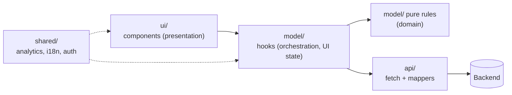
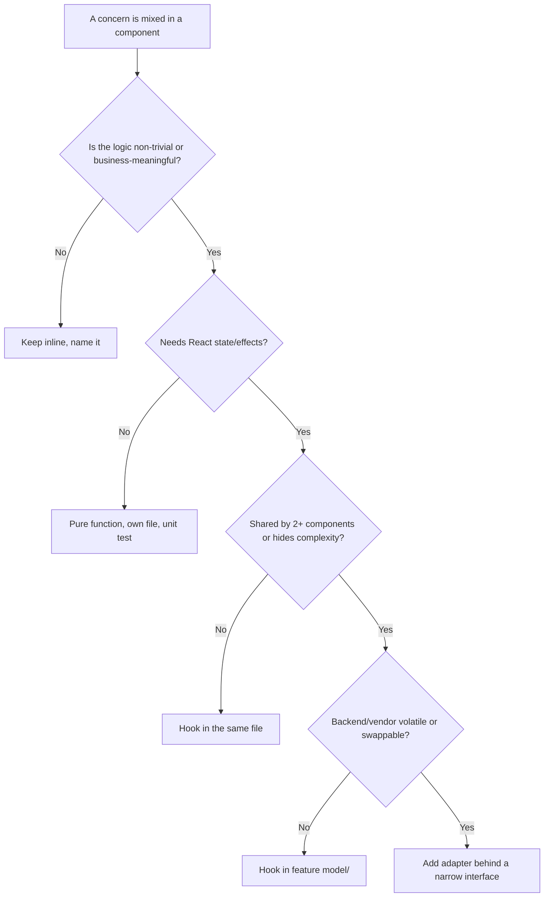

# 04 / 02 — Separation of Concerns in React: What to Separate, and How Far

## 1. Lesson metadata

| | |
|---|---|
| **Level** | Intermediate |
| **Study time** | 4–5 hours (reading 2 h, refactoring lab 1.5 h, exercises 1.5 h) |
| **Prerequisites** | [04 / 01 — Architecture fundamentals](./01-architecture-fundamentals.md), [Phase 1 / 12 — Component purity](../01-react-fundamentals/12-component-purity.md), [Phase 1 / 03 — UI as a function of state](../01-react-fundamentals/03-ui-as-a-function-of-state.md), [Phase 1 / 10 — Event handling](../01-react-fundamentals/10-event-handling.md) |
| **Next** | [03 — Component responsibility](./03-component-responsibility.md) |
| **Related later** | [12 — Domain logic vs UI logic](./12-domain-logic-vs-ui-logic.md), [14 — API boundaries and data access](./14-api-boundaries-and-data-access.md), [Phase 5 / 06 — Custom hook patterns](../05-design-patterns/06-custom-hook-patterns.md) |

**Learning objectives.** After this lesson you can:
1. State the definition of *concern* precisely (a reason to change) and distinguish it from "technology" (HTML/CSS/JS) separation.
2. Enumerate the concerns that routinely coexist in a React component: presentation, interaction, state, data access, domain rules, side effects, navigation, cross-cutting (auth, i18n, analytics).
3. Separate those concerns using four techniques (extraction to functions, custom hooks, modules/layers, composition), and know the cost of each.
4. Recognise over-separation (the "enterprise" failure mode) and under-separation (the "god component").
5. Choose the amount of separation justified by volatility, reuse, and testability.
6. Refactor a mixed component into separated concerns while keeping behaviour identical.

**Concepts covered:** concern, single reason to change, cross-cutting concerns, technology-based vs responsibility-based separation, seams, pure core / effectful shell, extraction hierarchy (inline → function → hook → module → layer), indirection cost, locality of behaviour, "ports" (preview), approach dossiers for four separation strategies.

---

## 2. Deep conceptual explanation

### 2.1 What problem is this lesson solving?

Consider a real-world `OrderPage` component that, in 400 lines: fetches an order; maps API field names; calculates totals with tax rules; holds form state; validates; formats currency; shows a modal; reads the URL; tracks analytics; and renders 120 lines of JSX. To change the tax rule you must read all 400 lines. To test the tax rule you must render the whole page with a mocked network. To reuse the "order summary" you must copy-paste. The component has **many reasons to change**, and each change risks the others.

*Separation of concerns* (SoC) is the principle that these different things should live in different places so that each can change, be understood, and be tested **independently**. The term is attributed to Edsger Dijkstra (1974); the modern working version is Robert C. Martin's Single Responsibility Principle phrased as "a module should have one, and only one, reason to change" (and in later wording: be responsible to one actor). We use the *reason to change* formulation because it is testable: ask "who would ask me to change this code, and why?".

### 2.2 What is a "concern"?

A concern is **a distinct reason to change**, or equivalently **a distinct kind of knowledge** the code has to have. It is not a technology.

Early web teaching separated *technologies*: HTML (structure), CSS (style), JS (behaviour). React's famous design stance, expressed in its documentation and original introductory talks, is that **UI logic and markup are inherently coupled** (what to render depends on state), so React colocates them in components and separates by *unit of UI* rather than by *technology*. This is not a violation of SoC; it is a choice of *which axis* to separate along. The axis of separation matters more than the amount.

The concerns that coexist in React code:

| Concern | Knowledge it holds | Typical reason to change | Natural home |
|---|---|---|---|
| **Presentation** | How data looks: markup, classes, layout, a11y attributes | Design changes | Component JSX, CSS |
| **Interaction** | What a click/keystroke means; focus; keyboard | UX changes | Event handlers, behaviour hooks |
| **Local UI state** | Open/closed, selected tab, draft text | UX changes | `useState`/`useReducer` in a component |
| **Server data access** | URLs, auth headers, request/response shape, caching, retries | Backend contract changes | `api/` module, query hooks |
| **Mapping / anti-corruption** | Translating wire format ↔ app model | Backend contract changes | `api/` mappers |
| **Domain rules** | Business calculations, invariants (tax, eligibility, state transitions) | Business policy changes | Pure functions in `model/` or `domain/` |
| **Orchestration** | The sequence of steps for a use case (validate → submit → navigate → notify) | Process changes | Hooks / application services |
| **Side effects** | Subscriptions, timers, storage, DOM integration | Platform needs | Effects, adapters |
| **Navigation / URL** | Route params, search params, redirects | Information architecture | Router hooks at boundary |
| **Cross-cutting** | Auth, i18n, analytics, error reporting, feature flags | Policy/product | Providers, wrappers, one module each |

### 2.3 Why not separate everything always?

Because **separation has a price: indirection**. Each seam adds a name to learn, a file to open, and a place for a mismatch to occur. SoC is justified when the concerns *change at different rates, for different reasons, or at different times*, or when separating them enables something you need (testing, reuse, parallel work). It is waste when two things always change together. Such things are *one concern* even if they involve two technologies.

Heuristic: **separate things that change independently; keep together things that change together** ("locality of behaviour" and high cohesion from [lesson 01](./01-architecture-fundamentals.md) §2.4).

### 2.4 Pure core, effectful shell

The single most useful organising idea for React SoC is a layering of *purity*:

- **Pure core**: functions of plain data → plain data. Domain rules, mappers, validators, formatters, reducers. No React, no network, no time, no randomness (or time/randomness passed in).
- **Effectful shell**: components, hooks, API clients, effects. Anything that reads or changes the outside world or React state.

The shell calls the core; the core never calls the shell. Consequences: the core is unit-testable in microseconds with plain assertions; the shell can be thin and tested with fewer, broader tests. This aligns with React's own purity rule ([Phase 1 / 12](../01-react-fundamentals/12-component-purity.md)): render is a pure function of props and state, and everything else belongs in event handlers and effects.

### 2.5 The extraction hierarchy

When you spot a concern mixed into a component, you choose *how far to move it*. Move it only as far as justified:

| Rung | Mechanism | Cost | Use when |
|---|---|---|---|
| 0 | Leave inline, but name it (a well-named local `const`) | None | Used once, trivial |
| 1 | Extract a **pure function** in the same file | Very low | Logic is nontrivial but local |
| 2 | Move the pure function to its own file and test it | Low | Rule is business-meaningful or reused |
| 3 | Extract a **custom hook** | Low–medium | Logic needs state/effects, or hides complexity from JSX |
| 4 | Extract a **module** with a public API (feature `model/`, `api/`) | Medium | Multiple components share it; contract matters |
| 5 | Introduce a **layer/port + adapter** | High | Need to swap implementations or isolate a volatile dependency |

Most real code should live on rungs 1–3. Rung 5 is justified by specific forces, not by default ([lesson 10](./10-clean-and-hexagonal-architecture.md), [11](./11-dependency-inversion.md)).

### 2.6 Common misconceptions

| Misconception | Reality |
|---|---|
| "SoC means separate files for JSX, logic, and CSS." | That is *technology* separation. A component's JSX and its logic usually change together; separating them into `Foo.view.tsx` / `Foo.logic.ts` can *increase* coupling (they share an unwritten prop contract). |
| "Custom hooks are how you separate concerns." | A hook that merely moves 80 lines out of a component has relocated, not separated, concerns. A hook is separation only if it presents a *narrow interface* around one concern. |
| "Business logic must not be in components, ever." | Rules should be *callable without React*. Calling them from a component is fine. The question is whether the rule *lives* in the component's body and cannot be reached without rendering. |
| "Fewer lines per component = better separation." | Size is a proxy, not the target. 40 lines containing four concerns is worse than 150 lines of one concern (a long, flat presentational list). |
| "Redux/global state is the separation of state from UI." | It separates *location*, not *concern*; if the store's slices mirror component structure and every action is `setX`, concerns are still mixed. |
| "Layers are free if folders are cheap." | The cost is cognitive: following a feature across layers. See [lesson 06](./06-feature-vs-layer-structure.md). |

---

## 3. Internal mechanics

### 3.1 Why React needs a rule about hooks to make SoC possible

*Public guarantee.* Hooks must be called unconditionally, in the same order on every render of a given component, from components or other hooks ([Rules of Hooks, react.dev](https://react.dev/reference/rules/rules-of-hooks)). *Teaching model.* React associates hook calls with a component's instance (conceptually, a per-component list of slots). Therefore a custom hook is *not* a separate "object" with its own lifecycle; it is **inlined into the calling component's hook list**. This has architectural implications:

1. **A custom hook has no identity of its own.** Two components calling `useCart()` each get their *own* state, unless the hook reads shared state (context, an external store, a query cache). Extracting state into a hook does not share it ([Phase 1 / 16](../01-react-fundamentals/16-state-preservation-and-reset.md)).
2. **Hooks do not cause isolation of re-renders.** If `useOrderPage()` returns 12 values from 6 `useState` calls and the page component uses them, an update to any state re-renders the component that called the hook, and thus everything below it unless memoised. Extracting a hook does not change render scope ([Phase 7 / 03](../07-performance/03-why-components-rerender.md)).
3. **The hook's dependencies are the component's runtime dependencies.** A hook that reads context makes the host component a context consumer. This is how "innocent extraction" can hide runtime coupling.

⚠ *Implementation detail:* the internal representation of hook state (a linked list of hook objects on the fiber, conceptually) may differ between versions; rely only on the documented rules.

### 3.2 Seams and where they can be placed

A **seam** is a place where behaviour can be changed without editing the code at that place (term from Michael Feathers' work on legacy code). In React, seams are:

| Seam | How you vary behaviour | Used for |
|---|---|---|
| **Props** | Pass different data/callbacks | Component tests, Storybook, reuse |
| **Children / slots** | Pass different JSX | Layout components, composition |
| **Context providers** | Provide a different value | Testing with fakes, theming, DI |
| **Module imports** | Mock/alias the module in tests | Network, time (via `vi.mock` / MSW) |
| **Function arguments** | Pass `fetchOrders` as a parameter | Pure core and application services |

SoC is the act of **creating seams between concerns** so that you can replace one side. The most robust seams are *props and function arguments* (visible, typed, no magic). Module mocking is the weakest (hidden, order-dependent).

### 3.3 Cost model of an extra layer

Each seam costs roughly: one more name; one more file; one more indirection when debugging (stack traces are longer, "go to definition" chains); one more place where types must be kept in sync. Benefits come only if one of the following is true: (a) the code behind the seam changes independently; (b) you can test one side without the other; (c) two consumers share one side. If none is true now and none is forecast, the seam is speculative.

---

## 4. Step-by-step walkthrough: separating a mixed component

We refactor the component in §5.3 in five measured steps, stopping at each rung to ask whether the next is justified.

1. **Identify concerns by reading for "reasons to change".** Highlight: wire format mapping (backend), `calcTotals` (finance rules), `useState` for coupon draft (UX), `fetch` (data access), `track` (analytics), JSX (design).
2. **Extract pure rules (rung 2).** `calcTotals(lines, coupon): Totals` and `applyCoupon`. Write unit tests now: they run without React. *Behaviour is unchanged* because the component calls the new function.
3. **Extract the data access + mapping (rung 4 for api).** `api/getOrder.ts` returns `Order` (app model), hiding wire format.
4. **Extract orchestration into a hook (rung 3).** `useOrderPage(orderId)` coordinates fetching, coupon state, and submit; exposes a *narrow* `{ order, totals, status, applyCoupon }`.
5. **Leave presentation as components that take props.** `OrderSummary({ totals })` is a pure view. Stop; do *not* add repository classes or a DI container.

Timeline of a coupon apply after refactor:
1. User types in coupon input → `OrderPage` local state updates (UI concern).
2. Click Apply → handler calls `applyCoupon(code)` from the hook (interaction → orchestration).
3. Hook calls pure `applyCoupon(order, code)` rule → returns new totals or a typed error (domain).
4. Hook stores result; `track("coupon_applied")` called from the hook (cross-cutting) — not from the rule.
5. Render: `OrderSummary` receives `totals` (presentation).

Behavioural equivalence check: before/after, run the same user flow and assert the same rendered text and same network calls (a characterisation test; see [Phase 8 / 08](../08-testing-and-quality/08-integration-testing.md)).

---

## 5. Code examples

### 5.1 Minimal example — separate a rule from a component

```tsx
// Before: rule is in render
function Price({ cents, taxRate }: { cents: number; taxRate: number }) {
  const total = Math.round(cents * (1 + taxRate));
  return <span>{(total / 100).toFixed(2)}</span>;
}
```

```tsx
// After: rule is a pure function, component only presents
// model/pricing.ts
export const withTax = (cents: number, taxRate: number): number =>
  Math.round(cents * (1 + taxRate));

// ui/Price.tsx
import { withTax } from "../model/pricing";
export function Price({ cents, taxRate }: { cents: number; taxRate: number }) {
  return <span>{(withTax(cents, taxRate) / 100).toFixed(2)}</span>;
}
```

**Predict:** is the "after" version worth it for this one-liner? *Answer:* Only if `withTax` is reused or the rule is likely to change (rounding policy, tax-inclusive countries). For a single-use trivial computation, rung 0/1 (keep it inline) is correct. Overzealous extraction here is the "enterprise" smell. (Also note: money as floating `toFixed` is a simplification; see [lesson 12](./12-domain-logic-vs-ui-logic.md) for money modelling.)

### 5.2 Practical example — a mixed `OrderPage`, then separated

First, the mixed version (kept compact; real ones are longer).

```tsx
// OrderPage.tsx — MIXED
import { useEffect, useState } from "react";

type ApiOrder = { id: string; line_items: { sku: string; unit_price: number; qty: number }[]; coupon?: string };

export function OrderPage({ orderId }: { orderId: string }) {
  const [order, setOrder] = useState<ApiOrder | null>(null);
  const [coupon, setCoupon] = useState("");
  const [error, setError] = useState<string | null>(null);

  useEffect(() => {
    fetch(`/api/orders/${orderId}`)
      .then((r) => r.json())
      .then(setOrder)
      .catch(() => setError("Failed"));
  }, [orderId]);

  if (error) return <p>{error}</p>;
  if (!order) return <p>Loading…</p>;

  const subtotal = order.line_items.reduce((s, l) => s + l.unit_price * l.qty, 0);
  const discount = coupon === "SAVE10" ? subtotal * 0.1 : 0;
  const tax = (subtotal - discount) * 0.2;
  const total = subtotal - discount + tax;

  return (
    <div>
      {order.line_items.map((l) => (
        <div key={l.sku}>{l.sku} × {l.qty}: £{(l.unit_price * l.qty / 100).toFixed(2)}</div>
      ))}
      <input value={coupon} onChange={(e) => setCoupon(e.target.value)} />
      <p>Total: £{(total / 100).toFixed(2)}</p>
    </div>
  );
}
```

Concerns mixed: wire types (`line_items`, snake case), fetch + error handling (and no cancellation or race handling; see [Phase 6 / 02](../06-data-fetching-and-state-ecosystems/02-cancellation-and-race-conditions.md)), coupon rule, tax rule, rendering.

Separated version:

```ts
// features/order/model/types.ts
export interface Line { sku: string; unitPriceMinor: number; qty: number }
export interface Order { id: string; lines: readonly Line[] }
export interface Totals { subtotal: number; discount: number; tax: number; total: number } // minor units

// features/order/model/pricing.ts  (pure core: no React, no fetch)
import type { Line, Totals } from "./types";

const TAX_RATE = 0.2;
const COUPONS: Record<string, number> = { SAVE10: 0.1 };

export function calcTotals(lines: readonly Line[], couponCode: string): Totals {
  const subtotal = lines.reduce((s, l) => s + l.unitPriceMinor * l.qty, 0);
  const rate = COUPONS[couponCode.trim().toUpperCase()] ?? 0;
  const discount = Math.round(subtotal * rate);
  const tax = Math.round((subtotal - discount) * TAX_RATE);
  return { subtotal, discount, tax, total: subtotal - discount + tax };
}
```

```ts
// features/order/api/getOrder.ts  (data access + anti-corruption mapping)
import type { Order } from "../model/types";

interface ApiOrder { id: string; line_items: { sku: string; unit_price: number; qty: number }[] }

export async function getOrder(orderId: string, signal?: AbortSignal): Promise<Order> {
  const res = await fetch(`/api/orders/${encodeURIComponent(orderId)}`, { signal });
  if (!res.ok) throw new Error(`getOrder failed: ${res.status}`);
  const raw = (await res.json()) as ApiOrder;
  return {
    id: raw.id,
    lines: raw.line_items.map((l) => ({ sku: l.sku, unitPriceMinor: l.unit_price, qty: l.qty })),
  };
}
```

```tsx
// features/order/model/useOrderPage.ts  (orchestration: state + effect + calls into core)
import { useEffect, useMemo, useState } from "react";
import { getOrder } from "../api/getOrder";
import { calcTotals } from "./pricing";
import type { Order } from "./types";

type State =
  | { status: "loading" }
  | { status: "error"; message: string }
  | { status: "ready"; order: Order };

export function useOrderPage(orderId: string) {
  const [state, setState] = useState<State>({ status: "loading" });
  const [coupon, setCoupon] = useState("");

  useEffect(() => {
    const ctrl = new AbortController();
    setState({ status: "loading" });
    getOrder(orderId, ctrl.signal)
      .then((order) => setState({ status: "ready", order }))
      .catch((e: unknown) => {
        if (ctrl.signal.aborted) return;
        setState({ status: "error", message: e instanceof Error ? e.message : "Unknown error" });
      });
    return () => ctrl.abort();
  }, [orderId]);

  const totals = useMemo(
    () => (state.status === "ready" ? calcTotals(state.order.lines, coupon) : null),
    [state, coupon],
  );

  return { state, totals, coupon, setCoupon };
}
```

```tsx
// features/order/ui/OrderPage.tsx  (presentation)
import { useOrderPage } from "../model/useOrderPage";
import { OrderSummary } from "./OrderSummary";

export function OrderPage({ orderId }: { orderId: string }) {
  const { state, totals, coupon, setCoupon } = useOrderPage(orderId);
  if (state.status === "loading") return <p>Loading…</p>;
  if (state.status === "error") return <p role="alert">{state.message}</p>;
  return (
    <OrderSummary lines={state.order.lines} totals={totals!} coupon={coupon} onCouponChange={setCoupon} />
  );
}
```

Line notes:
- `calcTotals` takes `readonly Line[]`; domain rules cannot mutate input.
- `getOrder` accepts an `AbortSignal`: the effect's cleanup aborts the request, and in StrictMode dev (effects run, clean up and run again) the first request is aborted deterministically ([Phase 2 / 12](../02-react-rendering-and-internals/12-why-rendering-must-be-pure.md)). `if (ctrl.signal.aborted) return;` prevents setting error state for the aborted request.
- `useMemo` is an optimisation, not a correctness tool: removing it must not change behaviour. `calcTotals` is cheap; it is memoised here only to keep `totals` referentially stable for children. Honest note: you could drop `useMemo` entirely.
- `totals!` is a deliberate shortcut: `totals` is non-null iff `status === "ready"`. A stricter model returns a discriminated union containing `totals` inside the `ready` variant, which removes the assertion; try it as an exercise.
- The hook returns a **narrow** object. The component does not know about `AbortController`, mapping, or the coupon table.

**Trade-offs.** The separated version is ~4 files instead of 1. Justified if pricing rules are business-critical and change; unjustified for a prototype. In production you would likely replace the hand-written fetch effect with a server-state library ([Phase 6 / 08](../06-data-fetching-and-state-ecosystems/08-tanstack-query.md)); the *separation* still holds, with `getOrder` becoming the query function.

### 5.3 Incorrect example — fake separation

```tsx
// useOrderPageEverything.ts
export function useOrderPageEverything(orderId: string) {
  // 150 lines: fetch, mapping, totals, coupon state, toast, navigation, analytics
  return { /* 25 values */ };
}
// OrderPage.tsx
export function OrderPage({ orderId }: { orderId: string }) {
  const everything = useOrderPageEverything(orderId);
  return <div>{/* 120 lines of JSX using everything.* */}</div>;
}
```

**Why wrong.** Concerns were *moved*, not separated: the hook has a dozen reasons to change; the component depends on a 25-member bag; testing the pricing rule still requires mounting hook + network; every consumer of the bag is coupled to all of it. This is the most common pseudo-SoC in React codebases ("hook as junk drawer").

### 5.4 Corrected — narrow interfaces, composed hooks

```ts
// Compose small hooks; each has one reason to change.
function useOrderData(orderId: string) { /* fetch + map; returns state */ }
function useCouponDraft() { /* coupon string + setter */ }
// pure: calcTotals(lines, coupon)

function useOrderPage(orderId: string) {
  const data = useOrderData(orderId);
  const coupon = useCouponDraft();
  const totals = data.status === "ready" ? calcTotals(data.order.lines, coupon.value) : null;
  return { data, totals, coupon };
}
```

Each lower hook can be tested, replaced, or reused (`useCouponDraft` on the checkout page) independently.

### 5.5 Advanced example — cross-cutting concerns via composition, not inline calls

Analytics calls sprinkled inline in handlers couple every feature to the analytics API and make tests assert on tracking calls. Provide an interface via context and keep features independent of the vendor:

```tsx
// shared/analytics/AnalyticsContext.tsx
import { createContext, use, type ReactNode } from "react";

export interface Analytics { track(event: string, props?: Record<string, unknown>): void }
const noop: Analytics = { track() {} };
const AnalyticsContext = createContext<Analytics>(noop);

export const AnalyticsProvider = ({ value, children }: { value: Analytics; children: ReactNode }) => (
  <AnalyticsContext value={value}>{children}</AnalyticsContext>
);
export const useAnalytics = () => use(AnalyticsContext);
```

Notes:
- *Version-sensitive:* in React 19, a context object can be rendered directly as a provider (`<AnalyticsContext value=…>`) and `use(Context)` can read context; `<Context.Provider>` and `useContext` still work. Verify against your installed version.
- A **default `noop` value** means components work in tests and Storybook without a provider: a seam with zero setup cost.
- Cost: context re-renders all consumers when `value` changes. Provide a **stable** object (created once at the composition root). See [Phase 7 / 06](../07-performance/06-context-propagation-cost.md).

---

## 6. Visual explanations

### Concerns as lanes inside one feature



Solid arrows are dependencies that point *inward toward purity*: `ui → model → domain`. `api` is a leaf that talks to the outside world. The dotted arrows show cross-cutting modules imported by many; they must be small and stable.

### Decision: how far to extract



---

## 7. Alternative approaches and trade-offs (dossiers)

Four strategies for organising concerns within a feature.

### 7.1 Dossier A — Colocated / "fat component"

- **Original problem solved.** React's founding insight: markup and the logic that drives it change together; separating them into templates and controllers (as in older MVC frameworks) made coupling implicit. Colocation maximises locality.
- **Representative structure.** `OrderPage.tsx` containing state, effects, handlers, JSX; maybe a few pure helpers at the bottom of the file.
- **Dependency rules.** None between concerns; the component may import anything below it. Typical mitigation: pure helpers in the same file must not use React.
- **Example code.** The §5.2 mixed version.
- **Advantages.** Everything visible at once; trivial navigation; no premature abstraction; fastest to write; excellent for prototypes and leaf components.
- **Disadvantages.** Poor testability of rules; rules unreachable without rendering; mixed volatility; merge conflicts on big files; hard to review.
- **Appropriate sizes.** Components < ~150 lines with one rule; solo/pair; prototypes; leaf UI.
- **Failure modes.** Growth by accretion to 800 lines; `useEffect` chains; duplicated rules in sibling components; tests that mock the network for each pricing assertion.
- **Migration.** Extract pure rules first (low risk, tests pin behaviour), then data access, then orchestration hook. Rung 1 → 2 → 3 → 4.

### 7.2 Dossier B — Hook extraction ("logic hooks")

- **Original problem solved.** Before hooks, shared stateful logic required HOCs/render props with wrapper hell ([Phase 5 / 09–10](../05-design-patterns/09-higher-order-components.md)). Hooks (React 16.8) made stateful logic reusable and composable without altering the component tree.
- **Representative structure.** `OrderPage.tsx` + `useOrderPage.ts` (+ small hooks `useCouponDraft.ts`).
- **Dependency rules.** Component imports hook; hook never imports components; hooks may import pure rules and API modules; hooks do not call other features' hooks except via public APIs.
- **Example.** §5.2 `useOrderPage`.
- **Advantages.** Component becomes a view; orchestration testable with `renderHook`; hooks compose; low ceremony.
- **Disadvantages.** Easy to produce pseudo-separation (§5.3); hooks hide dependencies on context (runtime coupling); a hook with a 25-value return is a god object; hook tests still need React and often providers.
- **Appropriate sizes.** All sizes; the default move beyond rung 2.
- **Failure modes.** Junk-drawer hooks; hooks calling hooks calling hooks (5-level chains hard to debug); duplicate state when two components each call the same hook expecting sharing.
- **Migration.** From fat component: extract and keep the component's output identical. To layers: move the hook's data calls into `api/` and rules into `domain/` when they stabilise.

### 7.3 Dossier C — Module layering within a feature (`ui / model / api / domain`)

- **Original problem solved.** At scale, concerns need *rules about what depends on what*, not just extraction. Layers provide predictable places and direction (as in classic layered architecture).
- **Representative structure.**
  ```text
  features/order/
    ui/        OrderPage.tsx  OrderSummary.tsx
    model/     useOrderPage.ts  pricing.ts  types.ts
    api/       getOrder.ts  mappers.ts
    index.ts
  ```
- **Dependency rules.** `ui → model → (domain pure) ; model → api ; api → shared/http`. `domain` imports nothing but types. `api` does not import `ui`/`model`.
- **Example.** §5.2 as organised above.
- **Advantages.** Predictable navigation; domain rules free of React *by construction* (lint-able); API contract changes confined to `api/`; reviewers know where to look.
- **Disadvantages.** More files; ceremony for small features; teams invent inconsistent sub-conventions; risk of anaemic layers (a `model/` that only re-exports `api/`).
- **Appropriate sizes.** 4+ developers on the product; features with real rules or volatile backends; long-lived.
- **Failure modes.** Layer skipping (`ui` importing `api` directly "just this once"); god `types.ts`; mirrored folders in each feature with empty content (cargo cult).
- **Migration.** Introduce lazily: create `api/` and `model/` only when a feature has something to put there. Add a lint rule for direction once two features follow the convention.

### 7.4 Dossier D — Ports and adapters at the edges (preview)

- **Original problem solved.** Isolate volatile external dependencies (backends, SDKs, storage) behind interfaces the app owns, so UI/rules are testable without them and the dependency can be swapped. Detailed in [lessons 10, 11, 13](./10-clean-and-hexagonal-architecture.md).
- **Representative structure.**
  ```text
  features/order/
    domain/    pricing.ts  ports.ts   (interface OrderRepository { get(id): Promise<Order> })
    adapters/  httpOrderRepository.ts  fakeOrderRepository.ts
    ui/ model/
  app/ composition root chooses adapters
  ```
- **Dependency rules.** Everything depends on `domain` (ports); adapters depend on domain; domain depends on nothing. Wiring only at `app/`.
- **Example.**
  ```ts
  export interface OrderRepository { get(id: string, signal?: AbortSignal): Promise<Order> }
  // useOrderPage(repo: OrderRepository, id) — repo passed in via context at the composition root
  ```
- **Advantages.** Maximum testability and swap-ability; clear contract for backend teams; supports multiple data sources (REST + offline cache + mocks).
- **Disadvantages.** Heavy ceremony for CRUD apps; duplicates what server-state libraries already provide (cache, retries); learning curve; easy to over-abstract to a "repository" that mirrors REST 1:1 with no value.
- **Appropriate sizes.** Complex domains, multiple data sources, long-lived apps, or when the backend contract is genuinely unstable/parallel-developed; otherwise skip.
- **Failure modes.** Abstractions that leak (ports shaped like HTTP); adapters with logic; DI container complexity; interfaces with one implementation forever.
- **Migration.** Start from Dossier C; introduce a port only when a second implementation (fake for tests/offline) is needed or the dependency churns. Convert `getOrder` into an implementation of the port, leave callers unchanged by passing it through a hook parameter.

### 7.5 Comparison

| Criterion | A: Fat component | B: Hooks | C: Layers in feature | D: Ports/adapters |
|---|---|---|---|---|
| Readability (small) | Excellent | Good | Fair | Poor |
| Readability (large) | Poor | Good | Good | Good (if disciplined) |
| Rule testability | Poor | Fair | Excellent | Excellent |
| Complexity cost | None | Low | Medium | High |
| Change locality | Good (until big) | Good | Very good | Very good |
| Onboarding cost | Lowest | Low | Medium | Highest |
| Fits CRUD admin | Yes | Yes | Often over-built | No |
| Fits complex domain | No | Partly | Yes | Yes |

**A scenario where the usually recommended approach (layering/extraction) is *not* best.** A marketing landing page with 6 sections, each a self-contained component with static content and a tiny form. Extracting `useHeroSection`, `model/`, and `api/` per section triples the file count with no reuse, no rule, no volatility. Fat components, perhaps with one shared `useNewsletterSignup` hook, are the right answer. Applying C or D here is a classic "enterprise" over-engineering failure.

---

## 8. Best practices and anti-patterns

**Do**
- Ask "who asks for this to change?" for each block of code. Different answers → separate.
- Keep **domain rules as pure functions** callable without React.
- Give every extracted unit a **narrow, intention-revealing interface**: `useOrderTotals(lines, coupon)` beats `useOrder()` returning 25 members.
- Keep **mapping at the boundary**: wire format never leaks past `api/`.
- Keep **cross-cutting concerns** (auth, i18n, analytics, flags) behind one small module each; consume via hooks/context with safe defaults.
- Prefer **passing data/callbacks as props** (the most visible seam) over reading globals.
- Test each concern at its natural level: rules (unit), orchestration (hook/integration), presentation (component + a11y queries).

**Beginner mistakes**
- Technology separation: `Component.jsx`, `Component.logic.js`, `Component.styles.js` as default structure.
- Fetching inside leaf components in a list (N requests) because "each component is self-contained".
- Business constants (tax rate) inline in JSX.

**Experienced-developer mistakes**
- Services/repositories/use-case classes for every operation (backend patterns transplanted).
- Hooks that return handlers/state for the *entire* page, producing a pseudo-class.
- A context per concern leading to provider pyramids and runtime coupling.
- Premature adapters for dependencies that will never be swapped.

**Smells:** a component importing both `fetch`/`axios` and a DOM-formatting library and a validation rule; hooks > 100 lines; a function containing `await` and an `if (taxRegion === ...)`; tests that mock 5 modules; `useEffect` that sets state computed from props (derive during render instead, [Phase 3](../03-react-state-and-hooks/01-usestate-internals-and-update-semantics.md)).

**Justified exceptions.** One-off screens, spikes, and leaf components keep concerns colocated; trivial rules that cannot plausibly change (e.g. `items.length === 0`) stay inline; temporary duplication across features can be preferable to a premature shared abstraction.

---

## 9. Real-world application

*E-commerce checkout.* Concerns: payment provider SDK (volatile, vendor-driven), shipping rules (policy), form validation (UX + policy), analytics (marketing), and a11y. Separation: provider SDK wrapped in a small adapter so the UI is tested with a fake; shipping/tax in pure functions with table-driven tests; form state local; analytics via context with noop default. Constraint: PCI scope reduction, so card fields are provider-hosted and must *never* pass through your state or logs, a *security concern* separated physically (iframe/hosted fields) rather than by convention.

*Finance dashboard.* Rounding, currency conversion, and P&L formulas are domain rules; mixing them into chart components results in discrepancies between charts and tables. Separate into a pure `domain/` module with tests that encode accountants' examples; components receive already-computed series. Real-time updates arrive via a subscription adapter; UI subscribes via selectors.

*Auth.* Concerns: token storage/refresh (infrastructure), session state (app state), route guarding (navigation), permission checks (domain). Keep tokens out of React state when possible (cookie-based sessions handled by the browser are often safer; verify against your threat model), make `can()` pure, and guard in the router layer ([lesson 18](./18-routing-architecture.md)).

*Forms.* Distinguish field state (UX), validation rules (domain: reusable between client and server), submission orchestration (Actions, [Phase 3](../03-react-state-and-hooks/01-usestate-internals-and-update-semantics.md)), and error display. Sharing a schema between client and server prevents drift; separating schema from UI makes rule changes safe.

*Realtime.* Transport (socket lifecycle, reconnect), message parsing/mapping, state reducer for applying events, and rendering. Separate the **reducer** (pure, testable with event sequences) from the transport (effectful) so that "message ordering" bugs can be reproduced in unit tests.

---

## 10. Debugging and troubleshooting

**Symptom: "A tiny change to pricing broke the shipping banner."**
1. Reproduce and locate: React DevTools → select the shipping banner → check *props/hooks* to see where the data came from.
2. Find the shared mutable source: a hook or module-level variable used by both. Search for module-scope `let` or mutated objects.
3. Root cause examples: a rule mutated its input array (`lines.sort()`), a shared mutable config object, or one hook doing two jobs with a shared state.
4. Fix: make rules pure/immutable (`toSorted`, copies) and split the hook. `Array.prototype.toSorted` requires a recent runtime; check your support targets.
5. Validate: add a unit test that freezes the input (`Object.freeze`) and asserts no mutation; run it against the old and new code.

**Symptom: Test for a hook is flaky/slow because it needs the network.** Look at the hook's imports: if it imports `fetch`/`axios` directly there is no seam. Introduce a parameter or provider seam; or use MSW at the network level (Phase 8 / 06) for integration-level tests while keeping rule tests network-free.

**Symptom: Extracting a hook "made the page slower".** Profile before/after (Profiler flamegraph, "why did this render"). Common cause: the extracted hook returns a new object each render, breaking memoised children; or a context read in the hook widened the component's subscription. Fix by stabilising returned references or reading context only where needed ([Phase 7 / 05](../07-performance/05-referential-equality.md)).

**Symptom: StrictMode double-fetch confusion after extraction.** In development, StrictMode intentionally re-runs effects once on mount to expose missing cleanup ([Phase 2 / 12](../02-react-rendering-and-internals/12-why-rendering-must-be-pure.md)). If your hook's request is not cancelled/ignored on cleanup, you will see duplicate calls and potentially stale-response races. This is an effect-design problem, not a separation problem; fix the cleanup.

---

## 11. Exercises

### Level A — Knowledge
A1. Define "concern" in terms of reasons to change. Why is "HTML, CSS, JS" not the React-appropriate axis?
A2. List six concerns that commonly coexist in a data-driven component.
A3. What is the "pure core, effectful shell" idea, and which React rule does it echo?
A4. Name three seams available in React and rank them by visibility.
A5. A hook is extracted from a component. Does the extracted state become shared between components? Why/why not?

### Level B — Code comprehension
B1. In §5.2, why does `getOrder` take an `AbortSignal` and why does the catch handler check `ctrl.signal.aborted`?
B2. Identify every concern in:
```tsx
function Badge({ user }: { user: { role: string; lastSeen: string } }) {
  const online = Date.now() - new Date(user.lastSeen).getTime() < 5 * 60_000;
  return <span className={user.role === "admin" ? "b-admin" : "b"}>{online ? "●" : "○"}</span>;
}
```
Which concern makes this component impure-ish and how would you fix it?
B3. `useOrderPage` returns `{ state, totals, coupon, setCoupon }`. If `coupon` changes, which components re-render and why does extracting into a hook not reduce that?

### Level C — Implementation
C1. Convert the `Badge` in B2 so that the "online" rule is a pure function with an injected `now`, and write two unit tests.
C2. Refactor the §5.2 `OrderPage` so `totals` is part of the `ready` variant of the state union (no `!`).
C3. Implement `useCouponDraft()` with trimming and uppercase normalisation, exposing `{ value, set, reset }`, and a test with `renderHook` (React Testing Library).

### Level D — Debugging
D1. After extracting `useOrderPage`, the loading spinner flashes twice on first mount in dev only. Explain and decide if it is a bug.
D2. A team extracted `useCart()` into a hook. Two components call it; adding to the cart in one does not update the other. Explain why and propose two fixes with trade-offs.
D3. A rule function `applyDiscounts(lines)` sorts `lines` in place. The cart summary and the receipt show different orders. Diagnose and fix.

### Level E — Architecture decisions
E1. For a 10-screen internal admin with CRUD, decide between Dossiers A–D and justify with criteria.
E2. A fintech startup's calculations must be audited and unit-tested against regulatory examples. Propose a concern separation and test strategy.
E3. A team debates: "All API calls through a `services/` folder vs inside feature `api/` folders". Evaluate.

### Level F — Expert challenge
F1. Take a 600-line component (describe a hypothetical one with fetching, a wizard, validation, analytics). Produce a refactoring plan in ≤10 small, individually shippable steps that preserves behaviour at every step, specifying the characterisation tests you write first and the stopping point beyond which further separation is waste.

---

## 12. Detailed answers and explanations

> Attempt the exercises first.

**A1.** A concern is a distinct reason to change (or distinct knowledge): who would ask for the change and why. HTML/CSS/JS are technologies; in a component, markup and the conditional logic that drives it change together (a new status needs both a new state and a new badge). React separates by *unit of UI* so these stay together. Wrong answer: "React ignores SoC". It chooses a different axis.

**A2.** Any six of: presentation, interaction, local UI state, data fetching, mapping, domain rules, orchestration, side effects, navigation, cross-cutting (auth/i18n/analytics). Evaluation: precise naming with an example for each.

**A3.** The pure core is code that maps data to data without effects; the shell does effects and calls the core. It echoes React's rule that render must be pure and effects/handlers hold side effects ([Phase 1 / 12](../01-react-fundamentals/12-component-purity.md)). Benefit: rules testable without React/browser/network.

**A4.** Props/function arguments (most visible, typed), children/slots (visible in JSX), context (implicit, but stated in tree), module imports/mocks (least visible). Ranking reasoning: visibility in the call site and in types.

**A5.** No. A custom hook is inlined into each calling component; each call creates its own state slots. Sharing requires shared storage: lifting state, context, an external store, or a server-state cache.

**B1.** An in-flight request must be cancelled when `orderId` changes or the component unmounts (and in StrictMode dev's simulated remount). Aborting rejects the fetch with `AbortError`; without the check, the handler would set an error state for a request nobody cares about, flashing a spurious error. Also prevents stale responses overwriting newer ones.

**B2.** Concerns: domain rule (what counts as online: 5 min), time source (`Date.now()`: impure, non-deterministic in render), presentation (class names/glyphs), role→style mapping. `Date.now()` in render makes output depend on the clock; the component isn't pure in the strict sense and will show stale values until re-rendered. Fix: pass `now` as a prop or use a ticking hook at the boundary; keep `isOnline(lastSeen, now)` pure.

**B3.** The component that calls the hook (`OrderPage`) re-renders on each `coupon` change, and so do all its non-memoised descendants. A hook runs in the caller's render; it does not create a render boundary. Memoising children or splitting state into a child component limits scope.

**C1.**
```ts
export const isOnline = (lastSeenIso: string, nowMs: number, windowMs = 5 * 60_000) =>
  nowMs - Date.parse(lastSeenIso) < windowMs;
// tests
expect(isOnline("2026-01-01T00:00:00Z", Date.parse("2026-01-01T00:04:59Z"))).toBe(true);
expect(isOnline("2026-01-01T00:00:00Z", Date.parse("2026-01-01T00:05:00Z"))).toBe(false);
```
Boundary behaviour at exactly 5 minutes is explicit; unparseable dates give `NaN`, which compares false (offline): decide whether to validate.

**C2.**
```ts
type State =
  | { status: "loading" }
  | { status: "error"; message: string }
  | { status: "ready"; order: Order; totals: Totals };
```
Compute totals inside a derived value: `const view = state.status === "ready" ? { ...state, totals: calcTotals(state.order.lines, coupon) } : state;` and return `view`. This keeps `coupon` as separate state while removing `!`.

**C3.**
```ts
import { useCallback, useState } from "react";
export function useCouponDraft() {
  const [value, setValue] = useState("");
  const set = useCallback((v: string) => setValue(v.trim().toUpperCase()), []);
  const reset = useCallback(() => setValue(""), []);
  return { value, set, reset };
}
```
Note: trimming on every keystroke prevents typing spaces mid-code; for an input, store raw text and normalise on submit. Discussing that is the real exercise. Test: `renderHook(() => useCouponDraft())`; `act(() => result.current.set(" save10 "))`; expect `"SAVE10"` (or raw, with the better design).

**D1.** StrictMode in development intentionally mounts, unmounts, and remounts a component once to surface effect-cleanup bugs; the effect runs twice and `setState({status:"loading"})` runs twice, with the first request aborted. A double flash on first mount in dev is expected and doesn't occur in production. It is a bug only if state ends inconsistent (e.g. aborted request sets error). Verify by building for production.

**D2.** Each component got its own `useState` slots, since hooks are inlined per caller. Fix 1: lift state to a common parent and pass down (visible, simple, prop drilling cost). Fix 2: external store/context/server-state cache (shared across tree; runtime coupling and re-render considerations). Wrong-but-plausible: "memoize the hook"; memoisation does not create sharing.

**D3.** In-place `sort` mutates the shared array so every consumer sees the new order. Fix: copy (`[...lines].sort(…)` or `toSorted`) and treat inputs as immutable ([Phase 0 / 08](../00-web-and-javascript-foundations/08-objects-references-immutability.md)). Add a frozen-input test.

**E1.** Evaluation: names criteria (size, rule volume, team, volatility), concludes mostly Dossier B (hooks) with Dossier C-lite (`api/` + `model/` only where needed), explicitly rejects D, and notes a generic data-table + resource hook removes duplication. Strong answer lists the signals to escalate to C: rule complexity, backend churn.

**E2.** Example: pure `domain/` module (no React), table-driven tests from regulatory examples (including rounding), property tests for invariants (total = sum of parts), versioned rules (effective dates) passed as data, UI as thin shell. Audit trail: calculations produce explanation objects, not only numbers. Test pyramid: heavy unit tests on domain, few integration tests on orchestration, minimal E2E. Conclude Dossier C with a strict pure domain and no ports unless data sources vary.

**E3.** Trade-offs: central `services/` has uniform conventions and a single place for cross-cutting HTTP concerns, but separates data access from the features that own the knowledge (low locality; god folder). Feature `api/` colocates contracts with use; shared HTTP client (`shared/api`) handles auth/retries. Recommended: shared client + per-feature `api/`; central `services/` fits tiny apps or when many features share the same endpoints heavily.

**F1. Example plan.** (1) Write characterisation tests (integration level: render, perform main flows with MSW, assert visible output and requests). (2) Extract constants/types. (3) Extract pure helpers (formatters), unit test. (4) Extract validation rules to pure functions; test with cases from bug history. (5) Extract API calls + mapping into `api/`. (6) Extract wizard step state into a reducer (`useReducer`), pure and testable. (7) Extract each step's JSX into components that receive props (no hooks reaching up). (8) Create orchestration hook(s) with narrow returns. (9) Move analytics to context-provided interface. (10) Add lint rule to prevent regressions. Each step is a separate PR, with tests green. Stopping point: when each file has one reason to change and rules are reachable without rendering; do not add ports unless a second implementation or volatile dependency is demonstrated.

---

## 13. Senior engineer interview questions

**Q1. "What does separation of concerns mean in React, given JSX mixes markup and logic?"**
*Strong answer:* A concern is a reason to change, not a technology. React deliberately colocates markup with the logic that drives it because they change together, and separates by unit of UI. Within a unit I separate things that change independently: domain rules (pure functions), data access/mapping, orchestration (hooks), presentation. The goal is change locality and testability, not file count.

**Q2. "Is moving logic to a custom hook separation of concerns?"**
*Strong answer:* Not by itself. A hook is inlined into the caller, shares its render scope, and may add hidden dependencies (context). It separates concerns only when it wraps one concern behind a narrow interface. Moving 100 lines into a `useEverything` hook is relocation. The real separation is making rules pure and data access isolated; hooks are the glue.

**Q3. "How do you decide whether a concern deserves its own layer?"**
*Strong answer:* Evidence of independent change (git history shows pricing changing monthly while UI is stable), testability needs, reuse by multiple consumers, or volatility of a dependency. Without one of those, the indirection cost dominates. I stage the extraction: function → module → port, stopping when the forces are satisfied.

**Q4. "How do you test code in a well-separated feature?"**
*Strong answer:* Unit tests for pure rules (fast, many), hook tests for orchestration with fakes or MSW, component tests via accessible queries with props, and a few integration/E2E flows. The separation makes the cheapest test possible for each concern; mixed components force expensive tests for cheap rules.

**Q5. "Where do analytics and feature flags go?"**
*Strong answer:* They are cross-cutting. Define a small interface owned by the app, provide it via context with a no-op default, call it from orchestration code (hooks/handlers) rather than from domain rules, and keep vendor SDK details in one adapter. This avoids vendor lock-in, simplifies tests, and keeps features independent of the vendor.

**Q6. "What's an example where you'd deliberately not separate?"**
*Strong answer:* Leaf presentational components, landing pages, spikes: concerns change together, and indirection would only add cost. I'd refactor when a second consumer or a recurring change pattern appears (rule of three as a heuristic, not a law).

---

## 14. Further learning resources

| Resource | URL | Covers / why | Level | Study |
|---|---|---|---|---|
| React docs — Keeping components pure | <https://react.dev/learn/keeping-components-pure> | The purity rule underlying "pure core, effectful shell" | Beginner | Whole page |
| React docs — Reusing logic with custom hooks | <https://react.dev/learn/reusing-logic-with-custom-hooks> | What hooks do and do not share | Beginner–Int. | Whole page; "Custom hooks let you share stateful logic, not state itself" |
| React docs — You might not need an effect | <https://react.dev/learn/you-might-not-need-an-effect> | Deriving data in render vs effects; orchestration smells | Intermediate | Whole page |
| React docs — Rules of Hooks | <https://react.dev/reference/rules/rules-of-hooks> | Constraints that shape hook extraction | Beginner | Whole page |
| React docs — Separating events from effects | <https://react.dev/learn/separating-events-from-effects> | Event vs effect concerns; includes `useEffectEvent`, verify status | Intermediate | Whole page |
| Robert C. Martin, *Clean Architecture* (book) | *(no URL)* | SRP/"reasons to change", dependency rule origin | Intermediate | SRP chapters |
| Michael Feathers, *Working Effectively with Legacy Code* (book) | *(no URL)* | Seams and characterisation tests | Intermediate | Seams chapters |
| Gary Bernhardt, "Boundaries" talk / "Functional Core, Imperative Shell" | *(unverified; search by title)* | Origin of the pure-core/effectful-shell framing | Intermediate | Whole talk |
| MDN — AbortController | <https://developer.mozilla.org/en-US/docs/Web/API/AbortController> | Cancellation used in §5.2 | Beginner–Int. | Whole page |

---

## 15. Knowledge checkpoint

**You should now understand**
- A concern is a reason to change; React separates by unit of UI, then separates concerns *within* units where they change independently.
- Pure core / effectful shell and the extraction hierarchy (inline → function → module → hook → layer → port).
- Hooks relocate logic but share the caller's render scope and add hidden dependencies; narrow interfaces are what make separation real.
- Four dossiers (fat component, hooks, layered feature, ports/adapters) with their costs and failure modes.

**You should be able to explain without notes**
- Why `Component.logic.ts` is usually the wrong split.
- Why a 25-value hook is not separation.
- When *not* to separate.

**You should be able to implement**
- A pure rule + mapper + orchestration hook + view for a data-driven page, with cancellation.
- A noop-default context seam for a cross-cutting concern.

**You should be able to debug**
- Shared mutation across consumers; hooks wrongly assumed to share state; StrictMode double effects.

**Before moving on:** read [03 — Component responsibility](./03-component-responsibility.md), which zooms in from "concerns" to the concrete question of what a single component should and should not do.
