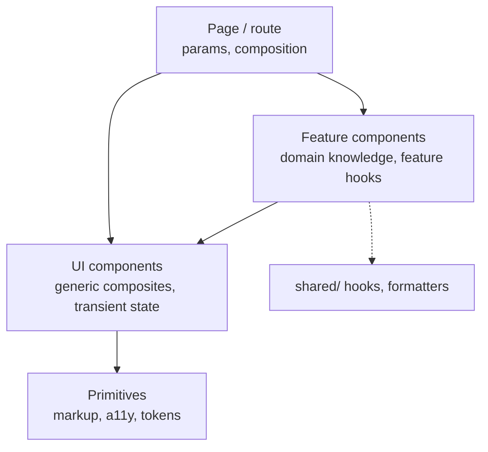
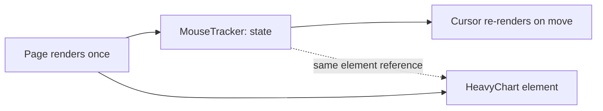

# 04 / 03 — Component Responsibility: Deciding What a Component Owns

## 1. Lesson metadata

| | |
|---|---|
| **Level** | Intermediate |
| **Study time** | 4–5 hours (reading 2 h, lab 1.5 h, exercises 1.5 h) |
| **Prerequisites** | [04 / 02 — Separation of concerns](./02-separation-of-concerns.md), [Phase 1 / 04 — Elements, components, instances](../01-react-fundamentals/04-elements-components-instances.md), [Phase 1 / 06 — Props and one-way data flow](../01-react-fundamentals/06-props-and-one-way-data-flow.md), [Phase 1 / 16 — State preservation and reset](../01-react-fundamentals/16-state-preservation-and-reset.md) |
| **Next** | [04 — Presentational vs container](./04-presentational-vs-container.md) |
| **Related later** | [15 — State ownership](./15-state-ownership.md), [Phase 5 / 01 — SOLID in React](../05-design-patterns/01-solid-in-react.md), [Phase 7 / 07 — State colocation for performance](../07-performance/07-state-colocation-for-perf.md) |

**Learning objectives.** After this lesson you can:
1. Define a component's **responsibility** as a contract: inputs it accepts, outputs it produces, state it owns, and effects it performs.
2. Apply five *splitting forces* (reason to change, reuse, state locality, render/performance isolation, team ownership) and know which signals justify each.
3. Classify components by role (page, feature, UI, primitive) and state the allowed capabilities and dependencies of each role.
4. Design prop APIs that express responsibility (narrow, typed, no leaked internals), and recognise "prop explosion" as a responsibility smell.
5. Detect and fix: god components, anaemic wrappers, components that own state they should not, and components that reach out to the world they should not know about.
6. Decide when *not* to split a component.

**Concepts covered:** responsibility as contract, ownership (of state, effects, data), role taxonomy, capability budget, prop surface, boolean-prop explosion, inversion of control via children/slots, state locality, identity and state reset, over-splitting, approach dossiers (role taxonomy, atomic design, size heuristics, slot-based composition).

---

## 2. Deep conceptual explanation

### 2.1 What problem is this lesson solving?

[Lesson 02](./02-separation-of-concerns.md) told you *which kinds of code* to separate. It did not tell you the unit at which UI code is divided: **the component**. Teams struggle with questions that look like taste but have engineering answers:

- This component is 300 lines. Should I split it? Along which line?
- Should `UserCard` fetch its own user or receive one?
- `Button` has 14 props and 3 booleans that interact. Is that a problem?
- Where does the "selected row" state live?
- Why does my form reset when I move it into a conditional wrapper?

Each question is really "what is this component *responsible for*?" A clear answer makes the component easy to name, test, reuse, and delete. A vague answer yields components named `Manager`, `Wrapper`, `Container`, `Handler`, or `Helper`.

### 2.2 Definition: a component's responsibility is its contract

A React function component, from the outside, is: **props in → UI description out**, plus optional **owned state** and **effects**. Its responsibility is the full contract:

| Part of contract | Question | Visible where |
|---|---|---|
| **Inputs** | What data/callbacks/slots does it need? | Props type |
| **Output** | What UI/behaviour does it promise? | Rendered result, a11y semantics |
| **Owned state** | What does it remember between renders? | `useState`, `useReducer`, refs |
| **Effects** | What does it do to the world? (subscribe, fetch, mutate DOM, log) | `useEffect`, event handlers |
| **Ambient dependencies** | What does it read without being told? (context, stores, router, globals) | `use(Context)`, `useStore`, `useParams` |
| **Identity rules** | When is its state reset or preserved? | Position in the tree, `key` ([Phase 1 / 16](../01-react-fundamentals/16-state-preservation-and-reset.md)) |

The *most architecturally important* column is **ambient dependencies**: the part of the contract not visible in the props type. Every ambient dependency makes a component harder to test (needs a provider), harder to reuse (needs the same app around it), and harder to reason about (what changes when the context changes?). A good design makes ambient dependencies **deliberate and concentrated** in a few components (pages, features) and absent from many (UI, primitives).

### 2.3 The capability budget

A practical way to bound responsibility: give each role a **capability budget**, a list of things that role is allowed to do. Violating the budget is a smell requiring justification.

| Role | May | May not (default) | Example |
|---|---|---|---|
| **Primitive** (design-system atom) | Render markup, accept style props, forward `ref` (a plain prop in React 19), handle a11y | Know about your domain, fetch, read app context, own non-visual state | `Button`, `Input`, `Icon` |
| **UI component** (generic composite) | Compose primitives, own *transient UI state* (open/closed, hover), accept slots | Know domain entities, call APIs, read router | `Dialog`, `Tabs`, `DataTable` |
| **Domain/feature component** | Know domain entities, own feature UI state, call feature hooks | Reach into other features' internals, own global concerns | `OrderSummary`, `CartDrawer` |
| **Page / route component** | Read route params, call feature hooks, compose features, set page-level layout | Contain feature-internal rules; hold unrelated feature state | `OrderPage` |
| **Provider / layout** | Provide context, shell layout, error/suspense boundaries | Render domain content | `AppProviders`, `Shell` |

This taxonomy is a *teaching model* with many variants (see dossiers in §7). What matters is that **the budget is explicit and checkable** (by code review and, ideally, lint rules on imports).

### 2.4 Splitting forces: when does a component split?

A component should be split when at least one *force* applies and the split's cost (a new name, a prop interface) is smaller than the benefit. The forces:

1. **Different reasons to change.** The summary table and the filter bar are changed by different requests. (From lesson 02.)
2. **Reuse.** Two places need the same unit. Wait for a real second use; "rule of three" is a heuristic that guards against speculative abstraction.
3. **State locality.** State used by only one subtree should live in that subtree. Moving `isOpen` into `Dropdown` stops the parent from re-rendering on every toggle, and removes a prop from the parent's API.
4. **Render isolation.** A frequently updating part (a clock, a hover-tracked tooltip) should not drag a heavy sibling along. React re-renders a component's *children* by default when it re-renders ([Phase 7 / 03](../07-performance/03-why-components-rerender.md)); a separate component with its own state bounds the blast radius. ⚠ Premature for most UI; measure first.
5. **Ownership/team boundaries.** Different teams own the header and the content; each gets its own component and contract.
6. **Testability/comprehension.** A 40-line branch of JSX with its own conditions deserves a name.

Notice what is **not** a force: line count alone. A 250-line component that renders a long static policy page is fine. A 60-line component with a fetch, a rule, a modal and a form is not.

### 2.5 State ownership is the heart of responsibility

Given the rules of React data flow, **who owns a piece of state** decides the shape of your component API. The default principle from the official docs ("Sharing state between components", "Choosing the state structure") is:

> Keep state **as local as possible**, and **lift it to the nearest common parent** only when two components need to coordinate.

Consequences:

- A component that owns state is *stateful*: instances are not interchangeable and the component has **identity** (position + key) that matters.
- A component that receives state via props is *controlled*: the owner decides. The same UI can then be reused (controlled/uncontrolled patterns, [Phase 1 / 11](../01-react-fundamentals/11-controlled-and-uncontrolled-inputs.md), [Phase 5 / 11](../05-design-patterns/11-controlled-component-pattern.md)).
- Lifting state up grows a parent's responsibility; pushing down shrinks it. Neither is "better": choose the lowest owner that satisfies all consumers.

Full treatment: [lesson 15](./15-state-ownership.md).

### 2.6 Prop surface as a responsibility smell detector

The prop list is the *visible* contract. Warning signs:

| Prop smell | What it signals |
|---|---|
| >7–10 props, most optional | The component does several jobs; consider composition |
| Pairs of booleans that interact (`isPrimary`, `isDanger`, `isGhost`) | A variant enum is missing (`variant: 'primary' \| 'danger' \| 'ghost'`) |
| `renderX`, `xComponent`, `xProps` accumulating | Component is trying to be everything for everyone; consider slots/compound pattern |
| Props passed through unchanged to a child 3 levels down | Drilling; consider composition (pass the child as `children`) before reaching for context |
| Prop names echoing internal structure (`innerButtonClassName`) | Leaky abstraction |
| Callback with a vague name (`onChange`, `onUpdate`) and a wide payload | Contract unclear: say *what* changed |
| A `config` object prop that mirrors the component's internals | A disguised pile of boolean flags |

Rule of thumb, not a law: a component whose props you cannot summarise in one sentence is probably two components.

### 2.7 Common misconceptions

| Misconception | Reality |
|---|---|
| "Small components are always better." | Small is a side effect, not a goal. Over-splitting produces prop-forwarding layers whose names add nothing ("anaemic wrappers"). |
| "Components should be pure, so they cannot have state." | Purity refers to *render*: same props/state → same output, no side effects in render. State ownership is normal and often *the point* of a component. |
| "Containers fetch; presentational components don't." | A useful default in some codebases, but not a React rule; see [lesson 04](./04-presentational-vs-container.md) for when it helps and when it hurts. |
| "Every piece of state should be global to avoid drilling." | Global state increases coupling, reduces locality, and widens re-render scope. Prefer composition (`children`) to avoid drilling before using context. |
| "Reusable means configurable." | Reuse through boolean flags yields a component nobody understands. Reuse through composition yields small pieces that combine. |
| "A component = a file." | Convention, not rule. Tiny private helper components colocated in the same file are fine and often better. |

---

## 3. Internal mechanics

### 3.1 Why component boundaries have runtime meaning (not just organisational)

*Public guarantee.* A component is called by React during render with its props, and may be re-rendered when its state changes, when its parent re-renders, or when a context it reads changes ([Phase 2 / 01](../02-react-rendering-and-internals/01-what-triggers-a-render.md)). *Public guarantee.* State is preserved for a component instance at the same position in the tree with the same type (and key); it resets when the type or key changes, or the node is removed ([Phase 1 / 16](../01-react-fundamentals/16-state-preservation-and-reset.md)).

So a component boundary is simultaneously:
1. **A naming/organisation boundary** (developer-visible).
2. **A state boundary** (state belongs to an instance at a tree position).
3. **A render boundary** (re-render is triggered per component; children re-render by default unless props are unchanged *and* memoisation applies).
4. **A reconciliation identity boundary** (type + key decide reuse).

Architecture decisions about "where to split" therefore have *behavioural* consequences, not just stylistic ones.

### 3.2 The "component defined inside a component" trap

```tsx
function Parent() {
  const [n, setN] = useState(0);
  function Child() { // new function identity each render of Parent
    const [text, setText] = useState("");
    return <input value={text} onChange={(e) => setText(e.target.value)} />;
  }
  return <><button onClick={() => setN(n + 1)}>{n}</button><Child /></>;
}
```

*Mechanics.* Each `Parent` render creates a *new* `Child` function. React compares element types by identity during reconciliation ([Phase 2 / 06–07](../02-react-rendering-and-internals/06-reconciliation-fundamentals.md)); a different type means "different component": the old subtree is unmounted (state lost, DOM node replaced, input loses focus) and a new one mounted. **Predict:** type "abc" into the input then click the button. *Result:* the input is cleared and loses focus on each click. *Fix:* define `Child` at module scope and pass what it needs as props. This is a *responsibility* error as well as a technical one: `Child` was defined as part of `Parent`'s body, so its identity depended on `Parent`'s render.

### 3.3 Why `key` is a responsibility decision

`key` tells React *which logical entity* a component instance represents. Using `<UserForm key={user.id} user={user} />` makes "a form for *this* user" the instance identity: switching users resets the form. Not providing the key makes the form an instance reused across users, and **you** must reset it by effect or controlled logic (error-prone). Choosing identity is part of component responsibility: *is this component "the profile form" or "the profile form for user 42"?* See [Phase 1 / 16](../01-react-fundamentals/16-state-preservation-and-reset.md), [Phase 2 / 07](../02-react-rendering-and-internals/07-identity-keys-and-reconciliation.md).

### 3.4 Children as pre-created elements (why composition limits re-renders)

When `Parent` renders `<Layout><Expensive /></Layout>`, the `<Expensive />` element is created in `Parent`'s render and passed as `children`. If `Layout` re-renders due to *its own state*, `children` is the same element reference, and React can bail out of re-rendering `Expensive` because the element object is identical (same props object → same output, bail-out on identical element). ⚠ *Teaching model:* this reliably explains "state in a wrapper doesn't re-render children passed from above" (documented in React's performance guidance and in Dan Abramov's "before you memo()" post). The precise bail-out mechanics are implementation details; rely on the observable behaviour and verify with the Profiler. This is one of React's strongest tools for assigning responsibility: **let the owner of the state be a wrapper, and let children arrive from above.**

---

## 4. Step-by-step walkthrough: assigning responsibilities in a product page

Scenario: a **ProductPage** shows a gallery, title, price, variant selector, "Add to cart" button, reviews list, and a "Recently viewed" strip. Walk through responsibility decisions in order.

1. **List the pieces of state and information** and classify each:
   - Product data (server state): needed by gallery, title, price, variants, add-to-cart.
   - Selected variant (UI state): needed by price (variant-dependent), add-to-cart, gallery (variant images).
   - Cart (global state/server state): needed by add-to-cart and the header badge.
   - Review list (server state, paged): needed by reviews only.
   - Gallery's active image index (UI state): used only by gallery.
2. **Assign owners by nearest-common-parent**:
   - Gallery's `activeIndex` → inside `Gallery` (local; no one else cares). *Exception:* if a variant change must reset it, `Gallery` gets `key={variantId}` or a controlled `activeIndex`: a *contract decision*.
   - `selectedVariantId` → `ProductPage` (shared by gallery, price, add-to-cart).
   - Cart → feature module `cart` exposing `useAddToCart()`; `ProductPage` passes the callback down or `AddToCartButton` uses the hook (a feature-level component with an ambient dependency, allowed by its role).
   - Reviews → `ProductReviews` fetches its own data (independent loading; separate Suspense/error boundary).
3. **Draw component responsibilities as contracts:**
   - `ProductPage` (page): reads `productId` param, uses `useProduct(id)`, owns `selectedVariantId`, composes the rest. *Budget:* route + composition.
   - `Gallery({ images, activeVariantId? })` (UI/feature): local `activeIndex`.
   - `PriceTag({ price: Money })` (UI): pure.
   - `VariantPicker({ variants, value, onChange })` (UI, controlled).
   - `AddToCartButton({ sku })` (feature): uses cart hook.
   - `ProductReviews({ productId })` (feature): independent fetch, own boundary.
   - `RecentlyViewed()` (feature): reads from local storage adapter; independent.
4. **Check ambient dependencies.** `PriceTag`, `VariantPicker`, `Gallery`: none. `AddToCartButton`: cart hook. `ProductReviews`: query client. Concentrated at feature level: good.
5. **Check re-render scope** with the Profiler: changing the variant re-renders `ProductPage`, `Gallery`, `PriceTag`, `VariantPicker`, `AddToCartButton`; it should *not* re-render `ProductReviews` or `RecentlyViewed`. If it does, either pass them as `children` from a layout above the state owner, or memoise them.
6. **Check identity.** The `Gallery` should reset its `activeIndex` when `productId` changes (navigate to another product with the same route component): render `<ProductPage key={productId} />` or `<Gallery key={productId} … />`. Decide and document.

Timeline of "user selects variant":
1. Click → `VariantPicker` calls `onChange(variantId)`.
2. `ProductPage` sets `selectedVariantId` (state update scheduled).
3. React re-renders `ProductPage` and, by default, its children; props-unchanged siblings bail out only if memoised or passed as stable elements.
4. `PriceTag` receives the variant's price, `Gallery` its images, `AddToCartButton` its SKU.
5. Commit; DOM updated for price, gallery, button.

---

## 5. Code examples

### 5.1 Minimal example — pushing state down to its only user

```tsx
// Before: ProductPage owns hover state used by one small tooltip
function ProductPage({ product }: { product: Product }) {
  const [tipOpen, setTipOpen] = useState(false);   // re-renders everything on hover
  return (
    <>
      <HeavyGallery images={product.images} />
      <button onMouseEnter={() => setTipOpen(true)} onMouseLeave={() => setTipOpen(false)}>Size guide</button>
      {tipOpen && <SizeTip />}
    </>
  );
}

// After: a component owns its own transient state
function SizeGuideButton() {
  const [open, setOpen] = useState(false);
  return (
    <>
      <button onMouseEnter={() => setOpen(true)} onMouseLeave={() => setOpen(false)}>Size guide</button>
      {open && <SizeTip />}
    </>
  );
}
function ProductPage({ product }: { product: Product }) {
  return (<><HeavyGallery images={product.images} /><SizeGuideButton /></>);
}
```

**Predict:** in the "before" version, what happens to `HeavyGallery` on hover? *Result:* `ProductPage` re-renders on each hover toggle; `HeavyGallery` re-renders too (same props, but not memoised, React re-renders children by default). *After:* only `SizeGuideButton` re-renders. The responsibility ("know whether the size tip is open") moved to the only component that cares, and the page's API got smaller. (Honest note: if `HeavyGallery` renders in 0.2 ms, this change is unobservable; it still removed a state variable from the page.)

### 5.2 Practical example — a prop-explosion component redesigned with composition

Before:

```tsx
interface CardProps {
  title: string;
  subtitle?: string;
  image?: string;
  imageAlt?: string;
  showFooter?: boolean;
  footerText?: string;
  footerAction?: () => void;
  footerActionLabel?: string;
  isHighlighted?: boolean;
  isCompact?: boolean;
  headerIcon?: ReactNode;
  renderBody?: () => ReactNode;
}
```

Problems: 12 props; `showFooter` + three footer props must be set together (invalid combos representable); every new variation adds a prop.

After (composition via slots):

```tsx
import type { ReactNode } from "react";

interface CardProps { variant?: "default" | "highlighted"; density?: "comfortable" | "compact"; children: ReactNode }

export function Card({ variant = "default", density = "comfortable", children }: CardProps) {
  return <article data-variant={variant} data-density={density} className="card">{children}</article>;
}
Card.Header = function CardHeader({ title, subtitle, icon }: { title: string; subtitle?: string; icon?: ReactNode }) {
  return <header>{icon}<h3>{title}</h3>{subtitle && <p>{subtitle}</p>}</header>;
};
Card.Body = function CardBody({ children }: { children: ReactNode }) { return <div>{children}</div>; };
Card.Footer = function CardFooter({ children }: { children: ReactNode }) { return <footer>{children}</footer>; };
```

Usage:

```tsx
<Card variant="highlighted">
  <Card.Header title="Pro plan" subtitle="Best for teams" />
  <Card.Body><PriceList plan={plan} /></Card.Body>
  <Card.Footer><button onClick={subscribe}>Subscribe</button></Card.Footer>
</Card>
```

Line notes:
- Invalid combinations (footer text without footer) are no longer representable.
- The consumer owns what goes in the slots; `Card` is responsible only for layout/semantics.
- Static-property subcomponents (`Card.Header`) are one convention; named exports (`CardHeader`) are equally valid and tree-shake better in some toolchains. Pick one per codebase. See [Phase 5 / 05](../05-design-patterns/05-compound-components.md).
- **Trade-off:** less discoverable than a single props object; consumers can compose wrongly (footer before header) unless the component enforces order (not worth it, usually).

### 5.3 Incorrect example — god component with every responsibility

```tsx
export function Dashboard() {
  const [user, setUser] = useState<User | null>(null);
  const [orders, setOrders] = useState<Order[]>([]);
  const [filter, setFilter] = useState("all");
  const [modal, setModal] = useState<"none" | "refund" | "export">("none");
  const [toast, setToast] = useState<string | null>(null);

  useEffect(() => { fetch("/api/me").then(r => r.json()).then(setUser); }, []);
  useEffect(() => { fetch(`/api/orders?filter=${filter}`).then(r => r.json()).then(setOrders); }, [filter]);
  // ... 40 lines: refund handler (fetch + validation + toast), CSV export, role checks
  // ... 150 lines of JSX: header, filter bar, table, two modals, toast
}
```

Failure modes: any state change (typing in a modal field, toast timeout) re-renders the entire dashboard including the table; effects are sequentially independent but written as a waterfall; modal logic cannot be reused; a role-check change touches the same file as table styling. Race: changing `filter` quickly can display orders for an earlier filter if responses arrive out of order (no cancellation).

### 5.4 Corrected implementation — responsibilities assigned

```tsx
// pages/DashboardPage.tsx — page: composition and route-level concerns only
export function DashboardPage() {
  const [filter, setFilter] = useState<OrderFilter>("all"); // shared by filter bar and table
  return (
    <DashboardLayout header={<UserHeader />}>
      <OrderFilterBar value={filter} onChange={setFilter} />
      <OrderTable filter={filter} />
      <ToastHost />
    </DashboardLayout>
  );
}

// features/orders/ui/OrderTable.tsx — feature: owns data loading for its table
export function OrderTable({ filter }: { filter: OrderFilter }) {
  const { orders, status } = useOrders(filter);       // hook handles cancellation / caching
  const refund = useRefundDialog();                   // owns modal state + submit orchestration
  if (status === "loading") return <TableSkeleton />;
  return (
    <>
      <DataTable rows={orders} columns={orderColumns} onRowAction={(row) => refund.open(row)} />
      {refund.dialog}
    </>
  );
}
```

Line notes:
- `filter` is owned by the page because two siblings need it (nearest common parent).
- `UserHeader` fetches the user itself (independent of the table); a failure there doesn't blank the table.
- `useRefundDialog()` returns `{ open, dialog }`; the *modal state* lives with the code that opens it. (⚠ A hook returning JSX is a debated convention: it hides a component. An explicit `<RefundDialog order={selected} onClose=… />` rendered in `OrderTable` is more transparent. Choose consciously.)
- The modal's text field changes re-render only the modal, not the page.

### 5.5 Advanced example — responsibility via inversion of control (children) to bound re-render scope

```tsx
// A "state holder" wrapper owns frequently-changing state and receives the heavy subtree as children
function MouseTracker({ children }: { children: ReactNode }) {
  const [pos, setPos] = useState({ x: 0, y: 0 });
  return (
    <div onPointerMove={(e) => setPos({ x: e.clientX, y: e.clientY })}>
      <Cursor x={pos.x} y={pos.y} />
      {children}                       {/* same element reference across MouseTracker re-renders */}
    </div>
  );
}

function Page() {
  return (
    <MouseTracker>
      <HeavyChart />                   {/* created by Page; Page does not re-render on pointer move */}
    </MouseTracker>
  );
}
```

**Predict:** on pointer move, which components render? *Result:* `MouseTracker` and `Cursor` only. `Page` did not re-render, so `<HeavyChart />` is the same element object; React bails out. *Why it matters architecturally:* the state owner (`MouseTracker`) has a clear, tiny responsibility, and the expensive subtree has no knowledge of mouse tracking. *Caveats:* if `Page` re-renders for another reason, `HeavyChart` re-renders too (children element is recreated); StrictMode in dev renders components twice but that doesn't alter the logic (render counts in dev are doubled; measure in a production build). In practice, prefer `React.memo` only where the Profiler shows a problem; with the React Compiler enabled some of these optimisations are automatic (volatile: verify against current React Compiler docs).

---

## 6. Visual explanations

### Role taxonomy and allowed dependencies



Allowed: arrows downward (and sideways within a layer only via composition from above). Forbidden: `UI → Feature` (UI knowing the domain), `Primitive → anything above`.

### Where state should live

```text
Used by one component only            ──► inside that component (useState)
Used by siblings                      ──► nearest common parent (lift up)
Needed by distant branches            ──► context/external store (cost: coupling + render scope)
Derived from other state/props        ──► compute during render (no state)
From the server                       ──► server-state cache, not component state
Needs to reset when an entity changes ──► key = entity id on the owner
```

### Children-as-slot pattern bounds re-render



---

## 7. Alternative approaches and trade-offs (dossiers)

### 7.1 Dossier A — Role-based taxonomy (page / feature / UI / primitive)

- **Original problem.** In growing codebases everything is "a component"; developers cannot predict what a component may depend on. A role taxonomy gives a *capability budget* per role and a dependency direction.
- **Representative structure.**
  ```text
  src/
    app/pages/         ← page components
    features/<x>/ui/   ← feature components
    shared/ui/         ← UI components + primitives (or ui/primitives, ui/composites)
  ```
- **Dependency rules.** `page → feature → shared/ui → primitives`. Primitives and shared/ui import nothing domain-specific; features do not import other features' internals.
- **Example.** `shared/ui/Dialog` (no domain), `features/orders/ui/RefundDialog` (domain, composes `Dialog`), `pages/OrderPage`.
- **Advantages.** Predictable, checkable (lint by directory); makes testing strategy per role explicit (primitives: a11y tests; features: integration; pages: smoke/E2E); aligns with design-system boundary.
- **Disadvantages.** Classification arguments for borderline cases (`UserAvatarWithStatus`: UI or feature?); ceremony at small scale; people may over-extract "UI" components that have only one consumer.
- **Appropriate sizes.** 4+ engineers, long-lived apps, any app with a design system.
- **Failure modes.** `shared/ui` accumulating domain knowledge ("just one `if (order.status…)`"); pages becoming feature containers with 500 lines; role names without enforced rules.
- **Migration.** Introduce by *classifying existing components* (spreadsheet or script), moving only those with obvious roles first (primitives and pages), then resolve the ambiguous middle by asking "does it know a domain entity?". Add lint rules after the move.

### 7.2 Dossier B — Atomic Design (atoms / molecules / organisms / templates / pages)

- **Original problem.** Brad Frost's methodology (2013 onward) provides a shared vocabulary between designers and engineers for composing interfaces from small parts, supporting design-system work.
- **Representative structure.**
  ```text
  components/
    atoms/ molecules/ organisms/ templates/ pages/
  ```
- **Dependency rules.** Each level composes the levels below (atoms → molecules → organisms → templates → pages). No upward imports.
- **Example.** `Button` (atom) + `Input` (atom) + `Label` (atom) → `SearchField` (molecule) → `Header` (organism).
- **Advantages.** Common language with designers; strong fit for design systems and pattern libraries; encourages building from reusable parts.
- **Disadvantages.** Levels are *about visual composition*, not responsibility: the boundary between molecule and organism is subjective; domain knowledge has no home (an organism may or may not know the domain); folders by level separate files that change together (low locality; see [lesson 06](./06-feature-vs-layer-structure.md)); data fetching/state placement is unspecified.
- **Appropriate sizes.** Design-system packages and marketing/content sites; mixed with feature folders for the app (atoms/molecules in `shared/ui`; organisms in features).
- **Failure modes.** Bikeshedding over classification; a single `organisms/` folder becoming the application; atomic folders with no rules about domain knowledge.
- **Migration.** Treat atomic levels as a *naming aid inside `shared/ui`*, not as the top-level organisation of the app; move domain organisms into features.

### 7.3 Dossier C — Size/heuristic-driven splitting ("keep components under N lines")

- **Original problem.** Teams need a cheap, objective trigger that prompts refactoring before components become unmanageable.
- **Representative structure.** No folder implication; typically a lint rule (`max-lines-per-function`, ESLint core) or review convention (e.g. warn at ~150–250 lines).
- **Dependency rules.** None.
- **Example.** A PR bot comments "this component exceeds 200 lines".
- **Advantages.** Objective, automatable; catches runaway growth; low conceptual overhead.
- **Disadvantages.** Proxy metric: encourages arbitrary splits by line number (extracting `Part1`, `Part2`), moving code without separating concerns; ignores long-but-cohesive components; ignores short-but-mixed ones.
- **Appropriate sizes.** Any, as a *tripwire*, never as the design method.
- **Failure modes.** Cosmetic splits; prop-forwarding layers; developers "gaming" by moving lines into hooks (see lesson 02's pseudo-separation).
- **Migration.** Replace the "lines" rule with a *review question* ("what are this component's responsibilities?") and keep the lint rule as a soft warning.

### 7.4 Dossier D — Slot/compound composition (responsibility by inversion of control)

- **Original problem.** Components that accept configuration for every variation become enormous. Inverting control (consumer passes UI in) keeps the component small and flexible.
- **Representative structure.**
  ```text
  shared/ui/Card/{Card.tsx, CardHeader.tsx, index.ts}   // or Card.tsx exporting subcomponents
  ```
- **Dependency rules.** The container component defines layout and semantics only; consumers supply content; subcomponents may share implicit state via context (compound components).
- **Example.** §5.2 `Card`.
- **Advantages.** Small APIs; invalid states unrepresentable; consumers keep control and bound re-render scope; scales to complex widgets (tabs, menus, comboboxes).
- **Disadvantages.** Harder to discover (no single props type); implicit context coupling between parts; typing polymorphic slots takes care; consumers can misuse composition.
- **Appropriate sizes.** Design systems and widely reused UI; unnecessary for one-off app components.
- **Failure modes.** Over-flexible parts that leak internals; context-based compound components used outside their parent (runtime error); slot sprawl (everything a slot).
- **Migration.** Start from the prop-heavy component; identify prop clusters that map to regions (header, footer); introduce slots while keeping the old props as deprecated wrappers until consumers migrate.

### 7.5 Comparison

| Criterion | A: Roles | B: Atomic | C: Size heuristic | D: Slots/compound |
|---|---|---|---|---|
| Addresses responsibility | Directly | Visual only | Indirectly | Directly (for UI) |
| Enforceable by tooling | Yes (directories) | Weakly | Yes (trivially) | Not by structure |
| Fit with design systems | Good | Excellent | Neutral | Excellent |
| Fit with feature folders | Excellent | Poor at top level | Neutral | Excellent |
| Onboarding | Easy | Medium (jargon) | Trivial | Medium |
| Risk of cargo-culting | Medium | High | High | Medium |

**A scenario where the recommended default (role taxonomy + small focused components) is *not* best.** A content-heavy marketing site built by designers and engineers jointly, where the design system *is* the product and pages are mostly assemblies of design-system parts with CMS-provided content. Atomic Design's shared vocabulary and folder structure map directly onto the designers' Figma libraries, giving real communication value that a developer-centric role taxonomy lacks.

---

## 8. Best practices and anti-patterns

**Do**
- Write the component's responsibility in one sentence in your head (or in a doc comment for shared components). If you need "and" twice, consider splitting.
- Keep ambient dependencies (context, router, stores) in feature/page components; keep primitives and UI components props-only.
- Type props to make invalid states unrepresentable (discriminated unions, variant enums).
- Decide **identity** deliberately: add `key` where "the same component for a different entity" should reset state.
- Prefer composition (`children`, slots) before context to avoid prop drilling.
- Define components at module scope. Never define a component inside another's render body.
- Keep state at the lowest owner; derive everything else during render.

**Beginner mistakes**
- Defining components inside components (§3.2).
- Duplicating props into state (`useState(props.x)`) and then wondering why updates don't show; derive or use a key ([Phase 1 / 14](../01-react-fundamentals/14-state-as-a-snapshot.md)).
- Boolean prop piles.
- Fetching in every list-item component (N+1 requests).

**Experienced-developer mistakes**
- Splitting into dozens of 10-line components with identical prop-forwarding.
- Using context to avoid passing 2 props one level.
- "Smart" UI components that read the router, making them unusable in Storybook.
- Making every component generic ("write once, use anywhere") before a second use.
- Memoising everything as a substitute for placing state well.

**Smells:** names ending in `Manager`, `Handler`, `Helper`, `Wrapper`, `Container` with no further meaning; >8 props; a component whose test requires 4 providers; `useEffect` that copies props to state; components with both heavy domain knowledge *and* styling details.

**Justified exceptions.** Page components may be long glue; a leaf component may fetch its own tiny piece of data when it is independently loadable and boundary-wrapped (e.g. a notification badge); a private helper component in the same file is better than a premature shared export.

---

## 9. Real-world application

*Admin tables (back-office, 10–50 columns).* A table component is a classic responsibility trap: sorting, selection, pagination, column visibility, row actions, and export all want to live in it. Typical architecture: a generic `DataTable` responsible for *rendering and keyboard/a11y* given `rows`, `columns`, and controlled `sort`/`selection` props; a feature-level `OrderTable` responsible for *what the data is* and which actions exist; page-level state in the URL (filters, page) so views are linkable ([lesson 18](./18-routing-architecture.md)). Constraint: 10,000 rows requires windowing, which is a *table* responsibility, not a feature one.

*Forms.* The `<Field>` component's responsibility: label, input association, error display, a11y (`aria-describedby`). The *form's* responsibility: submission orchestration. The *schema's* responsibility: rules. Mixing the three into one `Input` component with `validationRules` props is the most common cause of unreusable form kits.

*Dashboards with independent widgets.* Each widget owns its data fetching and error boundary so one failing widget does not blank the page; the page owns layout and shared filters (date range). Re-render isolation matters: a ticking real-time widget must not re-render siblings.

*Auth gates.* A `RequireRole` wrapper component has a precise responsibility: *decide whether children render*. It should not fetch the user; it receives the permission decision from an auth module. The *router* layer is often the better place for coarse guarding ([lesson 18](./18-routing-architecture.md)).

*Multi-team shell.* A `Shell` component owns navigation and slots for team-owned feature areas; teams own the content components. The shell's contract is a small API (routes + slots), the architecture's team boundary.

---

## 10. Debugging and troubleshooting

**Symptom: "Input loses focus on every keystroke / my form resets when the parent updates."**
1. In React DevTools, enable *Highlight updates when components render*; type and observe.
2. In the Components tab, inspect the subtree: if the component displays as an anonymous function or a new instance on each render, check for a component defined inside another.
3. Root cause: type identity changes each render (§3.2), or a changing `key` (e.g. `key={Math.random()}`, or key derived from a mutating index).
4. Fix: hoist the component to module scope; use stable keys.
5. Validate: type continuously; focus persists; DevTools shows the same instance (state preserved).

**Symptom: "Everything re-renders when I toggle a dropdown."**
1. Profiler → record the toggle → look at the flamegraph: which component owns the state; which siblings render *and why* ("Parent rendered", ⚠ the "why did this render" feature requires the Profiler setting enabled).
2. Root cause: state owned too high (page) for a purely local concern.
3. Fix: move state down into `Dropdown` (§5.1) or pass the heavy part as `children` (§5.5).
4. Validate with a second recording; compare commit duration.

**Symptom: "State persists between two different entities (user A's draft shows for user B)."**
Missing `key` on the stateful owner. Fix: `key={entity.id}`. Verify by switching entities and confirming that DevTools shows a new instance (state reset).

**Symptom: "This component can't be rendered in Storybook/tests without the whole app."**
List its ambient dependencies: search the file for `use(`, `useContext`, `useRouter`, `useParams`, store hooks. Decide: are they required for *this* component's responsibility, or only to fetch data it could receive via props? Convert to props and compose at a higher role. Validate: the component renders from a single story with plain props.

**Symptom: Prop type has 20 optional props and bugs from invalid combinations.** Write down the *valid* combinations; model them as a discriminated union or split into components (e.g. `ConfirmDialog` and `FormDialog`). Validate by making invalid combos a compile error (`// @ts-expect-error` tests).

---

## 11. Exercises

### Level A — Knowledge
A1. List the parts of a component's contract. Which part is *not* visible in its props type?
A2. State five forces that justify splitting a component and one that does not.
A3. What does a capability budget say about a primitive's allowed dependencies?
A4. Why do component boundaries have runtime consequences (name three)?
A5. What is the difference between a controlled and an uncontrolled component in terms of state ownership?

### Level B — Code comprehension
B1. Predict the behaviour:
```tsx
function Form() {
  const [name, setName] = useState("");
  const Field = () => <input value={name} onChange={(e) => setName(e.target.value)} />;
  return <Field />;
}
```
B2. In §5.5, if `Page` also holds `const [theme, setTheme] = useState("light")` and calls `setTheme`, does `HeavyChart` re-render? Why?
B3. What does `<UserForm key={user.id} user={user} />` change compared with omitting `key`, assuming the form has internal draft state?

### Level C — Implementation
C1. Rewrite a `Button` with `isPrimary`, `isDanger`, `isGhost` booleans into a typed `variant` prop. Show how the compiler now rejects invalid combinations.
C2. Implement a `Disclosure` component that supports both uncontrolled (`defaultOpen`) and controlled (`open`, `onOpenChange`) use with a discriminated-union props type.
C3. Refactor §5.3's `Dashboard` into page + feature components using the structure of §5.4, specifying where each piece of state lives and why.

### Level D — Debugging
D1. A list of `<TodoItem>` components shows each item's inline edit text jumping to another item after reordering. The list uses `key={index}`. Explain and fix.
D2. A `Tooltip` primitive imports `useCurrentUser` to hide on mobile for beta users. List the problems this creates and the redesign.
D3. Typing in a modal's text field makes the table behind it flicker (re-render visibly). Diagnose with the Profiler and propose two fixes.

### Level E — Architecture decisions
E1. Your team debates whether `ProductCard` should fetch its own product by id or receive a `product` prop. Present decision criteria and recommend for (a) a catalogue grid of 48 cards and (b) a single "featured" card on a landing page.
E2. A design-system team and a product team disagree about whether `DataTable` should support selection, sorting, pagination, and row-actions as built-in props. Propose an API strategy and justify.
E3. Evaluate adopting Atomic Design as the *top-level* folder structure of a 40-engineer product app.

### Level F — Expert challenge
F1. Design the component responsibility model for a *multi-tenant analytics dashboard* with user-configurable widgets (add, remove, resize), per-widget data sources, shared global filters, and real-time updates for some widgets. Specify the contract (props, state ownership, effects, identity/keys), how widgets are isolated for errors and performance, and how you would test the model. Identify two decisions you'd revisit if the product gets 10× more widget types.

---

## 12. Detailed answers and explanations

> Attempt the exercises first.

**A1.** Inputs (props), output (UI/semantics), owned state, effects, ambient dependencies, identity rules. Not visible in props: ambient dependencies (context, stores, router, globals), also identity rules (key/position) and effects. Evaluation: names ambient dependencies as the hidden one.

**A2.** Forces: reasons to change, reuse, state locality, render isolation, team ownership, testability/comprehension. Not a force: line count alone (a proxy). Any five accepted.

**A3.** A primitive may render markup, accept style/a11y props and forward `ref`, but must not know domain entities, fetch, or read app context; it depends only on tokens/utilities. This keeps primitives reusable and testable in isolation.

**A4.** (1) State belongs to an instance at a tree position (preserved/reset by identity), (2) re-render triggers and propagation are per component, (3) reconciliation identity (type + key) decides mount/unmount, (4) error boundaries and Suspense boundaries are component-level. Any three.

**A5.** In a controlled component the parent owns the value and the component reports changes via callbacks; uncontrolled keeps its own state. Controlled = owner decides, enabling coordination; uncontrolled = encapsulated, simpler. ([Phase 1 / 11](../01-react-fundamentals/11-controlled-and-uncontrolled-inputs.md).)

**B1.** `Field` is a new function each render of `Form`, so React sees a new component type every render, unmounts the old `<input>` and mounts a new one. Typing a character calls `setName`, `Form` re-renders, a *new* `Field` identity is created, the input remounts and loses focus. The user can type only one character before focus is lost. Fix: define `Field` outside `Form` (taking `value`/`onChange` as props) or inline the `<input>`. Wrong guess: "it works, just inefficient"; it breaks focus and loses transient DOM state (selection, scroll).

**B2.** Yes. `setTheme` re-renders `Page`; `Page`'s render creates a new `<HeavyChart />` element (a new object), so React cannot short-circuit on element identity; `HeavyChart` renders again unless memoised (`React.memo` would compare props—none—and skip). The children-bail-out works only when the *owner of the element* does not re-render. Fix: move `theme` into a component that wraps the tracker, or memoise `HeavyChart`.

**B3.** With `key={user.id}`, switching from user A to B unmounts A's form instance and mounts a new one, so its internal draft state resets to the initial value. Without a key, the same instance receives new props and keeps its internal state (a stale draft from A showing in B), unless the code resets it manually. Trade-off: the key reset is simple and correct when "new entity = new form"; but if you want to preserve drafts per user you must store them outside the component.

**C1.**
```tsx
type ButtonProps = { variant?: "primary" | "danger" | "ghost" } & React.ComponentPropsWithRef<"button">;
export function Button({ variant = "primary", ...rest }: ButtonProps) {
  return <button data-variant={variant} {...rest} />;
}
// <Button variant="danger" variant="ghost" /> is not expressible (and duplicate JSX attributes error).
```
Because `ref` is a regular prop in React 19, `ComponentPropsWithRef` carries it; in React 18 and earlier you'd need `forwardRef` (legacy). Edge: a `variant` union cannot express *combinations* like "ghost + danger"; if needed, model `tone` and `emphasis` as two orthogonal props, not booleans.

**C2.**
```tsx
import { useState, type ReactNode } from "react";
type Props =
  | { open: boolean; onOpenChange: (o: boolean) => void; defaultOpen?: never; children: ReactNode; summary: ReactNode }
  | { open?: undefined; onOpenChange?: (o: boolean) => void; defaultOpen?: boolean; children: ReactNode; summary: ReactNode };

export function Disclosure(props: Props) {
  const [inner, setInner] = useState(props.defaultOpen ?? false);
  const controlled = props.open !== undefined;
  const open = controlled ? props.open! : inner;
  const toggle = () => {
    const next = !open;
    if (!controlled) setInner(next);
    props.onOpenChange?.(next);
  };
  return (<div><button aria-expanded={open} onClick={toggle}>{props.summary}</button>{open && <div>{props.children}</div>}</div>);
}
```
Edge cases: switching between controlled and uncontrolled during the lifetime is a bug in React's own inputs (warning); mention it. The `open!` assertion: narrowing via the `controlled` boolean doesn't carry through; destructuring would avoid it.

**C3.** State placement: `filter` in the page (shared by bar and table), modal state in the feature's refund dialog (only the table opens it), toast in a toast context at the app/layout level (cross-cutting), orders in a server-state hook keyed by filter (cancellation/caching handled by the hook/library), user in the header. Reasoning in each case: nearest common owner; cross-cutting through a provider; server data not in `useState`.

**D1.** `key={index}` ties component identity to position, not entity. After reordering, instance #2 (with its internal edit state) is now rendered for a different todo. Use a stable id: `key={todo.id}`. Index keys are safe only for static lists never reordered/inserted ([Phase 1 / 09](../01-react-fundamentals/09-lists-keys-and-identity.md)).

**D2.** Problems: a primitive depends on app context (needs auth provider in every test/Storybook; can't be published in a design system); couples the design system to the product; the feature flag decision is a product concern. Redesign: the primitive takes `hideOnMobile?: boolean` (or `disabled`); a feature-level wrapper `BetaTooltip` reads the user and passes the prop. Dependency direction restored.

**D3.** Profiler: record typing; see the page and table re-rendering with "Parent rendered" because modal state or the text field's state lives in the page. Fix 1: move the field/draft state into the modal component. Fix 2: if the state must be in the parent, pass the table as stable `children` from a higher owner or memoise the table with stable props. Validate by comparing the commits' render lists before/after.

**E1.** Criteria: loading granularity, N+1 risk, cacheability, reuse/testability, error isolation. (a) 48 cards: receive `product` props; the list owner fetches once (one request or paged query), avoiding 48 requests; cards are pure and memoisable. (b) Featured card: either works; fetching by id is acceptable if the card is independently loadable and boundary-wrapped, or the page fetches and passes. Server-state caches with deduplication reduce the N+1 cost, but props-driven cards remain easier to test. Recommend a presentational `ProductCard` plus a `FeaturedProduct` feature wrapper that fetches.

**E2.** Strategy: a minimal core `DataTable` (rendering, a11y, keyboard, windowing) with *controlled* props for `sort`, `selection`, and `page` (state owned by the consumer, often in the URL), plus optional helper hooks (`useTableSort`) shipped alongside for the common case, and slots for row actions. Rationale: built-in state forces uncontrolled behaviour that conflicts with URL state and server-side pagination; helper hooks give convenience without coupling. Trade-off: more consumer wiring; mitigated by hooks/presets. Criteria: flexibility vs convenience, number of consumers, server-side vs client-side data.

**E3.** Weak as top-level for an app of that size: atomic levels organise by visual composition, so a feature's files scatter across `atoms/ molecules/ organisms/` (low locality), domain code lacks a home, and ownership is unclear. Reasonable alternative: feature folders at the top, with atomic classification inside `shared/ui` if designers use that vocabulary. Counterpoint: if the product is a design-system-led, mostly-content site, atomic may fit better (see the scenario in §7.5).

**F1. Example answer (evaluation criteria: explicit contracts; isolation; identity; tests).**
- *Widget contract:* `WidgetProps<TConfig> = { id: WidgetId; config: TConfig; filters: GlobalFilters; size: Size; onConfigChange(config: TConfig): void }`. Widgets are **feature-level components** (domain knowledge); they own their data fetching (server-state query keyed by `config` + `filters`) and their transient UI state.
- *Ownership:* the dashboard page owns layout and the *list of widget instances* (id, type, config) and global filters; widgets own only transient state. Layout and config persisted server-side; optimistic updates.
- *Identity:* `key={widget.id}` (stable per instance, never index/type), so reorder and resize preserve widget state; changing a widget's *type* changes the component type and resets by design.
- *Isolation:* each widget wrapped in its own error boundary and Suspense boundary ([lesson 19](./19-error-boundaries.md)); real-time widgets subscribe within the widget through a shared subscription adapter, with throttled state updates; widgets receive filters via props (not context) so only affected widgets re-render, or via context split by concern with selector-based store.
- *Registry:* `widgetRegistry: Record<WidgetType, { Component, configSchema, defaultConfig }>` is the extension point; adding a type requires no change to the page (open/closed).
- *Tests:* contract test suite run against every registry entry (renders with default config, handles error/empty states, calls `onConfigChange` appropriately); Profiler-based test for isolation (a ticking widget doesn't re-render a static one); integration test for add/remove/resize persistence.
- *Revisit at 10× types:* (1) a static registry importing all widgets hurts bundle size, so move to lazy per-type chunks; (2) shared fetching of overlapping data (dedupe/batching) may require a data layer that coordinates widgets rather than each querying independently.

---

## 13. Senior engineer interview questions

**Q1. "How do you decide where to put a piece of state?"**
*Strong answer:* Start local. Lift to the nearest common parent only when two components need it; derive rather than store anything computable; keep server data in a server-state cache; use a global store or context only for state that truly spans distant branches, accepting coupling and render scope costs. Also consider identity: if state should reset per entity, key the owner by entity id. I'd justify by who reads it and how often it changes.

**Q2. "When do you split a component?"**
*Strong answer:* When there's a force: independent reasons to change, a second use, state that belongs to a subtree, a hot-updating region that would drag siblings, or team ownership. Not for line count alone. I check that the new component has a nameable responsibility and a small prop surface; if the split needs ten pass-through props, the cut is wrong.

**Q3. "Why is defining a component inside another a bug?"**
*Strong answer:* A new function per render means a new type; React's reconciliation treats a different type as a different component, so it unmounts and remounts the subtree, losing state, focus, and DOM nodes, and doing extra work. Hoist to module scope and pass data via props.

**Q4. "Prop drilling: context or composition?"**
*Strong answer:* First try composition: pass the deeply needed element as `children` or a slot so intermediate components don't need to know. Use context for genuinely ambient data (theme, locale, current user) that many distant components read; understand that context changes re-render all consumers, so split contexts or use selector stores for frequently changing data.

**Q5. "How do you design a reusable component's API?"**
*Strong answer:* Start from use cases, not config. Keep props few and typed to forbid invalid combos; prefer variants over booleans; expose slots/compound parts when variation is structural; support controlled and uncontrolled where state ownership varies; avoid leaking internals; document and test the contract. Resist generality before a second consumer.

**Q6. "What's the risk of components fetching their own data?"**
*Strong answer:* N+1 requests, waterfalls (child fetch starts after parent renders), untestable UI, and hidden coupling to the data layer. Benefits: independence, isolated loading and error boundaries. A server-state library with request deduplication and prefetching mitigates the first two; I choose by whether the component is independently loadable and reused in contexts that don't have the data.

---

## 14. Further learning resources

| Resource | URL | Covers / why | Level | Study |
|---|---|---|---|---|
| React docs — Thinking in React | <https://react.dev/learn/thinking-in-react> | Decomposing UI by responsibility and state placement | Beginner | Whole page |
| React docs — Sharing state between components | <https://react.dev/learn/sharing-state-between-components> | Lifting state, controlled vs uncontrolled | Beginner | Whole page |
| React docs — Preserving and resetting state | <https://react.dev/learn/preserving-and-resetting-state> | Identity, position, `key` | Intermediate | Whole page, "Resetting state with a key" |
| React docs — Passing props to a component (children) | <https://react.dev/learn/passing-props-to-a-component> | Props contract, `children` | Beginner | "Passing JSX as children" |
| React docs — Passing data deeply with context | <https://react.dev/learn/passing-data-deeply-with-context> | "Before you use context" — composition alternatives | Intermediate | Whole page |
| React docs — `memo` reference | <https://react.dev/reference/react/memo> | What memoisation does/doesn't do; links to Compiler | Intermediate | Caveats; ⚠ verify compiler guidance |
| Atomic Design (Brad Frost, book) | <https://atomicdesign.bradfrost.com/> | Origin of atoms/molecules/organisms vocabulary | Beginner–Int. | Chapter 2 |
| TypeScript — Discriminated unions | <https://www.typescriptlang.org/docs/handbook/2/narrowing.html> | Making invalid prop combinations unrepresentable | Intermediate | "Discriminated unions" |
| "Before You memo()" (Dan Abramov) | <https://overreacted.io/before-you-memo/> | State placement and children to bound re-renders | Intermediate | Whole post |

---

## 15. Knowledge checkpoint

**You should now understand**
- A component's responsibility as a contract including its hidden ambient dependencies and identity rules.
- Six splitting forces and why line count is not one of them.
- Role-based capability budgets and how they create a checkable dependency direction.
- That state placement, `key`, and children-as-slots have runtime consequences.

**You should be able to explain without notes**
- Why a component defined inside another resets state.
- When to lift state vs push it down vs derive it.
- Why boolean prop explosion signals missing variants/composition.

**You should be able to implement**
- A variant-typed primitive, a controlled/uncontrolled component, a slot-based composite, and a page/feature split with explicit state owners.

**You should be able to debug**
- Focus/state loss from inline components; stale state across entities (missing `key`); over-broad re-renders from high state ownership.

**Before moving on:** read [04 — Presentational vs container](./04-presentational-vs-container.md), which examines one specific, widely used responsibility split: separating "how it looks" from "where data comes from", including its history, its decline after hooks, and when it remains useful.
