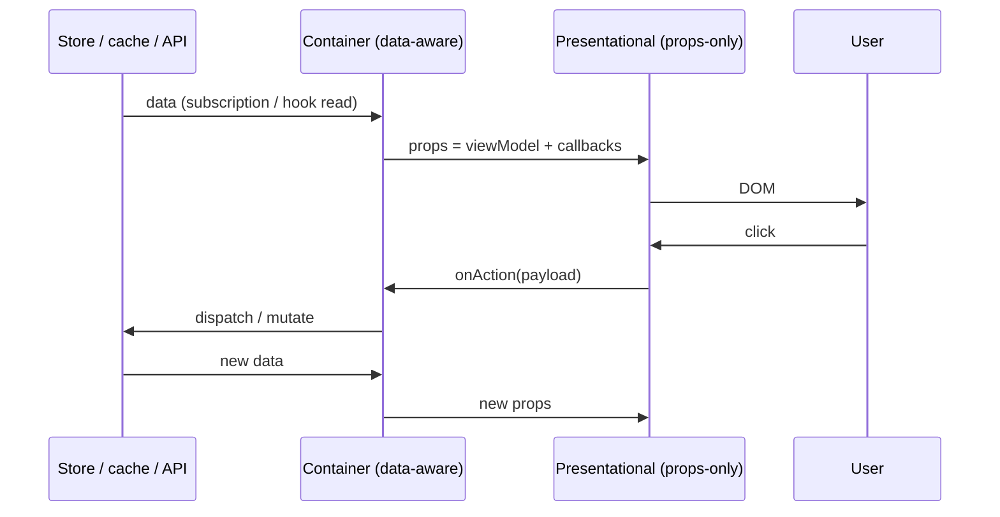
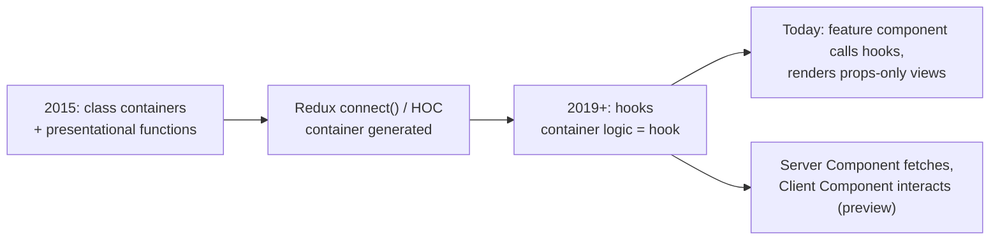
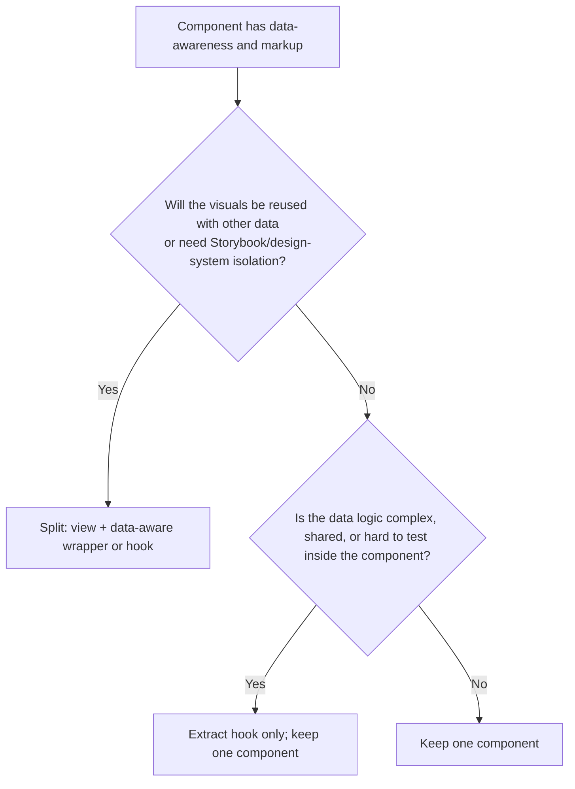

# 04 / 04 — Presentational vs Container Components: History, Mechanics, and Modern Use

## 1. Lesson metadata

| | |
|---|---|
| **Level** | Intermediate |
| **Study time** | 4 hours (reading 1.75 h, lab 1 h, exercises 1.25 h) |
| **Prerequisites** | [04 / 02 — Separation of concerns](./02-separation-of-concerns.md), [04 / 03 — Component responsibility](./03-component-responsibility.md), [Phase 1 / 06 — Props and one-way data flow](../01-react-fundamentals/06-props-and-one-way-data-flow.md), [Phase 1 / 11 — Controlled and uncontrolled inputs](../01-react-fundamentals/11-controlled-and-uncontrolled-inputs.md) |
| **Next** | [05 — Composition and dependency direction](./05-composition-and-dependency-direction.md) |
| **Related later** | [Phase 5 / 04 — Container/presentational (pattern view)](../05-design-patterns/04-container-presentational.md), [Phase 5 / 06 — Custom hook patterns](../05-design-patterns/06-custom-hook-patterns.md), [Phase 5 / 18 — Behavior vs presentation](../05-design-patterns/18-behavior-vs-presentation.md), [Phase 9 — Server Components](../09-advanced-rendering-and-ecosystem/) |

> Phase 5 revisits this as a *pattern* with refactoring labs. This lesson treats it as an **architectural decision**: where in a codebase should the boundary between "knows where data comes from" and "knows how to draw it" sit, and is it worth having?

**Learning objectives.** After this lesson you can:
1. Describe the original container/presentational split, the problem it solved in the class-component era, and why its original form is now considered *legacy*.
2. Explain what changed with hooks, and what *survived* (the separation of data-awareness from visual rendering).
3. Implement four variants: class-based containers/HOC `connect` (historical), hook-based "headless container", feature-level containers with presentational children, and server/client component splits.
4. Decide the container boundary for a given feature using criteria: testability, reuse, Storybook/design-system needs, cost of indirection.
5. Recognise failure modes: component pairs that always change together, containers that only forward props, presentational components that secretly depend on context.
6. Migrate a legacy `connect()` container tree and a "fat component" to a modern split without behaviour changes.

**Concepts covered:** presentational component, container component, data-awareness, "smart/dumb" terminology and why it is discouraged, props-only contract, hook as container, headless component, view model, characterisation of coupling, server vs client component split (preview), Storybook-friendly design, over-separation cost, four approach dossiers.

---

## 2. Deep conceptual explanation

### 2.1 What problem is this lesson solving?

Around 2015, React apps were built from class components. A typical component:

```jsx
// historical (class components are legacy; shown only to explain the pattern)
class CommentList extends React.Component {
  state = { comments: [] };
  componentDidMount() { fetch("/comments").then(r => r.json()).then(comments => this.setState({ comments })); }
  render() { return <ul>{this.state.comments.map(c => <li key={c.id}>{c.body} — {c.author}</li>)}</ul>; }
}
```

Fetching, state, and markup lived in one class. Consequences:
- To redesign the list you had to read the fetching logic.
- To reuse the visuals with different data (e.g. in a "preview" screen), you could not.
- To test the rendering you needed to stub `fetch`.
- To use the markup in a style guide you had to fake a server.

In 2015, Dan Abramov wrote an influential article, *Presentational and Container Components*, proposing a split:

| | Presentational | Container |
|---|---|---|
| Concerned with | How things **look** | How things **work** |
| Aware of app/data layer (Flux/Redux)? | No | Yes |
| Reads data from | Props | Subscribes to state/store |
| Changes data via | Callbacks from props | Dispatching actions / calling APIs |
| Written | Usually by hand, as functions | Usually generated (e.g. Redux `connect()`), or hand-written classes |
| Has own state? | Usually no (UI state only) | Yes (it is the data source) |

In 2019, after hooks arrived, the same author added a note that he **no longer recommends this split as a dogma**: hooks let you extract the *logic* without restructuring the *component tree*, so the split is no longer needed to share logic. This lesson teaches both halves: the problem that was real, and why modern code usually meets it differently.

⚠ *Source note.* The summaries here are from memory of the original article and its update note; check the primary text on the author's blog (see §14) before quoting any statement.

### 2.2 The durable idea: separate "data-awareness" from "visual rendering"

Strip away classes, Redux, and HOCs. A durable observation survives:

> Some components need to know **where data comes from and where actions go** (ambient dependencies: stores, query caches, routers, auth). Others only need to know **what to draw given data**. Keeping these two kinds of knowledge apart gives you testability, reusability and design-iteration speed *at the cost of an extra layer*.

In the language of [lesson 03](./03-component-responsibility.md): presentational components have *no ambient dependencies* and a props-only contract; containers *concentrate* the ambient dependencies. In the language of lesson 02: presentation vs orchestration.

### 2.3 What changed with hooks

Before hooks, the way to *share* stateful logic was to wrap components: HOCs (`connect`, `withRouter`) and render props. A "container" was frequently a **separate component in the tree**, because the only way to attach behaviour was to wrap.

With hooks ([React 16.8](https://react.dev/reference/react/hooks), now standard), behaviour attaches **without changing the tree**:

```tsx
function CommentList() {
  const { comments, status } = useComments();   // "container" logic as a hook
  return <CommentListView comments={comments} status={status} />;
}
```

Three consequences:
1. The "container" is now often a **hook**, or a thin component that calls a hook and renders a presentational child. Separate container *classes* are unnecessary.
2. Sharing logic across different visuals no longer requires a container component: two views can call the same hook.
3. The remaining value of a presentational component is **a props-only visual unit**, not a "must not have hooks" rule. Presentational components may use hooks for *UI state* (`useState` for open/closed), refs, and ids, but no domain/data hooks.

### 2.4 The two-sentence modern rule

> Keep **data and side-effect orchestration** in a feature-level component or hook; keep **rendering** in components that receive plain data and callbacks as props. Create the split where it earns its keep (shared visuals, complex data logic, design-system boundaries), not everywhere.

### 2.5 Terminology to avoid

"Smart" and "dumb" components are widespread but misleading: presentational components are not dumb (they implement accessibility, animation, keyboard handling, and responsive layout, which is hard work), and containers are not necessarily smart. Prefer *presentational/view* and *container/connected/controller*, or best, describe the actual capability: "props-only" vs "data-aware".

### 2.6 Common misconceptions

| Misconception | Reality |
|---|---|
| "Presentational components can't have state." | They can have *UI state* (open, focused, hover, internal controlled-state mirror). What they should not have is *domain/server state and data-fetching*. |
| "Presentational components can't use hooks." | They can use React hooks for UI concerns (`useId`, `useRef`, `useState`, `useEffect` for focus management). They avoid *data-aware* hooks (`useStore`, `useQuery`, `useParams`). |
| "Every component needs a container." | Only where the split provides value (see §7). Most leaf components are simply presentational; many features need only one container at the top. |
| "The pattern is obsolete." | The *class/HOC form* is legacy. The *idea* (props-only views, data-aware boundary) is alive in Storybook-driven development, design systems, headless components, and Server/Client Component splits. |
| "Containers should have no JSX." | A container usually renders *something* (the presentational child, loading/error states); it should not contain *visual detail* (classes, layout markup). |
| "Props-only means anything passed in is fine." | A presentational component that accepts `store` or a giant `appState` prop is data-aware by proxy. Pass the minimum data it needs. |

---

## 3. Internal mechanics

### 3.1 What a "container" does at runtime (teaching model)

A container is a component that, when rendered, (a) subscribes to or reads data sources (store, query cache, context, URL), (b) transforms them into the *view model* the presentational child needs, (c) creates callbacks that translate UI events into actions, and (d) renders the presentational child with those props.



Because React's data flow is one-way, this sequence is *just React*; the pattern simply assigns responsibilities to the two participants.

### 3.2 Re-render consequences of the split (public guarantee + teaching model)

*Public guarantee.* When a container re-renders, it re-renders its children by default; presentational children only skip rendering if memoised and props are referentially equal ([Phase 7 / 05](../07-performance/05-referential-equality.md)).

*Teaching model.* The container is where *data change* enters the tree; presentational children are where *changes are displayed*. Two performance-relevant points:
1. **The container should subscribe to as little as it needs.** A container that reads a whole store slice re-renders for unrelated changes. With selector-based stores (Zustand, Redux `useSelector`), the container selects only the fields it passes down.
2. **View-model construction creates new objects each render.** `const vm = { total: sum(items), label: ... }` makes a new `vm` identity each time, defeating `React.memo` on the child unless memoised with correct dependencies ([Phase 7 / 04](../07-performance/04-memoization-trade-offs.md)). Prefer passing primitives or stable references to memoised children *when measurement shows it matters*.

### 3.3 Why hook-as-container does not create a render boundary

A custom hook is inlined into its caller's render ([lesson 02 §3.1](./02-separation-of-concerns.md)). In `function CommentList() { const vm = useComments(); return <View {...vm} />; }`, `CommentList` is the data-aware component and `View` the presentational one; **the hook is not a separate unit of rendering**. If you want render isolation between data logic and view, you need two *components* and memoisation on the view. This is why "hook = container" is accurate for *responsibility* but not for *runtime boundaries*.

### 3.4 Server Components and a modern re-appearance of the split (⚠ volatile)

*Public guarantee (React 19 / Server Components):* Server Components run on the server (or at build time), can be `async`, and can read data directly; Client Components (`"use client"`) run in the browser and may use state, effects, and event handlers. A server component can pass serialisable props to client components ([react.dev reference for Server Components](https://react.dev/reference/rsc/server-components)).

*Teaching model.* This is a structurally similar split: a data-aware parent that fetches and passes plain props to an interactive child. The difference is that the "container" is now *not shipped to the browser*, and there is **a hard serialization boundary**: props must be serialisable (no functions, except server actions). ⚠ *Framework-dependent details (bundler integration, caching semantics, which APIs exist) change quickly; verify against current framework docs. See Phase 9.*

---

## 4. Step-by-step walkthrough: refactoring a fat component into container + presentational

Starting point: `CommentList` that fetches, filters by author, and renders (modern functional form with the mistakes kept deliberately simple).

1. **Characterise behaviour.** Render with MSW returning 3 comments; assert the 3 `listitem`s and the filter behaviour. This test must pass before and after.
2. **Identify data-aware code**: `fetch`, filter state *derived from URL?* (here: local `authorFilter`), the loading/error branches.
3. **Define the view model** the visuals need: `{ comments: CommentVM[]; authors: string[]; selectedAuthor: string | "all"; }` plus callbacks `onAuthorChange(author)`. Decide types in a `types.ts` shared by both sides.
4. **Extract the presentational component** `CommentListView(props: ViewProps)`: JSX only. Move class names and layout into it. No `fetch`, no `useParams`, no domain hooks.
5. **Extract the container logic** into `useComments()` returning `{ status, comments, authors, selectedAuthor, setAuthor }`.
6. **Container component** `CommentList` calls the hook, branches on `status` (loading/error), and renders the view with props.
7. **Re-run the characterisation test.** It should pass unchanged (it tests behaviour at the integration level).
8. **Add a Storybook story / component test** for `CommentListView` with plain props: empty, one comment, 500 comments, long text, RTL. These tests need no network.
9. **Decide whether to keep both** `CommentList` and the hook. If the container is just `const vm = useComments(); return <View {...vm} />`, consider collapsing them: keep the hook and the view, drop the extra component, and let the *page* call the hook and render the view. Fewer components, same separation. (This is the "hook as container" variant.)

Timeline for "user changes the author filter":
1. `CommentListView` `<select onChange>` fires `onAuthorChange("ada")`.
2. Container's `setAuthor("ada")` schedules a state update.
3. Container re-renders; `useComments` derives `comments` filtered by author (derivation during render, not an effect).
4. View receives new `comments` props; reconciles `<li key={id}>`: removed items unmounted, retained items updated.
5. Commit; DOM updated. No network request occurs (filter is client-side). If the filter were server-side, the hook's query key changes and a fetch starts ([Phase 6](../06-data-fetching-and-state-ecosystems/01-fetch-lifecycle.md)).

---

## 5. Code examples

### 5.1 Minimal example — the smallest meaningful split

```tsx
// Presentational: props only
interface AvatarProps { src: string; name: string; size?: number }
export function Avatar({ src, name, size = 32 }: AvatarProps) {
  return ;
}

// Data-aware wrapper (container) - knows where the user comes from
export function CurrentUserAvatar() {
  const user = useCurrentUser();           // ambient dependency lives here
  if (!user) return null;
  return <Avatar src={user.avatarUrl} name={user.name} />;
}
```

Line notes: `Avatar` has no hooks and no ambient dependencies: usable in a design-system, in Storybook, and in tests with literal props. `CurrentUserAvatar` is the *only* piece that changes if auth is replaced. **When appropriate:** `Avatar` has more than one consumer; the wrapper is justified by the ambient dependency. **When not:** if `Avatar` is used in exactly one place and will never be reused, the split adds a file for no gain; inline is fine.

### 5.2 Practical example — modern comment list (hook as container)

```ts
// features/comments/model/types.ts
export interface Comment { id: string; author: string; body: string; createdAt: string }
export interface CommentsViewModel {
  comments: readonly Comment[];
  authors: readonly string[];
  selectedAuthor: string | null;     // null = all authors
}
```

```ts
// features/comments/model/useComments.ts
import { useEffect, useMemo, useState } from "react";
import type { Comment } from "./types";

type Status = "loading" | "error" | "ready";

export function useComments(postId: string) {
  const [status, setStatus] = useState<Status>("loading");
  const [all, setAll] = useState<readonly Comment[]>([]);
  const [selectedAuthor, setSelectedAuthor] = useState<string | null>(null);

  useEffect(() => {
    const ctrl = new AbortController();
    setStatus("loading");
    fetch(`/api/posts/${encodeURIComponent(postId)}/comments`, { signal: ctrl.signal })
      .then((r) => { if (!r.ok) throw new Error(String(r.status)); return r.json() as Promise<Comment[]>; })
      .then((data) => { setAll(data); setStatus("ready"); })
      .catch(() => { if (!ctrl.signal.aborted) setStatus("error"); });
    return () => ctrl.abort();
  }, [postId]);

  const authors = useMemo(() => [...new Set(all.map((c) => c.author))].sort(), [all]);
  const comments = useMemo(
    () => (selectedAuthor ? all.filter((c) => c.author === selectedAuthor) : all),
    [all, selectedAuthor],
  );

  return { status, comments, authors, selectedAuthor, setSelectedAuthor };
}
```

```tsx
// features/comments/ui/CommentListView.tsx — presentational: props only, no data hooks
import type { Comment } from "../model/types";

interface Props {
  comments: readonly Comment[];
  authors: readonly string[];
  selectedAuthor: string | null;
  onAuthorChange: (author: string | null) => void;
}

export function CommentListView({ comments, authors, selectedAuthor, onAuthorChange }: Props) {
  return (
    <section aria-labelledby="comments-heading">
      <h2 id="comments-heading">Comments ({comments.length})</h2>
      <label>
        Author{" "}
        <select value={selectedAuthor ?? ""} onChange={(e) => onAuthorChange(e.target.value || null)}>
          <option value="">All</option>
          {authors.map((a) => <option key={a} value={a}>{a}</option>)}
        </select>
      </label>
      {comments.length === 0 ? (
        <p>No comments yet.</p>
      ) : (
        <ul>{comments.map((c) => <li key={c.id}><strong>{c.author}</strong>: {c.body}</li>)}</ul>
      )}
    </section>
  );
}
```

```tsx
// features/comments/ui/CommentList.tsx — container: data-aware, no visual detail
import { useComments } from "../model/useComments";
import { CommentListView } from "./CommentListView";

export function CommentList({ postId }: { postId: string }) {
  const { status, comments, authors, selectedAuthor, setSelectedAuthor } = useComments(postId);
  if (status === "loading") return <p aria-busy="true">Loading comments…</p>;
  if (status === "error") return <p role="alert">Could not load comments.</p>;
  return (
    <CommentListView
      comments={comments}
      authors={authors}
      selectedAuthor={selectedAuthor}
      onAuthorChange={setSelectedAuthor}
    />
  );
}
```

Line notes:
- `<select value={selectedAuthor ?? ""}>` maps `null` ("all") to the empty option and back (`e.target.value || null`), keeping the **view model free of UI-specific sentinel strings** at the boundary. Predict what happens if an author literally named `""`: it cannot exist; we treat empty string as "all".
- `readonly` arrays express that the view must not mutate.
- `useMemo` here avoids recomputing the filtered array and keeps a stable reference; it is an optimisation and removing it must not change behaviour. In production you'd likely replace the `fetch`-in-effect with a query hook ([Phase 6 / 08](../06-data-fetching-and-state-ecosystems/08-tanstack-query.md)). The *split* stays identical.
- Testing: `CommentListView` can be tested by rendering with literal props and asserting on accessible roles; `useComments` through `renderHook` with MSW; `CommentList` via one integration test.

**Trade-off.** Three files for ~60 lines of logic. Worth it when the view will be reused (a "preview" in an editor), documented in Storybook, or when the data logic is non-trivial (here, borderline). For a single-use trivial list, a single component is better.

### 5.3 Incorrect example — presentational component with hidden data dependency

```tsx
// Looks presentational, but is not
export function PriceLabel({ productId }: { productId: string }) {
  const { currency } = useSettings();            // ambient dependency #1
  const { data } = useQuery(["price", productId], () => fetchPrice(productId)); // #2
  const navigate = useNavigate();                // #3
  return <span onClick={() => navigate(`/p/${productId}`)}>{format(data, currency)}</span>;
}
```

Problems: the "label" fetches, reads settings, and navigates. It cannot be shown in a story without three providers; it fires a request per instance (N+1 in a list); it cannot be reused where the price is already known; testing the formatting requires network setup. Despite the name, this is a container wearing a presentational costume.

### 5.4 Corrected implementation

```tsx
// props-only
export function PriceLabel({ amountText, onSelect }: { amountText: string; onSelect?: () => void }) {
  return onSelect
    ? <button type="button" onClick={onSelect}>{amountText}</button>
    : <span>{amountText}</span>;
}

// data-aware at the feature level, once per list not per label
export function ProductRow({ product }: { product: Product }) {
  const { currency } = useSettings();
  const navigate = useNavigate();
  return <PriceLabel amountText={formatMoney(product.price, currency)} onSelect={() => navigate(`/p/${product.id}`)} />;
}
```

Notes: use `<button>` for clickable text to get keyboard/a11y semantics (the incorrect version used a clickable `<span>`). Prices come with the product list response (no N+1). Ambient dependencies are concentrated in `ProductRow`.

### 5.5 Advanced example — headless container + multiple views (hook as the reusable part)

```tsx
// model/useSelection.ts — behaviour only; no markup
export function useSelection<T>(items: readonly T[], getId: (t: T) => string) {
  const [selected, setSelected] = useState<ReadonlySet<string>>(new Set());
  const toggle = (item: T) =>
    setSelected((prev) => {
      const next = new Set(prev);
      const id = getId(item);
      next.has(id) ? next.delete(id) : next.add(id);
      return next;
    });
  const isSelected = (item: T) => selected.has(getId(item));
  const clear = () => setSelected(new Set());
  return { selected, toggle, isSelected, clear, count: selected.size, all: items.length };
}

// Two completely different views, one behaviour
function TableView({ rows }: { rows: Row[] }) {
  const sel = useSelection(rows, (r) => r.id);
  return <table>{/* checkboxes call sel.toggle(row) */}</table>;
}
function GridView({ rows }: { rows: Row[] }) {
  const sel = useSelection(rows, (r) => r.id);
  return <div className="grid">{/* cards call sel.toggle(row) */}</div>;
}
```

Notes: `useSelection` is the "container logic" shared by two visual components: the case where the pattern's *original goal* (reuse logic across visuals) is solved by a hook, not a container component. `toggle` mutates a *copy* of the set (never the previous state). Each view has its own selection state; if both views are visible simultaneously and should share selection, state must be lifted (lesson 03) or put into a store. See [Phase 5 / 07](../05-design-patterns/07-headless-components.md) for the full headless pattern.

---

## 6. Visual explanations

### Evolution of the pattern



### What lives where (modern default)

```text
page            ── reads route, composes
  feature       ── data hooks (server state, store), orchestration, view model
    view        ── props-only: markup, a11y, layout, UI state (open/focus)
      primitives ── Button, Input, Icon
```

### Decision: do I need a separate container?



---

## 7. Alternative approaches and trade-offs (dossiers)

### 7.1 Dossier A — Classic containers (class components, HOC `connect`) — historical

- **Original problem.** Behaviour reuse and testability in the class-component era, in which state, effects (lifecycle methods) and rendering were all in one class, and the only reuse mechanisms were HOCs and render props. Redux's `connect()` generated containers from `mapStateToProps` / `mapDispatchToProps`.
- **Representative structure.**
  ```text
  components/   CommentList.jsx (presentational)
  containers/   CommentListContainer.jsx (connect(mapState, mapDispatch)(CommentList))
  ```
- **Dependency rules.** `containers → components → (nothing data-aware)`. Presentational components must not import the store or router.
- **Example code (historical, for recognition).**
  ```jsx
  // legacy Redux style
  const mapState = (s) => ({ comments: s.comments.items });
  const mapDispatch = { onAuthorChange: setAuthorFilter };
  export default connect(mapState, mapDispatch)(CommentList);
  ```
- **Advantages.** Strong, enforceable convention; trivially testable presentational layer; Storybook-friendly; good with code generation.
- **Disadvantages.** Two files per concept; HOC wrapper nesting ("wrapper hell") in DevTools; prop-name collisions; typing HOCs is painful; `containers/` folder separates files that change together (low locality).
- **Appropriate sizes.** Legacy codebases only; new code should not adopt it. Within a legacy codebase, continuing the convention may be correct until a migration plan exists.
- **Failure modes.** Containers that merely forward all props; presentational components that import the store "just once"; folder duplication; mapState selectors recomputing on every store change.
- **Migration.** Replace `connect` with the store's hooks (`useSelector`, `useDispatch` in Redux Toolkit) incrementally; keep presentational components untouched; convert one container at a time. Delete the `containers/` directory only when empty.

### 7.2 Dossier B — Hook as container ("logic hook + view")

- **Original problem.** Same as A, minus the HOC wrapper: share data-aware logic without changing the tree.
- **Representative structure.**
  ```text
  features/comments/
    model/useComments.ts
    ui/CommentList.tsx        (calls hook, renders view)
    ui/CommentListView.tsx    (props-only)
  ```
- **Dependency rules.** Views are props-only (no domain hooks); hooks never import components; the feature component is the only place both meet.
- **Example.** §5.2.
- **Advantages.** No wrapper nesting; hooks composable and testable; single source for logic reused by multiple views; type inference flows naturally.
- **Disadvantages.** Hook returns can become wide; the boundary is a convention (nothing stops a view from calling `useComments`); no render boundary (§3.3).
- **Appropriate sizes.** Default for most teams of any size.
- **Failure modes.** View components that call data hooks anyway; the pair `X`/`XView` where `X` merely passes props through (see §8); duplicated logic in hooks for similar features.
- **Migration.** From A: replace `connect` with hooks (see above). From fat component: extract hook then view (§4).

### 7.3 Dossier C — Feature-level boundary only (containers at page/feature roots)

- **Original problem.** Container/presentational for *every* component creates dozens of pairs. Many teams keep **data awareness only at a small number of boundary components** (page and feature roots), with everything beneath receiving props.
- **Representative structure.**
  ```text
  pages/OrderPage.tsx          — data-aware root: hooks, composition
  features/order/ui/*          — props-only components below
  ```
- **Dependency rules.** Data hooks allowed only in files named `*Page.tsx` / `*Feature.tsx` (or in `model/`); everything else props-only. Lint-able by file pattern.
- **Example.**
  ```tsx
  export function OrderPage({ orderId }: { orderId: string }) {
    const vm = useOrderPage(orderId);                    // single data-aware point
    return <OrderLayout summary={<OrderSummary totals={vm.totals} />} items={<ItemList lines={vm.lines} />} />;
  }
  ```
- **Advantages.** Few containers; most of the tree is trivially testable; ambient dependencies are easy to audit; fits co-owned feature slices.
- **Disadvantages.** Pages become large "wiring" components; prop-drilling pressure within the feature; independent loading/error states per region are harder (one data point → one loading state) unless regions get their own roots.
- **Appropriate sizes.** Small to medium teams; apps whose pages load one coherent data set.
- **Failure modes.** God page; drilling 15 props through 4 layers (use composition/slots first, context second); a single loading spinner for independent regions.
- **Migration.** Identify leaf components with hidden data hooks (grep `use*Query|useStore|useParams` in `ui/`), lift the calls to the feature/page root, pass results down. Split roots when regions need independent loading.

### 7.4 Dossier D — Server/Client component split (⚠ volatile, framework-dependent)

- **Original problem.** Keep data fetching and heavy dependencies on the server (smaller client bundle, direct data access, no client waterfalls), while keeping interactivity in the browser.
- **Representative structure (Next.js App Router style; verify).**
  ```text
  app/orders/[id]/page.tsx        (server) fetches order, renders <OrderView order={order} />
  app/orders/[id]/OrderView.tsx   ("use client") interactive coupon box
  ```
- **Dependency rules.** Server components may import client components (and pass serialisable props); client components may not import server components (but can receive them as `children`). Secrets and server-only modules stay in the server graph.
- **Example.**
  ```tsx
  // server component (async)
  export default async function OrderPage({ params }: { params: Promise<{ id: string }> }) {
    const { id } = await params;
    const order = await db.orders.find(id);      // direct data access (framework/server context)
    return <OrderView order={order} />;
  }
  ```
  ⚠ The `params` shape and async behaviour are framework-version-dependent; check current docs.
- **Advantages.** Smaller client bundles, data access without exposing endpoints, fewer waterfalls; natural container/presentational mapping.
- **Disadvantages.** Serialisation boundary (no functions/class instances), framework coupling, mental-model cost (two environments), caching semantics, harder local testing (async components need special handling).
- **Appropriate sizes.** Content-heavy or data-heavy apps on supporting frameworks; teams willing to learn the model. Not applicable to pure client SPAs.
- **Failure modes.** `"use client"` placed too high, making everything client-rendered; passing huge props across the boundary; leaking server-only code into client bundles.
- **Migration.** From client containers: move data fetching up into server components incrementally, mark only interactive leaves as client components; keep presentational components as shared (they work in both environments if they have no hooks/events).

### 7.5 Comparison

| Criterion | A: Class/HOC | B: Hook + view | C: Feature-root only | D: Server/Client |
|---|---|---|---|---|
| Status | Legacy | Mainstream | Mainstream | Emerging/volatile |
| Files per feature | Many | Moderate | Few | Moderate |
| View testability | Excellent | Excellent | Excellent (below root) | Good |
| Wrapper nesting | High | None | None | None |
| Render isolation | Via wrapper | Needs memo | Needs memo | Server/client boundary |
| Prop-drilling pressure | Low | Low–Med | Med–High | Med |
| Learning curve | Medium | Low | Low | High |

**A scenario where the recommended approach (hook + props-only view) is *not* best.** A throwaway internal tool with one page and no Storybook: the split triples files without benefit. One component with a data hook inside is the right amount. Likewise, a leaf `<Tag>` that is already props-only needs no counterpart.

---

## 8. Best practices and anti-patterns

**Do**
- Make the **props-only** property *checkable*: presentational files import no data hooks, router, or store (lint by path; lesson 25).
- Pass **minimal, domain-shaped props** (`amountText`, `status`, `onSubmit`), not entire entities or `store` objects, unless the entity is the domain concept of the component.
- Keep UI state (open/closed, focus, hover) **inside** presentational components, but allow **controlled overrides** when parents need coordination ([Phase 5 / 11](../05-design-patterns/11-controlled-component-pattern.md)).
- Name by role: `CommentList` (data-aware), `CommentListView` (props-only), or place the view in `ui/` and the hook in `model/`. Avoid the `Container` suffix in new code.
- Put loading/error branches in the container, or provide `Skeleton`/`ErrorState` presentational components.
- Provide Storybook stories for views with realistic edge cases: empty, long text, many items, RTL, error.

**Beginner mistakes**
- Splitting every component into `FooContainer`/`Foo` pairs.
- Passing the store/`dispatch` into presentational components "because they need to update data".
- Copying props into local state in the view (`useState(props.items)`), then failing to see updates ([Phase 1 / 14](../01-react-fundamentals/14-state-as-a-snapshot.md)).

**Experienced-developer mistakes**
- Treating the pattern as law, so teams ban `useState` in views and end up lifting trivial UI state into containers (growing prop APIs with `isOpen/onToggle` for every popover).
- Containers that grow into god-hooks (25 return values).
- Presentational components calling `useTranslation`, `useTheme` etc. and being declared "pure"; sometimes acceptable (UI-infrastructure context), but be explicit about which ambient dependencies are allowed.
- Using the split to justify not *thinking* about state ownership.

**Smells:** a pair where the container only does `return <View {...props} />`; a view with more than ~10 props that mirror the container's entire state; container with JSX containing `className`s; views importing `../model/*`; tests mocking modules to render a "presentational" component.

**Justified exceptions.** Allow *UI-infrastructure* ambient dependencies in views (theme, locale, design-token context) if you explicitly document them; allow a view to own a *derived* UI state (sorted order for display) if it is purely visual; allow a leaf to fetch its own data if it is an independent widget with its own boundary.

---

## 9. Real-world application

*Design-system-backed product (Storybook-first).* Designers iterate on `CommentListView` in Storybook with static fixtures; product engineers wire it to data in `CommentList`. Constraint: the design system must not depend on the product's API; hence the view is props-only and lives in `shared/ui` or in the feature's `ui/` with stories.

*Finance table with real-time data.* The container subscribes via selectors to a price store, maps to display-ready rows (formatted strings, change direction), and passes a stable `rows` array to a memoised, virtualised `QuoteTableView`. Constraint: updates arrive 20–50 times/s; container-level throttling (`requestAnimationFrame` batching) protects the view. The split makes the throttle a data-layer concern, not a drawing concern.

*Auth/permissions UI.* `PermissionGate` is a container-ish wrapper (reads permissions) that renders presentational `ForbiddenState` when denied; views never check roles themselves. Constraint: UI checks are advisory; enforcement is server-side.

*Forms.* Field components are presentational (label, input, error text); the form container owns values, validation, and submission ([Phase 3](../03-react-state-and-hooks/01-usestate-internals-and-update-semantics.md) covers Actions). Constraint: a11y: error messages linked via `aria-describedby`, owned by the field view.

*Multi-team product.* Platform team ships presentational views as a package; feature teams own containers. The props contract is the API between teams ([lesson 23](./23-multi-team-ownership.md)). Semantic versioning of view props matters.

---

## 10. Debugging and troubleshooting

**Symptom: "The story for `OrderView` crashes: `useNavigate() may be used only in the context of a <Router>`."**
1. Read the stack trace for the hook call; locate the file.
2. Root cause: a hidden ambient dependency in a supposedly presentational component.
3. Fix: replace with a callback prop (`onOpen(id)`); do the navigation in the container.
4. Validate: render the view in isolation (story/test) with plain props.

**Symptom: "Container re-renders on every keystroke of an unrelated form."**
1. React DevTools Profiler → record → "Why did this render?" (enable in settings) shows "Hook X changed" or "Parent rendered".
2. Root cause candidates: subscribing to an entire store slice; context value recreated each render; state held too high.
3. Fix: select narrower store fields; stabilise context value (`useMemo`) or split contexts; move the unrelated form state to its own component ([lesson 03](./03-component-responsibility.md)).
4. Validate with a second recording: commit duration and component list.

**Symptom: "View shows stale data after container updates."**
Check whether the view copied props to state (`useState(props.x)`). Replace with derivation or a `key`; verify in DevTools by watching the prop and the hook state diverge.

**Symptom: "Memoised view re-renders anyway."**
Compare props between renders: new object/array/function identities from the container. Use the Profiler's "props changed" info or add a temporary `console.log` comparing refs. Fix by stabilising (`useMemo`/`useCallback`) *only* if the profiler shows meaningful cost; ⚠ with the React Compiler enabled, much of this is automatic; verify your build setup.

**Symptom: Test passes locally, fails in CI for the container.** Look for dependence on fetch timing; use `findBy*` queries and MSW instead of fixed delays; ensure each test's server handlers reset.

---

## 11. Exercises

### Level A — Knowledge
A1. List the differences between presentational and container components in the original formulation.
A2. What did hooks change about the pattern, and what remained valuable?
A3. Why is "smart/dumb" terminology discouraged?
A4. Which hook types are acceptable inside a presentational component, and which are not?
A5. How does a Server Component split resemble the pattern, and what new constraint does it introduce?

### Level B — Code comprehension
B1. Classify each component as data-aware or props-only, and justify:
```tsx
function A({ items }: { items: Item[] }) { const [open, setOpen] = useState(false); /* renders a collapsible list */ }
function B() { const { data } = useQuery(["items"], fetchItems); return <A items={data ?? []} />; }
function C({ id }: { id: string }) { const nav = useNavigate(); return <button onClick={() => nav(`/i/${id}`)}>Open</button>; }
```
B2. In §5.2, why does the container return early on `loading`/`error` instead of passing `status` to the view? Name one trade-off of each choice.
B3. Why is `useMemo` for `authors` in §5.2 an optimisation rather than a requirement for correctness?

### Level C — Implementation
C1. Refactor §5.3 `PriceLabel` into the corrected form, then write a React Testing Library test of the presentational part that needs no providers.
C2. Convert a legacy `connect(mapState, mapDispatch)(Todos)` to a hook-based container using Redux Toolkit hooks (`useSelector`, `useDispatch`), keeping the presentational component untouched.
C3. Implement `useSelection` (§5.5) test cases with `renderHook`: toggle on/off, clear, and `count`.

### Level D — Debugging
D1. A presentational `Chart` component re-renders at 60 fps because its container recomputes `{ series: compute(data) }` each render. Diagnose and fix without `React.memo` first, then with it.
D2. A team's Storybook is full of providers and mocks for "view" components. Propose an audit and a remediation plan.
D3. A server-component page passes an `onSave` function to a client component and the framework throws a serialisation error. Explain and fix. (⚠ framework-specific; answer in terms of React's documented boundary rules.)

### Level E — Architecture decisions
E1. For a 6-engineer team with a design system and a Storybook, decide between Dossiers B and C and state lint rules that make the choice enforceable.
E2. A legacy codebase has 300 `connect`ed containers. Propose a migration strategy, sequencing, risk controls, and an "exit criterion" for the legacy pattern.
E3. When would you *recommend against* separating presentation from data at all?

### Level F — Expert challenge
F1. Design the container/view boundary strategy for a large app that must support (a) a client-rendered SPA shell, (b) server-rendered marketing pages, and (c) embeddable widgets distributed as a package with a stable props API. Address data-awareness placement, props contracts and versioning, bundle impact, testing at each layer, and how you keep the three consistent.

---

## 12. Detailed answers and explanations

> Attempt the exercises first.

**A1.** Presentational: concerned with appearance; reads data and callbacks from props; usually no data-layer awareness; typically functional and stateless (aside from UI state). Container: concerned with behaviour; subscribes to data sources, dispatches actions; provides data/callbacks to presentational children; often generated by `connect`. Table form in §2.1.

**A2.** Hooks let you attach data/behaviour to a component without a wrapper component, so sharing logic no longer requires a container in the tree; the logic moves into custom hooks. What remained: separating data-awareness from visual rendering for testability, reuse, and design-system/Storybook isolation, now as "props-only views + data-aware hook/feature component".

**A3.** It implies presentational components are trivial and containers sophisticated; in fact views carry significant complexity (a11y, responsiveness, animation) and containers may be trivial wiring. It also invites status hierarchies. Prefer describing capabilities: props-only vs data-aware.

**A4.** Acceptable: `useState`/`useReducer` for UI state, `useRef`, `useId`, `useEffect` for focus/DOM integration, `useLayoutEffect` for measurements, UI-infrastructure context (theme/locale) if declared. Not acceptable (by default): data fetching/query hooks, store hooks, router hooks, auth hooks. Reason: these are ambient domain dependencies that break isolation.

**A5.** A Server Component fetches (data-aware) and renders Client Components with props (like container → view). New constraint: props crossing the server→client boundary must be serialisable (functions can't be passed, except Server Functions/Actions as documented), and client components can't import server components directly. ⚠ Verify details in current docs.

**B1.** `A`: props-only (UI state `open` is allowed). `B`: data-aware (query hook): a container. `C`: data-aware (router): hidden ambient dependency; should receive `onOpen`. Plausible wrong answer: "C is presentational because it renders a button"; rendering simple markup does not offset the router dependency.

**B2.** Early return: the view stays simple and always receives ready data, and loading/error markup is centralised; trade-off: container now has visual markup, and views can't show skeletons in place (layout shift). Passing `status` to the view: the view controls skeletons/layout stability (better UX/consistency), at the cost of a larger props surface and a view that must handle all states. A good compromise: dedicated `Skeleton`/`ErrorState` views rendered by the container.

**B3.** `useMemo` caches results to avoid recomputation and keep stable references. Removing it yields the same values (pure computation of the same inputs). React treats `useMemo` as a performance hint, and its docs say it may discard the cache in some situations, so correctness must not depend on it. ([Phase 7 / 04](../07-performance/04-memoization-trade-offs.md).)

**C1.**
```tsx
// presentational (above) + test
import { render, screen } from "@testing-library/react";
import userEvent from "@testing-library/user-event";
import { PriceLabel } from "./PriceLabel";

test("renders a button when selectable and calls onSelect", async () => {
  const onSelect = vi.fn();
  render(<PriceLabel amountText="£9.99" onSelect={onSelect} />);
  await userEvent.click(screen.getByRole("button", { name: "£9.99" }));
  expect(onSelect).toHaveBeenCalledOnce();
});
test("renders text when not selectable", () => {
  render(<PriceLabel amountText="£9.99" />);
  expect(screen.queryByRole("button")).toBeNull();
  expect(screen.getByText("£9.99")).toBeInTheDocument();
});
```
No providers needed: that is the proof of props-only. (`vi` from Vitest; `toBeInTheDocument` from jest-dom.)

**C2.**
```tsx
import { useDispatch, useSelector } from "react-redux";
import { selectVisibleTodos, toggleTodo } from "./todosSlice";
import type { AppDispatch, RootState } from "../store";

export function TodosContainer() {
  const todos = useSelector((s: RootState) => selectVisibleTodos(s));
  const dispatch = useDispatch<AppDispatch>();
  return <Todos todos={todos} onToggle={(id) => dispatch(toggleTodo(id))} />;
}
```
`Todos` unchanged. Notes: `selectVisibleTodos` that returns a new array every call will cause re-renders on every store update unless memoised with `createSelector`; `useSelector` compares by reference. In production code prefer typed hooks (`useAppSelector`).

**C3.**
```tsx
const rows = [{ id: "a" }, { id: "b" }];
const { result } = renderHook(() => useSelection(rows, (r) => r.id));
act(() => result.current.toggle(rows[0]));
expect(result.current.count).toBe(1);
act(() => result.current.toggle(rows[0]));
expect(result.current.count).toBe(0);
act(() => { result.current.toggle(rows[0]); result.current.toggle(rows[1]); });
expect(result.current.count).toBe(2);   // functional updates queue correctly (batched)
act(() => result.current.clear());
expect(result.current.isSelected(rows[0])).toBe(false);
```
Edge: both toggles in one `act` rely on functional updates; non-functional versions would lose one toggle ([Phase 1 / 15](../01-react-fundamentals/15-update-queues-and-batching.md)).

**D1.** Cause: `{ series: compute(data) }` creates a new object (and recomputes) each render; the container re-renders at 60 fps because of an upstream subscription. Fix without memo: reduce the subscription (select only needed fields; throttle updates with rAF), compute outside the render path, or memoise the computed series (`useMemo(() => compute(data), [data])`), then pass `series` directly. With `React.memo(Chart)`, props must be referentially stable, so also memoise callbacks. Validate: Profiler commits/second and the "why rendered" for `Chart`. Whether memo is needed depends on the measured cost.

**D2.** Audit: grep views for `useQuery|useSelector|useNavigate|useParams|useContext`; list stories with decorators; measure per view the number of ambient dependencies. Remediation: replace each dependency with a prop or callback (move calls to the feature component); allow only declared UI-infrastructure context via a single global decorator; add a lint rule on `ui/` imports; track the count of stories requiring custom providers to zero.

**D3.** Functions cannot be serialised across the server→client boundary (only supported types, plus Server Functions marked as such). Fix: define the save as a Server Function/Action (if the framework supports it) and pass it, or implement `onSave` inside the client component (calling an API route/Action), or pass only data props and let the client component own the handler. Don't try to "stringify" functions.

**E1.** Likely recommendation: B with C's discipline: hooks in `model/`, one data-aware component per feature, views props-only in `ui/`. Enforce with lint: forbid imports of `**/model/**`, router hooks, and store modules in `**/*View.tsx` (or in `ui/views`), forbid `@tanstack/react-query` imports in views; require stories for `*View` files via a CI check. Criteria: designer collaboration (Storybook), team size (6: moderate ceremony tolerable), churn of backend (moderate). Mention alternative if the team is smaller.

**E2.** Strategy: (1) freeze the pattern for new code (new code uses hooks; lint blocks new `connect`). (2) Inventory containers by volatility and traffic. (3) Migrate on touch, plus a scheduled sweep: each container → `useSelector` hook-based with the *same* presentational component, behaviour unchanged, tests unchanged. (4) Extract reselect selectors as they are. (5) Risk controls: characterisation tests per migrated container; feature flags not needed (no behaviour change); watch re-render counts (hooks selectors vs `connect`'s `mapState` semantics differ: reference-equality). (6) Exit: zero `connect` imports; remove `containers/` folders; delete the lint exemption. Expect no user-visible benefit: justify by DX, typing, and tree depth in DevTools; do not over-invest if the codebase is being replaced.

**E3.** When the component is single-use, trivial, with no reuse/story/testing need; when views would pass through 20 props; when the data logic and the markup change together *always* (e.g. a small form feature in an internal tool); when the team is tiny and the product is a prototype. Evidence: git history shows co-change, and no second consumer in six months.

**F1. Example answer.** Evaluation: explicit contracts, bundle awareness, versioning, testing layers.
- *Layering:* `@acme/views` (props-only, no data hooks, no router; peerDep React; styled via tokens) is the shared layer for all three targets. Data-awareness is placed per target: SPA feature components use query hooks; marketing pages use Server Components (or SSG) that fetch and pass serialisable props; embeddable widgets include a thin data adapter that accepts either data props (host provides) or a `fetcher` interface (host-injected), keeping the widget unaware of the host's backend.
- *Contracts:* view props are an API: TypeScript types published, semver, deprecation policy; props use serialisable data and event callbacks named `on*`; no `ReactNode` slots in server→client boundaries unless intended as children.
- *Bundle impact:* views are tree-shakable, no side effects (`sideEffects: false` after verification), CSS strategy compatible with SSR (extractable/zero-runtime) for server pages; widgets bundle their own React or externalise it—decide explicitly (duplicate React risk).
- *Testing:* view contract tests + visual regression in Storybook; hook tests with MSW; integration tests per target; a "consumer test" that renders each exported view in a Server Component and a client environment to catch accidental use of hooks/browser APIs (`"use client"` requirements).
- *Consistency:* single source of design tokens, shared types package, CI check that `@acme/views` has no imports from data/router packages (dependency-cruiser), changelog enforcement.

---

## 13. Senior engineer interview questions

**Q1. "Is container/presentational still relevant with hooks?"**
*Strong answer:* The *mechanism* (class containers, HOC `connect`) is legacy because hooks share logic without wrappers. The *principle* — separate data-awareness from rendering — remains valuable for testing, Storybook/design-system isolation, and Server/Client component boundaries. I apply it at feature boundaries rather than per component, and I treat "props-only view" as an enforceable property, not a mandatory pairing.

**Q2. "What can a presentational component do?"**
*Strong answer:* Render markup, handle accessibility and keyboard behaviour, own UI state (open/focus/hover), measure DOM through refs, and call callbacks. It should not fetch, read stores/router/auth, or know domain endpoints. Theme/locale context may be allowed if declared; the test is that it renders from a single story with literal props.

**Q3. "Your container re-renders too often. What do you check?"**
*Strong answer:* Use the Profiler's reasons: which hook or prop changed. Check store subscriptions (selectors returning new references), context value identity, state held too high, and unstable view-model objects defeating memoised children. Fix at the cause — narrower selectors, split contexts, local state — before adding `memo`/`useMemo`, and re-measure.

**Q4. "Server Components vs containers: same thing?"**
*Strong answer:* Structurally similar (data-aware parent, interactive child), but with a hard serialisation boundary, environments that differ (server vs browser), and no client-side re-rendering of the server part. They remove client bundle and waterfalls but add constraints. I'd still keep views props-only so they work in both environments. I'd flag it as framework-dependent and verify against current docs.

**Q5. "How do you migrate 300 `connect` containers?"**
*Strong answer:* Freeze new usage, migrate on-touch plus a scheduled sweep, keep presentational components unchanged, add characterisation tests, watch selector reference semantics, and define an exit criterion (zero imports). Don't promise user-visible wins; sell DX and consistency, and don't migrate code scheduled for deletion.

**Q6. "How do you prevent presentational components from acquiring data hooks over time?"**
*Strong answer:* Make it mechanical: lint rules on import paths per directory, Storybook as a build gate (a view that needs providers fails the story), CODEOWNERS on the design-system package, and a review checklist. Convention without enforcement drifts.

---

## 14. Further learning resources

| Resource | URL | Covers / why | Level | Study |
|---|---|---|---|---|
| Dan Abramov — "Presentational and Container Components" (2015, with 2019 update note) | <https://medium.com/@dan_abramov/smart-and-dumb-components-7ca2f9a7c7d0> *(unverified; search by title)* | The original formulation and the author's later caveat | Intermediate | Whole article, update note |
| React docs — Reusing logic with custom hooks | <https://react.dev/learn/reusing-logic-with-custom-hooks> | The replacement for HOC-based containers | Beginner–Int. | Whole page |
| React docs — Server Components | <https://react.dev/reference/rsc/server-components> | Server/client split and its constraints ⚠ volatile areas | Intermediate | Whole page |
| React docs — `"use client"` directive | <https://react.dev/reference/rsc/use-client> | The boundary semantics and serialisation rules ⚠ verify | Intermediate | Whole page |
| Storybook docs | <https://storybook.js.org/docs> | Developing views in isolation; decorators | Beginner | "Writing stories" |
| React Testing Library docs | <https://testing-library.com/docs/react-testing-library/intro/> | Testing views by accessible queries | Beginner | Intro, queries |
| Redux Toolkit / React-Redux hooks | <https://react-redux.js.org/api/hooks> | Hook-based replacement for `connect` | Intermediate | `useSelector`, `useDispatch` |
| MSW docs | <https://mswjs.io/docs/> | Testing containers at the network boundary | Intermediate | "Getting started" |

---

## 15. Knowledge checkpoint

**You should now understand**
- The original problem container/presentational solved and why its class/HOC form is legacy.
- The durable idea: props-only views vs data-aware boundaries, concentrating ambient dependencies.
- That hooks relocate container logic without creating a render boundary.
- Four approach dossiers with their trade-offs, including Server/Client splits (volatile).

**You should be able to explain without notes**
- What a presentational component may and may not do.
- Why `X`/`XContainer` pairs for every component is an anti-pattern.
- Where to put loading/error states and why.

**You should be able to implement**
- Hook + view splits; a props-only component tested without providers; `connect` → hooks migration; a headless selection hook.

**You should be able to debug**
- Hidden ambient dependencies in "views"; over-rendering containers; props→state copies causing stale data.

**Before moving on:** read [05 — Composition and dependency direction](./05-composition-and-dependency-direction.md), which generalises "props-only views" into a theory of how components and modules should depend on each other, and why composition often replaces both inheritance and configuration.
