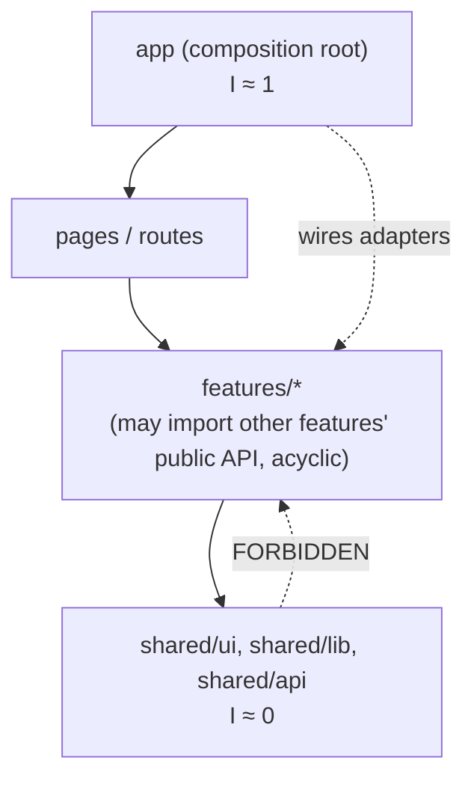
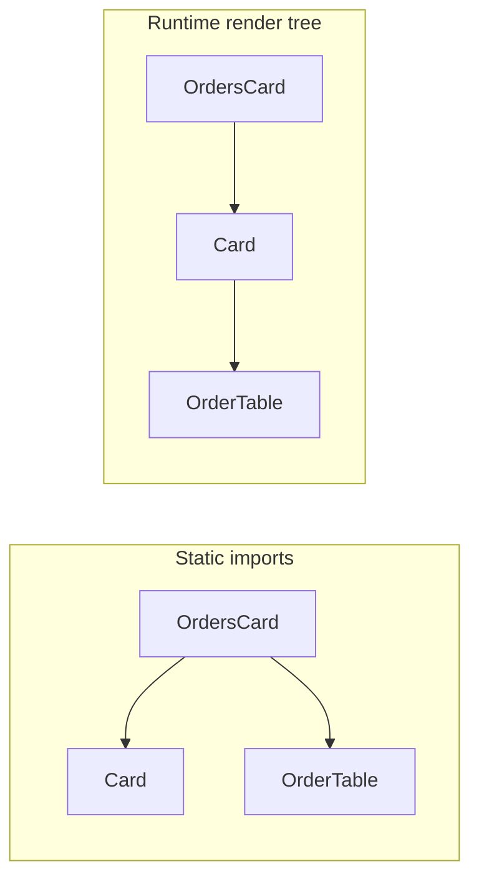
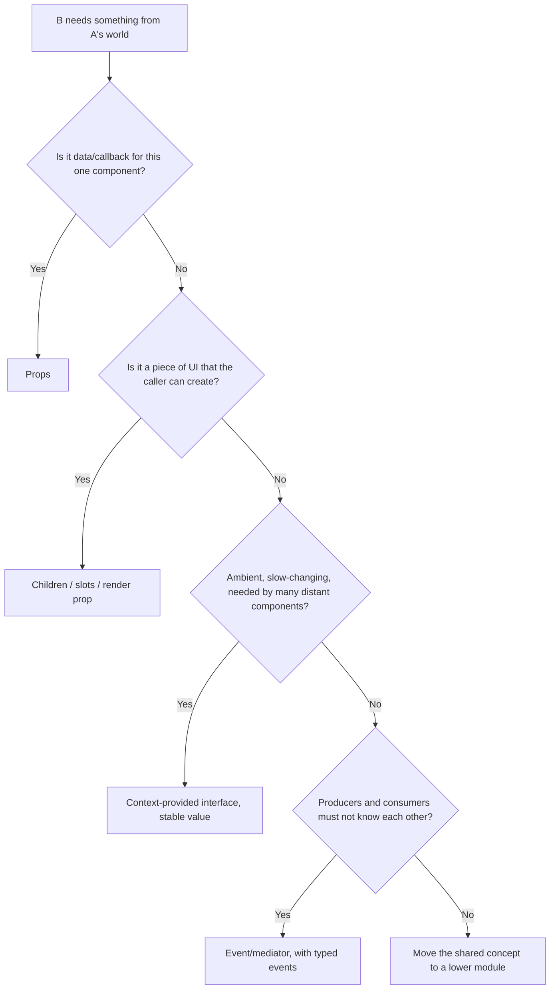

# 04 / 05 — Composition and Dependency Direction

## 1. Lesson metadata

| | |
|---|---|
| **Level** | Intermediate–Advanced |
| **Study time** | 5 hours (reading 2.25 h, lab 1.25 h, exercises 1.5 h) |
| **Prerequisites** | [04 / 01 — Architecture fundamentals](./01-architecture-fundamentals.md), [04 / 03 — Component responsibility](./03-component-responsibility.md), [04 / 04 — Presentational vs container](./04-presentational-vs-container.md), [Phase 1 / 07 — Composition and children](../01-react-fundamentals/07-composition-and-children.md), [Phase 0 / 10 — Modules and dependency graphs](../00-web-and-javascript-foundations/10-modules-and-dependency-graphs.md) |
| **Next** | [06 — Feature vs layer structure](./06-feature-vs-layer-structure.md) |
| **Related later** | [Phase 5 / 03 — Composition over inheritance](../05-design-patterns/03-composition-over-inheritance.md), [Phase 5 / 16 — Dependency injection](../05-design-patterns/16-dependency-injection.md), [04 / 11 — Dependency inversion](./11-dependency-inversion.md), [04 / 25 — Architectural fitness and enforcement](./25-architectural-fitness-and-enforcement.md) |

**Learning objectives.** After this lesson you can:
1. Distinguish **runtime composition** (what renders what) from **static dependency** (what imports what), and reason about the direction of each.
2. State and apply the dependency rules: depend toward stability, no cycles, depend on abstractions you own, keep a single composition root.
3. Use the five composition mechanisms in React (props, children, slots/render props, context, higher-order wrappers/hooks) and pick among them by coupling cost.
4. Invert a dependency in React: replace an upward import with a callback, a slot, or a context-provided interface, and know what each costs.
5. Detect and break dependency cycles (static and runtime).
6. Design a composition root that wires features together without features importing each other.
7. Evaluate dependency-injection-style approaches in React for appropriate sizes and failure modes.

**Concepts covered:** static vs runtime dependency, dependency direction, acyclic dependencies, stable dependencies, abstraction ownership, dependency inversion (introduction), composition root, children as slot, render props, context as injection, hook injection, event/mediator composition, public API of a module, instability metric, five approach dossiers.

---

## 2. Deep conceptual explanation

### 2.1 What problem is this lesson solving?

In lesson 01 we said architecture is "boundaries plus dependency rules". Lessons 02–04 told you what to put *inside* a boundary. This lesson is about the **edges between boundaries**: when module or component A needs something from B, *who* knows about *whom*?

Typical failures that dependency direction explains:

- `shared/ui/Table` imports `features/orders/OrderStatus` "to color the status column": the generic table now cannot be published or reused.
- The cart drawer must open when a product is added, so `cart/model` imports `ui/CartDrawer`, and `CartDrawer` imports `cart/model`: a cycle that breaks tests and initialisation order.
- Two feature teams each import the other's internals; neither can refactor.
- A single `utils.ts` is imported by everything and imports a feature "for one type": the whole app is one strongly connected component.

The remedy is a small set of rules about *direction* and a toolkit of *composition mechanisms* that let you obey them without making the code impossible to write.

### 2.2 Two dependency graphs: static and runtime

Dependency has two meanings in a React app, and they can disagree:

| | Static dependency | Runtime composition |
|---|---|---|
| Question | What does this file `import`? | What does this component render / read? |
| Determined by | Source text | Props, children, context at runtime |
| Visible to | Bundler, TypeScript, dependency tools | React DevTools component tree |
| Typical bug | Cycles, layering violations, bundle bloat | Hidden coupling via context; re-render fan-out |

Example: `Page` imports `Layout` and `Chart` (static edges *Page → Layout*, *Page → Chart*). At runtime `Layout` renders `Chart` as `children`: `Layout` **renders** `Chart` but has **no static dependency** on it. This asymmetry is React's superpower for decoupling: *the component that creates an element, not the one that renders it, owns the dependency.* The creator depends on the element's component; the renderer depends only on "something renderable" (`ReactNode`).

### 2.3 The dependency rules (a working set)

Collected from standard software-design practice (Robert C. Martin's package principles and the "dependency rule" of Clean Architecture; John Ousterhout's "deep modules" idea; Parnas's information hiding). They are guidelines, not laws; each has costs.

1. **Acyclic.** The static dependency graph between modules should have no cycles. A cycle means the modules cannot be understood, tested, or released independently: they are one module.
2. **Depend toward stability.** A module that is depended on by many (high fan-in) should change rarely and be abstract/general (primitives, `Money`, tokens). A module that changes often (a feature screen) should be depended on by few. *Instability* `I = fan-out / (fan-in + fan-out)`: 0 means maximally stable, 1 maximally unstable. Arrows should point from higher `I` to lower `I`.
3. **Depend on abstractions you own, at volatile boundaries.** Don't scatter calls to a vendor SDK or raw `fetch`; depend on a small interface (function, hook, or type) that *you* define and an adapter implements. Pay this cost only where volatility or testing justifies it ([lesson 11](./11-dependency-inversion.md)).
4. **Single composition root.** The one place that knows about *all* concrete modules and wires them (providers, routes, injecting adapters) is the top of the app. Features should not wire themselves to each other.
5. **Public APIs only.** Cross a boundary through its declared surface (`index.ts`, package `exports`), never through internal paths.
6. **Direction follows ownership of the contract.** The module that *needs* something defines the shape; the module that *provides* it conforms. (Inversion: the consumer owns the interface.)

### 2.4 Why direction matters: change propagation

If A imports B, a change to B's *surface* forces A to change; a change to A never forces B to. So **dependencies point in the direction of "forced change"**. Layering dependencies so that volatile modules depend on stable ones means most changes (to volatile modules) force nothing. A cycle makes forced change bidirectional.

### 2.5 The composition toolkit in React

React offers five mechanisms to supply a component with something it does not import. Ordered by *how much hidden coupling* they introduce:

| Mechanism | How | Visibility | Coupling cost | Typical use |
|---|---|---|---|---|
| **Props (data/callbacks)** | `<Table rows onSelect />` | Explicit, typed | Lowest | Default for everything |
| **Children** | `<Layout><Chart /></Layout>` | Explicit in JSX | Lowest | Layouts, wrappers, bounding re-renders |
| **Slots (named element props) / render props** | `<Page header={<Header />} />`, `<List renderItem={…} />` | Explicit | Low | Multi-region layouts; per-item rendering; lazy content |
| **Context** | `use(ThemeContext)` | Implicit (not in props) | Medium: hidden dependency + render fan-out | Truly ambient values (theme, locale, auth, DI of adapters) |
| **Module import / singleton** | `import { api } from "./api"` | Static but invisible to tests | High for volatile things | Constants, pure utilities, stable libraries |
| **Event/pub-sub (mediator)** | `bus.emit("cart:add")` | Implicit, stringly | Highest | Rare: decoupled cross-feature reactions |

Rule of thumb: **use the most explicit mechanism that solves the problem**. Reach for context only when passing explicitly would force many intermediate components to carry irrelevant props *and* children/slots can't fix it.

### 2.6 Inversion of control in React

Inversion of control means: instead of component X *calling* the thing it needs, X is *given* it. React is built on this: components are given props; `children` are given elements. Architecturally, you apply it at three granularities:

1. **Behaviour inversion (callback props).** `CartDrawer` doesn't know who opens it; the owner passes `open`/`onClose`. A hook doesn't navigate after success; it accepts `onSuccess`.
2. **Structure inversion (slots, children).** A layout doesn't import its content.
3. **Service inversion (context-provided interface).** A component asks for `useAnalytics()` / `useApi()`, and the root decides which implementation exists. This is dependency injection through context.

### 2.7 Common misconceptions

| Misconception | Reality |
|---|---|
| "Composition vs inheritance is a React slogan only." | React's docs explicitly recommend composition; practically, inheritance between components creates tight static coupling and has no React-supported use case for UI reuse. See [Phase 5 / 03](../05-design-patterns/03-composition-over-inheritance.md). |
| "Context is dependency injection, so use it for everything." | Context is *one* injection mechanism with render-propagation costs and implicit coupling. Use for ambient, slow-changing values. |
| "Importing from `shared/` is always fine." | Not if `shared/` contains domain knowledge or volatile code; direction rules apply to `shared/` too. |
| "Avoiding cycles only matters for runtime errors." | Cycles destroy independent understanding, testing and extraction even when they work. |
| "DI containers are needed for clean architecture." | In React, props, hooks, and context are the DI mechanisms; a container (e.g. InversifyJS) is rarely warranted in UI code. Verify need; it adds ceremony and bundle weight. |
| "Barrel files give me a public API." | A barrel is a *syntactic* surface; it is a real API only if it is small and deliberate (and tree-shake-friendly). |

---

## 3. Internal mechanics

### 3.1 Why children decouple *and* bound re-renders (public guarantee + teaching model)

*Public guarantee.* JSX produces element objects (`{ type, props, key }`); `children` is just a prop containing elements ([Phase 1 / 04](../01-react-fundamentals/04-elements-components-instances.md), [05](../01-react-fundamentals/05-jsx-explained.md)). The component that *writes* `<Chart />` creates the element; whoever receives it renders it by placing it in the returned tree.

*Teaching model.* Static dependency: only the creator imports `Chart`. Runtime: `Layout` renders it. Re-render consequence: if `Layout` re-renders because of its **own** state while its creator did not re-render, the `children` prop is the same object, so React can skip re-rendering that child (the bail-out compares the element reference; same element → reuse previous work). This is why *wrappers that hold fast-changing state and receive heavy content as children* are cheap. ⚠ This is observable behaviour documented by React's performance guidance, but the exact bail-out mechanism is an implementation detail; verify in the Profiler.

### 3.2 Context propagation: a runtime dependency that bypasses props

*Public guarantee.* A component that reads a context re-renders when the nearest provider's `value` changes (compared with `Object.is`), regardless of intermediate memoisation ([react.dev `useContext` / `use`](https://react.dev/reference/react/useContext)). So context creates a **runtime dependency edge from every consumer to the provider's value**, invisible in props and in imports of intermediate components.

Architectural consequences:
- **Fan-out:** one value change re-renders all consumers. Put *rarely-changing, narrowly-shaped* things in context; split contexts by change frequency ([Phase 7 / 06](../07-performance/06-context-propagation-cost.md)).
- **Hidden coupling:** a component's contract includes "must be rendered under provider P". Provide a **safe default** (noop implementation) where reasonable, or fail loudly with a helpful error where not.
- **Value identity:** `<Ctx value={{ a, b }}>` creates a new object each render of the provider; consumers re-render each time. Memoise or restructure.

React 19 note: `<Context value={…}>` can be used directly as the provider and `use(Context)` can read it (including conditionally); `<Context.Provider>`/`useContext` remain supported. Verify against your installed version.

### 3.3 ES module cycles (why direction is also a runtime-safety issue)

*Public guarantee (ECMAScript).* In a cycle, a module may be evaluated while one of its dependencies is only partially evaluated; imported bindings are live but may be in their temporal dead zone (`let/const/class`) or `undefined` (`function` declarations are hoisted and thus available) at the time of access ([Phase 0 / 10](../00-web-and-javascript-foundations/10-modules-and-dependency-graphs.md)). Whether a given cycle "works" therefore depends on *which module is the entry point and when the binding is first read* — a fragile property. Bundlers may reorder module evaluation in subtle ways. *Implementation detail:* hot module replacement (HMR) in dev servers can expose cycles in ways production builds do not, and vice versa.

### 3.4 Instability metric (worked)

Suppose in `src/` we count static imports:

| Module | Fan-in (imported by) | Fan-out (imports) | Instability I |
|---|---|---|---|
| `shared/ui` | 40 | 2 | 2/42 ≈ 0.05 |
| `shared/money` | 25 | 0 | 0 |
| `features/cart` | 6 | 8 | 8/14 ≈ 0.57 |
| `features/checkout` | 2 | 12 | 12/14 ≈ 0.86 |
| `app` | 0 | 15 | 1.0 |

Arrows go `app → checkout → cart → ui/money`: from higher `I` to lower: healthy. If `shared/ui` imported `features/cart` (fan-out +1, pointing to a higher-I module), the graph would violate "depend toward stability". The metric is *advisory*: it reveals suspicious edges; it does not prove design quality.

---

## 4. Step-by-step walkthrough: inverting a cycle in a real scenario

Starting situation (cycle): `useCart` imports `CartDrawer` to open it after an add; `CartDrawer` imports `useCart` to render items.


Resolution procedure:

1. **Find the reason for each edge.** `CartDrawer → useCart`: needs data (legitimate, UI depends on model). `useCart → CartDrawer`: needs to *cause UI to open* (illegitimate: model depends on UI).
2. **Decide which direction is legitimate** using the stability/ownership rule: model is more stable and more general than a specific drawer UI, so UI → model.
3. **Replace the illegitimate edge with an inversion.** Options:
   a. *Callback*: `useCart({ onItemAdded })`; the owner passes `() => setDrawerOpen(true)`.
   b. *Controlled UI state in a parent*: parent holds `drawerOpen`; passes `open`/`onClose` to the drawer; passes `onItemAdded` to the model hook.
   c. *Shared UI state module* `ui-state` (tiny store: `useDrawer()`) that both import, below both. Adds a third module but removes direct coupling.
   d. *Event*: model emits `itemAdded`; a root-level listener opens the drawer. Most decoupled; hardest to trace.
4. **Choose by cost**: (a)/(b) are explicit, cheap, typed → default. (c) when multiple distant components must open the drawer. (d) only when producers and consumers are in different teams/features and cannot know each other.
5. **Break the static cycle** (delete the import) and confirm with a tool (`madge --circular`, dependency-cruiser).
6. **Test**: model hook test no longer needs the drawer; drawer test renders with plain props.

Timeline at runtime after fix (b):
1. User clicks "Add" in `ProductActions` (owner of `onItemAdded` wiring).
2. `ProductActions` calls `addAndNotify(sku)` from `useCart`.
3. The hook updates cart state and calls `onItemAdded(sku)`.
4. The owner's callback sets `drawerOpen = true` (batched with the cart update in one render; [Phase 1 / 15](../01-react-fundamentals/15-update-queues-and-batching.md)).
5. React re-renders owner; `CartDrawer` receives `open` true and current items; commit shows the drawer.

---

## 5. Code examples

### 5.1 Minimal example — children as a decoupling slot

```tsx
// shared/ui/Card.tsx — knows nothing about its content
import type { ReactNode } from "react";
export function Card({ title, children }: { title: string; children: ReactNode }) {
  return (<section><h2>{title}</h2>{children}</section>);
}

// features/orders/ui/OrdersCard.tsx — creator owns the dependency on OrderTable
import { Card } from "@/shared/ui/Card";
import { OrderTable } from "./OrderTable";
export function OrdersCard() { return <Card title="Orders"><OrderTable /></Card>; }
```

Static graph: `OrdersCard → Card`, `OrdersCard → OrderTable`. `Card` has *no* edge to `OrderTable`: `shared/ui` stays domain-free. **Predict:** what if `Card` did `import { OrderTable }` to be convenient? *Answer:* `shared/ui` would depend on a feature (violating direction); `Card` could no longer be used with other content without branching.

### 5.2 Practical example — slots and render props for generic, domain-free components

```tsx
// shared/ui/DataList.tsx
import type { Key, ReactNode } from "react";

interface DataListProps<T> {
  items: readonly T[];
  getKey: (item: T) => Key;
  renderItem: (item: T, index: number) => ReactNode;
  empty?: ReactNode;
  header?: ReactNode;
}

export function DataList<T>({ items, getKey, renderItem, empty = <p>Nothing here.</p>, header }: DataListProps<T>) {
  return (
    <div>
      {header}
      {items.length === 0 ? empty : <ul>{items.map((it, i) => <li key={getKey(it)}>{renderItem(it, i)}</li>)}</ul>}
    </div>
  );
}
```

```tsx
// features/orders/ui/OrderList.tsx — supplies domain knowledge
<DataList
  items={orders}
  getKey={(o) => o.id}
  renderItem={(o) => <OrderRow order={o} />}
  empty={<EmptyOrders />}
  header={<OrderFilters />}
/>
```

Line notes:
- `DataList<T>` is generic; `T` is chosen by the caller. The component can't (and needn't) know what an `Order` is.
- `getKey` is an explicit contract: keys must be stable ([Phase 1 / 09](../01-react-fundamentals/09-lists-keys-and-identity.md)).
- `empty = <p>…</p>` as a default value creates a new element each render: fine; it is not memoised state.
- **Trade-off:** render props/slots hand control to the caller; excessive slots make the component's behaviour hard to see ("slot sprawl"). Limit to genuine variation points.
- Performance note: the inline `renderItem` lambda is a new function each render; it does not matter unless `DataList` is memoised, in which case stabilise or accept re-rendering.

### 5.3 Incorrect example — upward and sideways imports

```tsx
// shared/ui/StatusBadge.tsx
import { OrderStatus } from "@/features/orders/model/types";        // shared → feature (upward)
import { useCurrentUser } from "@/features/auth";                   // shared → feature (upward)
export function StatusBadge({ status }: { status: OrderStatus }) {
  const user = useCurrentUser();
  const color = status === "refunded" && user.role !== "admin" ? "grey" : colors[status];
  /* ... */
}

// features/orders/model/useOrders.ts
import { useCart } from "@/features/cart/model/useCart";              // sideways into internals
import { CartDrawer } from "@/features/cart/ui/CartDrawer";           // and a UI import into a model
```

**Consequences.** `shared/ui` can't be extracted into a package (it pulls in orders and auth); `StatusBadge` can't be shown in Storybook without auth; orders and cart are mutually entangled; renaming `cart/ui/CartDrawer` breaks `orders/model`. The static graph has edges upward (shared → feature), into internals, and from model to UI.

### 5.4 Corrected implementation

```tsx
// shared/ui/StatusBadge.tsx — generic and props-only
export type Tone = "neutral" | "success" | "warning" | "danger";
export function StatusBadge({ tone, children }: { tone: Tone; children: React.ReactNode }) {
  return <span data-tone={tone}>{children}</span>;
}

// features/orders/ui/OrderStatusBadge.tsx — domain mapping lives in the feature
import { StatusBadge, type Tone } from "@/shared/ui/StatusBadge";
import type { OrderStatus } from "../model/types";

const toneByStatus: Record<OrderStatus, Tone> = {
  pending: "warning", paid: "success", shipped: "success", refunded: "neutral", failed: "danger",
};

export function OrderStatusBadge({ status, canSeeRefunds }: { status: OrderStatus; canSeeRefunds: boolean }) {
  const tone = status === "refunded" && !canSeeRefunds ? "neutral" : toneByStatus[status];
  return <StatusBadge tone={tone}>{status}</StatusBadge>;
}
```

The permission check moved *out* of `shared/ui`: the caller (a feature component/page) computes `canSeeRefunds` from its ambient dependency and passes it. `Record<OrderStatus, Tone>` makes the compiler enforce exhaustiveness when a status is added: a *dependency-direction benefit*: the domain-specific mapping is in the domain, and TypeScript tells you when it drifts.

For cross-feature collaboration (orders needs to show "items in cart"), expose a **public** API from the cart feature:

```ts
// features/cart/index.ts — public API
export { useCartCount } from "./model/useCartCount";
export type { CartSummary } from "./model/types";
// internals not exported
```

```ts
// features/orders/ui/OrdersHeader.tsx
import { useCartCount } from "@/features/cart";    // OK: public API, direction orders → cart
```

and document that **cart must never import orders** (one-way). If cart genuinely needs something from orders, invert it with a callback/slot, or move the shared concept down into a lower module (`shared/…`/`domain/…`).

### 5.5 Advanced example — a composition root with injected adapters (dependency injection via context)

```tsx
// features/orders/model/ports.ts — the consumer owns the interface
export interface OrdersApi {
  list(params: { status?: string; signal?: AbortSignal }): Promise<Order[]>;
  refund(orderId: string): Promise<void>;
}
```

```tsx
// features/orders/model/OrdersApiContext.tsx
import { createContext, use, type ReactNode } from "react";
import type { OrdersApi } from "./ports";

const OrdersApiContext = createContext<OrdersApi | null>(null);

export function OrdersApiProvider({ api, children }: { api: OrdersApi; children: ReactNode }) {
  return <OrdersApiContext value={api}>{children}</OrdersApiContext>;
}
export function useOrdersApi(): OrdersApi {
  const api = use(OrdersApiContext);
  if (!api) throw new Error("useOrdersApi must be used within <OrdersApiProvider>");
  return api;
}
```

```tsx
// app/composition-root.tsx — the only place that knows the concrete adapter
import { httpOrdersApi } from "@/features/orders/api/httpOrdersApi";
import { OrdersApiProvider } from "@/features/orders";

const ordersApi = httpOrdersApi({ baseUrl: import.meta.env.VITE_API_URL });   // created once, stable identity

export function AppProviders({ children }: { children: React.ReactNode }) {
  return <OrdersApiProvider api={ordersApi}>{children}</OrdersApiProvider>;
}
```

```tsx
// tests: inject a fake without module mocking
render(
  <OrdersApiProvider api={{ list: async () => [fakeOrder], refund: vi.fn() }}>
    <OrderList />
  </OrdersApiProvider>,
);
```

Line notes:
- `ordersApi` is created at module scope (or once in the root), so the context `value` identity is stable: no re-render fan-out.
- The hook **throws** if no provider is present, converting a silent `null` into an actionable error. (A noop default is better for cross-cutting concerns like analytics; a hard failure is better for essential dependencies where silence would hide bugs.)
- `OrdersApi` lives in the *consumer* (`orders/model`), not in the adapter: dependency inversion ([lesson 11](./11-dependency-inversion.md)). `httpOrdersApi` imports the interface and implements it; the arrow points *toward* the feature.
- **Trade-offs.** Extra files, a provider per injected service (provider pyramids if overused), and implicit contract ("needs provider"). Benefits: tests with fakes, swapping implementations (offline, mock server in Storybook), a clear seam. For server state, libraries such as TanStack Query already provide a client injected via context; do not stack your own DI on top without need.

---

## 6. Visual explanations

### Allowed dependency directions



### Static vs runtime: who knows whom



`Card` renders `OrderTable` at runtime but has no static dependency on it.

### Choosing a composition mechanism



---

## 7. Alternative approaches and trade-offs (dossiers)

### 7.1 Dossier A — Props, children, and slots (explicit composition)

- **Original problem.** Components that need to vary behaviour or content; inheritance and configuration flags don't scale. React's design makes composition the primary mechanism.
- **Representative structure.**
  ```text
  shared/ui/Card, DataList, Layout       (accept children / slots / render props)
  features/*/ui                          (compose them with domain content)
  ```
- **Dependency rules.** Generic components depend on nothing domain-specific; callers depend on generic components; content is created by callers.
- **Example.** §5.1, §5.2.
- **Advantages.** Explicit and type-checked; no hidden runtime coupling; easy to test; bounds re-render scope; zero extra infrastructure.
- **Disadvantages.** Prop drilling when many layers must pass something through (mitigated by composition itself); slot sprawl; generic components with render props can be hard to read; typing generics adds complexity.
- **Appropriate sizes.** All sizes; the default.
- **Failure modes.** Drilling 6+ props through intermediaries; slot APIs that require callers to know internal layout; render props causing unnecessary re-renders when inline.
- **Migration.** From configuration-heavy components: identify prop clusters per region → turn into slots; keep old props as deprecated for one release.

### 7.2 Dossier B — Callback/inversion at module boundaries ("ports as function parameters")

- **Original problem.** A lower-level module needs to trigger something in a higher-level one (cart model opens a drawer; a form hook navigates after submit) without importing upward.
- **Representative structure.** No special structure: hooks/functions accept `on*` options or function parameters.
- **Dependency rules.** Lower modules expose extension points as parameters; higher modules supply implementations; arrows remain downward.
- **Example.** `useCart({ onItemAdded })`; `submitOrder(order, { send })`.
- **Advantages.** Minimal ceremony; fully typed and explicit; excellent testability (pass a spy); no context.
- **Disadvantages.** Parameter lists can grow; callers must remember to wire; closure/identity issues (unstable callbacks cause effect re-runs or break memoisation); doesn't scale to ambient concerns used everywhere.
- **Appropriate sizes.** All sizes; the first inversion tool to reach for.
- **Failure modes.** Callback hell/ordering ambiguity (which fires first?); stale closures in effects; "everything is a callback" making flows hard to trace.
- **Migration.** Replace the illegitimate upward import with an optional callback parameter; add a lint rule to forbid reintroduction.

### 7.3 Dossier C — Context-provided interfaces with a composition root (DI via React)

- **Original problem.** Many components across a tree need the same service (API client, analytics, feature flags, router abstraction), and threading it through props would pollute intermediate components. Also needed: swapping implementations for tests, storybook, or environments.
- **Representative structure.**
  ```text
  features/orders/model/{ports.ts, OrdersApiContext.tsx}
  features/orders/api/httpOrdersApi.ts
  app/composition-root.tsx
  ```
- **Dependency rules.** Interfaces owned by consumers; adapters depend on interfaces; only `app/` imports adapters; components use hooks that read context.
- **Example.** §5.5.
- **Advantages.** Test and story doubles without module mocks; one place to see what implementations are in use; supports multiple environments/tenants; keeps UI independent of vendors.
- **Disadvantages.** Hidden dependency in the component contract; provider pyramid; context fan-out if values change; indirection for newcomers; overlaps with existing libraries' own providers.
- **Appropriate sizes.** Medium-to-large apps, multi-team, with volatile or environment-dependent services; micro-frontends sharing a shell.
- **Failure modes.** Injecting *everything* (including pure utilities); unstable provider values causing re-render storms; a missing provider crashing in a deep subtree in production; using DI to hide a poorly-factored dependency.
- **Migration.** From direct imports: define the interface in the consumer, make the existing implementation conform, introduce the provider at the root with the existing implementation, change call sites to the hook one feature at a time, then add the fake for tests.

### 7.4 Dossier D — Event bus / mediator

- **Original problem.** Features that must react to each other's events but should not import each other (e.g. analytics reacting to every feature, a notifications center, cross-micro-frontend communication).
- **Representative structure.**
  ```text
  shared/events/{bus.ts, events.ts}      // typed event map
  features/*  emit and subscribe
  ```
- **Dependency rules.** Features depend on the event *schema* (shared, stable), never on each other; subscribers register in the composition root or feature `init`.
- **Example.**
  ```ts
  type Events = { "cart:item-added": { sku: string }; "auth:signed-out": undefined };
  // emit: bus.emit("cart:item-added", { sku }); on: bus.on("cart:item-added", handler)
  ```
- **Advantages.** Maximum decoupling; many-to-many reactions; works across framework or bundle boundaries (micro-frontends).
- **Disadvantages.** Control flow becomes implicit and hard to debug; ordering and error handling ambiguity; leaks (forgotten unsubscribe); events become a hidden public API; difficult static analysis ("who listens?"); React rendering model is not event-based, so subscribers must bridge to state (`useSyncExternalStore`).
- **Appropriate sizes.** Large multi-team systems and micro-frontends; for single-team apps usually avoid.
- **Failure modes.** Event spaghetti; payload drift without versioning; handlers running after unmount; infinite loops (event A triggers B triggers A).
- **Migration.** Replace by explicit callbacks or shared lower-level state if the coupling is actually intrinsic; or formalise: typed events, versioned schema, documented owners, central registry. See also [lesson 23](./23-multi-team-ownership.md).

### 7.5 Dossier E — Global singleton / direct module import (no composition mechanism)

- **Original problem.** Simplicity: `import { api } from "@/api"`. Most code needs *something* that is simply a constant or a stable utility.
- **Representative structure.** `shared/lib/*` with plain exports.
- **Dependency rules.** Downward imports of stable, pure, or truly global modules; the module itself must not depend on features.
- **Example.** `import { formatMoney } from "@/shared/money"`.
- **Advantages.** Zero ceremony; transparent; tree-shakable; ideal for pure functions and constants.
- **Disadvantages.** For stateful or environment-dependent things (clients, stores), tests need module mocking (hidden, order-dependent); can't vary per subtree/tenant; initialisation order issues (singletons created at import time); SSR cross-request state leakage if singletons hold per-user data ⚠.
- **Appropriate sizes.** All sizes for pure utilities; small apps for everything else.
- **Failure modes.** Singletons holding mutable per-user state on the server (data leaks between requests); circular imports through shared modules; test pollution.
- **Migration.** Wrap the singleton in an interface + provider (Dossier C) when a second implementation or per-request instance becomes necessary.

### 7.6 Comparison

| Criterion | A: Props/children/slots | B: Callback inversion | C: Context DI | D: Event bus | E: Direct import |
|---|---|---|---|---|---|
| Coupling visibility | Explicit | Explicit | Implicit | Implicit | Static but untyped for behaviour |
| Test seam | Props | Params | Provider | Bus stub | Module mock |
| Re-render side effects | None | None | Fan-out risk | Bridging needed | None |
| Ceremony | None | Low | Medium | Medium–High | None |
| Fits cross-team | Contract = props | Contract = params | Contract = interface | Contract = events | Contract = module API |
| Failure severity | Low | Low–Med | Medium | High | Varies |

**A scenario where the recommended default (explicit composition) is *not* best.** An application embedded in a host shell with many independently deployed micro-frontends: features cannot share a React tree or import one another; coordination happens through a small, versioned, typed event/message contract (Dossier D), because explicit props are impossible across deployment boundaries.

---

## 8. Best practices and anti-patterns

**Do**
- Decide a **layer order** (`app → pages → features → shared`) and write it down as lint rules.
- Make features depend on each other **only through public APIs**, in one direction, and treat any bidirectional need as a design signal (extract a lower-level concept or invert).
- Prefer **children/slots** over context to avoid drilling.
- Put **adapters and wiring in the composition root**.
- Keep context values **stable** and **narrow**, and split by change frequency.
- Detect cycles in CI (`madge --circular`, dependency-cruiser's `no-circular`; verify rule names).

**Beginner mistakes**
- Fixing a circular import by changing the order of import lines.
- Importing from a sibling's `ui/` folder for "just one component".
- Passing `setState` functions up through 5 levels instead of using composition or colocating state.

**Experienced-developer mistakes**
- DI-everything: interfaces and providers for dependencies that will never vary.
- Context for fast-changing state (mouse position, form values) causing app-wide re-renders.
- Event buses introduced to avoid a design conversation, leaving behavior untraceable.
- Treating `shared/` as exempt from rules; it accumulates features' leftovers.

**Smells:** `../../../` imports crossing top-level folders; barrel files that re-export everything; a "common" module importing features; `useEffect` used to sync two features' state; a provider that exposes 20 values; tests that mock internals of another feature; `import type` hiding a real conceptual dependency.

**Justified exceptions.** `import type` across features for a shared *vocabulary* type may be acceptable while you decide where it belongs (but track it); a small amount of duplication across features can be better than coupling; for the app shell, `app/` imports everything by design.

---

## 9. Real-world application

*E-commerce (cart ↔ checkout ↔ account).* Checkout needs cart contents and the signed-in user. Direction: `checkout → cart`, `checkout → auth` via public APIs. Cart must not know checkout; when checkout completes it calls `cart.clear()` (public API), not the other way around. Cross-cutting: analytics via noop-default context.

*Finance dashboard.* Widgets depend on a `marketData` module exposing a subscription interface (`subscribe(symbol, cb)`), implemented by a WebSocket adapter; tests inject a fake feed. Dependency inversion makes replay-based debugging possible: feed recorded sessions into the same interface.

*Auth.* `auth` is a low-level, stable feature other features depend on (`useCurrentUser`, `can`). It must not depend on others. Redirect-after-login is a callback/route state, not an import of the page you came from.

*Forms.* A generic `Form` component supplies field registration via context to descendants; field components depend on the form's *interface*, not a specific form instance. Context here is justified: an unbounded descendant set needs access, and passing props explicitly would pollute every intermediate.

*Realtime collaboration.* Presence/cursors arrive on a socket; a `PresenceProvider` (context) exposes a narrow selector API; consumers subscribe via `useSyncExternalStore` to avoid fan-out. Constraint: 100 cursors × 30 updates/s cannot go through React state naively.

*Multi-team/micro-frontend shell.* The shell owns routing and exposes a small typed API (`navigate`, `user`, `events`) to remote apps; remotes never import each other; shared libraries are version-pinned. Event contracts are versioned.

---

## 10. Debugging and troubleshooting

**Symptom: `Cannot access 'X' before initialization` or `Class extends value undefined` at startup.**
1. Identify the module in the error; find who imports it first (stack trace shows evaluation order).
2. Run `npx madge --circular --extensions ts,tsx src` (or dependency-cruiser) to list cycles.
3. For each cycle, classify each edge: type-only (use `import type`; erased at compile time), constant/utility (move to a lower module), or behavioural (invert with callback/slot).
4. Break the cycle by extracting a third module that both import (the shared concept), not by reordering.
5. Validate: cold start in dev, production build, and the unit test that imported the cycle directly.

**Symptom: a context value change re-renders most of the app.**
React DevTools Profiler → "Why did this render?" shows "Context changed" for many components. Fix: split context (state vs dispatch; independent fields), memoise value, or use a selector-capable store. Measure commit time before/after.

**Symptom: "Works in the app, fails in Storybook with 'must be used within Provider'".** That is the hidden-dependency contract surfacing. Either provide a global decorator with fakes (acceptable for infrastructure context) or refactor the component to receive the data by props.

**Symptom: Bundle includes features the page doesn't use.** A barrel import pulls a graph of unrelated modules, or a shared module imports a feature. Use the bundler analyser to find the path ([Phase 7 / 16](../07-performance/16-bundle-analysis.md)); fix the upward import, import by concrete path, or mark module side-effect free after verifying.

**Symptom: Feature A's change breaks feature B's test.** Run dependency-cruiser's reachability report from B to A; find the deep import; replace with public API or invert.

---

## 11. Exercises

### Level A — Knowledge
A1. Define static dependency and runtime composition and give an example where they differ.
A2. State four dependency rules from §2.3 and why each matters.
A3. Rank five composition mechanisms by coupling cost.
A4. What is the instability metric? What does a high-fan-in, high-instability module suggest?
A5. In dependency inversion, which side owns the interface and why?

### Level B — Code comprehension
B1. Given `shared/ui/Table` imports `@/features/orders/OrderStatus`, list three problems and how to fix them.
B2. In §5.5, why is `ordersApi` created outside the component, and what changes if you write `<OrdersApiProvider api={httpOrdersApi(...)}>` inline in `AppProviders`' render body?
B3. Why can `Layout` re-render without re-rendering `<Chart />` when `Chart` is passed as `children`, but not when `Layout` imports `Chart` and renders it itself?

### Level C — Implementation
C1. Break this cycle: `a.ts` exports `makeA` which imports `b.ts`'s `B_DEFAULT`; `b.ts` imports `a.ts`'s `A_LIMIT`. Show the corrected module layout.
C2. Implement `useCart({ onItemAdded })` with a stable callback via `useRef` so consumers needn't memoise `onItemAdded`. Discuss caveats.
C3. Write an ESLint flat-config fragment forbidding `features/*` from importing `app/*` and `shared/*` from importing `features/*`; then describe how to forbid deep imports across features, noting limits.

### Level D — Debugging
D1. A `ThemeContext` provider `value={{ mode, toggle }}` causes every consumer to re-render whenever *any* provider ancestor re-renders. Diagnose and fix.
D2. After adding a barrel `features/orders/index.ts` exporting everything, a circular dependency appears between `orders` and `cart`. Explain how a barrel can introduce cycles and how to resolve.
D3. A test of `useOrders` passes alone but fails with the whole suite; it imports a module-level `ordersApi` singleton. Diagnose and propose a remedy.

### Level E — Architecture decisions
E1. Two squads own `cart` and `checkout`. Each needs data from the other. Propose dependency directions, public APIs, and a rule for resolving bidirectional needs.
E2. Evaluate "inject every service via context" as a team convention.
E3. A product has a shell plus three independently deployed micro-frontends. Choose composition mechanisms for navigation, user session, and cross-app notifications; justify.

### Level F — Expert challenge
F1. Design a dependency-governance system for a 60-engineer monorepo: layer model, rules, allow-lists for legacy violations, CI gates, ownership, a metric dashboard, and a ratchet plan to reach zero cycles within two quarters without halting feature work.

---

## 12. Detailed answers and explanations

> Attempt the exercises first.

**A1.** Static dependency: an `import` edge in source. Runtime composition: which component renders which at runtime (via JSX, children, slots, context). They differ when a component receives children/slots: `Layout` renders `Chart` at runtime, but only the creator imports `Chart`. Evaluation: correct example plus the consequence (generic components stay domain-free).

**A2.** Acyclic (independent understanding/testing/extraction); depend toward stability (volatile modules shouldn't force changes on stable ones); depend on abstractions you own at volatile boundaries (swap/test cheaply); single composition root (wiring is visible; features don't know each other's concretes); public APIs only (internals free to change). Any four with reasons.

**A3.** Lowest to highest: props → children → slots/render props → context → module singleton (for volatile things) → event bus. Reason: visibility and type-checking decline; runtime/hidden coupling grows. Arguments for different orderings of middle items are acceptable if justified.

**A4.** `I = fan-out/(fan-in+fan-out)`: proportion of outgoing dependency. High fan-in and high instability means many modules depend on a module that itself depends on much and likely changes: a risk hotspot (e.g. a `utils.ts` that imports features). Fix: split it; push volatile parts down into their owners; stabilise the shared surface.

**A5.** The *consumer* (the module that needs the capability) owns the interface so that the provider (adapter) depends on it rather than the reverse. This keeps the consumer independent of provider details and lets it define the minimal shape it needs.

**B1.** Problems: (1) shared depends on a feature (upward direction), (2) the table cannot be reused/published/storied without orders, (3) a cycle risk if orders later imports the table (it will). Fixes: make `Table` generic over cell rendering (`columns` with `render` functions or `cell` slots), let the feature supply status rendering, move shared vocabulary types down if truly shared.

**B2.** Creating the API object inline in render creates a new `value` identity each render of `AppProviders`; every consumer re-renders each time `AppProviders` renders and, if the adapter holds internal state (cache/connection), it is recreated (possibly dropping connections). Create once (module scope or `useMemo` / `useState(() => …)`/ a ref). Wrong answer: "it only matters for performance" — adapter state reset is a correctness issue.

**B3.** `children` is created by `Layout`'s *caller*; when `Layout` re-renders for its own state, the `children` prop is the identical element object, so React can reuse the previous result for it (bail out). If `Layout` itself creates `<Chart />` in its render, a new element is created each time, so `Chart` re-renders unless it is memoised and its props are equal. (Caveat: if the caller re-renders, new `children` are created in either case.)

**C1.** Extract constants into `constants.ts`:
```ts
// constants.ts
export const A_LIMIT = 10;
export const B_DEFAULT = "x";
// a.ts
import { B_DEFAULT } from "./constants";
export const makeA = () => ({ b: B_DEFAULT });
// b.ts
import { A_LIMIT } from "./constants";
export const limitB = A_LIMIT * 2;
```
The cycle was a missing third module (a shared concept). Check that no module needs to import both `a` and `b` for each other's *behaviour*; if so, invert via parameters.

**C2.**
```ts
import { useCallback, useRef } from "react";
export function useCart(options?: { onItemAdded?: (sku: string) => void }) {
  const add = useCartStore((s) => s.add);
  const cbRef = useRef(options?.onItemAdded);
  cbRef.current = options?.onItemAdded;           // write during render: see caveat
  return { addAndNotify: useCallback((sku: string) => { add(sku); cbRef.current?.(sku); }, [add]) };
}
```
Caveat: writing to a ref during render violates React's rule that render be pure and can misbehave with concurrent rendering (a render that is discarded could leave a stale callback). The docs recommend updating refs in effects/event handlers; `useEffectEvent` (stable since React 19.2) solves a different problem: it is only for calling the latest values *inside Effects of the same component*, and its function must not be passed to children or used as a dependency, so it does not replace this exercise's stable-callback ref. Safer: update in `useLayoutEffect`/`useEffect`, or require callers to memoise. This exercise intentionally teaches the trade-off.

**C3.**
```js
export default [
  { files: ["src/features/**/*.{ts,tsx}"], rules: { "no-restricted-imports": ["error", { patterns: [{ group: ["@/app/*"], message: "features must not import app" }] }] } },
  { files: ["src/shared/**/*.{ts,tsx}"], rules: { "no-restricted-imports": ["error", { patterns: [{ group: ["@/features/*", "@/app/*"], message: "shared must not import features/app" }] }] } },
];
```
Deep-import prevention: pattern `@/features/*/*` forbids anything past the feature name; but it also blocks a feature's own alias-based internal imports (use relative imports inside a feature) and cannot know *which* feature the importer is in. Dedicated tools (eslint-plugin-boundaries, dependency-cruiser, Nx module boundaries) support "same feature allowed". ⚠ verify plugin options against current docs.

**D1.** A new object literal `{ mode, toggle }` is created each time the provider's component renders; React compares provider `value` with `Object.is`, so consumers re-render whenever the provider's parent re-renders the provider component. Fix: `useMemo(() => ({ mode, toggle }), [mode, toggle])` with a stable `toggle` (`useCallback`), or split the context into state/dispatch. Validate in the Profiler: "Context changed" disappears when `mode` doesn't change.

**D2.** Barrels re-export everything, so a module that imports `@/features/cart` (the barrel) *indirectly depends on every module the barrel re-exports*; if `cart`'s barrel exports something that imports `@/features/orders`, a file inside `orders` that imports `@/features/cart` closes a cycle even though no two *concrete* files depend on each other cyclically in intent. Fixes: import concrete modules inside the same feature (relative), keep barrels to a minimal public API, use `import type` where only types are needed, move the shared concept to a lower module.

**D3.** Module-level singletons persist across tests within the same module registry; state from earlier tests (cache, mocks) leaks. Remedies: inject the API (parameter or provider) so each test creates a fresh instance; reset modules between tests (`vi.resetModules()`, slow/fragile); reset the singleton in `afterEach`. Prefer injection.

**E1.** Evaluation: one-way default, public APIs, resolution rule. Example: `checkout → cart` (checkout reads cart contents via `useCartItems`, calls `cart.clear()`); `cart` must not import `checkout`. For cart needing something from checkout (e.g. "go to checkout" CTA), cart exposes an `onCheckout` callback/slot filled by the composition (page). For data both need (pricing rules), extract into a lower `pricing` module. Rule: if A→B and B→A both seem necessary, the missing piece is a lower module or an inversion. Ownership: each team owns its public API with contract tests.

**E2.** Pros: testability, swapping environments, explicit composition root. Cons: provider pyramids, hidden contracts, re-render fan-out, bundle/test setup overhead, DI for things that never vary is waste. Recommendation: inject only *volatile or environment-dependent services* (API clients, analytics, flags, storage); import pure utilities directly; prefer props/callbacks for component-level behaviour; review the convention when provider count exceeds ~5 or tests get hard to set up.

**E3.** Navigation: shell-owned router with a small `navigate(path)` API injected into remotes (plus URL as the shared contract). Session: shell owns the session, exposes it via a typed read-only interface and a subscribe mechanism; remotes must not manage tokens independently. Cross-app notifications: versioned typed events (Dossier D) because no shared React tree or imports exist. Justify with deployment independence; note costs (contract versioning, duplicated libraries) and failure modes (version skew; mitigate with compatibility windows and contract tests).

**F1. Example answer.** *Layer model:* declare ordered layers and allowed edges in a machine-readable config (e.g. dependency-cruiser rules) per package. *Rules:* no-cycles; layer direction; public API imports only; forbidden third-party packages in `shared/ui`. *Legacy:* generate a baseline allow-list of current violations; CI fails on *new* violations (ratchet); the list is committed and may only shrink. *Ownership:* CODEOWNERS on config and public API files; each violation entry tagged with owning team and a ticket. *Metrics:* number of cycles, violations by team, fan-in hotspots, average instability of `shared`; dashboard from CI artifacts. *Plan:* Week 1–2: baseline + visibility (warn mode); Week 3–4: block new violations; then 2 quarters: remove cycles by priority (largest strongly connected component first), using patterns from this lesson (extract lower module, invert via callback/slot, move type). Don't halt feature work: schedule violations burn-down as a fixed % of each team's capacity; "boy scout" rule on touched files. Risks: false positives, tool upgrade churn, allow-list becoming permanent: set expiry dates.

---

## 13. Senior engineer interview questions

**Q1. "How do you decide which direction a dependency should point?"**
*Strong answer:* Toward stability and toward the owner of the contract. Stable, general modules (primitives, money, domain types) sit at the bottom and are depended on; volatile feature modules sit above. If a lower module needs something from a higher one, I invert it: a callback parameter, a slot, or an interface owned by the lower module, so the arrow flips. I verify with a dependency-graph tool, since intent and reality drift.

**Q2. "When is context the wrong tool?"**
*Strong answer:* When the value changes frequently or is needed by only a few components. Context re-renders all consumers on value change and hides dependencies from props. For avoiding prop drilling, composition (`children`, slots) is often better. For fast-changing shared state, use a selector-capable store or `useSyncExternalStore`-based subscription. Context is good for ambient, slow-changing values (theme, locale, injected services).

**Q3. "How do you break a circular dependency?"**
*Strong answer:* Understand why each edge exists, then either extract the shared concept into a lower module both depend on, or invert the edge that points the wrong way via a callback/slot/interface. Use `import type` only if the dependency is purely type-level and the coupling is acceptable. Don't reorder imports to hide it. Confirm with a tool, and add a CI rule so it can't recur.

**Q4. "Is dependency injection appropriate in React?"**
*Strong answer:* Yes in its React-native forms: props, callbacks, and context-provided interfaces; rarely with a DI container. I inject volatile or environment-specific services at a composition root, define the interface in the consumer, and keep value identity stable. I avoid injecting pure utilities and avoid provider pyramids; I'd measure the benefits in test simplicity and swap-ability.

**Q5. "Why does passing children avoid re-renders?"**
*Strong answer:* Children are elements created by the parent; if the wrapper re-renders from its own state, it receives the same element reference and React can reuse the prior result for that subtree. If the wrapper creates the child itself, a fresh element is made each render. It's also a decoupling tool: the wrapper has no static dependency on the content. I'd verify in the Profiler and not rely on it for correctness.

**Q6. "How do you enforce dependency rules on a large team?"**
*Strong answer:* Executable rules in CI (dependency-cruiser or ESLint boundaries), a ratcheted baseline for legacy violations, CODEOWNERS on public APIs, and a small number of rules that matter (cycles, layer direction, public-API-only). Culture helps but doesn't scale without mechanisms; violations are locally cheap and globally expensive.

---

## 14. Further learning resources

| Resource | URL | Covers / why | Level | Study |
|---|---|---|---|---|
| React docs — Passing data deeply with context ("Before you use context") | <https://react.dev/learn/passing-data-deeply-with-context> | Composition alternatives before context | Intermediate | Whole page |
| React docs — `useContext` / `use` / `createContext` | <https://react.dev/reference/react/useContext> | Provider semantics, re-render behaviour ⚠ check React 19 notes | Intermediate | Caveats |
| React docs — Thinking in React | <https://react.dev/learn/thinking-in-react> | Data flow and composition fundamentals | Beginner | Whole page |
| React docs — `useSyncExternalStore` | <https://react.dev/reference/react/useSyncExternalStore> | Subscribing to external stores without context fan-out | Advanced | Whole page |
| TypeScript — Generics | <https://www.typescriptlang.org/docs/handbook/2/generics.html> | Typing generic slot/render-prop components | Intermediate | Whole page |
| dependency-cruiser | <https://github.com/sverweij/dependency-cruiser> | Rule-based dependency validation | Intermediate | README, rules *(verify options)* |
| Robert C. Martin — Package principles (ADP, SDP, SAP) | *(book: Clean Architecture; no URL)* | Acyclic Dependencies, Stable Dependencies, instability metric | Intermediate | Component-principles chapters |
| John Ousterhout — *A Philosophy of Software Design* (book) | *(no URL)* | Deep modules, information hiding | Intermediate | Modules chapters |
| David Parnas — "On the Criteria To Be Used in Decomposing Systems into Modules" (1972) | *(no URL; search by title)* | Origin of information hiding | Advanced | Whole paper |
| MDN — JavaScript modules (circular dependencies) | <https://developer.mozilla.org/en-US/docs/Web/JavaScript/Guide/Modules> | Module semantics | Beginner–Int. | Whole guide |

---

## 15. Knowledge checkpoint

**You should now understand**
- Static dependencies vs runtime composition, and how children/slots decouple them.
- The six dependency rules and the instability metric as an advisory tool.
- Five composition mechanisms ranked by coupling cost, and when each fits.
- Dependency inversion in React: callbacks, slots, context-provided interfaces, composition root.

**You should be able to explain without notes**
- Why cycles are architectural failures even when they run.
- Why context is not "free DI".
- How to flip an upward dependency.

**You should be able to implement**
- A cycle break by extraction; a callback inversion; a context-provided interface with a stable value and a test double; a lint rule for layer direction.

**You should be able to debug**
- Initialisation-order errors from cycles; context-driven re-render fan-out; Storybook failures from hidden providers.

**Before moving on:** read [06 — Feature vs layer structure](./06-feature-vs-layer-structure.md), which turns these dependency rules into concrete folder organisations and compares layer-based and feature-based structures in depth.
