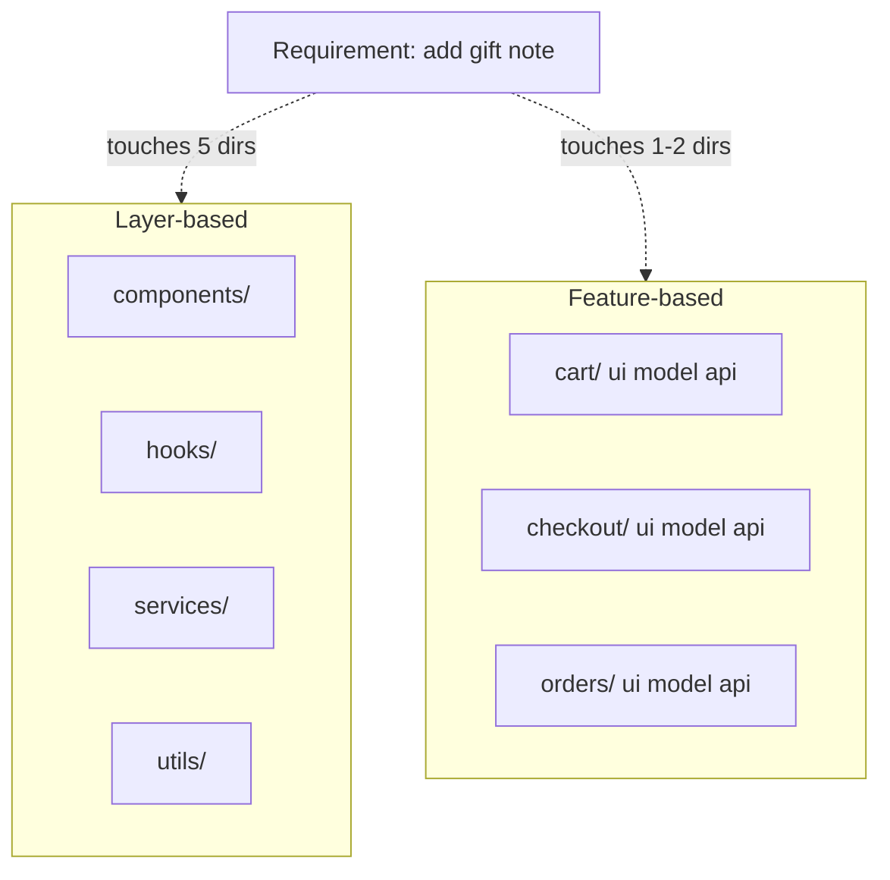
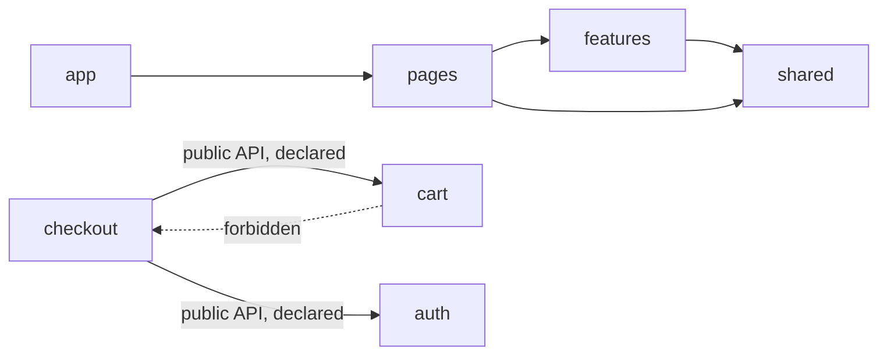
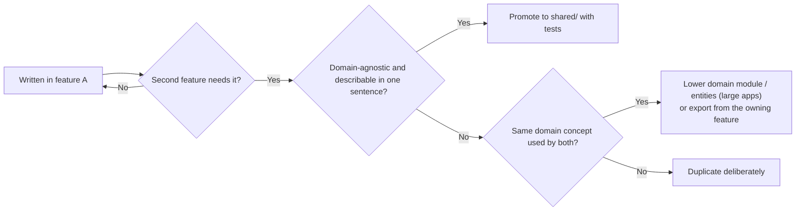

# 04 / 06 — Feature vs Layer Structure: Organising a React Codebase

## 1. Lesson metadata

| | |
|---|---|
| **Level** | Intermediate–Advanced |
| **Study time** | 5 hours (reading 2 h, migration lab 1.5 h, exercises 1.5 h) |
| **Prerequisites** | [04 / 01 — Architecture fundamentals](./01-architecture-fundamentals.md), [04 / 02 — Separation of concerns](./02-separation-of-concerns.md), [04 / 05 — Composition and dependency direction](./05-composition-and-dependency-direction.md), [Phase 0 / 20 — Tooling, transpilation and bundling](../00-web-and-javascript-foundations/20-tooling-transpilation-and-bundling.md) |
| **Next** | [07 — Modular architecture](./07-modular-architecture.md) |
| **Related later** | [08 — Domain-driven frontend](./08-domain-driven-frontend.md), [09 — Feature-Sliced Design](./09-feature-sliced-design.md), [18 — Routing architecture](./18-routing-architecture.md), [24 — Refactoring legacy React](./24-refactoring-legacy-react.md) |

**Learning objectives.** After this lesson you can:
1. Define layer-based ("by kind") and feature-based ("by capability") organisation, and the *axis of change* each optimises.
2. Design a feature-based structure with an internal layout, a `shared` area, a `pages`/`app` composition area, and explicit rules for what may import what.
3. Decide what is "shared" with a promotion rule rather than intuition, and avoid the shared-dumping-ground failure.
4. Handle cross-feature flows (checkout needs cart + user + shipping) without feature cycles.
5. Compare four structures (pure layers, pure features, hybrid feature-with-layers, route-colocated) with the required dossier fields, and choose by project/org size.
6. Plan and execute an incremental migration from layers to features with import shims, codemod-assisted moves, and CI ratchets.
7. Configure TypeScript path aliases and lint rules so the structure is enforced.

**Concepts covered:** axis of change, vertical vs horizontal slices, locality of change, feature boundary, public API (`index.ts`), shared kernel, promotion rule ("rule of three" with caveats), cross-feature composition, anti-corruption at feature edges, route colocation, barrel-file trade-offs, path aliases, migration shims, ratcheting.

---

## 2. Deep conceptual explanation

### 2.1 What problem is this lesson solving?

Every React app needs a folder structure, and almost every team has the same argument about it: "group by type" vs "group by feature". The argument is usually conducted as taste. This lesson makes it an engineering decision with criteria, because the choice determines:

- **How many directories a typical change touches** (change locality).
- **How easy it is to delete or extract a capability** (a feature should be removable in one step).
- **Who can own what** (CODEOWNERS works on directories).
- **How code splitting and lazy loading map to source** (a lazily loaded feature should correspond to a directory).
- **Whether architectural rules are expressible** ("checkout may not import admin" needs both to be directories).

### 2.2 The two axes

**Layer-based (horizontal, "by kind").** Organise by *what kind of code it is*:

```text
src/
  components/    hooks/    services/    store/    utils/    types/    pages/
```

**Feature-based (vertical, "by capability" or "by slice").** Organise by *what the product does*:

```text
src/
  features/
    catalog/   cart/   checkout/   orders/   auth/
  shared/
  app/
```

Each feature directory contains *all kinds* of code for that capability (UI, state, data access, types, tests).

The deep distinction is **the axis along which requirements vary**:

- If requirements vary mostly by *capability* ("add gift notes to checkout"), a feature directory localises the change.
- If requirements vary mostly by *kind of technical concern* ("switch the HTTP client", "replace our modal implementation across the app"), layers localise the change.

In product development the first kind dominates, which is why feature-oriented structures are popular. But technical migrations (the second kind) still happen, and are handled by the `shared/` area and tools (codemods), not by folder structure.

### 2.3 What is a "feature"?

A **feature** is a cohesive user-facing capability with its own vocabulary, state, and data, that can be described in a noun phrase a product manager would use: *Cart*, *Checkout*, *Order history*, *Search*, *User profile*. Heuristics for finding good feature boundaries:

| Heuristic | Meaning |
|---|---|
| **Business vocabulary** | Named in the language of product/domain experts, not technical terms ("modals", "forms" are not features) |
| **Change cohesion** | Requirements and bugfixes usually touch one feature; git history shows files co-changing within it |
| **Data ownership** | It owns some entities/server resources and their cache keys |
| **Team ownership** | One team can reasonably own it end to end |
| **Deletability** | You could remove it with a bounded set of edits at its boundary |
| **Loose coupling at edges** | Interaction with other features goes through few, explicit touchpoints |

Features are **not** pages (a page may compose several), not components (a feature has many), and not layers. They may be nested (a `checkout` feature containing `shipping`, `payment` sub-features) when the domain supports it, but nesting depth is a cost: stop at 1–2 levels.

### 2.4 The `shared` area and its discipline

Everything not owned by a single feature must live somewhere. Without discipline, that place (`shared`, `common`, `utils`, `lib`) becomes a dumping ground: it grows without bound, accumulates domain knowledge, and ends up imported by everything and depending on everything.

A workable discipline:

1. **Default to the feature.** New code starts in the feature that needs it.
2. **Promotion rule.** Code moves to `shared/` only when (a) a *second* feature needs it **and** (b) the code is *domain-agnostic* (it has no knowledge of any feature's entities or rules) **and** (c) you can state its contract in one sentence. If (b) fails, the thing is probably a *domain concept* belonging in a feature or in a lower "domain" module (see [lesson 08](./08-domain-driven-frontend.md)).
3. **Shared is divided by kind and kept small:** `shared/ui` (domain-free components), `shared/lib` (pure utilities), `shared/api` (HTTP client, error mapping), `shared/config`. Not `shared/misc`.
4. **Shared never imports features or app.** (Direction rule from lesson 05.)
5. **Duplication is allowed across features** while the abstraction is unclear; premature sharing couples teams.

### 2.5 Public API per feature

A feature exposes **a small public surface** and keeps everything else private:

```ts
// features/cart/index.ts
export { CartButton } from "./ui/CartButton";
export { useCartCount, useCartItems } from "./model/selectors";
export type { CartItem } from "./model/types";
```

Everything outside imports from `@/features/cart`, never `@/features/cart/model/store`. This is a convention; enforcement is by lint ([lesson 25](./25-architectural-fitness-and-enforcement.md)) or package `exports` (lesson 07).

### 2.6 Cross-feature flows

The hardest practical question in feature-based structures: *what happens when a user flow crosses features?* Checkout needs cart items, the signed-in user, shipping rates, and payment. Options (detailed in §7):

1. **Higher-level composition:** a page (or a coarser "flow" feature) composes the features and passes data/callbacks between them. Features don't import each other.
2. **Directed dependency:** `checkout → cart` allowed through cart's public API, never the reverse.
3. **Lower shared concept:** if `cart` and `checkout` both need `Money`, `Address`, `LineItem`, those belong in a lower module (`shared/domain` or `entities/`), not in either feature.
4. **Events/mediator** for truly decoupled reactions (rare).

Rule: **cross-feature imports are allowed only along a declared, acyclic direction through public APIs.** A feature cycle is a design error to be resolved by extraction or inversion (lesson 05).

### 2.7 Common misconceptions

| Misconception | Reality |
|---|---|
| "Feature folders are always better than layers." | They optimise for capability-driven change. For uniform, repetitive apps (CRUD admins), a layered approach may reduce code. See the §7 scenario. |
| "A `features/` folder makes the code modular." | Without enforced boundaries it's layers with extra nesting; imports into internals reappear within weeks. |
| "Everything reusable belongs in `shared`." | Reusable ≠ shared. Share when domain-agnostic and stable; otherwise, keep in the feature or duplicate. |
| "One feature per page." | Features and pages are different axes; a page may compose three features, and a feature may appear on several pages. |
| "Layers within features are optional noise." | Inside a large feature, a `ui/model/api` split restores navigability; in a tiny feature it's noise. Scale the internal structure to the feature. |
| "Moving files is cheap, so I can decide later." | True for files; false for *import habits* and ownership. Rules adopted early cost little; rules retrofitted onto 500 violations cost a quarter. |

---

## 3. Internal mechanics

### 3.1 How tools see structure

*Public guarantee.* Bundlers (Vite/Rollup, webpack, esbuild) and TypeScript do not care about folder names; they follow import specifiers. Structure matters to **humans** and to **tools that you configure** to read paths (lint rules, CODEOWNERS, test globs, route conventions, coverage thresholds, code-split entry points).

*Consequences.* A structure is "real" only to the extent that tools are configured with it. Feature directories enable:
- **CODEOWNERS** (`/src/features/checkout/ @acme/checkout-team`) — GitHub/GitLab feature; verify syntax in current docs.
- **Path-based lint boundaries** (restrict imports by directory pattern).
- **Per-directory test commands and coverage thresholds** (e.g. `vitest run src/features/cart`).
- **Lazy loading boundaries:** `const Checkout = lazy(() => import("@/features/checkout"))` maps a directory to a chunk ([Phase 7 / 15](../07-performance/15-code-splitting-and-lazy-loading.md)). ⚠ A barrel (`index.ts`) that re-exports heavy modules can pull the whole feature into the importing chunk; confirm with the bundle analyser.

### 3.2 Path aliases: `tsconfig` and bundler must agree

```jsonc
// tsconfig.json (fragment)
{
  "compilerOptions": {
    "paths": { "@/*": ["./src/*"] }
  }
}
```

```ts
// vite.config.ts (fragment) — Vite does not read tsconfig paths by default
import { defineConfig } from "vite";
import { fileURLToPath, URL } from "node:url";
export default defineConfig({
  resolve: { alias: { "@": fileURLToPath(new URL("./src", import.meta.url)) } },
});
```

Notes: TypeScript's `paths` affects only type-checking, not emitted code; the bundler/test runner needs matching alias configuration (Vite `resolve.alias`, or a plugin that reads `paths`; Vitest inherits Vite's config). `baseUrl` is not needed for `paths` (so it is omitted above, with `./`-prefixed targets): TypeScript 6.0 deprecated `baseUrl` and TypeScript 7.0 does not support it (devblogs.microsoft.com/typescript/announcing-typescript-6-0, checked 2026-10-22). Older tutorials that show `"baseUrl": "."` still work on TypeScript 5.x. A mismatch between tsconfig and bundler aliases is a classic cause of "compiles but fails at runtime/tests".

### 3.3 Barrels and their cost (teaching model + measure)

An `index.ts` barrel gives a *syntactic* public API. Costs: (1) importing one symbol may require the bundler/dev server to load and analyse the barrel's entire import graph, which can slow dev startup and HMR for large barrels; (2) tree-shaking effectiveness depends on `sideEffects` metadata and the bundler's analysis; (3) barrels invite accidental cycles (lesson 05, D2). *Mitigations:* keep feature barrels *small* (only the public API); use concrete relative imports *inside* a feature; consider TypeScript `export type` for types-only barrels; measure with the dev-server timing/bundle analyser rather than assuming. ⚠ Behaviour varies across tool versions.

---

## 4. Step-by-step execution walkthrough: placing a new requirement

Requirement: **"Add gift messages: at checkout the user can add a gift note (≤ 200 chars) per order; show the note in order history and on the packing slip PDF."**

Walk through both structures.

*Layer-based:*
1. `types/order.ts`: add `giftNote?: string`.
2. `services/orderService.ts`: send/receive `giftNote`.
3. `hooks/useCheckout.ts`: new state and validation.
4. `components/CheckoutForm.tsx`: new field.
5. `components/OrderCard.tsx`: show note.
6. `utils/validators.ts`: `validateGiftNote`.
7. `components/PackingSlip.tsx`: print note.
Seven files in five directories; reviewer needs to know all five areas. Risk: the validation util is shared by the profile form; changing the shared `validators.ts` accidentally changes unrelated validation.

*Feature-based:*
1. `features/checkout/model/giftNote.ts`: `validateGiftNote` (private to checkout).
2. `features/checkout/ui/GiftNoteField.tsx`: the field.
3. `features/checkout/api/mapOrderRequest.ts`: send `giftNote`.
4. `features/orders/ui/OrderCard.tsx`: show note (needs the `Order` type with `giftNote`; the `Order` entity is defined where? See below).
5. `features/orders/ui/PackingSlip.tsx`.
The `Order` type is used by *both* checkout (create) and orders (read): a **shared concept**. Options: (a) `orders` owns `Order` and exports it; `checkout → orders` (type import only) — acceptable but couples checkout to orders; (b) put `Order` into `shared/domain` (promotion rule: second user, domain-agnostic? No: it is domain knowledge, so it fails (b) of the promotion rule); (c) create a lower `entities/order` module ([Phase 4 / 09, FSD](./09-feature-sliced-design.md)). In a small app, (a) is pragmatic; in a large app (c) removes a cross-feature edge.

*Observation.* The feature structure localises UI/logic, but the shared-entity question appears immediately: *structure doesn't remove coupling, it makes coupling visible and forces a decision.* That visibility is its main value.

Timeline of a developer's day with each structure:
- *Layers:* search by name; change 7 files; run all tests; reviewers from multiple specialisations.
- *Features:* open `features/checkout`; add 3 files; run `vitest features/checkout`; one CODEOWNERS group reviews checkout plus a small `orders` change by another team.

---

## 5. Code examples

### 5.1 Minimal example — a small feature slice

```text
src/features/cart/
  index.ts
  ui/
    CartButton.tsx
    CartDrawer.tsx
  model/
    store.ts          (Zustand store, private)
    selectors.ts      (public hooks)
    types.ts
  api/
    cartApi.ts
```

```ts
// features/cart/model/types.ts
export interface CartItem { sku: string; name: string; unitPriceMinor: number; qty: number }
```

```ts
// features/cart/model/store.ts  (private to the feature)
import { create } from "zustand";
import type { CartItem } from "./types";

interface CartState {
  items: readonly CartItem[];
  add: (item: Omit<CartItem, "qty">) => void;
  remove: (sku: string) => void;
}

export const useCartStore = create<CartState>((set) => ({
  items: [],
  add: (item) =>
    set((s) => {
      const existing = s.items.find((i) => i.sku === item.sku);
      return existing
        ? { items: s.items.map((i) => (i.sku === item.sku ? { ...i, qty: i.qty + 1 } : i)) }
        : { items: [...s.items, { ...item, qty: 1 }] };
    }),
  remove: (sku) => set((s) => ({ items: s.items.filter((i) => i.sku !== sku) })),
}));
```

```ts
// features/cart/model/selectors.ts  (public hooks; hide the store shape)
import { useCartStore } from "./store";
export const useCartCount = () => useCartStore((s) => s.items.reduce((n, i) => n + i.qty, 0));
export const useCartItems = () => useCartStore((s) => s.items);
export const useAddToCart = () => useCartStore((s) => s.add);
```

```ts
// features/cart/index.ts
export { CartButton } from "./ui/CartButton";
export { CartDrawer } from "./ui/CartDrawer";
export { useCartCount, useCartItems, useAddToCart } from "./model/selectors";
export type { CartItem } from "./model/types";
```

Line notes:
- Zustand 5 selector semantics (executed on zustand 5.0.16 + React 19.3): a selector that returns a *new* array/object on every call, such as `(s) => s.items.map(...)`, makes React log "The result of getSnapshot should be cached to avoid an infinite loop" and throw "Maximum update depth exceeded"; wrapping it in `useShallow` (from `zustand/react/shallow`) fixes it. `useCartItems` returns the stored array reference, which is stable between updates; `useCartCount` returns a number. Check the Zustand docs for your version ([Phase 6 / 10](../06-data-fetching-and-state-ecosystems/10-zustand.md)).
- The *store* is private; consumers see selector hooks. Replacing Zustand with Redux Toolkit or context later changes only `model/`. This is the practical meaning of "public API".
- The feature is small; `api/` may be absent if there's no API.

### 5.2 Practical example — an app-level layout and enforced rules

```text
src/
  app/
    main.tsx  providers.tsx  router.tsx  routes/
  features/
    auth/  catalog/  cart/  checkout/  orders/
  shared/
    ui/  lib/  api/  config/
  pages/            (optional: thin route components that compose features)
```

Rules (written as sentences first, then enforced):

1. `app` may import anything.
2. `pages` may import `features` (public APIs) and `shared`.
3. `features/X` may import `shared` and **public APIs of other features** listed in an allow-list (`checkout → cart`, `checkout → auth`, `orders → auth`); never `app`/`pages`.
4. `shared` imports nothing from `features`, `pages`, or `app`.

ESLint flat-config enforcement using the `eslint-plugin-boundaries` plugin (⚠ plugin option names evolve; the shape below follows its documented element/rule model: verify against the current README before use):

```js
// eslint.config.js (sketch)
import boundaries from "eslint-plugin-boundaries";

export default [
  {
    plugins: { boundaries },
    settings: {
      "boundaries/elements": [
        { type: "app", pattern: "src/app/**" },
        { type: "page", pattern: "src/pages/**" },
        { type: "feature", pattern: "src/features/*", capture: ["featureName"] },
        { type: "shared", pattern: "src/shared/**" },
      ],
    },
    rules: {
      "boundaries/element-types": ["error", {
        default: "disallow",
        rules: [
          { from: "app", allow: ["page", "feature", "shared"] },
          { from: "page", allow: ["feature", "shared"] },
          { from: "feature", allow: ["shared", ["feature", { featureName: "${from.featureName}" }]] }, // same feature only
          { from: "shared", allow: ["shared"] },
        ],
      }],
    },
  },
];
```

This sketch **disallows cross-feature imports entirely** (a feature may import itself and `shared`). A real project adds explicit allowed pairs (e.g. `checkout → cart`) as the list of *intentional* edges: the list itself is documentation of the architecture's coupling, and it is reviewed when it changes.

Alternative with no plugin, using ESLint core's `no-restricted-imports` plus relative imports inside features; limits discussed in lesson 01 §5.5.

### 5.3 Incorrect example — "feature folders" that are layers in disguise

```text
src/features/
  cart/
    components/ hooks/ services/ utils/        // fine so far
  checkout/
    components/
      CheckoutForm.tsx   // imports ../../cart/hooks/useCartStore  (deep import)
  shared/
    everything.ts        // 2,300 lines, imported by every feature, imports cart types
```

```tsx
// features/checkout/components/CheckoutForm.tsx
import { useCartStore } from "../../cart/hooks/useCartStore";   // reaches into internals
import { formatAddress } from "../../orders/utils/formatAddress"; // sideways into another feature
```

**What went wrong.** The folder is named `features` but nothing prevents deep imports, so every feature depends on every other's internals. `shared/everything.ts` is the dumping ground (high fan-in, imports features: a cycle factory). Refactoring `cart`'s store breaks `checkout`. This is *layered thinking with feature-shaped directories*, and gives the cost of both.

### 5.4 Corrected implementation

```tsx
// features/checkout/ui/CheckoutForm.tsx
import { useCartItems } from "@/features/cart";            // public API only; direction checkout → cart
import { formatAddress } from "@/shared/lib/address";      // domain-agnostic helper promoted to shared
```

- `formatAddress` was needed by two features and has no domain rules, so it satisfies the promotion rule and moves to `shared/lib/address.ts` (with its own tests).
- `useCartItems` is imported via `cart`'s `index.ts`.
- `shared/everything.ts` is split by **concept and kind** (`shared/lib/date`, `shared/lib/address`, `shared/ui/*`), and any piece that referenced a feature type is either moved into that feature or rewritten against a minimal local type.

A lint rule bans `@/features/*/*` imports from outside the feature (with `eslint-plugin-boundaries`' `entry-point` rule or `no-restricted-imports` as above). Dependency-cruiser's `no-circular` rule prevents regressions.

### 5.5 Advanced example — page-level composition of features, avoiding feature cycles

Problem: `catalog` product tiles show an "Add to cart" button; the cart should show recommended products from `catalog`. That's a *bidirectional need*: `catalog ↔ cart`.

Resolution: **compose at the page level and invert via slots**.

```tsx
// features/catalog/ui/ProductTile.tsx — knows nothing about cart
import type { ReactNode } from "react";
import type { Product } from "../model/types";

export function ProductTile({ product, actions }: { product: Product; actions?: ReactNode }) {
  return (
    <article>
      <h3>{product.name}</h3>
      <p>{product.priceText}</p>
      {actions}
    </article>
  );
}
```

```tsx
// pages/CatalogPage.tsx — composes both features; owns the cross-feature wiring
import { ProductGrid } from "@/features/catalog";
import { AddToCartButton } from "@/features/cart";

export function CatalogPage() {
  return (
    <ProductGrid
      renderActions={(p) => <AddToCartButton sku={p.sku} name={p.name} priceMinor={p.priceMinor} />}
    />
  );
}
```

```tsx
// pages/CartPage.tsx — cart recommendations use catalog's public hook
import { CartItems } from "@/features/cart";
import { useRecommendations } from "@/features/catalog";
export function CartPage() {
  const recs = useRecommendations();
  return <CartItems recommendations={recs} />;     // cart accepts a slot/prop of recommendations
}
```

Direction: `pages → catalog`, `pages → cart`; neither feature imports the other. `AddToCartButton` takes plain data (`sku`, `name`, `priceMinor`), not a catalog `Product`, so cart is not coupled to catalog's types (an **anti-corruption edge**: the page maps catalog's `Product` to cart's expectations). Cost: pages carry wiring; a mapping function per crossing. Benefit: both features are independently deletable and testable.

---

## 6. Visual explanations

### The same app, two axes



### Allowed edges in a feature-based layout



### Promotion path for code



---

## 7. Alternative approaches and trade-offs (dossiers)

### 7.1 Dossier A — Pure layer-based (type-first)

- **Original problem solved.** Early SPA frameworks and MVC-trained teams needed predictable homes for kinds of code, and early React apps were small. It requires no domain analysis: anyone can classify "is it a component, hook, or util?".
- **Representative structure.**
  ```text
  src/components/ hooks/ services/ store/ utils/ types/ pages/ styles/
  ```
- **Dependency rules.** `pages → components → hooks → services/store → utils/types`; lower layers never import higher. Typically unwritten and unenforced.
- **Example code.** `components/OrderTable.tsx` imports `hooks/useOrders`, which imports `services/orderService` and `types/order`.
- **Advantages.** Zero domain modelling; uniform conventions; excellent for finding "all API calls"/"all modals"; trivial code generation templates; low barrier for new developers in tiny apps; good for tech-wide refactors (replace HTTP client in `services/`).
- **Disadvantages.** A feature is smeared across 5–6 directories; low change locality; folders grow unbounded (the `components/` folder with 300 files); everything is shared, so ownership is unclear; deleting a feature leaves orphans; merge conflicts concentrate in popular directories; lint boundaries can't express feature isolation.
- **Appropriate sizes.** 1–4 developers, < ~15 screens, short-to-medium lifetime; uniform CRUD apps where screens differ little.
- **Failure modes.** `components/` and `utils/` as dumping grounds; hooks importing components (cycles); dead code that no one dares delete; slow onboarding as scale increases; accidental coupling through shared `types/`.
- **Migration considerations.** To features: (1) pick the 2–3 most volatile capabilities; (2) create `features/<name>/` and move their files *with import shims* left behind in old locations (`export * from "@/features/cart/ui/CartButton"`), (3) rewrite imports with a codemod/IDE refactor, delete shims; (4) leave truly generic items in `shared/`; (5) add lint rules once ≥ 2 features exist; (6) repeat. Roughly one feature per day with tests for 5–15-file features; budget a few weeks for 20 features, without stopping product work.

### 7.2 Dossier B — Pure feature-based (flat inside each feature)

- **Original problem solved.** Change locality and team ownership: requirements are expressed per capability, so code is grouped per capability. Inspired by "package by feature" in server-side practice and vertical slice architecture.
- **Representative structure.**
  ```text
  src/features/cart/{CartButton.tsx, CartDrawer.tsx, useCart.ts, cartApi.ts, types.ts, index.ts}
  src/shared/...
  ```
- **Dependency rules.** Features import `shared` and (declared) other features' public APIs; no feature imports `app`/`pages`; `shared` imports nothing above it.
- **Example code.** §5.1 minus the internal subfolders.
- **Advantages.** Maximum locality; trivial to explain; features are deletable and lazy-loadable; ownership by directory; best fit for product teams.
- **Disadvantages.** Large features become flat piles of 40 files; kind-based conventions (where do API calls go?) vary per feature; duplication across features; "shared vs feature" decisions needed constantly; cross-feature flows need design.
- **Appropriate sizes.** 3–15 developers; apps with distinct capabilities; features of ≤ ~15 files each.
- **Failure modes.** God feature; feature cycles; shared dumping ground; inconsistent internal structure across features; deep imports without enforcement.
- **Migration considerations.** Move to hybrid (7.3) when a feature crosses ~15–20 files or when review feedback keeps asking "where does this go?". Move to packages when you need independent builds/ownership.

### 7.3 Dossier C — Hybrid: feature-based with layered internals (`ui / model / api`)

- **Original problem solved.** Pure feature folders become unnavigable inside big features; pure layers lack locality. The hybrid keeps locality at the top level and *consistent conventions inside*.
- **Representative structure.**
  ```text
  src/features/checkout/
    index.ts
    ui/      CheckoutForm.tsx  GiftNoteField.tsx  ...
    model/   useCheckout.ts  pricing.ts  validation.ts  types.ts
    api/     checkoutApi.ts  mappers.ts
    __tests__/ (or colocated *.test.tsx)
  ```
- **Dependency rules.** Within a feature: `ui → model → api`; `model` pure parts import nothing React; `api` imports `shared/api`. Between features: public API only.
- **Example code.** §5.1 and lesson 02 §5.2.
- **Advantages.** Locality *and* navigability; uniform place for pure rules (testable); supports per-layer lint (`ui` must not import `api`); good onboarding (every feature looks the same); compatible with Feature-Sliced Design vocabulary (lesson 09).
- **Disadvantages.** More directories (empty folders in small features: avoid creating them speculatively); ceremony; sub-layer rules may be bent ("just import api in ui this once"); naming conflicts with other conventions (`lib`, `services`).
- **Appropriate sizes.** 6–40 developers; features with real logic; multi-team; long-lived.
- **Failure modes.** Cargo-culted empty folders; anaemic `model/`; layers that mirror REST 1:1; internal layer violations; features with identical skeleton but trivial content.
- **Migration considerations.** From flat features: create subfolders only when a feature crosses the size threshold; move files in one PR per feature (pure moves, no behaviour changes) so git history follows (`git mv`; reviewers use rename detection). Introduce the intra-feature lint rule afterwards.

### 7.4 Dossier D — Route-colocated structure (file-system routing)

- **Original problem solved.** Frameworks with file-system routing (Next.js App Router, Remix/React Router framework mode, TanStack Start/Router file routes) map URLs to files. Colocating code by *route* makes the page's data loading, UI, and actions travel together, and aligns with framework conventions (layouts, loaders, error boundaries per route).
- **Representative structure (illustrative; framework conventions differ and change: verify).**
  ```text
  app/
    (shop)/
      products/
        page.tsx            loader/data + UI for /products
        _components/        route-private components
        [id]/page.tsx
      cart/page.tsx
    layout.tsx
  src/shared/ ...           (cross-route code)
  ```
- **Dependency rules.** Route directories own route-private code (underscore/private folders by convention); anything used by two routes moves to `shared` or a feature module imported by both; routes import features, not vice versa.
- **Example.** A route file does server data fetching and passes data to a feature UI component.
- **Advantages.** Matches framework mental model (routing, layouts, error/loading boundaries colocated); enables per-route code splitting automatically; easy for small apps and content sites; helps with RSC data loading colocated with UI.
- **Disadvantages.** Routes ≠ domain capabilities: cross-route features (cart badge, auth) don't fit; business logic tends to leak into route files; framework-specific and subject to change ⚠; hard to share between routes without a second structure (`shared`/`features`) anyway.
- **Appropriate sizes.** Small–medium apps, content-heavy sites, frameworks with strong conventions; larger apps use route-colocation *for thin route files* and feature modules for domain code.
- **Failure modes.** Fat route files with fetch + rules + UI; duplicated logic across routes; framework lock-in; deep route nesting producing deep component imports.
- **Migration considerations.** Keep route files thin and delegate to feature modules (`app/products/page.tsx` imports `features/catalog`); this lets you move frameworks (or from SPA to framework) by rewriting thin route adapters ([lesson 18](./18-routing-architecture.md), [Phase 9](../09-advanced-rendering-and-ecosystem/)).

### 7.5 Comparison

| Criterion | A: Layers | B: Flat features | C: Hybrid | D: Route-colocated |
|---|---|---|---|---|
| Change locality | Poor | Good | Very good | Good (per route) |
| Navigability in big units | Poor | Poor inside big features | Good | Fair |
| Convention uniformity | High | Low | High | Framework-driven |
| Enforceability by lint | Layer rules only | Feature rules | Both | Weak |
| Team ownership | Weak | Strong | Strong | Medium |
| Cost to start | Lowest | Low | Medium | Low (framework) |
| Cross-cutting flows | Natural (shared by default) | Needs design | Needs design | Awkward |
| Typical sizes | 1–4 devs | 3–15 | 6–40+ | 1–15 |

**A scenario where the recommended default (hybrid feature structure) is *not* best.** A back-office app with 40 near-identical CRUD resources (users, roles, products, suppliers, …), each = list + create/edit form + delete, differing only in fields and endpoints, built by a team of three. A layer-oriented structure with a generic `ResourceTable`, `ResourceForm`, `useResource`, and a `resources/` configuration directory is less code, more consistent, and easier to change globally ("add bulk export to all lists" is one edit). Forty feature directories with copies of the same skeleton would invite drift. Add genuine features (e.g. `reporting`) alongside only when real capability-specific logic appears.

---

## 8. Best practices and anti-patterns

**Do**
- Choose the *axis of change* explicitly and write the rationale in an ADR.
- Name features after product vocabulary; keep to 1–2 nesting levels.
- Keep each feature's public API tiny; export hooks/components, not stores or reducers.
- Use a **promotion rule** for `shared`; track `shared` size/fan-in as a metric.
- Colocate tests, stories, and styles with the code they cover.
- Keep `pages`/route files thin: composition and wiring only.
- Enforce: path aliases + lint boundaries + cycle detection in CI.
- Migrate incrementally with import shims and a ratchet.

**Beginner mistakes**
- Creating a `features/` folder but importing internals freely.
- Naming features after technical things (`modals`, `forms`, `hooks`).
- Putting every component in `shared/ui` "just in case".

**Experienced-developer mistakes**
- Over-fine feature granularity (one feature per button) leading to chatty cross-imports.
- Over-coarse features (`dashboard` containing the app).
- Premature micro-frontends/packages before boundaries stabilise.
- Mandating identical skeletons for all features regardless of size.
- Using barrels for *everything* and paying in dev-server startup.

**Smells:** `shared` has more files than the sum of two features; `utils/index.ts` with 100 exports; features importing each other's `ui/` folders; `types/` global folder; rename of a feature requires touching > 20 files outside it; two features with 80% identical code (a missing shared abstraction *or* an over-split feature).

**Justified exceptions.** Tiny apps use a flat structure; framework-mandated directories (`app/`, `pages/`) take precedence at the top level; a "kernel" of domain types shared by many features can live in a lower module deliberately; temporary shims during migrations are acceptable if tracked with an expiry.

---

## 9. Real-world application

*E-commerce (25 engineers, 3 squads).* Features: `catalog`, `search`, `cart`, `checkout`, `account`, `orders`, `promotions`. Structure: hybrid (7.3). `checkout` is strict (PCI-sensitive): public API only, CODEOWNERS, extra test gates. `catalog`/`search` are allowed higher churn. Shared kernel: `Money`, `Address`, `ProductRef` types in `shared/domain`, kept deliberately small and reviewed by an architecture group. Cross-feature composition at `pages/`. Constraint: promotions affect cart totals; ownership boundary: `promotions` exposes `applyPromotions(cart)` as a pure function; cart calls it through its public API (direction `cart → promotions`).

*Finance dashboard (6 engineers).* Features: `portfolio`, `trading`, `alerts`, `reports`. Real-time quotes are a *platform capability* (`shared/realtime`) consumed by features through a narrow subscription API. Calculation code is in `domain/` (pure, no React) shared by `portfolio` and `reports`; the promotion rule is relaxed for this kernel because both features *must* produce identical numbers.

*Auth & permissions.* `auth` is a base feature (low-level): other features depend on it, never the reverse. `can()` lives in `auth`'s public API; features pass resource context.

*Forms-heavy back-office.* The CRUD scenario in §7.5: layer-oriented `resources/` config with a handful of true features. Constraint: auditors need consistent validation behaviour across resources: a *reason to centralise*.

*Multi-team shell.* Feature directories align to CODEOWNERS groups; `app/` owned by the platform team; shared UI by the design-system team. A new squad onboarding takes ownership of a `features/<x>` directory with a README listing public API and dependencies.

---

## 10. Debugging and troubleshooting

**Symptom: "Renaming a function in `features/cart` broke 14 files in other features."**
1. Run `rg "features/cart/" src --glob '!src/features/cart/**'` to list deep imports from outside.
2. Each is a boundary violation: classify as (a) should use public API (add the export), (b) shows missing shared concept (extract), (c) should be removed (wrong direction).
3. Fix, then enable a lint rule to prevent recurrence.
4. Validate: rename again; only the feature's own files change.

**Symptom: "Dev server cold start tripled after we added barrels."**
1. Compare dev-server startup logs/timings before/after; use browser Network panel to count module requests on first load (unbundled dev servers like Vite serve modules individually).
2. Count modules loaded for a trivial route.
3. Cause: importing from a feature barrel loads all its re-exports. Fix: keep barrel minimal; import concrete files inside the feature; lazy-load route-level features.
4. Validate with a cold start measurement. ⚠ Behaviour depends on the tool and version.

**Symptom: "Circular dependency warning between `cart` and `checkout`."**
Use `madge --circular` or dependency-cruiser output to see the path. Apply lesson 05's resolution: invert via callback/slot, extract a lower module, or move composition to the page.

**Symptom: "`shared/` keeps growing."**
Generate a report: for each file in `shared`, count importing features. Files with a single importing feature move back into that feature. Files importing features are violations. Track the number monthly.

**Symptom: Tests for a feature fail only when run with the whole suite.** Suspect module-level singletons or shared mutable state in `shared/` (store instances, caches). Convert to factories or reset per test.

---

## 11. Exercises

### Level A — Knowledge
A1. Define feature-based and layer-based organisation. Which axis of change does each optimise?
A2. State a promotion rule for moving code to `shared/` and give its three conditions.
A3. What does a feature's public API consist of, and why is a barrel not automatically a public API?
A4. Give three heuristics for choosing feature boundaries.
A5. Why must `tsconfig` `paths` and the bundler's aliases agree?

### Level B — Code comprehension
B1. For the structure in §5.3, list every architectural violation and rank them by cost of repair.
B2. In §5.5, why does `AddToCartButton` take `sku`, `name`, `priceMinor` instead of a catalog `Product`?
B3. A feature barrel `index.ts` does `export * from "./ui"; export * from "./model"; export * from "./api";`. List two problems.

### Level C — Implementation
C1. Write a Node script that lists, for each file in `src/shared`, the set of top-level features that import it (using the regex approach from lesson 01 §5.2 or a proper parser), and flags files imported by exactly one feature.
C2. Write dependency-cruiser rules (JSON/JS config) expressing: `shared` may not import `features`; features may not import `app`; no circular dependencies; cross-feature imports allowed only to `index.ts`. State which parts you are unsure of and how you would verify them.
C3. Design the folder structure and public APIs for an app with `auth`, `projects`, `tasks`, `comments` where tasks belong to projects and comments belong to tasks. State allowed dependency edges.

### Level D — Debugging
D1. After moving a file with `git mv` and fixing imports, Vitest fails with "Failed to resolve import `@/features/cart`" but `tsc` passes. Diagnose.
D2. `features/orders/index.ts` re-exports a component that imports a heavy charting library; the home page (which imports only `useOrderCount` from the barrel) grew by 300 kB. Diagnose and fix.
D3. Two teams both add a `formatDate` helper in their features; they differ subtly and a bug appears when an order shows two formats. Discuss the right resolution and prevention.

### Level E — Architecture decisions
E1. A 5-person team inherits a layered app with 120 components. Product wants a new "subscriptions" capability and an internationalisation overhaul. Decide how to structure each and what to migrate first.
E2. Decide whether to put API request/response type definitions in the feature, in `shared/api`, or generated from an OpenAPI schema in a separate package. Weigh the options.
E3. Argue for or against nesting features (e.g. `checkout/shipping`, `checkout/payment`) versus flattening them (`shipping`, `payment`, `checkout`).

### Level F — Expert challenge
F1. You must migrate a 600-component layered codebase to hybrid features over 6 months while shipping features weekly. Produce the plan: discovery metrics, ordering of migrations, tooling (codemods, shims, lint ratchet), risk controls, team coordination, metrics of success, and criteria for stopping the migration early (not every layer must be moved).

---

## 12. Detailed answers and explanations

> Attempt the exercises first.

**A1.** Layer-based groups by kind of code (components/hooks/services); optimises for technical uniformity and tech-wide changes. Feature-based groups by product capability; optimises for capability-driven change locality, ownership, deletability. Evaluation: ties each to its axis of change.

**A2.** Promote to `shared` only when (a) a second feature needs it, (b) it is domain-agnostic (no knowledge of feature entities/rules), (c) its contract can be stated in one sentence (and it has/gets tests). If (b) fails, keep in the owning feature, extract a lower domain module, or duplicate deliberately.

**A3.** The curated set of exports (components/hooks/types) others may use, documented and tested; everything else is private. A barrel that re-exports everything (`export *`) exposes internals, so any internal rename is a breaking change; it's a syntactic aggregator, not a designed interface. Enforcement matters: lint/`exports`.

**A4.** Any three: business vocabulary, change cohesion (git co-change), data ownership, team ownership, deletability, loose coupling at edges.

**A5.** TypeScript `paths` only informs type resolution; it doesn't rewrite imports in emitted/bundled code. The bundler/test runner needs its own alias config; mismatch yields "typechecks but fails to resolve at runtime/tests".

**B1.** Violations: (1) deep import into another feature's internals (`checkout → cart/hooks/useCartStore`); (2) sideways dependency on another feature's `utils` (`checkout → orders`); (3) `shared/everything.ts` as high-fan-in dumping ground; (4) shared importing features (cycle risk); (5) no enforcement. Cost ranking: (3)+(4) highest (tangled, requires splitting and re-pointing many imports), then (2) (needs a decision: promote or own), then (1) (add a public export), then (5) (add lint after fixing). Plausible mistake: fixing (1) first and declaring victory.

**B2.** To avoid coupling cart to catalog's `Product` type: the page maps catalog data to the minimal data cart needs (an anti-corruption edge). If catalog renames fields or changes shape, only the page's mapping changes. Trade-off: mapping boilerplate, potential drift if cart needs more fields later.

**B3.** (1) `export *` exposes every internal as public API; (2) barrels pulling `ui`, `model` and `api` mean importing a hook loads UI and API modules (bundle/dev-server cost; side effects), plus risk of cycles via re-exports and name collisions with `export *` (conflicting names are silently excluded/ambiguous per ES semantics). Better: named exports of a small API.

**C1.** Approach: walk `src/features/*` and `src/shared/**`; for each import specifier resolving into `shared`, record `feature -> sharedFile`; aggregate; print files with `features.size === 1` as "move-back candidates". Important caveats: handle alias imports (`@/shared/…`) by resolving using the same alias map; handle `index.ts` barrels (a feature importing `shared/lib` imports the barrel, which re-exports files: attribute by following re-exports or analyse with a real parser like TypeScript's compiler API/`ts-morph`). A regex gives a first approximation only.

**C2.** Sketch (⚠ verify rule schema and `pathNot`/`path` regex semantics against dependency-cruiser's current docs):
```js
module.exports = {
  forbidden: [
    { name: "no-circular", severity: "error", from: {}, to: { circular: true } },
    { name: "shared-no-features", severity: "error",
      from: { path: "^src/shared" }, to: { path: "^src/(features|pages|app)" } },
    { name: "features-no-app", severity: "error",
      from: { path: "^src/features" }, to: { path: "^src/(app|pages)" } },
    { name: "features-public-api-only", severity: "error",
      from: { path: "^src/features/([^/]+)/" },
      to: { path: "^src/features/(?!$1/)[^/]+/(?!index\\.ts$)", pathNot: "^src/features/$1/" } },
  ],
};
```
The last rule's backreference semantics (`$1` from the `from` match) are supported by dependency-cruiser's group-matching feature but the exact syntax should be verified; if uncertain, split into per-feature rules generated by a script. Edge cases: type-only imports, test files, barrel resolution.

**C3.** Example: `features/auth`, `features/projects`, `features/tasks`, `features/comments`; public APIs: `projects` exports `ProjectPicker`, `useProject(id)`; `tasks` exports `TaskList`, `useTasks(projectId)`, `TaskRef` type; `comments` exports `CommentThread({ targetId, targetType })` taking an opaque target reference rather than importing `tasks`. Edges: `tasks → projects`? Prefer `tasks` receives `projectId` as a prop from the page; `projects` and `tasks` are composed at `pages/ProjectPage`. `comments → auth` (author identity), `tasks → comments` (renders the thread) is *not* needed if the page composes the thread next to the task. Result: features depend only on `auth` and `shared`; pages compose. Justify: containment relationships (comments belong to tasks) tempt nested imports; passing ids and composing at the page keeps features independently deletable.

**D1.** Vitest uses Vite's resolver, which doesn't read tsconfig `paths` unless configured (`resolve.alias` or a tsconfig-paths plugin). `tsc` passes because type resolution uses `paths`. Fix: define the alias in `vite.config.ts`/`vitest.config.ts` (Vitest inherits Vite config if you use the same file) or add the plugin. Validate by running a test that imports an aliased module.

**D2.** Importing from the barrel loads all re-exports; if the bundler cannot prove the chart component side-effect-free and unused, the library remains in the chunk. Fix: lazy-load the chart component (`lazy(() => import(...))`), import the hook from a narrower module (a separate `@/features/orders/count` entry or via a smaller public API), or split the feature's API into multiple entry points; verify `sideEffects` flags; confirm with the bundle analyser before and after.

**D3.** The right resolution depends on whether they are the same concept: if both mean "format a date for display", a shared, tested `shared/lib/date` is correct (domain-agnostic, second consumer, one-sentence contract). If they mean different things (billing date vs display date), name them differently and keep them separate. Prevention: a promotion rule, a lint rule forbidding ad-hoc `toLocaleDateString` in features (use the shared helper), and a design-token/format guideline owned by a named group.

**E1.** Suggested: new `subscriptions` as a feature directory in the hybrid structure from the start (`features/subscriptions/{ui,model,api}`) even though the rest is layered — a *strangler* approach; i18n is a cross-cutting technical concern: implement in `shared/i18n` (layer-oriented thinking is correct), with a codemod to wrap strings by directory over time. Migrate first the features touched by upcoming roadmap items, not the entire codebase. Evidence to collect: git churn per area; where bugs occur; which components are shared. Avoid a big-bang move.

**E2.** Options: (a) types in each feature's `api/` — max locality, risks duplicate definitions of shared resources; (b) a single `shared/api` types folder — easy reuse, becomes a coupling hub and global change point; (c) generated from OpenAPI in a package — one source of truth, strong contract with backend, but generated types mirror the wire format (not your domain) and need an anti-corruption mapping at the feature edge. Recommendation: generate wire types (c) when an OpenAPI/schema exists; keep domain/view-model types and mappers in features; avoid hand-maintaining wire types in two places. Criteria: backend change rate, number of clients, team ownership of the contract.

**E3.** Nesting: signals the domain hierarchy, scopes ownership, keeps sub-features private to the parent; but increases depth and import path complexity, and can hide that `shipping` is used elsewhere. Flattening: simpler paths, explicit dependencies, but the parent/child relation is lost and public API sprawl grows. A pragmatic rule: nest only when children are *not* used outside the parent and are always loaded together; flatten when two parents need the same child. Evidence: import graph shows whether children are used externally.

**F1. Example plan.** *Discovery (week 1–2):* import graph, cycles, fan-in hotspots, git co-change clustering; propose 12–20 candidate features; validate with 4–5 engineers; identify the shared kernel candidates. *Order:* migrate by (churn × pain) descending, but start with 1–2 leaf-ish, well-tested features to prove tooling; leave volatile high-fan-in components (design-system parts) for a later "shared/ui extraction". *Tooling:* `git mv`-only PRs (no logic changes) to preserve history; codemod (ts-morph/jscodeshift) to rewrite imports; shims (`export *` from old paths) with expiry; path alias set up first; lint ratchet: baseline of violations committed; new violations fail CI; CODEOWNERS added per migrated feature. *Risk controls:* characterisation tests for the top flows; migrate during low-risk windows; keep PRs < 200 file renames; feature-flag nothing (pure moves) but monitor error rates after each deploy. *Coordination:* announce a moving-window calendar to avoid merge-conflict storms (freeze touched feature's directory for a day); long-lived branches rebased via the codemod rather than manual conflict resolution. *Success metrics:* % files in features, cycles count, deep-import violations, median files-per-PR for roadmap items, PR cycle time. *Early stop criteria:* when remaining layered code is stable, rarely changed (git churn near zero), and not blocking ownership, leave it in a `legacy/` area with a lint rule forbidding new imports from features into it; stop spending when marginal gain (churn-weighted) falls below cost.

---

## 13. Senior engineer interview questions

**Q1. "Feature folders or layer folders?"**
*Strong answer:* It depends on the axis of change. Product requirements usually arrive per capability, so features give locality, ownership and deletability; I'd choose a hybrid (features at the top, a consistent `ui/model/api` inside larger ones) with enforced boundaries. For uniform CRUD apps built by tiny teams, a layered structure with generic components can be less code. The structure only matters to the extent it's enforced, so I'd configure lint, aliases, and CODEOWNERS.

**Q2. "How do you stop `shared` becoming a dumping ground?"**
*Strong answer:* A promotion rule (second consumer, domain-agnostic, one-sentence contract), sub-division by kind (`ui`, `lib`, `api`), a no-upward-import rule, and metrics (single-consumer files, size, fan-in). New code starts in the feature; duplication is acceptable until the abstraction is clear. Review `shared` additions with an owner.

**Q3. "Checkout needs data from cart and user. How do features interact?"**
*Strong answer:* One-directional dependencies through public APIs (`checkout → cart`, `checkout → auth`), with cart never importing checkout. Where the interaction is a UI relation (cart wants "go to checkout"), invert via a callback/slot and compose in the page. Shared concepts (Money, Address) move to a lower module. Cycles are a design smell I resolve by extraction or inversion.

**Q4. "How do you migrate a big layered codebase to features?"**
*Strong answer:* Incrementally: define target structure and rules, add lint rules in warn mode, migrate by churn-weighted priority with pure `git mv` PRs and codemods for imports, leave shims with expiry, ratchet violations, characterise behaviour with tests, and stop when marginal returns diminish. Never a big-bang branch.

**Q5. "Are barrel files good or bad?"**
*Strong answer:* A small barrel at a feature boundary is a good, visible public API. Large barrels re-exporting everything slow dev servers, hinder tree-shaking in some setups, and cause cycles. Use barrels only at boundaries, keep them minimal, import concrete modules inside the feature, and measure.

**Q6. "Where do route files fit in a feature-based architecture?"**
*Strong answer:* Routes (framework-mandated) are thin adapters: they read params, call feature hooks/loaders, compose features. Domain logic stays in features, so a framework change or SPA→SSR move means rewriting the thin layer, and so cross-route features (cart badge) have a home.

---

## 14. Further learning resources

| Resource | URL | Covers / why | Level | Study |
|---|---|---|---|---|
| React docs — Thinking in React | <https://react.dev/learn/thinking-in-react> | Component decomposition by UI units, a starting point for feature slicing | Beginner | Whole page |
| React docs — Build a React app from scratch | <https://react.dev/learn/build-a-react-app-from-scratch> | Official perspective on frameworks vs custom setups (routing, data, code splitting) | Intermediate | Whole page |
| Feature-Sliced Design | <https://feature-sliced.design/> | A formal methodology for feature-oriented structure | Intermediate | Overview |
| TypeScript — `paths` / module resolution | <https://www.typescriptlang.org/docs/handbook/modules/reference.html> | Path mapping semantics; verify `baseUrl` guidance for your TS version | Intermediate | "paths" |
| Vite — `resolve.alias` | <https://vite.dev/config/shared-options.html#resolve-alias> | Aliases for bundling/dev/test | Beginner | Alias section |
| dependency-cruiser | <https://github.com/sverweij/dependency-cruiser> | Rule-based boundary enforcement | Intermediate | Rules reference *(verify options)* |
| eslint-plugin-boundaries | <https://github.com/javierbrea/eslint-plugin-boundaries> | Element-type import rules | Intermediate | README *(verify options)* |
| ts-morph | <https://github.com/dsherret/ts-morph> | Programmatic TypeScript refactoring/codemods | Advanced | Docs *(verify)* |
| GitHub docs — About code owners | <https://docs.github.com/en/repositories/managing-your-repositorys-settings-and-features/customizing-your-repository/about-code-owners> | CODEOWNERS for directory ownership | Beginner | Syntax section |

---

## 15. Knowledge checkpoint

**You should now understand**
- Feature vs layer organisation as a choice of axis of change, with criteria rather than taste.
- Feature boundaries heuristics, public APIs, the promotion rule for `shared`, and how to handle cross-feature flows without cycles.
- Four structures (layers, flat features, hybrid, route-colocated) with their problems, rules, trade-offs, sizes, failure modes, and migrations.
- Why alias configuration, barrels, and lint boundaries determine whether a structure is real.

**You should be able to explain without notes**
- When layers beat features.
- Why `features/` without enforcement degrades.
- How to resolve a `cart ↔ checkout` cycle.

**You should be able to implement**
- A feature slice with a public API; lint/dependency rules for boundaries; a page-level composition of two features; an incremental migration with shims.

**You should be able to debug**
- Deep-import breakage, barrel-induced slowness/bundle growth, alias mismatches between `tsc` and the bundler, a growing `shared/`.

**Before moving on:** read [07 — Modular architecture](./07-modular-architecture.md), which takes feature modules one step further: module contracts, versioning, package boundaries, and the modular monolith.
