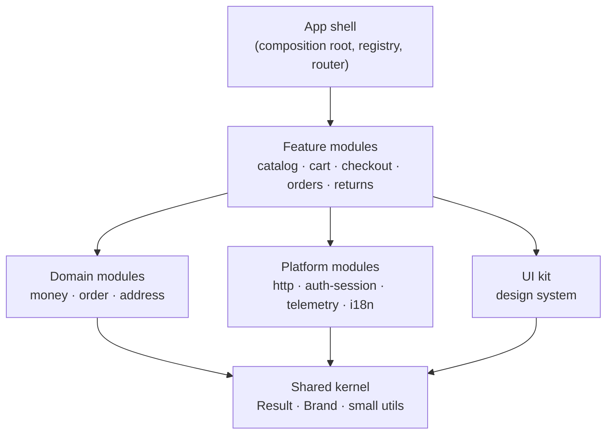
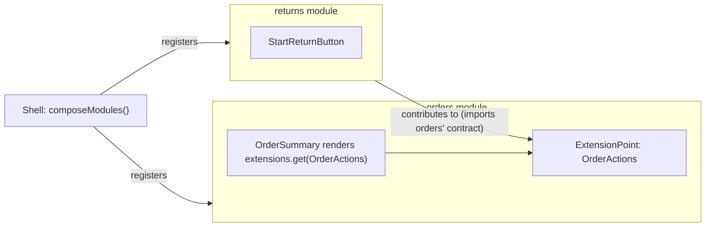

# 04 / 07 — Modular Architecture: Module Contracts, Boundaries and the Modular Monolith

## 1. Lesson metadata

| | |
|---|---|
| **Level** | Advanced |
| **Study time** | 5–6 hours (reading 2.5 h, module-extraction lab 1.5 h, exercises 1.5–2 h) |
| **Prerequisites** | [01 — Architecture fundamentals](./01-architecture-fundamentals.md), [05 — Composition and dependency direction](./05-composition-and-dependency-direction.md), [06 — Feature vs layer structure](./06-feature-vs-layer-structure.md), [Phase 0 / 10 — ES modules, dependency graphs, tree shaking](../00-web-and-javascript-foundations/10-modules-and-dependency-graphs.md), [Phase 0 / 20 — Tooling, transpilation and bundling](../00-web-and-javascript-foundations/20-tooling-transpilation-and-bundling.md) |
| **Next** | [08 — Domain-driven frontend](./08-domain-driven-frontend.md) |
| **Related** | [09 — Feature-Sliced Design](./09-feature-sliced-design.md), [13 — Application services and adapters](./13-application-services-and-adapters.md), [17 — Data flow architecture](./17-data-flow-architecture.md), [22 — Monorepos and shared packages](./22-monorepos-and-shared-packages.md), [23 — Multi-team ownership](./23-multi-team-ownership.md), [25 — Architectural fitness and enforcement](./25-architectural-fitness-and-enforcement.md), [Phase 5 / 08 — Provider pattern](../05-design-patterns/08-provider-pattern.md), [Phase 10 / 12 — Backward compatibility](../10-production-engineering/12-backward-compatibility.md), [Phase 11 / 12 — Micro-frontends](../11-senior-and-architect-mastery/12-microfrontends.md) |

**Learning objectives.** After this lesson you can:
1. Define a **module** in a front-end codebase by its *contract* (what it promises), not by its folder, and state the four properties of a good module: cohesion, encapsulation, explicit dependencies, and a stable public surface.
2. Classify modules (feature, domain/entity, platform/capability, shared kernel, app shell) and give each a dependency rule.
3. Design a module's **contract**: exported components/hooks/functions, types, events, extension points (slots), and the registration mechanism by which the app shell composes modules.
4. Compare four levels of modularity — folder modules with lint boundaries, workspace packages, a modular monolith with a module registry, and independently deployed modules (micro-frontends) — with the full dossier for each: problem, structure, rules, code, pros/cons, sizes, failure modes, migration.
5. Choose the lowest level of modularity that meets the real requirement, and recognise when going up a level is premature.
6. Communicate across modules without coupling: props and composition, public hooks, typed events, shared kernel types, and extension points.
7. Version and evolve a module contract without breaking consumers, and test the contract itself.
8. Enforce boundaries mechanically (lint, package `exports`, dependency analysis) and migrate an existing codebase incrementally toward modules.

**Concepts covered:** module, contract, encapsulation, information hiding, cohesion/coupling, public API vs internal API, shared kernel, module registry/manifest, extension point (slot/contribution), composition root, dependency inversion at module level, package `exports`, workspace dependencies, `sideEffects`, TypeScript project references, circular dependency detection, contract tests, semantic versioning of internal packages, modular monolith, deployment independence, module federation (conceptual).

> ⚠ **Tooling volatility.** Lint plugin options, monorepo task runners, package-manager workspace syntax, TypeScript `moduleResolution`/`paths` semantics and module-federation tooling all change faster than architecture principles. Code in this lesson marked *(sketch)* shows the shape of a configuration; verify option names against the current docs of the tool before use.

---

## 2. Deep conceptual explanation

### 2.1 What problem is this lesson solving?

[Lesson 06](./06-feature-vs-layer-structure.md) answered *where code lives*. It ended on an uncomfortable truth: a folder named `features/` makes nothing modular. Directories are a **convention**; modularity is a **property enforced by the cost of crossing a boundary**. A codebase has modules when:

- you can say, for each unit, *what it offers* and *what it needs* in a few lines;
- reaching around that statement (importing its internals) is mechanically impossible or at least visibly flagged;
- the unit can be tested, understood, owned, replaced or removed without reading the rest of the system.

The problems modular architecture addresses are those of scale and time: dependency tangles that make every change risky, teams blocked on each other's release cadence, builds and test suites that grow with the whole app, a graph where nothing can be deleted because "something might use it", and onboarding that requires understanding everything.

The deeper point (David Parnas's "information hiding" principle, 1972, which predates front-end by decades): **a module boundary is a decision you hide behind it.** The module's secret is *what is likely to change* — a storage choice, an API shape, a layout, a state library. Good modularity hides the volatile behind the stable.

### 2.2 Module, component, feature, package: four different words

| Term | Definition | Unit of |
|---|---|---|
| **Component** | A function returning UI | Rendering/reuse |
| **Feature** | A cohesive user-facing capability ([06 §2.3](./06-feature-vs-layer-structure.md)) | Product change |
| **Module** | A unit with an explicit contract and hidden internals | Design/dependency |
| **Package** | A unit of distribution with its own `package.json`, dependency list and entry points | Build/versioning/ownership |

A feature is *a good candidate* for a module. A module may be implemented as a folder or as a package. A package is a *mechanism* that makes the boundary harder to cross (resolution via `exports`, separate dependency manifest). Conflating the words causes bad decisions ("we have packages so we are modular" — no; a package with `exports: { "./*": "./src/*" }` exposes everything).

### 2.3 The four properties of a good module

1. **Cohesion.** Things that change together live together; the module has a single, nameable purpose.
2. **Encapsulation.** Internals are not importable by outsiders; the public surface is deliberately small.
3. **Explicit dependencies.** Everything the module needs from outside is visible at its edge (imports, props, injected ports, required providers), not hidden in globals, global CSS, singleton stores, `window` events, or implicit context.
4. **Stable contract.** The public surface changes rarely and compatibly; internal changes do not ripple.

A useful smell test is the **"lift and shift" test:** could you move this module to another repository with a short list of declared dependencies and have it compile? If the answer is "it needs seven global providers, a CSS reset and three types from `utils/`", the module's real contract is larger than its public API.

### 2.4 Module kinds and their dependency rules

Not every module is a feature. A workable taxonomy, from top (most dependent) to bottom (least):

| Kind | Examples | May depend on | Must not depend on |
|---|---|---|---|
| **App shell** | router setup, providers, module registry, layout | any module (public APIs) | — |
| **Feature module** | `catalog`, `cart`, `checkout`, `orders` | domain modules, platform modules, shared kernel; other feature modules only through declared, acyclic edges | app shell |
| **Domain module** | `money`, `order` entity types and rules, `address` | shared kernel, other domain modules (acyclic) | features, platform UI |
| **Platform module** | `http-client`, `auth-session`, `telemetry`, `feature-flags`, `i18n` | shared kernel | features, domain |
| **UI kit** | `design-system` components and tokens | shared kernel | features, domain, platform data |
| **Shared kernel** | primitive types (`Brand<T>`, `Result`), tiny utilities | nothing | everything above |

The *kinds* are the stable structure; the **rule** is single-directional: *dependencies point down this list.* This is [lesson 05's dependency-direction principle](./05-composition-and-dependency-direction.md) applied to modules. It is also the skeleton of [Feature-Sliced Design](./09-feature-sliced-design.md) and of hexagonal arrangements ([10](./10-clean-and-hexagonal-architecture.md)); the vocabulary differs, the shape is the same.

### 2.5 The contract: what a module may promise

A React module's contract has more channels than a library function's. List them explicitly; anything not listed is private.

| Channel | Example | Coupling it creates |
|---|---|---|
| **Components** | `<CartButton />`, `<ProductGrid renderActions={…} />` | Props types, required providers, styling assumptions |
| **Hooks / functions** | `useCartCount()`, `calculateTotal(items)` | Types and semantics (including referential stability) |
| **Types** | `CartItem`, `Money` | Structural coupling to consumers' code |
| **Events** (outbound) | `cart:itemAdded` | Event names and payload types |
| **Extension points** (inbound) | `registerCartAction(action)`, slot props | A promise to call contributed code in defined situations |
| **Registration manifest** | `{ id, routes, nav, permissions }` | App shell's expectations of the module's shape |
| **Required environment** | providers, feature flags, CSS variables, route params | Implicit dependencies, which should be made explicit (§2.6) |

Two sub-principles keep a contract small:

- **Export capabilities, not structure.** Export `useCartCount()` rather than `useCartStore`; export `<CartButton/>` rather than the reducer. Consumers get to *use* the capability but cannot depend on the store technology.
- **Accept data and callbacks, not other modules' types** where you can. A module whose component takes `{ sku, name, priceMinor }` is less coupled than one taking a `catalog.Product` ([06 §5.5](./06-feature-vs-layer-structure.md) — the anti-corruption edge).

### 2.6 Hidden dependencies: context, CSS, singletons

React offers many ways to depend on something invisibly:

- **Context.** A module whose components call `useContext(AuthContext)` has a dependency on *some provider above*. Make it explicit: export a hook from the owning module (`useCurrentUser`), document the required provider in the contract, and fail loudly with a helpful error when the provider is missing (not `undefined` silently). Alternatively accept the needed value as a prop at the module's root.
- **Global CSS.** Module CSS that relies on `body` resets or global class names is an implicit dependency; use CSS Modules, CSS-in-JS with scoping, or a design-system token contract ([20](./20-design-systems.md)).
- **Singletons.** A module importing a global store, a global event emitter, or `window.__APP__` is coupled to every other importer. Inject via props/context/ports ([11 — Dependency inversion](./11-dependency-inversion.md)).
- **Route and URL coupling.** Hard-coded `"/orders/123"` strings in a module that doesn't own the route table. Expose route builders from the owning module or an injected `navigate`/`href` function ([18](./18-routing-architecture.md)).
- **Side-effecting imports.** Modules that register things on import (polyfills, analytics, global listeners) break tree-shaking ([00/10](../00-web-and-javascript-foundations/10-modules-and-dependency-graphs.md)) and make "importing" a behavior. Prefer explicit `register()` calls from the shell.

### 2.7 How modules cooperate without knowing each other

Cross-module needs fall into five patterns, from least to most coupled:

1. **Composition by the parent.** The shell or a page composes modules and passes data/callbacks/slots ([06 §5.5](./06-feature-vs-layer-structure.md)). Zero module-to-module imports.
2. **Shared-kernel types.** Both modules depend on a tiny, stable lower module (`Money`, `Address`).
3. **Directed public-API import.** `checkout → cart` through cart's public hooks. Acceptable if the edge is declared and acyclic.
4. **Typed events (inversion).** A module *publishes* an event; others *subscribe*. The publisher does not know the subscribers, but the event contract is shared (it lives in the *publisher's* contract or in the kernel).
5. **Extension points (inversion).** A module defines a registry ("order actions") and other modules contribute entries. The host depends on an *interface*; contributors depend on the host's interface.

Patterns 4 and 5 reduce compile-time coupling and increase **runtime opacity**: you can no longer "go to definition" from cause to effect. Use them where the dependency *direction* would otherwise be wrong (a low-level module must trigger something high-level) or where the set of participants is open (plug-ins). Do not use events as a way to avoid thinking about boundaries: an event bus used for ordinary data flow is a global variable with extra steps.

### 2.8 Levels of modularity

The central claim of this lesson: **modularity is a spectrum with costs at each step.** The levels correspond to the dossiers in §7:

| Level | Boundary mechanism | Typical unit of ownership | Deploy together? |
|---|---|---|---|
| 1. Folder modules + lint | Convention + lint/dependency rules | Directory (CODEOWNERS) | Yes |
| 2. Workspace packages | `package.json` + `exports` + build/TS project | Package | Yes (one app build) |
| 3. Modular monolith with module registry | Packages/folders + manifest + extension points | Team | Yes |
| 4. Independently deployed modules | Network/runtime composition (micro-frontends) | Team *and* pipeline | No |

Each step up buys **stronger isolation, independent versioning/cadence** and costs **tooling, build time, coordination overhead and runtime complexity**. Most products need level 1, a few need level 2 for specific shared libraries, and fewer need 3 or 4. This lesson's discipline: *move up only when you can state the problem the current level fails to solve.*

### 2.9 Misconceptions

| Misconception | Reality |
|---|---|
| "Modular means many packages." | Modular means *hidden internals behind a contract*. A well-linted folder structure can be more modular than 30 packages with open `exports`. |
| "A barrel file is the module's public API." | A barrel is a *syntax*; the API is the set of promises. A barrel re-exporting everything is no API. |
| "Micro-frontends are the end state of modularity." | They are a deployment architecture with heavy costs. Most teams get 90% of the value from level 1–2. |
| "Events decouple modules." | Events decouple *compile-time imports*; they add runtime coupling to event names and payloads and make flows implicit. |
| "Shared code should live in one `common` package." | A catch-all shared package accumulates fan-in and domain knowledge; it is the single point of coupling. Split by kind and keep it small. |
| "More isolation is always better." | Isolation has a price (duplicated dependencies, harder cross-cutting changes, version skew). The right isolation is the cheapest one that meets the requirement. |
| "We can modularise later." | Imports across would-be boundaries accrue daily. Cheap enforcement early prevents the expensive untangling later. |

---

## 3. Internal mechanics

### 3.1 How tools see a boundary

*Public guarantee (module systems and tooling).*

- **ES modules** have no notion of "private files": any file reachable by a specifier can be imported ([00/10](../00-web-and-javascript-foundations/10-modules-and-dependency-graphs.md)). Privacy must be provided by tooling.
- **Package `exports`** (Node.js package entry points, honoured by bundlers and by TypeScript under `moduleResolution: "node16" | "nodenext" | "bundler"`) *does* provide privacy: only the listed subpaths can be imported by consumers; deep imports of unlisted files fail to resolve. ⚠ Behaviour under older TypeScript `moduleResolution: "node"` ignores `exports`; verify your setup.
- **TypeScript** does not enforce architectural rules; `paths` is only a type-checking alias (bundlers need matching config, [06 §3.2](./06-feature-vs-layer-structure.md)). It can enforce *declared visibility* of types via `export`, and with project references can enforce **build-order/dependency direction** between projects.
- **Lint and dependency analysers** (ESLint with import-boundary plugins, `no-restricted-imports`, dependency-cruiser, Nx/other workspace tooling with tag-based constraints) enforce rules over the import graph; they are only as complete as their configuration.

### 3.2 What a package boundary adds

| Capability | Folder module | Workspace package |
|---|---|---|
| Hiding internals | Lint rule (soft) | `exports` map (resolution-level, hard) |
| Declared dependencies | Whole-app `package.json` | Per-package `dependencies`/`peerDependencies` — undeclared imports can fail |
| Independent test/build | Directory-level test globs | Per-package scripts; cached task graph |
| Versioning | Not applicable | Possible (semver, changesets/versioning tools) |
| Cost | Near zero | Build config per package, TS config, publishing or internal linking, tooling upgrades ×N |

Package `exports` sketch:

```jsonc
// packages/cart/package.json (sketch)
{
  "name": "@acme/cart",
  "version": "0.0.0",
  "private": true,
  "type": "module",
  "sideEffects": false,
  "exports": {
    ".": { "types": "./src/index.ts", "default": "./src/index.ts" },
    "./testing": { "types": "./src/testing.ts", "default": "./src/testing.ts" }
  },
  "peerDependencies": { "react": "^19.0.0" },
  "dependencies": { "@acme/money": "workspace:*" }
}
```

- `exports` lists exactly two entry points; `@acme/cart/src/store` does not resolve.
- Pointing `exports` at **source** (`./src/index.ts`) — sometimes called the "internal package, no build step" or "just-in-time package" approach — keeps developer experience simple (the app's bundler compiles it) and works only when every consumer's toolchain compiles TypeScript from `node_modules`/workspace links. Building to `dist` instead isolates toolchains at the cost of build orchestration. Both are legitimate; choose per [22](./22-monorepos-and-shared-packages.md).
- `"workspace:*"` is the pnpm/Yarn workspace protocol; npm workspaces use plain version ranges that resolve to local packages. ⚠ Verify for your package manager.
- `peerDependencies: react` prevents two copies of React ([hooks break with duplicate React](https://react.dev/warnings/invalid-hook-call-warning)); the app owns React's version.
- `"sideEffects": false` tells bundlers unused re-exports can be dropped; correct only if no module in the package has import-time side effects (CSS imports are side effects: list them).

### 3.3 Import graph metrics

You can reason about modularity with graph metrics (computed by dependency-analysis tools or a script, [06 exercise C1](./06-feature-vs-layer-structure.md)):

- **Fan-in** (how many modules import X): high fan-in means *stability is mandatory*; changes to X ripple. Platform/kernel modules *should* have high fan-in.
- **Fan-out** (how many modules X imports): high fan-out means X is *fragile*: any dependency's change can break it. App shell *will* have high fan-out; a feature module should not.
- **Cycles**: strongly connected components larger than one module. Zero tolerance across module boundaries.
- **Instability** I = fan-out / (fan-in + fan-out) (Robert Martin's metric): stable modules (I near 0) should be abstract/contract-like; unstable modules (I near 1) may be concrete and volatile. The *Stable Dependencies Principle*: depend in the direction of stability.

These are *heuristics*, not goals. They highlight modules worth looking at; they do not tell you the right design.

### 3.4 Lazy loading and chunk boundaries

A bundler splits at dynamic `import()`. A module with a lazy entry point corresponds to a chunk:

```ts
const CheckoutRoutes = lazy(() => import("@acme/checkout/routes"));
```

If the module also exports a tiny hook (`useCartCount`) from the *same* entry as its heavy UI, importing the hook from the shell pulls in the UI into the main chunk. ⚠ This depends on the bundler's tree-shaking and `sideEffects` metadata. Design module entry points around **load profiles**: a *light* entry for eager exports (hooks, types, small components) and a *lazy* entry for heavy routes. This is a contract design decision, not a bundler trick ([Phase 7 / 15](../07-performance/15-code-splitting-and-lazy-loading.md)).

### 3.5 Runtime composition vs build-time composition

- **Build-time composition** (levels 1–3): the shell imports modules; the bundler sees everything; type-checking spans modules; one deployable. Refactors are mechanical (rename a symbol across modules). Failures show at build time.
- **Runtime composition** (level 4): modules are loaded over the network at runtime from independently deployed bundles (module federation, import maps, iframes, web components). Type safety across the boundary is partial (types must be shared out of band); version skew is a runtime failure mode; shared singletons (React, router, design system) must be negotiated explicitly. ⚠ Tooling is evolving; see [Phase 11 / 12](../11-senior-and-architect-mastery/12-microfrontends.md).

---

## 4. Step-by-step execution walkthrough: extracting a module from a grown feature

Scenario: `features/orders` has grown to 80 files. Product wants another team to own "returns" (a flow that starts from an order) and wants `orders` to expose a stable contract to `returns` and to the account-overview page. Currently `returns` code lives inside `orders/ui/ReturnDialog.tsx` and imports `orders/model/store` directly.

**Step 1 — Write the contract before moving anything.** In prose: *`orders` offers: `<OrderList>`, `<OrderSummary orderId>`, `useOrder(orderId)` (returns a view model), type `OrderSummaryVM`. It accepts an `actions` slot on `OrderSummary` so other modules contribute buttons. It emits `order:statusChanged`.* This takes 20 minutes and surfaces disagreements early.

**Step 2 — Measure the current graph.** Script or tool output: who imports `orders/*`, which internals are deep-imported, which `orders` files import other features. Example finding: 14 files outside `orders` deep-import `orders/model/store`; `orders/ui/ReturnDialog.tsx` imports `catalog` internals.

**Step 3 — Create the public entry and redirect public consumers.** Add `orders/index.ts` exporting the contract. Replace outside deep imports with entry imports **one consumer at a time** (codemod or IDE refactor). Where a consumer needs something not in the contract, decide: *add to the contract* (if it is a legitimate capability) or *change the consumer*.

**Step 4 — Introduce the lint rule in "ratchet" mode.** Record the current violations in a baseline file; the rule fails on *new* violations only. Over the following weeks the baseline shrinks ([25](./25-architectural-fitness-and-enforcement.md)).

**Step 5 — Invert the `returns` dependency.** `ReturnDialog` is moved to `features/returns`. It now depends on `orders` through the public API (`useOrder`, type `OrderSummaryVM`) — direction `returns → orders`, which matches the product relationship (a return belongs to an order). `orders` offers the `actions` slot; the **shell/page** places `<StartReturnButton orderId>` from `returns` into `OrderSummary`'s `actions`. No `orders → returns` import. Cycle avoided.

**Step 6 — Decide on a package boundary (or not).** Does `orders` need an independent build, independent versioning, or hard encapsulation? If a different team now owns `returns` and the lint boundary has proved insufficient (violations keep appearing, review cannot keep up), promote `orders` to `packages/orders` with an `exports` map. Otherwise stay at level 1.

**Step 7 — Add contract tests** (§5.5): render `OrderSummary` with the `actions` slot, assert the slot is rendered; assert `useOrder`'s result shape; run these in `orders`' suite so changes to the contract fail fast.

**Step 8 — Update ownership and docs.** CODEOWNERS entries for both directories; a short `README` in each module stating the contract and the allowed dependencies.

**Observation.** The extraction did not require any clever technique: it required writing the contract, making the dependency direction right, and installing enforcement. The *hard* part is Step 1 and Step 5, which are design decisions.

---

## 5. Code examples

### 5.1 Minimal example — a module with a deliberately small contract

```text
src/modules/notifications/
  index.ts                 (public contract)
  NotificationProvider.tsx (public)
  useNotify.ts             (public)
  internal/
    queue.ts               (private)
    Toast.tsx              (private)
    types.ts               (partly public via index.ts)
```

```ts
// modules/notifications/internal/types.ts
export type NotificationLevel = "info" | "success" | "error";
export interface NotificationInput {
  readonly level: NotificationLevel;
  readonly message: string;
  readonly timeoutMs?: number;
}
export interface Notifier {
  notify(input: NotificationInput): void;
}
```

```tsx
// modules/notifications/NotificationProvider.tsx
import { createContext, useCallback, useMemo, useState, type ReactNode } from "react";
import { Toast } from "./internal/Toast";
import type { NotificationInput, Notifier } from "./internal/types";

export const NotifierContext = createContext<Notifier | null>(null);

interface Item extends NotificationInput { readonly id: number }

export function NotificationProvider({ children }: { children: ReactNode }) {
  const [items, setItems] = useState<readonly Item[]>([]);

  const notify = useCallback((input: NotificationInput) => {
    setItems((prev) => [...prev, { ...input, id: Date.now() + prev.length }]);
  }, []);

  const notifier = useMemo<Notifier>(() => ({ notify }), [notify]);

  return (
    <NotifierContext value={notifier}>
      {children}
      {items.map((i) => (
        <Toast key={i.id} item={i} onDone={() => setItems((p) => p.filter((x) => x.id !== i.id))} />
      ))}
    </NotifierContext>
  );
}
```

```ts
// modules/notifications/useNotify.ts
import { use } from "react";
import { NotifierContext } from "./NotificationProvider";
import type { Notifier } from "./internal/types";

export function useNotify(): Notifier {
  const n = use(NotifierContext);
  if (!n) throw new Error("useNotify must be used inside <NotificationProvider> (module: notifications)");
  return n;
}
```

```ts
// modules/notifications/index.ts  — THE contract
export { NotificationProvider } from "./NotificationProvider";
export { useNotify } from "./useNotify";
export type { Notifier, NotificationInput, NotificationLevel } from "./internal/types";
```

**Line notes.**
- `<NotifierContext value={…}>` renders the context directly as a provider (React 19 syntax; `<NotifierContext.Provider>` is still accepted).
- `use(Context)` reads context (and can be called conditionally); `useContext` also works. `useNotify` fails loudly when the provider is missing — this converts a hidden dependency (§2.6) into an explicit, diagnosable one.
- The contract exposes an **interface** `Notifier`, not the queue: consumers (and tests) can fake it.
- `Toast`, the queue, and `Date.now()`-based ids are private and can change freely. (The id scheme is deliberately naive; replace with a counter in a ref for production.)

**Trade-off.** A context-based service requires the provider in the tree for every consumer; the failure mode is a missing provider in a test or a Storybook story. Provide a `testing` entry with a `FakeNotifier` (§5.5).

### 5.2 Practical example — a module manifest and registry in the app shell

The shell should know modules only through a **manifest**: a typed object each module exports. Adding a module is then a one-line registration; removing it is a one-line deletion.

```ts
// src/platform/module-system/types.ts
import type { ComponentType } from "react";

export interface AppRoute {
  readonly path: string;
  readonly load: () => Promise<{ default: ComponentType }>; // lazy entry
  readonly requires?: readonly Permission[];
}

export interface NavItem {
  readonly id: string;
  readonly label: string;
  readonly to: string;
  readonly order: number;
  readonly requires?: readonly Permission[];
}

export type Permission = string & { readonly __brand: "Permission" };

export interface AppModule {
  readonly id: string;
  readonly routes: readonly AppRoute[];
  readonly nav?: readonly NavItem[];
  /** Called once by the shell; must not render or perform side effects other than registration. */
  readonly register?: (ctx: ModuleContext) => void;
}

export interface ModuleContext {
  readonly extensions: ExtensionRegistry;
}

export interface ExtensionRegistry {
  contribute<T>(point: ExtensionPoint<T>, value: T): void;
  get<T>(point: ExtensionPoint<T>): readonly T[];
}

export interface ExtensionPoint<T> {
  readonly id: string;
  /** phantom field; carries T for type inference only */
  readonly _t?: T;
}
```

```ts
// src/platform/module-system/registry.ts
import type { AppModule, ExtensionPoint, ExtensionRegistry } from "./types";

export function createExtensionRegistry(): ExtensionRegistry {
  const store = new Map<string, unknown[]>();
  return {
    contribute(point, value) {
      const list = store.get(point.id) ?? [];
      list.push(value);
      store.set(point.id, list);
    },
    get<T>(point: ExtensionPoint<T>): readonly T[] {
      return (store.get(point.id) ?? []) as readonly T[];
    },
  };
}

export function composeModules(modules: readonly AppModule[]) {
  const ids = new Set<string>();
  for (const m of modules) {
    if (ids.has(m.id)) throw new Error(`Duplicate module id: ${m.id}`);
    ids.add(m.id);
  }
  const extensions = createExtensionRegistry();
  for (const m of modules) m.register?.({ extensions });
  return {
    extensions,
    routes: modules.flatMap((m) => m.routes),
    nav: modules.flatMap((m) => m.nav ?? []).sort((a, b) => a.order - b.order),
  };
}
```

```ts
// src/modules/orders/index.ts (contract, excerpt)
import type { ReactNode } from "react";
import type { AppModule, ExtensionPoint } from "@/platform/module-system";

export interface OrderAction { readonly id: string; readonly render: (orderId: string) => ReactNode }
export const OrderActions: ExtensionPoint<OrderAction> = { id: "orders.actions" };

export const ordersModule: AppModule = {
  id: "orders",
  routes: [{ path: "/orders/*", load: () => import("./routes") }],
  nav: [{ id: "orders", label: "Orders", to: "/orders", order: 20 }],
};
```

```ts
// src/modules/returns/index.ts
import { OrderActions } from "@/modules/orders";           // returns → orders (declared edge)
import type { AppModule } from "@/platform/module-system";
import { StartReturnButton } from "./ui/StartReturnButton";

export const returnsModule: AppModule = {
  id: "returns",
  routes: [{ path: "/returns/*", load: () => import("./routes") }],
  register: ({ extensions }) =>
    extensions.contribute(OrderActions, {
      id: "start-return",
      render: (orderId) => <StartReturnButton orderId={orderId} />,
    }),
};
```

(That last file would be `index.tsx` because it contains JSX; shown with `.ts` header for brevity of the module list.)

```tsx
// src/app/main.tsx (composition root, excerpt)
import { composeModules } from "@/platform/module-system";
import { ordersModule } from "@/modules/orders";
import { returnsModule } from "@/modules/returns";

export const app = composeModules([ordersModule, returnsModule]);
```

**Line notes.**
- `orders` defines the **extension point** (it depends on nothing about `returns`); `returns` contributes to it (`returns → orders`). The shell wires everything. Remove `returnsModule` from the list and the Start Return button disappears with no dangling import in `orders`.
- `ExtensionPoint<T>` is typed via a phantom field so `contribute(OrderActions, …)` is type-checked against `OrderAction`.
- The registry is *data*; it is created once in the composition root and passed through context to `OrderSummary` (not shown) which renders `extensions.get(OrderActions)`. Since registration happens before first render, rendering is deterministic.
- `load: () => import("./routes")` makes each module's UI a lazy chunk.

**Costs.** The indirection is real: "who renders Start Return?" is not answerable by following imports from `orders`. Mitigations: a dev-time `registry.describe()` that prints the contribution table; naming conventions for extension points; keep the number of extension points small and documented. This is a **pattern for open sets of contributors**; for one known consumer, a prop or slot ([06 §5.5](./06-feature-vs-layer-structure.md)) is simpler.

### 5.3 Incorrect example — a "module" with an open `exports`, singletons and a shared grab-bag

```jsonc
// packages/orders/package.json  (WRONG)
{
  "name": "@acme/orders",
  "exports": { "./*": "./src/*" },
  "dependencies": { "react": "^19.0.0", "zustand": "^5.0.0" }
}
```

```ts
// packages/orders/src/ui/OrderRow.tsx  (WRONG)
import { useAppStore } from "@acme/shared/store";            // global singleton
import { formatMoney } from "@acme/shared";                  // kitchen-sink package
import { trackEvent } from "../../../app/analytics";         // reaches up out of the package
import "./orders.css";                                       // global class names

export function OrderRow({ id }: { id: string }) {
  const order = useAppStore((s) => s.orders[id]);
  ...
}
```

**Predict:** is this a module? What fails first when a second app tries to reuse it, and what fails first when you change the order store's shape?

**Reveal.** It is a *folder with a `package.json`*. Failures:
1. `exports: { "./*": … }` exposes every internal file: consumers import `@acme/orders/ui/OrderRow` and `@acme/orders/store/internal`, so renaming any file is a breaking change.
2. `react` listed under `dependencies` risks a duplicate React copy in some install layouts; it should be a `peerDependency` (⚠ package-manager dependent, but the principle holds).
3. The module reads a global store `@acme/shared/store`, so its real dependency is *the shape of a global store*; changing the global store breaks `orders` (and every other module).
4. `../../../app/analytics` is an upward import out of the package: a layering violation that also breaks in isolated builds.
5. Unscoped CSS creates cross-module style collisions.
6. `@acme/shared` is a kitchen sink: the dependency graph shows `orders → shared`, hiding which parts are used.

### 5.4 Corrected implementation — inject dependencies, narrow the contract

```jsonc
// packages/orders/package.json (corrected sketch)
{
  "name": "@acme/orders",
  "private": true,
  "type": "module",
  "sideEffects": ["**/*.css"],
  "exports": { ".": "./src/index.ts", "./testing": "./src/testing.ts" },
  "peerDependencies": { "react": "^19.0.0" },
  "dependencies": { "@acme/money": "workspace:*" }
}
```

```tsx
// packages/orders/src/ui/OrderRow.tsx (corrected)
import { formatMoney, type Money } from "@acme/money";      // narrow, domain-agnostic package
import styles from "./OrderRow.module.css";                 // scoped styles
import { useOrdersEnv } from "../env";                       // explicit environment contract

export interface OrderRowProps { readonly order: { id: string; total: Money; status: string } }

export function OrderRow({ order }: OrderRowProps) {
  const { onEvent } = useOrdersEnv();                        // injected, e.g. analytics adapter
  return (
    <li className={styles.row} onClick={() => onEvent({ type: "order.opened", orderId: order.id })}>
      {order.id} — {formatMoney(order.total)} — {order.status}
    </li>
  );
}
```

```ts
// packages/orders/src/env.ts
import { createContext, use } from "react";

export type OrdersEvent = { type: "order.opened"; orderId: string };
export interface OrdersEnv { readonly onEvent: (e: OrdersEvent) => void }

export const OrdersEnvContext = createContext<OrdersEnv | null>(null);
export function useOrdersEnv(): OrdersEnv {
  const v = use(OrdersEnvContext);
  if (!v) throw new Error("OrdersEnvContext missing: wrap in <OrdersEnvProvider> (see @acme/orders)");
  return v;
}
```

The `orders` module's *environment* is now an explicit interface; the shell provides an implementation that maps `OrdersEvent` to the analytics adapter. The module has no knowledge of analytics, of global stores, or of the app. It can be rendered in isolation with a fake env — in tests and Storybook.

### 5.5 Advanced example — contract tests and a testing entry point

A module's `testing` entry exports fakes and helpers that other modules use in *their* tests, so consumers never import internals:

```tsx
// packages/orders/src/testing.tsx
import type { ReactNode } from "react";
import { OrdersEnvContext, type OrdersEnv, type OrdersEvent } from "./env";

export function createFakeOrdersEnv() {
  const events: OrdersEvent[] = [];
  const env: OrdersEnv = { onEvent: (e) => events.push(e) };
  return { env, events };
}

export function OrdersTestProvider({ env, children }: { env: OrdersEnv; children: ReactNode }) {
  return <OrdersEnvContext value={env}>{children}</OrdersEnvContext>;
}
```

```tsx
// packages/orders/src/contract.test.tsx
import { render, screen } from "@testing-library/react";
import userEvent from "@testing-library/user-event";
import { describe, expect, it } from "vitest";
import { OrderRow } from "./index";
import { createFakeOrdersEnv, OrdersTestProvider } from "./testing";

describe("orders contract", () => {
  it("OrderRow reports order.opened through the injected env", async () => {
    const { env, events } = createFakeOrdersEnv();
    render(
      <OrdersTestProvider env={env}>
        <OrderRow order={{ id: "o1", total: { amountMinor: 1250, currency: "EUR" }, status: "paid" }} />
      </OrdersTestProvider>,
    );
    await userEvent.click(screen.getByRole("listitem"));
    expect(events).toEqual([{ type: "order.opened", orderId: "o1" }]);
  });

  it("index.ts exports exactly the documented surface", async () => {
    const mod = await import("./index");
    expect(Object.keys(mod).sort()).toEqual(["OrderList", "OrderRow", "OrdersEnvProvider", "useOrder"].sort());
  });
});
```

The second test is a **surface snapshot**: it fails when someone adds or removes an export, forcing a conscious contract change (and a version bump decision). Type-level surface checks (API extractor-style reports, `tsd`/`expectTypeOf`) catch type changes that runtime snapshots miss. Verify tool options before adopting.

### 5.6 Advanced example — typed events with ownership

```ts
// packages/orders/src/events.ts  (owned by orders; part of its contract)
export interface OrderEvents {
  "order.statusChanged": { orderId: string; from: string; to: string };
  "order.cancelled": { orderId: string; reason: string };
}
```

```ts
// packages/platform-events/src/index.ts
export type Unsubscribe = () => void;

export interface EventBus<E extends Record<string, unknown>> {
  emit<K extends keyof E>(type: K, payload: E[K]): void;
  on<K extends keyof E>(type: K, handler: (payload: E[K]) => void): Unsubscribe;
}

export function createEventBus<E extends Record<string, unknown>>(): EventBus<E> {
  const handlers = new Map<keyof E, Set<(p: never) => void>>();
  return {
    emit(type, payload) {
      handlers.get(type)?.forEach((h) => (h as (p: typeof payload) => void)(payload));
    },
    on(type, handler) {
      const set = handlers.get(type) ?? new Set();
      set.add(handler as (p: never) => void);
      handlers.set(type, set);
      return () => set.delete(handler as (p: never) => void);
    },
  };
}
```

Used in a hook so subscription follows component lifecycle:

```ts
import { useEffect } from "react";
import type { OrderEvents } from "@acme/orders/events";   // separate public entry for types
import type { EventBus } from "@acme/platform-events";

export function useOrderEvent<K extends keyof OrderEvents>(
  bus: EventBus<OrderEvents>, type: K, handler: (p: OrderEvents[K]) => void,
) {
  useEffect(() => bus.on(type, handler), [bus, type, handler]);   // handler should be stable (useCallback)
}
```

**Notes.** The event *types* live in the publisher's contract; subscribers depend on the publisher (directed edge), the publisher depends on nobody. The effect returns the unsubscribe function (cleanup). An unstable `handler` re-subscribes each render; from React 19.2 (stable) you may use `useEffectEvent` inside the component to read the latest `handler` from the effect without re-subscribing (call it only inside effects; do not list it in the dependency array). Only use buses for *notifications* (facts that happened), not commands or data queries; ordering and error isolation in handlers need explicit design (a throwing handler in `forEach` above stops later handlers: wrap in try/catch for production).

### 5.7 Advanced example — a dependency-cruiser rule set for the module kinds (sketch)

```js
// .dependency-cruiser.cjs (sketch; verify option names against the current docs)
module.exports = {
  forbidden: [
    { name: "no-circular", severity: "error", from: {}, to: { circular: true } },
    {
      name: "platform-not-upward",
      severity: "error",
      from: { path: "^src/platform" },
      to: { path: "^src/(modules|app)" },
    },
    {
      name: "modules-not-to-app",
      severity: "error",
      from: { path: "^src/modules" },
      to: { path: "^src/app" },
    },
    {
      name: "deep-import-into-module",
      severity: "error",
      from: { path: "^src/(?!modules/([^/]+)/)" },                 // anywhere outside the module itself…
      to: { path: "^src/modules/[^/]+/(?!index\\.tsx?$|testing\\.tsx?$)" }, // …may only import index/testing
    },
    {
      name: "no-orphans",
      severity: "warn",
      from: { orphan: true, pathNot: ["\\.d\\.ts$", "main\\.tsx$"] },
      to: {},
    },
  ],
};
```

**Caveat.** The `deep-import-into-module` rule as written also forbids a module's *own other modules'* deep imports but *allows* imports within the same module only if the `from` pattern excludes them — expressing "same-module" exemptions with capture groups depends on the tool's regex group references (`$1`); verify the exact syntax (dependency-cruiser supports referencing groups from `from.path` in `to.pathNot`). The rule *names* the architecture's rules in one file, which is its main value; lesson 25 expands enforcement.

---

## 6. Visual explanations

### 6.1 Module kinds and dependency direction



### 6.2 Extension point inversion



### 6.3 Four levels of modularity

```text
Level 1  folders + lint          [ one repo | one build | one package.json     ]
Level 2  workspace packages      [ one repo | one app build | many package.json ]
Level 3  modular monolith        [ level 2 + manifests, registry, extension pts ]
Level 4  independently deployed  [ many pipelines | runtime composition | version skew ]
         ----> isolation, autonomy, and cost all increase  ---->
```

### 6.4 What a module contract includes

```mermaid
mindmap
  root((Module contract))
    Exports
      Components
      Hooks
      Functions
      Types
    Inversion
      Events emitted
      Extension points
      Slots
    Environment
      Required providers
      Config and flags
      Routes and permissions
    Promises
      Referential stability
      Error behavior
      Performance profile
      Versioning policy
```



---

## 7. Alternative approaches and trade-offs (dossiers)

### 7.1 Dossier A — Level 1: folder modules with public entry and enforced lint boundaries

- **Original problem solved.** A single-app codebase needs to stop internals leaking across features without the overhead of packages. The cheapest boundary that is *mechanically* enforceable.
- **Representative folder structure.**
  ```text
  src/
    app/                 (shell, providers, module list)
    modules/
      cart/    index.ts  ui/  model/  api/  internal/
      checkout/ index.ts ...
    platform/            (http, auth, telemetry)
    shared/              (kernel + ui kit entry)
  ```
- **Dependency rules.** Kinds per §2.4. Outside code imports only `modules/<x>/index.ts` (and `testing.ts`). Cross-module edges only along an allow-list; no cycles; `platform`/`shared` never import `modules` or `app`.
- **Example code.** §5.1 (notifications), §5.7 (rules).
- **Advantages.** Near-zero tooling cost; refactors are IDE-assisted and atomic; single type-check; one build and one set of dependencies; easy to adopt incrementally; sufficient for most teams and apps.
- **Disadvantages.** Boundaries are *soft*: they hold only while lint is enforced in CI and not suppressed; no independent versioning; all modules share dependency versions; test/build time scales with the whole app; ownership is by convention (CODEOWNERS).
- **Appropriate sizes.** 3–40 developers, one product, 5–40 modules, one deployable. Teams of 20–40 require strong CI enforcement and CODEOWNERS.
- **Failure modes.** `eslint-disable` creep; barrels that re-export everything; modules that grow into grab-bags (`modules/common`); cross-module edges accumulate until an unplanned cycle; "temporary" deep imports that stay forever; the module list in the shell becoming a god file.
- **Migration considerations.** *From layers*: [06 §7.1](./06-feature-vs-layer-structure.md). *To level 2:* pick the modules with high reuse across apps or distinct ownership; move to `packages/<x>` preserving the same entry (`index.ts`) so consumers' import specifiers change from `@/modules/x` to `@acme/x` mechanically (codemod). The path alias can be pointed to the package during transition (`@/modules/x` → `packages/x/src`), then removed.

### 7.2 Dossier B — Level 2: workspace packages with `exports` maps

- **Original problem solved.** Soft boundaries erode; teams want hard encapsulation, independent test/build caching, declared dependencies (a module can only import what it lists), and reuse across several apps (web, admin, mobile web view, Storybook).
- **Representative folder structure.**
  ```text
  repo/
    apps/
      web/       (shell)       admin/ (second app)
    packages/
      ui/        money/        auth-session/
      orders/    cart/         checkout/
      config-eslint/  config-ts/
    package.json (workspaces)   pnpm-workspace.yaml | turbo.json | nx.json  (tool-dependent)
  ```
- **Dependency rules.** Each package declares its dependencies; the graph is a DAG (enforced by package manager + cycle check + workspace tooling tags). Apps depend on packages; packages never depend on apps; low-level packages (`money`, `ui`) never depend on feature packages. `peerDependencies` for React and other singletons.
- **Example code.** §3.2 `package.json`, §5.4.
- **Advantages.** Hard encapsulation (`exports`); undeclared dependency detection; per-package scripts and cached task graphs (only rebuild/test what changed — requires a task runner and correct inputs/outputs ⚠ tool-specific); reuse across apps; potential independent versioning (changesets-style workflows) and publishing to a private registry; clearer ownership boundaries (one package = one owner).
- **Disadvantages.** Tooling setup and upkeep (TS configs, build modes, ESLint/Vitest config sharing, path resolution for source-exported packages); more repo-level complexity; harder refactors across packages (renames require multi-package PRs; version skew if packages are published); slower fresh installs; duplicate dependency risks; developer-experience regressions (HMR across packages, go-to-definition into `dist`) unless configured; over-fragmentation into many tiny packages.
- **Appropriate sizes.** 10–200+ developers, multiple apps or teams, or a UI kit/domain library reused across apps; 10–100 packages. Below ~10 developers and one app, the overhead rarely pays.
- **Failure modes.** Package explosion (every folder becomes a package); `shared`/`common` mega-package; circular package dependencies hidden by TS `paths`; `exports` wildcards defeating encapsulation; building packages to `dist` and forgetting to rebuild (stale types); two React copies; versioning ceremony for packages that are only ever consumed by one app; CI times growing because the task graph has no caching.
- **Migration considerations.** Extract *leaf* packages first (kernel, UI kit, money) — they have no upward dependencies; then domain and platform; features last. Keep consumers on the same specifier through an alias while moving. Introduce one task runner and caching early. Decide source-vs-built packages once ([22](./22-monorepos-and-shared-packages.md)). *Back to level 1:* if packages are always changed together and released together, inline them as folders; document the retreat as a valid outcome.

### 7.3 Dossier C — Level 3: modular monolith with manifests, registry and extension points

- **Original problem solved.** Many teams contribute to one product; the shell should not need editing per feature; teams add capabilities (routes, nav items, widgets, settings pages, actions) without touching each other's code; features must degrade independently (flags, permissions); removing a module should be one change.
- **Representative folder structure.**
  ```text
  src/
    app/
      main.tsx             composeModules([...])
      module-list.ts       the only file that knows all modules
    platform/
      module-system/       AppModule, ExtensionPoint, registry
      permissions/  feature-flags/  telemetry/
    modules/
      orders/   index.ts (manifest + contract)   routes.tsx  extension-points.ts
      returns/  index.ts                         routes.tsx
      reporting/ ...
  ```
- **Dependency rules.** Modules depend on `platform/module-system` types and on other modules' *declared* extension points/events; the shell depends on all manifests; `module-system` depends on nothing in modules. A module's manifest is cheap to import (no heavy code; routes are lazy).
- **Example code.** §5.2, §5.6.
- **Advantages.** Shell is stable; adding/removing modules is local; feature flags/permissions can be applied uniformly at registration; supports plug-in-like extensibility (widgets on dashboards, actions on orders); good fit for large product suites and white-label/tenant-specific variants; one build and deployable, so type safety is retained.
- **Disadvantages.** Indirection (runtime wiring is harder to trace than imports); registries become implicit global state; ordering and conflicts among contributions need rules; testing requires composition helpers; debugging "why is this button here?" needs tooling; risk of over-engineering — an extension point per feature; performance cost if every manifest imports eagerly.
- **Appropriate sizes.** 20–200 developers, 5+ teams, one product shell; 10–60 modules; product variants or permission-driven composition.
- **Failure modes.** Extension-point sprawl (everything becomes pluggable); contribution order bugs; implicit dependencies on contributions existing ("the button is always there" — until a flag disables the module); registry used as a service locator hiding dependencies; manifest importing the whole module (defeating lazy loading); events used for data flow; type-unsafe registries (`any` payloads).
- **Migration considerations.** *From level 1:* add `module-system` and manifests *per module* incrementally, starting with routes and navigation (the commonest shell-edit hot spot). Add extension points only when a second contributor appears (rule of two, as in [06 §2.4](./06-feature-vs-layer-structure.md)). *Out to level 4:* the manifest is already the seam: a module whose manifest is loaded from a remote URL instead of a static import is the first step toward micro-frontends — but only after contracts have been stable for months.

### 7.4 Dossier D — Level 4: independently deployed modules (micro-frontends; conceptual)

- **Original problem solved.** Teams cannot coordinate a single release train: they need independent deployment cadences, independent technology upgrade timelines, and failure isolation, often in large organisations with several product lines inside one UI, or when integrating acquired products.
- **Representative folder structure.**
  ```text
  repos or workspaces (one pipeline each):
    shell/            host app: loads remotes, owns routing, auth, design tokens
    mfe-orders/       remote: exposes "./Routes" (built and deployed independently)
    mfe-returns/      remote
    contracts/        shared types/schemas, versioned, published
  ```
  Mechanisms vary: module federation (webpack/Rspack-based, or runtime-based variants), import maps with ES modules, iframes, web components, or server-side composition. ⚠ Tooling and recommended practices evolve quickly; see [Phase 11 / 12](../11-senior-and-architect-mastery/12-microfrontends.md).
- **Dependency rules.** Remotes depend only on versioned contracts and on **negotiated shared singletons** (React, router, design system); no remote imports another remote's code; communication through URL, props passed by the shell, a minimal event/contract channel, or backend APIs. The shell never imports remote internals.
- **Example code (conceptual).**
  ```ts
  // shell: load a remote's exposed entry lazily (module-federation-like dynamic import; syntax tool-specific)
  const OrdersRoutes = lazy(() => import("orders/Routes"));       // "orders" is a remote name, resolved at runtime
  ```
  Types for `"orders/Routes"` must be provided by a published type package or generated declarations; they can drift from what is deployed.
- **Advantages.** Independent deploys and rollbacks; team autonomy; incremental upgrades and technology heterogeneity; failure isolation (a failing remote can be replaced by a fallback); scales organisational throughput when the *coordination cost* is the bottleneck.
- **Disadvantages.** Version skew at runtime; duplicated or mismatched dependencies (bundle size, two Reacts); inconsistent UX without a strictly governed design system; cross-remote state/auth/navigation complexity; end-to-end testing across deployed versions; observability and error attribution; performance costs (extra network waterfalls, bigger total JS); build/deploy platform investment.
- **Appropriate sizes.** 50+ developers across 5+ autonomous teams with proven coordination bottlenecks; or integrating separate products. Almost never justified below ~30 developers or with one team.
- **Failure modes.** "Distributed monolith" (remotes tightly coupled through shared state and deployment order); runtime contract breaks discovered in production; UX fragmentation; shared-dependency negotiation failures (singletons loaded twice); performance regressions from waterfalls; teams unable to run the whole system locally.
- **Migration considerations.** First reach level 3 and stabilise contracts; extract the lowest-coupling, highest-autonomy module first; version the contract package; add contract tests and a staging composition environment; keep a path back (module can be re-bundled into the shell) for the first modules. Define SLAs: backward compatibility window, deprecation policy ([Phase 10 / 12](../10-production-engineering/12-backward-compatibility.md)).

### 7.5 Comparison

| Criterion | L1 Folder + lint | L2 Packages | L3 Modular monolith | L4 Independently deployed |
|---|---|---|---|---|
| Encapsulation strength | Soft (lint) | Hard (exports) | Hard/soft + registration | Hard (network) |
| Independent deploy | No | No | No | **Yes** |
| Type safety across boundary | Full | Full | Full | Partial (contract packages) |
| Setup/upkeep cost | Very low | Medium–high | Medium | Very high |
| Refactor ease | High | Medium | Medium | Low |
| Runtime complexity | None | None | Moderate (registry) | High |
| Team autonomy | Low–medium | Medium | High | Very high |
| Typical team size | 3–40 | 10–200 | 20–200 | 50+ |
| Dominant failure mode | Lint erosion | Package explosion | Extension sprawl | Distributed monolith |

**A scenario where the recommended default (level 1, or level 2 only where justified) is *not* best.** An enterprise suite assembled from products built by *different companies after acquisitions*, each with its own release cycle, framework version and ownership, and which must appear inside one navigation shell next quarter. Rewriting into one codebase is neither affordable nor politically feasible. Here level 4 (or iframe/web-component integration for the oldest pieces) is the pragmatic answer, accepting the UX and performance cost. The test: *the independence requirement is a hard organisational fact, not a preference.*

The opposite scenario: a 6-person startup splitting into five packages "to be ready for scale". The build, versioning and TS configuration cost slows every change, while no team boundary exists to benefit. Level 1 with a strict lint rule would have achieved most of the benefit.

---

## 8. Best practices and anti-patterns

### 8.1 Practices

1. **Write the contract first** (one page: exports, events, extension points, required environment, performance notes). Review contract changes like API changes.
2. **Make dependencies explicit.** Replace singletons and hidden context with props, injected ports, or documented providers that throw clear errors when missing.
3. **Prefer composition to messaging.** Use events and registries only for inversion where the dependency direction would otherwise be wrong or the participant set is open.
4. **Keep the shared kernel tiny and boring** — types and pure helpers with no domain knowledge. Promote with a rule ([06 §2.4](./06-feature-vs-layer-structure.md)).
5. **Enforce mechanically and early:** lint boundaries in CI; ratchet existing violations; fail on new cycles.
6. **Design entry points by load profile** (eager vs lazy) so module boundaries align with chunk boundaries.
7. **Test contracts, not just internals:** surface snapshots, behaviour through the public entry, fakes exported from `testing`.
8. **Version intentionally.** Even internal packages benefit from changelogs and deprecation windows; breaking changes should be batch-migrated with codemods.
9. **Own modules.** CODEOWNERS per directory/package; a README with contract and non-goals; an owner is who reviews contract changes.
10. **Choose the lowest level that solves a stated problem** and record the decision ([Phase 10 / 16 — ADRs](../10-production-engineering/16-architecture-decision-records.md)).

### 8.2 Anti-patterns

| Anti-pattern | Why it fails | Fix |
|---|---|---|
| Open `exports` wildcard / `export *` everywhere | No encapsulation; every internal rename is breaking | Explicit entry points and named exports |
| `common`/`shared` mega-module | Highest fan-in, accumulates domain knowledge, causes cycles | Split by kind; promotion rule; push domain concepts to domain modules |
| Event bus as the main data path | Hidden control flow; untyped payloads; ordering bugs | Props/hooks for data, events for notifications |
| Module imports global store directly | Hidden dependency; impossible to reuse or test in isolation | Inject through a port/provider |
| One package per component | Tooling overhead without boundary benefits | Packages for *cohesive* units with owners |
| Modules importing "up" to the app/shell for convenience | Layer inversion; breaks isolation | Inject callbacks/ports from the shell |
| Barrel exports that include test utils and mocks | Test code ships to prod; heavy imports | Separate `testing` entry |
| Contract by README only | Drifts; unenforced | Types + tests + lint + API-report |
| Extension points with `any`/string payloads | Contributors break hosts at runtime | Typed `ExtensionPoint<T>` and runtime validation at boundaries ([14](./14-api-boundaries-and-data-access.md)) |
| Splitting before seams exist | Forces wrong boundaries; later cross-cutting changes cost double | Find boundaries via change history and ownership first |

### 8.3 Justified exceptions

- A **modular monolith inside one folder** may legitimately contain a "temporary" cross-module deep import during migration if tracked in the baseline with an expiry.
- **Shared mutable singletons** (a QueryClient, router) are legitimate when owned by the shell and exposed via providers; the issue is *modules reaching for them as globals*.
- **Duplicated code** between modules is better than a premature shared module while the abstraction is unclear.
- **Tiny apps**: folders and conventions with no lint at all can be the right choice for a three-screen product with a three-month life.

---

## 9. Real-world application

| Domain | Module layout | Engineering constraint |
|---|---|---|
| **E-commerce** | `catalog`, `cart`, `checkout`, `orders`, `returns`; domain `money`/`address`; platform `payments-adapter` | Checkout is high-value and high-risk: strictest contract tests and ownership; cart badge in the shell needs a light eager entry; `returns` contributes to `orders` via extension point. |
| **Dashboards** | Widget modules contribute to a `DashboardWidgets` extension point; a `data-sources` platform module | Widgets owned by different teams: manifest includes required permissions and data source ids; lazy load per widget; error boundary per widget ([19](./19-error-boundaries.md)). |
| **Finance** | `accounts`, `payments`, `statements`; domain `money` with fixed-precision rules; audit platform module | Strong isolation for compliance review: package boundaries and ownership map to audit scopes; contract changes need review by control owners. |
| **Forms-heavy admin** | Generic resource modules registered from config; few hand-written modules | See the §7 scenario in lesson 06: uniform CRUD is better served by configuration than by many bespoke modules. |
| **Auth** | `auth-session` platform module exposing `useSession`, `requirePermission`; features never read tokens | Single owner of token storage and refresh; features depend on a narrow session interface, so storage strategy can change ([Phase 9 / 12](../09-advanced-rendering-and-ecosystem/12-auth-boundaries.md)). |
| **Real-time** | `realtime` platform module owns the socket; features subscribe through typed channels | One connection, many subscribers; subscription lifecycle tied to component lifecycle; reconnect policy is a platform concern ([Phase 6 / 17](../06-data-fetching-and-state-ecosystems/17-real-time-websockets-subscriptions.md)). |
| **Multi-team suite** | Level 3 shell + per-team module sets, CODEOWNERS, per-module CI | Merge conflicts concentrate in `module-list.ts`: generate it or keep one line per module and treat it as a contract of its own ([23](./23-multi-team-ownership.md)). |

---

## 10. Debugging and troubleshooting

### 10.1 "Changing module A broke module B and I don't see a dependency"

*Investigate.* Search for deep imports of A's internals (`grep -R "modules/a/" src --include=*.ts*`), check global singletons (a shared store), context providers, event names, global CSS classes, `window` properties. Use a dependency analyser to print B's transitive dependencies.

*Root cause.* A hidden dependency channel (§2.6). *Fix/validate.* Move it into A's contract or invert it; add a lint rule that forbids the channel (for example restrict imports of the global store to the shell); confirm B's tests run with A replaced by a fake.

### 10.2 "Circular dependency between modules at runtime: `undefined` import"

*Symptoms.* A component or constant is `undefined` only in some entry orders; `Cannot access 'X' before initialization` (a temporal dead zone error in ES modules).

*Investigate.* Run the cycle check (`dependency-cruiser --validate`, `madge --circular`, or the lint rule); look at barrels: module A's barrel imports B's barrel, which imports A's barrel.

*Root cause.* A cycle through barrels or shared constants. *Fix.* Break the cycle by moving the shared piece down (kernel/domain), inverting via a port, or passing the dependency in; replace internal barrel imports with direct relative imports inside a module. Validate by running the cycle check in CI.

### 10.3 "Bundle for the home page grew after we added a module"

*Investigate.* Bundle analyser ([Phase 7 / 16](../07-performance/16-bundle-analysis.md)): find which chunk includes the module's heavy dependency; trace the import chain. Common culprits: eager import of a manifest that imports the UI; a barrel that re-exports a heavy component; `sideEffects` not set so unused exports are retained; a CSS import counted as side effect.

*Fix.* Split the entry into light/lazy; move heavy imports behind `import()`; set `sideEffects` correctly; validate by the analyser and a CI size budget.

### 10.4 "Two Reacts" / "Invalid hook call" after splitting into packages

*Symptoms.* `Invalid hook call` or context not found when a package's component renders in the app.

*Investigate.* Check `npm ls react` / `pnpm why react`; confirm the package declares `react` as a peer dependency; check bundler `resolve.dedupe`/aliases (Vite) for React; see the official [Invalid hook call](https://react.dev/warnings/invalid-hook-call-warning) guidance.

*Fix.* Peer dependencies; dedupe configuration; ensure the app, not packages, installs React. Validate with a single React copy in the bundle.

### 10.5 "A module's tests pass alone but fail in the app (or vice versa)"

Typically an implicit dependency (a provider, a global mock, a CSS reset, time zone/locale) or a different module resolution (alias mismatch). Reproduce with the module's own `testing` provider; compare resolved module paths in the failing environment (`vitest --reporter verbose`, `resolve.alias`).

### 10.6 "The registry rendered nothing for an extension point"

Registration order: `register` ran after the first render, or the module was not in the module list, or a feature flag disabled it. Add a dev-mode `describe()` listing contributions per point; assert in tests that `composeModules` collected the expected entries.

---

## 11. Exercises

### Level A — Knowledge
A1. Define "module" in this lesson. Why is a folder not sufficient?
A2. List the seven channels of a module contract and give one coupling risk for each.
A3. State the dependency rule for the six module kinds in §2.4.
A4. What does package `exports` provide that a lint rule does not? What does it not provide?
A5. Define fan-in, fan-out and instability. Which kinds of modules should have high fan-in?

### Level B — Code comprehension
B1. In §5.2, `returns` imports `OrderActions` from `orders`. Why is this not a cycle even though `orders` renders `returns`' button?
B2. In §5.3, list all six problems and rank by the cost of repair.
B3. In §5.6, the bus's `emit` uses `forEach`. Describe the failure when one handler throws and propose the minimal fix.
B4. In §5.1, why does `useNotify` throw when the context is `null` instead of returning a no-op?

### Level C — Implementation
C1. Write an ESLint `no-restricted-imports` configuration (flat config) that forbids deep imports into `src/modules/*/` except from within the same module. State the limits of this approach.
C2. Implement a `describe()` method for the extension registry that returns a table of `point id → contributor module id`; adapt `contribute` to record the module id.
C3. Write a surface-snapshot test for a package's entry that fails on added/removed exports, and a type-level test that fails if `Notifier.notify`'s parameter type changes.

### Level D — Debugging
D1. After you convert `modules/cart` to `packages/cart`, Vitest in the app fails with "Cannot find module '@acme/cart/ui/CartButton'", while the app's `tsc` passes (using a `paths` alias). Diagnose and fix.
D2. The checkout page intermittently renders `undefined is not a function` on first load only. Imports show `cart/index.ts ↔ checkout/index.ts`. Diagnose and fix without merging the modules.
D3. After introducing a module registry, a module's nav item shows in dev but not in production. List four hypotheses and how to test each.

### Level E — Architecture decisions
E1. A 12-developer team has one React app (35 screens), two squads, and a shared design system built by a third person. Decide between level 1, 2 and 3. Specify what you would put in packages (if any) and why.
E2. Two products (consumer web and an internal admin) must share authentication, a design system and money formatting, but not features. Design the module/package layout and dependency rules; discuss versioning.
E3. A director proposes micro-frontends "so teams can release independently". Write the questions you need answered, the evidence you would collect, and the decision criteria.

### Level F — Expert challenge
F1. Design a 6-month plan to move a 400-component, 25-developer app from level 0 (layers, no boundaries) to level 1–2 with a module registry for routes/nav only. Include discovery metrics (cycle count, deep-import count, fan-in of `utils`), ordering, tooling, ratchet, ownership, risk controls, and an explicit stopping criterion. Explain what you would measure to show the architecture is improving.

---

## 12. Detailed answers and explanations

> Attempt the exercises first.

**A1.** A module is a unit with an explicit contract (what it offers and requires), hidden internals, and a stable surface. A folder is only a grouping; without enforcement anyone can import any file, so the "contract" is whatever the current imports happen to be. *Evaluation:* mentions enforcement and information hiding.

**A2.** (1) Components: prop types, provider requirements, styling assumptions. (2) Hooks/functions: types, semantics, referential stability (a hook returning a new object each render can cause consumers' re-renders). (3) Types: structural coupling to consumer code. (4) Events: names and payloads. (5) Extension points: a promise to call contributed code at specified moments. (6) Registration manifest: shell expectations of shape. (7) Required environment: hidden dependencies (providers, flags, CSS variables).

**A3.** Dependencies point downward: shell → features → (domain, platform, UI kit) → kernel; domain/platform/UI kit depend only on the kernel (and, for domain, other domain modules acyclically); features may depend on other features only through declared acyclic public edges; nothing depends upward on the shell.

**A4.** `exports` makes unlisted subpaths unresolvable by consumers (hard encapsulation) and, with separate manifests, enforces declared dependencies. It does not stop someone from adding to the exported surface, does not stop exported APIs from being poorly designed, and under older TypeScript module resolution may not be honoured for type-checking. Lint rules apply to relative or alias imports within the same package/app and can be disabled; `exports` applies at resolution time.

**A5.** Fan-in = number of modules that depend on X; fan-out = number X depends on; instability = fan-out/(fan-in+fan-out). Platform, kernel, UI kit and domain modules should have high fan-in and therefore low instability and a deliberately stable contract.

**B1.** The import graph has a single edge `returns → orders` (returns imports orders' extension-point *definition*). `orders` renders contributions through the registry at runtime; it never imports `returns`. Runtime call flows can be bidirectional while compile-time dependencies stay acyclic — that's the point of inversion. *Wrong answer:* "it's a cycle because each affects the other's UI".

**B2.** (1) Open `exports` — high cost: enumerate and migrate all deep imports (and because consumers already depend on it, this is breaking). (2) Global store dependency — high: untangle state ownership ([15](./15-state-ownership.md)). (3) Upward import to `app/analytics` — medium: introduce an injected port. (4) Kitchen-sink `shared` — medium/high: split gradually, usage-driven. (5) React in dependencies — low: change to peer. (6) Global CSS — medium: convert to CSS Modules incrementally. *Evaluation:* ranking justified by blast radius, not by the order listed.

**B3.** If a handler throws, `forEach` aborts: later handlers never run, and the exception propagates into `emit`'s caller (the publisher), coupling publisher to subscriber failures. Minimal fix: wrap each handler call in try/catch, reporting errors (telemetry) and continuing; or schedule handlers asynchronously, understanding that this changes ordering semantics.

**B4.** Returning a no-op hides a configuration error (notifications silently vanish). Throwing converts a hidden dependency to an explicit, immediate, and debuggable failure at the first render. For optional dependencies, expose a separate `useOptionalNotify()` and document that it returns `null`.

**C1.** Sketch:

```js
// eslint.config.js (sketch)
export default [
  {
    files: ["src/**/*.{ts,tsx}"],
    rules: {
      "no-restricted-imports": ["error", {
        patterns: [{
          group: ["@/modules/*/*", "!@/modules/*/testing"],
          message: "Import modules only through their public entry (@/modules/<name>).",
        }],
      }],
    },
  },
  // Inside a module, allow its own deep imports via relative paths, which the pattern above does not match.
];
```

Limits: matches only the alias form (relative imports like `../../orders/model/store` bypass it unless you also restrict relative `../**/modules/**`); cannot express *which* modules may import which; negation patterns follow gitignore-style semantics and are easy to get wrong — verify with test fixtures. A boundaries-aware plugin or dependency-cruiser expresses richer rules.

**C2.** Change `contribute(point, value)` to `contribute(point, value, moduleId)` (or give `ModuleContext` a bound `contribute` created per module so the id is closed over). Store `{ moduleId, value }` entries; `get` maps to values; `describe()` returns `Object.entries(store).flatMap(([pointId, entries]) => entries.map((e) => ({ pointId, moduleId: e.moduleId })))`. Evaluation: per-module closure avoids requiring modules to pass their own id (less error-prone).

**C3.** Runtime: `expect(Object.keys(await import("./index")).sort()).toEqual([...])`. Type-level (Vitest): `expectTypeOf<Notifier["notify"]>().parameter(0).toEqualTypeOf<NotificationInput>()`. Note runtime export lists do not include type-only exports; use API-report tooling or type tests for them.

**D1.** `tsc` honours `paths` (type-only alias) and resolves `@acme/cart/ui/CartButton` to the source; Vitest/Vite resolves via the package's `exports` map (or lacks the alias). The subpath is not exported, so resolution fails. Fix: import from `@acme/cart` (the public entry), or add the entry to `exports` deliberately if it is a legitimate contract member; remove stray `paths` entries that bypass `exports` so tools agree (and set `moduleResolution` to a value that honours `exports`). Validate by running `tsc` and Vitest against the same resolution rules.

**D2.** An ES-module cycle through barrels: whichever barrel loads first triggers the other, and a binding is read before the first module finishes evaluating (TDZ or `undefined` for hoisted function/classes depending on construct). Fix: eliminate the cycle by moving the shared symbol down (e.g. a `cart-types` or domain module), by inverting the dependency (checkout passes a callback into cart), or by importing directly from concrete files within a module instead of via barrels. Enforce with a cycle rule. *Wrong fix:* reordering imports to "make it work".

**D3.** (1) Tree-shaking dropped a registration because `sideEffects: false` and the manifest was imported only for side effects — test by importing explicitly and checking the production bundle. (2) A feature flag evaluated differently in prod — log the flag at composition time. (3) Permissions filter evaluated before the session loaded — check ordering and loading state. (4) Environment-specific module list or conditional import (`import.meta.env`) — compare resolved module list in both builds. (5) Case-sensitive paths on CI/Linux vs macOS — check build logs. *Evaluation:* ≥4 hypotheses each with a discriminating test.

**E1.** Open-ended. Criteria: justifies the *lowest sufficient* level; identifies the real problems (is it merge conflicts, ownership, build time or leakage?). Example answer: Level 1 for features with lint boundaries, CODEOWNERS per squad; the design system as a package (it has its own owner and cadence, reused by Storybook) — level 2 for that one unit; no registry yet; revisit when a third team or second app appears. Trade-off acknowledged: packaging the design system adds build/versioning work but matches a real ownership boundary.

**E2.** Packages: `ui`, `money`, `auth-session`, `config-*`, and optionally `platform/http`; apps: `web`, `admin` with their own feature modules (not shared). Rules: apps → packages; packages → lower packages; no package → app; features are *not* shared across apps unless two apps truly present the same capability (then a feature package with an env/ports contract). Versioning: internal packages used from source with workspace links (single version) unless apps deploy on different cadences needing compatibility windows; changelogs and codemods for breaking changes; peer React. Evaluation: explicit non-sharing of features, ports for differences, reasoned versioning.

**E3.** Questions: What specifically blocks independent releases today (shared release train, flaky E2E, merge queue, approvals)? How many teams, and are their areas separable at the URL/UI level? What is the cost of coordination vs the cost of micro-frontend overhead? Can lower-cost steps (trunk-based development, feature flags, per-module CI, module registry) remove the bottleneck? Evidence: lead time, deploy frequency, change-failure rate, number of cross-team PRs, build/test duration by area. Criteria: pursue level 4 only if independent deployability remains blocked after levels 1–3 and teams accept UX/performance costs; start with a pilot on a low-coupling area with an exit path. *Strong answers* quantify and propose reversible steps.

**F1.** Evaluation criteria: baseline metrics (dependency-cycle count, deep-import count, fan-in of `utils`, number of files touched per typical change from git history, build/test time, PR review latency); sequencing (leaf-first: kernel/UI → platform → domain → features; or volatility-first for features with highest churn); tooling (path alias alignment, codemods with an AST tool, shims, `dependency-cruiser` baseline ratchet, CODEOWNERS); ownership (each module has a named owner before it is "done"); risk controls (pure-move PRs, no behaviour change, feature flags for registry rollout, e2e smoke tests green throughout); registry scope limited to routes/nav initially; stop criteria (violations below threshold, remaining unmodularised code is stable/low-churn, benefits measured); success metrics (cycle count → 0, deep imports → 0 outside baseline, files-per-change down, build time stable, review latency down). *Pitfalls to flag:* big-bang freeze, moving files and changing logic in one PR, no enforcement after moves, over-extending to level 3 prematurely.

---

## 13. Senior engineer interview questions

**Q1. How do you decide whether something deserves to be a package, a folder module, or neither?**
Start from the problem: do we need *hard* encapsulation, independent ownership/versioning, reuse across apps, or isolated build/test caching? If none, a linted folder suffices; if one or more are real, a package earns its cost. Neither is right for code with unclear boundaries or a single caller. The reasoning is cost-benefit; packages are mechanisms, not goals.

**Q2. Why is a barrel file not an API?**
A barrel exports names; an API is a set of promises (semantics, stability, error behaviour) and a deliberate limit on what is reachable. A barrel that re-exports everything creates a large, accidental surface and often causes cycles and bundling problems; a small barrel *can* implement an API, together with enforcement that prevents bypassing it.

**Q3. When are events a good decoupling tool in a React app, and when not?**
Good: notifications of facts to an open set of subscribers across modules where importing the subscribers would invert dependencies (audit logging, analytics, cache invalidation hints). Bad: data flow, commands requiring responses, anything needing ordering guarantees or transactional behaviour. Events replace compile-time coupling with runtime coupling to names and payloads, and they hide control flow, so they require typed contracts and tooling to trace them.

**Q4. How would you enforce module boundaries on a team that already has 800 violations?**
Ratchet. Snapshot the existing violations into a baseline, make the rule fail only on new ones, publish the count, burn it down opportunistically (touch it, fix it), prioritise by blast radius, and track ownership. Trying to fix everything at once stalls product work; enforcing nothing guarantees erosion.

**Q5. What are the dangers of a module registry?**
Hidden control flow, ordering sensitivity, implicit global state, extension sprawl, "service locator" misuse that hides dependencies, and lazy-loading defeats if manifests import module code. Mitigate with typed extension points, a small number of documented points, dev-time introspection and explicit composition at one place.

**Q6. How does a modular monolith differ from micro-frontends?**
Same logical modularity, different deployment/runtime model. The monolith composes at build time into one artifact (shared types, atomic refactors, no version skew); micro-frontends compose at runtime from independently deployed artifacts (team autonomy, independent rollback) with version skew, duplication and UX-consistency costs. Choose micro-frontends only when independent deployment is a hard requirement.

**Q7. Two modules need each other. What do you do?**
Find what each really needs. Usually either a shared concept belongs in a lower module (kernel/domain), or the relationship is directional and the other side needs an extension point or callback prop, or the composition belongs in the page/shell. A true cycle means one module's boundary is wrong; merge or split along the real seam.

**Q8. How should a module consume a global thing like the current user?**
Through a narrow, owned interface — a hook or injected prop exposed by the owning platform module (`useSession()`), not by reaching into a store or token. The module's contract documents that it needs a session provider; tests supply a fake; the owning module can change storage or refresh strategy without affecting consumers.

**Q9. Why does `peerDependencies: react` matter in an internal package?**
Hooks and context rely on a single React instance. A package carrying its own copy produces "invalid hook call" or context mismatches. Peer dependencies make the app own the version and the package declare compatibility.

**Q10. How do you know your modular architecture is working?**
Observable outcomes: typical changes touch one module; cycles remain at zero; deep-import violations stay at zero; build/test time per change scales with the touched modules; onboarding and review latency decrease; modules get deleted or replaced without cross-cutting edits. If none of these improve, the structure is ceremony.

---

## 14. Further learning resources

| Resource | URL | Covers / why | Level | Study |
|---|---|---|---|---|
| React docs — Thinking in React | <https://react.dev/learn/thinking-in-react> | Component decomposition as a starting point for modules | Beginner | Whole page |
| React docs — Passing data deeply with context | <https://react.dev/learn/passing-data-deeply-with-context> | Context as an implicit dependency channel | Intermediate | Whole page |
| React docs — Invalid hook call warning | <https://react.dev/warnings/invalid-hook-call-warning> | Duplicate-React failures in package setups | Intermediate | "Duplicate React" |
| Node.js docs — Packages: `exports` | <https://nodejs.org/api/packages.html> | Package entry points and encapsulation semantics | Intermediate | "Package entry points", "Subpath exports" |
| TypeScript docs — Modules reference | <https://www.typescriptlang.org/docs/handbook/modules/reference.html> | `moduleResolution`, `exports` handling, `paths` | Advanced | Module resolution sections |
| TypeScript docs — Project references | <https://www.typescriptlang.org/docs/handbook/project-references.html> | Build-order isolation between projects | Advanced | Whole page |
| dependency-cruiser | <https://github.com/sverweij/dependency-cruiser> | Rule-based dependency validation | Intermediate | Rules reference *(verify options)* |
| eslint-plugin-boundaries | <https://github.com/javierbrea/eslint-plugin-boundaries> | Element-type import rules | Intermediate | README *(verify options)* |
| madge | <https://github.com/pahen/madge> | Circular dependency detection | Beginner | README |
| Changesets | <https://github.com/changesets/changesets> | Versioning and changelogs for packages in a workspace | Intermediate | README *(verify)* |
| Module Federation docs | <https://module-federation.io/> | Runtime module composition concepts | Advanced | Overview — see Phase 11 / 12 |
| D. L. Parnas — "On the Criteria To Be Used in Decomposing Systems into Modules" (1972) | <https://dl.acm.org/doi/10.1145/361598.361623> *(unverified deep link)* | Origin of information hiding as the decomposition criterion | Advanced | Whole paper |
| Martin Fowler — Micro Frontends | <https://martinfowler.com/articles/micro-frontends.html> | Overview of the independent-deployment model and trade-offs | Intermediate | Whole article |

---

## 15. Knowledge checkpoint

**You should now understand**
- A module as a contract with hidden internals, and the seven channels through which a React module can couple to others.
- Module kinds and the downward dependency rule; fan-in/out and stability as heuristics.
- Four levels of modularity (linted folders, packages, modular monolith with registry, independently deployed) with their problems, structures, rules, trade-offs, sizes, failure modes and migrations.
- Why hidden dependencies (context, CSS, singletons, side-effect imports) are the real enemy, and how composition, ports, events and extension points differ.

**You should be able to explain without notes**
- Why a barrel is not an API and why `exports: { "./*": … }` defeats encapsulation.
- How an extension point lets `returns` add a button to `orders` without an `orders → returns` import.
- When a modular monolith is better than micro-frontends, and the reverse.

**You should be able to implement**
- A module with a small contract and an explicit environment; a manifest/registry with typed extension points; lint/dependency rules for boundaries; contract tests and a `testing` entry.

**You should be able to debug**
- Barrel-induced cycles, missing providers, alias vs `exports` mismatches, duplicate React, bundle growth through eager entries, and registry timing/flag issues.

**Before moving on:** read [08 — Domain-driven frontend](./08-domain-driven-frontend.md), which answers the question this lesson deferred: *what should the module boundaries be*, derived from the domain rather than from folders — bounded contexts, ubiquitous language and anti-corruption layers.
