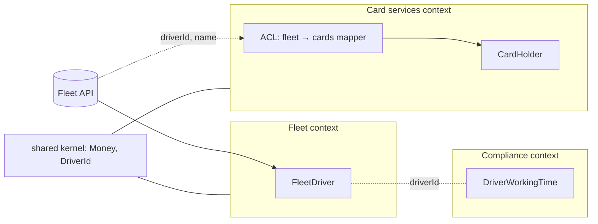
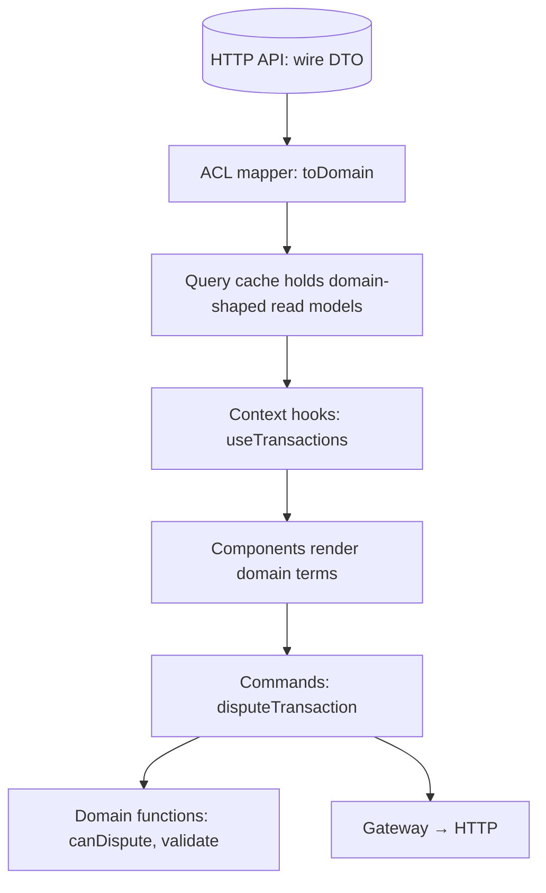
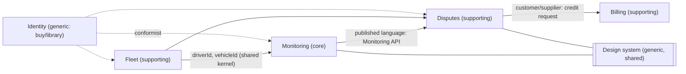
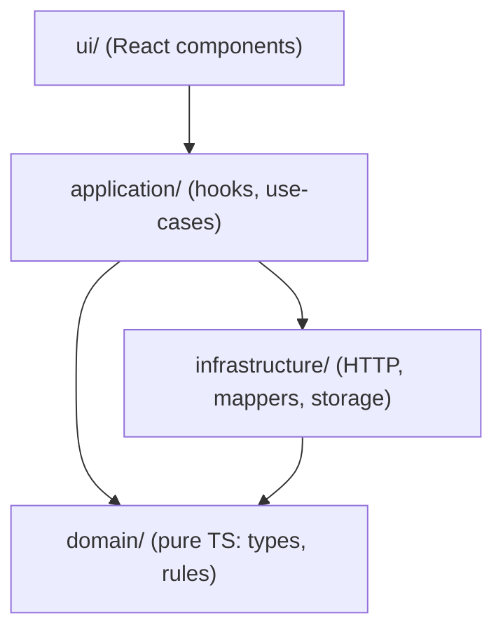

# 04 / 08 — Domain-Driven Frontend: Bounded Contexts, Ubiquitous Language, and Where DDD Actually Helps in React

## 1. Lesson metadata

| | |
|---|---|
| **Level** | Intermediate–Advanced |
| **Study time** | 4–5 hours (reading 2 h, modelling workshop 1 h, exercises 1.5 h) |
| **Prerequisites** | [01 — Architecture fundamentals](./01-architecture-fundamentals.md), [02 — Separation of concerns](./02-separation-of-concerns.md), [06 — Feature vs layer structure](./06-feature-vs-layer-structure.md), [07 — Modular architecture](./07-modular-architecture.md) |
| **Next** | [09 — Feature-Sliced Design](./09-feature-sliced-design.md) |
| **Related** | [12 — Domain logic vs UI logic](./12-domain-logic-vs-ui-logic.md), [10 — Clean and hexagonal architecture](./10-clean-and-hexagonal-architecture.md), [14 — API boundaries and data access](./14-api-boundaries-and-data-access.md) |

**Learning objectives.** After this lesson you can:
1. Explain which parts of Domain-Driven Design (DDD) transfer to a React front end and which are back-end concerns that rarely pay off in the browser.
2. Identify a bounded context and draw a context map for a real product.
3. Use a ubiquitous language to name modules, types, components and routes, and detect when the UI vocabulary diverges from the business vocabulary.
4. Model value objects, entities, and aggregates as plain TypeScript where (and only where) invariants justify it.
5. Explain how a bounded context maps to folders, packages, routes, and team ownership, and how contexts communicate without importing each other's internals.
6. Recognise the failure modes: anemic domain, "DDD cosplay", one model for every screen, leaking transport DTOs into components.
7. Plan an incremental adoption/migration path in an existing React codebase.

**Concepts covered:** domain, subdomain (core/supporting/generic), bounded context, ubiquitous language, context map, anti-corruption layer (ACL), entity, value object, aggregate, domain event, domain service, application service, read model vs write model (CQRS-lite), strategic vs tactical DDD.

---

## 2. Deep conceptual explanation

### 2.1 What problem is this lesson solving?

Most React codebases start organised by *technical role*: `components/`, `hooks/`, `utils/`, `services/`. That is fine at 20 files. Around the point where several teams touch the app, three problems appear that technical folders cannot solve:

1. **Vocabulary drift.** The business says "driver", "vehicle", "fuel transaction", "authorisation". The front end says `User`, `Item`, `Entry`, `data`, `record`. Every conversation between product, back end and front end needs a translation step, and every translation step is a place for bugs.
2. **One model to rule them all.** A single `Customer` type is imported by billing screens, support screens, and marketing screens. Each screen needs 10% of its fields and a different set of rules. The type grows into a 60-field monster, optional fields multiply, and no one can change it safely.
3. **Unclear ownership boundaries.** When "the orders code" is spread over `components/`, `hooks/`, `utils/` and `store/`, nobody can answer "who owns the rules for what a valid order is?"

Domain-Driven Design (Eric Evans, *Domain-Driven Design*, 2003; later strategic refinements by Vaughn Vernon and others) is a body of practices for exactly these problems. It was **born in back-end enterprise software**. The question for this lesson is: what survives the trip into a single-page application whose "persistence" is an HTTP API and whose main job is rendering?

### 2.2 Strategic vs tactical DDD

DDD splits into two layers. This distinction is the most important thing to take from the lesson.

| Layer | Concerns | Value in React front ends |
|---|---|---|
| **Strategic DDD** | Domains/subdomains, bounded contexts, ubiquitous language, context maps, team alignment | **High.** Scales with product and organisation size; cheap (mostly naming, folders, conversations). |
| **Tactical DDD** | Entities, value objects, aggregates, repositories, domain events, domain services | **Selective.** High where there are real client-side invariants (pricing, scheduling, form-wizard validation, offline editing); low for CRUD-over-HTTP screens where the server is the source of truth. |

A common failure is adopting the *tactical* patterns (classes named `OrderAggregate`, `OrderRepository`) without doing the *strategic* work. You get the ceremony without the benefit.

### 2.3 Domain, subdomain, and where to invest

A **domain** is the area of business the software serves (here: fleet payments and logistics). It decomposes into **subdomains**:

| Subdomain type | Meaning | Investment | Example (fleet-services product) |
|---|---|---|---|
| **Core** | What makes the business distinct and competitive | Highest design effort, best engineers, bespoke code | Fuel-card transaction monitoring and fraud rules; route-cost optimisation |
| **Supporting** | Necessary but not differentiating | Moderate, simple models | Driver and vehicle management, invoicing views |
| **Generic** | Solved problems | Buy or use a library | Authentication, notifications, file upload, date pickers |

This classification should drive *where you spend architecture budget*. Applying hexagonal architecture, aggregates and event buses to the "profile settings" screen (generic/supporting) while the core "transaction review" workflow is a 1,500-line component is a misallocation.

### 2.4 Ubiquitous language

The **ubiquitous language** is a shared, precise vocabulary used by developers, designers, product and domain experts *in conversation, in documents and in code*. Rules:

- The same word means the same thing inside one bounded context.
- Code uses the business word: `FuelTransaction`, not `Item`; `authorise()`, not `updateStatus(2)`.
- When the business renames something, the code is renamed. Rename cost is part of the maintenance budget.
- The language is *per bounded context*. "Account" in billing (a ledger) and "account" in identity (a login) are different concepts; do not force a single definition.

In React this extends to component, hook, route, and test names. A route `/transactions/:id/dispute` and a feature folder `dispute-transaction/` make the language visible in URLs and PR titles.

**Practical technique: glossary-as-code.** Keep a short `GLOSSARY.md` per context (or a doc-comment on the context's public module) and review it when naming things. Reject PRs introducing synonyms for existing terms (`Vehicle` vs `Truck` vs `Asset`) unless the glossary records the distinction.

### 2.5 Bounded context

A **bounded context** is an explicit boundary within which a particular model and language are valid. Outside it, the same word may mean something else, and the same real-world thing may be modelled differently.

Example, one real-world thing across contexts:

| Context | "Driver" means | Fields it cares about |
|---|---|---|
| Fleet management | A person assigned to vehicles | name, licence class, assigned vehicles, status |
| Card services | A card holder entitled to buy fuel | card number (masked), limits, PIN status |
| Compliance / tachograph | A person with working-time records | rest periods, infringements, tachograph card id |

If you create one `Driver` type with all of these fields, every context depends on every other context's changes. If you create three narrow models (`FleetDriver`, `CardHolder`, `DriverWorkingTime`) linked by a shared identifier (`driverId`), each can evolve independently.

**Bounded contexts in front-end terms** usually align with one or more of:

- A **route subtree** (`/cards/*`, `/fleet/*`).
- A **folder or package** with a public entry point (see [07 — Modular architecture](./07-modular-architecture.md)).
- A **team's ownership area** (see [23 — Multi-team ownership](./23-multi-team-ownership.md)).
- Sometimes a **deployable** (micro-frontend; see Phase 11 microfrontends lesson, *planned*) — but a bounded context does **not** have to be a deployable. A modular monolith SPA can have many bounded contexts.

### 2.6 Context mapping: how contexts relate

Contexts interact. A *context map* documents the relationship type. The classic patterns (Evans; Vernon):

| Relationship | Meaning | Front-end illustration |
|---|---|---|
| **Shared kernel** | Two contexts share a small, jointly owned model | A `Money` value object and `CurrencyCode` in a shared package; changes require both teams' agreement |
| **Customer–supplier** | Downstream context's needs influence upstream's planning | Cards UI team requests a new field from the Fleet API team |
| **Conformist** | Downstream accepts upstream's model as is | Using the generated API client types directly in a thin screen |
| **Anti-corruption layer (ACL)** | Downstream translates upstream's model into its own to avoid contamination | A mapper converting a legacy API DTO to the cards context's own `CardHolder` |
| **Open host service / published language** | Upstream offers a stable, documented interface | A versioned REST/GraphQL schema, or a public package API |
| **Separate ways** | No integration; duplicate if needed | Two contexts each keep their own copy of a lookup list |

The **ACL** is the most practically useful pattern for React. The back-end contract is outside your control; a mapper at the boundary (see [14 — API boundaries and data access](./14-api-boundaries-and-data-access.md) and [13 — Application services and adapters](./13-application-services-and-adapters.md)) isolates UI code from wire-format churn.



### 2.7 Tactical building blocks, translated

| DDD concept | Definition | In a React/TS front end |
|---|---|---|
| **Value object** | Immutable, compared by value, no identity, self-validating | `Money`, `DateRange`, `LicensePlate`, `Percentage`; plain frozen objects or branded types with constructor functions |
| **Entity** | Has identity that persists across changes | `Vehicle { id, … }` as returned by an API and edited in a form; identity is the id |
| **Aggregate** | Cluster of objects treated as one unit for consistency, with one root; invariants hold within it | An `Order` with line items; a multi-step `ClaimDraft` form; a client-side `Basket` |
| **Domain service** | Domain logic that does not belong to one entity | `calculateSurcharge(transaction, rules)`; pure functions |
| **Domain event** | Something that happened, in past tense | `TransactionDisputed`; in front ends often realised as callbacks, event emitters, or query invalidations |
| **Repository** | Collection-like abstraction for persisting aggregates | An `OrdersGateway` interface implemented by an HTTP adapter (see [11](./11-dependency-inversion.md), [13](./13-application-services-and-adapters.md)) |
| **Application service** | Orchestrates use cases, no business rules of its own | `submitClaim()` that validates, calls the gateway, publishes an event |
| **Read model / write model** | Separate shapes for reading and for changing | List-view DTO for tables vs full editable form model |

In idiomatic modern TypeScript, you rarely need classes. **Plain functions plus readonly data types** deliver the same guarantees with less ceremony and play well with React's immutability assumptions (see [Phase 3 state lessons](../03-react-state-and-hooks/01-usestate-internals-and-update-semantics.md)).

### 2.8 Where React is exposed

React itself has no opinion on DDD. But three React properties interact with it:

1. **Rendering is a function of data.** A domain model that is immutable data plus pure functions maps naturally to props/state. A mutable class instance held in state does **not** (React compares by `Object.is`; mutation leaves the reference unchanged, so no re-render — see [Phase 3 state immutability](../03-react-state-and-hooks/01-usestate-internals-and-update-semantics.md)).
2. **The server is usually the source of truth.** In most apps the aggregate lives in the database; the front end holds a *copy* (cache) and *proposes changes*. This heavily reduces the need for tactical patterns: the back end enforces invariants. The front end replicates only the rules needed for immediate feedback (validation, affordance, previews).
3. **UI state is not domain state.** "Is the dropdown open?" is not a domain concept. Mixing the two is the root of most "domain logic in components" problems (see [12 — Domain logic vs UI logic](./12-domain-logic-vs-ui-logic.md)).

### 2.9 Common misconceptions

| Misconception | Reality |
|---|---|
| "DDD means classes, repositories and an `OrderAggregate`." | Those are *tactical* patterns, optional. The core of DDD is language and boundaries. |
| "Each bounded context must be a micro-frontend." | No. Contexts are a modelling concept. Deployment granularity is an independent decision. |
| "The front end must mirror the back-end's contexts 1:1." | Often similar, but UI contexts may be organised around user tasks (e.g. "reconcile invoices" spanning billing and ledger data). The front end can have its own contexts with ACLs to back-end ones. |
| "DDD is for big projects only." | Strategic vocabulary work helps a 3-person team too. Tactical DDD is what should scale with complexity. |
| "A shared `types/` package of all entities is DDD." | It is the opposite: one global model coupling every context. |
| "Domain logic belongs on the server only." | Rules needed for instant feedback (not for enforcement) are legitimately duplicated or shared on the client. Enforcement must remain server-side. |

---

## 3. Internal mechanics

DDD is not a runtime mechanism, so "internals" means *how the pieces connect and what rules keep them honest*.

### 3.1 Public guarantee vs teaching model vs implementation detail

- **Public guarantee (of the practice):** within a bounded context, one model and one language; explicit translation at boundaries. These are the claims of the DDD literature.
- **Teaching model (this lesson):** the mapping of contexts to folders/routes/packages, and the "functional core" style of tactical patterns in TypeScript. Other legitimate mappings exist.
- **Implementation detail (your project's choice):** class vs function, branded type vs wrapper, whether you use an event emitter or query invalidation for domain events.

### 3.2 The dependency rules of a context-based structure

Rules a bounded-context layout needs (adapt to your tooling; see [25 — Architectural fitness and enforcement](./25-architectural-fitness-and-enforcement.md)):

1. A context exposes a **public API** (an `index.ts` or package entry). Other contexts import **only** from it.
2. A context **never imports another context's internals** (`../cards/internal/…`).
3. Contexts do not form **cycles**. If A and B both need each other, either a shared kernel or an event-based decoupling is missing.
4. Cross-context data crosses via **identifiers and published DTOs**, translated by an ACL on the consuming side.
5. A **shared kernel** is tiny, stable, and explicitly co-owned. Its size is a metric to watch.
6. Inside a context, the dependency direction is: UI → application (use-cases/hooks) → domain (pure) ; infrastructure (HTTP) depends on domain types, not the reverse. (Deepened in [10](./10-clean-and-hexagonal-architecture.md) and [11](./11-dependency-inversion.md).)

### 3.3 How the model reaches the screen



⚠ *Version-sensitive.* The caching layer in this diagram is typically TanStack Query or a framework loader (see Phase 6). Their APIs evolve; the *architecture* does not depend on a specific one.

---

## 4. Step-by-step walkthrough: modelling a context from a conversation

Scenario: a fleet-payments company wants a "Dispute a fuel transaction" feature. We walk through the strategic process chronologically.

1. **Event storm / language session (30–60 minutes).** Product, support agent, back-end engineer and front-end engineer list events in past tense: `TransactionImported`, `TransactionFlagged`, `DisputeRaised`, `EvidenceAttached`, `DisputeAccepted`, `DisputeRejected`, `CreditIssued`.
2. **Find the language conflicts.** Support says "claim", back end calls it `chargeback_case`, the UI mockup says "Report a problem". Decide: the term is **Dispute**. Record rejected synonyms in the glossary.
3. **Group events into contexts.** `TransactionImported`, `TransactionFlagged` belong to *Transaction monitoring*; `DisputeRaised`…`DisputeRejected` belong to *Disputes*; `CreditIssued` belongs to *Billing*.
4. **Classify subdomains.** Monitoring is core (competitive fraud rules), Disputes is supporting, Billing is supporting/generic.
5. **Draw the context map.** Disputes is downstream of Monitoring (needs transaction summary) and upstream of Billing (credit notes). Disputes consumes Monitoring via an ACL: it maps `MonitoringTransactionDto` to its own `DisputableTransaction { id, amount: Money, occurredAt, merchantName, disputeWindowEndsAt }`.
6. **Decide the front-end shape.** One front-end context `disputes/` with a public API: a route element, a hook `useDisputableTransaction`, and a `<DisputeButton transactionId />` that other contexts may embed.
7. **Identify real client-side invariants.** Is "dispute window" computed client-side? Maybe the server returns `disputeWindowEndsAt`; the client only compares it with the clock to hide the button. That is a small pure function `canDispute(tx, now)`; no aggregate needed.
8. **Choose tactical tools proportionally.** `Money` as a value object (currency arithmetic is genuinely error-prone). The `DisputeDraft` (multi-step form with evidence files) is a client-side aggregate-ish thing with invariants ("at least one reason; evidence ≤ 5 files; amount ≤ transaction amount"). Everything else is read models.
9. **Implement boundaries.** Folder, public API, mapper, hooks, tests of domain functions without React.
10. **Enforce.** Add a lint rule or dependency check ([25](./25-architectural-fitness-and-enforcement.md)) forbidding deep imports into `disputes/` from other contexts.

---

## 5. Code examples

### 5.1 Minimal example — a value object as plain TypeScript

```ts
// shared-kernel/money.ts
export type CurrencyCode = "EUR" | "GBP" | "PLN" | "CZK";

export interface Money {
  readonly minor: number;            // integer minor units (cents)
  readonly currency: CurrencyCode;
}

export function money(minor: number, currency: CurrencyCode): Money {
  if (!Number.isInteger(minor)) throw new RangeError("Money.minor must be an integer");
  return Object.freeze({ minor, currency });
}

export function add(a: Money, b: Money): Money {
  assertSameCurrency(a, b);
  return money(a.minor + b.minor, a.currency);
}

export function lte(a: Money, b: Money): boolean {
  assertSameCurrency(a, b);
  return a.minor <= b.minor;
}

function assertSameCurrency(a: Money, b: Money): void {
  if (a.currency !== b.currency) {
    throw new Error(`Currency mismatch: ${a.currency} vs ${b.currency}`);
  }
}

export function format(m: Money, locale = "en-GB"): string {
  return new Intl.NumberFormat(locale, { style: "currency", currency: m.currency }).format(m.minor / 100);
}
```

Line notes:
- `minor` as an integer avoids floating-point drift (`0.1 + 0.2`). ⚠ Not every currency has two minor digits (e.g. JPY has zero; some have three). A production `Money` needs per-currency exponent data; treat the `/ 100` in `format` as a simplification of this lesson.
- `Object.freeze` is shallow and runtime-only; the `readonly` types are the primary guard. Freezing also helps catch accidental mutation in development.
- Functions rather than methods: the value object is just data, so it serialises, is safe in React state, and tree-shakes.

**Predict:** `add(money(100, "EUR"), money(50, "GBP"))` — what happens? It throws `Currency mismatch: EUR vs GBP`. The invariant "you cannot add different currencies" lives in exactly one place, instead of being re-implemented (or forgotten) in each component that totals amounts.

### 5.2 Practical example — a bounded context with an ACL

Folder structure (strategic layout; see [06](./06-feature-vs-layer-structure.md) for the structure debate):

```text
src/
  contexts/
    monitoring/                  # upstream context (owned by team Monitoring)
      index.ts                   # public API
      …
    disputes/                    # this context
      index.ts                   # PUBLIC API: only what other contexts may use
      domain/
        disputable-transaction.ts   # types + pure rules
        dispute-draft.ts            # draft aggregate: validation, invariants
        glossary.md
      application/
        use-disputable-transaction.ts   # hooks (read side)
        use-raise-dispute.ts            # command orchestration
      infrastructure/
        monitoring-acl.ts            # DTO → domain mapper
        disputes-gateway.ts          # HTTP adapter
      ui/
        DisputePage.tsx
        DisputeForm.tsx
        DisputeButton.tsx
  shared-kernel/
    money.ts
    ids.ts
  app/
    routes.tsx
```

Dependency rules for this structure:

| From | May import | May not import |
|---|---|---|
| `disputes/ui` | `disputes/application`, `disputes/domain`, `shared-kernel`, design system | `disputes/infrastructure` directly, other contexts' internals |
| `disputes/application` | `disputes/domain`, `disputes/infrastructure` (via wiring), `shared-kernel` | `disputes/ui` |
| `disputes/domain` | `shared-kernel` only | React, `fetch`, any infrastructure |
| `disputes/infrastructure` | `disputes/domain` types, `shared-kernel`, `monitoring` **public API** | `disputes/ui`, `monitoring` internals |
| Other contexts | `disputes/index.ts` | everything else in `disputes/` |

**Domain code** (no React, no HTTP):

```ts
// contexts/disputes/domain/disputable-transaction.ts
import type { Money } from "../../../shared-kernel/money";

export type TransactionId = string & { readonly __brand: "TransactionId" };

export interface DisputableTransaction {
  readonly id: TransactionId;
  readonly amount: Money;
  readonly occurredAt: Date;
  readonly merchantName: string;
  readonly disputeWindowEndsAt: Date;
}

export type CannotDisputeReason = "window-closed" | "already-disputed";

export function disputability(
  tx: DisputableTransaction,
  alreadyDisputed: boolean,
  now: Date,
): { ok: true } | { ok: false; reason: CannotDisputeReason } {
  if (alreadyDisputed) return { ok: false, reason: "already-disputed" };
  if (now.getTime() > tx.disputeWindowEndsAt.getTime()) return { ok: false, reason: "window-closed" };
  return { ok: true };
}
```

Notes: `now` is a parameter, not `new Date()` inside the function. Injecting time makes the rule deterministic and trivially testable. A discriminated union return conveys *why*, which the UI maps to copy; domain code contains no strings meant for display (that is UI/i18n responsibility).

**The ACL** — the only place that knows the monitoring wire format:

```ts
// contexts/disputes/infrastructure/monitoring-acl.ts
import type { DisputableTransaction, TransactionId } from "../domain/disputable-transaction";
import { money, type CurrencyCode } from "../../../shared-kernel/money";

// Shape published by the Monitoring API (their language, their naming).
interface MonitoringTxDto {
  txn_id: string;
  gross_amount_minor: number;
  ccy: string;
  ts: string;                     // ISO-8601
  site: { operator_name: string };
  flags?: { dispute_deadline?: string };
}

const SUPPORTED: readonly CurrencyCode[] = ["EUR", "GBP", "PLN", "CZK"];

function isCurrency(c: string): c is CurrencyCode {
  return (SUPPORTED as readonly string[]).includes(c);
}

export function toDisputable(dto: MonitoringTxDto): DisputableTransaction {
  if (!isCurrency(dto.ccy)) throw new Error(`Unsupported currency: ${dto.ccy}`);
  const occurredAt = new Date(dto.ts);
  const deadline = dto.flags?.dispute_deadline
    ? new Date(dto.flags.dispute_deadline)
    : new Date(occurredAt.getTime() + 90 * 24 * 3600 * 1000); // fallback: assumption documented here, not scattered
  return {
    id: dto.txn_id as TransactionId,
    amount: money(dto.gross_amount_minor, dto.ccy),
    occurredAt,
    merchantName: dto.site.operator_name,
    disputeWindowEndsAt: deadline,
  };
}
```

Line notes: the cast `as TransactionId` is the sanctioned place for a branded-type cast. The 90-day fallback is a **business assumption** — it must be confirmed with the domain expert; the point is that it lives in exactly one file. (The "90" here is a lesson placeholder, not a real business rule.)

**Application layer hook** (React enters here):

```tsx
// contexts/disputes/application/use-disputable-transaction.ts
import { useQuery } from "@tanstack/react-query";
import { toDisputable } from "../infrastructure/monitoring-acl";
import { disputesGateway } from "../infrastructure/disputes-gateway";
import { disputability } from "../domain/disputable-transaction";

export function useDisputableTransaction(id: string) {
  const query = useQuery({
    queryKey: ["disputes", "disputable-transaction", id],
    queryFn: async () => toDisputable(await disputesGateway.fetchMonitoringTx(id)),
  });
  const verdict = query.data
    ? disputability(query.data, /* alreadyDisputed */ false, new Date())
    : undefined;
  return { ...query, verdict };
}
```

Notes: query-key prefix `"disputes"` namespaces cache entries by context, which makes invalidation scoped. Calling `new Date()` in render is impure but harmless here; for stricter purity, derive `now` from a clock hook. TanStack Query API (v5 object syntax) shown; verify against current docs.

**Public API:**

```ts
// contexts/disputes/index.ts
export { DisputeButton } from "./ui/DisputeButton";
export { disputesRoutes } from "./ui/routes";
export type { TransactionId } from "./domain/disputable-transaction";
```

Everything else is private by convention and — better — by lint rule.

### 5.3 Incorrect example — one global model

```ts
// src/types/driver.ts   ← imported by 70 files across contexts
export interface Driver {
  id: string;
  name: string;
  licenceClass?: string;
  cardNumber?: string;
  cardLimit?: number;
  restPeriods?: RestPeriod[];
  tachographId?: string;
  // … 40 more optional fields
}
```

What goes wrong:
- Everything is optional because no single screen needs everything, so the compiler can no longer tell you *which* fields a given screen can rely on.
- The compliance team adding `tachographId` forces a review from the cards team, since they import the same type.
- A change in meaning ("limit" now per-card instead of per-driver) breaks unrelated screens silently.

### 5.4 Corrected implementation

Three narrow models, one per context, linked by id:

```ts
// contexts/fleet/domain/fleet-driver.ts
export interface FleetDriver { readonly id: DriverId; readonly name: string; readonly licenceClass: string; readonly vehicleIds: readonly VehicleId[]; }

// contexts/cards/domain/card-holder.ts
export interface CardHolder { readonly driverId: DriverId; readonly displayName: string; readonly limit: Money; readonly pinStatus: "set" | "locked" | "unset"; }

// contexts/compliance/domain/working-time.ts
export interface DriverWorkingTime { readonly driverId: DriverId; readonly restPeriods: readonly RestPeriod[]; }
```

`DriverId` lives in the shared kernel. Duplication of `name`/`displayName` is deliberate (*separate ways* for non-essential data) and cheaper than coupling.

### 5.5 Advanced example — a client-side aggregate with invariants (draft form)

Where a tactical pattern is warranted: a multi-step dispute form where rules span fields.

```ts
// contexts/disputes/domain/dispute-draft.ts
import { type Money, lte } from "../../../shared-kernel/money";

export type Reason = "not-my-transaction" | "wrong-amount" | "duplicate" | "other";

export interface DisputeDraft {
  readonly transactionAmount: Money;
  readonly reason?: Reason;
  readonly claimedAmount?: Money;
  readonly evidence: readonly { name: string; sizeBytes: number }[];
  readonly note: string;
}

export type DraftIssue =
  | { code: "reason-required" }
  | { code: "amount-exceeds-transaction" }
  | { code: "note-required-for-other" }
  | { code: "too-many-files"; max: number };

const MAX_FILES = 5;

export function validate(d: DisputeDraft): DraftIssue[] {
  const issues: DraftIssue[] = [];
  if (!d.reason) issues.push({ code: "reason-required" });
  if (d.claimedAmount && !lte(d.claimedAmount, d.transactionAmount)) issues.push({ code: "amount-exceeds-transaction" });
  if (d.reason === "other" && d.note.trim() === "") issues.push({ code: "note-required-for-other" });
  if (d.evidence.length > MAX_FILES) issues.push({ code: "too-many-files", max: MAX_FILES });
  return issues;
}

export function addEvidence(d: DisputeDraft, file: { name: string; sizeBytes: number }): DisputeDraft {
  // Aggregate root controls the invariant: returns a new draft, never mutates.
  return d.evidence.length >= MAX_FILES ? d : { ...d, evidence: [...d.evidence, file] };
}
```

Used from a reducer or `useActionState` (see [Phase 3 reducer lessons](../03-react-state-and-hooks/01-usestate-internals-and-update-semantics.md) and Phase 9 forms lesson). The UI never re-implements `MAX_FILES`; it asks `validate(draft)`. The **server still validates** — client validation is a UX convenience, not a security boundary.

**When this is too much:** if the form is three text fields and the server returns field errors, a hand-written `DisputeDraft` module is ceremony; schema validation inside the form library is enough.

---

## 6. Visual explanations

### 6.1 Context map for the example product



### 6.2 Inside one context (layers are developed in depth in later lessons)



The arrow from `infrastructure` to `domain` is the key: infrastructure knows the domain's types (it produces them), but the domain does not know infrastructure.

### 6.3 Strategic investment map

| | Generic | Supporting | Core |
|---|---|---|---|
| Language workshops | Light | Medium | Heavy, continuous |
| Tactical patterns | None | Selective (value objects) | Aggregates/rules where invariants exist |
| Architecture enforcement | Library boundary | Folder + lint | Folder + lint + contract tests |
| Build vs buy | Buy | Mixed | Build |

---

## 7. Alternative approaches and trade-offs

### 7.1 Comparison of organising principles

| Criterion | Technical layers (`components/hooks/utils`) | Feature folders | DDD bounded contexts | Feature-Sliced Design ([09](./09-feature-sliced-design.md)) |
|---|---|---|---|---|
| Primary axis | Technical role | User-facing feature | Business model + language | Layers × business slices |
| Needs domain expert input | No | Little | **Yes, essential** | Some (entities/features) |
| Ownership clarity | Poor | Good | Very good | Good |
| Cross-feature reuse | Easy, uncontrolled | Ad hoc | Via public APIs/ACL | Via layer rules |
| Upfront cost | Minimal | Low | Medium (workshops, naming) | Medium (learning convention) |
| Scales to many teams | Poorly | Moderate | Well | Well |
| Benefit for simple CRUD | Adequate | Adequate | Marginal | Marginal |

### 7.2 Approach profile: DDD-style front end

**Original problem it solved.** Enterprise back-ends where business logic complexity, not technology, was the main risk: models drifted from business meaning, teams stepped on each other's data models, and developers/domain experts could not talk to each other. DDD was proposed to put the domain model and shared language at the centre.

**Representative folder structure.** See §5.2: `contexts/<name>/{domain,application,infrastructure,ui}` plus `shared-kernel/`.

**Dependency rules.** Contexts import each other only via public API; ACL at boundaries; domain is pure; shared kernel small; no cycles.

**Example code.** §5.1–5.5.

**Advantages.**
- Names match business language, shortening onboarding and requirement conversations.
- Contexts map naturally to teams and routes; reduces merge conflicts and accidental coupling.
- ACLs localise API churn.
- Pure domain functions are cheap to test and reusable (also in Node scripts or workers).

**Disadvantages.**
- Requires access to domain experts and sustained discipline; naming sessions cost time.
- Tactical patterns add indirection; many front-end screens have no real invariants to protect.
- Risk of mismatch: back-end contexts may be organised differently from UI task flows, requiring extra mapping.
- Duplicated models across contexts (deliberate) look like violations of DRY to newcomers (see [Phase 5 DRY/KISS/YAGNI](../05-design-patterns/02-dry-kiss-yagni.md)).

**Appropriate project/org size.**

| Size | Recommendation |
|---|---|
| Solo / 1–3 devs, short-lived app | Strategic vocabulary only: consistent names, a glossary. No contexts folder. |
| 4–10 devs, one team, one product | Light contexts (folders with public APIs), value objects where valuable, ACL mapper files. |
| 10–50 devs, several teams | Full strategic DDD: context map, ownership, enforced boundaries, shared kernel governance. Tactical patterns in core subdomains. |
| 50+ devs / multiple apps | Contexts as packages or micro-frontends (Phase 11 microfrontends and [22 — Monorepos and shared packages](./22-monorepos-and-shared-packages.md)); formal context-map governance. |

**Failure modes.**
1. **Anemic domain cosplay**: `domain/` folder contains only types; all rules in components. The structure exists but the invariants don't.
2. **Over-engineered CRUD**: aggregates and repositories for a settings page.
3. **Context sprawl**: 30 contexts of 3 files each; every feature crosses five of them.
4. **God shared kernel**: the kernel becomes the old global `types/` folder.
5. **Language drift**: glossary written once, never updated; UI copy, code and API diverge again.
6. **Leaky ACL**: components import DTO types "just this once".
7. **Wrong boundaries**: contexts drawn around technical concerns ("forms context", "tables context") rather than business meaning.

**Migration considerations.** See §8.4.

### 7.3 A scenario where DDD is NOT the best approach

A marketing site with a CMS-driven page builder, or an internal admin tool consisting of thirty near-identical list-and-edit screens over a well-designed back-end, has **no complex client-side domain**. The recommended approach is: generated API client, schema-driven forms, feature folders, and a shared table component. Introducing contexts and ACL mappers adds files without removing risk. The honest test: *"Is there a rule that would be wrong if two screens implemented it differently?"* If the answer is rarely yes, tactical DDD has little to protect.

---

## 8. Best practices and anti-patterns

### 8.1 Best practices

1. **Start with the language.** Before folders, list the nouns and verbs and agree on them with the business.
2. **Draw the context map on one page** and keep it in the repo. Review it quarterly.
3. **Make boundaries physical**: a public `index.ts`, lint-enforced.
4. **Put an ACL at every integration with a model you don't control** (third-party APIs, legacy back ends).
5. **Keep the domain layer pure**: no React, no `fetch`, no `Date.now()`/`new Date()` without an injected clock where determinism matters.
6. **Prefer plain data and functions** for tactical patterns; reserve classes for cases that genuinely benefit (e.g. when interoperating with a class-based library).
7. **Treat the server as the authority.** Client-side rules provide feedback; they do not replace enforcement.
8. **Allow models to differ per context** and resist the urge to unify.
9. **Spend modelling effort proportionally** to subdomain type.

### 8.2 Beginner mistakes

- Creating `services/`, `repositories/`, `entities/` folders at the root and calling it DDD.
- Treating every API response type as an "entity".
- Naming things after UI (`TableRow`, `ModalData`) in the domain layer.

### 8.3 Experienced-developer mistakes

- Porting back-end class hierarchies (`AggregateRoot`, `Repository<T>` generic bases) into React state with mutation.
- Designing a perfect domain model before shipping anything; contexts discovered in production usage are usually better than speculative ones.
- Insisting on 1:1 mapping to back-end services, which makes the UI mirror the org chart rather than user tasks. (Conway's law cuts both ways; choose deliberately.)
- Hiding all HTTP behind "repositories" while the UI actually needs cache semantics (stale-while-revalidate, optimistic updates). The abstraction should *accommodate* the query cache, not fight it (see [14](./14-api-boundaries-and-data-access.md)).

### 8.4 Migration considerations (from technical-layer structure)

1. **Don't big-bang.** Pick one **core or painful** area. Create `contexts/<name>/` and move files with `git mv` to preserve history.
2. **Introduce the public API first**, re-exporting existing modules; redirect external imports through it; then move internals behind it.
3. **Extract an ACL mapper** where the wire format leaks; add characterization tests before changing mappings.
4. **Split the god type** gradually: create narrow per-context types, convert consumers, delete the global fields once unused. TypeScript's compiler errors are your worklist.
5. **Add dependency checks in "warn" mode**, then "error" mode once violations hit zero (see [25](./25-architectural-fitness-and-enforcement.md) and [24 — Refactoring legacy React](./24-refactoring-legacy-react.md)).
6. **Update the glossary during renames**, not after.
7. **Measure**: PR conflict rate, files touched per feature, number of cross-context imports, time-to-onboard.

### 8.5 Justified exceptions

- A tiny shared kernel `Money`/`Id` duplicated in two contexts is acceptable until the third consumer appears.
- Conformist consumption of a stable, well-modelled API in a thin screen is fine; do not add an ACL for its own sake.
- Pragmatic leakage of a DTO type inside a *single* file that is itself the adapter is not leakage.

---

## 9. Real-world application

| Domain | Contexts | Engineering constraints |
|---|---|---|
| **E-commerce** | Catalogue, Cart/Checkout, Orders, Customer Care | Cart is a genuine client-side aggregate (pricing/promotions preview) with server authority at checkout; catalogue "product" ≠ cart "line item" ≠ order "item" |
| **Finance / fleet payments** | Transaction monitoring, Disputes, Billing, Limits | Money value object mandatory; audit trail terms must match compliance vocabulary; regulatory wording fixed by Legal |
| **Dashboards** | Metrics definitions, Visualisation, Alerts | "Metric" in the semantic layer differs from "series" in the chart context; ACL converts query results into chart models |
| **Forms-heavy (insurance claims)** | Claim intake, Policy lookup, Assessment | Draft aggregates with cross-field invariants; versioned forms by jurisdiction |
| **Auth** | Generic subdomain | Buy/integrate; expose a minimal `Session` model to other contexts through a shared kernel |
| **Real-time (trading, telematics)** | Positions, Orders, Market data | Event-driven domain events from sockets; read models optimised for streaming; see Phase 6 realtime lesson |
| **Multi-team portals** | One context per team | Context map is the coordination artefact; public API changes follow a deprecation policy |

---

## 10. Debugging and troubleshooting

| Symptom | Likely root cause | Investigation | Fix / validation |
|---|---|---|---|
| Changing a type breaks tests in unrelated areas | Shared global model; context boundary missing | `tsc --noEmit` and IDE "find all references"; count importers per context | Split into per-context types; verify compiler errors localised |
| Same business rule implemented differently on two screens | Rule lives in components | Grep for the literal constants/conditions; compare behaviour in tests | Extract to a domain function; add table-driven tests |
| Team argues about what "active" means | Missing ubiquitous language | Collect usage in code, API, copy | Decide, write glossary entry, rename |
| Circular import warnings between contexts | Missing shared kernel or event decoupling | `madge --circular` or ESLint import plugin (⚠ verify tool names/versions in your setup) | Extract the shared type to the kernel or invert via callback/event |
| UI breaks after back-end field rename | No ACL | Search DTO field usage in `ui/` | Introduce mapper; update only mapper; contract test it |
| Runtime `Currency mismatch` errors | Value object doing its job | Check the origin of the mismatched `Money` in the stack trace | Fix upstream conversion; do not remove the guard |
| State not updating when editing domain object | Mutating a class instance held in React state | React DevTools: no re-render on action; breakpoint on setter | Make domain data immutable; return new objects |

**Repro for the mutation problem:**

```tsx
class Basket { items: string[] = []; add(i: string) { this.items.push(i); } }
function Cart() {
  const [basket] = useState(() => new Basket());
  return <button onClick={() => basket.add("x")}>{basket.items.length}</button>; // never re-renders
}
```

No state setter is called, and `basket` identity never changes, so React has no signal to re-render. The fix is immutable data: `setBasket(b => addItem(b, "x"))`.

---

## 11. Exercises

### Level A — Knowledge
A1. Distinguish strategic from tactical DDD and say which is generally more valuable in a React app.
A2. Define bounded context, and give two examples of the same real-world object modelled differently.
A3. What is an anti-corruption layer and where does it sit in a React app?
A4. Classify: authentication, fraud-rule editor, user preferences. Core, supporting, or generic — and why does it matter?
A5. Why should a `Money` value object store integer minor units?
A6. State three dependency rules for a bounded-context layout.

### Level B — Code comprehension
B1. What is wrong with this snippet from a domain perspective, and what are two distinct problems?
```ts
export function isOverdue(inv: Invoice) {
  return new Date(inv.dueDate) < new Date() && inv.status !== "PAID";
}
```
B2. Predict the outcome:
```ts
const a = money(100, "EUR");
const b = money(100, "EUR");
console.log(a === b, a.minor === b.minor);
```
B3. In §5.2, which file would you change if the Monitoring API renamed `site.operator_name` to `site.merchant`? Which would you *not* need to touch, and why?

### Level C — Implementation
C1. Implement `DateRange` as a value object (`start`, `end`, invariants `start <= end`) with `overlaps(a, b)` and `contains(range, date)`; write five test cases including boundaries.
C2. Write an ACL mapper from a legacy DTO `{ cust_no: string; cust_nm: string; cr_lim: string }` to `CardHolder` (§5.4), converting the string limit to `Money`, and rejecting malformed values with a typed error.
C3. Create a public `index.ts` and an ESLint `no-restricted-imports` pattern (describe the pattern config) that forbids other contexts from deep-importing `contexts/disputes/*`.

### Level D — Debugging
D1. A teammate reports "totals are off by a cent in some invoices." Code: `total = items.reduce((s, i) => s + i.price * i.qty, 0)` where `price` is `19.99`. Diagnose and propose a domain-level fix.
D2. After a refactor, `contexts/cards` imports from `contexts/disputes/ui` and `disputes` imports from `cards/ui`. Build fails intermittently with `undefined` imports at module init. Explain the cause and a structural fix.

### Level E — Architecture decisions
E1. You inherit a 200-component React app with a single `types/` folder of 120 interfaces and `utils/` of 90 functions. The company has three squads. Propose a first-quarter plan to introduce bounded contexts without halting feature work.
E2. A back-end team publishes a GraphQL schema with a mega `User` type. Decide between conformist use and an ACL for (a) an admin table and (b) a billing wizard. Justify.
E3. Argue for or against giving the "Notifications" subdomain its own context in a team of six.

### Level F — Expert challenge
F1. Two contexts (Cards and Disputes) both need "recent transactions". Compare: shared kernel type, duplicated read models with an ACL each, and a shared query hook exported by Monitoring's public API. Evaluate on change cost, coupling, team autonomy, cache coherence, and testing. Recommend one for (i) a 2-team org and (ii) a 12-team org.
F2. Design a lightweight automated check (not a full tool) that detects "context boundary violations" in CI and reports violations as a trend rather than a binary failure. State metrics, thresholds, and how it avoids blocking urgent fixes.

---

## 12. Detailed answers and explanations

> Attempt the exercises first.

**A1.** Strategic DDD covers domains, bounded contexts, ubiquitous language and context maps; tactical DDD covers entities, value objects, aggregates, repositories and so on. Strategic is generally more valuable in React because its costs are low (naming, folders) and its benefits scale with team count; tactical patterns pay off only where genuine client-side invariants exist. Common wrong answer: "tactical, because that's the code". Code patterns without shared boundaries just add indirection.

**A2.** A bounded context is an explicit boundary within which one model and language are consistent. Example: "Driver" in Fleet (assignment, licence) vs Cards (card limit, PIN) — or "Product" in catalogue (description, media) vs cart (price at time of adding, quantity). Edge: the *identifier* is shared; the models are not.

**A3.** A translation layer that converts an external/upstream model into the local context's model, so the upstream's naming and structure do not leak. In React: a mapper function in `infrastructure/` (or the gateway/adapter), called before data enters the cache or components. Wrong answer: "a wrapper component". It's about data/model translation, not UI.

**A4.** Authentication: generic (buy/integrate). Fraud-rule editor: core (competitive logic, bespoke workflow). User preferences: supporting (or generic). It matters because investment (modelling, enforcement, testing) should follow differentiation; uniform treatment wastes effort on generic parts and under-invests in the core.

**A5.** Binary floating point cannot represent most decimal fractions exactly (`0.1 + 0.2 !== 0.3`), so summing prices accumulates rounding errors. Integer minor units make addition exact. Caveats: currencies have different exponents (⚠ JPY 0, some 3), and multiplication by rates needs an explicit rounding policy decided with the business.

**A6.** Any three: public API only; no deep imports; no cycles; domain layer has no React/IO; cross-context data via ids and ACL; small shared kernel. 

**B1.** (1) *Impure/non-deterministic*: `new Date()` inside the function makes tests time-dependent and impossible to reproduce; inject `now`. (2) *Primitive obsession/parsing*: `new Date(inv.dueDate)` parses a string at the point of use, with time-zone ambiguity (a date-only ISO string like `"2025-03-01"` is parsed as UTC midnight, while "overdue" in a business sense probably means end of the due day in the customer's time zone). The domain needs an explicit rule about *when* an invoice becomes overdue and the type should carry a proper date (e.g. date-only value object). A third smaller issue: the magic string `"PAID"` should be a typed union.

**B2.** `false true`. Objects are compared by reference with `===`; each `money()` call creates a new frozen object. Value-object *equality* must be implemented explicitly (e.g. an `equals(a, b)` function). In React this matters for dependency arrays and memoisation: two equal-valued but distinct `Money` objects trigger effects/renders (see [Phase 7 referential equality](../07-performance/05-referential-equality.md)).

**B3.** Change only `MonitoringTxDto` and `toDisputable` in `monitoring-acl.ts`. Domain, application hook, and UI are untouched because they depend on `DisputableTransaction`, not on the DTO. Edge: if the rename were also visible in a *contract test* fixture, update that. That the answer is "one file" is the entire value of an ACL.

**C1. Reference solution**
```ts
export interface DateRange { readonly start: Date; readonly end: Date; }

export function dateRange(start: Date, end: Date): DateRange {
  if (Number.isNaN(start.getTime()) || Number.isNaN(end.getTime())) throw new RangeError("Invalid date");
  if (start.getTime() > end.getTime()) throw new RangeError("start must be <= end");
  return Object.freeze({ start, end });
}
export const contains = (r: DateRange, d: Date) =>
  d.getTime() >= r.start.getTime() && d.getTime() <= r.end.getTime();
export const overlaps = (a: DateRange, b: DateRange) =>
  a.start.getTime() <= b.end.getTime() && b.start.getTime() <= a.end.getTime();
```
Tests: identical ranges overlap; ranges touching at one instant overlap (inclusive semantic — document this choice; half-open intervals are often preferable); disjoint do not; `contains` at both boundaries true; constructor rejects `start > end` and invalid dates. Edge: `Date` objects are mutable, so `Object.freeze` does not protect them; clone on entry (`new Date(start.getTime())`) for strictness.

**C2. Reference solution**
```ts
class LegacyMappingError extends Error {
  constructor(public readonly field: string, public readonly value: unknown) {
    super(`Cannot map ${field}: ${String(value)}`);
  }
}
export function toCardHolder(dto: { cust_no: string; cust_nm: string; cr_lim: string }, currency: CurrencyCode): CardHolder {
  if (!/^\d+(\.\d{1,2})?$/.test(dto.cr_lim)) throw new LegacyMappingError("cr_lim", dto.cr_lim);
  const minor = Math.round(Number(dto.cr_lim) * 100);   // acceptable at this single boundary; or parse digit-wise
  return { driverId: dto.cust_no as DriverId, displayName: dto.cust_nm.trim(), limit: money(minor, currency), pinStatus: "unset" };
}
```
Evaluation criteria: validation before conversion; a typed error; the float multiplication confined to the boundary (digit-string parsing is better); no DTO type exported beyond the module; `pinStatus` default documented as a business decision.

**C3.** `index.ts` exports the public surface (§5.2). ESLint: `no-restricted-imports` with `patterns` such as `["**/contexts/*/!(index)*", ...]` — glob syntax in gitignore style; exact negation support varies, so verify against the ESLint docs for your version. Alternatives that are more robust: `eslint-plugin-boundaries` or `import/no-internal-modules` with `allow` lists (⚠ verify option names), or TypeScript project references/package `exports` fields when contexts are packages. Evaluation: forbids `contexts/disputes/ui/X` from outside but allows `contexts/disputes` and imports within the context itself (needs an override scoped to files under the context).

**D1.** `19.99` is not exactly representable in binary; sums and products accumulate error (e.g. `19.99 * 3` is `59.97` or `59.969999…` depending on operands; the key point is that the result is not guaranteed to be exact). Fix: represent prices as integer minor units from the ACL onward, aggregate integers, format at the edge. Rounding policy for percentage discounts/taxes must be explicit and agreed (per line vs per invoice). Validate with property-based or table tests against back-end totals.

**D2.** A circular module dependency: evaluating module A requires B which requires A, so one sees a partially initialised module (`undefined` bindings at init time) depending on which entry is loaded first — hence "intermittent". Structural fix: contexts must not depend on each other's `ui`. Use public APIs, and if each needs the other, extract the common concept to the shared kernel or invert via a callback/slot passed from the app layer (composition root; see [05 — Composition and dependency direction](./05-composition-and-dependency-direction.md)).

**E1. Evaluation criteria and example answer.** Good answers: (1) don't stop feature work; (2) start with language and map, not folders; (3) choose 1–2 pilot contexts (the most conflict-prone area plus one core area); (4) public API + lint in warn mode; (5) split the biggest god types by compiler-driven refactor; (6) assign squad ownership via CODEOWNERS; (7) metrics. Example: *Weeks 1–2:* two workshops, produce a context map and a glossary; inventory `types/` by importer count to find the most shared 10. *Weeks 3–6:* pilot context for the area with highest conflict rate, `git mv`, `index.ts`, ACL for the worst API. *Weeks 7–10:* roll the same recipe out to the second squad's area; add boundary lint in warn mode. *Weeks 11–13:* turn lint into error for the pilot contexts, retrospective on metrics (cross-squad PR conflicts, files-per-feature). Pitfall to name: renaming everything at once.

**E2.** (a) The admin table: conformist is probably fine if the table displays fields as they come and the schema is stable; add a thin selector for the columns. (b) The billing wizard has rules (validations, money semantics) and the mega `User` type includes unrelated fields; ACL to a narrow `BillingCustomer`, so back-end schema churn in profile fields doesn't ripple. Mixed strategy is legitimate: ACL cost is justified by *rule density and change exposure*, not by principle.

**E3.** Open-ended. Criteria: references subdomain type (notifications likely generic → buy/library, wrap behind a small interface), team size (six people can't sustain many contexts), change frequency, and whether other contexts need a stable interface. A good answer: "No separate context at six people; provide a `notify()` port in the shared kernel and an adapter; promote to its own context when message-template rules or a dedicated owner appear."

**F1.** Example reasoning. *Shared kernel type:* lowest duplication, but couples both teams' releases; fine with 2 teams that sit together. *Duplicated read models + ACL each:* maximal autonomy; risks inconsistent interpretation and double-fetching unless the cache key is shared at the data layer; best at 12 teams. *Shared hook from Monitoring's public API:* single source of truth and cache coherence; couples consumers to Monitoring's release cadence and React/query-library version, and forces Monitoring to design for others' needs (customer–supplier). Recommendation: (i) shared hook or kernel type; (ii) Monitoring publishes a stable read-model API (hook or client), each consumer maps to its needs via a thin selector rather than a full ACL, with versioning policy. Criteria: change cost, coupling, autonomy, cache coherence (same query key → one network request), testing (hook mocks vs fixture DTOs). Award credit for naming the trade-offs rather than a single "correct" choice.

**F2.** A good design: a script (TypeScript AST or `madge`/dependency-cruiser output; ⚠ verify tool capabilities) producing a JSON of cross-context edges, classifies each as public-API or deep, stores counts per commit. CI posts the delta as a PR comment; fails only when *new* deep imports are introduced relative to the main-branch baseline ("ratchet"). Allow an `// arch-exception: <ticket>` marker that is counted and expires. Metrics: deep-import count (target 0), cycles (0), kernel size (files, importers), average contexts touched per PR. Emergency fixes: label bypass with mandatory follow-up ticket. Evaluate answers on ratcheting (avoiding a big-bang cleanup), visibility, and escape hatch hygiene. See [25](./25-architectural-fitness-and-enforcement.md).

---

## 13. Senior engineer interview questions

**Q1. "Do you use DDD on the front end?"**
Good answer: "Strategic DDD yes, tactical selectively. I always align names with the business and mark context boundaries. I add value objects and domain functions where rules would be wrong if duplicated, like money or scheduling. I don't build aggregate/repository ceremony for CRUD screens, since the server enforces the invariants and our cache already behaves like a repository." Causal reasoning: the cost/benefit of each pattern depends on where invariants live.

**Q2. "How do you decide the boundaries of a context?"**
Look for language boundaries (the same word meaning different things), change-together groups, team ownership, and data-consistency needs. Event storming with domain experts; validate with "does a change in X force a change in Y?" Boundaries are hypotheses, refined by observing PR coupling.

**Q3. "When would you introduce an anti-corruption layer?"**
When the upstream model is outside our control, is poorly aligned with our language, changes often, or is legacy. Not when the API is stable, well-modelled and the consumer is a thin view. The ACL buys isolation at the price of a mapping layer to maintain and test.

**Q4. "Your teammate puts a `calculateTotal` rule in a component. Why does it matter?"**
Rules in components get duplicated, cannot be tested without rendering, and are hidden from non-React consumers. Moving to a pure function enables table tests and reuse. But "it matters" is conditional: for a one-off display formatter, extraction is premature.

**Q5. "How do bounded contexts interact with a monorepo/micro-frontends?"**
Contexts are the modelling unit; packages or micro-frontends are optional *deployment/ownership* units. Many contexts fit in one deployable. Split deployables only when independent release cadence outweighs cost (shared dependencies, integration testing, UX consistency).

**Q6. "How do you keep the ubiquitous language from rotting?"**
Glossary in-repo, reviewed in PRs touching names; copy and API vocabulary included in review; rename promptly; onboarding uses glossary; metrics are anecdotal (synonyms discovered in code search).

**Q7. "A shared kernel is growing. What do you do?"**
Audit each export by importer count and by change frequency; move single-consumer types back to their context; split by sub-area; require cross-team approval for additions (CODEOWNERS); make adding to the kernel more expensive than duplicating until duplication hurts.

**Q8. "Why not model domain objects as classes with behaviour?"**
In React, state is compared by reference; mutation-based class instances don't trigger re-renders and complicate serialisation (SSR, persistence, devtools). Immutable data plus functions gives the same encapsulation of rules with natural React fit. Classes remain acceptable if immutable and if a library demands them; this is a trade-off, not a rule.

---

## 14. Further learning resources

| Resource | URL | Covers / why | Level | Study |
|---|---|---|---|---|
| Eric Evans — *Domain-Driven Design: Tackling Complexity in the Heart of Software* (book, 2003) | No URL (book) | Original source: ubiquitous language, bounded contexts, context mapping | Advanced | Parts I, IV (strategic design) |
| Vaughn Vernon — *Implementing Domain-Driven Design* (book, 2013) and *Domain-Driven Design Distilled* (2016) | No URL (books) | More practical treatment; Distilled is a short strategic overview | Intermediate | *Distilled*, whole |
| Martin Fowler — Bounded Context | <https://martinfowler.com/bliki/BoundedContext.html> | Concise explanation of the concept | Intermediate | Whole page |
| Martin Fowler — Anemic Domain Model | <https://martinfowler.com/bliki/AnemicDomainModel.html> | The anti-pattern and the debate around it | Intermediate | Whole page |
| Domain-Driven Design Community | <https://dddcommunity.org/> | Community hub, introductory material | Beginner | Library section |
| TypeScript Handbook | <https://www.typescriptlang.org/docs/> | Discriminated unions, readonly, type guards used above | Intermediate | "Narrowing", "Everyday Types" |
| MDN — `Intl.NumberFormat` | <https://developer.mozilla.org/en-US/docs/Web/JavaScript/Reference/Global_Objects/Intl/NumberFormat> | Currency formatting semantic | Beginner | Currency style |
| React docs — Choosing the State Structure | <https://react.dev/learn/choosing-the-state-structure> | Immutability and structuring state, relevant to domain data in React | Beginner–Int. | Whole page |

URLs in this table were checked for HTTP 200 on 2026-10-22; any still marked *(unverified)* could not be checked automatically (blocked or unreachable). A 200 response does not guarantee the page content still matches the description; if a link has moved, search the site for the quoted title.

---

## 15. Knowledge checkpoint

**You should now understand**
- Strategic vs tactical DDD and which parts earn their keep in React.
- Bounded contexts, ubiquitous language, context maps, ACL, shared kernel.
- How to translate value objects, entities, aggregates into immutable TypeScript data plus functions.
- The failure modes: anemic domain, over-engineering, kernel sprawl, DTO leakage.

**You should be able to explain without notes**
- Why one global `Driver` type is a liability.
- Where an ACL sits and what it protects.
- Why the server remains the authority for invariants.

**You should be able to implement**
- A value object, a pure domain function with injected time, a DTO→domain mapper, a context public API.

**You should be able to debug**
- Boundary violations, circular dependencies between contexts, floating-point money errors, mutation of domain objects in state.

**Before moving on:** read [09 — Feature-Sliced Design](./09-feature-sliced-design.md), which proposes a concrete, opinionated folder methodology that borrows ideas (business-oriented slices, public APIs) from this approach, and [12 — Domain logic vs UI logic](./12-domain-logic-vs-ui-logic.md) for the day-to-day line-drawing.
