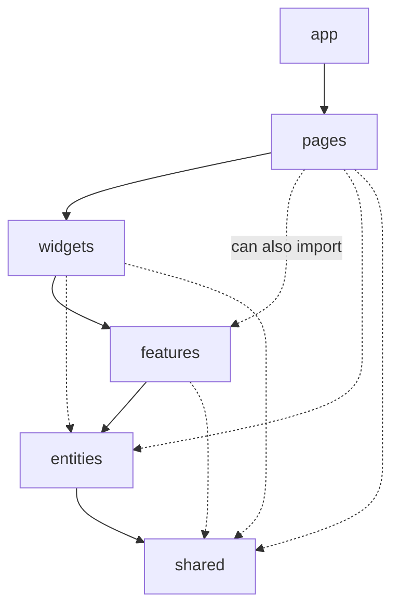
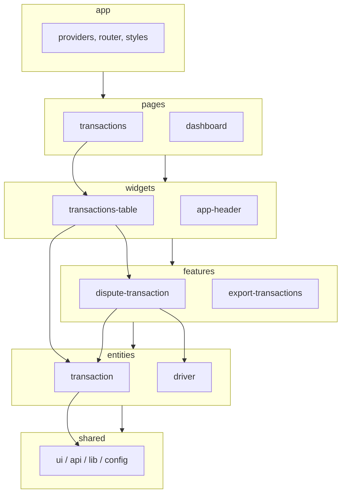
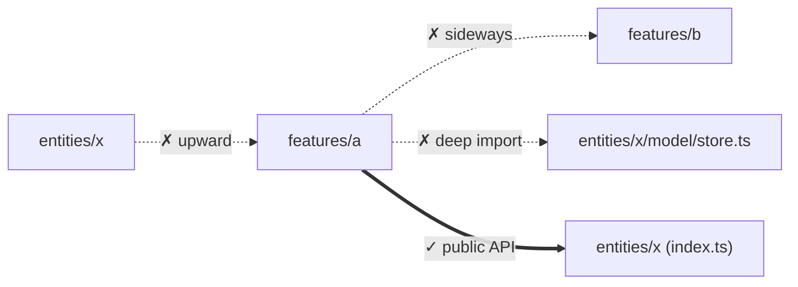
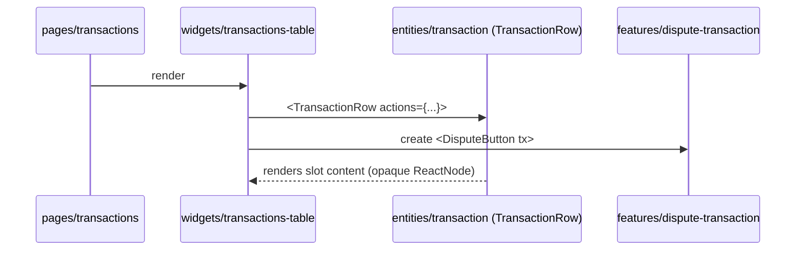

# 04 / 09 — Feature-Sliced Design: Layers, Slices, Segments, and the Import Rule

## 1. Lesson metadata

| | |
|---|---|
| **Level** | Intermediate–Advanced |
| **Study time** | 4–5 hours (reading 2 h, restructuring lab 1.5 h, exercises 1.5 h) |
| **Prerequisites** | [06 — Feature vs layer structure](./06-feature-vs-layer-structure.md), [07 — Modular architecture](./07-modular-architecture.md), [08 — Domain-driven frontend](./08-domain-driven-frontend.md) |
| **Next** | [10 — Clean and hexagonal architecture](./10-clean-and-hexagonal-architecture.md) |
| **Related** | [05 — Composition and dependency direction](./05-composition-and-dependency-direction.md), [25 — Architectural fitness and enforcement](./25-architectural-fitness-and-enforcement.md), [23 — Multi-team ownership](./23-multi-team-ownership.md) |

> **Checked against feature-sliced.design (v2.1 docs: reference/layers, slices-segments, public-api, with-nextjs; 2026-10-22).** FSD is a community-maintained specification that has changed between versions (notably the 2.0 → 2.1 transition and the deprecation of the `processes` layer). Layers, order, the import rule, `@x` notation, segment names and the `app`/`shared` exception below match the current docs; re-read them before adopting FSD. Where this lesson gives opinions, they are labelled as such.

**Learning objectives.** After this lesson you can:
1. Name FSD's layers, their order, and the import rule that connects them.
2. Distinguish layer, slice, and segment, and place code in the right one.
3. Explain the role of public APIs and why cross-slice imports on one layer are forbidden.
4. Apply FSD to a React/TypeScript codebase and decide, per piece of code, whether it belongs in `pages`, `widgets`, `features`, `entities` or `shared`.
5. Evaluate FSD honestly against feature folders, DDD contexts, and "just fewer folders", and identify team sizes where it helps or hurts.
6. Recognise failure modes (entity bloat, feature-everything, god `shared`, cargo-cult layering) and plan an incremental migration.

**Concepts covered:** layer, slice, segment, public API, import rule, `app`/`pages`/`widgets`/`features`/`entities`/`shared`, deprecated `processes`, cross-import notation (`@x`), segment naming by purpose, FSD vs DDD, Steiger linter.

---

## 2. Deep conceptual explanation

### 2.1 What problem is this lesson solving?

[06 — Feature vs layer structure](./06-feature-vs-layer-structure.md) showed that both pure technical layers (`components/hooks/utils`) and pure feature folders eventually fail:

- **Layer-only structures** scatter one business concept across five folders and encourage unrestricted imports.
- **Feature-only structures** work until features need to share things. Then you get `features/cart` importing `features/product`, which imports `features/user`, which imports `features/cart`. Cycles, and no rule to say which direction is legitimate.

FSD (originally "Feature Sliced", from the Russian-speaking front-end community, c. 2018 onwards) tries to give **a standard answer to both questions**: *what do I name the folders* and *which folders may depend on which*. It combines two axes:

- **Vertical axis: layers** — ordered by "how much responsibility and how much knowledge of the app" the code has.
- **Horizontal axis: slices** — business-domain partitions within a layer.

The central rule is a single sentence:

> A module in a slice can import other slices only if they are located on layers **strictly below**.

That sentence generates most of the architecture's value.

### 2.2 Layers (per the official documentation)

Top to bottom, from most to least "responsibility and dependency":

| # | Layer | Purpose (docs-aligned summary) | Has slices? |
|---|---|---|---|
| 1 | **App** | Everything that makes the app run: routing setup, entrypoint, global providers, global styles, store setup | No (segments only) |
| 2 | **Processes** | **Deprecated.** Was for complex cross-page flows. Docs recommend moving the content into `features` and `app` | Yes (deprecated) |
| 3 | **Pages** | Screens/routes; each page is a slice that assembles lower layers | Yes |
| 4 | **Widgets** | Large self-contained UI blocks that combine features/entities (e.g. a full header, an order table with actions) | Yes |
| 5 | **Features** | Reusable *user interactions that deliver business value* (e.g. "add to cart", "dispute transaction", "toggle theme" if it is business-relevant) | Yes |
| 6 | **Entities** | Business entities the app works with (user, product, transaction): their UI, API access and data model | Yes |
| 7 | **Shared** | Reusable, **business-agnostic** foundation: UI kit, API client setup, utilities, config | No (segments only) |

Notes (checked against the layers reference):
- You **don't need every layer**. The docs say to add a layer only when it adds value; most projects have at least `shared`, `pages`, and `app`. Adding new layers beyond the standard set is discouraged.
- `app` and `shared` have no slices; their segments can import each other freely.
- Historically `processes` was the layer between `app` and `pages`. Treat it as legacy in new projects.



Arrows mean "may import from". Any layer may import from any layer strictly below it, not just the next one. No upward imports, ever.

### 2.3 Slices

A **slice** partitions a layer by business domain: `features/add-to-cart`, `entities/product`, `pages/checkout`. Rules:

- Slice names are **not prescribed** by FSD; they come from your domain language (this is where [08 — DDD's ubiquitous language](./08-domain-driven-frontend.md) feeds in).
- **Slices on the same layer cannot import each other.** `features/add-to-cart` must not import `features/apply-coupon`. This is the rule that prevents cycles and forces you to decide where shared composition happens (in a higher layer, usually `widgets` or `pages`).
- Slices expose a **public API** (typically an `index.ts`). Other layers import from the slice's public API only, never deep paths.

### 2.4 Segments

A **segment** is a folder inside a slice (or directly in `app`/`shared`) that groups code by **purpose**, not by what it technically is. The docs recommend segment names that describe *what the code is for* and discourage purely technical ones like `components`, `hooks`, `types`.

Standard names mentioned in the documentation:

| Segment | Purpose |
|---|---|
| `ui` | Everything about display: components, formatters, styles |
| `api` | Backend interactions: request functions, data types for responses, mappers |
| `model` | The data model: stores, schemas/validation, business logic, interfaces |
| `lib` | Library code needed by other modules in this slice |
| `config` | Configuration and feature flags |

Some layers have extra conventions (e.g. `app` has `routes`, `store`, `styles`, `entrypoint`; `shared` may have `routes`, `i18n`; shared also commonly has `api`, `ui`, `lib`, `config`).

**Opinion (not doctrine):** The `components/hooks/types` discouragement is the part most teams find least natural. If your team agrees on purpose-based segments, good; if you find `ui/` plus `model/` sufficient, that is the spirit.

### 2.5 The public API rule and cross-imports

- **Public API.** Each slice has one entry file. Outside the slice, import `@/entities/product`, not `@/entities/product/model/store`. This is the same boundary discipline as in [08 §3.2](./08-domain-driven-frontend.md) and [07 — Modular architecture](./07-modular-architecture.md).
- **Cross-imports between entities** are a recognised pain point: `order` refers to `product`, but entities cannot import siblings. The documentation describes a special cross-reference convention (an `@x` folder inside the entity exposing a public API *for a specific neighbour*) as a pragmatic escape hatch. The notation is `entities/A/@x/B.ts` ("A crossed with B"), imported by B as `entities/A/@x/B`; the docs advise using it only on the Entities layer, and note that they advise first considering whether the entities should be merged or the relation lifted to a higher layer.

### 2.6 Where FSD sits relative to other ideas

| Idea | Relationship to FSD |
|---|---|
| **Feature folders** ([06](./06-feature-vs-layer-structure.md)) | FSD adds ordering between folders (layers) and forbids sibling imports. |
| **DDD bounded contexts** ([08](./08-domain-driven-frontend.md)) | Contexts are about models/language; FSD is about folder taxonomy and import direction. They can coexist: a context may internally use FSD, or FSD entity/feature slices can be named from the ubiquitous language. FSD has *no* concept of context map or ACL; you must add them if needed. |
| **Clean/Hexagonal** ([10](./10-clean-and-hexagonal-architecture.md)) | Hexagonal inverts dependencies around a domain core. FSD layers are about responsibility height, not about domain-vs-infrastructure. They address different axes; combining them is possible but costs complexity. |
| **Atomic design** | Orthogonal: it classifies UI components by granularity. FSD's `shared/ui` may be organised atomically. |

### 2.7 Common misconceptions

| Misconception | Reality |
|---|---|
| "FSD is a library/tool." | It is a methodology/specification. Optional tooling exists (the docs mention an official linter, Steiger, plus CLI/IDE folder generators). |
| "Every layer is mandatory." | No; add layers when they add value. |
| "Every component belongs in `features`." | Only reusable *user interactions with business value*. Most UI belongs in `pages`, `widgets` or `shared/ui`. The docs warn against over-extracting. |
| "Entities are database tables." | They are business concepts the UI works with; they may combine UI, API access and model for that concept. |
| "FSD replaces state management or routing choices." | Orthogonal; it says where to put the code. |
| "Layering means a clean architecture." | Layering by responsibility is not the same as dependency inversion (see [11](./11-dependency-inversion.md)). |

---

## 3. Internal mechanics

FSD has no runtime. "Mechanics" = how the rules are structured and how they are enforced.

### 3.1 Public guarantee / teaching model / implementation detail

- **Public guarantee (documented by FSD):** layer names and order, the import rule, slices/segments definitions, public API per slice. *Verify; the spec evolves.*
- **Teaching model (this lesson):** how to decide placement using questions (§4), and how to enforce with lint/dependency tools.
- **Implementation detail (your repo):** path aliases (`@/*`), barrel files, how `index.ts` re-exports, the lint tool in use.

### 3.2 Formal import rule

Let layers be ordered `app > processes > pages > widgets > features > entities > shared`. For a file `f` in layer `L(f)` and slice `S(f)`, an import of file `g` is allowed iff:

1. `g` is in the same slice (any segment; relative imports), or
2. `L(g)` is strictly lower than `L(f)` **and** the import targets `g`'s slice public API (unless `g` is in `shared`, whose segments are imported as `shared/ui`, `shared/lib`, etc.), or
3. both are in `app` or both in `shared` (segments within them may import each other).

Anything else — upward import, same-layer cross-slice import, deep import into another slice — is a violation (with `@x`-style cross-reference as the documented exception for entities, per the public-api reference).

### 3.3 Why this prevents cycles

If every allowed import goes strictly downward in a total order of layers, and same-layer sibling imports are forbidden, the "slice dependency graph" is a DAG by construction. A cycle would require at least one upward or sideways edge. This is a **structural guarantee**, not a convention that depends on reviewers' vigilance — provided it is enforced by tooling.

### 3.4 Bundlers and barrel files

Public APIs are commonly implemented as barrel files (`index.ts` with `export * from`). Barrels interact with bundlers' tree-shaking and with dev-server speed: a heavy barrel can cause large portions of a slice to be loaded in tests or dev when one symbol is wanted. Whether this matters depends on bundler, `sideEffects` flags and module graph; verify with your bundle analyzer ([Phase 7 bundle analysis](../07-performance/16-bundle-analysis.md)) rather than assume. Prefer explicit named re-exports over `export *` for clarity.

---

## 4. Step-by-step walkthrough: placing code for a "Transactions" screen

Scenario: a fleet-payments app screen listing fuel transactions with a "Dispute" action, a filter bar, and a sidebar showing the signed-in user.

**Decision procedure (a teaching heuristic, not official):**

1. *Is this code about booting the app (providers, router, global styles)?* → `app`.
2. *Is it business-agnostic and reusable in any project (Button, `formatDate`, `httpClient`)?* → `shared`.
3. *Is it about a business noun (Transaction, Driver) — its type, API calls, display of it?* → `entities/<noun>`.
4. *Is it a user action with business value (dispute a transaction, export CSV, add card)?* → `features/<verb-noun>`.
5. *Is it a large composite block that combines the above and is reused or self-contained (TransactionsTable with row actions, AppHeader)?* → `widgets/<name>`.
6. *Is it the screen at a route?* → `pages/<name>`; keep logic there unless reuse is real.

Chronological build:

1. `shared/ui/Button`, `shared/api/httpClient`, `shared/lib/format-money`.
2. `entities/transaction`: `model/types.ts` (Transaction type), `api/get-transactions.ts`, `ui/TransactionRow.tsx` (displays one transaction — no actions).
3. `features/dispute-transaction`: `ui/DisputeButton.tsx`, `ui/DisputeDialog.tsx`, `model/dispute-schema.ts`, `api/raise-dispute.ts`. It imports `entities/transaction` (below) and `shared`.
4. `widgets/transactions-table`: composes `entities/transaction/ui/TransactionRow` (via public API) and `features/dispute-transaction`'s button, injected into the row through a slot prop.
5. `pages/transactions`: assembles `widgets/transactions-table` and the filter bar, wires the route loader.
6. `app/routes`: registers `pages/transactions` in the router.

Predict: can `entities/transaction` render the Dispute button? **No**: it would import from `features`, which is above. Therefore `TransactionRow` accepts a render slot (e.g. `actions?: ReactNode`) filled by the widget. This is the standard FSD answer to "lower layers need to display higher-layer content": composition via props/slots (see [05 — Composition and dependency direction](./05-composition-and-dependency-direction.md)).

---

## 5. Code examples

### 5.1 Representative folder structure

```text
src/
  app/
    index.tsx                 # entrypoint: createRoot(...)
    providers/                # QueryClientProvider, ThemeProvider, ErrorBoundary
    routes/                   # router config importing pages
    styles/
  pages/
    transactions/
      ui/TransactionsPage.tsx
      api/loader.ts           # route loader/prefetch (optional)
      index.ts                # public API: export { TransactionsPage }
    dashboard/
      …
  widgets/
    transactions-table/
      ui/TransactionsTable.tsx
      index.ts
    app-header/
      …
  features/
    dispute-transaction/
      ui/DisputeButton.tsx
      ui/DisputeDialog.tsx
      model/schema.ts
      api/raise-dispute.ts
      index.ts
    export-transactions/
      …
  entities/
    transaction/
      model/types.ts
      model/selectors.ts
      api/get-transactions.ts
      ui/TransactionRow.tsx
      index.ts
    driver/
      …
  shared/
    ui/                       # Button, Dialog, Table primitives
    api/                      # http client, error types
    lib/                      # formatMoney, dates
    config/                   # env parsing
```

### 5.2 Dependency rules for this structure

| Layer (from) | May import | Must not |
|---|---|---|
| `app` | `pages`, `widgets`, `features`, `entities`, `shared` | — |
| `pages/x` | `widgets`, `features`, `entities`, `shared` | `pages/y`, `app` |
| `widgets/x` | `features`, `entities`, `shared` | `widgets/y`, `pages`, `app` |
| `features/x` | `entities`, `shared` | `features/y`, `widgets`, `pages`, `app` |
| `entities/x` | `shared` | `entities/y` (except documented cross-reference), higher layers |
| `shared` | (nothing above itself) | any business layer |

All cross-slice imports go through the slice's `index.ts`.

### 5.3 Minimal example — entity and public API

```ts
// entities/transaction/model/types.ts
export type TransactionId = string & { readonly __brand: "TransactionId" };

export interface Transaction {
  readonly id: TransactionId;
  readonly amountMinor: number;
  readonly currency: "EUR" | "GBP" | "PLN";
  readonly occurredAt: string;      // ISO
  readonly merchantName: string;
  readonly status: "pending" | "settled" | "disputed";
}
```

```ts
// entities/transaction/api/get-transactions.ts
import { httpClient } from "@/shared/api";
import type { Transaction } from "../model/types";

export async function getTransactions(params: { from: string; to: string }, signal?: AbortSignal): Promise<Transaction[]> {
  const res = await httpClient.get<Transaction[]>("/transactions", { params, signal });
  return res.data;
}
```

```ts
// entities/transaction/ui/TransactionRow.tsx
import type { ReactNode } from "react";
import { formatMoney } from "@/shared/lib/format-money";
import type { Transaction } from "../model/types";

export function TransactionRow({ tx, actions }: { tx: Transaction; actions?: ReactNode }) {
  return (
    <tr>
      <td>{tx.merchantName}</td>
      <td>{formatMoney(tx.amountMinor, tx.currency)}</td>
      <td>{tx.status}</td>
      <td>{actions}</td>
    </tr>
  );
}
```

```ts
// entities/transaction/index.ts   ← public API
export type { Transaction, TransactionId } from "./model/types";
export { getTransactions } from "./api/get-transactions";
export { TransactionRow } from "./ui/TransactionRow";
```

Line notes: `TransactionRow` accepts `actions: ReactNode` — a *slot* so higher layers can inject behaviour without the entity importing upward. `httpClient` is imported from `@/shared/api` (alias; configure in `tsconfig` `paths` and bundler). The `signal` parameter enables cancellation (see [Phase 6 cancellation](../06-data-fetching-and-state-ecosystems/02-cancellation-and-race-conditions.md)).

### 5.4 Practical example — feature and widget composition

```tsx
// features/dispute-transaction/ui/DisputeButton.tsx
import { useState } from "react";
import type { Transaction } from "@/entities/transaction";
import { Button } from "@/shared/ui";
import { DisputeDialog } from "./DisputeDialog";

export function DisputeButton({ tx }: { tx: Transaction }) {
  const [open, setOpen] = useState(false);
  if (tx.status === "disputed") return null;           // simple rule; richer rules → model/ segment
  return (
    <>
      <Button onClick={() => setOpen(true)}>Dispute</Button>
      {open && <DisputeDialog tx={tx} onClose={() => setOpen(false)} />}
    </>
  );
}
```

```ts
// features/dispute-transaction/index.ts
export { DisputeButton } from "./ui/DisputeButton";
```

```tsx
// widgets/transactions-table/ui/TransactionsTable.tsx
import { useQuery } from "@tanstack/react-query";
import { getTransactions, TransactionRow } from "@/entities/transaction";
import { DisputeButton } from "@/features/dispute-transaction";

export function TransactionsTable({ from, to }: { from: string; to: string }) {
  const { data, isPending, error } = useQuery({
    queryKey: ["transactions", from, to],
    queryFn: ({ signal }) => getTransactions({ from, to }, signal),
  });
  if (isPending) return <p>Loading…</p>;
  if (error) return <p role="alert">Could not load transactions.</p>;
  return (
    <table>
      <tbody>
        {data.map((tx) => (
          <TransactionRow key={tx.id} tx={tx} actions={<DisputeButton tx={tx} />} />
        ))}
      </tbody>
    </table>
  );
}
```

Explained: the widget is the first layer allowed to see both `entities/transaction` and `features/dispute-transaction`, so **it** performs the composition. The `queryKey` convention (ownership of query keys) is a design choice worth fixing early: here the widget owns it; many FSD teams put query keys/factories in the entity's `api` segment so that features can invalidate them without importing the widget (a feature on the layer below cannot import widgets). Verify the current TanStack Query API when copying (v5 object signature).

Predict: after a successful dispute, how does the table refresh? `DisputeDialog`'s mutation lives in the feature, which cannot import the widget's key. Options: (a) the entity exports a `transactionKeys` factory from its public API and the feature invalidates `transactionKeys.all`; (b) the feature emits an `onSuccess` callback prop supplied by the widget. Both honour the import rule. Option (a) couples via a shared convention; (b) is more explicit but needs prop drilling.

```ts
// entities/transaction/api/keys.ts
export const transactionKeys = {
  all: ["transactions"] as const,
  list: (p: { from: string; to: string }) => [...transactionKeys.all, p] as const,
};
```

### 5.5 Incorrect example

```tsx
// features/dispute-transaction/ui/DisputeDialog.tsx  (violations)
import { useCurrentDriver } from "@/features/driver-profile/model/store";  // ✗ sibling slice + deep import
import { TransactionsTable } from "@/widgets/transactions-table";            // ✗ upward import
import { cn } from "../../../../shared/lib/cn";                              // ✗ fragile relative path to shared (style issue; prefer alias)
```

Three different violations: sideways (`features` → `features`), upward (`features` → `widgets`), and deep import (bypassing the public API).

### 5.6 Corrected implementation

- `useCurrentDriver` is really about the **driver entity** → move to `entities/driver` and import from `@/entities/driver`.
- The dialog should not render the table. If it needs to refresh it after success, use the invalidation pattern above or an `onSuccess` prop.
- Import `cn` from `@/shared/lib` (public API of `shared/lib`).

### 5.7 Advanced example — enforcing the rules in CI

Approaches (the first three tool families exist as of 2026-10-22; Steiger is `steiger` 0.8.x with `@feature-sliced/steiger-plugin`, still pre-1.0):

1. **Steiger**, the FSD-aligned linter by the FSD maintainers (verify availability/rules in the docs).
2. **ESLint `no-restricted-imports`** with patterns per layer to forbid upward imports.
3. **`eslint-plugin-boundaries`** configured with element types for each layer.
4. **`dependency-cruiser`** rules describing allowed edges, producing graph reports.

Illustrative `no-restricted-imports` (flat config sketch for `features/**`):

```js
// eslint.config.js (sketch; the patterns were executed on ESLint 9.39 and flag deep/cross-feature imports as described)
export default [
  {
    files: ["src/features/**/*.{ts,tsx}"],
    rules: {
      "no-restricted-imports": ["error", {
        patterns: [
          { group: ["@/widgets/*", "@/pages/*", "@/app/*"], message: "Features may not import from higher layers." },
          { group: ["@/features/*"], message: "Features may not import other features; compose in a higher layer." },
          { group: ["@/entities/*/*", "@/shared/*/*/*"], message: "Import from the slice public API only." },
        ],
      }],
    },
  },
];
```

Limitation: a simple glob cannot easily express "may import its own slice's internals but not another feature's"; dedicated plugins handle that better. Treat the sketch as an outline of what to enforce, not a drop-in config.

---

## 6. Visual explanations

### 6.1 The layer cake and who may import whom



### 6.2 What the import rule forbids



### 6.3 Slot-based composition across layers



The entity never *knows* the feature exists; it renders an opaque `ReactNode`.

---

## 7. Alternative approaches and trade-offs

### 7.1 Comparison

| Criterion | Feature folders | FSD | DDD contexts + layers within | Hexagonal per module | Plain `components/hooks/utils` |
|---|---|---|---|---|---|
| Standard vocabulary for newcomers | None (invented per team) | **Yes** (published docs, community, tooling) | Medium (DDD literature; layouts vary) | Medium | Yes (convention) |
| Cycle prevention | Convention only | **Structural** (with lint) | Public APIs + review | By dependency inversion | None |
| Cross-feature sharing | Ad hoc | Via lower layers / composition above | Via ACL/shared kernel | Via ports | Unrestricted |
| Business-model fidelity | Medium | Medium (entities) | **High** | High | Low |
| Domain/infra separation | Not addressed | Not addressed directly | Yes (domain layer) | **Yes** | No |
| Learning/onboarding cost | Low | Medium (concepts: layer/slice/segment, rules) | Medium–High | High | Very low |
| Fit for small apps | Good | Overhead likely | Overhead | Overkill | Fine |
| Fit for 5+ teams | Weak | Good | Good | Mixed | Poor |
| Tooling | Generic | Dedicated linter, docs, examples (Steiger is pre-1.0, 0.8.x) | Generic | Generic | Generic |

### 7.2 Approach profile: Feature-Sliced Design

**Original problem it solved.** Front-end projects that grew past a handful of developers collapsed into either layer-scattered code or tangled feature folders, with no shared vocabulary for "where does this go?" and no rule preventing cyclic dependencies. FSD offered a standardised taxonomy and a one-directional import rule that new developers can learn from documentation rather than tribal knowledge.

**Representative folder structure.** See §5.1.

**Dependency rules.** Imports go strictly downward across layers; no same-layer cross-slice imports; public API per slice; `app` and `shared` segments are internally unrestricted. (§3.2.)

**Example code.** §5.3–5.7.

**Advantages.**
- Shared, documented vocabulary and onboarding material.
- Structural prevention of cycles and "everything imports everything".
- Forces explicit decisions about reuse: if two features need to share, it must go *down* (to an entity or shared) or be composed *up* (widget/page).
- Clear places for code; reviewable placement rules.
- Works with any state manager, router, and UI library.

**Disadvantages.**
- **The classification tax.** Many placement decisions are genuinely ambiguous (is "user avatar with menu" a widget, a feature, or an entity UI?). The docs and community debate these; expect team arguments.
- **Entities cross-references** are awkward (`order` ↔ `product`), and `@x`-style exceptions can erode the rule.
- **Segments by purpose** (`ui`/`api`/`model`) can still host a god `model` file.
- **No domain-vs-infrastructure separation.** Business rules, HTTP calls and UI sit in one slice; FSD does not tell you how to keep rules pure ([12](./12-domain-logic-vs-ui-logic.md)).
- **Boilerplate**: many `index.ts` files; barrel-file performance considerations.
- **Layer inflation**: pushing everything into `features` or `entities` to "be consistent".
- Community-driven specification: evolves; version differences between blog posts and current docs.
- Meta-frameworks (file-based routing such as Next.js `app/` or `pages/`) collide with FSD's `app` and `pages` names; the docs' Next.js guide recommends prefixed layer folders (e.g. `_app`, `_pages` under `src/`) alongside the framework's own `app/` and `pages/` folders at the project root.

**Appropriate project/org sizes (opinion, with reasoning).**

| Size | Verdict |
|---|---|
| 1–3 devs, <50 components | Probably overkill; `pages/` + `shared/` + a few feature folders achieves most value. Adopt the vocabulary lightly if team members know FSD. |
| 4–10 devs, one product, 6–18+ months life | **Good fit**, especially if turnover is high (shared vocabulary), as a "lightweight" FSD with 4–5 layers. |
| 10–40 devs, multiple squads | **Good fit** with enforced lint and CODEOWNERS per slice or layer. |
| 40+ devs / multiple apps | Use FSD *inside* each app/package; add monorepo/package boundaries ([22](./22-monorepos-and-shared-packages.md)) and DDD context mapping ([08](./08-domain-driven-frontend.md)) above it. |

**Failure modes.**
1. **Cargo-cult layering**: creating all layers with a single slice in each.
2. **Everything is a feature**: `features/button-with-icon`; entity-less features hold all logic.
3. **Entity bloat/god entity**: `entities/user` imported by everything and containing 40 fields and 12 hooks.
4. **God `shared`**: business logic dumped into `shared/lib` because "it's used in two places" (shared must be business-agnostic).
5. **Barrel explosions**: slow dev server/test startup and accidental import cycles via `index.ts` re-exports within a slice.
6. **Rule erosion**: exceptions (`@x`, "just this once" deep imports) accumulate because no linter runs in CI.
7. **Mismatch with routing framework** (file-system routing) producing duplicate "pages".
8. **Slice per back-end endpoint**: naming slices from API resources instead of business domain.

**Migration considerations.**
1. *Start from `shared`.* Move generic UI and utilities first; low risk, high clarity.
2. *Introduce `pages`.* One slice per route; keep existing code inside pages initially (the docs recommend not extracting too early).
3. *Extract `entities`* only for nouns used by two or more pages. Resist pre-extracting.
4. *Extract `features`* for interactions reused or independently maintained.
5. *Add `widgets`* when a block composes multiple lower slices and appears on several pages.
6. *Add linting in warn mode*, then error as violations drop.
7. Migrate by area, per squad, using `git mv`; avoid a repo-wide freeze.
8. If migrating from a layer-based layout (`components/`, `hooks/`, `store/`), treat `store/slices/x` as `entities/x/model` or `features/y/model`, depending on whether it describes data (noun) or interaction (verb).
9. Keep a short in-repo "FSD decisions" doc recording the placement conventions your team agreed on, since the spec leaves gray areas.
10. See [24 — Refactoring legacy React](./24-refactoring-legacy-react.md) and Phase 10 application migrations lesson (*planned*).

### 7.3 A scenario where FSD is NOT the best choice

A small product team (3 developers) building a dashboard on Next.js with the App Router. File-system routing already determines `app/` structure; the team has a handful of feature areas, and everyone knows the codebase. FSD adds a second taxonomy that collides with the framework's, requires explaining layers to every new hire, and yields many single-file slices. A simpler `app/` routes plus `features/<area>/` plus `components/ui/` layout, with a lint rule for "no cross-feature imports", provides ~80% of the benefit. FSD becomes attractive when the team grows or the codebase begins to show the cycle/"where does this go?" symptoms. (⚠ This is an opinion about marginal benefit, not a measured result.)

Another case: a **domain-heavy** app where the main risk is complex business rules (pricing, scheduling). FSD organises *folders* but will not protect domain logic from UI entanglement. Combine with DDD-style pure domain modules ([08](./08-domain-driven-frontend.md), [12](./12-domain-logic-vs-ui-logic.md)) in each `model` segment.

---

## 8. Best practices and anti-patterns

### 8.1 Best practices

1. **Adopt the minimum layers that pay for themselves** (docs agree). `app`, `pages`, `shared` first.
2. **Name slices after business language**, not UI shapes or endpoints.
3. **Keep pages thick, features sparse.** Code used by one page may stay in the page (the layers reference says a UI block that is not reused is fine inside the page slice).
4. **Use composition (slots, render props, children) to let lower layers host higher-layer content** ([05](./05-composition-and-dependency-direction.md)).
5. **Make `shared` truly business-agnostic.** Test: could you publish this to npm for an unrelated company unchanged?
6. **Enforce with tooling** from day one, even if starting in warn mode.
7. **Explicit exports** in `index.ts`; avoid `export *` unless deliberate.
8. **Own query keys at the entity level** to allow invalidation from features without upward import.
9. **Document grey-area decisions** in an ADR ([Phase 10 ADRs](../10-production-engineering/16-architecture-decision-records.md), *planned*).

### 8.2 Beginner mistakes

- Treating folders as a taxonomy exercise without enforcing imports.
- Putting each component into `features/` because "everything the user does is a feature".
- Importing slice internals to "save time".
- Creating the `processes` layer (deprecated).

### 8.3 Experienced-developer mistakes

- Debating placement endlessly instead of agreeing a heuristic and moving on. (A convention that is 90% right and consistently applied beats a perfect one nobody uses.)
- Importing entities from sibling entities through `@x` paths until the entity graph is a mesh. Consider merging, or promote the relation to a feature/widget.
- Pushing business rules into UI segments because FSD provides no domain layer.
- Letting `index.ts` barrels import each other cyclically within a slice.
- Mixing global state libraries into `shared` with domain-specific stores.

### 8.4 Smells

| Smell | Meaning |
|---|---|
| A slice imported by almost all others | It probably belongs in `shared`, or is a god entity |
| `features/*` with a single trivial component | Over-extraction; keep in the page |
| `shared/lib/utils.ts` of 3,000 lines | God shared |
| Many `// eslint-disable boundaries` | Enforcement erosion |
| PRs touching 6 layers for a small change | Slices too fine-grained, or wrong cut lines |

### 8.5 Justified exceptions

- A design-system package living outside FSD is just `shared/ui` in spirit.
- Generated API clients may live in `shared/api` even though they carry resource names; keep business mapping out.
- Framework-mandated files (`app/layout.tsx` under Next.js) may need thin re-export shims from FSD pages.

---

## 9. Real-world application

| Domain | FSD mapping | Constraints |
|---|---|---|
| **E-commerce** | entities: product, cart-item, order, customer; features: add-to-cart, apply-promo, checkout-submit; widgets: product-grid, mini-cart, header; pages: catalog, product, checkout | Cart total logic is domain-heavy: keep it as pure functions in `entities/cart/model` or a dedicated domain module |
| **Dashboards** | entities: metric, report; features: change-date-range, export-report; widgets: kpi-strip, trend-chart-panel | Many widgets share filters: filter state lives in URL ([Phase 6 URL state](../06-data-fetching-and-state-ecosystems/18-url-state-management.md)) or in pages, not in widgets importing widgets |
| **Finance** | entities: transaction, card, account; features: dispute-transaction, freeze-card, set-limit | Audit/regulatory language must match slice names; money value object in `shared/lib` (business-agnostic) or in entity |
| **Forms-heavy** | features per form; entity `model` hosts schemas | Shared field components live in `shared/ui`; cross-field rules in `model` |
| **Auth** | entities: session/viewer; features: login, logout; app: auth provider; shared: token storage utilities | Session is read everywhere → typical entity |
| **Realtime** | entities hold subscription adapters in `api`; features trigger commands | Sockets in `shared/api`; domain-specific channels in entity `api` |
| **Multi-team** | CODEOWNERS per `features/*` and `pages/*`; shared owned by platform team | Public API changes follow a review path; lint is the contract |

---

## 10. Debugging and troubleshooting

| Symptom | Likely root cause | Investigation | Fix / validation |
|---|---|---|---|
| Circular import warning / `undefined` at module init involving `index.ts` | Barrel inside slice imports a file that imports the barrel | Dependency graph tool or IDE; look for `from "@/entities/x"` *inside* `entities/x` | Within a slice, import siblings relatively (`../model`), never via own barrel |
| Lint says "cannot import features from entities" but you need it | Wrong placement or missing slot | Ask: is the lower slice rendering a higher-layer concept? | Pass as props/slot/callback; or move the code up/down |
| Everyone imports `entities/user` and it keeps changing | God entity | Count importers (`rg "entities/user"`) | Split read models per use (e.g. `viewer`, `driver-summary`), or move generic parts to `shared` |
| Slow dev server/tests after introducing barrels | Heavy `index.ts` re-exports pull entire slice | Measure module graph size (bundler analyzer, test startup time) | Narrow re-exports, split by segment, avoid `export *`, configure `sideEffects` correctly |
| Page folder and Next.js `pages/` or `app/` clash | Name collisions between framework routing and FSD layers | Inspect build output | Follow the docs' framework-integration guidance (the `with-nextjs` page: prefix FSD layer folders, e.g. `_app`, `_pages`), e.g. keep routing files as thin shims |
| Features cannot refresh each other's data | Invalidation keys not shared | Search for duplicated string query keys | Entity-level key factories; or event callbacks composed in widget |

Validation of any fix: run the architecture lint, run affected tests, and re-generate the dependency graph to confirm violations count decreased.

---

## 11. Exercises

### Level A — Knowledge
A1. List the FSD layers in order from highest to lowest and state which is deprecated.
A2. State the import rule in one sentence. What two kinds of import does it forbid?
A3. Define layer, slice, segment. Which layers have no slices?
A4. Why does the docs' segment naming advice discourage `components`, `hooks`, `types`?
A5. What does a slice's public API achieve?

### Level B — Code comprehension
B1. Classify each import as allowed/forbidden and justify:
```ts
// in features/export-transactions/ui/ExportButton.tsx
import { Button } from "@/shared/ui";
import { Transaction } from "@/entities/transaction";
import { DisputeButton } from "@/features/dispute-transaction";
import { TransactionsTable } from "@/widgets/transactions-table";
import { transactionKeys } from "@/entities/transaction/api/keys";
```
B2. In §5.4, why does `TransactionRow` take `actions?: ReactNode` rather than importing `DisputeButton`?
B3. Given `entities/order` needs the type `Product` from `entities/product`, list three ways to resolve it within FSD (one may be the docs' cross-reference convention).

### Level C — Implementation
C1. Restructure this layer-based tree into FSD (layers + slices; show new paths for each file): `components/Header.tsx`, `components/ProductCard.tsx`, `components/CartButton.tsx`, `hooks/useCart.ts`, `store/cartSlice.ts`, `api/products.ts`, `pages/Catalog.tsx`, `utils/formatPrice.ts`.
C2. Write the `index.ts` public API for `features/add-to-cart` and a consumer inside `widgets/product-grid` using it.
C3. Write a script outline (pseudo-code or Node) that reads import statements and reports layer-rule violations.

### Level D — Debugging
D1. Dev server throws `Cannot access 'X' before initialization` in a slice. `entities/product/model/selectors.ts` imports `{ Product } from "@/entities/product"`. Diagnose and fix.
D2. After extracting `features/apply-coupon`, `features/checkout-submit` needs the applied coupon. A teammate imports `@/features/apply-coupon/model/store`. Explain what is wrong and show two compliant designs.

### Level E — Architecture decisions
E1. A 5-person team has 25 screens, one back end, and growing PR conflicts. Evaluate adopting full FSD vs a "lite" version. Recommend and justify.
E2. Where should the following live and why: (a) a `useDebounce` hook; (b) a `useViewer` hook returning the signed-in user; (c) a "Pay invoice" button + dialog; (d) the main navigation bar with user menu?
E3. Your product uses Next.js App Router. Describe how you would integrate FSD while avoiding collisions (state your assumptions and what to verify in docs).

### Level F — Expert challenge
F1. A company has three apps sharing a design system and 30% of entities. Design the repository/package architecture using FSD inside apps. Where do shared entities live, who owns them, and what prevents the "shared entity" package from becoming a dependency magnet?
F2. Critique the claim: "FSD guarantees low coupling." Use the formal rule (§3.2) to show what it does and does not guarantee, with a concrete counterexample of high coupling that satisfies every FSD rule.

---

## 12. Detailed answers and explanations

> Attempt the exercises first.

**A1.** `app` → `processes` (deprecated) → `pages` → `widgets` → `features` → `entities` → `shared`. (confirmed against feature-sliced.design, 2026-10-22.) Wrong answer: placing `shared` at top because it is "most used" — the ordering is by responsibility/knowledge, not usage frequency.

**A2.** A slice may import other slices only from layers strictly below. It forbids (1) **upward** imports (lower layer importing higher) and (2) **sideways** imports between slices of the same layer. (Also, by convention, deep imports bypassing the public API.)

**A3.** Layer = top-level tier (`features`); slice = business-domain partition within a layer (`features/dispute-transaction`); segment = purpose-grouping folder (`ui`, `api`, `model`) inside a slice or in `app`/`shared`. `app` and `shared` have no slices.

**A4.** Technical names describe *what the file is*, which scatters related code and encourages grab-bag folders; purpose names describe *why the code exists* and keep a slice's code cohesive. (Opinion-flavoured: teams are free to add pragmatic extra segments but should keep them purpose-oriented.)

**A5.** It defines the slice's contract: consumers depend on a small stable surface, so internals can be refactored without touching importers; also lets tools enforce "no deep imports".

**B1.**
- `@/shared/ui` — allowed (lower layer).
- `@/entities/transaction` — allowed (lower layer, public API).
- `@/features/dispute-transaction` — **forbidden** (sibling slice, same layer).
- `@/widgets/transactions-table` — **forbidden** (higher layer).
- `@/entities/transaction/api/keys` — **forbidden by the public-API rule** (deep path) unless `keys` is re-exported from the entity's `index.ts`; fix by exporting it there. Plausible wrong answer: "allowed because entities is lower" — layer direction is necessary, not sufficient.

**B2.** Because `entities` is below `features`; importing `DisputeButton` would be an upward import. The slot lets a higher layer (the widget) inject it; the entity depends only on `ReactNode`. Benefit beyond rules: the entity is reusable where no dispute action exists.

**B3.** (1) Docs' cross-reference convention (the `@x` public API in `entities/product` for `order`) — verify notation; keeps the dependency explicit but is an exception. (2) Duplicate the minimal needed type in `order` (an `OrderLine` with `productId` and a snapshot of name/price) — often *more correct*, since an order line records price at purchase time, not the current product (DDD's separate models, [08](./08-domain-driven-frontend.md)). (3) Lift the relation: a `widget` or `feature` that needs both composes them; or merge entities if they are inseparable. Best answer notes that (2) is frequently the domain-correct solution.

**C1. Reference solution**
```text
shared/lib/format-price.ts                (from utils/formatPrice.ts)
shared/api/http-client.ts                 (if any shared client)
entities/product/api/get-products.ts      (from api/products.ts)
entities/product/ui/ProductCard.tsx       (from components/ProductCard.tsx)
entities/product/index.ts
entities/cart/model/cart-slice.ts         (from store/cartSlice.ts)  — noun/data
features/add-to-cart/ui/CartButton.tsx    (from components/CartButton.tsx)  — interaction
features/add-to-cart/model/use-cart.ts    (from hooks/useCart.ts)
features/add-to-cart/index.ts
widgets/app-header/ui/Header.tsx          (from components/Header.tsx)
pages/catalog/ui/CatalogPage.tsx          (from pages/Catalog.tsx)
```
Judgment calls: `useCart` reads cart state, so it could live in `entities/cart` (read) while `features/add-to-cart` holds the *action*; many teams put read hooks in the entity and mutations in the feature. `Header` may need `CartButton` (feature) and a viewer entity, therefore it is a widget. Evaluation: correct direction of dependencies; no cycles; justification of ambiguous placements.

**C2.**
```ts
// features/add-to-cart/index.ts
export { AddToCartButton } from "./ui/AddToCartButton";
export { useAddToCart } from "./model/use-add-to-cart";
```
```tsx
// widgets/product-grid/ui/ProductGrid.tsx
import { ProductCard, type Product } from "@/entities/product";
import { AddToCartButton } from "@/features/add-to-cart";

export function ProductGrid({ products }: { products: Product[] }) {
  return <ul>{products.map(p => <li key={p.id}><ProductCard product={p} actions={<AddToCartButton productId={p.id} />} /></li>)}</ul>;
}
```

**C3. Reference outline**
```ts
const ORDER = ["app", "pages", "widgets", "features", "entities", "shared"] as const;
// 1. glob src/**/*.{ts,tsx}; 2. parse imports (TypeScript compiler API or a regex for aliased "@/layer/slice/..." paths)
// 3. for each import: (layerFrom, sliceFrom) → (layerTo, sliceTo, pathRest)
//    violation if idx(layerTo) < idx(layerFrom)                      // upward
//    violation if layerTo === layerFrom && sliceTo !== sliceFrom && layerFrom not in {app, shared} // sideways
//    violation if sliceTo !== sliceFrom && pathRest !== ""           // deep import (allow shared segments)
// 4. print violations; exit(1) if count > baseline (ratchet)
```
Edge cases: type-only imports, dynamic `import()`, re-exports, relative paths that climb out of a slice, path aliases, tests/stories files. Mention a real tool is preferable to a home-grown regex.

**D1.** A file inside the slice imports its own barrel (`@/entities/product`), which re-exports `selectors.ts`, creating a cycle: barrel → selectors → barrel; depending on evaluation order, a binding is in the temporal dead zone. Fix: within a slice, import via relative path (`../model/types`); only *external* consumers use the barrel. Also prefer `import type` for type-only references so no runtime edge exists. Validate: cycle detector reports none; dev server starts.

**D2.** It's a sideways (feature → feature) *and* deep import. Compliant designs: (1) **Lower the shared concept**: the "applied coupon" is a cart/order concept → `entities/cart` (or `entities/order-draft`) exposes it; both features read/write via entity public API. (2) **Compose above**: a widget/page holds the state and passes `coupon` and `onApply` as props/callbacks to both features. Trade-offs: (1) shares via state/cache (implicit coupling through data), (2) explicit but may drill props or require context at the widget level.

**E1. Evaluation criteria and example.** Look for: symptom diagnosis (PR conflicts = coupling in shared files or god folders); cost/benefit of FSD at 5 people; "lite" option; enforcement; migration path; metrics. Example: *Recommend FSD-lite*: `app`, `pages`, `features`, `entities`, `shared`, add `widgets` later. Adopt the import rule and public APIs via lint, since the import rule delivers most value. Don't extract single-use code from pages. Revisit full layers when two squads form. Risk: arguments about placement — mitigate with a one-page decision tree and ADR.

**E2.** (a) `shared/lib` (or `shared/hooks` if the team accepts that name; purpose-wise `shared/lib`): business-agnostic. (b) `entities/viewer` (or `entities/user`) `model`/`api`: it is business data, used widely; keep minimal to avoid a god entity. (c) `features/pay-invoice`: user interaction with business value; uses `entities/invoice`. (d) `widgets/app-header` (or `widgets/main-nav`): composite block combining navigation, viewer entity and possibly features such as logout. Alternative placements are defensible if reasoned.

**E3.** Open-ended; criteria: acknowledges collision of `app`/`pages` names with framework routing; uses framework route files as thin shims importing FSD pages; keeps FSD `app` layer for providers/config or places framework dir at the root and FSD at `src/`; verifies against docs and framework docs for the exact version; notes server vs client component boundaries (a slice can contain both; `'use client'` directives live at file level — see [Phase 9 client/server boundaries](../09-advanced-rendering-and-ecosystem/04-client-server-boundaries-and-serialization.md)); lint configured to allow framework file conventions.

**F1.** Example: monorepo ([22](./22-monorepos-and-shared-packages.md)) with `packages/ui` (design system = FSD `shared/ui`), `packages/api-client` (generated), and `packages/entities-*` split by *bounded context* (e.g. `@org/entity-transaction`), not one `@org/entities`. Each owned by the team that owns the domain; semver + changesets; consumers import only from package entry points. App-specific entities remain in apps. To avoid magnet: entities package exports narrow read models; apps define their own derived models via ACL; require two real consumers before promoting; track importer counts; deprecation policy. Evaluation: ownership, versioning cost, coupling discussion.

**F2.** The import rule guarantees an acyclic graph over slices at layer granularity and prevents upward knowledge. It does **not** bound the *amount* of coupling: a god entity `entities/app-state` imported by every slice, with a 200-field type and every feature reading it, satisfies all rules and yields maximal coupling (change amplification). Likewise, features coupled through shared mutable global state or a shared query-key naming convention or event bus, which are invisible to the import graph. Also, within a slice, FSD says nothing about coupling between UI and business rules. So: FSD guarantees *direction and acyclicity*, not *low coupling*. Full marks for naming coupling that is semantic/runtime rather than import-level.

---

## 13. Senior engineer interview questions

**Q1. "What does FSD give you that feature folders don't?"**
A rule that gives direction: layers ordered by responsibility, imports strictly downward, no sideways slice imports. That converts "avoid cycles" from advice to structure. It also supplies shared vocabulary and tooling. It does not provide domain modelling or inversion of dependencies.

**Q2. "A lower layer needs to display something owned by a higher layer. What do you do?"**
Invert via composition: slot props/children/render props, or callbacks, supplied by the higher layer. The lower layer depends on an abstraction (`ReactNode`, a function type), not the concrete higher-layer module ([05](./05-composition-and-dependency-direction.md)).

**Q3. "How do you avoid over-extracting features?"**
Keep code in the page until a second consumer exists or until the slice has independent ownership/testing needs. Extraction has a cost: public API, indirection, naming. Premature extraction produces many one-file slices.

**Q4. "How would you migrate a 300-component codebase?"**
Incrementally: shared first, pages next, then entities and features driven by real reuse; lint in warn mode; squad-by-squad; no repo freeze. Keep a decisions doc. Measure violations and PR conflicts.

**Q5. "FSD vs DDD vs hexagonal — pick one."**
They're orthogonal: FSD = folder taxonomy plus import direction, DDD = language and model boundaries, hexagonal = dependency inversion around domain core. Choose by the dominant risk: team coordination/where-things-go → FSD; semantic drift → DDD; domain logic independent of IO → ports/adapters on the domain-heavy parts. Mix pragmatically, and warn about cumulative ceremony.

**Q6. "Where do you put business rules in FSD?"**
Not prescribed; commonly in `model` segments of entities/features as pure modules. I would keep them framework-free so they can be unit tested and reused (see [12](./12-domain-logic-vs-ui-logic.md)).

**Q7. "How can an FSD codebase still be tightly coupled?"**
Through god entities, global state, shared query-key conventions, event buses, or large `shared`. The import rule only controls static dependency direction (see F2).

**Q8. "How reliable is FSD as a standard?"**
It's a community specification with a docs site and tooling, not an industry standard like HTTP. It has evolved (e.g. deprecation of processes), so pin to a docs version in your repo's decisions doc, and treat variations pragmatically.

---

## 14. Further learning resources

| Resource | URL | Covers / why | Level | Study |
|---|---|---|---|---|
| Feature-Sliced Design — official site | <https://feature-sliced.design> | Specification, motivation, examples, migration guides | Intermediate | Get Started, Reference (Layers, Public API), Guides |
| FSD — Layers reference | <https://feature-sliced.design/docs/reference/layers> | Layer list and import rule (consulted when writing this lesson) | Intermediate | Whole page |
| FSD — Steiger linter | <https://github.com/feature-sliced/steiger> | Architecture linter for FSD | Intermediate | README |
| FSD GitHub organisation | <https://github.com/feature-sliced> | Docs source, examples | Intermediate | Repos list |
| React docs — Thinking in React | <https://react.dev/learn/thinking-in-react> | Component hierarchy and data flow baseline | Beginner | Whole page |
| React docs — Passing JSX as children | <https://react.dev/learn/passing-props-to-a-component> | The composition mechanism used for slots | Beginner | "Passing JSX as children" |
| dependency-cruiser | <https://github.com/sverweij/dependency-cruiser> | Rule-based dependency validation and graph | Intermediate | Rules reference |
| eslint-plugin-boundaries | <https://github.com/javierbrea/eslint-plugin-boundaries> | ESLint plugin enforcing element-level boundaries | Intermediate | README |

URLs in this table were checked for HTTP 200 on 2026-10-22; any still marked *(unverified)* could not be checked automatically (blocked or unreachable). A 200 response does not guarantee the page content still matches the description; if a link has moved, search the site for the quoted title.

---

## 15. Knowledge checkpoint

**You should now understand**
- FSD's layers, slices, segments and the single import rule that drives it.
- Why same-layer sibling imports are forbidden and how composition (slots) resolves the need.
- That FSD organises folders and dependency direction but does not provide domain/infrastructure separation or guarantee low coupling.

**You should be able to explain without notes**
- Where to place a given piece of code and why.
- How a lower layer can display higher-layer content without importing it.
- When FSD is overkill and what to use instead.

**You should be able to implement**
- A small FSD structure with public APIs; a lint/CI check for violations; an incremental migration plan.

**You should be able to debug**
- Barrel-induced cycles, upward/sideways import violations, god entities and god `shared`.

**Before moving on:** read [10 — Clean and hexagonal architecture](./10-clean-and-hexagonal-architecture.md) to contrast *responsibility layering* (FSD) with *dependency inversion around a domain core*.
