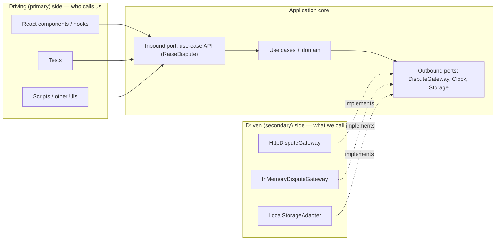
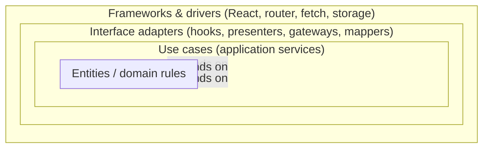
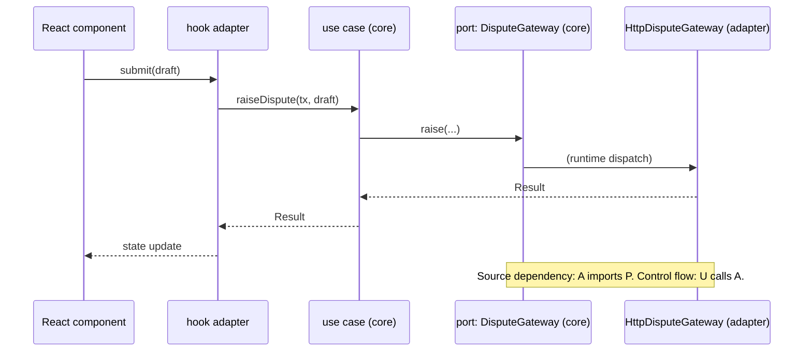

# 04 / 10 — Clean and Hexagonal Architecture in React: Ports, Adapters, and When They Are Excessive

## 1. Lesson metadata

| | |
|---|---|
| **Level** | Advanced |
| **Study time** | 5 hours (reading 2.5 h, refactoring lab 1.5 h, exercises 1 h) |
| **Prerequisites** | [02 — Separation of concerns](./02-separation-of-concerns.md), [05 — Composition and dependency direction](./05-composition-and-dependency-direction.md), [08 — Domain-driven frontend](./08-domain-driven-frontend.md), [09 — Feature-Sliced Design](./09-feature-sliced-design.md) |
| **Next** | [11 — Dependency inversion](./11-dependency-inversion.md) |
| **Related** | [12 — Domain logic vs UI logic](./12-domain-logic-vs-ui-logic.md), [13 — Application services and adapters](./13-application-services-and-adapters.md), [14 — API boundaries and data access](./14-api-boundaries-and-data-access.md) |

**Learning objectives.** After this lesson you can:
1. State the *dependency rule* and explain, from first principles, what problem it solves.
2. Describe Clean Architecture (Robert C. Martin) and Hexagonal Architecture / Ports and Adapters (Alistair Cockburn), and show that they share a core idea but differ in emphasis.
3. Map the concentric circles / hexagon to a React application: where React, the router, `fetch`, the query cache, and `localStorage` sit.
4. Implement a small, correct ports-and-adapters slice in TypeScript with a React UI, an application service, and two adapters (HTTP and in-memory).
5. Judge, with explicit criteria, when this architecture is justified in a front end and when it is excessive.
6. Recognise failure modes and plan an incremental adoption or retreat.

**Concepts covered:** dependency rule, entities/use cases/interface adapters/frameworks, driving (primary) vs driven (secondary) ports and adapters, composition root, humble object, screaming architecture, anti-corruption, testability, framework independence, cost of indirection.

---

## 2. Deep conceptual explanation

### 2.1 What problem is this lesson solving?

Applications are built from two kinds of code:

- **Policy**: rules about the business ("a dispute can only be raised within the dispute window").
- **Mechanism**: the machinery that carries policy out ("`fetch` to this URL", "render a `<dialog>`", "save to `localStorage`").

Mechanisms change often and for reasons unrelated to policy: a new React major, a switch from REST to GraphQL, a new storage strategy. If policy code *imports* mechanism code, each mechanism change forces edits (and re-testing) of policy. Conversely, policy cannot be exercised without spinning up the mechanism (a browser, a network, a DOM).

Clean and Hexagonal Architecture answer with one idea: **make mechanisms depend on policy, not the reverse**, by defining the interfaces that policy needs and letting mechanisms implement them.

### 2.2 Where the ideas came from

| Name | Originator / era | Original problem |
|---|---|---|
| **Hexagonal Architecture (Ports and Adapters)** | Alistair Cockburn, mid-1990s, published 2005 | Business logic polluted by UI and DB code made it impossible to test without both; "symmetry" between UI side and DB side was ignored |
| **Onion Architecture** | Jeffrey Palermo, 2008 | Layered architectures where the domain depends on the data layer |
| **Clean Architecture** | Robert C. Martin, 2012 blog post, 2017 book | Synthesised hexagonal, onion, BCE, DCI: independence from frameworks, UI, DB, and external agencies |

All three arose in server-side enterprise software, where the persistence layer and web framework were large, replaceable-in-theory dependencies. Whether this transfers to React is a real question (§7.3).

### 2.3 The dependency rule

> Source code dependencies must point only **inward**, toward higher-level policy. Nothing in an inner circle can know anything about something in an outer circle.

"Know" means *import, name, or depend on the shape of*. An inner circle cannot import an outer module, mention an outer type, or use an outer naming convention. Data crossing a boundary should be simple structures chosen by the inner side.

Clean Architecture's classic four rings:

| Ring (inside → outside) | Contains | Example in a React app |
|---|---|---|
| **Entities** | Enterprise-wide business rules and data | `Money`, `DisputeWindow`, `canDispute()` |
| **Use cases** (application business rules) | Orchestration of entities for one application action | `raiseDispute(cmd)`: checks rule, calls ports, returns result |
| **Interface adapters** | Convert between use-case shapes and external shapes: controllers, presenters, gateways | View-model builders, API mappers, repository implementations, hooks that translate use-case results into component props |
| **Frameworks and drivers** | The tools | React, React DOM, router, TanStack Query, `fetch`, `localStorage`, WebSocket |

Hexagonal draws the same thing differently: a **core** (application + domain) surrounded by **ports** (interfaces it defines), with **adapters** plugging into ports from the outside.



Key vocabulary (Cockburn):

- **Port**: an interface owned by the application core describing an interaction. *Driving (primary) ports* are what the world uses to drive the app (use-case APIs). *Driven (secondary) ports* are what the app needs from the world (persistence, clock, notifications).
- **Adapter**: code that translates between an external technology and a port. *Driving adapters* (React components, route handlers, test drivers) call inbound ports; *driven adapters* (HTTP client wrappers, storage wrappers) implement outbound ports.

### 2.4 Clean vs Hexagonal: differences that matter

| Aspect | Hexagonal | Clean |
|---|---|---|
| Shape | Core + ports + adapters (symmetry inside/outside) | Concentric rings, explicit entity/use-case split |
| Emphasis | Replaceability of both driving and driven sides; testing via ports | Dependency rule across *every* ring; separate "enterprise" vs "application" rules |
| Prescriptiveness | Light: "ports and adapters" | Heavier: named roles (interactors, presenters, controllers, gateways, view models) |
| Typical front-end adaptation | Ports as TypeScript interfaces; adapters as modules | Often carried over with a lot of ceremony (use-case classes, presenters, DTO layers per ring) |

Common front-end practice is a *pragmatic hybrid*: Clean's dependency rule, Hexagonal's port/adapter vocabulary, and none of the class-heavy ceremony.

### 2.5 Where React sits

React is, in these diagrams, a **framework/driver** and a **driving adapter**: it receives user events and invokes application functions, then renders results. This has important consequences:

1. **Components are not "the application".** They are the outermost, most volatile ring. They should contain as little policy as practical.
2. **Hooks straddle rings.** A custom hook that calls a use case and holds loading state is an *interface adapter* (it adapts use-case results to React's model). A hook that contains business rules is policy hidden in the framework ring.
3. **State libraries and the query cache are framework-ring tools**; their use should be isolated behind the adapters if you want to swap them. In practice, TanStack Query is so central that many teams treat it as part of the application's accepted stack (see §7.3).
4. **React 19 server features blur the picture.** Server Components, Actions, and framework loaders move "driving adapter" code to the server. The principle (policy independent of delivery mechanism) still applies, but you may be writing hexagonal code on the server side while the client is a thin adapter. ⚠ Verify framework specifics against current docs (Phase 9).

### 2.6 Common misconceptions

| Misconception | Reality |
|---|---|
| "Clean architecture = four folders: `entities`, `usecases`, `adapters`, `frameworks`." | The folders are incidental; the *dependency rule* is the content. A folder structure that violates it is not clean. |
| "Every `fetch` must be hidden behind a repository interface." | Only where the abstraction pays for itself (testing seams, multiple implementations, protecting policy from volatile contracts). Otherwise it is a pass-through layer. |
| "Hexagonal means swapping the database/framework later." | Swapping is rare. The real, frequent payoffs are testability and keeping policy readable. Justifying the architecture by "we might switch from React" is usually a bad bet. |
| "Clean architecture requires classes and DI containers." | Plain functions and closures suffice (see [11](./11-dependency-inversion.md)). |
| "Components should contain no logic." | UI logic belongs in UI ([12](./12-domain-logic-vs-ui-logic.md)). The goal is no *business policy* in components. |
| "Business logic in hooks is clean." | If it imports React, it's in the framework ring. A hook is an adapter. |

---

## 3. Internal mechanics

### 3.1 Public guarantee / teaching model / implementation detail

- **Public guarantee (of the architectural principles):** the dependency rule and port/adapter definitions as published by Martin and Cockburn.
- **Teaching model (this lesson):** mapping the rings to React concepts, with a functional style.
- **Implementation detail (yours):** where files are placed, whether ports are `interface`s or function types, whether you use a DI container.

### 3.2 How a dependency is inverted at compile time and at run time

Compile time: the use case file `import type { DisputeGateway } from "./ports"`. The interface lives in the **inner** ring. The HTTP adapter file `import type { DisputeGateway } from "../../core/ports"` and declares `implements`/satisfies it. Arrows in the import graph point inward.

Run time: control flows outward (use case → gateway → network), against the import arrows. That is *dependency inversion*: source dependency direction opposes flow of control. The glue is a **composition root** — one place near the entry point that constructs adapters and injects them into use cases (React: often providers or a module-level `createApp()`; see [11](./11-dependency-inversion.md) and [Phase 5 DI](../05-design-patterns/16-dependency-injection.md)).

### 3.3 Boundary-crossing data

Rules (Martin): data crossing a boundary should be simple, isolated structures; the inner ring defines their shape. In TypeScript: plain object types or discriminated unions; no Axios responses, no `Response` objects, no React elements, no `Query` result types crossing into the core.

A concrete test: *Can I run my use-case tests in Node with no DOM, no network, and no React import?* If yes, the core is isolated.

### 3.4 The humble object

Martin's "humble object" pattern: separate hard-to-test behaviour (UI rendering) from testable behaviour by making the hard-to-test part trivially thin. A React component that only maps a prepared view model to JSX and forwards events is a humble object. The preparation lives in a plain function (a "presenter") testable without rendering. In React this is closely related to the container/presenter split ([04 — Presentational vs container](./04-presentational-vs-container.md), [Phase 5 container-presentational](../05-design-patterns/04-container-presentational.md)).

---

## 4. Step-by-step execution walkthrough: one user action through the hexagon

Action: the user clicks "Raise dispute" in a dialog.

1. **Driving adapter (React).** `DisputeDialog`'s submit handler calls a hook-provided function `submit(draft)`.
2. **Hook adapter.** `useRaiseDispute` obtains the use case from the composition root (via context or module import) and calls `raiseDispute(command)`; it wraps the promise in React state/mutation tooling (e.g. `useMutation` or React 19's `useActionState`).
3. **Inbound port / use case.** `raiseDispute` validates the command using domain rules (`validate(draft)`, `canDispute(tx, now)`). If invalid, it returns a typed failure; **no I/O occurred**.
4. **Outbound port call.** The use case calls `gateway.raise({ transactionId, reason, claimed })` — the interface is defined by the core.
5. **Driven adapter (HTTP).** `HttpDisputeGateway` maps the command to the wire format (ACL, see [08](./08-domain-driven-frontend.md)), `fetch`es, handles status codes, maps the response (or error) back to core types (`DisputeReceipt` or `{ kind: "rejected", reason }`).
6. **Return path.** The use case receives core types, applies post-conditions (e.g. computes a confirmation), and returns `Result`.
7. **Hook adapter** updates React state, invalidates relevant queries; the view model is recomputed.
8. **Render.** The humble component shows the confirmation or errors.

In a test, steps 1–2 and 5 are replaced: a test calls `raiseDispute` directly with `InMemoryDisputeGateway`, asserting steps 3, 4 and 6 in milliseconds, with no DOM.

---

## 5. Code examples

### 5.1 Representative folder structure

One feature slice organised hexagonally (within a feature folder or an FSD slice's `model`; combine as you wish with [06](./06-feature-vs-layer-structure.md)/[09](./09-feature-sliced-design.md)):

```text
src/
  disputes/
    core/                       # NO React, NO fetch, NO browser APIs
      domain/
        dispute-draft.ts        # entities + pure rules
        money.ts
      ports.ts                  # outbound ports (interfaces)
      use-cases/
        raise-dispute.ts        # application services
        load-disputable-transaction.ts
      index.ts                  # what the outside may import from core
    adapters/
      http/
        http-dispute-gateway.ts # implements ports (driven adapter)
        dto.ts                  # wire types, mappers (ACL)
      memory/
        in-memory-gateway.ts    # for tests, Storybook, prototyping
      react/                    # driving adapters
        use-raise-dispute.ts
        DisputeDialog.tsx
        DisputeAppContext.tsx   # provides use cases to components
    composition/
      create-disputes-app.ts    # wires adapters into use cases
  app/
    main.tsx                    # composition root for the whole app
```

### 5.2 Dependency rules

| Module | May import | Must not import |
|---|---|---|
| `core/domain` | other `core/domain`, language built-ins | anything else (no React, no `Date.now()` direct use if determinism needed, no `fetch`) |
| `core/ports` | `core/domain` types | adapters |
| `core/use-cases` | `core/domain`, `core/ports` | adapters, React |
| `adapters/http`, `adapters/memory` | `core` (public API) , third-party HTTP libs | `adapters/react` |
| `adapters/react` | `core` public API, React, UI kit | `adapters/http` directly (receives use cases from the composition root) |
| `composition` | everything in this slice | — |
| `app/main.tsx` | composition modules | — |

### 5.3 Minimal example — core with one port

```ts
// core/ports.ts
import type { DisputeDraft } from "./domain/dispute-draft";

export interface DisputeReceipt { readonly disputeId: string; readonly submittedAt: Date; }

export type GatewayError =
  | { kind: "window-closed" }
  | { kind: "duplicate" }
  | { kind: "unavailable"; retryable: boolean };

export type Result<T, E> = { ok: true; value: T } | { ok: false; error: E };

export interface DisputeGateway {
  raise(transactionId: string, draft: DisputeDraft, signal?: AbortSignal): Promise<Result<DisputeReceipt, GatewayError>>;
}

export interface Clock { now(): Date }
```

```ts
// core/use-cases/raise-dispute.ts
import { validate, type DisputeDraft, type DraftIssue } from "../domain/dispute-draft";
import type { Clock, DisputeGateway, DisputeReceipt, GatewayError, Result } from "../ports";

export type RaiseDisputeFailure =
  | { kind: "invalid"; issues: DraftIssue[] }
  | GatewayError;

export interface RaiseDisputeDeps { gateway: DisputeGateway; clock: Clock }

export function makeRaiseDispute({ gateway }: RaiseDisputeDeps) {
  return async function raiseDispute(
    transactionId: string,
    draft: DisputeDraft,
    signal?: AbortSignal,
  ): Promise<Result<DisputeReceipt, RaiseDisputeFailure>> {
    const issues = validate(draft);
    if (issues.length > 0) return { ok: false, error: { kind: "invalid", issues } };
    return gateway.raise(transactionId, draft, signal);
  };
}
export type RaiseDispute = ReturnType<typeof makeRaiseDispute>;
```

Line notes: `makeRaiseDispute` is a **factory taking dependencies** — dependency injection with plain functions (no container). The `clock` dependency is declared but unused here; in a real version the use case would check a window with `clock.now()`. (A cleaner version would remove the unused dependency; it's shown to illustrate the shape. TypeScript's `noUnusedParameters` does not flag unused destructured properties not listed, since we only destructure `gateway`.) The failure type is a **discriminated union**, so callers must handle each case (exhaustiveness via `never` checks).

**Predict:** if the draft has no reason, is the gateway called? No. `validate` returns `[{code:"reason-required"}]`, so the use case returns early with `{ ok: false, error: { kind: "invalid", ... } }`. Test with an in-memory gateway that records calls: `calls.length === 0`.

### 5.4 Practical example — adapters and the composition root

```ts
// adapters/http/http-dispute-gateway.ts
import type { DisputeGateway, GatewayError, Result, DisputeReceipt } from "../../core/ports";
import type { DisputeDraft } from "../../core/domain/dispute-draft";

interface RaiseDisputeResponseDto { dispute_id: string; submitted_at: string }

export function createHttpDisputeGateway(baseUrl: string, fetchImpl: typeof fetch = fetch): DisputeGateway {
  return {
    async raise(transactionId, draft, signal) {
      let res: Response;
      try {
        res = await fetchImpl(`${baseUrl}/transactions/${encodeURIComponent(transactionId)}/disputes`, {
          method: "POST",
          headers: { "Content-Type": "application/json" },
          body: JSON.stringify(toRequestDto(draft)),
          signal,
        });
      } catch (e) {
        if (e instanceof DOMException && e.name === "AbortError") throw e;   // let cancellation propagate
        return fail({ kind: "unavailable", retryable: true });
      }
      if (res.status === 409) return fail({ kind: "duplicate" });
      if (res.status === 422) return fail({ kind: "window-closed" });
      if (!res.ok) return fail({ kind: "unavailable", retryable: res.status >= 500 });
      const dto = (await res.json()) as RaiseDisputeResponseDto;
      const receipt: DisputeReceipt = { disputeId: dto.dispute_id, submittedAt: new Date(dto.submitted_at) };
      return { ok: true, value: receipt };
    },
  };
}

function fail(error: GatewayError): Result<never, GatewayError> { return { ok: false, error }; }

function toRequestDto(d: DisputeDraft) {
  return { reason: d.reason, claimed_minor: d.claimedAmount?.minor, note: d.note };
}
```

Notes: the adapter owns HTTP status semantics (`409`, `422` here are *illustrative* — real API contracts differ) and converts them to core errors. It accepts an injectable `fetchImpl` so it can itself be tested. The `as RaiseDisputeResponseDto` cast is unchecked at runtime — see [14](./14-api-boundaries-and-data-access.md) for runtime validation (schemas) at this exact boundary.

```ts
// adapters/memory/in-memory-gateway.ts
import type { DisputeGateway, DisputeReceipt } from "../../core/ports";

export function createInMemoryDisputeGateway(opts: { now?: () => Date } = {}) {
  const calls: { transactionId: string }[] = [];
  const seen = new Set<string>();
  const gateway: DisputeGateway = {
    async raise(transactionId) {
      calls.push({ transactionId });
      if (seen.has(transactionId)) return { ok: false, error: { kind: "duplicate" } };
      seen.add(transactionId);
      const receipt: DisputeReceipt = { disputeId: `d-${seen.size}`, submittedAt: (opts.now ?? (() => new Date()))() };
      return { ok: true, value: receipt };
    },
  };
  return { gateway, calls };
}
```

```ts
// composition/create-disputes-app.ts
import { makeRaiseDispute } from "../core/use-cases/raise-dispute";
import { createHttpDisputeGateway } from "../adapters/http/http-dispute-gateway";

export function createDisputesApp(config: { apiBaseUrl: string }) {
  const clock = { now: () => new Date() };
  const gateway = createHttpDisputeGateway(config.apiBaseUrl);
  return { raiseDispute: makeRaiseDispute({ gateway, clock }) };
}
export type DisputesApp = ReturnType<typeof createDisputesApp>;
```

```tsx
// adapters/react/DisputeAppContext.tsx
import { createContext, use, type ReactNode } from "react";
import type { DisputesApp } from "../../composition/create-disputes-app";

const DisputeAppContext = createContext<DisputesApp | null>(null);

export function DisputeAppProvider({ app, children }: { app: DisputesApp; children: ReactNode }) {
  return <DisputeAppContext value={app}>{children}</DisputeAppContext>;   // React 19: context object usable as provider
}

export function useDisputesApp(): DisputesApp {
  const app = use(DisputeAppContext);
  if (!app) throw new Error("DisputeAppProvider missing");
  return app;
}
```

Notes: React 19 allows `<Context value={…}>` directly as provider and `use(Context)` to read it (older versions use `<Context.Provider>` and `useContext`). The hook throws a clear error if the provider is missing: a common DX improvement.

```tsx
// adapters/react/use-raise-dispute.ts
import { useMutation } from "@tanstack/react-query";
import { useDisputesApp } from "./DisputeAppContext";
import type { DisputeDraft } from "../../core/domain/dispute-draft";

export function useRaiseDispute(transactionId: string) {
  const { raiseDispute } = useDisputesApp();
  return useMutation({
    mutationFn: (draft: DisputeDraft) => raiseDispute(transactionId, draft),
  });
}
```

A caveat, important in practice: `useMutation`'s `mutationFn` returns a `Result`; a *resolved* `{ ok: false }` is **not** a mutation error to TanStack Query (⚠ verify against current docs): `onError` fires only on thrown/rejected. Either translate in the hook (`throw` on `!ok`) or consume `data.ok`. Mixing result-style and exception-style error channels is a very common source of bugs in this architecture.

Test with the in-memory adapter, no React:

```ts
// core/use-cases/raise-dispute.test.ts  (Vitest)
import { describe, it, expect } from "vitest";
import { makeRaiseDispute } from "./raise-dispute";
import { createInMemoryDisputeGateway } from "../../adapters/memory/in-memory-gateway";

describe("raiseDispute", () => {
  it("does not call the gateway for an invalid draft", async () => {
    const { gateway, calls } = createInMemoryDisputeGateway();
    const raise = makeRaiseDispute({ gateway, clock: { now: () => new Date("2025-01-01") } });
    const res = await raise("tx-1", { transactionAmount: { minor: 1000, currency: "EUR" }, evidence: [], note: "" });
    expect(res.ok).toBe(false);
    expect(calls).toHaveLength(0);
  });
});
```

### 5.5 Incorrect example — "clean" in name only

```ts
// core/use-cases/raise-dispute.ts   (violations)
import axios from "axios";                         // framework in the core
import { toast } from "react-hot-toast";           // UI in the core
import { useQueryClient } from "@tanstack/react-query"; // hook in a non-component

export async function raiseDispute(txId: string, draft: Draft) {
  const res = await axios.post(`/api/tx/${txId}/disputes`, draft);   // DTO = domain
  toast.success("Dispute raised");
  return res.data;                                  // wire type escapes
}
```

Problems: the "use case" imports `axios` (outer), `react-hot-toast` (UI), and a hook (calling a hook outside a component/hook violates the Rules of Hooks, see [Phase 3 hooks rules](../03-react-state-and-hooks/01-usestate-internals-and-update-semantics.md)). The `.data` leaks the wire format. Testing requires mocking the module system.

### 5.6 Corrected: see §5.3–5.4

Notifications are the **driving adapter's** job: the hook or component shows the toast when it receives `ok: true`. If a use case needs to *cause* a notification (e.g. in a non-UI flow), define a `Notifier` outbound port and inject an adapter that happens to call the toast library.

### 5.7 Advanced — the same use case from two driving adapters

Because use cases are plain functions, a Node script (e.g. a bulk-dispute CLI for support staff) or a Playwright test harness can reuse `makeRaiseDispute` with the HTTP gateway, with zero React. This reuse is the real-world test of whether the architecture is paying for itself: if there is only ever one driver (the React UI) and one driven adapter (HTTP), you hold the cost of two interfaces and get testability only (still valid, but see §7.3 for cheaper ways to get it).

---

## 6. Visual explanations

### 6.1 The rings and the allowed direction



### 6.2 Control flow vs dependency direction



### 6.3 Cost of indirection by size

| Concern | 1 screen CRUD | Complex workflow | Multi-client platform |
|---|---|---|---|
| Layers needed | UI + API hook | UI + hook + use-case + gateway | Full ports/adapters per client |
| Test seam value | Low (MSW suffices) | High | High |
| Risk of over-engineering | High | Medium | Low |

---

## 7. Alternative approaches and trade-offs

### 7.1 Comparison

| Criterion | Components + hooks calling `fetch`/query directly | Container/presenter + service module | **Hexagonal / Clean (ports & adapters)** | FSD ([09](./09-feature-sliced-design.md)) | Server-centric framework (loaders/Actions) |
|---|---|---|---|---|---|
| Code volume (files/lines) | Smallest | Small | **Largest** | Medium | Small–medium |
| Business-rule testability without React | Poor | Good (if rules in service) | **Excellent** | Depends on segment discipline | Rules often on server |
| Test via network mocks (MSW) | Easy | Easy | Easy but optional | Easy | Different story |
| Swapping HTTP client / transport | Hard | Medium | **Easy** | Medium | n/a |
| Onboarding | Easiest | Easy | Hard (vocabulary + indirection) | Medium | Framework knowledge |
| Refactoring cost when requirements change | Low in small apps, high in large | Medium | Medium; inner core stable, adapters churn | Medium | Varies |
| Fit with data-cache libraries | Natural | Natural | Needs thought: cache semantics vs ports | Natural | Natural |
| Risk of pass-through layers | None | Low | **High** | Low | Low |

### 7.2 Approach profile: Clean / Hexagonal in React

**Original problem it solved.** Business logic entangled with delivery mechanisms and persistence made systems untestable without full infrastructure, hard to change when technology changed, and obscured the business rules. (Cockburn: UI and DB side-by-side symmetrically attached to an application that can be driven by tests/automation equally; Martin: frameworks as details.)

**Representative folder structure.** §5.1.

**Dependency rules.** Source dependencies point inward; ports are owned by the core; adapters implement ports; a composition root wires everything. §5.2.

**Example code.** §5.3–5.7.

**Advantages.**
- Core logic is testable in plain Node, fast and deterministic.
- Volatile contracts (REST shape, SDK, storage) isolated in adapters.
- Multiple drivers (React UI, scripts, tests) and multiple driven implementations (HTTP, in-memory, offline).
- Forces explicit failure modelling at boundaries (typed `Result` instead of ad hoc exceptions).
- Enables parallel work (UI against in-memory adapters while back end is unfinished).
- Large codebases: boundaries let teams reason locally.

**Disadvantages.**
- Substantial indirection: for a typical CRUD screen, each layer is a pass-through.
- Fights the grain of modern React data tooling: query caches, suspense, loaders, and Actions *are* adaptors with caching semantics; wrapping them in ports risks reimplementing them or hiding features (stale-while-revalidate, request de-duplication, optimistic updates) behind a lowest-common-denominator interface.
- Two error channels (`Result` and exceptions) unless managed carefully.
- Heavier onboarding; naming overhead; bike-shedding about "which ring".
- Interfaces designed around one implementation tend to be shaped like that implementation anyway (leaky ports), so the swappability promise is often hollow.
- Tooling/DX: more files, longer navigation paths, harder "go to definition" through factories.

**Appropriate project/org sizes (opinion backed by cost/benefit).**

| Size / type | Verdict |
|---|---|
| Prototype, marketing site, small CRUD admin | **Excessive.** Use components + a data-fetching hook; consider MSW for tests. |
| Medium product, one team, mostly CRUD with 1–2 complex workflows | **Selective.** Apply ports/adapters to the complex workflows only (pricing, scheduling, multi-step submissions, offline sync); keep the rest simple. |
| Large product, several teams, long lifespan, complex rules | **Justified** for core subdomains ([08](./08-domain-driven-frontend.md)), enforced by lint. |
| Multi-client (web + React Native + embedded widgets) sharing logic | **Justified**: core as a package shared across clients; adapters per platform. |
| Domain with heavy client-side logic (editors, trading UIs, offline-first) | **Justified**: the client owns real invariants/state machines. |

**Failure modes.**
1. **Pass-through layers**: use case `getUser(id) { return repo.getUser(id) }` repeated 80 times.
2. **Port per function**: dozens of one-method interfaces with no second implementation.
3. **Leaky abstraction**: port types named after the REST API (`getUsersPage(pageToken)`) or returning `AxiosResponse`.
4. **Ceremony inflation**: classes, DI containers (`inversify`-style), decorators, "interactor/presenter/controller/view-model" for a button.
5. **Cache semantic loss**: ports hide `staleTime`, background refetch, and cancellation, so the UI is slow or flickery; or the team re-implements a cache.
6. **Exception/Result confusion** (§5.4).
7. **Frozen architecture**: nobody dares restructure because the "architecture doc" says so; the structure outlives its value.
8. **Core not actually isolated**: a `core/` import of `react` slips in; no enforcement ([25](./25-architectural-fitness-and-enforcement.md)).

**Migration considerations.**
- *From component-heavy code to hexagonal:* (1) identify one complex workflow; (2) extract rules into pure functions + tests (this already captures much of the value, see [12](./12-domain-logic-vs-ui-logic.md)); (3) introduce a single port only where a test seam or alternative implementation is wanted; (4) move network calls into an adapter file returning core types; (5) add the composition root; (6) enforce import rules for `core/`.
- *Retreat path:* if the layer is pure pass-through, inline it. Port interfaces are cheap to delete; removing a DI container is not — another reason to start with plain factories.
- *Adopt incrementally by feature.* Never rewrite the whole app to a different architecture at once ([24](./24-refactoring-legacy-react.md)).
- *With a data-cache library:* let the **adapter layer own the cache integration** (hooks wrap `useQuery` around a port-fed `queryFn`), so the core remains cache-agnostic while the UI keeps caching semantics.

### 7.3 When Clean/Hexagonal is excessive in React — and what to do instead

Be direct about it: **for many React applications, full Clean Architecture is over-engineering.** Reasons grounded in React's properties:

1. **The data layer is already abstracted by a library.** TanStack Query, RTK Query, SWR, Apollo, and framework loaders define a stable "driven port" in practice (a `queryFn` returning a promise). Wrapping it again with `Repository` interfaces duplicates the abstraction without adding a swappable implementation. Your tests can substitute at the network boundary with MSW ([Phase 8 mocking](../08-testing-and-quality/06-mocking-strategies-and-msw.md)), which gives the *testability* benefit at a fraction of the code.
2. **Most front-end logic is presentation and orchestration of server state.** The server owns invariants. There are few "entities" with rules to protect.
3. **Components are already composable and injectable** via props, children and context (see [05](./05-composition-and-dependency-direction.md)); you can do dependency inversion without ring vocabulary.
4. **UI frameworks change slower than clean-architecture literature claims, and rewrites are rarer than predicted.** The "we will swap React" argument seldom materialises; the "we will swap REST for GraphQL" argument sometimes does, in which case an adapter/ACL helps — but a thin mapper achieves it.
5. **React 19 / framework trends move data-fetching and mutation into the framework** (loaders, Server Components, Actions). Your hexagon's driven side may be the framework itself ⚠ (verify per framework).

A **graduated approach** (my recommendation; opinion):

| Level | When | What you add |
|---|---|---|
| 0 | Simple screens | Components + query hooks; types from API client |
| 1 | Rules accumulating | Pure domain functions in a module with tests ([12](./12-domain-logic-vs-ui-logic.md)) |
| 2 | External contract churn or multiple back ends | ACL mapper / `api/` module returning domain-shaped data ([14](./14-api-boundaries-and-data-access.md)) |
| 3 | Complex orchestration, multiple triggers, offline, multiple clients | Application services with injected dependencies (function factories) ([13](./13-application-services-and-adapters.md)) |
| 4 | Multi-client platform / heavy core | Full ports-and-adapters packages with composition roots |

Most screens in most apps stay at levels 0–2. Level 4 is rare in a single SPA.

---

## 8. Best practices and anti-patterns

### 8.1 Best practices

1. **Start from the dependency rule, not folders.** Add folders only to make the rule visible.
2. **Define ports in terms of the core's needs**, not the server's endpoints: `raise(transactionId, draft)`, not `postDisputes(body)`.
3. **Keep the core free of React and browser APIs.** Enforce with a lint rule/dependency check ([25](./25-architectural-fitness-and-enforcement.md)).
4. **Inject time and randomness** (`Clock`, `IdGenerator`) for deterministic tests.
5. **Use functions and closures for DI** before reaching for containers.
6. **Choose one error strategy at each boundary** and document it (typed `Result` in core, exceptions translated in adapters, or the reverse).
7. **Let adapters own cache and cancellation integration**; pass `AbortSignal` through ports.
8. **Have an in-memory adapter** only when you use it (tests, Storybook, local dev). An unused adapter is dead code.
9. **Prefer a few coarse ports** (one per aggregate/capability) to many fine-grained ones.
10. **Review for pass-throughs** regularly; delete any layer with no behaviour.

### 8.2 Beginner mistakes

- Copying Java/C# Clean Architecture layouts: `UserRepositoryImpl`, `GetUserUseCase`, `UserPresenter`, `UserViewModel` for a profile page.
- Believing "clean" means "more files".
- Putting hooks in the domain layer.

### 8.3 Experienced-developer mistakes

- Designing ports before there is a second implementation or a test need ("speculative generality"; [Phase 5 YAGNI](../05-design-patterns/02-dry-kiss-yagni.md)).
- Reimplementing a query cache behind `Repository` with manual invalidation logic.
- Treating architecture as a uniform policy for all features rather than investing where complexity lives.
- Overusing `Result` types without ergonomics, leading to `if (!r.ok)` pyramids; adopt helpers or reserve `Result` for expected domain failures and let exceptions represent unexpected faults.

### 8.4 Smells

| Smell | Meaning |
|---|---|
| Use cases that are one-line delegations | Pass-through layer; inline |
| `core/` importing from `node_modules` heavily | Framework leaked into core |
| Mocks of internal modules in nearly every test | Boundaries not where tests need them |
| Interface with one method, one implementation, no test double | Speculative port |
| Types named `…Dto` used in components | ACL missing or bypassed |

### 8.5 Justified exceptions

- Using `useQuery` directly in a component for a trivial read, inside an otherwise hexagonal feature.
- Letting the core depend on a tiny, stable utility library (`zod`, date library) as a conscious "allowed dependency". Document the allow-list; the strictness is about *volatile* and *I/O-bound* dependencies.
- Passing React's `AbortSignal` (a web platform standard, not React) through ports.

---

## 9. Real-world application

| Domain | Where ports/adapters pay | Where not | Constraints |
|---|---|---|---|
| **E-commerce** | Checkout pricing/promotions engine; payment SDK behind a `PaymentProvider` port (multiple PSPs by region) | Catalogue browse | PSP SDKs are volatile and sometimes mandated; adapters isolate them |
| **Dashboards** | Query-builder/metric semantics as core, transport as adapter | Static charts | Large result sets: ports must support streaming/pagination or they become bottlenecks |
| **Finance / fleet payments** | Limit and eligibility rules, dispute workflows, reconciliation, audit trail | Settings pages | Regulatory logging via `AuditLog` port; deterministic clocks for time-window rules |
| **Forms** | Multi-step validation core reusable on server and client | Single-page contact form | Share validation core with back end if both are TypeScript (a package) |
| **Auth** | `SessionStore` port (cookie/memory/secure storage) for multi-platform | Basic web app with framework auth | Security-sensitive: avoid DIY; adapters wrap proven libs ([Phase 9 auth boundaries](../09-advanced-rendering-and-ecosystem/12-auth-boundaries.md)) |
| **Realtime** | `MarketDataFeed` port with WebSocket and replay adapters (recorded sessions for tests) | Occasional live badge | Backpressure and reconnect handling belong in the adapter |
| **Multi-client** | Shared core package used by web and React Native | Web only | Package boundary and versioning ([22](./22-monorepos-and-shared-packages.md)) |
| **Offline-first** | `SyncQueue`/`LocalStore` ports | Online-only | Conflict resolution policy is domain logic |

---

## 10. Debugging and troubleshooting

| Symptom | Likely root cause | Investigation | Fix / validation |
|---|---|---|---|
| `Invalid hook call` when invoking a "use case" | Use case calls a hook (`useQueryClient`) outside React | Stack trace points to core module | Move hook usage to the adapter; pass needed functions in via deps |
| Mutation `onError` never fires although the operation failed | Port returns `{ ok: false }` (resolved) | Log mutation state; check `isError` vs `data.ok` | Throw in the adapter hook on `!ok`, or branch on `data` |
| Tests need heavy mocking of modules | Dependencies imported not injected | `vi.mock` count; imports in core | Introduce a port + factory; inject fakes |
| UI shows stale data after a mutation | Port hides cache invalidation | React Query Devtools: stale/fresh queries | Invalidate in the hook adapter after `ok: true`; centralise key factory |
| Core test passes, production fails | In-memory adapter diverges from HTTP adapter | Contract test both adapters against the same suite | Shared contract test suite for all adapters |
| Cancelled navigation still resolves state updates | `AbortSignal` not passed through port | Network panel shows request not cancelled | Add `signal` param to ports; thread from `queryFn` |
| Bundle pulls server-only/Node-only code into client | Core imports an adapter or Node API | Bundle analyzer ([Phase 7](../07-performance/16-bundle-analysis.md)) | Fix import direction; separate entrypoints |

**Adapter contract testing** (a valuable, under-used technique): write one suite that asserts port behaviour, run it against both the HTTP adapter (with MSW) and the in-memory adapter. If they diverge, the in-memory one is lying.

---

## 11. Exercises

### Level A — Knowledge
A1. State the dependency rule in your own words. What counts as "knowing" about an outer circle?
A2. Define driving (primary) and driven (secondary) ports/adapters, with a React example of each.
A3. Where does a custom hook that holds loading state and calls a use case belong in Clean Architecture's rings? Why?
A4. List three signs that Clean Architecture is excessive for a given React screen.
A5. What is a composition root, and why is it needed?

### Level B — Code comprehension
B1. In §5.3, why is `Result` used instead of throwing? What would the caller lose if it threw?
B2. In §5.4, why does `createHttpDisputeGateway` take `fetchImpl`? Name two benefits.
B3. Given `const raise = makeRaiseDispute({ gateway, clock })` called with an invalid draft, which of `gateway`, `clock` are invoked?
B4. Why does the incorrect example in §5.5 make the use case difficult to test?

### Level C — Implementation
C1. Add a `Clock`-based rule to `raiseDispute`: reject if `now > windowEndsAt` (passed in the command), returning `{ kind: "window-closed" }`. Write two Vitest tests using a fixed clock.
C2. Write a `Notifier` outbound port and a toast adapter; update the use case so a "high-value dispute" (> €5,000 minor 500000) triggers `notifier.notifyRiskTeam(...)`. Show the composition root change.
C3. Write a contract test suite function `describeDisputeGatewayContract(makeGateway)` verifying "duplicate raise returns duplicate error" and run it against the in-memory adapter.

### Level D — Debugging
D1. A teammate wraps `useQuery` inside `core/use-cases/get-transactions.ts` and says "it works in the browser, but unit tests crash with 'Invalid hook call'". Explain and restructure.
D2. After adding a `TransactionRepository` port with `getAll()`, the transactions page refetches on every tab focus *and* the app lost the previous caching behaviour. What happened and how do you restore cache semantics without exposing React Query to the core?

### Level E — Architecture decisions
E1. Your team of 4 builds an internal back-office tool: 30 CRUD screens, 2 complex approval workflows. A new hire proposes full Clean Architecture everywhere. Decide and justify using criteria.
E2. You must support a web app and a React Native app with the same business flows. Design the package structure, ports, and what differs per platform.
E3. Decide whether a `UserRepository` port is justified when the app uses TanStack Query plus a generated OpenAPI client, with MSW tests.

### Level F — Expert challenge
F1. Argue both sides: "In React, hooks are the dependency-injection mechanism, so ports are unnecessary" — then give your own position with conditions under which it flips.
F2. Design a lint/CI strategy that verifies the dependency rule for `core/` without false positives from type-only imports and tests, and that supports a ratchet for legacy violations.

---

## 12. Detailed answers and explanations

> Attempt the exercises first.

**A1.** Source-code dependencies point inward only; an inner module must not import, reference by name, or depend on the data shape/format/naming of an outer one. Wrong answer: "inner can't *call* outer" — it does call outer at runtime, via interfaces it owns (inversion). The rule is about static dependencies.

**A2.** Driving (primary): who *uses* the app: a React component/hook calling `raiseDispute`, or a test. Driven (secondary): what the app *uses*: `DisputeGateway` implemented by `HttpDisputeGateway`, or a `Clock`, `Storage`. Ports are the interfaces, adapters the implementations/translators.

**A3.** In *interface adapters*: it translates the use-case result into React state. It must not contain business rules (that would hide policy in the framework ring); it also should not be imported by the core. Edge: hooks that merely compose UI state (open/close) are plain UI, not an adapter to the core.

**A4.** Any three: (1) use cases that are one-line pass-throughs; (2) one implementation per port and no tests using a fake; (3) the server already enforces all rules and the screen is read-mostly; (4) data library already handles caching/retries; (5) team smaller than the layers; (6) most PRs touch 5 files for a one-field change.

**A5.** The single place (near program entry) that constructs concrete adapters and injects them into use cases/components. Needed because inner code cannot construct outer code (it would import it), yet *someone* must. Without it, adapters get constructed in random places and the dependency rule erodes.

**B1.** Expected domain failures (invalid draft, duplicate, window closed) are *normal outcomes*, not exceptional faults. `Result` makes them part of the type: the caller must handle each case (exhaustive `switch`). With exceptions the failure set is invisible in signatures, easy to forget (`catch (e)` is `unknown`), and mixing with genuine bugs is hard. Counter-view: exceptions integrate with React error boundaries and query libraries' error channels; neither is universally superior.

**B2.** (1) Tests can inject a fake `fetch` (or MSW-free stubs) and assert the adapter's mapping logic. (2) The adapter can run in environments with different `fetch` (Node polyfill, a wrapped `fetch` with auth/tracing). Also: avoids relying on global state.

**B3.** Neither. `validate(draft)` returns issues before any port call; `clock` isn't used in this version. Hence zero gateway calls (verified by `calls.length` in the test).

**B4.** It imports `axios`, a toast, and a hook; tests need module mocks for all three and a React context for the hook, and assertions on toasts instead of results. The use case also returns `res.data` (wire shape), so tests are coupled to the API format.

**C1. Reference solution**
```ts
export interface RaiseDisputeCommand { transactionId: string; draft: DisputeDraft; windowEndsAt: Date }

export function makeRaiseDispute({ gateway, clock }: RaiseDisputeDeps) {
  return async (cmd: RaiseDisputeCommand, signal?: AbortSignal) => {
    if (clock.now().getTime() > cmd.windowEndsAt.getTime()) return { ok: false as const, error: { kind: "window-closed" as const } };
    const issues = validate(cmd.draft);
    if (issues.length) return { ok: false as const, error: { kind: "invalid" as const, issues } };
    return gateway.raise(cmd.transactionId, cmd.draft, signal);
  };
}
```
Tests: (1) clock one ms after window → `window-closed`, gateway `calls` empty; (2) clock exactly at `windowEndsAt` → allowed (boundary; document inclusive/exclusive). Evaluate: the clock injected; boundary tested; ordering decision (window check before validation) is explicit and documented. Note the inferred return type union needs an annotated `Result<..., RaiseDisputeFailure>` for callers; add it.

**C2. Reference outline**
```ts
export interface Notifier { notifyRiskTeam(e: { transactionId: string; amountMinor: number }): Promise<void> }
// use case: after gateway success && draft.claimedAmount && minor > 500000 → await notifier.notifyRiskTeam(...)
// adapter: createHttpNotifier(baseUrl) posting to a risk endpoint — NOT the toast
```
Note the trap: a "toast" is *UI feedback to the user* (driving adapter responsibility), whereas "notify risk team" is a business side-effect (driven port). A good answer distinguishes them. Composition root: `makeRaiseDispute({ gateway, clock, notifier })`. Decide: should notifier failure fail the dispute? Policy decision: best-effort (catch and log) vs transactional; state it.

**C3. Reference**
```ts
export function describeDisputeGatewayContract(name: string, make: () => DisputeGateway) {
  describe(`DisputeGateway contract: ${name}`, () => {
    it("returns duplicate on second raise for same transaction", async () => {
      const g = make();
      const draft = { transactionAmount: { minor: 100, currency: "EUR" as const }, evidence: [], note: "", reason: "duplicate" as const };
      expect((await g.raise("t1", draft)).ok).toBe(true);
      const second = await g.raise("t1", draft);
      expect(second).toEqual({ ok: false, error: { kind: "duplicate" } });
    });
  });
}
describeDisputeGatewayContract("in-memory", () => createInMemoryDisputeGateway().gateway);
```
Run the same function against the HTTP adapter with MSW handlers returning 201 then 409.

**D1.** Hooks can only run inside React render (or other hooks); in a Vitest Node test there is no React renderer/provider. The use case should be a plain function taking a `fetchTransactions` dependency; the hook adapter wraps it with `useQuery({ queryKey, queryFn: ({ signal }) => getTransactions(deps, signal) })`. Validate: unit tests call the function directly; component tests render the hook adapter with a QueryClient provider.

**D2.** `getAll()` returned a promise and the page called it in `useEffect` (or `queryFn` without sensible `staleTime`/keys), so the library's cache keys, de-duplication and background refetch config were lost or default (refetch on window focus is a default behaviour of the library; ⚠ verify defaults). Restore by keeping caching in the **adapter**: hook with explicit `queryKey` (including parameters), `staleTime`, `signal` threaded to the port; the port stays `getAll(params, signal)` returning plain data. The core never imports the query library.

**E1.** Evaluation criteria: differentiates by feature complexity; proposes selective application; cites cost (files, onboarding), benefits (test seam), alternatives (MSW, feature folders, pure functions); includes enforcement; defines review trigger ("if a CRUD screen acquires rules → move to level 1/2"). Example answer: "CRUD screens: Level 0–1 with generated API client and schema-based forms; approval workflows: Level 3 with an application service and injected gateway, a pure rules module and an in-memory adapter for Storybook; ADR documents the criteria; revisit at 12 months."

**E2.** Example: monorepo packages `@org/disputes-core` (domain, ports, use cases; no DOM, no RN APIs), `@org/disputes-adapters-http` (fetch-based, works in both), `apps/web` (React DOM adapters, router, storage via `localStorage`/cookies), `apps/mobile` (React Native adapters, secure storage, push notification adapter). Per-platform ports: `SecureStore`, `Notifier`, `FilePicker`. Considerations: ensure core has no `window`; shared `fetch` semantics; versioning; build targets ([22](./22-monorepos-and-shared-packages.md)). Partial credit if only the diagram is given without discussing what stays differing.

**E3.** Probably **not justified** for simple resource access: the OpenAPI client plus TanStack Query already provide a typed boundary, and MSW provides the test seam. Add a thin `api/` module/ACL if the wire model diverges from UI needs ([14](./14-api-boundaries-and-data-access.md)). A port becomes justified if there are two real implementations (e.g. online and offline), or the core logic needs to run outside React. State what would change your mind.

**F1.** *For:* hooks plus context already inject dependencies (a provider supplies the gateway); components depend on hook contracts; testing via provider overrides. Ports are just types. *Against:* hooks are React-bound, so logic placed in them can't run elsewhere/without a renderer; hook rules constrain composition; policy would be in the framework ring. *Position (example):* hooks are the DI mechanism **for UI** and the right place to inject adapters into components, but if the logic has to run outside React (scripts, workers, native), or must be tested at high speed without renderer, the logic should live in plain functions with ports and hooks stay thin. Flip conditions: second client, long-lived complex rules, heavy test needs → ports; simple CRUD → hooks only. Grade on conditional reasoning.

**F2.** Use a boundary-aware rule engine (`eslint-plugin-boundaries`, `dependency-cruiser`; ⚠ verify rule syntax) with "element types" `core`, `adapters`, `ui`. Rule: `core` may import `core` and an explicit allow-list of packages (`zod`, date lib). Ignore `import type` from allowed packages only if they are zero-runtime (verify TS `verbatimModuleSyntax`/`importsNotUsedAsValues` interplay); exclude `*.test.ts` or give tests separate type `test` allowed to import adapters. Ratchet: store baseline violation list as a file; CI fails on new violations, not existing; the baseline shrinks over time; PR comment shows delta. Supplement with a runtime check: run core unit tests in a Node environment with `jsdom` *disabled* so accidental DOM use fails. Evaluate: handles type imports, tests, legacy ratchet, allow-list governance.

---

## 13. Senior engineer interview questions

**Q1. "Would you use Clean Architecture in a React app?"**
Selectively. The *dependency rule* is valuable wherever business rules are non-trivial: keep policy free of React/I/O. The full ceremony (four rings everywhere) usually isn't: data libraries and MSW already give boundaries and test seams for CRUD. I apply ports and adapters to complex workflows or multi-client logic and keep simple screens simple, with explicit criteria and a review trigger.

**Q2. "What's the difference between hexagonal and layered architecture?"**
Layered architecture has UI → business → data with the business layer depending *down* on the data layer. Hexagonal has the core define ports, and data access implements them, so the dependency from business to data is inverted. The consequence: you can test and run the core without the data layer.

**Q3. "Where do hooks fit?"**
They're driving adapters/UI glue: they adapt use-case results to React lifecycles. Hooks containing business rules keep policy bound to React. I keep rules in pure modules and let hooks call them.

**Q4. "How does this interact with TanStack Query?"**
The query library is part of the outer ring. I put it in hook adapters: `queryFn` calls the core/port functions with `signal`. Ports return plain data; invalidation and keys are adapter concerns. That avoids reimplementing the cache and keeps the core cache-agnostic.

**Q5. "What's the cost of an unnecessary port?"**
Indirection: extra files and navigation, a second type to maintain in step with the implementation, mocks that drift. If the interface has one implementation and no test double, you pay without receiving.

**Q6. "Result types or exceptions?"**
Result types for *expected* domain outcomes at core boundaries (forces handling, self-documenting); exceptions for programmer errors and infrastructure faults that error boundaries/queries should catch. Whichever, translate consistently at one boundary (the hook adapter) so the UI sees a single channel.

**Q7. "How would you introduce this into a legacy app?"**
Pick one painful workflow. Characterisation tests first. Extract rules into pure functions; extract I/O into an adapter returning domain types; introduce the composition root; add lint for `core/`; measure test speed/defects; stop if value is not visible. (See [24](./24-refactoring-legacy-react.md).)

**Q8. "How do you test adapters?"**
Contract tests shared across implementations; for HTTP adapters use MSW (or a fake `fetch`) and assert mapping, status handling and cancellation; for in-memory adapters, run the same contract to keep them honest.

---

## 14. Further learning resources

| Resource | URL | Covers / why | Level | Study |
|---|---|---|---|---|
| Alistair Cockburn — Hexagonal architecture | <https://alistair.cockburn.us/hexagonal-architecture/> | Original statement of Ports and Adapters | Intermediate | Whole page |
| Robert C. Martin — The Clean Architecture | <https://blog.cleancoder.com/uncle-bob/2012/08/13/the-clean-architecture.html> | The 2012 post: rings and dependency rule | Intermediate | Whole post |
| Robert C. Martin — *Clean Architecture* (book, 2017) | No URL (book) | Detailed treatment: boundaries, humble object, screaming architecture | Advanced | Parts III–V |
| Jeffrey Palermo — Onion Architecture | <https://jeffreypalermo.com/2008/07/the-onion-architecture-part-1/> | The precursor article | Intermediate | Part 1 |
| Martin Fowler — Presentation Domain Data Layering | <https://martinfowler.com/bliki/PresentationDomainDataLayering.html> | Simple layering baseline for comparison | Beginner | Whole page |
| TanStack Query docs | <https://tanstack.com/query/latest> | The data-cache library discussed as an "adapter-ring" tool | Intermediate | Overview, Query keys, Mutations |
| MSW docs | <https://mswjs.io/docs/> | Network-boundary mocking as an alternative test seam | Intermediate | Getting started |
| React docs — Reusing logic with custom Hooks | <https://react.dev/learn/reusing-logic-with-custom-hooks> | What hooks are for (and are not) | Beginner–Int. | Whole page |
| TypeScript Handbook | <https://www.typescriptlang.org/docs/> | Discriminated unions, `satisfies`, `import type` | Intermediate | Narrowing, Modules |

URLs in this table were checked for HTTP 200 on 2026-10-22; any still marked *(unverified)* could not be checked automatically (blocked or unreachable). A 200 response does not guarantee the page content still matches the description; if a link has moved, search the site for the quoted title.

---

## 15. Knowledge checkpoint

**You should now understand**
- The dependency rule, ports/adapters vocabulary, and the difference in emphasis between Clean and Hexagonal.
- Where React, hooks, query caches and `fetch` sit in the rings.
- The real benefits (isolated, fast-testable policy; volatile contracts quarantined) and real costs (indirection, cache-semantic friction, ceremony).
- A graduated adoption model, and why many React apps never need the top level.

**You should be able to explain without notes**
- Inversion of source dependency vs control flow.
- Why a hook with business rules breaks the architecture.
- When *not* to use this architecture.

**You should be able to implement**
- A use case factory with injected ports, an HTTP adapter and an in-memory adapter, a composition root, and a hook adapter; contract tests across adapters.

**You should be able to debug**
- Hook-in-core errors, dual error channels, cache semantics lost behind ports, divergence between fake and real adapters.

**Before moving on:** read [11 — Dependency inversion](./11-dependency-inversion.md), which isolates the mechanism (the "D" in SOLID) from the architectural packaging covered here.
