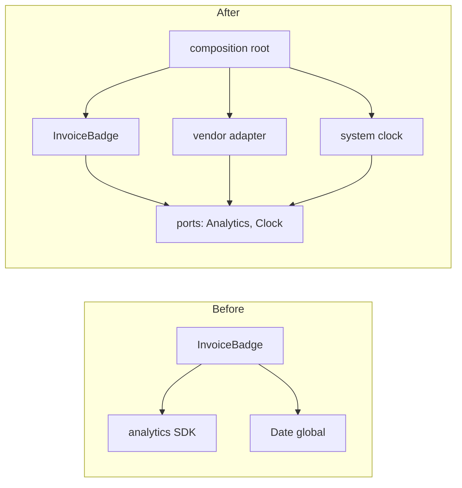
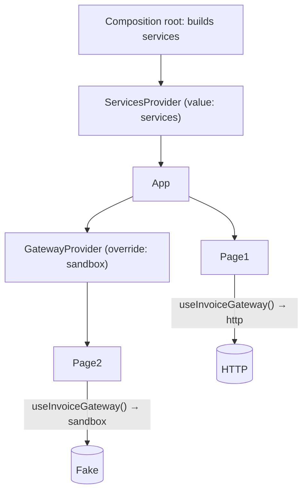
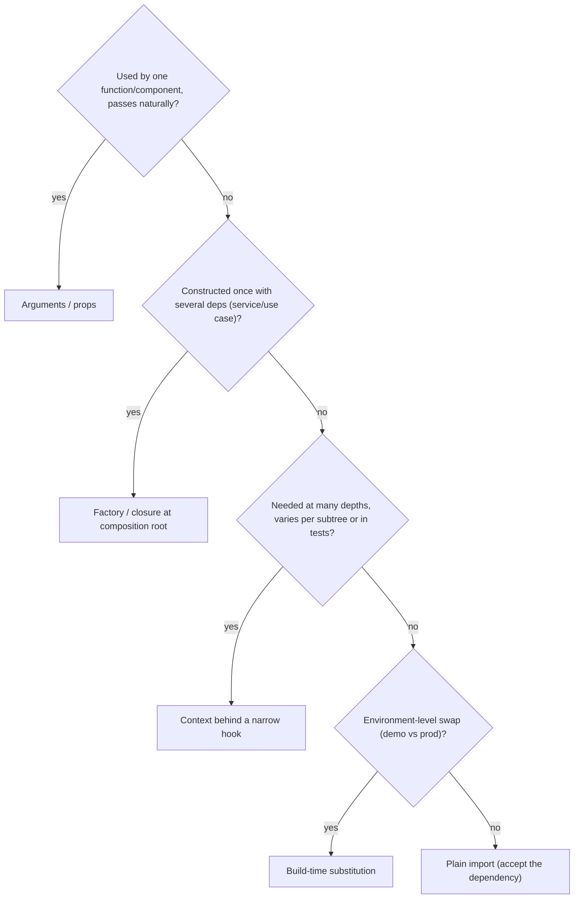

# 04 / 11 — Dependency Inversion in React: DIP, Injection, Inversion of Control, and Their Real Mechanisms

## 1. Lesson metadata

| | |
|---|---|
| **Level** | Advanced |
| **Study time** | 4–5 hours (reading 2 h, lab 1.5 h, exercises 1.5 h) |
| **Prerequisites** | [05 — Composition and dependency direction](./05-composition-and-dependency-direction.md), [10 — Clean and hexagonal architecture](./10-clean-and-hexagonal-architecture.md), Phase 3 context material ([Phase 3 index](../03-react-state-and-hooks/01-usestate-internals-and-update-semantics.md)) |
| **Next** | [12 — Domain logic vs UI logic](./12-domain-logic-vs-ui-logic.md) |
| **Related** | [13 — Application services and adapters](./13-application-services-and-adapters.md), [Phase 5 — Dependency injection](../05-design-patterns/16-dependency-injection.md), [Phase 5 — SOLID in React](../05-design-patterns/01-solid-in-react.md) |

**Learning objectives.** After this lesson you can:
1. Distinguish three often-conflated ideas: the **Dependency Inversion Principle (DIP)**, **Dependency Injection (DI)**, and **Inversion of Control (IoC)**.
2. Identify, in any React module, its dependencies, whether they are *volatile*, and who decides which implementation is used.
3. Apply six concrete DI mechanisms in React/TypeScript: arguments/props, closures/factories, React Context, module-level registries, hooks-as-seams, and bundler/environment substitution, and say when each is appropriate.
4. Explain why props are already dependency injection, and where Context becomes a hidden dependency.
5. Build a composition root and replace it in tests and Storybook.
6. Recognise over-abstraction and "interface for everything" failure modes, and migrate toward or away from inversion incrementally.

**Concepts covered:** DIP (Martin's two statements), abstraction ownership, volatile vs stable dependencies, DI by argument, closure/factory injection, Context injection, service locator, composition root, seams (Feathers), test doubles (fake/stub/mock/spy), module mocking vs injection, build-time substitution, circular provider ordering.

---

## 2. Deep conceptual explanation

### 2.1 What problem is this lesson solving?

Suppose a component needs the current time, a way to fetch data, and a way to log. The simplest code reaches for them directly:

```tsx
function InvoiceBadge({ invoice }: { invoice: Invoice }) {
  const overdue = new Date() > invoice.dueDate;       // hard-wired clock
  useEffect(() => { analytics.track("invoice_badge_viewed"); }, []);   // hard-wired global
  return <span>{overdue ? "Overdue" : "OK"}</span>;
}
```

Two hard-wired dependencies: `new Date()` and a global `analytics`. The consequences are mundane but costly:

- **Tests are non-deterministic** (`new Date()`) or need module mocking (`analytics`).
- **Reuse is limited**: you cannot render this in Storybook without the analytics bootstrap, or in a different app with a different analytics tool.
- **Change ripples**: swapping the analytics vendor edits every component.

Dependency inversion is the family of techniques that make *who supplies the dependency* a decision made elsewhere, rather than hard-coded in the consumer.

### 2.2 Three distinct ideas

| Term | What it is | Level | Typical statement |
|---|---|---|---|
| **Dependency Inversion Principle (DIP)** | A *design principle* about the direction of **source-code dependencies** | Design | "High-level modules should not depend on low-level modules. Both should depend on abstractions. Abstractions should not depend on details; details should depend on abstractions." (Robert C. Martin) |
| **Dependency Injection (DI)** | A *technique*: a component receives its dependencies from outside instead of constructing/locating them | Implementation | "Pass it in." |
| **Inversion of Control (IoC)** | A *style* in which a framework/caller controls the flow and calls your code (the "Hollywood principle") | Architecture | "Don't call us, we'll call you." React is IoC: you write components; React decides when to call them |

They are related but independent. You can use DI without inverting source dependencies (inject a concrete `AxiosClient` class: the consumer still imports the class type). You can satisfy DIP without a DI framework (the abstraction lives in the consumer's module; an adapter implements it).

### 2.3 The Dependency Inversion Principle, carefully

DIP has two statements:

1. High-level modules should not depend on low-level modules. Both should depend on abstractions.
2. Abstractions should not depend on details. Details should depend on abstractions.

The subtle, usually-missed point is **who owns the abstraction**. Martin's point (also made by Cockburn's ports): the interface belongs to the **client (high-level) side** and is shaped by *its* needs. If the interface is shaped by the implementation (e.g. `AxiosLike`, `RestClient.get(url, config)`), the high-level module still depends on the low-level details; you have only added a layer of syntax.

| Example | Owned by | Verdict |
|---|---|---|
| `interface InvoiceRepo { byId(id: InvoiceId): Promise<Invoice>; }` defined in `invoicing/core` | Consumer | Inverted |
| `interface HttpClient { get<T>(url: string, config?: AxiosRequestConfig): Promise<AxiosResponse<T>> }` | Library | Not inverted (names the library's types) |
| `type Fetcher = (input: RequestInfo, init?: RequestInit) => Promise<Response>` | Web platform (stable) | Acceptable: depends on a stable standard abstraction |

### 2.4 Volatile vs stable dependencies

Not every dependency deserves an abstraction. A pragmatic filter (Martin's own distinction between stable and volatile):

| Dependency | Volatility | Invert? |
|---|---|---|
| `Math`, `Array`, `Intl` | Stable standard library | No |
| React itself | Stable-ish, central | No (the cost is the whole app) |
| `fetch` / HTTP transport | Stable API, volatile *endpoints/contracts* | Invert at the *contract* level (gateway), not `fetch` itself |
| Current time, random ids | Non-deterministic | **Yes** (Clock/IdGenerator) |
| Analytics, feature flags, logging | Vendor-volatile, cross-cutting | **Yes** (small interface) |
| Storage (`localStorage`, IndexedDB) | Environment-volatile (SSR, private mode, native) | Usually yes |
| Router | Library-volatile, but deeply embedded | Often accept; isolate navigation via a `navigate` callback in domain-heavy flows |
| UI kit | Replaceable by design system | Via design-system boundary ([20](./20-design-systems.md)) |

The test: *would a change in this dependency force edits in many unrelated places, or make code non-testable?* If yes, invert it. If no, a direct import is simpler and clearer.

### 2.5 React already has IoC and DI built in

Two key facts, often missed:

1. **Props are dependency injection.** A component receiving `onSubmit`, `formatter`, `renderRow` or `children` is being injected with behaviour. The parent decides; the child depends on a function *type* only. Everything in [05 — Composition and dependency direction](./05-composition-and-dependency-direction.md) is DIP applied to UI.
2. **React is an IoC container for rendering.** You never call your components; React does. Hooks such as `useContext` are the framework resolving dependencies by position in the tree.

The mechanisms below differ in **explicitness** (visible in the function signature or hidden) and **scope** (one call, one subtree, the whole process).

### 2.6 Six DI mechanisms in React

| # | Mechanism | Scope | Explicit? | Typical use |
|---|---|---|---|---|
| 1 | **Arguments / props** | One call / one component | Fully explicit | Rendering strategies, callbacks, data adapters passed to pure functions |
| 2 | **Closure / factory (`makeX(deps)`)** | One constructed object | Explicit at construction | Use cases, services, API clients ([13](./13-application-services-and-adapters.md)) |
| 3 | **React Context** | Subtree | Implicit at the call site, explicit at provider | Theme, i18n, "services" provider, feature-flag client, test overrides |
| 4 | **Module-level registry / singleton** | Process | Implicit; global | Analytics, logger, config; simplest, hardest to test |
| 5 | **Hook as seam** (`useClock()`, `useAnalytics()`) | Per call, backed by 3 or 4 | Medium: call site shows the dependency name | Encapsulate how a dependency is obtained, so components don't know whether it's Context or global |
| 6 | **Build/environment substitution** (bundler aliases, `import.meta.env`, conditional exports, test config) | Build | Hidden in config | Different implementations per platform/environment (web vs native, mock API in dev) |

Not on the list: DI containers (`inversify`, `tsyringe`, decorators). They exist in TypeScript; they are rarely needed in React because Context + factories cover the needs, and decorators/reflect-metadata add build and bundle cost. ⚠ If you evaluate one, verify current maintenance and bundle impact.

### 2.7 Common misconceptions

| Misconception | Reality |
|---|---|
| "DIP = DI = IoC." | Three distinct concepts (§2.2). |
| "DIP means every import needs an interface." | Only volatile or non-deterministic dependencies, at boundaries where the inversion pays. |
| "Context is dependency injection and therefore always good." | Context is *implicit* DI: callers don't show the dependency in their props. It can hide coupling and cause broad re-renders when values change ([Phase 7 context propagation cost](../07-performance/06-context-propagation-cost.md)). |
| "A hook is a pure abstraction over its implementation." | A hook that internally imports `axios` is just a wrapper; the importing module depends on the hook, which depends on the detail. Fine if the hook is the adapter, bad if it's in the core. |
| "I can just `vi.mock` the module; why inject?" | Module mocking works but couples tests to import paths and the module system, is global state, and is brittle under refactors. Injection is a plain function call. (Both are legitimate; see §7.) |
| "DI containers are required for SOLID." | They are optional machinery. |

---

## 3. Internal mechanics

### 3.1 Public guarantee / teaching model / implementation detail

- **Public guarantee:** React guarantees that a context value read through `useContext`/`use` is the nearest provider's `value` (or the default), and that consumers re-render when the provider's value changes by `Object.is` comparison. That is documented behaviour. ⚠ Details of how bailouts interact with context are version-sensitive; see [Phase 2 context material](../02-react-rendering-and-internals/) and verify against current docs.
- **Teaching model:** the six mechanisms table, the volatility filter, and the composition-root pattern.
- **Implementation detail:** the internal representation of context propagation, which we deliberately don't depend on.

### 3.2 What changes at compile time vs run time

Compile time (TypeScript): a consumer declares `type Deps = { clock: Clock; analytics: Analytics }`. The compiler checks that any caller provides objects *structurally* satisfying those types. TypeScript's structural typing means an adapter doesn't need `implements`; it needs the right shape. That makes ports lightweight in TS compared with nominal languages.

Run time: the composition root constructs concrete objects and passes them down (arguments, factory calls, provider values). The consumer module's import graph contains **only the interface module** (`import type`), so a bundler need not include the adapter in tests that provide fakes, and a test can ship without importing the vendor SDK.

### 3.3 Context as a service locator

Reading `useContext(Services)` inside a deep component is, structurally, a **service locator**: the component asks a registry for what it needs. Fowler's classic comparison: service locators hide dependencies (you can't see them from the signature) while DI makes them explicit. In React, the locator is scoped and replaceable per subtree, which mitigates the main downside (global state), but the hidden-dependency cost remains. Mitigation: wrap in a **named hook** that throws if the provider is missing and whose return type is narrow (`useClock(): Clock`, not `useServices(): Everything`).

### 3.4 Timing: when are dependencies resolved?

| Mechanism | Resolved at |
|---|---|
| Props | Each render, by the parent |
| Factory | Construction time (once, typically at app start or in `useMemo`/state initialiser) |
| Context | Each render of the consumer (value read) |
| Module singleton | Import time (once) |
| Build substitution | Build time |

Consequence: if a factory's output is created *inside render* without memoisation, every render creates new use-case functions and new references, which can retrigger effects whose dependency arrays include them ([Phase 7 referential equality](../07-performance/05-referential-equality.md)). Construct in the composition root, or hold in `useState(() => create(...))`/`useMemo` with stable inputs.

---

## 4. Step-by-step walkthrough: inverting the clock and analytics in `InvoiceBadge`

Start from the hard-wired component of §2.1.

1. **List dependencies.** `Date` (non-deterministic), `analytics` (vendor global), `invoice` (data, already injected).
2. **Classify.** `Date` → invert (Clock). `analytics` → invert (Analytics, cross-cutting). `invoice` → fine.
3. **Define abstractions on the consumer side**, minimal:
   - `Clock = { now(): Date }`
   - `Analytics = { track(event: "invoice_badge_viewed", props?: Record<string, string | number>): void }`
4. **Choose injection mechanisms.** Clock affects a *pure rule*: pass via argument to the rule function. Analytics is cross-cutting and appears in many components: provide via Context behind a hook.
5. **Extract the rule:** `isOverdue(invoice, now)`. The component supplies `now` from a `useClock()` hook.
6. **Write the composition root**: instantiate `systemClock`, `segmentAnalytics` (or whichever vendor) once, provide at app root.
7. **Test double substitution.** In tests, render with a provider giving `fixedClock` and a spy analytics. In Storybook decorators, `noopAnalytics`.
8. **Verify.** Test: with `now = due date + 1 day`, badge says "Overdue", and `track` was called once with the right event (in StrictMode development, effects run twice on mount — a spy might see two calls; account for it in tests, see [Phase 2 StrictMode](../02-react-rendering-and-internals/) and verify against current docs).

---

## 5. Code examples

### 5.1 Minimal example — DI by argument

```ts
// invoice-rules.ts (pure; no React)
export interface Invoice { readonly id: string; readonly dueDate: Date; readonly paid: boolean }

export function isOverdue(invoice: Invoice, now: Date): boolean {
  return !invoice.paid && now.getTime() > invoice.dueDate.getTime();
}
```

```ts
// invoice-rules.test.ts
import { expect, it } from "vitest";
import { isOverdue } from "./invoice-rules";

it("is overdue after the due date", () => {
  const inv = { id: "i1", dueDate: new Date("2025-03-01T00:00:00Z"), paid: false };
  expect(isOverdue(inv, new Date("2025-03-02T00:00:00Z"))).toBe(true);
  expect(isOverdue(inv, new Date("2025-02-28T00:00:00Z"))).toBe(false);
});
```

No framework, no mocking: the dependency is "just a parameter". **Predict:** what happens if `paid` is true and `now` is far past? `false`, because `!invoice.paid` short-circuits.

### 5.2 Practical example — closure/factory + Context + hooks as seams

```ts
// services/ports.ts   (consumer-owned abstractions)
export interface Clock { now(): Date }
export interface Analytics {
  track(event: string, props?: Record<string, string | number | boolean>): void;
}
export interface Services { clock: Clock; analytics: Analytics }
```

```tsx
// services/ServicesContext.tsx
import { createContext, use, type ReactNode } from "react";
import type { Analytics, Clock, Services } from "./ports";

const ServicesContext = createContext<Services | null>(null);

export function ServicesProvider({ value, children }: { value: Services; children: ReactNode }) {
  return <ServicesContext value={value}>{children}</ServicesContext>;   // React 19 style; older: <ServicesContext.Provider>
}

function useServices(): Services {
  const s = use(ServicesContext);
  if (!s) throw new Error("ServicesProvider is missing from the tree");
  return s;
}

// narrow hooks: components depend on exactly what they use
export const useClock = (): Clock => useServices().clock;
export const useAnalytics = (): Analytics => useServices().analytics;
```

```tsx
// InvoiceBadge.tsx
import { useEffect } from "react";
import { isOverdue, type Invoice } from "./invoice-rules";
import { useAnalytics, useClock } from "./services/ServicesContext";

export function InvoiceBadge({ invoice }: { invoice: Invoice }) {
  const clock = useClock();
  const analytics = useAnalytics();
  const overdue = isOverdue(invoice, clock.now());

  useEffect(() => {
    analytics.track("invoice_badge_viewed", { invoiceId: invoice.id, overdue });
  }, [analytics, invoice.id, overdue]);

  return <span data-state={overdue ? "overdue" : "ok"}>{overdue ? "Overdue" : "OK"}</span>;
}
```

Line notes:
- `clock.now()` runs *during render*. A render should be a pure function of props, state and context ([Phase 2 purity](../02-react-rendering-and-internals/)). Reading a *wall clock* is impure: the output changes without any input changing. For a coarse "overdue" badge this is accepted in practice, but be aware: the badge will not update when the date passes unless something re-renders it. For time-sensitive UI, expose a ticking `useNow(intervalMs)` hook built on `useSyncExternalStore` or state+interval, so time becomes a *reactive input* rather than a hidden read.
- The effect depends on `analytics`; as long as the provider's value is stable, that is fine. If the provider value object is re-created every render of the root, `analytics` identity might change (if `Services` is rebuilt with new members each time). Build services once.

```tsx
// app/main.tsx  — the composition root
import { createRoot } from "react-dom/client";
import { ServicesProvider } from "../services/ServicesContext";
import { App } from "./App";
import { createVendorAnalytics } from "../infrastructure/vendor-analytics";

const services = {
  clock: { now: () => new Date() },
  analytics: createVendorAnalytics({ writeKey: import.meta.env.VITE_ANALYTICS_KEY }),   // bundler-specific env access (Vite shown)
};

createRoot(document.getElementById("root")!).render(
  <ServicesProvider value={services}><App /></ServicesProvider>,
);
```

`services` is created at module scope (once), so the provider value has stable identity.

**Test with substitution:**

```tsx
// InvoiceBadge.test.tsx  (Vitest + React Testing Library)
import { render, screen } from "@testing-library/react";
import { expect, it, vi } from "vitest";
import { InvoiceBadge } from "./InvoiceBadge";
import { ServicesProvider } from "./services/ServicesContext";

it("shows Overdue and tracks once per distinct state", () => {
  const track = vi.fn();
  const services = { clock: { now: () => new Date("2025-03-10T00:00:00Z") }, analytics: { track } };
  render(
    <ServicesProvider value={services}>
      <InvoiceBadge invoice={{ id: "i1", dueDate: new Date("2025-03-01T00:00:00Z"), paid: false }} />
    </ServicesProvider>,
  );
  expect(screen.getByText("Overdue")).toBeInTheDocument();
  expect(track).toHaveBeenCalledWith("invoice_badge_viewed", { invoiceId: "i1", overdue: true });
});
```

(`render` here is not wrapped in `StrictMode` unless you opt in; if you do, expect `track` twice on mount in development behaviour; see [Phase 8 test strategy](../08-testing-and-quality/01-test-strategy-and-pyramid.md).) `toBeInTheDocument` requires `@testing-library/jest-dom` setup.

### 5.3 Incorrect example — Context as a god object, hidden coupling

```tsx
const AppContext = createContext<any>(null);

function InvoiceBadge({ invoice }: { invoice: Invoice }) {
  const app = useContext(AppContext);
  app.analytics.track("viewed");                       // side effect in render
  const overdue = app.utils.isOverdue(invoice, app.clock.now());
  return <span>{overdue ? app.i18n.t("overdue") : "OK"}</span>;
}
```

Problems:
1. `any` — no compile-time check of what is provided; a typo is a runtime error.
2. **God context**: any change to any member re-renders every consumer (⚠ context change triggers re-render of all consumers reading it regardless of which member they use; split contexts or use selectors, see [Phase 7](../07-performance/06-context-propagation-cost.md)).
3. Side effect (`track`) **in render**: runs on every render and twice in StrictMode development; should be in an effect or event handler.
4. Pure functions (`isOverdue`) injected through context although they are stable and testable by import. Over-injection.

### 5.4 Corrected implementation

See §5.2: narrow ports, a missing-provider error, pure rule imported directly (no injection needed for pure code), time and analytics injected, side effect inside `useEffect`.

### 5.5 Advanced example — a swappable data gateway with a test double and a per-subtree override

```ts
// invoicing/ports.ts
export interface InvoiceGateway {
  list(params: { status?: "open" | "paid" }, signal?: AbortSignal): Promise<readonly Invoice[]>;
}
```

```tsx
// invoicing/GatewayContext.tsx
const GatewayContext = createContext<InvoiceGateway | null>(null);
export const GatewayProvider = ({ gateway, children }: { gateway: InvoiceGateway; children: ReactNode }) =>
  <GatewayContext value={gateway}>{children}</GatewayContext>;
export function useInvoiceGateway(): InvoiceGateway {
  const g = use(GatewayContext);
  if (!g) throw new Error("GatewayProvider missing");
  return g;
}
```

```tsx
// invoicing/use-invoices.ts
export function useInvoices(status?: "open" | "paid") {
  const gateway = useInvoiceGateway();
  return useQuery({
    queryKey: ["invoices", { status }],
    queryFn: ({ signal }) => gateway.list({ status }, signal),
  });
}
```

Uses:
- **Production:** `GatewayProvider gateway={httpInvoiceGateway}` at the app root.
- **Storybook / demo mode:** `GatewayProvider gateway={inMemoryGateway}` around stories, no network.
- **Per-subtree override:** a "sandbox" admin area uses `sandboxGateway` for the same components, an advantage of Context-based DI over module singletons.
- **Query key note:** the key `["invoices", {status}]` does not include *which gateway* is in use. If two subtrees use different gateways with a shared `QueryClient`, they will share cache entries. Include a gateway identity (e.g. an `id` string) in the key, or give each subtree its own `QueryClient`. This is a genuine DI-meets-cache pitfall.

TanStack Query v5 object-style signatures shown; verify against current docs.

### 5.6 Another mechanism — build-time substitution

```ts
// vite.config.ts (sketch; verify option names for your Vite version)
import { defineConfig } from "vite";
export default defineConfig(({ mode }) => ({
  resolve: {
    alias: mode === "demo"
      ? { "@/infrastructure/gateway": "/src/infrastructure/gateway.memory.ts" }
      : {},
  },
}));
```

Advantages: zero runtime overhead; the unused adapter is tree-shaken. Disadvantages: the swap is invisible in code, hard to override per test or per subtree, and complicates type-checking (both files must satisfy the same type). Best for coarse, environment-level choices (demo build, native vs web).

---

## 6. Visual explanations

### 6.1 Direction of source dependencies before and after inversion



### 6.2 Context-based injection across the tree



### 6.3 Choosing a mechanism



---

## 7. Alternative approaches and trade-offs

### 7.1 Comparison: how to make a dependency substitutable

| Criterion | Props/args | Factory/closure | Context + hook | Module singleton + `vi.mock` | Build-time alias | DI container (decorators) |
|---|---|---|---|---|---|---|
| Visibility of dependency | **Explicit** | Explicit | Medium (hook name) | Hidden | Hidden (config) | Declared, magic resolution |
| Per-subtree override | By passing | n/a | **Yes** | No | No | Via child containers |
| Test setup effort | Lowest | Low | Medium (providers) | Medium; brittle paths | Config per test mode | High |
| Runtime overhead | None | None | Context propagation (consider re-render scope) | None | None | Reflection/metadata |
| SSR/RSC compatibility | Fine | Fine | ⚠ Context not available in Server Components (verify per current docs) | Module-level singletons are **shared across requests** on a server: risk of cross-request state leakage | Fine | Same singleton risk |
| Tree-shaking of unused adapters | Yes | Yes | Depends | Depends | **Yes** | Poor |
| Scales to hundreds of dependencies | Prop drilling hurts | Good | Provider pyramid | Good, with discipline | Coarse only | Designed for it |

### 7.2 Approach profile: Dependency inversion/injection in React

**Original problem it solved.** Modules hard-wired to concrete low-level details (databases, file systems, vendors) were rigid (changes ripple), fragile (unrelated tests break), and immobile (cannot be reused elsewhere). Martin framed DIP in the 1990s to reverse the dependency so that policy does not depend on detail.

**Representative folder structure.**

```text
src/
  services/
    ports.ts                    # consumer-owned interfaces: Clock, Analytics, Storage, Logger
    ServicesContext.tsx         # provider + narrow hooks
  infrastructure/
    system-clock.ts
    vendor-analytics.ts         # adapter (imports vendor SDK)
    local-storage.ts
    in-memory/                  # fakes for tests/demo
  features/
    invoices/
      ports.ts                  # InvoiceGateway (feature-owned)
      use-invoices.ts
  app/
    composition-root.ts         # constructs & wires everything
    main.tsx
```

**Dependency rules.**
1. Ports live with the **consumer** (feature) or in a small shared `services/ports` for truly cross-cutting ones.
2. Consumers import ports (`import type`), never adapters.
3. Adapters import ports and vendor SDKs; they never import UI.
4. Only the composition root imports adapters *and* consumers.
5. Context hooks are narrow (one port per hook); no `useEverything()`.
6. No dependency on a port exists unless the dependency is volatile, non-deterministic, or cross-cutting.

**Example code.** §5.1–5.6.

**Advantages.**
- Deterministic tests with trivial doubles; fewer module mocks.
- Vendor and transport swaps localised to adapters.
- Reuse across environments (app, Storybook, demo, native).
- Clear seams for cross-cutting concerns (logging, analytics, flags).
- Makes hidden coupling visible during design discussions ("what does this component need from the world?").

**Disadvantages.**
- More files and indirection; harder navigation ("go to definition" lands on an interface).
- Context-based DI hides dependencies and can widen re-render scope.
- Provider-ordering pyramids; the app root becomes a wall of providers.
- Wrongly-owned interfaces give the *appearance* of inversion without the benefit.
- Test doubles can drift from reality (fake passes, real fails) → need contract tests ([10 §10](./10-clean-and-hexagonal-architecture.md)).
- Server rendering hazards with module singletons or request-scoped dependencies (⚠ framework-specific).

**Appropriate project/org sizes.**

| Size | Recommendation |
|---|---|
| Small app, 1–3 devs | Props + a few narrow Context hooks (clock, analytics, flags) at most. Use MSW for network boundary. No factories unless services exist. |
| Medium, one team | Factories for application services; Context for cross-cutting services; composition root file; contract tests for key adapters. |
| Large / multi-team | Composition root per app and per micro-frontend/shell boundary; explicit ports as the package API between contexts ([08](./08-domain-driven-frontend.md), [22](./22-monorepos-and-shared-packages.md)); lint to prevent adapter imports in consumers. |
| Libraries (design systems, SDKs) | Expose seams (render props, slots, provider props); never hard-wire global singletons. Libraries benefit most from inversion since you do not control the host. |

**Failure modes.**
1. **Interface-for-everything**: abstractions around `Math.max` or React hooks.
2. **God context** (`AppContext` with everything; any change re-renders all).
3. **Service locator abuse**: components pull arbitrary services; no one can tell what a component needs.
4. **Wrong ownership**: ports shaped by the vendor SDK.
5. **Provider hell**: 14 nested providers; ordering bugs (provider B needs A, mounted above it).
6. **Singleton state in SSR**: request data leaks across users because a module-level service holds per-user state (a security-relevant failure; ⚠ verify per framework).
7. **Unstable provider value**: value object re-created each render → every consumer re-renders and effects re-run.
8. **Fake/real drift**: in-memory adapter behaves differently from the HTTP one.
9. **Over-mocking**: tests assert interactions with fakes rather than outcomes.

**Migration considerations.**
- *Towards inversion* (incrementally): (1) pick the worst offender (non-deterministic or vendor-coupled); (2) define a minimal consumer-owned interface; (3) introduce the adapter and move the vendor import there; (4) inject with the lightest mechanism (argument or narrow hook); (5) replace `vi.mock` of that module in tests; (6) delete the global; (7) add lint for direct vendor imports outside adapters ([25](./25-architectural-fitness-and-enforcement.md)).
- *Away from inversion* (retreat): inline an interface with a single implementation and no test double; replace a provider with a direct import for constants; keep the seam only where a test or second environment needs it.
- *Between mechanisms:* module singleton → Context: wrap the singleton in a provider whose default value is the singleton, so consumers don't change; then migrate tests to supply overrides.
- *Beware renaming churn:* keep the old hook as a deprecated alias.

### 7.3 Scenarios where inversion is NOT the best approach

- **The dependency is the point.** A component wrapping a specific charting library (`<RevenueChart>` that *is* a Recharts configuration) gains nothing from a `ChartPort`; the library API will leak anyway and the abstraction becomes a poor clone.
- **Tiny apps / prototypes**: direct imports with MSW for tests are cheaper and sufficient.
- **Server Components or loaders**: the framework already provides request-scoped dependency passing (⚠ verify framework APIs); layering your own Context-based DI there may not even work (context is a client concept).
- **Hot paths**: injecting a function that is called 10,000 times per frame through Context lookups is rarely your bottleneck, but injecting *objects with new identities* into memoised lists can be. Measure first ([Phase 7](../07-performance/01-measure-before-optimizing.md)).

---

## 8. Best practices and anti-patterns

### 8.1 Best practices

1. **Invert the volatile, non-deterministic and cross-cutting; import the rest.**
2. **Own the interface on the consumer side**, minimal, in the domain's words.
3. **Keep pure logic pure and import it directly**; only inject effects and world-access.
4. **Narrow hooks over god contexts**: `useClock()` rather than `useApp().clock`.
5. **Throw a descriptive error for a missing provider** (or provide a safe default for optional services like analytics).
6. **Stable provider values**: construct at module scope or memoise ([Phase 7](../07-performance/05-referential-equality.md)).
7. **One composition root per application boundary.** Everything is wired there; no `new Adapter()` in components.
8. **Pass `AbortSignal` through async ports.**
9. **Contract-test adapters and fakes** with the same suite.
10. **Make time reactive** if the UI must change as time passes (`useNow`).
11. **Document the seam list** (which dependencies are injectable) in the repo; it is part of the architecture.

### 8.2 Beginner mistakes

- Creating an interface and a single implementation for every module.
- Calling `new Date()`/`Math.random()` inside render, then being surprised by flaky tests and hydration mismatches ([Phase 9 hydration](../09-advanced-rendering-and-ecosystem/02-hydration-internals-deep-dive.md)).
- Using Context for state that changes every keystroke.

### 8.3 Experienced-developer mistakes

- Reaching for a DI container to solve provider ordering.
- Hiding all side effects behind injected interfaces and then mocking interactions in every test (testing the mock, not behaviour).
- Putting React state in the provider's `value` along with services, so service consumers re-render on state change; separate *stable services* from *changing state* in different contexts.
- Treating DIP as moral rather than economic: inverting a dependency that will never change, never be tested differently and never vary by environment.

### 8.4 Smells

| Smell | Meaning |
|---|---|
| `useContext(AppContext)` returning `any` | Untyped service locator |
| Port with methods named after a vendor endpoint | Wrong ownership |
| Provider tree > 8 levels at root with order dependencies | Needs a composition helper or merging |
| `jest.mock("axios")` in 80% of tests | The boundary for tests is not where the code's boundary is; introduce a gateway or use MSW |
| `if (process.env.NODE_ENV === "test")` in production code | Missing seam; production code knows about test |

### 8.5 Justified exceptions

- Module-level singletons for truly process-wide, request-independent infrastructure in client-only code (logger) are fine if tests can reset them.
- Direct `fetch` in a component of a throwaway internal tool.
- A global feature-flag SDK client where the vendor's own React integration already provides a provider (use it rather than wrapping).

---

## 9. Real-world application

| Domain | Typical injected dependencies | Constraints |
|---|---|---|
| **E-commerce** | `PaymentProvider` (PSP per region), `Clock` (promo windows), `Analytics`, `FeatureFlags` | Promo-window logic needs a deterministic clock for QA; PSP SDKs are lazy-loaded adapters |
| **Dashboards** | `MetricsGateway`, `Clock` (relative ranges), `UserPreferencesStore` | "Last 7 days" depends on now → inject; timezones |
| **Finance / fleet payments** | `Clock`, `AuditLog`, `FeatureFlags`, `RiskScoringGateway` | Audit requirements: the logger must not be silently swapped for no-op in production; enforce at composition root |
| **Forms** | `Validator` strategies, `Storage` for draft persistence, `IdGenerator` | Draft persistence differs web/native |
| **Auth** | `SessionStore`, `TokenRefresher` | Security-critical: do not scatter token access; one adapter |
| **Realtime** | `SocketFactory`, `Clock`, `Scheduler` | Replay/fake sockets for deterministic tests; reconnect timers injectable (fake timers or injected scheduler) |
| **Multi-team** | Ports as inter-team contracts; shell provides services to micro-frontends | Version the ports; deprecate slowly ([Phase 10 backward compatibility](../10-production-engineering/12-backward-compatibility.md)) |
| **Design-system libraries** | Slots, render props, `LinkComponent` injection (so the library works with any router) | Don't import the app's router in the library |

---

## 10. Debugging and troubleshooting

| Symptom | Likely root cause | Investigation | Fix / validation |
|---|---|---|---|
| `ServicesProvider is missing` error in one test | Component tree rendered without wrapper | Stack trace → hook; check test render helper | Add a `renderWithServices` test utility; validate that all tests use it |
| Every consumer re-renders when unrelated state changes | Provider `value` object recreated each render | React DevTools Profiler: "why did this render?" (context changed); highlight updates | Hoist/memoise value; split volatile and stable contexts |
| Effect with `[analytics]` dependency fires on every render | Unstable `analytics` identity (new object per render) | Log identity; DevTools hook values | Construct once; or exclude with documented rationale (⚠ do not silence exhaustive-deps lint casually) |
| Query results from "sandbox" subtree show production data | Shared `QueryClient` + keys that omit gateway identity | Inspect Query Devtools cache keys | Include a gateway identity in keys, or isolate `QueryClient` |
| Server-rendered page shows another user's data | Module singleton holding request-scoped data | Reproduce with two parallel requests; grep for module-level mutable state | Move to request-scoped context/args; ⚠ check framework request-context APIs |
| Hydration mismatch warning on a time-based badge | `new Date()`/`Date.now()` differ server vs client | Console hydration warning diff | Inject time that is consistent (pass from server), or render time-dependent content after mount ([Phase 9](../09-advanced-rendering-and-ecosystem/02-hydration-internals-deep-dive.md)) |
| Test passes with the fake but fails against staging | Fake/real drift | Run contract suite against both | Fix fake; add contract coverage |
| Circular dependency at app start | Composition root imported by consumers ("just to grab the service") | Dependency graph; trace import | Consumers never import the root; they use hooks/args |

---

## 11. Exercises

### Level A — Knowledge
A1. Define DIP, DI and IoC and give one sentence on how each relates to React.
A2. Who should own the interface in DIP, and what goes wrong if the implementation owns it?
A3. List the six DI mechanisms from §2.6 in order of increasing scope.
A4. Why is reading `new Date()` during render problematic for purity and testing?
A5. Name two dependencies you would *not* invert and explain why.

### Level B — Code comprehension
B1. In §5.2, `useClock` and `useAnalytics` both call `useServices`. What are the benefits of narrow hooks compared with exposing `useServices` directly?
B2. What goes wrong if `main.tsx` constructs `services` *inside* a component body that re-renders?
B3. In §5.5, two subtrees use different gateways and share one `QueryClient`. Predict the bug and the symptom.

### Level C — Implementation
C1. Write `useNow(intervalMs: number, clock: Clock): Date` that re-renders on an interval, using state and an effect with correct cleanup. State what you'd change to make it SSR-safe.
C2. Write a `renderWithServices(ui, overrides?)` test helper with sensible default fakes (fixed clock, spy analytics) and typed overrides via `Partial<Services>`.
C3. Convert this code to inject its storage dependency through a factory, and write one test:
```ts
export function loadDraft(): Draft | null {
  const raw = localStorage.getItem("draft");
  return raw ? (JSON.parse(raw) as Draft) : null;
}
```

### Level D — Debugging
D1. A page re-renders 30 times per second after adding a `MetricsProvider` with `value={{ track, flush }}` where both are module-level functions. The provider sits in a component that re-renders on a timer. Diagnose and fix.
D2. After introducing a `Logger` singleton, a Node-based SSR deployment occasionally logs one user's email under another request's correlation id. Diagnose.

### Level E — Architecture decisions
E1. A team wants to introduce `inversify` with decorators to "do DI properly". Evaluate against Context+factories for a 12-developer SPA.
E2. Design the DI approach for a shared component library used by 4 apps with different routers, analytics vendors, and i18n libraries.
E3. When should a dependency be injected via Context vs via a factory at the composition root? Give decision criteria and two examples each.

### Level F — Expert challenge
F1. You have a monorepo where `core` must not import adapters, yet adapters must be constructed with config at app startup in two apps (web and native). Design the composition roots, the config flow, and the lint rules. Address lazy-loading adapters for performance.
F2. Critically evaluate the statement: "With TypeScript's structural typing, ports are free." Include the costs that remain.

---

## 12. Detailed answers and explanations

> Attempt the exercises first.

**A1.** DIP: a design principle that high-level policy and low-level detail both depend on abstractions owned by the policy. DI: passing dependencies in rather than constructing/locating them; in React, props and context. IoC: the framework calls your code; React calls your components and manages hooks. Wrong answer: "DI is the same as DIP" — you can inject a concrete type (DI, not DIP).

**A2.** The high-level/consumer module should own it, shaped by its needs. If the implementation owns it, the consumer depends on vendor-shaped types (e.g. `AxiosResponse`), so the "abstraction" just re-exports the detail and changes in the vendor still ripple.

**A3.** Arguments/props (call) → factory/closure (object) → Context (subtree) → module singleton (process) → build-time substitution (build). (Hooks-as-seams sit on top of Context/singleton; ordering of "singleton vs build" can be argued; the key is understanding scope.)

**A4.** Render should be a pure function of inputs ([Phase 2](../02-react-rendering-and-internals/)); time is a hidden input. Consequences: flaky tests, SSR hydration mismatches, and no re-render when time passes. Solution: inject `now` as an argument or reactive hook.

**A5.** E.g. `Array.prototype.map` (stable standard library), React itself (replacing it means a rewrite regardless), `Intl` (stable). Reason: inverting a stable, ubiquitous dependency adds cost with no change/test benefit.

**B1.** Narrow hooks make each component's dependency explicit and minimal (a component using `useClock` declares it needs only a clock), simplify test doubles (provide only what's used if designed with separate contexts), prevent growth into a god context, and allow swapping internals (Context → singleton) without changing call sites. With `useServices`, anything can be pulled in anywhere. Note: with one shared `Services` context object, all consumers still re-render if the object identity changes; separate contexts per service if that matters.

**B2.** A new object per render → `ServicesContext value` changes identity every time the parent re-renders → all consumers re-render; adapters created anew (new analytics SDK clients, new listeners) → duplicated events/connections and effect re-runs (`[analytics]`). Construct once at module scope or `useState(() => create())`/`useMemo`.

**B3.** Cache poisoning across gateways: both subtrees use key `["invoices", {status}]`, so the second subtree can see the first's data (or whichever was fetched first), showing production data in the sandbox or vice versa. Symptom: sandbox shows real invoices; or flicker as two fetchers compete. Fix: include a gateway id in the key or use separate clients.

**C1. Reference solution**
```ts
export function useNow(intervalMs: number, clock: Clock): Date {
  const [now, setNow] = useState(() => clock.now());
  useEffect(() => {
    const id = setInterval(() => setNow(clock.now()), intervalMs);
    return () => clearInterval(id);
  }, [intervalMs, clock]);
  return now;
}
```
SSR notes: the initial state calls `clock.now()` on both server and client, producing different values → hydration mismatch for rendered output depending on time. Options: server passes its timestamp as a prop so both render the same initial value; or render time-dependent text only after mount (`useEffect` flag); or use `useSyncExternalStore` with a `getServerSnapshot` returning the server-provided time (⚠ verify). Evaluation: cleanup, dependency array correctness, injected clock, SSR awareness.

**C2. Reference solution**
```tsx
export function renderWithServices(ui: ReactElement, overrides: Partial<Services> = {}) {
  const track = vi.fn();
  const services: Services = {
    clock: { now: () => new Date("2025-01-01T00:00:00Z") },
    analytics: { track },
    ...overrides,
  };
  return { track, ...render(<ServicesProvider value={services}>{ui}</ServicesProvider>) };
}
```
Edge: if `overrides.analytics` is provided, the returned `track` isn't wired; return `services` as well, or return the effective analytics. Note spread semantics.

**C3. Reference solution**
```ts
export interface KeyValueStore { getItem(k: string): string | null }
export function makeLoadDraft(store: KeyValueStore) {
  return function loadDraft(): Draft | null {
    const raw = store.getItem("draft");
    if (!raw) return null;
    try { return JSON.parse(raw) as Draft; } catch { return null; }   // corrupt data policy: documented decision
  };
}
// test
it("returns null for corrupt data", () => {
  const load = makeLoadDraft({ getItem: () => "{oops" });
  expect(load()).toBeNull();
});
```
Notice `localStorage` satisfies `KeyValueStore` structurally; no adapter class is needed. Also `JSON.parse(...) as Draft` is unvalidated; see [14](./14-api-boundaries-and-data-access.md).

**D1.** The provider's `value` is an object literal created each render, so each timer-driven re-render of the provider's host component produces a new object and re-renders all consumers. Fix: hoist `const metrics = { track, flush }` to module scope (since members are module-level), or `useMemo`; also move the timer state down so the provider's host doesn't re-render. Validate with Profiler (renders per second).

**D2.** A module-level singleton `Logger` stores a per-request context (correlation id/user) in a shared variable; concurrent requests on one Node process interleave. Fix: request-scoped logger created per request and passed through (arguments, request context such as AsyncLocalStorage on the server; ⚠ framework-specific); never keep per-request mutable state in module scope. This is a privacy incident class, not just a bug.

**E1. Evaluation criteria + example.** Criteria: cost (decorators need `experimentalDecorators`/metadata or a newer decorator setup; ⚠ verify TS/decorator status), bundle size, learning curve, SSR/RSC compatibility, tree-shaking, hiring/ramp-up, whether the app has hundreds of services (unlikely). Example: "No container. A 12-dev SPA has dozens, not hundreds, of dependencies; factories plus a single composition root plus a few narrow contexts give explicit wiring, lint-enforceable boundaries and smaller bundles. Revisit if we exceed ~X services or need request-scoped lifetimes on the server." Penalise dogmatic answers either way.

**E2.** Expect: slots/render props for UI parts; `LinkComponent`/`navigate` injection (or `asChild`/polymorphic pattern; [Phase 5](../05-design-patterns/19-polymorphic-components.md)); a `LibraryProvider` with narrow config (`translate(key)`, `track(event)`) and sensible defaults so the library works without any provider; avoid peer-importing the app's router; semver the provider contract; document SSR behaviour. Mention that defaults prevent adoption friction; exposing too many seams increases API surface to maintain.

**E3.** Context: needed at many depths, varies by subtree or test, tied to React tree lifetime (theme, i18n, current gateway for sandbox). Factory at root: constructed once, used by non-React code too, many dependencies wired together (use cases). Examples Context: theme, feature-flag client; Factory: `raiseDispute` use case, API client with auth interceptors. Combined: factory builds services; Context delivers them to components.

**F1.** Example structure: `packages/core` (ports + use cases), `packages/adapters-http` (platform-neutral), `apps/web/composition.ts` and `apps/native/composition.ts` each importing platform adapters, reading config from their environment layers ([Phase 10 environment configuration](../10-production-engineering/03-environment-configuration.md), *planned*), constructing services, and passing to a shared `<AppShell services={…}/>` from `packages/ui`. Lint: `core` may not import `adapters-*`; apps may not be imported by packages; `no-restricted-imports` for vendor SDKs outside `adapters-*`. Lazy-loading: adapters with heavy SDKs created via dynamic `import()` behind the port (`getPayments(): Promise<PaymentProvider>`), so the port's async nature reflects loading; show trade-off of async ports. Evaluate: avoids cycles, platform divergences in ports, config validation at startup.

**F2.** *True:* structural typing means no `implements`/inheritance, object literals and plain functions satisfy ports, and `localStorage` satisfies a minimal `KeyValueStore`. *Costs remaining:* design cost of getting the interface right (ownership), accidental structural compatibility (two ports with the same shape are interchangeable; branded types if mix-ups matter), runtime drift (types don't check behaviour; need contract tests), indirection for readers, and the dependency's *semantics* (errors, cancellation, ordering) that types don't capture. Partial credit if only the typing aspect is discussed.

---

## 13. Senior engineer interview questions

**Q1. "What's the difference between DIP and DI?"**
DIP is about *which way source dependencies point* and who owns the abstraction. DI is a mechanism for supplying dependencies. You can inject a concrete class and still violate DIP, and you can satisfy DIP with a plain interface and a factory.

**Q2. "Are props dependency injection?"**
Yes — the parent decides what the child collaborates with, and the child depends on a type, not an implementation. Context is the same idea with implicit, subtree-scoped delivery.

**Q3. "When would you use Context for DI, and what are its costs?"**
When the dependency is needed at many depths and varies by subtree/test (theme, gateway, flags). Costs: hidden dependency at call sites, re-render propagation when the value changes, no use in Server Components (verify), and provider ordering. Mitigate: narrow hooks, stable values, separate stable services from changing state.

**Q4. "How do you test code that depends on time?"**
Inject the clock (argument/provider) or use fake timers for timers; keep rules pure with `now` parameter. Avoid reaching for global `Date` mocking in business logic tests when injection is possible; fake timers still help for debounced UI.

**Q5. "How do you decide what deserves an abstraction?"**
Volatility, non-determinism, cross-cutting use, and testing/environment needs — not purity. Counter-question: what edits would a vendor change force? If many unrelated files, invert.

**Q6. "What are the SSR dangers of DI via singletons?"**
Module scope is shared across requests; any per-request/user state held there leaks. Use request-scoped construction or framework request context; keep module singletons stateless.

**Q7. "`vi.mock` vs injection?"**
`vi.mock` is quick and fine for isolating a leaf module (e.g., a vendor SDK) in a few tests; injection gives explicit seams, avoids global patching, works in Storybook and demos, and survives refactors. I prefer injection at architectural boundaries and module mocks at the edges, but I don't treat module mocking as wrong.

**Q8. "Your provider tree is a 12-level pyramid. What now?"**
Group related providers into one composed `AppProviders` component, merge contexts that always change together, remove providers that hold constants (import them), and remove those serving a single page (move down). Also examine for ordering dependencies, which signal a missing composition root rather than a missing library.

---

## 14. Further learning resources

| Resource | URL | Covers / why | Level | Study |
|---|---|---|---|---|
| Robert C. Martin — "The Dependency Inversion Principle" (C++ Report, 1996) and *Agile Software Development: Principles, Patterns, and Practices* | No stable URL (book/article) | Original statement of DIP | Advanced | DIP chapter |
| Martin Fowler — Inversion of Control Containers and the Dependency Injection pattern | <https://martinfowler.com/articles/injection.html> | The classic comparison of DI vs service locator | Intermediate | Whole article |
| Martin Fowler — InversionOfControl | <https://martinfowler.com/bliki/InversionOfControl.html> | Framework-vs-library distinction | Beginner | Whole page |
| React docs — Passing Data Deeply with Context | <https://react.dev/learn/passing-data-deeply-with-context> | Official explanation of Context, defaults, use cases | Beginner–Int. | Whole page |
| React docs — `use` | <https://react.dev/reference/react/use> | Reading context (and promises) with `use` in React 19 | Intermediate | Reading context section |
| React docs — `createContext` | <https://react.dev/reference/react/createContext> | Context API incl. provider syntax in React 19 | Intermediate | Provider section |
| Michael Feathers — *Working Effectively with Legacy Code* | No URL (book) | "Seams" as the concept of substitution points | Advanced | Seams chapter |
| Mark Seemann — *Dependencies, Dependency Injection* (book, "Composition Root") | No URL (book) | The Composition Root pattern | Advanced | Composition Root chapter |
| MSW docs | <https://mswjs.io/docs/> | Alternative test boundary at network level | Intermediate | Getting started |

URLs in this table were checked for HTTP 200 on 2026-10-22; any still marked *(unverified)* could not be checked automatically (blocked or unreachable). A 200 response does not guarantee the page content still matches the description; if a link has moved, search the site for the quoted title.

---

## 15. Knowledge checkpoint

**You should now understand**
- DIP vs DI vs IoC and the importance of who owns the abstraction.
- Which dependencies deserve inversion and which do not.
- The six mechanisms and their scope, explicitness, and costs.
- The Context-as-service-locator trade-off and provider-value stability.

**You should be able to explain without notes**
- Why props are DI and why `new Date()` in render is a hidden dependency.
- Why module singletons are dangerous in server rendering.
- When *not* to invert.

**You should be able to implement**
- A composition root, narrow hooks over Context, a factory-based service, test helpers with fakes, a reactive `useNow`.

**You should be able to debug**
- Unstable provider values, cache-key collisions between gateways, fake/real drift, hydration mismatches from time, singleton state leaks.

**Before moving on:** read [12 — Domain logic vs UI logic](./12-domain-logic-vs-ui-logic.md) to decide what to put *behind* the seams we just built, and [13 — Application services and adapters](./13-application-services-and-adapters.md) for the orchestration layer that consumes them.
