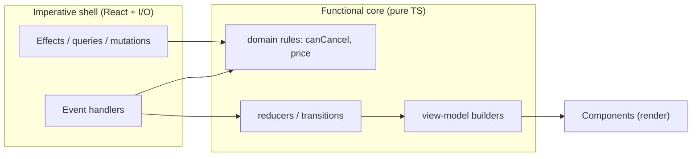
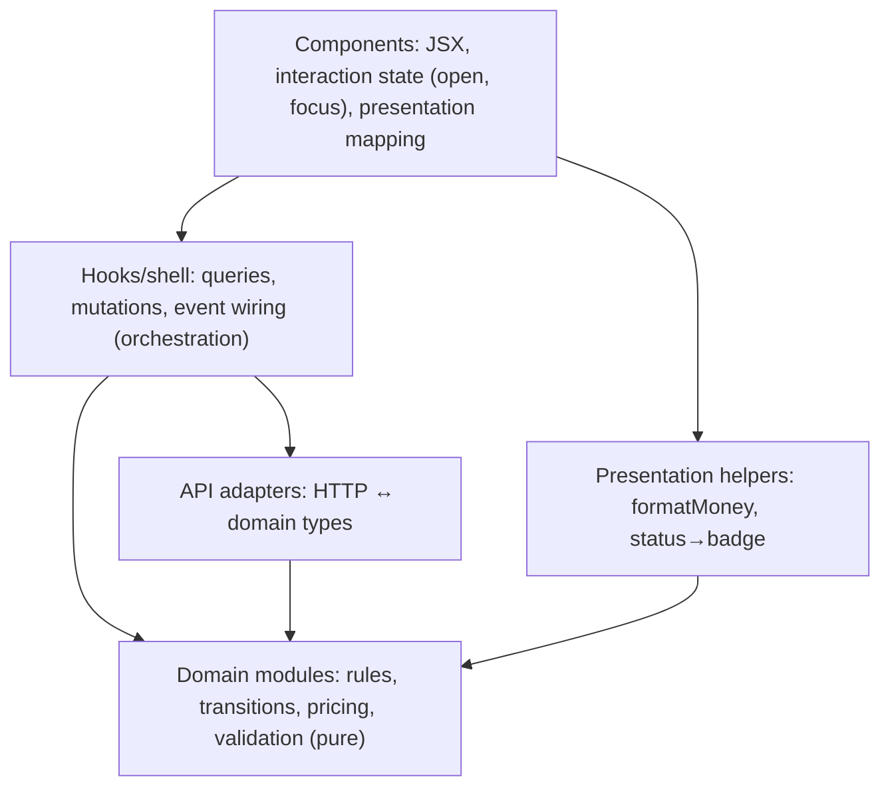
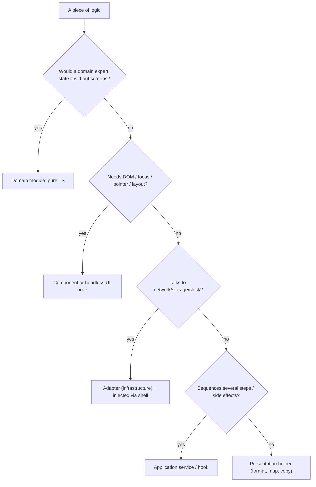

# 04 / 12 — Domain Logic vs UI Logic: Drawing the Line in a React Codebase

## 1. Lesson metadata

| | |
|---|---|
| **Level** | Intermediate–Advanced |
| **Study time** | 4 hours (reading 1.5 h, refactoring lab 1.5 h, exercises 1 h) |
| **Prerequisites** | [02 — Separation of concerns](./02-separation-of-concerns.md), [03 — Component responsibility](./03-component-responsibility.md), [08 — Domain-driven frontend](./08-domain-driven-frontend.md), [11 — Dependency inversion](./11-dependency-inversion.md) |
| **Next** | [13 — Application services and adapters](./13-application-services-and-adapters.md) |
| **Related** | [04 — Presentational vs container](./04-presentational-vs-container.md), [10 — Clean and hexagonal architecture](./10-clean-and-hexagonal-architecture.md), [Phase 5 — Custom hook patterns](../05-design-patterns/06-custom-hook-patterns.md), [Phase 5 — Reducer pattern](../05-design-patterns/12-reducer-pattern.md) |

**Learning objectives.** After this lesson you can:
1. Classify any piece of logic in a React app as **domain**, **application/orchestration**, **UI/presentation**, **interaction**, or **infrastructure**.
2. Apply concrete decision tests to decide where it belongs, including borderline cases (validation, formatting, derived data, permissions, feature flags).
3. Extract domain logic from components and hooks into pure, framework-free modules and test it without rendering.
4. Keep UI logic in the UI (and not over-extract it), and know what "headless" UI logic looks like.
5. Explain the "functional core, imperative shell" shape in React terms and its limits.
6. Identify failure modes: logic in JSX, logic in effects, duplicated rules, over-extracted trivia, and anemic domain modules.
7. Migrate an existing component incrementally with characterization tests.

**Concepts covered:** domain logic, application logic, presentation logic, interaction logic, derived state, validation tiers (syntactic/semantic/authoritative), pure functions, reducers, selectors, view models, headless hooks, functional core/imperative shell, anemic model, characterization tests.

---

## 2. Deep conceptual explanation

### 2.1 What problem is this lesson solving?

Open the largest component in a typical React project. You will often find in one 400-line function: a fetch, a loading flag, a rule about who may cancel an order, a currency conversion, a debounce, a modal open flag, a table sort, a validation rule that also exists on the server, and JSX. When the rule about who may cancel an order changes, a developer must read the whole file to find it; when a second screen needs the rule, someone copy-pastes it; when it is wrong, nobody can write a quick test for it without rendering a component tree and mocking a network.

The remedy is not "put everything in hooks" and not "no logic in components". It is to **identify what kind of logic you are looking at**, because different kinds have different homes, different volatility, and different test strategies.

### 2.2 A taxonomy of logic

| Kind | Question it answers | Examples | Changes when… | Natural home |
|---|---|---|---|---|
| **Domain logic** | "What is true / allowed in this business?" | Order cancellation eligibility; price calculation; dispute window; credit-limit check; tax; scheduling constraints | The business changes its rules | Pure functions/modules, no React ([08](./08-domain-driven-frontend.md)) |
| **Application logic (orchestration)** | "What steps do we perform for this use case?" | Validate → call API → on success refresh list and navigate; retry policy; sequencing of multiple calls | The workflow changes | Application services / hooks that call them ([13](./13-application-services-and-adapters.md)) |
| **Presentation logic** | "How do we show this?" | Formatting dates/money; choosing an icon; truncating text; deciding which columns to show on mobile; mapping status to a badge colour | Design or locale changes | View-model functions, components, `shared/lib` formatters |
| **Interaction (UI-state) logic** | "How does the interface behave?" | Open/close modal; focus management; keyboard navigation; accordion expanded set; hover state; drag state; table sort direction | UX/accessibility requirements change | Components, local state, headless hooks ([Phase 5 headless](../05-design-patterns/07-headless-components.md)) |
| **Infrastructure logic** | "How do we talk to the outside?" | HTTP headers, retries at transport level, serialisation, storage keys, websocket reconnects | Backend/tech changes | Adapters ([14](./14-api-boundaries-and-data-access.md)) |

The line that matters most for architecture is between **domain** and everything else, but the other lines matter for avoiding over-extraction (interaction logic belongs in the UI; do not push it into the domain).

### 2.3 The deciding tests

No single rule decides every case; use several and look for agreement.

1. **The business-expert test.** Would a product owner or domain expert recognise and care about this rule, and could they state it without mentioning screens? ("Orders can be cancelled until they are dispatched" → domain. "The dialog closes on Escape" → UI.)
2. **The second-screen test.** If a different screen (or a mobile app, or a back-office script) showed this data, would it need the same rule? If yes → domain (or application) logic, not a component detail.
3. **The no-DOM test.** Could this logic run in Node without a DOM or React? If it needs `document`, focus, scroll positions, `window.matchMedia` → UI logic. If it could → candidate for extraction.
4. **The rename test.** If the product redesigned the UI completely (cards instead of tables, wizard instead of one page) would this logic survive unchanged? Survives → domain/application. Dies → UI.
5. **The authority test.** Is the server the source of truth for this rule, and the client only previewing? Then the client logic is a *replica for feedback*, labelled as such, and not trusted ([§2.6](#26-validation-three-tiers-and-where-each-lives)).
6. **The change-driver test.** What triggers edits to this code: finance, design, accessibility, or infrastructure? Mixed answers within one function indicate it should be split.

### 2.4 Why React makes this line blurry

React encourages colocating logic with markup (that's a strength for UI logic), and hooks make it easy to put *anything* in a component: `useEffect` can fetch, compute, subscribe and navigate in one place. Three React-specific forces push domain logic into the UI layer:

1. **Hooks look like the place for logic.** A `useOrder()` hook that fetches, derives eligibility, formats strings and manages dialog state mixes four kinds of logic behind one name.
2. **Derived state in render is convenient.** `const total = items.reduce(...)` in JSX is trivial; ten of those become the shadow domain.
3. **Effects as event wiring.** Domain reactions ("when the order is cancelled, update the totals") get implemented as effects reacting to state, rather than as functions that compute the new state ([You Might Not Need an Effect](https://react.dev/learn/you-might-not-need-an-effect)).

### 2.5 What "pure domain logic" looks like in TypeScript

Properties:

- **Plain data in, plain data out.** No JSX, no hooks, no `fetch`, no DOM.
- **Deterministic**: time, randomness and ids passed in ([11](./11-dependency-inversion.md)).
- **Total or explicit about failure**: returns discriminated unions for rule outcomes rather than throwing for expected cases.
- **Named in the ubiquitous language**: `canCancel`, `priceBasket`, `nextAllowedStatuses`.
- **Immutable**: returns new objects; plays well with React state semantics ([Phase 3](../03-react-state-and-hooks/01-usestate-internals-and-update-semantics.md)).

Illustration:

```ts
export type OrderStatus = "draft" | "placed" | "dispatched" | "delivered" | "cancelled";
export interface Order { readonly id: string; readonly status: OrderStatus; readonly placedAt: Date; readonly lines: readonly Line[] }

export type CancelVerdict =
  | { allowed: true }
  | { allowed: false; reason: "already-dispatched" | "already-cancelled" | "not-placed" };

export function canCancel(order: Order): CancelVerdict {
  switch (order.status) {
    case "placed": return { allowed: true };
    case "draft": return { allowed: false, reason: "not-placed" };
    case "cancelled": return { allowed: false, reason: "already-cancelled" };
    case "dispatched":
    case "delivered": return { allowed: false, reason: "already-dispatched" };
  }
}
```

The `switch` over a union gives exhaustiveness: adding a status to `OrderStatus` makes the compiler complain that the function doesn't return on all paths (with `noImplicitReturns`/strictness, TypeScript flags missing cases at compile time ⚠ verify your tsconfig flags). Return a *reason*, not UI copy: copy and translation are presentation.

### 2.6 Validation: three tiers and where each lives

"Validation" is the most commonly misfiled logic. It has three tiers:

| Tier | Example | Authority | Home |
|---|---|---|---|
| **Syntactic / field-level** | "email looks like an email", "amount is a non-negative number" | Client for feedback; server must re-check | Schema (e.g. a validation library) in `model`/domain module; shared with server if both TypeScript |
| **Semantic / cross-field** | "claimed amount ≤ transaction amount", "end date after start date" | Client (UX) and server (authority) | Pure domain functions |
| **Authoritative / state-dependent** | "this username is unused", "card not already frozen", "within credit limit right now" | **Server only** | Server; client displays the outcome |

Rules of thumb: the client replicates tier 1 and 2 for instant feedback; it never claims authority on tier 3. UI logic then decides *when* to show errors (on blur, on submit) — that timing is interaction logic and stays in the UI.

### 2.7 Common misconceptions

| Misconception | Reality |
|---|---|
| "All logic should leave components." | Interaction and presentation logic are UI logic and belong near the components. Over-extraction creates indirection with no reuse. |
| "Custom hooks are where business logic belongs." | Hooks are React-bound; business rules inside them cannot run or be tested without React. Put the rule in a pure function; call it from the hook. |
| "Domain logic means classes with methods." | Not necessarily; modules of pure functions over immutable data suffice. |
| "If the server enforces it, the client must not know." | The client may replicate *non-authoritative* rules for UX. Duplication is acceptable if labelled and tested, ideally derived from a shared contract. |
| "Reducers are domain logic." | A reducer is a state-transition *mechanism*. Its transitions might encode domain rules (then delegate to domain functions) or UI states (then it's UI logic). |
| "Formatting is domain logic because money is domain." | The *value* (minor units, currency) is domain; the *string* ("€12.50" vs "12,50 €") is presentation, locale dependent. |

---

## 3. Internal mechanics

### 3.1 Public guarantee / teaching model / implementation detail

- **Public guarantee (React):** render must be pure with respect to props, state and context ([React docs — Keeping components pure](https://react.dev/learn/keeping-components-pure)); event handlers and effects are where side effects belong. This is what makes extracting pure functions natural.
- **Teaching model (this lesson):** the five-way taxonomy, the deciding tests, and the functional-core/imperative-shell structure.
- **Implementation detail:** how React schedules and bails out of renders; not relevant to correctness of the split, though it affects *cost* (§3.3).

### 3.2 Functional core, imperative shell, in React terms

Gary Bernhardt's "functional core, imperative shell" separates pure decision-making from side-effecting execution. In React:

| Part | React realisation |
|---|---|
| **Functional core** | Domain modules (pure), reducers (pure), selectors/view-model builders (pure), validation schemas |
| **Imperative shell** | Event handlers, effects, hooks calling gateways, query/mutation hooks, routing |
| **Rendering** | A pure function of (props, state) → UI; the "humble object" |



The shell collects inputs (user events, network results), calls the core to decide, then performs effects based on the decision. The core never performs I/O.

### 3.3 Render-time cost of extracted logic

Extracting logic into pure functions called during render does not make it free: it still runs on every render of that component. Whether memoisation (`useMemo`, React Compiler ⚠ verify current status in Phase 9) is warranted depends on measured cost; most domain functions (an `if`, a short loop) are negligible. See [Phase 7 — Expensive computations](../07-performance/10-expensive-computations.md). The architectural split is independent of the optimisation decision: pure functions are *memoisable*, which is an extra benefit, not a requirement.

### 3.4 Derived state vs stored state

A domain value computable from other state should be **derived**, not stored (React docs: avoid redundant state; [Choosing the State Structure](https://react.dev/learn/choosing-the-state-structure)). `canCancel(order)` is derived from `order`; storing `isCancellable` in state invites desynchronisation. A domain function is the natural derivation mechanism.

---

## 4. Step-by-step walkthrough: extracting logic from a muddled component

Starting component (Order card with cancel action), annotated by logic kind in comments:

```tsx
function OrderCard({ orderId }: { orderId: string }) {
  const [order, setOrder] = useState<Order | null>(null);              // infra/app state
  const [dialogOpen, setDialogOpen] = useState(false);                  // interaction
  const [error, setError] = useState<string | null>(null);             // app/UI

  useEffect(() => {
    fetch(`/api/orders/${orderId}`).then(r => r.json()).then(setOrder); // infra (+ no cancellation, no error handling)
  }, [orderId]);

  if (!order) return <p>Loading…</p>;

  const cancellable =                                                   // DOMAIN
    order.status === "placed" ||
    (order.status === "draft" && false);                                // dead branch, domain rule rot
  const total = order.lines.reduce((s, l) => s + l.qty * l.unitPrice, 0); // DOMAIN (money as float!)
  const label = new Intl.NumberFormat("en-GB", { style: "currency", currency: "EUR" }).format(total / 100); // PRESENTATION

  async function confirmCancel() {                                      // APPLICATION
    const res = await fetch(`/api/orders/${orderId}/cancel`, { method: "POST" }); // infra
    if (!res.ok) { setError("Could not cancel"); return; }
    setOrder({ ...order!, status: "cancelled" });                      // domain transition done ad hoc
    setDialogOpen(false);                                               // interaction
  }

  return (/* … JSX … */ null);
}
```

Chronological extraction steps (each step leaves the app working):

1. **Write characterization tests** (render + MSW, or at least snapshot the visible text) capturing current behaviour, including the "dead" branch. Don't fix behaviour yet.
2. **Extract domain**: `canCancel(order)` and `orderTotal(order): Money` into `orders/domain.ts`; write unit tests for them (these are fast, no DOM). Decide with the business what the `draft` branch *should* do.
3. **Extract the transition**: `cancelled(order): Order` returns a new order with the new status (pure). The component no longer builds `{ ...order, status: "cancelled" }` itself.
4. **Extract infrastructure**: `ordersApi.get(id, signal)` and `ordersApi.cancel(id)` in `orders/api.ts`, returning domain-shaped data ([14](./14-api-boundaries-and-data-access.md)).
5. **Extract orchestration**: a hook (or application service) `useOrder(orderId)` and `useCancelOrder()` using the query library; the cancel mutation invalidates the order's query. This replaces `useState + useEffect` fetching (see [Phase 6](../06-data-fetching-and-state-ecosystems/01-fetch-lifecycle.md) and [React docs — You Might Not Need an Effect](https://react.dev/learn/you-might-not-need-an-effect)).
6. **Extract presentation**: `formatMoney(m, locale)` in `shared/lib`, a `statusBadge(status)` mapping if reused.
7. **Leave interaction logic in place**: `dialogOpen` stays a local `useState` in the component. Resist the urge to move it into a global store.
8. **Re-run characterization tests** + new unit tests. Delete the characterization tests that are now redundant with unit-level ones, keeping at least one integration test of the full flow.

Predict: after step 5, how many places know the string `"cancelled"`? One: `domain.ts`. (Plus the API mapper if the wire value differs.) Before: the component (and probably every other place that checks status).

---

## 5. Code examples

### 5.1 Minimal example — pure domain functions plus a tested rule

```ts
// orders/domain.ts   (OrderStatus and canCancel are the definitions from §2.5, living in this same module)
import { money, add, type Money } from "../shared-kernel/money";   // see lesson 08

export interface Line { readonly sku: string; readonly qty: number; readonly unit: Money }
export interface Order { readonly id: string; readonly status: OrderStatus; readonly lines: readonly Line[]; readonly currency: Money["currency"] }

export function orderTotal(order: Order): Money {
  return order.lines.reduce(
    (sum, l) => add(sum, money(l.unit.minor * l.qty, l.unit.currency)),
    money(0, order.currency),
  );
}

export function cancelled(order: Order): Order {
  const verdict = canCancel(order);
  if (!verdict.allowed) throw new Error(`Cannot cancel: ${verdict.reason}`);
  return { ...order, status: "cancelled" };
}
```

```ts
// orders/domain.test.ts
import { describe, expect, it } from "vitest";
import { canCancel, cancelled, orderTotal } from "./domain";

describe("canCancel", () => {
  it.each([
    ["placed", true],
    ["draft", false],
    ["dispatched", false],
    ["delivered", false],
    ["cancelled", false],
  ] as const)("status %s → allowed=%s", (status, allowed) => {
    expect(canCancel({ id: "o1", status, lines: [], currency: "EUR" }).allowed).toBe(allowed);
  });
});

it("orderTotal sums line totals exactly", () => {
  const o = { id: "o1", status: "placed", currency: "EUR", lines: [
    { sku: "a", qty: 3, unit: { minor: 1999, currency: "EUR" } },
  ] } as const;
  expect(orderTotal(o).minor).toBe(5997);
});
```

`as const` on the whole object keeps literal types; `lines` becomes readonly, matching the `readonly Line[]` type. Because money is in minor units, `1999 * 3 = 5997` exactly. (⚠ If `qty` can be fractional — e.g. fuel litres — multiplication needs a rounding policy; that is a *domain decision*, not a formatting detail.)

### 5.2 Practical example — hook as thin imperative shell

```tsx
// orders/use-order.ts
import { useQuery, useMutation, useQueryClient } from "@tanstack/react-query";
import { ordersApi } from "./api";
import { canCancel, orderTotal } from "./domain";

export function useOrder(orderId: string) {
  const query = useQuery({
    queryKey: ["orders", orderId],
    queryFn: ({ signal }) => ordersApi.get(orderId, signal),
  });
  const order = query.data;
  return {
    ...query,
    // derived, not stored:
    cancelVerdict: order ? canCancel(order) : undefined,
    total: order ? orderTotal(order) : undefined,
  };
}

export function useCancelOrder(orderId: string) {
  const qc = useQueryClient();
  return useMutation({
    mutationFn: () => ordersApi.cancel(orderId),
    onSuccess: () => qc.invalidateQueries({ queryKey: ["orders", orderId] }),
  });
}
```

```tsx
// orders/OrderCard.tsx
import { useState } from "react";
import { formatMoney } from "../shared/lib/format-money";
import { useCancelOrder, useOrder } from "./use-order";

export function OrderCard({ orderId }: { orderId: string }) {
  const { data: order, isPending, cancelVerdict, total } = useOrder(orderId);
  const cancel = useCancelOrder(orderId);
  const [confirming, setConfirming] = useState(false);          // interaction logic stays local

  if (isPending || !order || !cancelVerdict || !total) return <p>Loading…</p>;

  return (
    <article>
      <h2>Order {order.id}</h2>
      <p>{formatMoney(total, "en-GB")}</p>
      {cancelVerdict.allowed ? (
        <button onClick={() => setConfirming(true)}>Cancel order</button>
      ) : (
        <p>{cancelReasonCopy[cancelVerdict.reason]}</p>
      )}
      {confirming && (
        <ConfirmDialog
          onConfirm={() => cancel.mutate(undefined, { onSuccess: () => setConfirming(false) })}
          onClose={() => setConfirming(false)}
          pending={cancel.isPending}
          error={cancel.isError ? "Could not cancel the order." : undefined}
        />
      )}
    </article>
  );
}

const cancelReasonCopy = {
  "already-dispatched": "This order has been dispatched and can't be cancelled.",
  "already-cancelled": "This order is already cancelled.",
  "not-placed": "This order has not been placed yet.",
} as const;                                                    // presentation: copy lives in UI (and would be i18n'd)
```

Line notes:
- The component contains **no domain rule**; it calls `canCancel` via the hook's derived `cancelVerdict`.
- `cancelReasonCopy` is typed by `as const`; indexing with `cancelVerdict.reason` is type-checked against the union keys (exhaustive at compile time since the keys must cover all reasons for the index to be valid).
- The "Loading…" guard conflates "no data" with "pending". In real code, handle error state explicitly ([Phase 6 loading and error states](../06-data-fetching-and-state-ecosystems/03-loading-and-error-states.md)).
- **Server authority:** `canCancel` here decides *whether to show the button*. The server must still reject a cancel it deems invalid, and the UI must handle that rejection (the mutation error).

### 5.3 Incorrect example — domain logic in effects and JSX

```tsx
function Basket({ items }: { items: Item[] }) {
  const [total, setTotal] = useState(0);
  const [discount, setDiscount] = useState(0);

  useEffect(() => {                                        // derived state via effect
    setTotal(items.reduce((s, i) => s + i.price * i.qty, 0));
  }, [items]);

  useEffect(() => {
    if (total > 100) setDiscount(total * 0.1);             // rule hidden in an effect
    else setDiscount(0);
  }, [total]);

  return <p>{(total - discount).toFixed(2)}</p>;
}
```

What goes wrong:
- Three renders to reach a stable state: first render with `total = 0`, effect sets total; re-render, effect sets discount; re-render. The user can briefly see a stale total (flash) because effects run after paint (for passive effects, typically after the browser has had the chance to paint; ⚠ timing details depend on the update lane—see [Phase 2 effects](../02-react-rendering-and-internals/)).
- The discount rule is invisible to anyone reading data flow; no unit test without rendering.
- Floating-point money (`toFixed` on floats).
- The `> 100` threshold and `0.1` rate are business constants buried in a component.

### 5.4 Corrected implementation

```ts
// basket/domain.ts
export interface PricedBasket { subtotal: Money; discount: Money; total: Money }

const DISCOUNT_THRESHOLD = money(10_000, "EUR");   // illustrative business constants; confirm with product
const DISCOUNT_RATE_PERCENT = 10;

export function priceBasket(items: readonly Line[]): PricedBasket {
  const subtotal = items.reduce((s, l) => add(s, money(l.unit.minor * l.qty, l.unit.currency)), money(0, "EUR"));
  const discount = subtotal.minor > DISCOUNT_THRESHOLD.minor
    ? money(Math.round((subtotal.minor * DISCOUNT_RATE_PERCENT) / 100), "EUR")
    : money(0, "EUR");
  return { subtotal, discount, total: money(subtotal.minor - discount.minor, "EUR") };
}
```

```tsx
function Basket({ items }: { items: readonly Line[] }) {
  const priced = priceBasket(items);                 // derived during render: one pass, no extra renders
  return <p>{formatMoney(priced.total, "en-GB")}</p>;
}
```

`Math.round` encodes a rounding policy (half away from zero for positive numbers) — still a **domain decision** to confirm. Edge: all-EUR assumption simplifies the example.

### 5.5 Advanced example — reducer as state-machine core with separate UI state

A multi-step "raise dispute" wizard has *domain-meaningful* steps (identify → evidence → review) and *UI-only* state (which tooltip is open).

```ts
// disputes/wizard-machine.ts  (pure)
export type Step = "reason" | "evidence" | "review" | "submitted";
export interface WizardState { step: Step; draft: DisputeDraft }
export type WizardEvent =
  | { type: "reason-chosen"; reason: Reason }
  | { type: "evidence-added"; file: { name: string; sizeBytes: number } }
  | { type: "back" }
  | { type: "next" }
  | { type: "submitted" };

export function wizardReducer(state: WizardState, event: WizardEvent): WizardState {
  switch (event.type) {
    case "reason-chosen":
      return { ...state, draft: { ...state.draft, reason: event.reason } };
    case "evidence-added":
      return { ...state, draft: addEvidence(state.draft, event.file) };      // delegates to domain (lesson 08)
    case "next": {
      if (state.step === "reason" && !state.draft.reason) return state;       // guard
      if (state.step === "review" && validate(state.draft).length > 0) return state;
      const order: Step[] = ["reason", "evidence", "review"];
      const i = order.indexOf(state.step as Exclude<Step, "submitted">);
      return i >= 0 && i < order.length - 1 ? { ...state, step: order[i + 1] } : state;
    }
    case "back": {
      const order: Step[] = ["reason", "evidence", "review"];
      const i = order.indexOf(state.step);
      return i > 0 ? { ...state, step: order[i - 1] } : state;
    }
    case "submitted":
      return { ...state, step: "submitted" };
  }
}
```

In the component: `const [state, dispatch] = useReducer(wizardReducer, initial)` for the wizard, and separate `useState` for tooltip/hover/focus. The reducer is testable in isolation; **the tooltip is not in it**. (For richer flows consider an explicit state-machine library; see [Phase 6 state machines](../06-data-fetching-and-state-ecosystems/12-state-machines-and-xstate.md).)

Note: `useReducer` reducers must be pure; in StrictMode development React may invoke reducers twice to surface impurity ([Phase 3 reducers](../03-react-state-and-hooks/01-usestate-internals-and-update-semantics.md); verify exact behaviour in current docs).

### 5.6 A headless hook: reusable UI logic that is *not* domain logic

```tsx
// shared/lib/use-disclosure.ts
export function useDisclosure(initial = false) {
  const [open, setOpen] = useState(initial);
  return useMemo(() => ({
    open,
    onOpen: () => setOpen(true),
    onClose: () => setOpen(false),
    onToggle: () => setOpen(o => !o),
  }), [open]);
}
```

This is UI/interaction logic extracted for reuse. It belongs in `shared`, has no business vocabulary, and is not "domain". The two kinds of extraction target different layers; mixing them (a `useDisclosure` that knows about orders) is the smell.

---

## 6. Visual explanations

### 6.1 Where each kind of logic sits



Arrows read "may depend on". The domain depends on nothing above it.

### 6.2 Decision flow



### 6.3 Authority matrix for validation

| | Instant feedback | Authoritative | Located |
|---|---|---|---|
| Field syntax | ✓ client | ✓ server | schema shared if possible |
| Cross-field | ✓ client | ✓ server | pure domain function |
| State-dependent (uniqueness, balances) | ✗ (or optimistic hint) | ✓ server only | server; client shows error |

---

## 7. Alternative approaches and trade-offs

### 7.1 Comparison of where to put logic

| Criterion | Inline in component | Custom hook only | Pure domain module + thin hook | Global store actions/thunks | Server-only (loader/Action/RSC) |
|---|---|---|---|---|---|
| Unit-testable without React | No | Needs `renderHook` | **Yes** | Often yes (store testable) | Yes (server code) |
| Reusability across screens | Copy-paste | Reuse in React only | Reuse everywhere (incl. Node/native) | Within store scope | n/a |
| Discoverability | Poor in large files | Medium | **Good** (named rules) | Medium | Medium |
| Overhead for tiny logic | None | Low | Some (file, import) | Some | Varies |
| Fit with React's purity model | Good if pure | Good | **Good** | Varies (impure thunks) | n/a |
| Risk | God components | Domain trapped in React | Over-extraction of trivia | Domain trapped in store lib | Latency for instant feedback |

### 7.2 Approach profile: explicit domain/UI separation

**Original problem it solved.** Separation of presentation from business logic is one of the oldest ideas in UI engineering: Model–View–Controller (Smalltalk-80, 1979), later MVP/MVVM, Fowler's "Presentation Domain Data Layering", Bernhardt's functional core/imperative shell. The recurring problem: UI code accumulates business rules, which become untestable, duplicated, and entangled with framework churn.

**Representative folder structure.**

```text
src/features/orders/
  domain/
    order.ts            # types
    rules.ts            # canCancel, orderTotal, transitions (pure)
    rules.test.ts
  api/
    orders-api.ts       # HTTP + mapper → domain types
  hooks/ (or application/)
    use-order.ts        # query + derived verdicts
    use-cancel-order.ts # mutation + invalidation
  ui/
    OrderCard.tsx       # JSX + interaction state
    ConfirmDialog.tsx
    cancel-reason-copy.ts
  index.ts
```

**Dependency rules.**
- `domain/` imports only other domain modules and the shared kernel.
- `api/` imports `domain/` types.
- `hooks/` imports `domain/`, `api/`, React and the query library.
- `ui/` imports `hooks/`, `domain/` *types and pure helper functions for display*, and shared UI.
- No upward imports; `domain/` never imports `ui/`, `hooks/` or `api/`.

**Example code.** §5.1–5.6.

**Advantages.** Testable rules; single source of truth for business conditions; smaller components; safer refactors of UI; reuse in other clients; clear review ownership (domain experts review `rules.ts`).

**Disadvantages.**
- More files and navigation; trivial logic is easier inline.
- Boundary disputes (is this formatting or domain?).
- Risk of **anemic** domain modules: types only, with rules in hooks anyway.
- A pure core + imperative shell can make interactive, time-based flows (optimistic UI with rollbacks, debounced validation) harder to reason about than a cohesive hook.
- Duplicated client rules can drift from server rules.

**Appropriate project/org sizes.**

| Size | Recommendation |
|---|---|
| Small / prototypes | Inline until a rule appears twice or needs a test (rule of three). Put one `rules.ts` per feature if rules accumulate. |
| Medium | Default to pure rules in a feature `domain/` module for anything a domain expert would recognise; keep UI logic local. |
| Large / multi-team / multi-client | Rules in shared, versioned packages; schemas generated from contracts; contract tests against the server's implementation. |

**Failure modes.**
1. *Logic in effects*: derived state computed through `useEffect` + `setState` (§5.3).
2. *Hook-trapped domain*: rules inside hooks that import React; can't be reused/tested cheaply.
3. *Over-extraction*: a `isOpen`-style trivial boolean moved to a "domain" module; or every `.map` becomes `domain/mapItems.ts`.
4. *Anemic domain folder*: types without rules.
5. *Duplicated rules* between client and server drifting apart; or between two screens.
6. *UI copy in the domain* (`"You can't cancel this order"` strings in `rules.ts`), hindering i18n.
7. *Authority confusion*: client rule treated as security.
8. *Store-coupled domain*: rules written as store actions only, so they cannot be reused without the store.

**Migration considerations.** Follow §4: characterization tests first; extract pure functions from the *leaves* (calculations) before the *orchestration*; keep behaviour identical in the extraction commit; fix wrong rules in separate commits with the business's decision recorded; migrate one component per PR; run both implementations in parallel in tests for risky rules (`expect(newRule(x)).toEqual(oldRule(x))` across a corpus of recorded inputs). See [24 — Refactoring legacy React](./24-refactoring-legacy-react.md).

### 7.3 When the recommended approach is NOT best

- **Pure UI state coordinated through one hook**: e.g. a combobox's highlighted index, open state, and typeahead buffer. This is interaction logic; extracting it to a "domain" module is wrong. A headless hook (or a library such as an accessible-primitives library) is the right unit ([Phase 5 headless components](../05-design-patterns/07-headless-components.md)).
- **Server-owned logic with thin clients**: with Server Components/Actions/loaders, the "rule" may run only on the server and the client receives a decision (`canCancel: true`). Replicating the rule on the client adds drift risk with little benefit. Return capabilities from the server (`allowedActions: ["cancel"]`) and render accordingly. ⚠ Verify framework patterns in Phase 9.
- **Exploratory features**: before the business rule is understood, extraction hardens a guess. Inline, learn, then extract.
- **Latency-sensitive hot paths** where extra function-call layers matter (rare in business UIs).

---

## 8. Best practices and anti-patterns

### 8.1 Best practices

1. **Name rules in business terms** (`canCancel`, `isWithinDisputeWindow`), not UI terms (`showCancelButton`).
2. **Return reasons, not copy.** UI maps reasons → text (and i18n).
3. **Derive, don't sync.** Compute derived values during render from source state; avoid `useEffect` mirroring ([You Might Not Need an Effect](https://react.dev/learn/you-might-not-need-an-effect)).
4. **Prefer server-provided capabilities** when authority is on the server and rules are complex or change often.
5. **Test rules with table-driven unit tests** (`it.each`) at the domain level; test flows with integration tests.
6. **Keep interaction state local** and colocated.
7. **Rule of three** for extraction of non-domain helpers; but extract *domain* rules earlier, when the first test is wanted.
8. **Record business constants as named values** with provenance (comment/ADR link).
9. **Make time, locale and randomness parameters.**
10. **Keep money/number semantics in domain**, formatting in presentation.

### 8.2 Beginner mistakes

- Doing all computation inside JSX expressions.
- Storing derived values in state.
- Fetching in `useEffect` without cancellation then adding `setState` for derived values.

### 8.3 Experienced-developer mistakes

- Moving everything into a `useOrderLogic()` mega-hook and calling it separation.
- Creating a rich domain layer for a screen whose rules all live on the server.
- Treating the client replica of a rule as authoritative (e.g. hiding a button as "security").
- Pushing UI state (selected tab, expanded rows) into global stores/domain "for testability".

### 8.4 Smells

| Smell | Meaning |
|---|---|
| `if (order.status === "x" \|\| …)` scattered across files | Rule not centralised |
| `useEffect` whose body only calls `setX(f(y))` | Derived state via effect |
| Business constants (`0.2`, `100`, `"PLAN_B"`) inline in JSX | Hidden policy |
| Test files that `render()` to test arithmetic | Domain trapped in UI |
| A "domain" function that accepts `ReactNode` or returns JSX | Wrong layer |
| Strings with user-visible copy in `domain/` | Presentation leaking in |

### 8.5 Justified exceptions

- A one-line condition used once, with no business meaning (`items.length === 0 ? <Empty/> : <List/>`).
- Prototype code under time pressure, if flagged and tracked ([Phase 10 technical debt](../10-production-engineering/15-technical-debt.md), *planned*).
- UI libraries where logic *is* interaction (comboboxes, date pickers).

---

## 9. Real-world application

| Domain | Domain logic examples | UI logic examples | Constraints |
|---|---|---|---|
| **E-commerce** | Pricing/promotions, stock eligibility for shipping options, return windows | Carousel state, image zoom, sticky add-to-cart bar | Server validates price at checkout; client preview must not diverge visibly |
| **Dashboards** | Metric definitions, aggregation semantics, thresholds for alerts | Chart hover, legend toggles, brush selection | Aggregation on server for large data; client only post-processes |
| **Finance / fleet** | Fee calculation, limits, dispute windows, reconciliation matching | Table column visibility, density toggle | Auditability: domain rules versioned and reviewed; rounding rules from Finance |
| **Forms** | Cross-field constraints, conditional required fields | Field focus, error timing, step animation | Shared schemas with back end if possible |
| **Auth** | Role/permission checks as capabilities | Login form UX, password visibility | Never rely on client checks for security ([Phase 9 auth boundaries](../09-advanced-rendering-and-ecosystem/12-auth-boundaries.md)) |
| **Realtime** | Ordering/merging of updates, conflict rules | Highlight flash on update | Replay-able pure reducers help deterministic tests |
| **Multi-team** | Domain packages with contract tests | App-specific layout | Version rules; communicate rule changes |

---

## 10. Debugging and troubleshooting

| Symptom | Likely root cause | Investigation | Fix / validation |
|---|---|---|---|
| Flash of wrong total after changing quantity | Derived value computed in effect | React DevTools Profiler: extra render after commit; log renders | Compute during render (§5.4); verify single render |
| Two screens disagree about whether an order is cancellable | Duplicated rule | grep status comparisons; unit-test both against a corpus | Single `canCancel`; delete copies |
| Button enabled, server returns 409/422 | Client replica diverged from authoritative rule | Compare request/response in Network panel; reproduce with that state | Align rule; or trust server-provided capabilities; show server error gracefully |
| `useEffect` fires `setState` loop (`Maximum update depth exceeded`) | Effect updates state it depends on | Console error; inspect dependency array | Remove effect; derive; or fix dependencies |
| Reducer produces different results in dev | Impure reducer (mutation, `Date.now()`, random) revealed by StrictMode double-invocation | Compare outputs of two invocations; look for mutation | Make pure; pass time/ids in actions |
| Test of a "simple rule" needs 40 lines of provider setup | Rule trapped in component/hook | Count mocks | Extract to pure function; test directly |
| Rounding differs by 1 cent from back end | Different rounding policy / floats | Compare intermediate values with back end | Agree rounding rules; integer arithmetic; shared test vectors |

**Technique: shared test vectors.** For rules duplicated across client and server, keep a JSON file of `(input, expected)` pairs consumed by both test suites. It is cheaper than sharing code across languages and catches drift.

---

## 11. Exercises

### Level A — Knowledge
A1. Name the five kinds of logic from §2.2 and give one example of each from an invoicing app.
A2. State three of the six deciding tests.
A3. Why is formatting money "presentation" while storing it in minor units is "domain"?
A4. What are the three validation tiers and which one must never be authoritative on the client?
A5. What does "functional core, imperative shell" mean in a React component tree?

### Level B — Code comprehension
B1. Classify each line as domain/application/presentation/interaction/infrastructure:
```tsx
const [open, setOpen] = useState(false);
const late = daysBetween(invoice.dueDate, today) > 0 && !invoice.paid;
const label = late ? t("invoice.overdue") : t("invoice.ok");
await api.post(`/invoices/${id}/remind`);
queryClient.invalidateQueries({ queryKey: ["invoices"] });
```
B2. In §5.3, how many renders occur on mount and why? Predict the sequence of `total`/`discount` values rendered.
B3. In §5.2, why is `cancelReasonCopy` not in `domain/`?

### Level C — Implementation
C1. Extract the pure rule and write table-driven tests: "A card can be frozen if it is active and has no pending authorisations; an expired card can never be frozen; a frozen card can be unfrozen only by a user with role `admin`."
C2. Convert the following effect-based derived state into render-time derivation and explain what changes in render count:
```tsx
const [filtered, setFiltered] = useState<Item[]>([]);
useEffect(() => { setFiltered(items.filter(i => i.name.includes(query))); }, [items, query]);
```
C3. Write a reducer for a shopping basket (`add`, `remove`, `setQty`) with the rule "quantity ≤ 10 per SKU; qty 0 removes the line", with unit tests.

### Level D — Debugging
D1. A form shows "Amount exceeds balance" immediately for valid inputs after a user switches accounts quickly. The validation runs in `useEffect` reading `balance` fetched via `fetch`. Diagnose the likely cause class and fix the architecture.
D2. `canCancel` returns `true` in the UI, but the server answers `403`. Provide an investigation plan and three possible root causes, one architectural.

### Level E — Architecture decisions
E1. Your back end exposes `allowedActions` per resource. Should you still implement `canCancel` on the client? Decide with criteria.
E2. A team insists every conditional in JSX must be extracted to `domain/`. Argue a nuanced policy with examples of what to extract and what to leave.
E3. Decide where to put "optimistic update + rollback" logic for toggling a favourite: domain, application, or UI? Justify and sketch.

### Level F — Expert challenge
F1. Design a strategy for rules duplicated across a TypeScript front end and a Java back end: how do you prevent drift (options: code generation, shared test vectors, server-provided capabilities, rule engine)? Evaluate each for cost, latency, and risk.
F2. Critique: "Pure domain functions in `domain/` make React code easy to test, so we don't need integration tests." Identify what pure-function tests cannot catch and propose a balanced test portfolio.

---

## 12. Detailed answers and explanations

> Attempt the exercises first.

**A1.** Domain: late-fee computation. Application: "send reminder then refresh invoices". Presentation: formatting the fee as "€12.50", picking a red badge. Interaction: whether the "send reminder" confirm dialog is open. Infrastructure: `POST /invoices/{id}/remind` with auth header and retry.

**A2.** Any three: business-expert, second-screen, no-DOM, rename, authority, change-driver tests. A typical wrong answer: "if it's complex, extract it". Complexity isn't the criterion; *kind* is.

**A3.** The numeric amount and currency (minor units) carry business meaning and must be exact and consistent; the string depends on locale and design (`€12.50` vs `12,50 €`), changes with UI/i18n and has no effect on business outcomes. Mixing them leads to parsing formatted strings back into numbers, a classic bug source.

**A4.** Syntactic, semantic/cross-field, authoritative/state-dependent. The third must never be authoritative on the client (uniqueness, current balance, permissions). Client checks of the first two are for feedback.

**A5.** Pure decision logic (rules, reducers, selectors) is separated from effectful execution (event handlers, effects, I/O). Components render pure functions of props/state; effect-ful code calls pure functions to decide, then performs actions. This maximises code testable without React or I/O.

**B1.** `useState(false)` → interaction. `late = daysBetween(...) && !paid` → domain (rule for lateness; `today` should be injected, ⚠ hidden time dependency). `label = late ? t(...)` → presentation. `api.post` → infrastructure (or application if it's the orchestrated step; the raw call is infra). `invalidateQueries` → application orchestration (cache coordination). Common mistake: calling `late` presentation because it feeds a label.

**B2.** Three renders: (1) mount with `total=0, discount=0` renders `0.00`; effects run after commit: first effect sets `total` (e.g. 150) → (2) re-render with `total=150, discount=0` shows `150.00`; the second effect (dependency `total` changed) sets `discount=15` → (3) re-render shows `135.00`. (On initial mount both effects run in the first pass: the second effect sees `total=0` and sets `discount=0` which is a no-op bail-out; the main sequence stands.) In StrictMode dev, mount effects run an extra time but converge to the same state. The intermediate values can be visible: the user may see `0.00` and `150.00` briefly. Edge: React may batch updates inside effects so that (2) and (3) may differ in timing; the minimum intermediate state is the first render with zeros.

**B3.** It is user-visible copy: language-dependent, design-driven, subject to i18n. The domain returns a *reason code*; the UI chooses words. Domain stays language-neutral and stable under copy edits.

**C1. Reference solution**
```ts
export type FreezeVerdict = { allowed: true } | { allowed: false; reason: "expired" | "not-active" | "pending-authorisations" };
export function canFreeze(card: { status: "active" | "frozen" | "expired"; pendingAuths: number }): FreezeVerdict {
  if (card.status === "expired") return { allowed: false, reason: "expired" };
  if (card.status !== "active") return { allowed: false, reason: "not-active" };
  if (card.pendingAuths > 0) return { allowed: false, reason: "pending-authorisations" };
  return { allowed: true };
}
export function canUnfreeze(card: { status: string }, role: "admin" | "user"): boolean {
  return card.status === "frozen" && role === "admin";
}
```
Tests via `it.each`: expired with 0 auths → `expired` (check precedence: expired beats pending); active with 1 pending → pending; frozen → `not-active`; role user cannot unfreeze; admin on non-frozen → false. Evaluation: precedence documented, reasons not copy, no React.

**C2. Reference**
```tsx
const filtered = useMemo(() => items.filter(i => i.name.includes(query)), [items, query]);
```
or just `const filtered = items.filter(...)` if cheap. Render count: effect version renders twice per change (one with stale `filtered`, then after `setFiltered`); derived version renders once, and `filtered` is always consistent with `items`/`query`. `useMemo` is an optimisation, not a correctness tool; omit it unless measured ([Phase 7 memoization](../07-performance/04-memoization-trade-offs.md)).

**C3. Reference**
```ts
type Action = { type: "add"; sku: string } | { type: "remove"; sku: string } | { type: "setQty"; sku: string; qty: number };
const MAX_QTY = 10;
export function basketReducer(state: readonly { sku: string; qty: number }[], a: Action) {
  switch (a.type) {
    case "add": return basketReducer(state, { type: "setQty", sku: a.sku, qty: (state.find(l => l.sku === a.sku)?.qty ?? 0) + 1 });
    case "remove": return state.filter(l => l.sku !== a.sku);
    case "setQty": {
      const qty = Math.min(MAX_QTY, Math.max(0, Math.trunc(a.qty)));
      if (qty === 0) return state.filter(l => l.sku !== a.sku);
      return state.some(l => l.sku === a.sku)
        ? state.map(l => (l.sku === a.sku ? { ...l, qty } : l))
        : [...state, { sku: a.sku, qty }];
    }
  }
}
```
Tests: add to empty; add beyond 10 clamps; `setQty` 0 removes; negative clamps to removal. **Known gap in this reference sketch:** `Math.trunc(NaN)` is `NaN`, and `Math.max(0, NaN)` / `Math.min(10, NaN)` are both `NaN`, so a `NaN` quantity would be stored. A complete answer guards with `Number.isFinite(a.qty)` (ignore the action or treat as 0) and adds a test for it; spotting this edge is an evaluation criterion.

**D1.** A race condition: the effect validates against `balance` from whichever fetch resolved, possibly the *previous* account's balance (stale response arriving after a newer request), or validates before the new balance has arrived (stale closure over old `balance`). Class: asynchronous derived state via effect + missing cancellation. Fix: make the balance a query keyed by account ([Phase 6 races](../06-data-fetching-and-state-ecosystems/02-cancellation-and-race-conditions.md)), derive the validation during render from `(amount, balance)` where `balance` is present, and show no balance error while the balance is pending; keep authoritative balance checks on the server.

**D2.** Plan: reproduce with the exact entity state; compare the server's decision input with the client's (stale cache? role? time?). Root causes: (1) stale client data (query cache older than server state) — fix with invalidation/refetch or server `allowedActions`; (2) rule divergence (client rule ignores a new condition) — shared test vectors; (3) **architectural**: the client replicates an authority-dependent rule (permissions) it cannot know fully, so should render server-provided capabilities. Validation: add a test vector reproducing it; confirm via network panel.

**E1.** Prefer to use `allowedActions` from the server as the source for *whether* to show an action; implement client-side rules only for pre-submit form feedback where latency matters. Criteria: authority, rule volatility, number of clients, latency of getting the capability (already in the payload), complexity of rule, offline needs. If offline-first, replicate with sync. Wrong answer: "always duplicate for performance" or "never duplicate".

**E2.** Policy: extract conditionals that express *business meaning* or are reused; leave presentational conditionals (`isEmpty`, layout) inline. Examples to extract: `isWithinDisputeWindow`. To leave: `items.length === 0`. Evaluate: reasoning about cost of indirection vs test/reuse benefits, with a rule of thumb and escape hatch.

**E3.** Split: the *decision* (what the favourite state becomes) is trivial domain/UI; the *optimistic update and rollback orchestration* is application logic (mutation `onMutate`/`onError` or React 19's `useOptimistic` in a form action verify exact semantics in current docs) in the shell; the UI renders the optimistic value. Sketch: hook `useToggleFavourite` encapsulates cache update/rollback; a pure `toggled(favs, id)` function computes the new list; component calls `mutate`. See [Phase 6 optimistic updates](../06-data-fetching-and-state-ecosystems/05-optimistic-updates.md).

**F1. Evaluation criteria and example.** Options: (a) *Server-provided capabilities* — lowest drift, adds payload and requires server to compute; fails offline. (b) *Shared test vectors* — cheap, detects drift, doesn't prevent it. (c) *Code generation from a rule specification* (e.g. decision tables/DSL → TS + Java) — prevents drift, high tooling cost. (d) *Rule engine/service* — central, adds latency and a dependency; reserve for rules changing very often. (e) *Shared implementation via a polyglot runtime (e.g. WASM)* — heavy; rarely justified. Recommend (a) for permissions/eligibility, (b) for pure calculations like pricing/rounding, (c) only if rules are numerous and regulated. Include process: ownership, change notification, CI contract job.

**F2.** Pure-function tests don't catch: wiring errors (the component never calls the rule), incorrect data mapping at the API boundary, cache invalidation bugs, accessibility problems, rendering/state interplay, race conditions, timing, server contract drift. Balanced portfolio: many fast unit tests of rules/reducers; component tests with RTL and MSW for flows; a few E2E for critical journeys; contract tests for API; a11y checks. See [Phase 8 test strategy](../08-testing-and-quality/01-test-strategy-and-pyramid.md) and [integration testing](../08-testing-and-quality/08-integration-testing.md).

---

## 13. Senior engineer interview questions

**Q1. "How do you decide whether logic belongs in a component or a separate module?"**
By kind and consumers: domain rules (would be wrong if implemented twice) go to pure modules; interaction and presentation logic remain with components, unless reusable as a headless hook. I use the second-screen and no-DOM tests, and extract when a rule is recognisably business-meaningful or needs a unit test.

**Q2. "Why not put business logic in custom hooks?"**
Hooks bind it to React's render lifecycle and require a renderer in tests, and the rule can't be reused outside React. I let hooks *call* pure rules and perform orchestration. If the logic is truly stateful across renders (subscriptions, timers), the hook is right for the state; the *rules* inside it are still extracted.

**Q3. "What's wrong with derived state in `useEffect`?"**
Extra renders, a transient inconsistent frame, extra complexity from dependency arrays, and potential loops. Derive during render; use `useMemo` only when measured as expensive.

**Q4. "Do you duplicate server rules on the client?"**
Only non-authoritative ones for feedback, labelled and tested, ideally with shared test vectors; for permissions/eligibility I prefer server-provided capabilities. The client must handle server rejection regardless.

**Q5. "How do you handle money?"**
Integer minor units with currency in the domain; rounding policy specified with Finance; formatting in presentation via `Intl.NumberFormat`; tests with known awkward cases.

**Q6. "How would you refactor a 600-line component?"**
Characterization tests; classify logic kinds with comments; extract pure domain functions; extract infra to adapters; hooks for orchestration; leave interaction logic; refactor in small, behaviour-preserving PRs; run both old/new rules on recorded data for risky logic.

**Q7. "Where do you put feature-flag checks?"**
Flags are infrastructure-provided inputs; evaluating them is orchestration. Keep flag lookups at the edge (a hook), pass the boolean/variant into pure rules or components; avoid scattering vendor SDK calls ([11](./11-dependency-inversion.md)). Remove flags promptly once stable ([Phase 10 continuous delivery](../10-production-engineering/18-continuous-delivery.md), *planned*).

**Q8. "Is `useReducer` a way to separate domain from UI?"**
It separates *state transitions* from the component, which helps when transitions are rule-heavy. But a reducer can equally hold UI-only state; the reducer is a mechanism, not a layer. Domain rules inside should delegate to domain functions.

---

## 14. Further learning resources

| Resource | URL | Covers / why | Level | Study |
|---|---|---|---|---|
| React docs — Keeping Components Pure | <https://react.dev/learn/keeping-components-pure> | Purity requirement for render | Beginner | Whole page |
| React docs — You Might Not Need an Effect | <https://react.dev/learn/you-might-not-need-an-effect> | Derived state, event handlers vs effects | Intermediate | Whole page |
| React docs — Choosing the State Structure | <https://react.dev/learn/choosing-the-state-structure> | Avoid redundant/duplicated state | Beginner–Int. | Principles section |
| React docs — Extracting State Logic into a Reducer | <https://react.dev/learn/extracting-state-logic-into-a-reducer> | `useReducer` and pure transitions | Intermediate | Whole page |
| React docs — Reusing Logic with Custom Hooks | <https://react.dev/learn/reusing-logic-with-custom-hooks> | What hooks share (stateful logic, not state) | Beginner–Int. | Whole page |
| Gary Bernhardt — "Boundaries" (talk) and "Functional Core, Imperative Shell" (Destroy All Software screencast) | *(search the titles; unverified URLs)* | Origin of the functional core/imperative shell idea | Advanced | The talk |
| Martin Fowler — Presentation Domain Data Layering | <https://martinfowler.com/bliki/PresentationDomainDataLayering.html> | Classic layering of presentation/domain/data | Beginner | Whole page |
| Kent C. Dodds — Application State Management with React / testing articles | *(unverified; search titles on kentcdodds.com)* | Practical hook/state patterns; treat as opinion | Intermediate | State colocation |
| Vitest docs | <https://vitest.dev/guide/> | Unit testing pure modules | Beginner | `it.each`, getting started |

URLs in this table were checked for HTTP 200 on 2026-10-22; any still marked *(unverified)* could not be checked automatically (blocked or unreachable). A 200 response does not guarantee the page content still matches the description; if a link has moved, search the site for the quoted title.

---

## 15. Knowledge checkpoint

**You should now understand**
- The five kinds of logic and why the domain/other line matters.
- The deciding tests and their limits.
- Why derived state in effects is a smell and what to do instead.
- The three validation tiers and authority.
- That UI logic is legitimate and should not be over-extracted.

**You should be able to explain without notes**
- Why a hook is an adapter, not a domain layer.
- How to keep copy/i18n out of the domain.
- When the server should provide capabilities instead of duplicating rules.

**You should be able to implement**
- A pure rule module with table-driven tests; a reducer with guards; a hook that derives verdicts; a behaviour-preserving extraction.

**You should be able to debug**
- Flash-of-stale-total from effect chains, rule drift between client and server, impure reducers, trapped logic that forces heavy test setup.

**Before moving on:** read [13 — Application services and adapters](./13-application-services-and-adapters.md), which gives a home to the *orchestration* logic category left in the "imperative shell" here.
