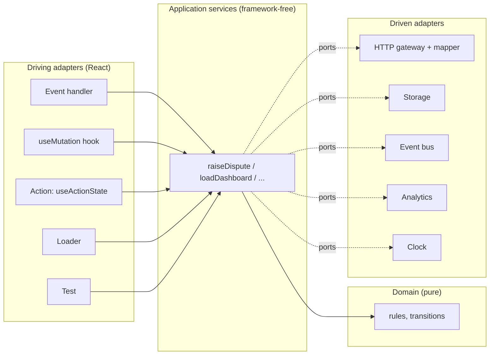
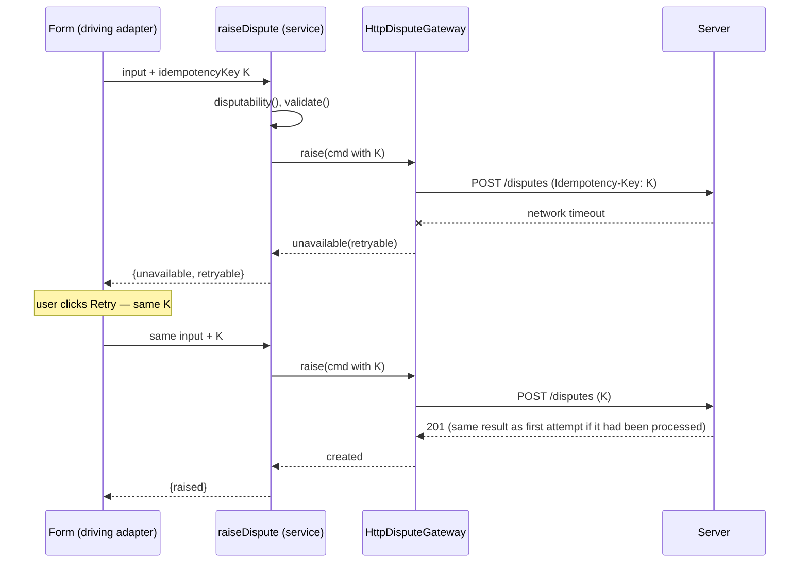
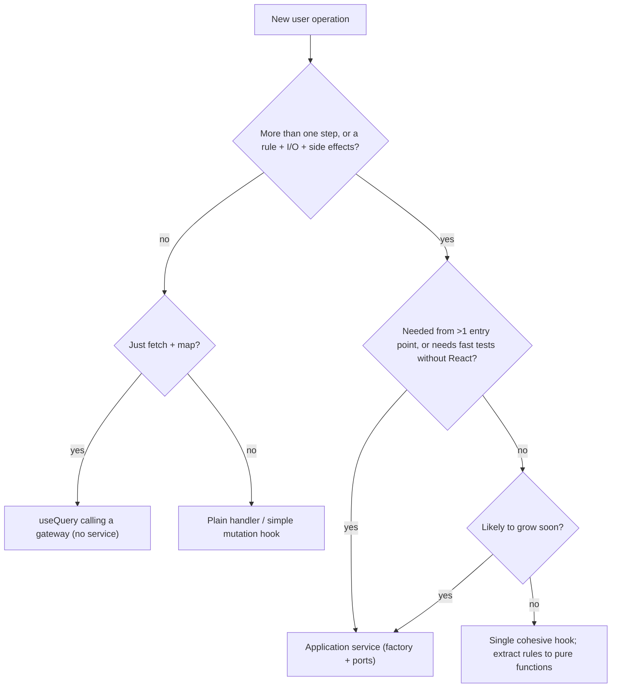

# 04 / 13 — Application Services and Adapters: Orchestrating Use Cases Around the React UI

## 1. Lesson metadata

| | |
|---|---|
| **Level** | Advanced |
| **Study time** | 4–5 hours (reading 2 h, lab 1.5 h, exercises 1.5 h) |
| **Prerequisites** | [10 — Clean and hexagonal architecture](./10-clean-and-hexagonal-architecture.md), [11 — Dependency inversion](./11-dependency-inversion.md), [12 — Domain logic vs UI logic](./12-domain-logic-vs-ui-logic.md) |
| **Next** | [14 — API boundaries and data access](./14-api-boundaries-and-data-access.md) |
| **Related** | [08 — Domain-driven frontend](./08-domain-driven-frontend.md), [16 — Server vs client state](./16-server-vs-client-state.md), [Phase 6 — Optimistic updates](../06-data-fetching-and-state-ecosystems/05-optimistic-updates.md), [Phase 5 — Facade and command](../05-design-patterns/17-facade-and-command.md) |

**Learning objectives.** After this lesson you can:
1. Define an **application service** (use case / interactor) and separate it from domain logic, UI logic and infrastructure.
2. Name and design the main **adapters** in a React front end: HTTP gateways, storage, clock/id, notifier, navigation, analytics, and the **UI adapters** (hooks, Actions) that drive the services.
3. Write application services as dependency-injected functions that return typed outcomes, and wire them with a composition root.
4. Integrate services with TanStack Query-style caches, React 19 Actions (`useActionState`, `useOptimistic`), and routers without letting those libraries leak into the services.
5. Handle cross-cutting concerns: cancellation, retries, idempotency, concurrency, logging, optimistic updates, and compensations.
6. Decide, with explicit criteria, when an application-service layer is justified and when a hook is enough.
7. Recognise failure modes and plan migration from "fat hooks" to services, or the reverse.

**Concepts covered:** application service, use case, command and query, unit of work (front-end sense), saga/compensation (lightweight), gateway, mapper/ACL, driving vs driven adapters, navigation port, notification port, idempotency key, optimistic update, outcome/Result modelling, orchestration vs choreography, service granularity.

---

## 2. Deep conceptual explanation

### 2.1 What problem is this lesson solving?

[12](./12-domain-logic-vs-ui-logic.md) left a category of logic unplaced: **orchestration**. When the user clicks "Raise dispute", something must: validate the draft (domain), call the API (infrastructure), tell the cache that disputes and the transaction changed (state), show a confirmation (UI), maybe navigate, and report to analytics. None of that is a *business rule* and none of it is *pure UI*. If it lives in an `onClick` handler, it is duplicated when a second entry point appears (a bulk action, a keyboard shortcut, a command palette); if it lives in a fat hook, it is untestable without React; if it lives in a global store thunk, it is coupled to the store.

An **application service** gives orchestration a named, testable home between UI and domain/infrastructure.

### 2.2 Definitions

| Term | Definition (as used in this curriculum) |
|---|---|
| **Domain logic** | Rules about the business, pure, no I/O ([12](./12-domain-logic-vs-ui-logic.md)). |
| **Application service / use case** | A function (or object) that implements **one user-meaningful operation** by coordinating domain functions and ports. It holds no business rules of its own and no UI. Examples: `raiseDispute`, `loadDashboard`, `submitClaim`. |
| **Command** | A request to change something (`RaiseDispute { transactionId, draft }`). Usually returns an outcome, not data to render. |
| **Query** | A request to read something with no side effects (`GetDisputableTransaction { id }`). |
| **Port** | An interface the service depends on, owned by the application/domain side ([10](./10-clean-and-hexagonal-architecture.md)). |
| **Driven adapter** | Implements a port using a technology: `HttpDisputeGateway`, `LocalStorageDraftStore`, `RouterNavigator`, `SystemClock`. |
| **Driving adapter** | Calls the service from a delivery mechanism: a React hook, a component event handler, a React 19 Action function, a route loader, a test. |
| **Outcome** | The typed result of a use case: success value or a *named* failure (not a string, not an untyped exception). |

Terminology varies (Clean Architecture: "interactor"; DDD: "application service"; CQRS: "command handler"; MVVM: "view model" partly overlaps). We use *application service* as umbrella and keep one rule: **it orchestrates; it does not decide business rules or render**.

### 2.3 The orchestration responsibilities

A typical application service does a subset of:

1. **Authorise** (as a UX affordance, e.g. check capabilities; the server remains the authority).
2. **Validate** by calling domain functions.
3. **Gather inputs** from ports (clock, current user, stored drafts).
4. **Execute** I/O via gateways (one or several calls).
5. **Interpret** gateway outcomes into domain-level outcomes (conflict, rejected, unavailable).
6. **Coordinate state effects**: signal that cached data is stale (via an event/port), or return what changed so the driving adapter can update the cache.
7. **Emit notifications** (domain events or analytics) through ports.
8. **Return** a typed outcome.

Not responsibilities: formatting, layout, focus management, toasts (UI), SQL/HTTP details (infrastructure), pricing rules (domain).

### 2.4 Where the cache belongs

This is the thorniest question in front-end application services. Server-state libraries (TanStack Query, SWR, Apollo, RTK Query) are not just transports: they own caching, deduplication, background refetch, retries, and invalidation. Three approaches, in increasing purity and cost:

| Approach | How | Trade-off |
|---|---|---|
| **A. Service is cache-agnostic; hook adapter owns the cache** | The service returns an outcome. The hook (`useMutation`) does `invalidateQueries` on success. | Simple, idiomatic. The *knowledge of which queries are affected* lives in the hook (UI side). OK for most apps. |
| **B. Service emits domain events; a subscriber adapter invalidates** | The service publishes `DisputeRaised{ txId }` through an `EventPublisher` port; a subscriber maps events to cache invalidations. | Decouples; adds an event bus (indirection). Worthwhile when many consumers react to the same event. |
| **C. Service receives a `CachePort`** | `cache.invalidate("disputes")` as an abstract port | Leaks cache vocabulary into the service; usually not worth it. |

Default recommendation: **A**, with a centralised **query-key factory** (so the hook adapter doesn't invent keys ad hoc). Reach for B in large apps with many cross-feature reactions.

### 2.5 UI adapters in React 19

React 19 adds first-class mechanisms that drive application services:

| Mechanism | Role as driving adapter |
|---|---|
| Event handler | Simplest: `onClick={() => raiseDispute(...)}` with local pending state |
| `useMutation` (TanStack Query) | Mutation lifecycle + cache integration |
| **Actions** with `useActionState` | Form-driven: `useActionState(async (prev, formData) => outcomeToState(await service(...)), initial)`; React tracks the pending state |
| `useOptimistic` | Show an optimistic value while an Action is pending, reverting automatically if the Action finishes (success or failure → true state takes over) |
| `useFormStatus` | Child components read the parent form's pending state |
| Route loaders/actions (framework/router-specific) | Call queries/commands on navigation/submit ⚠ verify per framework |

These are *delivery mechanisms*. The service should not know whether it was called from an Action, a mutation hook, or a loader. Action semantics (transitions, error handling, ordering of queued Actions) are version-sensitive; consult the React docs for `useActionState` and `useOptimistic` for current behaviour.

### 2.6 Adapters in detail

| Adapter | Port (consumer-owned) | Typical implementation | Concerns it owns |
|---|---|---|---|
| **HTTP gateway** | `DisputeGateway.raise(cmd, signal)` | `fetch`/generated client | URL, headers, auth, serialisation, status → outcome mapping, timeouts |
| **Mapper / ACL** | (part of the gateway) | `toDomain(dto)` / `toRequest(cmd)` | Wire-format churn ([14](./14-api-boundaries-and-data-access.md)) |
| **Storage** | `DraftStore.save/load` | `localStorage`, IndexedDB | Keys, versioning/migration, quota errors, SSR absence |
| **Clock / IdGenerator** | `Clock.now()` | `Date`, `crypto.randomUUID()` | Determinism for tests |
| **Navigator** | `Navigator.toDisputeDetails(id)` | Router `navigate` | Route paths; keeps URLs out of services |
| **Notifier** | `Notifier.success(message key)` | Toast library | UI feedback (often better kept in the driving adapter) |
| **Analytics/Logger** | `Analytics.track(event)` | Vendor SDK | PII filtering, sampling |
| **Event publisher** | `Events.publish(e)` | In-memory emitter | Fan-out to subscribers |

A note on **navigation and notification**: should the service call them? Heuristic: *if the behaviour is a consequence of the user's interaction with this UI, the driving adapter does it* (after seeing the outcome). *If it is a product-level policy independent of which UI triggered the operation* (e.g. "after raising a dispute from anywhere, show the dispute page"), it can be modelled as a port, but this is rarer than people assume. Overusing `Navigator` ports makes services depend on route structure.

### 2.7 Service shape: three common forms

1. **Function factory (recommended default).**
   ```ts
   export function makeRaiseDispute(deps: { gateway: DisputeGateway; clock: Clock }) {
     return async function raiseDispute(cmd: RaiseDisputeCommand, signal?: AbortSignal): Promise<RaiseDisputeOutcome> { /* … */ };
   }
   ```
2. **Object of related operations** (a "module service"): `{ raise, withdraw, listMine }` built by one factory with shared deps; useful to group by aggregate.
3. **Class with injected dependencies.** Works; ceremony; `this`-binding hazards when passed as callbacks. Use only if your team already standardises on classes.

### 2.8 Common misconceptions

| Misconception | Reality |
|---|---|
| "Application services are the same as hooks." | Hooks are React-bound adapters; services are framework-free functions. A hook can *wrap* a service. |
| "Services should wrap every query." | Pure reads often don't need a service: a `useQuery` calling a gateway/mapper is enough. Services earn their place when there is *orchestration* (multiple steps, rules, side effects). |
| "A service must be async and class-based." | Neither. Synchronous orchestration of pure functions can be a service; functions suffice. |
| "Services hold state." | They should be stateless or hold only injected collaborators. State belongs to React/state libraries/caches. |
| "A service layer makes the app architecture clean." | A layer that merely forwards calls adds noise (see failure modes). |
| "Transactions exist in the front end." | There are no ACID transactions across HTTP calls. Multi-call workflows need compensations or server-side orchestration. |

---

## 3. Internal mechanics

### 3.1 Public guarantee / teaching model / implementation detail

- **Public guarantee (React):** Actions and `useActionState`/`useOptimistic` are documented React 19 APIs; their precise scheduling (transitions, ordering) is documented but evolving. Verify against react.dev.
- **Teaching model:** services as DI'd functions, cache-agnostic, with outcomes as discriminated unions; hook adapters integrate with caches.
- **Implementation detail:** how TanStack Query or React schedules updates; not relied upon by the service.

### 3.2 Outcome modelling

A service should not communicate through `throw` for *expected* results. Compare:

```ts
// Exceptions for expected outcomes: invisible in the signature
async function raise(...): Promise<Receipt> { /* throws DuplicateError | WindowClosedError | ... */ }

// Outcome union: visible, exhaustively checkable
type RaiseOutcome =
  | { kind: "raised"; receipt: Receipt }
  | { kind: "invalid"; issues: DraftIssue[] }
  | { kind: "duplicate" }
  | { kind: "window-closed" }
  | { kind: "unavailable"; retryable: boolean };
```

**Convention** (a team decision; pick one): *expected, domain-meaningful outcomes are values; unexpected faults (bugs, programmer errors, impossible states) throw*. Network failure is "expected" in a distributed system, so `unavailable` is a value at the gateway/service boundary; a `TypeError` from a bug is thrown and caught by an error boundary ([19 — Error boundaries](./19-error-boundaries.md)).

Exhaustiveness helper:

```ts
export function assertNever(x: never): never {
  throw new Error(`Unhandled case: ${JSON.stringify(x)}`);
}
```

### 3.3 Cancellation and concurrency

- **Cancellation**: thread `AbortSignal` from the driving adapter through the service to the gateway's `fetch`. The service does not create controllers; callers do. For queries, the query library provides `signal` ([Phase 6](../06-data-fetching-and-state-ecosystems/02-cancellation-and-race-conditions.md)).
- **Mutations are not generally cancellable in a meaningful sense**: aborting the HTTP request does not guarantee the server did not process it. Treat abort of a command as "I stop waiting", and rely on idempotency to make retry/reconcile safe.
- **Concurrency**: double-submit is a frequent bug. Defences: disable the control while pending (UI), `idempotency key` per user intent (service/gateway; header or field), server-side dedupe. The key should be generated **once per intent** (e.g. when the form opens or the Action starts) and reused on retry, not generated per HTTP attempt. ⚠ Whether an API supports idempotency keys is a server contract; verify.

### 3.4 Composition and ordering

Multi-step services can be sequential (`await a(); await b();`) or parallel (`Promise.all` / `Promise.allSettled`). Decide explicitly on partial failure: if step 1 succeeded and step 2 failed, what is the state of the world, and can the user recover? Without server-side transactions, the front end can: (1) *retry the failed step* (if idempotent), (2) *compensate* (call a reverse operation), (3) *surface a partial outcome* (`{ kind: "partially-completed", completed: [...], failed: [...] }`), or (4) *push orchestration to the server* (a single endpoint/BFF performing the workflow). Option 4 is often best: it makes a real transaction possible.

### 3.5 Timing: when does the service run?

| Driver | When | Considerations |
|---|---|---|
| Event handler / mutation | On user event | Handle double-click; pending state |
| Action in form | On submit (React manages pending state/transition) | Outcome → `useActionState` state; progressive enhancement (Phase 9) |
| Loader / server | Before render / on server | No `window`; request-scoped dependencies; singletons hazard ([11](./11-dependency-inversion.md)) |
| Effect | After commit | Prefer events over effects ([You Might Not Need an Effect](https://react.dev/learn/you-might-not-need-an-effect)); services invoked from effects must be idempotent because effects may run twice in StrictMode dev |

---

## 4. Step-by-step walkthrough: "Raise dispute" end to end

Scenario: user submits the dispute form. Chronological:

1. **UI event.** The form's `action` function (React 19) or submit handler is invoked. The hook adapter creates an `AbortController` (or uses the mutation library's signal) and an idempotency key (stored in a ref/state created when the dialog opened).
2. **Driving adapter → service.** `raiseDispute({ transactionId, draft, idempotencyKey }, signal)`.
3. **Service: authorise/pre-check.** Calls `disputability(tx, now)` (domain) — requires `clock.now()`. If the window is closed → return `{ kind: "window-closed" }` with no I/O.
4. **Service: validate.** `validate(draft)`; if issues → `{ kind: "invalid", issues }`.
5. **Service: execute.** `gateway.raise(cmd, signal)`. The gateway maps the command to a request DTO (ACL), sends it, maps status codes to outcomes: 201 → `raised`; 409 → `duplicate`; 422 → `window-closed`; network error/5xx → `unavailable`.
6. **Service: post-process.** On `raised`, `events.publish({ type: "DisputeRaised", transactionId })` and `analytics.track("dispute_raised", …)` (best-effort: failures here must not turn a successful command into a failed outcome — catch/log).
7. **Return outcome** to the driving adapter.
8. **Driving adapter: translate to UI effects.** `raised` → invalidate `["transactions", id]` and `["disputes"]` queries, close the dialog, show a confirmation toast, optionally navigate. `invalid` → show field errors. `duplicate` → show "already raised", refetch. `unavailable` → show retry (reuse the *same* idempotency key). `window-closed` → show explanatory message and refetch transaction.
9. **Cleanup.** If the component unmounted mid-flight, the signal aborts waiting; the server outcome remains unknown to the client → next load reconciles from server state.

Predict: which step must tolerate being run twice? Step 5, if the user retries after `unavailable`. That is why the idempotency key exists and why it is generated once per intent.

---

## 5. Code examples

### 5.1 Representative folder structure

```text
src/features/disputes/
  domain/
    dispute-draft.ts
    disputability.ts
  application/                    # application services (framework-free)
    ports.ts                      # DisputeGateway, Clock, Events, Analytics
    raise-dispute.ts
    load-disputable-transaction.ts
    outcomes.ts
    index.ts
  infrastructure/                 # driven adapters
    http-dispute-gateway.ts
    dto.ts                        # wire types + mappers
    events.ts                     # in-memory event bus
  ui/                             # driving adapters + presentation
    use-raise-dispute.ts
    DisputeForm.tsx
    messages.ts
  composition.ts                  # builds services from adapters (feature composition)
  keys.ts                         # query-key factory
  index.ts
```

### 5.2 Dependency rules

| From | May import | Must not |
|---|---|---|
| `application/` | `domain/`, `application/ports` | `ui/`, `infrastructure/`, React, `fetch`, router, toast |
| `infrastructure/` | `application/ports`, `domain/` types | `ui/`, services' implementation |
| `ui/` | `application/` (types and service types), React, `keys.ts`, shared UI | `infrastructure/` (gets services from composition via context/props) |
| `composition.ts` | all of the above | — (this is the only module that sees both sides) |

### 5.3 Minimal example — a service with outcomes

```ts
// application/ports.ts
export interface Clock { now(): Date }
export interface DisputeGateway {
  raise(cmd: RaiseDisputeRequest, signal?: AbortSignal): Promise<GatewayOutcome>;
}
export interface RaiseDisputeRequest { transactionId: string; draft: DisputeDraft; idempotencyKey: string }
export type GatewayOutcome =
  | { kind: "created"; disputeId: string }
  | { kind: "conflict" }
  | { kind: "rejected-window" }
  | { kind: "unavailable"; retryable: boolean };

export interface Events { publish(e: { type: "DisputeRaised"; transactionId: string; disputeId: string }): void }
export interface Analytics { track(event: string, props?: Record<string, string | number | boolean>): void }
```

```ts
// application/outcomes.ts
import type { DraftIssue } from "../domain/dispute-draft";
export type RaiseDisputeOutcome =
  | { kind: "raised"; disputeId: string }
  | { kind: "invalid"; issues: DraftIssue[] }
  | { kind: "window-closed" }
  | { kind: "duplicate" }
  | { kind: "unavailable"; retryable: boolean };

export function assertNever(x: never): never { throw new Error(`Unhandled: ${JSON.stringify(x)}`); }
```

```ts
// application/raise-dispute.ts
import { disputability } from "../domain/disputability";
import { validate, type DisputeDraft } from "../domain/dispute-draft";
import type { Analytics, Clock, DisputeGateway, Events } from "./ports";
import type { RaiseDisputeOutcome } from "./outcomes";

export interface RaiseDisputeDeps { gateway: DisputeGateway; clock: Clock; events: Events; analytics: Analytics }

export interface RaiseDisputeInput {
  transaction: { id: string; disputeWindowEndsAt: Date; alreadyDisputed: boolean };
  draft: DisputeDraft;
  idempotencyKey: string;
}

export function makeRaiseDispute(deps: RaiseDisputeDeps) {
  return async function raiseDispute(input: RaiseDisputeInput, signal?: AbortSignal): Promise<RaiseDisputeOutcome> {
    const verdict = disputability(input.transaction, deps.clock.now());
    if (!verdict.ok) return verdict.reason === "already-disputed" ? { kind: "duplicate" } : { kind: "window-closed" };

    const issues = validate(input.draft);
    if (issues.length > 0) return { kind: "invalid", issues };

    const res = await deps.gateway.raise(
      { transactionId: input.transaction.id, draft: input.draft, idempotencyKey: input.idempotencyKey },
      signal,
    );

    switch (res.kind) {
      case "created":
        safely(() => deps.events.publish({ type: "DisputeRaised", transactionId: input.transaction.id, disputeId: res.disputeId }));
        safely(() => deps.analytics.track("dispute_raised", { hasEvidence: input.draft.evidence.length > 0 }));
        return { kind: "raised", disputeId: res.disputeId };
      case "conflict": return { kind: "duplicate" };
      case "rejected-window": return { kind: "window-closed" };
      case "unavailable": return { kind: "unavailable", retryable: res.retryable };
    }
  };
}
export type RaiseDispute = ReturnType<typeof makeRaiseDispute>;

function safely(fn: () => void): void {
  try { fn(); } catch { /* best-effort side effects must not change the command's outcome; log via a Logger port in real code */ }
}
```

Line notes:
- The `disputability` signature differs from lesson 08's version (there the second argument was `alreadyDisputed`); here the transaction carries `alreadyDisputed`. Within one codebase keep one signature; this lesson adapts it to show the shape of an input.
- `switch` over `res.kind` is exhaustive; because all branches return, TypeScript infers no fall-through. Adding a gateway outcome without handling it becomes a compile error under `noImplicitReturns` (function lacks ending return) — ⚠ verify your tsconfig strictness.
- `safely` implements an explicit policy: *post-success side effects are best-effort*. This policy must be a conscious decision, documented in the service.
- No React, no `fetch`, no toast.

**Predict:** what does the service return if the gateway returns `{ kind: "conflict" }` after a retry caused by a previous timeout where the first request actually succeeded? `duplicate` — misleading to the user ("already raised" is *true*, though they didn't see success). With an idempotency key honoured by the server, the retry would return the original `created` result instead. This is why idempotency belongs in the contract (§3.3).

### 5.4 Practical example — HTTP adapter and composition

```ts
// infrastructure/http-dispute-gateway.ts
import type { DisputeGateway, GatewayOutcome, RaiseDisputeRequest } from "../application/ports";

export function createHttpDisputeGateway(opts: { baseUrl: string; fetchImpl?: typeof fetch }): DisputeGateway {
  const doFetch = opts.fetchImpl ?? fetch;
  return {
    async raise(cmd: RaiseDisputeRequest, signal?: AbortSignal): Promise<GatewayOutcome> {
      let res: Response;
      try {
        res = await doFetch(`${opts.baseUrl}/disputes`, {
          method: "POST",
          headers: { "Content-Type": "application/json", "Idempotency-Key": cmd.idempotencyKey },
          body: JSON.stringify({
            transaction_id: cmd.transactionId,
            reason: cmd.draft.reason,
            claimed_minor: cmd.draft.claimedAmount?.minor,
            note: cmd.draft.note,
          }),
          signal,
        });
      } catch (e) {
        if (signal?.aborted) throw e;                       // caller cancelled: propagate
        return { kind: "unavailable", retryable: true };    // network failure
      }
      if (res.status === 201) {
        const body = (await res.json()) as { dispute_id: string };    // validate at runtime in real code (lesson 14)
        return { kind: "created", disputeId: body.dispute_id };
      }
      if (res.status === 409) return { kind: "conflict" };
      if (res.status === 422) return { kind: "rejected-window" };
      return { kind: "unavailable", retryable: res.status >= 500 };
    },
  };
}
```

All status codes and header names (`Idempotency-Key`) are illustrative; they are *the adapter's knowledge* of one particular API and nobody else's. The adapter alone changes when the API does.

```ts
// composition.ts
import { makeRaiseDispute } from "./application/raise-dispute";
import { createHttpDisputeGateway } from "./infrastructure/http-dispute-gateway";
import { createEventBus } from "./infrastructure/events";
import type { Analytics } from "./application/ports";

export function createDisputes(env: { apiBaseUrl: string; analytics: Analytics }) {
  const events = createEventBus<{ type: "DisputeRaised"; transactionId: string; disputeId: string }>();
  const gateway = createHttpDisputeGateway({ baseUrl: env.apiBaseUrl });
  const clock = { now: () => new Date() };
  return {
    events,
    raiseDispute: makeRaiseDispute({ gateway, clock, events, analytics: env.analytics }),
  };
}
export type DisputesModule = ReturnType<typeof createDisputes>;
```

### 5.5 Driving adapters in React

**(a) With TanStack Query (`useMutation`)** ⚠ verify v5 API shapes.

```tsx
// ui/use-raise-dispute.ts
import { useMutation, useQueryClient } from "@tanstack/react-query";
import { useRef } from "react";
import { useDisputes } from "./DisputesContext";          // provides DisputesModule (see lesson 11)
import { disputeKeys } from "../keys";
import type { RaiseDisputeInput } from "../application/raise-dispute";

export function useRaiseDispute() {
  const { raiseDispute } = useDisputes();
  const qc = useQueryClient();
  const keyRef = useRef<string>(crypto.randomUUID());      // one idempotency key per intent (per mounted form)

  return useMutation({
    mutationFn: async (input: Omit<RaiseDisputeInput, "idempotencyKey">) => {
      const outcome = await raiseDispute({ ...input, idempotencyKey: keyRef.current });
      if (outcome.kind === "unavailable" && outcome.retryable) throw new Error("unavailable");  // let the mutation library own retry/error UI if desired
      return outcome;                                     // other outcomes are values
    },
    onSuccess: (outcome, vars) => {
      if (outcome.kind === "raised") {
        qc.invalidateQueries({ queryKey: disputeKeys.all });
        qc.invalidateQueries({ queryKey: ["transactions", vars.transaction.id] });
        keyRef.current = crypto.randomUUID();              // intent completed: next submission is a new intent
      }
    },
  });
}
```

Notes: the policy "`retryable` unavailable becomes a thrown error" is **a decision in the adapter** that decides *which channel* TanStack Query's `isError` reflects. Define it once and document it, since mixing channels is a top bug source ([10 §5.4](./10-clean-and-hexagonal-architecture.md)). `crypto.randomUUID()` requires a secure context (HTTPS/localhost); ⚠ verify availability in your target browsers.

**(b) With React 19 Actions** ⚠ verify against current docs.

```tsx
// ui/DisputeForm.tsx
"use client"; // only relevant in frameworks that use this directive; omit for plain SPA
import { useActionState } from "react";
import { useDisputes } from "./DisputesContext";
import { messageFor } from "./messages";
import { draftFromFormData } from "./form-mapping";

type FormState = { status: "idle" } | { status: "error"; message: string; issues?: string[] } | { status: "done"; disputeId: string };

export function DisputeForm({ transaction }: { transaction: TransactionSummary }) {
  const { raiseDispute } = useDisputes();
  const [state, submit, pending] = useActionState<FormState, FormData>(
    async (_prev, formData) => {
      const outcome = await raiseDispute({
        transaction,
        draft: draftFromFormData(formData, transaction),
        idempotencyKey: String(formData.get("idempotencyKey")),
      });
      switch (outcome.kind) {
        case "raised": return { status: "done", disputeId: outcome.disputeId };
        case "invalid": return { status: "error", message: messageFor("invalid"), issues: outcome.issues.map(i => i.code) };
        default: return { status: "error", message: messageFor(outcome.kind) };
      }
    },
    { status: "idle" },
  );

  return (
    <form action={submit}>
      <input type="hidden" name="idempotencyKey" defaultValue={/* generated once per form mount */ crypto.randomUUID()} />
      {/* fields… */}
      <button disabled={pending}>Submit</button>
      {state.status === "error" && <p role="alert">{state.message}</p>}
    </form>
  );
}
```

Caveat flagged in the code: `defaultValue={crypto.randomUUID()}` evaluates on every render, but React's `defaultValue` applies only at mount for an uncontrolled input, so the DOM keeps the first value while later renders generate unused UUIDs (wasteful and confusing). Better: `const [idemKey] = useState(() => crypto.randomUUID());`. This is a real subtle pitfall worth a code review comment.

Both adapters call the same `raiseDispute` — that is the point.

### 5.6 Incorrect example — orchestration in the click handler

```tsx
async function onSubmit() {
  setPending(true);
  try {
    if (new Date() > tx.disputeWindowEndsAt) { toast.error("Window closed"); return; }   // domain + UI mixed
    const res = await fetch("/api/disputes", { method: "POST", body: JSON.stringify(draft) });
    if (res.status === 409) { toast.error("Already raised"); return; }                      // infra + UI mixed
    const data = await res.json();
    queryClient.invalidateQueries({ queryKey: ["disputes"] });                              // cache
    analytics.track("dispute_raised");                                                      // cross-cutting (global)
    navigate(`/disputes/${data.id}`);                                                       // routing
  } catch { toast.error("Something went wrong"); }
  finally { setPending(false); }                                                            // forgot: unmounted component updates are harmless in React 18+, but the flow is untestable
}
```

Problems: every concern coupled; no cancellation; no idempotency; double-click raises two disputes; the bulk-dispute screen copy-pastes this; `catch` swallows programming errors as "Something went wrong"; domain time check duplicates the rule; tests require DOM + fetch mock + toast mock + router mock.

### 5.7 Advanced — a multi-step service with compensation (and why you may prefer server orchestration)

```ts
export function makeReplaceCard(deps: { cards: CardGateway; limits: LimitGateway }) {
  return async function replaceCard(input: { cardId: string; keepLimits: boolean }, signal?: AbortSignal)
    : Promise<ReplaceOutcome> {
    const blocked = await deps.cards.block(input.cardId, signal);
    if (blocked.kind !== "ok") return { kind: "failed", at: "block" };

    const issued = await deps.cards.issueReplacement(input.cardId, signal);
    if (issued.kind !== "ok") {
      // compensation: attempt to unblock; report partial state if compensation also fails
      const undo = await deps.cards.unblock(input.cardId);                // no signal: compensation must run even if the user cancelled
      return undo.kind === "ok" ? { kind: "failed", at: "issue" } : { kind: "inconsistent", cardId: input.cardId, blocked: true };
    }
    if (input.keepLimits) {
      const moved = await deps.limits.copy(input.cardId, issued.newCardId, signal);
      if (moved.kind !== "ok") return { kind: "partial", newCardId: issued.newCardId, missing: "limits" };
    }
    return { kind: "replaced", newCardId: issued.newCardId };
  };
}
```

Critique: four network calls, three failure windows, a compensation that can itself fail, and a user who may close the tab mid-way. This is a **distributed transaction implemented in the browser**, which is fragile. The recommended design is a single server endpoint (or BFF) that performs the workflow with transactional guarantees and returns one outcome. Keep the front-end version only when the back end cannot be changed, and then surface `inconsistent` outcomes honestly with a recovery path (support contact, retry reconcile). Observe also that the compensation call deliberately omits the `signal`: cancellation of the *user's wait* must not cancel the *cleanup*.

---

## 6. Visual explanations

### 6.1 Layering and call direction



### 6.2 Sequence for a command with idempotent retry



### 6.3 Service-or-not decision



---

## 7. Alternative approaches and trade-offs

### 7.1 Comparison

| Criterion | Handler/hook orchestrates everything | Application service + hook adapter | Global store thunks/sagas/epics | Server-side orchestration (BFF, Actions, loaders) | XState machines |
|---|---|---|---|---|---|
| Entry-point reuse | Poor | **Good** | Good (within store) | Good | Good |
| Test speed w/o DOM | Poor | **Excellent** | Good | Server tests | Good |
| Framework independence | Low | **High** | Tied to store library | Tied to framework | Library-bound but portable |
| Complexity of simple CRUD | **Lowest** | Overkill | Overkill | Medium | Overkill |
| Multi-step workflows w/ rollback | Messy | Manageable | Manageable (sagas designed for it) | **Best (transactions)** | **Best for UI-visible state** |
| Fit with query cache | Natural | Adapter integrates | Often duplicates cache | Natural w/ loaders | Orthogonal |
| Onboarding | Easiest | Needs convention | Needs library knowledge | Needs framework knowledge | Needs modelling skill |

### 7.2 Approach profile: application services + adapters

**Original problem it solved.** In layered enterprise applications, controllers/UI classes accumulated orchestration and rules ("transaction script" in Fowler's PoEAA; "fat controller"). The *Service Layer* pattern (Fowler, PoEAA) and the application-service layer of DDD (Evans/Vernon) define an API for the application that clients (UIs, tests, batch jobs) use, with orchestration kept out of the UI and out of the domain.

**Representative folder structure.** §5.1.

**Dependency rules.** §5.2: services depend on domain and ports only; adapters implement ports; UI adapters call services; one composition module.

**Example code.** §5.3–5.7.

**Advantages.**
- One implementation of each operation regardless of entry point.
- Fast, deterministic tests of workflows with fake ports.
- Explicit outcome types make failure handling exhaustive and consistent.
- Vendor/transport change isolation (HTTP adapter, mapper).
- Clear review surface for workflow changes.

**Disadvantages.**
- Extra layer and vocabulary; simple operations feel over-built.
- Two error channels unless disciplined (outcomes vs thrown).
- Cache integration friction; invalidation knowledge sits outside the service or requires events.
- Risk of reimplementing library features (retries, dedupe) inside services.
- Front-end "transactions" across multiple calls are inherently fragile.
- Renaming/moving operations touches port, service, adapter, hook, test.

**Appropriate project/org sizes.**

| Size | Recommendation |
|---|---|
| Small team, CRUD-centric | Skip the layer; use hooks + gateway functions; extract a service only when a workflow appears in two places or needs non-React tests. |
| Medium team, workflows with rules and side effects | Services for the 10–20% of operations that orchestrate; plain query hooks for the rest. |
| Large/multi-team, multiple clients or surfaces (web, native, embedded widgets) | Services in a shared package; adapters per platform; contract tests; event publishing for cross-feature reactions. |
| Heavy server-framework apps | Prefer framework actions/loaders as the orchestration location; keep client-side services only for client-only workflows (offline, wizards). |

**Failure modes.**
1. **Pass-through services**: `getUser = (id) => gateway.getUser(id)` × N.
2. **God service**: `AppService` with 60 methods; no cohesion.
3. **Cache reimplementation**: services keep their own caches and de-dupe maps, fighting the query library.
4. **Hidden UI in services**: toasts, navigation, `window.confirm` in the service.
5. **Swallowed errors**: `safely` used on core steps; failures disappear.
6. **Non-idempotent retry**: double-charged/double-created resources.
7. **Compensation theatre**: elaborate rollback code that is never exercised in tests and fails when needed.
8. **Outcome explosion**: dozens of outcome kinds nobody handles distinctly; collapse into categories (e.g. `invalid | conflict | unavailable | forbidden`).
9. **Stale service closures**: services capturing config at construction that later changes (feature flags, tokens) rather than reading through ports.
10. **Server singleton leakage**: services built once per process hold per-request data (SSR).

**Migration considerations.**
- *From fat hooks:* (1) write tests around the hook as it is; (2) lift pure rules out ([12](./12-domain-logic-vs-ui-logic.md)); (3) introduce gateway functions and mapper; (4) turn the hook body into a service taking `deps`; (5) leave the hook as a thin adapter; (6) run the existing hook tests; (7) add service-level tests; (8) add a second entry point to prove reuse.
- *To remove a service layer (retreat):* inline pass-through services into hooks; keep ports only where fakes are used.
- *Toward server orchestration:* when a service has >2 sequential mutating calls, propose a server endpoint; keep the service signature stable and swap the gateway implementation (an advantage of ports).
- *Introduce events gradually:* start with approach A (hook adapter invalidates), move to events when three or more reactions to the same outcome appear.

### 7.3 Scenario where a service layer is NOT the best approach

A form posts to one endpoint and the page re-renders from refreshed server state. With a framework Action or `useMutation`, the entire "workflow" is: call, invalidate, close. The domain rule is a schema. Introducing `makeSubmitProfile(deps)`, `ProfileGateway`, `ProfileOutcome` and an in-memory fake adds four files and no new capability; MSW tests this end-to-end at the network seam. Keep the mutation hook, put the schema in a module, and move on. Promote to a service when a *second entry point or rule-heavy branching* arrives.

---

## 8. Best practices and anti-patterns

### 8.1 Best practices

1. **One service per user-meaningful operation**, named in the ubiquitous language (`raiseDispute`, not `handleSubmit`).
2. **Inputs and outputs are plain data**: commands in, outcomes out.
3. **Depend on ports, inject by factory**; composition at one root.
4. **Expected outcomes as values; unexpected faults as exceptions**; document the rule.
5. **Thread `AbortSignal`** for reads and waits; never abort compensations.
6. **Design commands for idempotency**; generate keys per intent, not per attempt.
7. **Keep UI effects in the driving adapter** (toast, focus, dialog, navigation) unless a product policy demands otherwise.
8. **Centralise query keys** in a factory the driving adapters share.
9. **Treat post-success side effects as best-effort** unless they are part of the contract; log failures.
10. **Test services with fake ports; test adapters with contract tests/MSW; test driving adapters with component tests.**
11. **Prefer server-side orchestration for multi-call mutations.**
12. **Make outcome handling exhaustive** (`assertNever`).

### 8.2 Beginner mistakes

- Doing everything in `onClick`/`useEffect`.
- Treating HTTP status codes as the service's vocabulary.
- Forgetting to disable the submit control (and idempotency) — double submit.

### 8.3 Experienced-developer mistakes

- Wrapping the query library in a custom abstraction that loses `staleTime`, cancellation or devtools.
- Introducing a global event bus used for everything (spooky action at a distance); events for cross-feature reactions only, typed, with discoverable subscriptions.
- Hiding navigation and toasts inside services "for consistency" and then being unable to reuse the service in a bulk flow.
- Building sagas in the browser for workflows that belong on the server.
- Generating the idempotency key inside the gateway per HTTP attempt (defeats its purpose).

### 8.4 Smells

| Smell | Meaning |
|---|---|
| Service imports `react`, `react-router`, `react-hot-toast` | Driving-adapter concerns leaked |
| Service methods named after endpoints (`postDisputes`) | Port shaped by transport |
| Each service has exactly one caller and one line | Pass-through |
| `try { … } catch {}` everywhere | Swallowed faults |
| Outcome union with 12 members | Collapse or restructure |
| Tests mocking `fetch`, router, toast and service simultaneously | Boundaries not respected |

### 8.5 Justified exceptions

- A `Navigator` port for flows that are explicitly cross-surface (web + native share the service, platform adapters navigate).
- Services that hold ephemeral state (e.g. a request coalescer) when no library covers it, documented and tested.
- Directly calling `queryClient` inside a hook adapter that doubles as a "service" in small apps.

---

## 9. Real-world application

| Domain | Typical application services | Notable constraints |
|---|---|---|
| **E-commerce** | `placeOrder`, `applyPromoCode`, `updateCartLine` | Idempotent checkout (retries after payment redirects); promo preview vs authoritative price; optimistic cart updates with reconcile |
| **Dashboards** | `loadDashboard` (parallel queries), `saveView`, `exportReport` | Parallel loading with partial results; `Promise.allSettled`; cancellation on filter change |
| **Finance / fleet payments** | `raiseDispute`, `freezeCard`, `approveTransaction` | Audit trails; four-eyes approvals (server); idempotency keys mandatory; no optimistic UI for irreversible actions |
| **Forms-heavy** | `submitClaim` with draft persistence (`DraftStore` port) | Autosave debouncing; offline queue; draft schema versioning |
| **Auth** | `signIn`, `refreshSession`, `signOut` | Token handling in one adapter; refresh races (single-flight) |
| **Realtime** | `subscribeToPositions`, `sendOrder` | Connection lifecycle in adapters; ordering and dedupe; reconnect backoff |
| **Multi-team** | Services as published module APIs | Versioned ports/outcomes; deprecation policy |
| **Offline-first** | `queueMutation`, `syncPending` | Idempotency + conflict resolution; storage adapters |

---

## 10. Debugging and troubleshooting

| Symptom | Likely root cause | Investigation | Fix / validation |
|---|---|---|---|
| Duplicate resource created on rapid double-click | No pending guard or idempotency | Network tab shows two POSTs with different/no keys | Disable control; stable per-intent key; server dedupe; test with rapid submit |
| Retry creates a second resource | Idempotency key regenerated per attempt | Compare headers across attempts | Generate key once per intent; reset after success |
| UI shows success but data stale | Cache not invalidated or wrong keys | Query devtools; log keys in adapter | Centralised key factory; invalidate on `raised` |
| `isError` never true though failure occurred | Outcome returned as value | Log mutation state | Decide channel policy; translate in hook adapter |
| Mutation still "pending" after navigation | Waiting on a request tied to an unmounted component | Network tab; abort behaviour | Pass signal; rely on mutation cache; ensure UI doesn't depend on unmounted state |
| Partial workflow left inconsistent state | Multi-call orchestration without compensation | Reconstruct call sequence from logs/traces ([Phase 10 observability](../10-production-engineering/04-observability-and-logging.md)) | Move to server orchestration or implement tested compensation + recovery UI |
| Service tests pass; production fails on mapping | Fake gateway does not reflect real API | Contract-test fake vs adapter with MSW | Shared contract suite |
| Effect-triggered service runs twice in dev | StrictMode double-invoking effects | Console double logs; confirm via StrictMode toggle | Move to event handler; or make service idempotent and effect cleanup correct |

---

## 11. Exercises

### Level A — Knowledge
A1. Distinguish domain logic, application service, and adapter responsibilities with one example each.
A2. What are driving vs driven adapters? Classify: a `useMutation` hook, an `HttpGateway`, a `LocalStorageDraftStore`, an `Action` passed to `<form action>`.
A3. Why are expected failures modelled as outcome values in this lesson, and when do we still throw?
A4. What is an idempotency key, and when must it be generated?
A5. List three approaches for connecting service completion to cache invalidation, with one trade-off each.

### Level B — Code comprehension
B1. In §5.3, why is `safely` used for events and analytics but not for the gateway call?
B2. In §5.5(b), explain the problem with `defaultValue={crypto.randomUUID()}` and fix it.
B3. In §5.7, why doesn't the compensation call pass `signal`? What's the downside?
B4. In §4 step 8, which outcomes should cause a refetch, and why?

### Level C — Implementation
C1. Write `makeLoadDashboard(deps)` that loads three independent sections in parallel and returns `{ sections: { a: Outcome; b: Outcome; c: Outcome } }` without failing entirely if one fails; include cancellation.
C2. Write a contract test suite for `DisputeGateway.raise` outcomes (created, conflict, window, unavailable) runnable against both an MSW-backed HTTP adapter and an in-memory fake.
C3. Implement a `DraftStore` port with `localStorage` adapter handling quota/availability errors, versioned payloads, and a fake.

### Level D — Debugging
D1. Users report that "Retry" after a network error sometimes produces duplicate disputes. The hook creates the idempotency key inside `mutationFn`. Diagnose and fix.
D2. The service tests are green but a toast shows twice in production. The service calls `notifier.success()` and the hook's `onSuccess` also toasts. Explain the architectural cause and resolve.
D3. A service built at module scope in an SSR app returns another user's draft occasionally. Diagnose.

### Level E — Architecture decisions
E1. Your app uses TanStack Query heavily. Decide whether services should accept a `QueryClient`, emit events, or return outcomes only. Justify.
E2. A "bulk dispute" feature must raise 50 disputes with progress reporting and partial failure. Design the service API, concurrency limit, outcomes and UI adapter.
E3. The team wants a global `Navigator` port so services can navigate. Argue for/against and propose a policy.

### Level F — Expert challenge
F1. Design an offline-capable `raiseDispute`: queued commands, idempotency, ordering, conflict handling when the transaction changed meanwhile, and how the UI shows pending/failed/confirmed states.
F2. Critique the claim "we don't need application services because React Query + hooks already is the application layer." Where is it right, and where does it break down?

---

## 12. Detailed answers and explanations

> Attempt the exercises first.

**A1.** Domain: `disputability(tx, now)` decides if a dispute is permitted (pure). Application service: `raiseDispute` sequences check → validate → gateway → events and returns an outcome. Adapter: `HttpDisputeGateway` turns a command into an HTTP request and the response into a `GatewayOutcome`. Wrong answers often put status code handling in the service or business rules in the adapter.

**A2.** `useMutation` hook: driving. `HttpGateway`: driven. `LocalStorageDraftStore`: driven. Action passed to `<form action>`: driving. Driving adapters call *into* the application; driven adapters are called *by* the application through ports.

**A3.** Expected failures (invalid, conflict, unavailable) are part of normal operation and a typed union forces handling at each call site and documents the contract. We throw for faults that are bugs or impossible states (programmer errors) or when a framework mechanism relies on thrown errors (error boundaries, query retry) — with the translation done once in the driving adapter.

**A4.** A unique token per *user intent* sent with a command so that the server can recognise retries and return the original result instead of repeating the effect. Generate it once when the intent begins (form open / action start), reuse across retries, discard after confirmed completion. Generating per HTTP attempt defeats it.

**A5.** (A) Hook adapter invalidates after success: simple; knowledge of affected queries in the UI layer. (B) Service publishes domain events; subscriber invalidates: decoupled and scalable; adds indirection and a bus to debug. (C) Service takes a `CachePort`: explicit; leaks cache vocabulary and couples the service to caching concepts.

**B1.** Events/analytics are post-success side effects: their failure must not change the truth that the dispute was created. If the gateway call fails, the outcome *must* reflect it. Swallowing gateway errors would hide the failure and mislead the user. Note: swallowing without logging loses diagnostics — use a `Logger` port.

**B2.** `defaultValue` expression runs each render, creating throwaway UUIDs; the uncontrolled input only uses the first. It's wasteful, and if someone later changes it to `value=`, the key would change per render. Fix: `const [idemKey] = useState(() => crypto.randomUUID());` then `defaultValue={idemKey}` (or pass the key via closure instead of hidden input). Also note that FormData-based hidden keys are user-visible in DOM; fine for idempotency (not a secret).

**B3.** If the user cancels (or navigates away) after the block succeeded but the issue failed, aborting the compensation would leave the card blocked — an inconsistent state. The downside: the cleanup continues after the UI is gone, with nobody to report its result; log and surface on next load; consider server orchestration.

**B4.** `duplicate`, `window-closed` (client's view of the transaction is stale or wrong → refetch the transaction), `unavailable` after retry exhaustion (to reconcile in case the command actually succeeded), and of course `raised`. `invalid` needs no refetch — the problem is local input.

**C1. Reference solution**
```ts
type Section<T> = { kind: "ok"; data: T } | { kind: "failed"; retryable: boolean };
export function makeLoadDashboard(d: { a: AGateway; b: BGateway; c: CGateway }) {
  return async function loadDashboard(signal?: AbortSignal) {
    const wrap = async <T,>(p: Promise<T>): Promise<Section<T>> => {
      try { return { kind: "ok", data: await p }; }
      catch (e) { if (signal?.aborted) throw e; return { kind: "failed", retryable: true }; }
    };
    const [a, b, c] = await Promise.all([wrap(d.a.get(signal)), wrap(d.b.get(signal)), wrap(d.c.get(signal))]);
    return { sections: { a, b, c } };
  };
}
```
Points: `Promise.all` over wrapped promises never rejects except on abort (rethrown intentionally), so one failure doesn't fail all; `Promise.allSettled` is an alternative. Cancellation propagates by throwing `AbortError` so callers can ignore. Edge: `<T,>` comma needed in `.tsx` files for generic arrow functions; in `.ts` not needed.

**C2. Reference outline**
```ts
export function describeDisputeGatewayContract(name: string, make: (scenario: "created" | "conflict" | "window" | "down") => DisputeGateway) {
  describe(name, () => {
    it.each([
      ["created", { kind: "created" }],
      ["conflict", { kind: "conflict" }],
      ["window", { kind: "rejected-window" }],
    ] as const)("%s", async (scenario, expected) => {
      const res = await make(scenario).raise(cmd);
      expect(res.kind).toBe(expected.kind);
    });
    it("down → unavailable(retryable)", async () => {
      expect(await make("down").raise(cmd)).toEqual({ kind: "unavailable", retryable: true });
    });
  });
}
```
MSW variant sets handlers per scenario (201/409/422/network error); fake variant configured by scenario flag. Evaluation: same assertions both sides; no HTTP vocabulary in assertions.

**C3. Reference outline.** Port: `interface DraftStore { load(id: string): Draft | null; save(id: string, d: Draft): SaveResult; clear(id: string): void }` with `SaveResult = {ok:true} | {ok:false; reason:"unavailable"|"quota"}`. Adapter: wrap `localStorage` access in `try/catch` (access may throw in private modes/blocked storage and is undefined during SSR); key `draft:v1:${id}`; payload `{ v: 1, data }`; on load, migrate or discard unknown versions; catch `QuotaExceededError` (`DOMException` name check). Fake: Map-backed. Evaluate: SSR safety, versioning, error handling, same contract tests.

**D1.** Creating the key inside `mutationFn` generates a new key per attempt (including automatic or manual retries), so the server sees different intents. Fix: create once per intent (ref/state at form mount or `useActionState` initial) and reuse; rotate only after a confirmed completion. Validation: network tab shows identical `Idempotency-Key` across retries; server returns the same dispute.

**D2.** The notification responsibility is duplicated: the service (via `Notifier` port) and the driving adapter both react to success. Resolve by deciding ownership: UI feedback belongs to the driving adapter; remove the `Notifier` from the service (or keep only for product-policy notifications that are not UI toasts). Add a lint/review rule: services don't import UI libraries.

**D3.** Module-scope service holds mutable per-user state (e.g. a draft cache in a closure) shared among concurrent requests on the server. Fix: construct per request or make the service stateless and pass request-scoped context explicitly. See [11 §10](./11-dependency-inversion.md). Security-relevant.

**E1.** Return outcomes only (A), with query invalidation in the hook adapter via a central key factory; events (B) when ≥3 reactions per outcome or cross-feature; avoid `QueryClient` in the service (C) since it couples the framework-free layer to a library. Criteria: portability, simplicity, discoverability, alignment with library idioms. Mention that for apps where TanStack Query is non-negotiable, accepting `QueryClient` in a *hook-level* service is a pragmatic variant; just don't call it framework-free.

**E2.** Service `raiseDisputes(inputs, { concurrency: 5, onProgress, signal })` returning `BulkOutcome = { succeeded: Id[]; failed: { id; outcome }[]; cancelled: Id[] }`. Use a small worker-pool loop or a limiter; one idempotency key per item; stop launching on abort; `onProgress` as a callback port (not React state). UI adapter holds progress in state, shows per-item status and offers "retry failed" (reusing keys). Considerations: rate limits, partial failure, server bulk endpoint preferred if available. Evaluate on concurrency control, partial failure handling, idempotency, cancellation semantics.

**E3.** Against by default: services coupling to route structure and UI flow; reuse across surfaces suffers. For: product-level policy flows or multi-platform shared flows where navigation is part of the workflow. Policy: services return outcomes carrying *what* to show (`{ kind: "raised", disputeId }`); the driving adapter decides *where* to go; add a port only for cross-platform workflows with an ADR.

**F1.** Example design: a `CommandQueue` port persisted in IndexedDB; each queued command has `id`, `idempotencyKey`, `createdAt`, `status: pending|inflight|failed|confirmed`, `baseVersion` of the entity. Sync worker (online event + periodic) processes in per-aggregate order (FIFO per key) with concurrency across aggregates; retries with backoff on `unavailable`; on `conflict`/`window-closed` mark `failed` with reason and surface for user resolution; optimistic UI derives from `confirmed ∪ pending` state with visual indicator for pending; service layer: `enqueueRaiseDispute` (local, immediate) vs `syncPending` (network). Conflict: server returns current version; policy "server wins, user informed". Discuss time-window rules evaluated at *server receipt time*, not at client enqueue time, so a disputed-offline window may close — product decision. Evaluate completeness: idempotency, ordering, conflict policy, UX states, storage versioning, tab coordination (multiple tabs → Web Locks/BroadcastChannel; ⚠ verify availability).

**F2.** *Right when:* operations are single-call CRUD; the query library already supplies caching, retries, devtools and the mutation lifecycle; MSW tests give a seam. In that case adding services duplicates the library. *Breaks down when:* workflows have multiple steps, rules with I/O interplay, multiple entry points, non-React clients, or need exhaustive outcome handling; when the mutation hook becomes 120 lines mixing rules, cache logic and UI; when tests become slow because everything needs a renderer and providers. A balanced stance: React Query is a *cache and transport coordinator*, not the application's use-case layer; introduce services where orchestration exists, keep hooks thin where it doesn't.

---

## 13. Senior engineer interview questions

**Q1. "What belongs in an application service versus the domain layer?"**
Domain: rules and transitions that are true regardless of I/O. Application: coordinating them with ports (calls, events, time) to fulfil a use case, and translating results into outcomes. If it does I/O or sequences steps, it isn't domain; if it makes a business decision, it isn't merely orchestration.

**Q2. "Do you wrap every API call in a service?"**
No. Reads usually go through a gateway function + mapper called from `useQuery`. I add a service when there's orchestration (rules + I/O + side effects), multiple entry points, or a need for fast non-React tests. Otherwise it's a pass-through layer.

**Q3. "How do you prevent double submissions?"**
Layered defences: disable the control during pending state; per-intent idempotency key for the server to dedupe; server-side uniqueness constraints; optimistic UI that cannot trigger duplicates. UI alone is insufficient (retries, multiple tabs).

**Q4. "How do application services interplay with React Query?"**
Services are library-agnostic and return outcomes. The hook adapter wraps them in `useMutation`, invalidates by a central key factory, and decides how outcomes map to `isError`. For many cross-feature reactions I'd emit domain events and subscribe adapters.

**Q5. "How do you handle multi-step workflows in the browser?"**
Prefer server orchestration. If unavoidable: explicit partial outcomes, tested compensations (not cancellable), idempotent steps, recovery UI, and observability to diagnose inconsistent states.

**Q6. "Should services call navigation or show toasts?"**
Generally not: that's UI policy for the particular surface. Services return outcomes; the driving adapter chooses feedback. Exceptions are cross-platform product policies, decided deliberately.

**Q7. "Result type vs exceptions in services?"**
Result/outcome unions for expected domain outcomes (exhaustive handling, readable signatures); exceptions for faults and for places where the framework expects them. Translate at the driving adapter so the UI sees one channel.

**Q8. "How do Actions and `useActionState` change this?"**
They provide a first-class driving adapter for forms: pending state and result state managed by React, progressive enhancement potential. The service remains the same; the Action function maps the outcome to form state. ⚠ Check current semantics (transition behaviour, ordering) in the docs.

---

## 14. Further learning resources

| Resource | URL | Covers / why | Level | Study |
|---|---|---|---|---|
| Martin Fowler — *Patterns of Enterprise Application Architecture* (Service Layer, Transaction Script) | No URL (book); summary: <https://martinfowler.com/eaaCatalog/serviceLayer.html> | Origin of the service-layer pattern | Advanced | Service Layer |
| Eric Evans / Vaughn Vernon — application services in DDD | No URL (books) | Application vs domain services | Advanced | Layered architecture chapters |
| React docs — `useActionState` | <https://react.dev/reference/react/useActionState> | Form Actions and state | Intermediate | Reference + usage |
| React docs — `useOptimistic` | <https://react.dev/reference/react/useOptimistic> | Optimistic UI during Actions | Intermediate | Reference + usage |
| React docs — `<form>` | <https://react.dev/reference/react-dom/components/form> | Passing functions to `action` | Intermediate | Form actions |
| TanStack Query — Mutations | <https://tanstack.com/query/latest/docs/framework/react/guides/mutations> | Mutation lifecycle, invalidation | Intermediate | Mutations guide |
| MDN — AbortController / AbortSignal | <https://developer.mozilla.org/en-US/docs/Web/API/AbortController> | Cancellation primitives | Beginner–Int. | Whole page |
| IETF draft/RFC on Idempotency-Key header | *(search "Idempotency-Key HTTP header IETF"; status may have changed — unverified)* | Standardisation of idempotency keys | Advanced | Header semantics |
| MSW docs | <https://mswjs.io/docs/> | Contract testing HTTP adapters | Intermediate | Getting started |

URLs in this table were checked for HTTP 200 on 2026-10-22; any still marked *(unverified)* could not be checked automatically (blocked or unreachable). A 200 response does not guarantee the page content still matches the description; if a link has moved, search the site for the quoted title.

---

## 15. Knowledge checkpoint

**You should now understand**
- The role of application services as orchestrators, distinct from domain rules, UI logic and infrastructure.
- The types of adapters, and the driving/driven distinction in React terms (hooks, Actions, loaders vs gateways, stores, clocks).
- Outcome modelling, cancellation, idempotency, and cache integration options.
- Why multi-call workflows in the browser are fragile and server orchestration is preferred.

**You should be able to explain without notes**
- When *not* to introduce a service.
- Why the idempotency key is per intent, and why compensations ignore cancellation.
- Which responsibilities stay in the driving adapter.

**You should be able to implement**
- A DI'd service with exhaustive outcomes; an HTTP adapter with mapping; a composition module; hook and Action adapters; contract tests.

**You should be able to debug**
- Duplicate submissions, stale caches after success, mismatched error channels, double notifications, SSR singleton leaks.

**Before moving on:** read [14 — API boundaries and data access](./14-api-boundaries-and-data-access.md), which zooms in on the gateway/mapper adapter: runtime validation, DTO vs domain models, error taxonomy, and where data access modules live.
