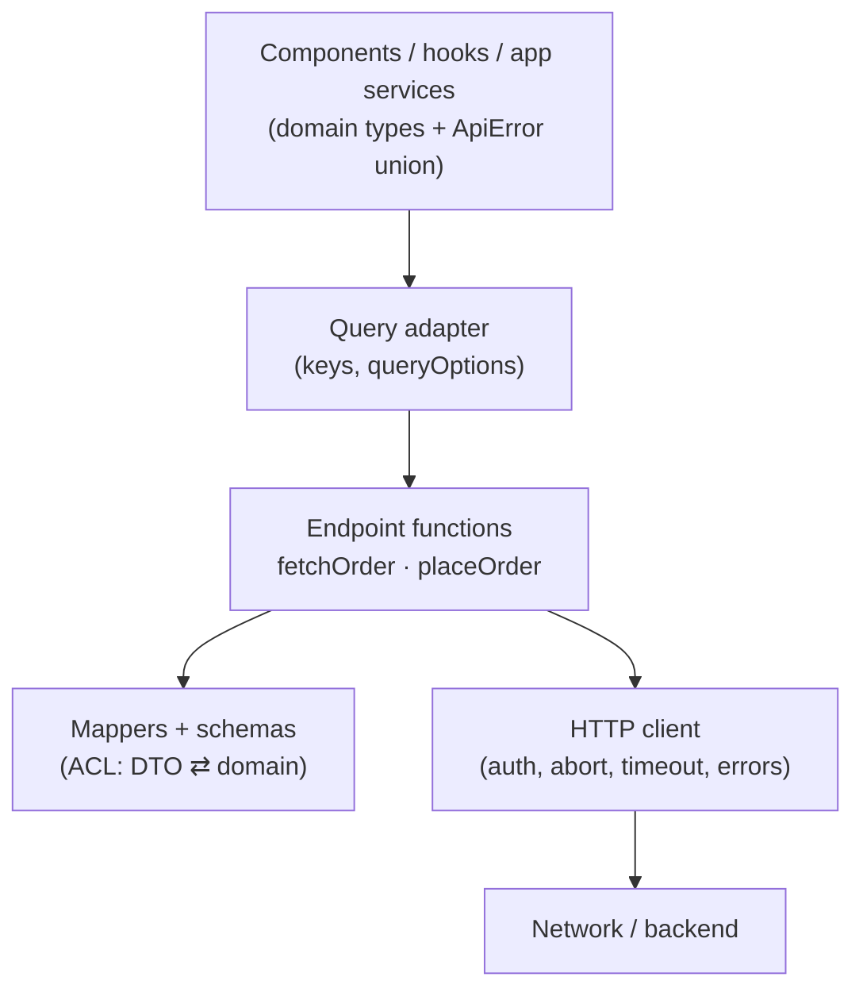
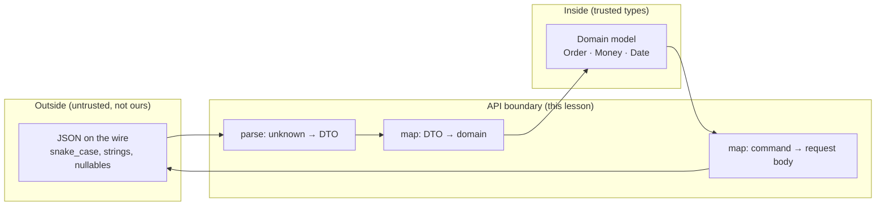
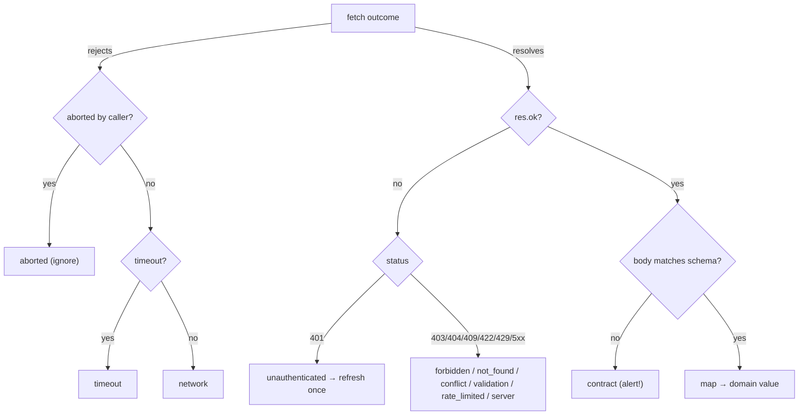

# 04 / 14 — API Boundaries and Data Access: Contracts, Validation, Mapping and the Data-Access Layer

## 1. Lesson metadata

| | |
|---|---|
| **Level** | Advanced |
| **Study time** | 5–6 hours (reading 2.5 h, lab 1.5 h, exercises 1.5–2 h) |
| **Prerequisites** | [08 — Domain-driven frontend](./08-domain-driven-frontend.md), [10 — Clean and hexagonal architecture](./10-clean-and-hexagonal-architecture.md), [11 — Dependency inversion](./11-dependency-inversion.md), [12 — Domain logic vs UI logic](./12-domain-logic-vs-ui-logic.md), [13 — Application services and adapters](./13-application-services-and-adapters.md), [Phase 0 / 14 — Web APIs and network requests](../00-web-and-javascript-foundations/14-web-apis-and-network-requests.md), [Phase 0 / 19 — Generics, utility types, discriminated unions](../00-web-and-javascript-foundations/19-typescript-generics-and-utility-types.md) |
| **Next** | [15 — State ownership](./15-state-ownership.md) |
| **Related** | [16 — Server vs client state](./16-server-vs-client-state.md), [17 — Data flow architecture](./17-data-flow-architecture.md), [07 — Modular architecture](./07-modular-architecture.md), [Phase 6 / 01 — Fetch lifecycle](../06-data-fetching-and-state-ecosystems/01-fetch-lifecycle.md), [Phase 6 / 02 — Cancellation and race conditions](../06-data-fetching-and-state-ecosystems/02-cancellation-and-race-conditions.md), [Phase 6 / 04 — API normalization](../06-data-fetching-and-state-ecosystems/04-api-normalization.md), [Phase 6 / 08 — TanStack Query](../06-data-fetching-and-state-ecosystems/08-tanstack-query.md), [Phase 6 / 15 — Error recovery and retries](../06-data-fetching-and-state-ecosystems/15-error-recovery-and-retries.md), [Phase 8 / 06 — Mocking strategies and MSW](../08-testing-and-quality/06-mocking-strategies-and-msw.md), [Phase 8 / 07 — Testing API interactions](../08-testing-and-quality/07-testing-api-interactions.md) |

**Learning objectives.** After this lesson you can:
1. Explain why the network edge is a **trust boundary**, and why a TypeScript type assertion on a `fetch` response is a lie the compiler cannot check.
2. Distinguish **wire format (DTO)**, **domain model**, and **view model**, and place the mapping between them at the boundary (anti-corruption layer).
3. Design a **data-access layer (DAL)**: transport client, endpoint functions, runtime validation, mappers, error taxonomy, cancellation, authentication, and cache-key conventions — and decide how much of that a given codebase needs.
4. Build a typed HTTP client that returns validated, mapped, cancellable results with a closed error taxonomy, and wire it into TanStack Query and React 19 Actions without letting either leak into the domain.
5. Compare four architectural approaches to API access — direct calls in components, a hand-written typed data-access layer, generated clients with runtime validation, and a backend-for-frontend / server-side DAL — with the full dossier for each: problem, folder structure, dependency rules, example code, pros/cons, sizes, failure modes, migration.
6. Handle contract evolution (tolerant reader, versioning, feature detection), pagination, idempotency, authentication refresh, and error semantics at the boundary.
7. Test the boundary with contract tests, mock servers and schema-based fixtures, and detect contract drift in CI.
8. Recognise failure modes (DTO leakage, over-abstraction, double validation, cache-key chaos) and plan migration between approaches.

**Concepts covered:** trust boundary, DTO, domain model, view model, anti-corruption layer, mapper, runtime schema validation, parse-don't-validate, tolerant reader, closed error taxonomy, `Result` types, `AbortSignal` propagation, data-access layer, repository vs gateway, query-key factories, `queryOptions`, idempotency keys, cursor pagination, token refresh single-flight, OpenAPI/GraphQL code generation, backend-for-frontend, server-only data access, contract testing, schema drift.

> ⚠ **Library volatility.** Validation libraries (Zod, Valibot, ArkType), query libraries (TanStack Query v5), mock tooling (MSW 2.x; MSW 3.0 is now current and moves `http`/`HttpResponse` to `msw/http` and requires Node 22, see mswjs.io/docs/migrations/2.x-to-3.x), OpenAPI and GraphQL generators, and framework server-data APIs change their option names and recommended idioms. Code here shows *shapes*; Zod and TanStack Query snippets target the APIs I am confident of (`z.object`, `safeParse`, `z.infer`; `queryOptions`, `useQuery`, `signal` in `queryFn`). Verify against the current docs for your versions before copying. Framework-specific server APIs (Next.js, React Router framework mode, TanStack Start) carry a "verify against current docs" note.

---

## 2. Deep conceptual explanation

### 2.1 What problem is this lesson solving?

Every front end has a boundary where **data it did not create** enters its type system: HTTP/JSON responses, GraphQL results, WebSocket frames, `localStorage` content, URL parameters, `postMessage` events, third-party SDK callbacks. Inside the boundary you want guarantees ("an `Order` always has a `total: Money`"); outside it you have *bytes someone else produced, under a contract that may have changed last Tuesday*.

The most common way React apps handle this boundary is the most dangerous:

```ts
const orders = (await (await fetch("/api/orders")).json()) as Order[];
```

This line says to the compiler "trust me". The compiler obeys; nothing checks. Consequences compound over time:

- **Silent drift.** A backend renames `total_amount` to `totalAmount`. TypeScript still compiles; the UI renders `NaN` or throws a `TypeError` in a deeply nested component — far from the cause, perhaps only for users in a rarely used state.
- **Leaky shapes.** `snake_case` fields, nullable-everything, string dates, "magic" status codes and server-specific envelope formats spread into components, hooks and tests. Renaming a backend field becomes a 90-file change.
- **Duplicated plumbing.** Each component handles `res.ok`, JSON errors, auth headers, abort, retries and loading flags slightly differently.
- **Untestable seams.** Components that call `fetch` can only be tested by mocking `fetch` globally.
- **Cache chaos.** Without a convention, the same resource is fetched under several different keys with different shapes, and invalidation becomes guesswork ([16](./16-server-vs-client-state.md)).

The solution is a boundary with a **name, a location and an owner**: a **data-access layer** (DAL) that converts the outside world into inside-world types — once, centrally, verifiably — and offers the rest of the app *capabilities* (`getOrder(id)`, `placeOrder(cmd)`) rather than HTTP.

### 2.2 Three models, not one

A frequent source of confusion is treating "the type of the thing" as one type. There are three distinct ones:

| Model | Owner | Shape optimised for | Example |
|---|---|---|---|
| **Wire model / DTO** (data transfer object) | The API (backend team, third party) | Serialisation and the backend's persistence/evolution | `{ "order_id": "o_1", "total_amount": "12.50", "currency": "EUR", "created": "2025-03-01T10:00:00Z", "state": "PAID" }` |
| **Domain model** | The front-end domain ([08](./08-domain-driven-frontend.md)) | Rules and invariants the UI logic relies on | `{ id: OrderId; total: Money; createdAt: Date; status: "paid" \| … }` |
| **View model** | A screen/component | Rendering convenience | `{ title: "Order #o_1", totalText: "€12.50", badgeTone: "success" }` |

The DTO → domain mapping belongs at the **API boundary** (this lesson). The domain → view mapping belongs near the UI ([12](./12-domain-logic-vs-ui-logic.md)). Collapsing them is sometimes the right choice (§7: tiny apps; BFF that returns view models) but should be a **decision**, not an accident.

### 2.3 Parse, don't validate

The principle (from Alexis King's essay "Parse, don't validate"): a function that checks data and returns `boolean` throws away the knowledge it gained; a function that *parses* data returns a **more precise type** that carries the proof. In TypeScript terms:

```ts
// validates but the compiler learns nothing the caller can use
function isOrderDto(x: unknown): boolean { … }

// parses: either a value of the precise type, or a typed failure
function parseOrderDto(x: unknown): Result<OrderDto, ParseError> { … }
```

Runtime schemas (Zod, Valibot, ArkType, io-ts, hand-written) implement parsing: you describe the shape once; the library gives you both a runtime check and the static type (`z.infer<typeof schema>`), so type and check cannot diverge. The boundary's job is to ensure that *past this point, types are true*.

### 2.4 Where validation stops

Validate **structure and the invariants you rely on**, not everything the server could say:

- **Do validate:** required fields, primitive types, enumerations you `switch` over, nullability, array vs object, numeric formats you compute with, and invariants the UI breaks without.
- **Don't validate:** fields you never read (ignore unknown keys — the *tolerant reader*, Postel's law applied carefully), or business rules the server owns (server remains the authority; you may *mirror* rules for UX but do not treat them as security).
- **Decide your failure policy:** a malformed *list item* should usually not blank the whole screen. Options: fail the whole response (strict), drop invalid items and report (lenient), or substitute a default (resilient). Choose per resource, report parse failures to telemetry ([Phase 10 / 04](../10-production-engineering/04-observability-and-logging.md)), and never swallow silently.

### 2.5 The data-access layer: responsibilities

A DAL is a *cohesive set of responsibilities* — it need not be a layer in the folder sense:

| Responsibility | Concern | Where it commonly lives |
|---|---|---|
| **Transport** | base URL, headers, credentials, content negotiation, timeouts | `http-client` (platform module) |
| **Authentication** | attach token, refresh on 401, handle logout | `http-client` + `auth-session` |
| **Cancellation** | accept and forward `AbortSignal` | every endpoint function takes `{ signal }` |
| **Error normalisation** | map network/HTTP/parse failures to a *closed* union | `http-client` |
| **Validation** | parse response against schema | endpoint function |
| **Mapping (ACL)** | DTO → domain, command → request body | `mappers` next to the endpoint |
| **Endpoint functions** | typed capabilities per resource: `getOrder`, `listOrders`, `placeOrder` | feature `api/` folder |
| **Cache integration** | query keys, `queryOptions`, invalidation tags | feature `api/queries.ts` (adapter for the query library) |
| **Observability** | request ids, timing, error reporting | `http-client` hooks |

Everything above the DAL (components, hooks, application services) sees *domain types and a small error union*; everything below it (the HTTP client) never sees a domain type.

### 2.6 Gateway vs repository: pragmatic naming

Domain-driven literature distinguishes a **repository** (collection-like: `orders.add`, `orders.byId`) from a **gateway** (wraps an external system's API). In front-end code the DAL is nearly always a *gateway*: the remote system has its own semantics (pagination, partial responses, eventual consistency, error codes) that a faux-collection abstraction would hide dangerously. Prefer verbs that expose remote reality — `fetchOrder`, `listOrders({ cursor })`, `placeOrder(cmd, { idempotencyKey })` — over `orderRepository.save(order)`, which suggests a synchronous, always-succeeding in-memory collection.

### 2.7 Error semantics are part of the contract

Network access fails in ways local functions don't. A useful closed taxonomy at the boundary:

| Kind | Meaning | Typical UI/flow response |
|---|---|---|
| `network` | Request did not complete (offline, DNS, CORS failure, connection reset) | Retry affordance, offline UI |
| `timeout` / `aborted` | Client timeout or caller cancelled | Aborted: ignore silently; timeout: retry |
| `unauthenticated` (401) | Session missing/expired | Refresh once, else redirect to sign-in |
| `forbidden` (403) | Authenticated but not allowed | Permission message |
| `not_found` (404) | Resource absent | Not-found UI |
| `conflict` (409/412) | Version conflict | Reload and merge flow |
| `validation` (400/422) | Server rejected input; field errors | Map to form field errors |
| `rate_limited` (429) | Backoff required (`Retry-After`) | Delay, retry |
| `server` (5xx) | Server failure | Retry with backoff; report |
| `contract` | Response did not match schema | Report to telemetry; show generic error; **never** a normal path |

`contract` errors are special: they signal a **bug** (ours or theirs), not a user problem. Separating them from `server` errors lets you alert on drift. Consumers pattern-match on `kind`; adding a kind is a compile-time-visible change where `switch` statements are exhaustive.

### 2.8 Cache keys and the DAL

With a server-state cache (TanStack Query, SWR, RTK Query; [Phase 6 / 07](../06-data-fetching-and-state-ecosystems/07-server-state-management.md)), the **query key is part of the DAL's contract**: it names the resource and its parameters, and determines sharing and invalidation. The DAL should own keys (a *key factory*) so that:

- the same logical resource always has the same key;
- invalidation after a mutation can target *families* (`["orders"]`) or *instances* (`["orders", "detail", id]`);
- components never hand-write key arrays.

### 2.9 Misconceptions

| Misconception | Reality |
|---|---|
| "TypeScript types guarantee the response shape." | Types are erased; `as Foo` is an assertion. Only runtime checks verify. |
| "Validate with a schema = need to validate every response everywhere." | Validate at the boundary once, to the extent you rely on the data. Don't re-validate downstream. |
| "A DAL means a class hierarchy of repositories." | It's functions and modules. Classes and interfaces only where substitution matters. |
| "GraphQL/OpenAPI codegen removes the need for validation." | Generated *types* are still compile-time only; responses can diverge (deployment skew, bugs, proxies). Codegen reduces drift, not runtime risk. |
| "Mappers are boilerplate for tiny gains." | They localise backend changes to one file and convert wire quirks (strings → dates/money) once. The gain scales with number of consumers and the volatility of the API. |
| "Hooks should call `fetch` directly; it's simpler." | True for a prototype; costly once there are two consumers, auth, errors or tests. |
| "The query library is the data layer." | It is a *cache and synchronisation* tool. The DAL supplies its `queryFn`s; the library does not know your contract, mapping or auth. |
| "BFF means no validation needed." | A BFF moves the boundary server-side; the front end still trusts a contract it does not control at runtime. Less risk, not none. |

---

## 3. Internal mechanics

### 3.1 What `fetch` does and does not tell you

*Public guarantee (Fetch Standard, MDN).*

- `fetch()` **rejects only on network-level failure** (and on abort); an HTTP 404 or 500 **resolves** with `response.ok === false`. You must check `ok`/`status`.
- `response.json()` can throw (`SyntaxError`) on invalid JSON and consumes the body (a body can be read once; `clone()` to read twice).
- `AbortSignal` passed in `init.signal` aborts the request; an aborted fetch rejects with a `DOMException` whose `name` is `"AbortError"`. `AbortSignal.timeout(ms)` and `AbortSignal.any([...])` exist in current browsers ⚠ (verify support floor for your targets).
- Cross-origin requests are subject to CORS; a CORS failure appears as a generic `TypeError: Failed to fetch` — indistinguishable from "offline" in JS by design.
- Cookies are sent according to `credentials` mode (`same-origin` default; `include` for cross-site).

### 3.2 JSON is lossy

`JSON.parse` yields `unknown` structure with only: `null`, booleans, numbers (IEEE 754 doubles), strings, arrays, objects. Consequences for contracts:

- Dates arrive as strings; `Date` must be constructed (and time zones considered).
- Big integers and precise decimals lose precision as numbers: represent money as **integer minor units** or **decimal strings**, and parse deliberately ([12](./12-domain-logic-vs-ui-logic.md) on `Money`).
- `undefined` does not exist on the wire; absent vs `null` may have different meanings in the API.
- Key order is not meaningful; duplicated keys keep the last.

### 3.3 TypeScript's `unknown` and narrowing

`response.json()` is typed `Promise<any>` in the DOM lib: `any` silently disables checking. The boundary should immediately treat it as `unknown`:

```ts
const body: unknown = await res.json();
```

Then **narrow via parsing** (schema) — not by assertion. This one habit — `unknown` in, validated type out — is the core of the lesson at the type level ([Phase 0 / 18](../00-web-and-javascript-foundations/18-typescript-fundamentals-and-narrowing.md)).

### 3.4 Schema libraries (teaching model)

A schema library offers: a declarative description → a parser function `parse(input: unknown): T` that throws or `safeParse` that returns `{ success, data | error }` → inferred static type → structured error paths (`["items", 3, "price"]`) → transforms (string → `Date`) and refinements. ⚠ Library versions differ in API details (for instance, string-format helpers and error shapes changed between Zod major versions); the structure above is stable.

Costs: bundle size (tens of kB for general-purpose libraries; smaller for modular ones), runtime CPU proportional to response size (validating a 10 MB response on the main thread is a long task — [Phase 7 / 20](../07-performance/20-long-tasks-and-main-thread.md)), and learning curve. Mitigations: validate at the right granularity, avoid validating huge payloads fully (validate the part you read; or use a lenient schema for bulk and strict for detail), validate off-main-thread for very large payloads only if measured.

### 3.5 TanStack Query's relation to the DAL

*Public guarantee (TanStack Query v5 docs).* `queryFn` receives a context containing `queryKey` and an `AbortSignal` (`signal`); returning a promise that rejects marks the query as errored; `queryOptions()` is a helper that returns a typed options object usable by `useQuery`, `prefetchQuery`, `ensureQueryData` and `setQueryData` with consistent key/type inference. The library neither validates nor maps data: *your `queryFn` is the DAL call.* (Verify exact current signatures in the docs: [Phase 6 / 08](../06-data-fetching-and-state-ecosystems/08-tanstack-query.md).)

### 3.6 React 19 integration points

- **`use(promise)`** with Suspense can consume a promise created *outside* render (from a cache or a router loader); do not create new promises in render ([Phase 3 / 22](../03-react-state-and-hooks/22-modern-hooks-and-apis.md)). A query library or router loader provides stable promises.
- **Actions** (`useActionState`, `<form action>`) are for mutations: the action function calls a DAL command (`placeOrder`) and returns a serialisable result/state; field-level `validation` errors from the error taxonomy map directly to form state ([Phase 9 / 13](../09-advanced-rendering-and-ecosystem/13-forms-actions-and-mutations.md)).
- **`useOptimistic`** layers a temporary view on top of server state; the DAL does not know about it, but its command functions should be idempotent and return the canonical result so the optimistic value can be reconciled ([13](./13-application-services-and-adapters.md)).

---

## 4. Step-by-step execution walkthrough: one request, end to end

Scenario: the order detail page calls `getOrder("o_1")`. We trace the layers.

1. **Component renders** `useOrder("o_1")`, a hook in `features/orders/api/queries.ts` that calls `useQuery(orderQueries.detail("o_1"))`.
2. **Query cache lookup** by key `["orders", "detail", "o_1"]`. Cache miss → the library calls the query's `queryFn({ signal })`.
3. **Endpoint function** `fetchOrder("o_1", { signal })` runs. It calls the transport: `http.get("/orders/o_1", { signal, schema: orderDtoSchema })`.
4. **Transport** builds the URL, attaches the `Authorization` header from the session adapter, sets `Accept: application/json`, adds a request id, merges `signal` with a default timeout (`AbortSignal.any([signal, AbortSignal.timeout(10_000)])`, ⚠ support check), and calls `fetch`.
5. **Network** returns `200` with a JSON body. The transport checks `res.ok`; reads `await res.json()` as `unknown`.
6. **Validation.** The schema parses the body: all required fields present, types right. On failure → `ApiError { kind: "contract", issues }` is thrown/returned (and reported to telemetry).
7. **Mapping.** `toOrder(dto)` converts: `"12.50"` → `Money { amountMinor: 1250, currency: "EUR" }`, `"2025-03-01T10:00:00Z"` → `Date`, `"PAID"` → `"paid"`. Unknown status → mapper decides (`"unknown"` variant or `contract` error).
8. **Return** `Order` (domain type) to the `queryFn`. The cache stores it under the key; subscribers re-render.
9. **Component** receives `Order`. A selector/view-model function produces display strings.

**Failure walkthrough.**
- *401 at step 5.* Transport calls the session adapter's single-flight `refresh()`; on success retries once; on failure throws `ApiError{ kind: "unauthenticated" }`; the app shell's global handler redirects to sign-in. Components never see tokens.
- *Abort at step 4.* Component unmounted; the library aborts `signal`; `fetch` rejects with `AbortError`; transport maps to `{ kind: "aborted" }`; the library ignores it (cancelled queries are not errors).
- *Schema mismatch at step 6.* `contract` error; alerting fires; UI shows a generic error with a request id; the team investigates the drift (§10).

---

## 5. Code examples

### 5.1 Minimal example — `unknown` in, validated domain type out

```ts
import { z } from "zod";

const orderDtoSchema = z.object({
  order_id: z.string(),
  total_amount: z.string(),       // decimal string from the API
  currency: z.string().length(3),
  created: z.string(),            // ISO timestamp as string
  state: z.enum(["PAID", "PENDING", "CANCELLED"]),
});
type OrderDto = z.infer<typeof orderDtoSchema>;

type Money = { readonly amountMinor: number; readonly currency: string };
export type OrderStatus = "paid" | "pending" | "cancelled";
export interface Order {
  readonly id: string;
  readonly total: Money;
  readonly createdAt: Date;
  readonly status: OrderStatus;
}

function toMoney(amount: string, currency: string): Money {
  const [whole, frac = ""] = amount.split(".");
  const minor = Number(whole) * 100 + Number((frac + "00").slice(0, 2));
  return { amountMinor: minor, currency };
}

const statusMap: Record<OrderDto["state"], OrderStatus> = {
  PAID: "paid", PENDING: "pending", CANCELLED: "cancelled",
};

export function toOrder(dto: OrderDto): Order {
  return {
    id: dto.order_id,
    total: toMoney(dto.total_amount, dto.currency),
    createdAt: new Date(dto.created),
    status: statusMap[dto.state],
  };
}

export async function fetchOrder(id: string, signal?: AbortSignal): Promise<Order> {
  const res = await fetch(`/api/orders/${encodeURIComponent(id)}`, { signal });
  if (!res.ok) throw new Error(`HTTP ${res.status}`);
  const body: unknown = await res.json();
  return toOrder(orderDtoSchema.parse(body));      // throws ZodError on mismatch
}
```

**Line notes.**
- `z.infer` derives `OrderDto` from the schema: the runtime check and the static type cannot diverge.
- `statusMap` is a total mapping from the DTO enum; if the schema gains a new enum member, TypeScript errors until the mapper handles it — drift becomes a compile-time event.
- `toMoney` is intentionally simple (no negative values or more than two decimals); production code uses a decimal library or a stricter parser (`Number("12.5")*100` floating errors are why we split the string). Currency-specific minor units (JPY has 0, KWD has 3) are a domain concern; do not hardcode 2 in real code.
- `body: unknown` prevents accidental use of `any`.
- Error handling is minimal (`throw new Error`); §5.2 replaces it with a taxonomy.

**Trade-off.** This is a good size for a small app: three concerns (transport, parse, map) in one file, one endpoint. It stops scaling at about the third resource, when transport code starts duplicating.

### 5.2 Practical example — a typed HTTP client with a closed error taxonomy

```ts
// platform/http/errors.ts
export type ApiError =
  | { readonly kind: "network"; readonly cause: unknown }
  | { readonly kind: "aborted" }
  | { readonly kind: "timeout" }
  | { readonly kind: "unauthenticated" }
  | { readonly kind: "forbidden" }
  | { readonly kind: "not_found" }
  | { readonly kind: "conflict"; readonly body: unknown }
  | { readonly kind: "validation"; readonly fieldErrors: Readonly<Record<string, readonly string[]>> }
  | { readonly kind: "rate_limited"; readonly retryAfterMs?: number }
  | { readonly kind: "server"; readonly status: number; readonly requestId?: string }
  | { readonly kind: "contract"; readonly issues: readonly string[]; readonly requestId?: string };

/** Throwable wrapper so TanStack Query / error boundaries can carry the union. */
export class ApiException extends Error {
  constructor(readonly error: ApiError) {
    super(`ApiError:${error.kind}`);
    this.name = "ApiException";
  }
}
export const isApiException = (e: unknown): e is ApiException => e instanceof ApiException;
```

```ts
// platform/http/client.ts
import type { ZodType } from "zod";
import { ApiException, type ApiError } from "./errors";

export interface HttpDeps {
  readonly baseUrl: string;
  readonly getToken: () => Promise<string | null>;
  readonly refresh: () => Promise<boolean>;          // single-flight inside the session adapter
  readonly onContractError?: (e: Extract<ApiError, { kind: "contract" }>) => void;
  readonly timeoutMs?: number;
}

export interface RequestOptions<T> {
  readonly signal?: AbortSignal;
  readonly schema: ZodType<T>;
  readonly body?: unknown;
  readonly headers?: Readonly<Record<string, string>>;
  readonly query?: Readonly<Record<string, string | number | undefined>>;
}

export function createHttpClient(deps: HttpDeps) {
  async function send<T>(method: string, path: string, opts: RequestOptions<T>, retried = false): Promise<T> {
    const url = new URL(path, deps.baseUrl);
    for (const [k, v] of Object.entries(opts.query ?? {})) if (v !== undefined) url.searchParams.set(k, String(v));

    const signals = [AbortSignal.timeout(deps.timeoutMs ?? 10_000)];
    if (opts.signal) signals.push(opts.signal);
    const signal = AbortSignal.any(signals);              // ⚠ verify browser support floor

    const token = await deps.getToken();
    let res: Response;
    try {
      res = await fetch(url, {
        method,
        signal,
        headers: {
          Accept: "application/json",
          ...(opts.body !== undefined ? { "Content-Type": "application/json" } : {}),
          ...(token ? { Authorization: `Bearer ${token}` } : {}),
          ...opts.headers,
        },
        body: opts.body !== undefined ? JSON.stringify(opts.body) : undefined,
      });
    } catch (cause) {
      if (opts.signal?.aborted) throw new ApiException({ kind: "aborted" });
      if (cause instanceof DOMException && cause.name === "TimeoutError") throw new ApiException({ kind: "timeout" });
      if (cause instanceof DOMException && cause.name === "AbortError") throw new ApiException({ kind: "aborted" });
      throw new ApiException({ kind: "network", cause });
    }

    const requestId = res.headers.get("x-request-id") ?? undefined;

    if (res.status === 401 && !retried && (await deps.refresh())) return send(method, path, opts, true);

    if (!res.ok) throw new ApiException(await toApiError(res, requestId));

    if (res.status === 204) return opts.schema.parse(undefined);   // schema for "no content" is z.undefined()

    const raw: unknown = await res.json().catch(() => undefined);
    const parsed = opts.schema.safeParse(raw);
    if (!parsed.success) {
      const error = {
        kind: "contract" as const,
        issues: parsed.error.issues.map((i) => `${i.path.join(".")}: ${i.message}`),
        requestId,
      };
      deps.onContractError?.(error);
      throw new ApiException(error);
    }
    return parsed.data;
  }

  return {
    get: <T>(path: string, o: RequestOptions<T>) => send("GET", path, o),
    post: <T>(path: string, o: RequestOptions<T>) => send("POST", path, o),
    put: <T>(path: string, o: RequestOptions<T>) => send("PUT", path, o),
    del: <T>(path: string, o: RequestOptions<T>) => send("DELETE", path, o),
  };
}

async function toApiError(res: Response, requestId?: string): Promise<ApiError> {
  switch (res.status) {
    case 401: return { kind: "unauthenticated" };
    case 403: return { kind: "forbidden" };
    case 404: return { kind: "not_found" };
    case 409:
    case 412: return { kind: "conflict", body: await res.json().catch(() => undefined) };
    case 400:
    case 422: {
      const body: unknown = await res.json().catch(() => undefined);
      return { kind: "validation", fieldErrors: extractFieldErrors(body) };
    }
    case 429: {
      const ra = Number(res.headers.get("retry-after"));
      return { kind: "rate_limited", retryAfterMs: Number.isFinite(ra) ? ra * 1000 : undefined };
    }
    default: return { kind: "server", status: res.status, requestId };
  }
}

function extractFieldErrors(body: unknown): Record<string, string[]> {
  // API-specific; here: { errors: { field: ["msg", ...] } }
  if (typeof body === "object" && body !== null && "errors" in body) {
    const e = (body as { errors: unknown }).errors;
    if (typeof e === "object" && e !== null) {
      return Object.fromEntries(
        Object.entries(e).map(([k, v]) => [k, Array.isArray(v) ? v.map(String) : [String(v)]]),
      );
    }
  }
  return {};
}
```

**Line notes.**
- **Dependencies are injected** (`HttpDeps`): token access, refresh, telemetry hook, timeout. The client has no import of the auth module; tests inject fakes ([11](./11-dependency-inversion.md)).
- **Closed union + wrapper class.** `ApiError` is a data type (exhaustively switchable); `ApiException` carries it through promise rejections, which is how TanStack Query, `use`, and error boundaries propagate failures.
- **Abort vs timeout.** We check `opts.signal?.aborted` first so a caller cancel isn't mislabelled; `AbortSignal.timeout` rejects with `TimeoutError` (a `DOMException`).
- **401 handling is single retry** and delegated: `refresh()` must be single-flight (§5.6) or parallel requests stampede the token endpoint.
- **`schema.safeParse`** so a failure becomes a typed `contract` error with a readable issue list, not a raw library exception. In `204` handling, `parse(undefined)` throws a `ZodError` if the schema isn't `z.undefined()`: that throw is outside our wrapper; for production wrap it in the same contract-error logic.
- **Network error ambiguity**: `kind: "network"` includes CORS failures and offline; JS cannot tell them apart by design.
- The code is a *shape*: not shown are retries with backoff for idempotent GETs (usually left to the query library), request body encoding for `FormData`, and streaming.

### 5.3 Incorrect example — DTO leakage and unchecked assertions

```tsx
// features/orders/OrderList.tsx (WRONG)
import { useEffect, useState } from "react";

export function OrderList() {
  const [orders, setOrders] = useState<any[]>([]);
  const [loading, setLoading] = useState(true);

  useEffect(() => {
    fetch("/api/orders", { headers: { Authorization: "Bearer " + localStorage.getItem("token") } })
      .then((r) => r.json())
      .then((data) => { setOrders(data.results); setLoading(false); });
  }, []);

  if (loading) return <p>Loading…</p>;
  return (
    <ul>
      {orders.map((o) => (
        <li key={o.order_id}>
          {o.order_id}: {(o.total_amount * 1).toFixed(2)} {o.currency} — {new Date(o.created).toLocaleDateString()}
        </li>
      ))}
    </ul>
  );
}
```

**Predict.** List every failure mode this component has (at least eight).

**Reveal.**
1. No `res.ok` check: a 500 with a JSON error body makes `data.results` `undefined` → `orders` becomes `undefined` → `.map` throws.
2. No error state; `loading` stays `true` forever on network failure (and `.then` chain has no `.catch`).
3. No cancellation: unmount, or a later render with different params, lets stale responses `setState` (race conditions; [Phase 6 / 02](../06-data-fetching-and-state-ecosystems/02-cancellation-and-race-conditions.md)); also in StrictMode development the effect runs twice and fetches twice.
4. `any[]`: the compiler checks nothing; rename a field and nothing fails at build time.
5. DTO leakage: `order_id`, `total_amount`, `created` (wire names) are now used throughout the component.
6. String-to-number coercion `* 1` and `.toFixed(2)` for money: floating-point errors; currency minor units ignored.
7. Auth token read from `localStorage` inline: security-sensitive and duplicated everywhere; refresh logic absent; token in JS-readable storage is XSS-exposed ([Phase 10 / 06](../10-production-engineering/06-security-xss-csrf-csp.md)).
8. `new Date(o.created)` assumes a parsable string; invalid values produce "Invalid Date" silently.
9. No cache: every mount refetches; two components needing the same list fetch twice.
10. Untestable without mocking global `fetch` and `localStorage`.

### 5.4 Corrected implementation — feature `api/` module with schema, mapper, query options

```ts
// features/orders/api/schemas.ts
import { z } from "zod";

export const orderDtoSchema = z.object({
  order_id: z.string(),
  total_amount: z.string(),
  currency: z.string().length(3),
  created: z.string(),
  state: z.enum(["PAID", "PENDING", "CANCELLED"]),
});
export const orderListDtoSchema = z.object({
  results: z.array(orderDtoSchema),
  next_cursor: z.string().nullable(),
});
export type OrderDto = z.infer<typeof orderDtoSchema>;
```

```ts
// features/orders/api/endpoints.ts
import { http } from "@/platform/http";                      // the configured client instance
import { orderDtoSchema, orderListDtoSchema } from "./schemas";
import { toOrder } from "./mappers";
import type { Order } from "../model/types";

export interface Page<T> { readonly items: readonly T[]; readonly nextCursor: string | null }

export async function fetchOrder(id: string, o: { signal?: AbortSignal } = {}): Promise<Order> {
  const dto = await http.get(`/orders/${encodeURIComponent(id)}`, { schema: orderDtoSchema, signal: o.signal });
  return toOrder(dto);
}

export async function fetchOrders(
  o: { cursor?: string; status?: Order["status"]; signal?: AbortSignal } = {},
): Promise<Page<Order>> {
  const dto = await http.get("/orders", {
    schema: orderListDtoSchema,
    signal: o.signal,
    query: { cursor: o.cursor, status: o.status?.toUpperCase() },
  });
  return { items: dto.results.map(toOrder), nextCursor: dto.next_cursor };
}
```

```ts
// features/orders/api/queries.ts   (adapter to TanStack Query v5)
import { queryOptions, infiniteQueryOptions } from "@tanstack/react-query";
import { fetchOrder, fetchOrders } from "./endpoints";
import type { Order } from "../model/types";

export const orderKeys = {
  all: ["orders"] as const,
  lists: () => [...orderKeys.all, "list"] as const,
  list: (f: { status?: Order["status"] }) => [...orderKeys.lists(), f] as const,
  details: () => [...orderKeys.all, "detail"] as const,
  detail: (id: string) => [...orderKeys.details(), id] as const,
};

export const orderQueries = {
  detail: (id: string) =>
    queryOptions({
      queryKey: orderKeys.detail(id),
      queryFn: ({ signal }) => fetchOrder(id, { signal }),
      staleTime: 30_000,
    }),
  list: (f: { status?: Order["status"] } = {}) =>
    infiniteQueryOptions({
      queryKey: orderKeys.list(f),
      queryFn: ({ pageParam, signal }) => fetchOrders({ cursor: pageParam, status: f.status, signal }),
      initialPageParam: undefined as string | undefined,
      getNextPageParam: (last) => last.nextCursor ?? undefined,
    }),
};
```

```tsx
// features/orders/ui/OrderList.tsx
import { useInfiniteQuery } from "@tanstack/react-query";
import { orderQueries } from "../api/queries";
import { isApiException } from "@/platform/http";

export function OrderList({ status }: { status?: "paid" | "pending" | "cancelled" }) {
  const q = useInfiniteQuery(orderQueries.list({ status }));

  if (q.isPending) return <p>Loading…</p>;
  if (q.isError) return <OrderListError error={q.error} onRetry={() => q.refetch()} />;

  return (
    <>
      <ul>
        {q.data.pages.flatMap((p) => p.items).map((o) => (
          <li key={o.id}>
            {o.id} — {formatMoney(o.total)} — {o.createdAt.toLocaleDateString()}
          </li>
        ))}
      </ul>
      {q.hasNextPage && <button onClick={() => q.fetchNextPage()} disabled={q.isFetchingNextPage}>More</button>}
    </>
  );
}

function OrderListError({ error, onRetry }: { error: unknown; onRetry: () => void }) {
  if (isApiException(error)) {
    switch (error.error.kind) {
      case "unauthenticated": return <p>Please sign in again.</p>;
      case "forbidden": return <p>You do not have access to orders.</p>;
      case "contract": return <p>Something went wrong (ref: {error.error.requestId ?? "n/a"}).</p>;
      default: return <button onClick={onRetry}>Retry</button>;
    }
  }
  return <button onClick={onRetry}>Retry</button>;
}
declare function formatMoney(m: { amountMinor: number; currency: string }): string;
```

**What changed.** The component sees only the domain `Order`, a closed set of error kinds, and a query hook; no wire names; no auth; cancellation via `signal`; one cache key convention; the mapper is the single place that knows `order_id`. A backend rename touches `schemas.ts` and `mappers.ts` only.

**Note.** `useInfiniteQuery` + `queryOptions` helpers in v5 require `initialPageParam`; names shown follow the v5 docs, ⚠ verify against your installed version. `staleTime` is per-resource policy and a deliberate DAL decision ([Phase 6 / 06](../06-data-fetching-and-state-ecosystems/06-cache-consistency-and-invalidation.md)).

### 5.5 Advanced example — mutations with idempotency, error mapping and invalidation

```ts
// features/orders/api/commands.ts
import { z } from "zod";
import { http } from "@/platform/http";
import { orderDtoSchema } from "./schemas";
import { toOrder } from "./mappers";
import type { Order } from "../model/types";

export interface PlaceOrderCommand {
  readonly cartId: string;
  readonly shippingAddressId: string;
  readonly giftNote?: string;
}

export async function placeOrder(
  cmd: PlaceOrderCommand,
  o: { idempotencyKey: string; signal?: AbortSignal },
): Promise<Order> {
  const dto = await http.post("/orders", {
    schema: orderDtoSchema,
    signal: o.signal,
    headers: { "Idempotency-Key": o.idempotencyKey },
    body: {                                            // command → wire mapping (outbound ACL)
      cart_id: cmd.cartId,
      shipping_address_id: cmd.shippingAddressId,
      gift_note: cmd.giftNote ?? null,
    },
  });
  return toOrder(dto);
}

export const cancelOrderResponse = z.object({ order_id: z.string(), state: z.literal("CANCELLED") });
```

```tsx
// features/orders/ui/PlaceOrderForm.tsx — React 19 Action + DAL command
import { useActionState } from "react";
import { useQueryClient } from "@tanstack/react-query";
import { placeOrder } from "../api/commands";
import { orderKeys } from "../api/queries";
import { isApiException } from "@/platform/http";

type FormState =
  | { status: "idle" }
  | { status: "success"; orderId: string }
  | { status: "error"; fieldErrors: Record<string, readonly string[]>; message?: string };

export function PlaceOrderForm({ cartId, addressId }: { cartId: string; addressId: string }) {
  const qc = useQueryClient();

  const [state, action, pending] = useActionState<FormState, FormData>(async (_prev, fd) => {
    const giftNote = String(fd.get("giftNote") ?? "").trim() || undefined;
    try {
      const order = await placeOrder(
        { cartId, shippingAddressId: addressId, giftNote },
        { idempotencyKey: String(fd.get("idempotencyKey")) },     // generated once per form instance, see below
      );
      await qc.invalidateQueries({ queryKey: orderKeys.lists() });
      return { status: "success", orderId: order.id };
    } catch (e) {
      if (isApiException(e) && e.error.kind === "validation") {
        return { status: "error", fieldErrors: e.error.fieldErrors };
      }
      return { status: "error", fieldErrors: {}, message: "Could not place the order. Please try again." };
    }
  }, { status: "idle" });

  return (
    <form action={action}>
      <input type="hidden" name="idempotencyKey" defaultValue={crypto.randomUUID()} />
      <label>Gift note <input name="giftNote" maxLength={200} /></label>
      {state.status === "error" && state.fieldErrors.gift_note?.map((m) => <p key={m} role="alert">{m}</p>)}
      <button disabled={pending}>Place order</button>
    </form>
  );
}
```

**Line notes.**
- **Idempotency key** is generated once per *form instance* and sent with the request. A retry (user double-click, network retry, Action re-submission) carries the same key; the server deduplicates and returns the original order. Generating the key per submission would defeat the purpose. `defaultValue={crypto.randomUUID()}` re-evaluates on every render but React applies `defaultValue` only at mount; to be strict, generate once with `useState(() => crypto.randomUUID())` or `useRef` — the form's behavior on re-render is otherwise unclear to readers.
- The Action returns a *serialisable state*; field errors from the `validation` kind map to the form. The mapping `gift_note` is a wire name: in a stricter design the endpoint function maps server field names to *command* field names (`giftNote`) so the UI never sees `gift_note` — a good exercise (Level C).
- **Invalidation** targets `orderKeys.lists()`, the family of list queries, not hand-written keys.
- Commands do not use `queryFn`; they are plain async functions; whether to wrap them in `useMutation` is an application-service decision ([13](./13-application-services-and-adapters.md)).

### 5.6 Advanced example — single-flight token refresh

```ts
// platform/auth-session/refresh.ts
export function createRefresher(doRefresh: () => Promise<boolean>) {
  let inFlight: Promise<boolean> | null = null;
  return function refresh(): Promise<boolean> {
    inFlight ??= doRefresh().finally(() => { inFlight = null; });
    return inFlight;
  };
}
```

**Why.** Ten parallel requests hit 401 simultaneously. Without single-flight, ten refresh calls race; with rotating refresh tokens, nine will fail and may invalidate the session. With it, all ten await the same promise, then retry once. The `finally` resets the slot so the next expiry triggers a new refresh. Cross-tab coordination (Web Locks API or `BroadcastChannel`) is a further layer when tabs share a refresh token ⚠ (verify support and security model).

### 5.7 Advanced example — tolerant reader and unknown enum values

```ts
import { z } from "zod";

const knownStatus = z.enum(["PAID", "PENDING", "CANCELLED"]);

// accept unknown future statuses without failing the whole list
const statusSchema = z.union([knownStatus, z.string().transform((s) => ({ unknown: s }) as const)]);

type StatusWire = z.infer<typeof statusSchema>;   // "PAID" | "PENDING" | "CANCELLED" | { readonly unknown: string }

export type OrderStatus = "paid" | "pending" | "cancelled" | "unknown";
export function toStatus(s: StatusWire): OrderStatus {
  if (typeof s === "object") {
    reportUnknownStatus(s.unknown);                      // telemetry
    return "unknown";
  }
  return ({ PAID: "paid", PENDING: "pending", CANCELLED: "cancelled" } as const)[s];
}
declare function reportUnknownStatus(raw: string): void;
```

**Why.** If the backend adds `REFUNDED` before the front end ships, a strict enum fails the entire response (`contract` error) — the whole order list vanishes because of one new value. A tolerant reader degrades *that item's status* to `"unknown"`, which UI renders neutrally, and telemetry flags it. The cost: every `switch` on `OrderStatus` must handle `"unknown"` (the compiler enforces it). Use strict parsing where wrongness is dangerous (payments), tolerant parsing where graceful degradation is acceptable. ⚠ Whether `z.union` tries members in order and how it reports errors are library details; test the behavior.

### 5.8 Advanced example — a contract test with MSW and schema-based fixtures

```ts
// features/orders/api/endpoints.test.ts (Vitest + MSW 2.x style; the handler/server API below ran on msw 2.15 + Vitest 3. On MSW 3 import `http` and `HttpResponse` from `msw/http`; `setupServer` stays in `msw/node`)
import { http as mswHttp, HttpResponse } from "msw";
import { setupServer } from "msw/node";
import { afterAll, afterEach, beforeAll, expect, it } from "vitest";
import { fetchOrder } from "./endpoints";
import { ApiException } from "@/platform/http";

const server = setupServer();
beforeAll(() => server.listen({ onUnhandledRequest: "error" }));
afterEach(() => server.resetHandlers());
afterAll(() => server.close());

it("maps the wire format to the domain model", async () => {
  server.use(
    mswHttp.get("*/orders/o_1", () =>
      HttpResponse.json({ order_id: "o_1", total_amount: "12.50", currency: "EUR",
                          created: "2025-03-01T10:00:00Z", state: "PAID" }),
    ),
  );
  const order = await fetchOrder("o_1");
  expect(order).toMatchObject({ id: "o_1", total: { amountMinor: 1250, currency: "EUR" }, status: "paid" });
});

it("reports contract drift as a contract error, not a crash downstream", async () => {
  server.use(mswHttp.get("*/orders/o_1", () => HttpResponse.json({ orderId: "o_1" })));   // renamed field
  await expect(fetchOrder("o_1")).rejects.toMatchObject({ error: { kind: "contract" } });
});

it("maps 404 to not_found", async () => {
  server.use(mswHttp.get("*/orders/missing", () => new HttpResponse(null, { status: 404 })));
  await expect(fetchOrder("missing")).rejects.toBeInstanceOf(ApiException);
});
```

**Notes.** This tests the *real* client, validation and mapping against a fake network — the highest-leverage test at this boundary ([Phase 8 / 07](../08-testing-and-quality/07-testing-api-interactions.md)). For drift against the **real** backend, add a consumer-driven contract (Pact-style) or run the same fixtures against a staging API in CI; or validate recorded real responses against schemas on a schedule. A fixture that is merely hand-written to match your schema proves self-consistency, not agreement with the server.

---

## 6. Visual explanations

### 6.1 Layers and the direction of dependency



### 6.2 What crosses the boundary in each direction



### 6.3 Error taxonomy decision tree



---

## 7. Alternative approaches and trade-offs (dossiers)

### 7.1 Dossier A — Direct calls in components/hooks (no dedicated data-access layer)

- **Original problem solved.** Getting data on screen with the least ceremony. For prototypes, spikes, single-screen tools and throwaway apps the cost of any layer exceeds its value; React's own docs show `fetch` in effects for explanation. The approach has *no* design cost up front.
- **Representative folder structure.**
  ```text
  src/
    components/
      OrderList.tsx       (fetch + state + UI)
      OrderDetail.tsx
    hooks/
      useFetch.ts         (optional generic helper)
  ```
- **Dependency rules.** None enforced; components import `fetch`/helpers directly. A minimal sane rule: *no `fetch` in render paths*; responses are typed at the call site.
- **Example code.** §5.3 (shown there with its failure modes), or the sanitised form:
  ```tsx
  const { data } = useQuery({ queryKey: ["orders"], queryFn: () => fetch("/api/orders").then((r) => r.json() as Promise<Order[]>) });
  ```
- **Advantages.** Zero indirection; fastest to write; trivial to understand; easy to delete; no abstractions to be wrong about; works for apps with 1–5 endpoints.
- **Disadvantages.** Types are assertions; wire format leaks into UI; duplicated auth/error/abort logic; cache keys chaotic; tests need to mock `fetch` globally; backend changes ripple across components; each developer re-invents error handling.
- **Appropriate sizes.** 1–2 developers; < ~5 endpoints; short-lived or internal tooling; proof-of-concepts. Growth past ~3 developers or ~10 endpoints usually flips the cost-benefit.
- **Failure modes.** Drift bugs appearing far from the cause; inconsistent loading/error UX; duplicated fetches; security slip-ups (tokens read inline); impossible mass refactors ("rename `order_id`" touches 60 files); tests coupled to implementation details.
- **Migration considerations.** To B: (1) create `platform/http` with one function (`getJson(path, schema)`); (2) move each `fetch` into `features/<x>/api/endpoints.ts` returning DTO-parsed values first, *without* mappers (pure extraction); (3) add schemas for the endpoints in order of risk (payments, auth first); (4) introduce mappers when the second consumer needs a different shape or when wire names start to annoy; (5) add key factories when you touch invalidation. Do it **one endpoint per PR**; each is mechanical and reviewable.

### 7.2 Dossier B — Hand-written typed data-access layer (feature `api/` + shared HTTP client)

- **Original problem solved.** Centralising the cross-cutting concerns (auth, abort, errors, validation, mapping, keys) so features get domain types and a closed error union, with changes to the wire contract localised to one folder.
- **Representative folder structure.**
  ```text
  src/
    platform/
      http/        client.ts  errors.ts  index.ts
      auth-session/ refresh.ts
    features/
      orders/
        index.ts               (public contract: hooks, components, domain types)
        model/    types.ts  pricing.ts
        api/      schemas.ts  mappers.ts  endpoints.ts  commands.ts  queries.ts
        ui/       OrderList.tsx  PlaceOrderForm.tsx
  ```
- **Dependency rules.** `ui → api/queries → api/endpoints → (schemas, mappers, platform/http)`; `model` imports nothing from `api`/`ui`; `platform/http` imports no feature; `schemas` types (DTOs) are **not exported** from the feature's `index.ts` — only domain types are; no `fetch` outside `platform/http`; query keys only via the factory.
- **Example code.** §5.2 and §5.4–5.6.
- **Advantages.** Backend changes localised; types are true at runtime (schemas); consistent errors and auth; testable seams (inject client/deps or mock network with MSW); cache-key discipline; clear ownership; moderate size and no generator toolchain.
- **Disadvantages.** Hand-maintained duplication of what the backend already specifies (schemas ≈ OpenAPI); schema/mapper boilerplate per endpoint; drift between schema and real API only detected by contract tests/monitoring; risk of over-abstraction (generic `Repository<T>` classes); runtime validation cost on large payloads; onboarding cost for conventions.
- **Appropriate sizes.** 3–40 developers, 10–300 endpoints, a stable-ish API under the same organisation; the default for most product teams.
- **Failure modes.** Mappers that mirror DTOs 1:1 (pure ceremony); schemas validating too much (brittle) or too little (illusory safety); `api/` leaking DTO types into UI via exports; endpoint functions that also hold UI concerns (toasts); each feature rebuilding its own mini-client; repository-pattern cargo cult hiding pagination/caching.
- **Migration considerations.** *From A:* see 7.1. *To C:* keep endpoint function *signatures* stable (they are the contract), replace the bodies with generated-client calls, and replace hand-written schemas with generated ones; mappers remain. *To D:* endpoint functions become thin wrappers over the BFF; mapping and aggregation move server-side; schemas may shrink to the BFF contract.

### 7.3 Dossier C — Generated clients and types (OpenAPI/GraphQL codegen) plus runtime validation

- **Original problem solved.** Hand-written DTO types drift from the specification, and endpoint boilerplate scales poorly in large APIs. If the backend publishes an OpenAPI document or a GraphQL schema, derive types (and optionally clients and runtime schemas) from it, making drift a *compile-time* or *CI-time* event.
- **Representative folder structure.**
  ```text
  repo/
    packages/
      api-contract/               (or src/api/generated)
        openapi.json | schema.graphql      (source of truth, checked in or fetched in CI)
        generated/                          (types / client / zod schemas; never edited; regenerated by script)
        index.ts                            (curated re-exports)
    src/features/orders/api/
      endpoints.ts                (wraps generated client; maps DTO → domain)
      mappers.ts
      queries.ts
    codegen.config.ts | openapi-ts config   (tool-specific)
  ```
- **Dependency rules.** Generated code is a *leaf*: imported only by `features/*/api` and `platform/http`; never by `ui` or `model` (otherwise DTOs leak and every spec change breaks UI); generated files are not hand-edited; regeneration is a CI step with a diff check ("spec changed but generated code not committed" fails). With GraphQL: operations (queries/fragments) live next to the feature; generated types per operation reflect *exactly the fields the component selects*.
- **Example code.** Sketch with an OpenAPI type generator (tool-specific; ⚠ verify generator and its output style):
  ```ts
  // features/orders/api/endpoints.ts
  import type { paths } from "@acme/api-contract";             // generated types
  import { http } from "@/platform/http";
  import { toOrder } from "./mappers";

  type GetOrderResponse = paths["/orders/{id}"]["get"]["responses"]["200"]["content"]["application/json"];

  export async function fetchOrder(id: string, o: { signal?: AbortSignal } = {}) {
    const dto: GetOrderResponse = await http.get(`/orders/${id}`, { schema: orderResponseSchema, signal: o.signal });
    return toOrder(dto);
  }
  // orderResponseSchema: either generated (some generators emit Zod schemas) or hand-written and
  // checked against GetOrderResponse with a type-level assertion (see Exercise C2)
  ```
  GraphQL variant (shape): a typed document produced by the generator's `graphql(...)` helper from a query such as `query Order($id: ID!) { order(id: $id) { id total { amount currency } status } }` executed by a client; the result type is derived from the document; mappers convert scalars (custom scalars `DateTime`, `Money`) if needed.
- **Advantages.** Types track the spec automatically; breaking changes surface at regeneration (diff in PR review); less hand-written boilerplate; typed parameters and paths; for GraphQL, over-/under-fetching is controlled and types match selections; encourages spec-first collaboration with backend teams.
- **Disadvantages.** Toolchain and generator upgrades; generated code bloat/odd style; spec accuracy is a social contract (specs often lag implementation, or mark everything optional/nullable); *types still are not runtime guarantees* unless schemas are generated and used; leaking generated types into UI creates the same coupling as hand-written DTOs; custom scalars/unions need mapping work; build pipeline complexity (fetching specs from a service in CI).
- **Appropriate sizes.** 10–200+ developers; large APIs (100+ operations); backend publishes and maintains a reliable spec; polyglot teams; multiple front ends sharing a contract package.
- **Failure modes.** Stale or inaccurate specs; generated types treated as truth and not validated; regeneration noise in PRs; leaked generated types in components; "one giant generated client" imported everywhere (bundle size) ⚠ verify tree-shaking of the generator's output; mismatched versions between spec and deployed backend; hand edits to generated files lost on regeneration.
- **Migration considerations.** *From B:* introduce the generator in a contract package; replace DTO types with generated ones endpoint by endpoint (endpoint signatures unchanged); add a CI check that fails when the spec and committed output differ; keep mappers; consider generating runtime schemas to preserve validation. *Out of C:* because mappers and endpoint signatures are the feature-facing contract, you can swap generators or drop codegen without touching UI.

### 7.4 Dossier D — Backend-for-frontend (BFF) and server-side data access (RSC / loaders)

- **Original problem solved.** The browser should not orchestrate five service calls, hold secrets, re-implement authorisation, or shape data for the UI. A **BFF** — a server layer owned by the front-end team — exposes UI-shaped endpoints (aggregating, mapping, caching, hiding credentials), and framework server data paths (React Server Components, route loaders/actions, server functions) place data access *on the server* inside the framework.
- **Representative folder structure.** Two flavours; framework conventions differ and change — verify against current docs:
  ```text
  # (1) Separate BFF service
  repo/
    apps/web/               (React SPA or framework app: talks only to the BFF)
    services/bff/
      routes/  orders.ts  account.ts          (UI-shaped endpoints)
      clients/ ordersService.ts  usersService.ts   (outbound clients to internal services)
      mappers/ schemas/  auth/
    packages/bff-contract/  (shared types or OpenAPI for web ⇄ bff)

  # (2) Framework server-side DAL (RSC/loaders) — shape only
  app/ (routes)                 thin: call DAL, render
  src/server/
    dal/   orders.ts  users.ts  (server-only: auth checks, DB/services, mapping to view models)
    auth/  session.ts
  src/features/orders/ui/       (components receive plain, serialisable props)
  ```
- **Dependency rules.** The browser bundle may import only the BFF/DAL *contract types* or client functions, never server modules; DAL modules are marked server-only (conventions such as a `server-only` package import that fails the build if bundled client-side — ⚠ framework/package specific, verify); authorisation checks live *inside* the DAL function (not in the caller); the DAL returns **serialisable** view-ready data ([Phase 9 / 04 — Client/server boundaries and serialization](../09-advanced-rendering-and-ecosystem/04-client-server-boundaries-and-serialization.md)); secrets never leave the server.
- **Example code (shape).**
  ```ts
  // src/server/dal/orders.ts  (server-only; framework conventions vary — verify)
  import "server-only";
  import { cache } from "react";
  import { getSession } from "../auth/session";
  import { ordersService } from "../clients/ordersService";

  export const getOrderView = cache(async (id: string) => {
    const session = await getSession();
    if (!session) throw new Error("unauthenticated");
    const dto = await ordersService.get(id);
    if (dto.customer_id !== session.userId) throw new Error("forbidden");   // authorisation at the data boundary
    return { id: dto.order_id, title: `Order #${dto.order_id}`, totalText: formatEur(dto.total_amount) };
  });
  declare function formatEur(s: string): string;
  ```
  The server component awaits `getOrderView(id)` and passes plain props to client components. `cache` from React deduplicates calls within one render pass ⚠ (semantics are per-request on the server; verify in the docs).
- **Advantages.** Fewer round trips; browser sees only UI-shaped data; secrets and tokens stay server-side; authorisation enforced in one place; backend changes absorbed by the BFF (ACL moves to a place you control and deploy); smaller client bundles (no mapper/validator code for server-rendered data); caching strategies at the BFF.
- **Disadvantages.** A new deployable to build, secure, scale and operate (separate BFF) or a framework commitment (RSC/loaders); more moving parts and latency hop; BFF can become a second monolith or a duplicate of backend logic; ownership ambiguity (front-end vs back-end team); preview/test environments must include the BFF; client-side-only interactivity still needs a client DAL (so you may have **both** B and D); type sharing across the BFF boundary needs a contract mechanism.
- **Appropriate sizes.** 10+ developers or many backend services/microservices behind the UI; strict security requirements (tokens in HTTP-only cookies); mobile + web clients with different data needs; or any app already on a framework with a server runtime where the extra cost is small.
- **Failure modes.** Authorisation done in UI instead of DAL ("hidden button" security); DAL functions returning raw DTOs/ORM rows with secrets over the RSC serialisation boundary; BFF endpoints that mirror backend 1:1 (pure proxy overhead); waterfalls on the server (sequential awaits) replacing waterfalls on the client; N+1 calls inside loops; caches not keyed per user (data leaking between users) — critical; framework API churn.
- **Migration considerations.** *From B:* introduce BFF endpoints for the *worst* screens first (those with the most chained client calls); the client's endpoint function keeps its signature and now calls the BFF; remove client-side mappers as the BFF absorbs them. *Into framework DAL:* move read paths for initial render into server components/loaders; keep client queries for interactive/live data ([16](./16-server-vs-client-state.md)). Measure before and after (waterfalls, TTFB, bytes).

### 7.5 Comparison

| Criterion | A: Direct in components | B: Typed DAL (hand-written) | C: Generated + validation | D: BFF / server DAL |
|---|---|---|---|---|
| Runtime type safety | None (assertions) | Strong (schemas) | Strong if schemas generated/used | Strong on server; client trusts BFF contract |
| Drift detection | Production only | Contract tests/monitoring | Regeneration diff + CI | BFF contract + server tests |
| Backend change blast radius | Whole UI | One feature `api/` folder | Generated layer + mappers | BFF only (if aggregated) |
| Boilerplate | Lowest | Medium | Low–medium (generator upkeep) | Medium–high |
| Infra/tooling cost | None | Low | Medium | High (service) / framework |
| Security posture | Weak (tokens/logic in browser) | Fair | Fair | Best (secrets & authz server-side) |
| Test seams | Poor (mock `fetch`) | Good (MSW, injected client) | Good | Good (server unit tests + contract) |
| Typical team size | 1–2 | 3–40 | 10–200+ | 10+ |
| Dominant failure mode | Silent drift | Over-abstraction, brittle schemas | Stale specs, DTO leakage | Authz mistakes, BFF sprawl |

**A scenario where the recommended default (B, a typed DAL) is *not* best.** A two-person team builds an internal dashboard over a **GraphQL API with a rigorous schema**, with typed documents generated per query, running inside the company network with a short life. Adding a hand-written Zod schema and mapper per resource duplicates what codegen already provides, and the data is only displayed. The generated typed documents plus a thin result-to-view mapper (C, without hand-written DTO schemas) is less code and equally safe *for this context*, accepting that a spec/backend mismatch is caught by integration tests rather than runtime parsing.

**Another scenario against B.** A content site with server-rendered pages where the data is read once on the server: the DAL belongs on the server (D) and a client-side typed HTTP client would be dead weight.

---

## 8. Best practices and anti-patterns

### 8.1 Practices

1. **`unknown` in, domain out.** Treat every external input as `unknown`; narrow with a parser; never assert.
2. **Own a boundary folder per feature** (`api/`) and a single HTTP client in `platform`. No `fetch` elsewhere (enforce by lint: `no-restricted-globals`/`no-restricted-syntax` for `fetch` outside `platform/http`; [25](./25-architectural-fitness-and-enforcement.md)).
3. **Do not export DTO types from the feature.** DTOs are private to `api/`; consumers get domain types.
4. **Close the error set.** A small union with exhaustive handling; unexpected shapes become `contract` errors that alert.
5. **Propagate `AbortSignal`** through every endpoint function; let the cache library drive cancellation.
6. **Centralise keys** in a factory; derive invalidation from the key hierarchy.
7. **Validate what you rely on; ignore what you don't.** Strict where wrongness is costly; tolerant where degradation is acceptable.
8. **Make commands idempotent** (idempotency keys for creates; version/etag for updates) and design UI retries around them.
9. **Test the boundary with a fake network** (MSW) covering success, each error kind, drift and unknown enum values; keep fixtures close to real recorded responses.
10. **Monitor `contract` errors** as a first-class signal; include request ids to correlate with backend logs.

### 8.2 Anti-patterns

| Anti-pattern | Why it fails | Fix |
|---|---|---|
| `as Foo` on parsed JSON | Compile-time lie | Schema parse; `unknown` |
| Generic `Repository<T>` with `save/find/delete` | Hides pagination, partial failure, latency; invites N+1 | Verb-specific gateway functions |
| DTO type used in props | Wire format leaks; renames cascade | Mapper; domain types |
| Validation in components | Duplicated, inconsistent; runs per render | Validate once at the boundary |
| Swallowing parse errors (`catch {}` / `?? []`) | Drift invisible; blank screens | Report `contract` errors; fail visibly in dev |
| One `ApiError` with `message: string` | Callers string-match | Discriminated union |
| Hand-written query-key arrays in components | Inconsistent keys; broken invalidation | Key factory |
| Interceptors that mutate global state invisibly (toasts for every error) | Hidden coupling; double notifications | Return typed errors; handle at call sites or via boundary components |
| Mapping in the UI "just this once" | The ACL erodes | Add to mapper; add test |
| Retrying non-idempotent POSTs blindly | Duplicate orders/charges | Idempotency key; retry GET only by default |
| Over-validating giant payloads on the main thread | Long tasks; jank | Validate only required parts; paginate; measure |
| Auth token in `localStorage` read ad hoc | XSS exposure; refresh chaos | Session adapter; HTTP-only cookies where architecture allows |

### 8.3 Justified exceptions

- **Skip mappers** when DTO and domain are the same by design (a BFF returns view models; a first-party API that your team co-designs and versions with you) — keep the schema.
- **Skip runtime schemas** for prototypes and for responses from a BFF *in the same repository and deployment* with generated types and integration tests — consciously accepting the risk.
- **Mirror server validation rules** in the client for UX, while treating server errors as authoritative.
- **Lenient parsing** (drop invalid items, report) is legitimate for feeds and lists where partial data is better than none.

---

## 9. Real-world application

| Domain | Boundary concerns | Engineering constraint |
|---|---|---|
| **E-commerce** | Prices and stock arrive from several services; checkout must not double-charge | Money as minor units or decimal strings, parsed in mapper; idempotency keys on `placeOrder`; stale price handling (`conflict`/`validation`) mapped to UI; unknown product states tolerated, payment responses strict. |
| **Dashboards** | Large time series, many widgets, partial failures | Per-widget queries and error kinds so one failing widget doesn't blank the page; validation of huge arrays costs CPU: validate shape of the envelope and sample/trust numeric arrays from a trusted BFF; decimation server-side. |
| **Finance** | Precision, auditability, strict contracts | Decimal strings, no floats; strict schemas (a `contract` error is *better* than a wrong number); request ids and correlation for audits; never retry non-idempotent calls; error taxonomy mapped to regulated messages. |
| **Forms** | Field-level server validation | `validation` errors carry a field map → form state; map wire field names to command field names in the endpoint; optimistic UI via `useOptimistic` only with reconciliation against the canonical response. |
| **Auth** | Tokens, refresh, logout, 401/403 semantics | Session adapter owns tokens; single-flight refresh; global handling of `unauthenticated`; prefer HTTP-only cookies + CSRF protection when the architecture allows ([Phase 10 / 06](../10-production-engineering/06-security-xss-csrf-csp.md)). |
| **Real-time** | Socket frames are another untrusted boundary | Validate frames with the same schemas; reconcile with the query cache (`setQueryData`) through a function in the DAL; order/gap handling; versioned messages ([Phase 6 / 17](../06-data-fetching-and-state-ecosystems/17-real-time-websockets-subscriptions.md)). |
| **Multi-team** | Many backends and many front-end teams | Contract package or OpenAPI per backend; per-feature `api/`; CI drift checks; deprecation policy and tolerant readers so backends can add fields/enum values safely ([Phase 10 / 12](../10-production-engineering/12-backward-compatibility.md)). |

---

## 10. Debugging and troubleshooting

### 10.1 "`Cannot read properties of undefined` deep in a component after a backend deploy"

*Symptoms.* Works locally; fails in production for some users; the stack trace points to rendering code.

*Investigate.* Network tab: compare the actual response body to the schema (field renamed? now `null`? array became object?). If a schema parse exists, check telemetry for `contract` errors with the request id; if not, this is the missing boundary.

*Root cause.* Contract drift passed unvalidated into the UI. *Fix/validate.* Add/adjust the schema and mapper; add a drift test with the failing payload as a fixture; add a CI contract check or alert on `contract` rate.

### 10.2 "Everything refetches / data doesn't update after mutation"

*Investigate.* React Query DevTools: list keys. Different keys for the same resource (`["orders"]` vs `["orders", {}]` vs `["order-list"]`) mean no sharing and no invalidation. Check where keys are constructed (components?).

*Fix.* Introduce key factories; update invalidation to target families; remove hand-written arrays (lint rule). Validate by observing a single entry per logical resource and the expected refetch after mutation.

### 10.3 "Duplicate orders were created"

*Investigate.* Server logs by request id: two POSTs with different idempotency keys? Network panel: double submission, or a library retried a mutation? Check whether the Action/handler can run twice (double-click, StrictMode double invocation in development for effects — not for Actions —, back/forward cache re-submits).

*Root cause.* Non-idempotent command with retries or double submission. *Fix.* Key generated once per user intent and sent; disable the submit button while pending; server dedupes. Validate with a test submitting twice quickly.

### 10.4 "Stuck loading after login / intermittent 401 loops"

*Investigate.* Network panel: multiple concurrent refresh calls; refresh endpoint 401; token rotation races. Check that refresh is single-flight and that the retry occurs once (`retried` flag). Look for a 401 on the refresh call itself, which must not trigger another refresh (infinite loop).

*Fix.* Single-flight refresh; exclude auth endpoints from refresh logic; on definitive failure, clear session and redirect once.

### 10.5 "CORS error" vs "offline"

Both appear as `TypeError: Failed to fetch`. Distinguish using the browser console (CORS messages appear there, not in JS), the Network tab (request blocked vs not sent), and `navigator.onLine` (unreliable but informative). Fix CORS server-side (allowed origin/headers/credentials), or route through the same origin/BFF. Do not "fix" with `no-cors` mode (opaque responses are unreadable).

### 10.6 "Parsing is slow / main thread blocked after fetch"

Performance panel: a long task after the response, in schema `parse` or `JSON.parse`. Reduce by paginating, trimming payloads server-side, validating only fields needed, or moving parse to a worker for very large payloads *after measuring* ([Phase 7 / 20](../07-performance/20-long-tasks-and-main-thread.md)).

### 10.7 "Generated types say it's always present, but it's `undefined` at runtime"

Spec says required but backend omits under some conditions (spec drift). Add a runtime schema that mirrors reality, log violations, and file a contract issue; do not "fix" in components with `?.`.

---

## 11. Exercises

### Level A — Knowledge
A1. Name the three models (wire, domain, view) and state which belongs at the API boundary.
A2. Why does `fetch` resolve on HTTP 500? What must you check?
A3. What is the difference between "validate" and "parse" in the "parse, don't validate" sense?
A4. List the error kinds in the lesson's taxonomy and give a different UI response for each of three.
A5. Why is `contract` a separate error kind from `server`?

### Level B — Code comprehension
B1. In §5.2, trace what happens when two requests receive 401 simultaneously and `refresh` is *not* single-flight.
B2. In §5.4, a new enum value `"REFUNDED"` appears in the API. Describe what each layer does today, and what you would change to degrade gracefully (§5.7).
B3. In §5.5, why is the idempotency key placed in a hidden form field rather than generated inside the Action function? What would break if it were generated inside?

### Level C — Implementation
C1. Write `toOrder` so that `Money` parsing handles negative amounts, more than two fractional digits (reject with `contract` error), and currencies with 0 or 3 minor digits via a lookup table.
C2. Write a type-level assertion that fails to compile when a hand-written `OrderDto` (from the schema) diverges from a generated type `GeneratedOrder` — using `expectTypeOf` or a helper `type Equals<A,B>`.
C3. Implement `listOrders` with cursor pagination returning `Page<Order>` and write the `getNextPageParam` for TanStack Query; include behavior for an empty last page.
C4. Write an ESLint rule configuration that forbids calling `fetch` outside `src/platform/http` (flat config, `no-restricted-globals` with overrides).

### Level D — Debugging
D1. Users on slow connections sometimes see order lists from a *previous filter* after changing the filter quickly. The code uses `useEffect` + `fetch` without cancellation. Diagnose and fix at the DAL level.
D2. After a deployment, the sentry shows `contract` errors for 3% of requests on `/orders` with issue path `items.4.status`. Describe your investigation and the immediate and lasting fixes.
D3. A mutation succeeds but the list doesn't update until a hard refresh. The query keys are `["orders"]` in the list hook and `["order-list", filters]` in the invalidation call. Diagnose and fix.

### Level E — Architecture decisions
E1. A 15-developer team with a REST backend (OpenAPI available but often stale) and a new GraphQL gateway in progress. Choose an approach for the next year and a migration path; address validation, mapping, and testing.
E2. Decide whether to put data-access in a BFF or in the client for a product with mobile web, a React SPA, and a partner-integration API. Provide criteria, risks and the first slice to build.
E3. A teammate proposes a generic `ApiService<T>` base class with `getAll/getById/create/update/delete`. Write a code-review response with trade-offs and an alternative.

### Level F — Expert challenge
F1. Design the end-to-end strategy to **detect and prevent contract drift** between 6 backend teams and 3 front-end apps: sources of truth, CI checks, runtime telemetry, rollout policies (tolerant vs strict), deprecation windows, ownership and incident response. Include how you would measure success.

---

## 12. Detailed answers and explanations

> Attempt the exercises first.

**A1.** Wire model/DTO (owned by the API), domain model (owned by the front-end domain), view model (owned by a screen). The DTO → domain mapping (and parsing of the DTO) belongs at the API boundary; the domain → view mapping belongs near UI/presentation logic. *Wrong answer:* "the boundary maps to the view model" — that couples the DAL to screens.

**A2.** The Fetch Standard treats a completed HTTP exchange as a successful *network* operation; only network failures/aborts reject. Check `response.ok` (or status) and handle non-2xx explicitly, then read the body.

**A3.** *Validate* returns a boolean or throws and leaves the input's type unchanged, discarding what was learned; *parse* returns a value of a more precise type (or a typed failure), making the proof part of the type. Practical effect: after parsing, downstream code needs no defensive checks.

**A4.** Taxonomy: network, aborted, timeout, unauthenticated, forbidden, not_found, conflict, validation, rate_limited, server, contract. Examples: `network` → retry button/offline banner; `unauthenticated` → refresh then redirect to sign-in; `validation` → field errors in the form; (also acceptable) `conflict` → "reload and review changes". *Evaluation:* three kinds with *different*, justified responses.

**A5.** `server` is the server failing; `contract` is a mismatch between what was promised and what arrived, indicating a bug or drift that needs engineering attention and may require rollback or hotfix. Separating them gives distinct alerting, dashboards and incident routing; mixing them hides drift under background noise of 5xx.

**B1.** Both requests get 401; each calls `refresh()` → two refresh calls. With rotating refresh tokens, the second call may send a token that the first already invalidated: it fails (401/400), the second request's `refresh` returns `false`, so it throws `unauthenticated`, which the app interprets as logout — even though the session was just refreshed successfully by the first request. With single-flight, both await the same promise and both retry with the new token.

**B2.** Today: schema `z.enum([...])` fails → `contract` error for the whole list → the list screen shows the generic error even though only one item has the new status. Change: the tolerant-reader approach in §5.7 (accept unknown strings in the status field), map to `"unknown"`, report telemetry, and ensure every `switch` handles `"unknown"`; consider lenient list parsing (drop/flag bad items). Keep payment-critical fields strict. Trade-off: UI must render unknown states neutrally.

**B3.** The key must be stable across *retries of the same user intent*. If it were generated inside the Action function, every invocation (including an automatic or manual re-submission) would create a new key and the server could not deduplicate. A hidden field generated once per form instance (or state generated once) persists across re-submits of that form. Edge: after success, a *new* intent (placing another order) should get a new key: reset the form/key on success or key the component by cart version.

**C1.** Sketch: parse with a regex `^(-)?(\d+)(?:\.(\d+))?$`; reject otherwise (throw a `ContractError`/return a failure to be wrapped in `contract`); lookup `minorUnits = { EUR: 2, JPY: 0, KWD: 3 }` (default 2, or reject unknown currencies as `contract`); reject when fractional digits exceed `minorUnits`; compute `BigInt` or `Number` safely: `Number(whole) * 10**minor + Number(frac.padEnd(minor, "0"))`, apply sign last. Use `BigInt` for large values and expose `amountMinor` as a number only if within `Number.MAX_SAFE_INTEGER` (else reject). *Evaluation:* sign handling, precision, per-currency digits, explicit rejection not silent rounding.

**C2.**
```ts
type Equals<A, B> = (<T>() => T extends A ? 1 : 2) extends (<T>() => T extends B ? 1 : 2) ? true : false;
type Assert<T extends true> = T;
type _Check = Assert<Equals<OrderDto, GeneratedOrder>>;   // fails to compile on divergence
```
Or `expectTypeOf<OrderDto>().toEqualTypeOf<GeneratedOrder>()` in a Vitest type test. Note exact equality is strict; for a *subset* relation (you validate only fields you read) use `OrderDto extends Pick<GeneratedOrder, keyof OrderDto> ? true : false`.

**C3.** Endpoint as in §5.4. `getNextPageParam: (last) => last.nextCursor ?? undefined` ends pagination when `nextCursor` is `null`. Empty last page: if the server returns `{ results: [], next_cursor: null }`, `nextCursor` is null and pagination stops; if it returns an empty page *with* a cursor (possible with filters), `getNextPageParam` continues; consider guarding `last.items.length === 0 ? undefined : …` only if the API guarantees no gaps — otherwise you may stop early. State the assumption.

**C4.**
```js
// eslint.config.js (sketch)
export default [
  {
    files: ["src/**/*.{ts,tsx}"],
    rules: {
      "no-restricted-globals": ["error", { name: "fetch", message: "Use platform/http." }],
    },
  },
  { files: ["src/platform/http/**"], rules: { "no-restricted-globals": "off" } },
];
```
Limits: does not catch `window.fetch` or `globalThis.fetch` (add `no-restricted-properties`); third-party libraries may call `fetch` legitimately; tests may need exemptions.

**D1.** Race condition: responses return out of order; the last response to *arrive* wins, not the last request issued. In a DAL-level fix: endpoint functions accept `signal`; the query library aborts the previous request when the key changes (key includes the filter), and ignores late results for stale keys. If staying with effects, create an `AbortController` per effect run and abort in cleanup ([Phase 6 / 02](../06-data-fetching-and-state-ecosystems/02-cancellation-and-race-conditions.md)). Validate by throttling network and switching filters rapidly.

**D2.** Investigation: group errors by `issues` and request id; fetch a failing response (staging replay or logged sample if privacy allows); compare `items[4].status` to the enum. Likely a new enum value or null. Immediate: tolerant reader for `status` (degrade to `unknown`) or temporary schema widening; deploy quickly; notify backend. Lasting: contract test with the new value; add an alert on contract-rate; agree with backend on an additive-change policy and release notes; consider generated types from the spec and a CI drift check. *Evaluation:* separates containment from root-cause fix and includes communication.

**D3.** `invalidateQueries({ queryKey: ["order-list"] })` does not match `["orders"]` keys, so the list is never invalidated. Fix: a key factory used by both hook and invalidation; invalidate `orderKeys.lists()`. Validate with React Query DevTools: the list entry turns stale and refetches after mutation. Prevent via lint (no raw array literals in `queryKey` outside `api/queries.ts`).

**E1.** Open-ended. Criteria: justifies keeping hand-written schemas (B) for REST where the spec is unreliable; uses generated types only where the spec is trusted; adopts GraphQL gradually behind the same endpoint function signatures; keeps mappers as the stable seam; introduces MSW-based tests plus contract checks against the staging gateway; addresses client-side cache normalisation differences (GraphQL client cache vs query keys) and avoids two caches for one resource; migration endpoint by endpoint. Example answer: *Year 1:* B for REST with schemas generated from the spec when it passes a spec-validation CI check; GraphQL features use typed documents with per-feature mappers; one cache library per resource type; revisit after the gateway stabilises.

**E2.** Criteria: number of clients needing different shapes (favours a BFF per client or a shared BFF with views), security (tokens on server, cookies), team ownership (who runs it?), latency budget, operational maturity, and partner API stability (the partner API is a *public contract*, not a BFF concern — keep it separate). Example: start with a BFF slice for the worst-aggregating screen (e.g. account overview: 5 calls → 1), keep the SPA's DAL with signatures unchanged, measure round trips and error rate, then decide whether to extend. Risks: BFF becomes second monolith; ownership unclear; add SLOs and a deprecation policy.

**E3.** Review points: `getAll/getById/...` hides pagination, filters, partial responses, idempotency and error semantics; generic base classes couple unrelated resources; inheritance makes mocking and tree-shaking harder; most endpoints diverge from CRUD soon (`cancelOrder`, `refund`). Alternative: small, verb-named functions per feature with shared transport, schemas and mappers; extract a helper only for genuinely repeated mechanics (pagination envelope, error mapping) and keep it a function, not a base class. Acknowledge where CRUD admin apps with truly uniform resources might justify a generic resource helper (see [06 §7.5](./06-feature-vs-layer-structure.md)).

**F1.** Evaluation criteria: **sources of truth** (OpenAPI/GraphQL schema versioned in the backend repos; consumer-driven contracts for fields the front ends actually use); **CI** (spec lint with breaking-change detection on backend PRs; front-end regeneration diff checks; contract tests with MSW using recorded/real fixtures; cross-repo "can-I-deploy"-style verification against consumers); **runtime telemetry** (`contract` error rate per endpoint and app version, with request ids and sampled issue paths; unknown-enum counters); **rollout policy** (additive changes allowed without coordination because front ends use tolerant readers; breaking changes require versioned endpoints and a deprecation window with usage dashboards); **ownership** (per-endpoint owners; on-call routing for contract alerts); **incident response** (feature flags to widen schemas, rollback procedure, comms template); **success metrics** (drift incidents per quarter, time-to-detect, share of endpoints with schema coverage, `contract` rate, deploy coordination count). *Strong answers* address the cost of strictness vs resilience and avoid relying on a single mechanism.

---

## 13. Senior engineer interview questions

**Q1. Why isn't a TypeScript interface for the API response enough?**
Types are erased at runtime and `as`/generic parameters on `json()` are assertions, so nothing checks the data. The boundary needs a runtime parser; otherwise drift appears as unrelated runtime errors in UI code. Types become *true* only when produced by parsing.

**Q2. Where do you put the mapping from wire format to domain objects, and why there?**
In the feature's data-access folder next to the endpoint, because that is the only place that should know the wire format. This localises backend changes, keeps components, hooks and tests on stable domain types, and gives one place to convert strings to dates/money and to apply anti-corruption rules.

**Q3. How do you handle a backend adding a new enum value?**
By deciding in advance: strict where wrongness is harmful (payments), tolerant where graceful degradation is fine. Tolerant means accepting unknown values, mapping to an explicit `unknown` variant, rendering neutrally and reporting telemetry; the type system then forces every consumer to handle it. Strict parsing turns the new value into a `contract` error, which is correct only if failing visibly is preferable.

**Q4. What is the relationship between the data-access layer and TanStack Query?**
The query library is a cache and synchronisation engine; the DAL provides its `queryFn`s, keys and mutation functions. The library handles staleness, dedup, retries, background refetch, and cancellation; the DAL handles contract, auth, validation, mapping and errors. Keeping them separate lets the DAL work in loaders, Actions and tests without React.

**Q5. How do you make a POST safe to retry?**
Use an idempotency key generated once per user intent and sent with the request; the server stores the outcome by key and returns it on repeat. Without server support, don't blindly retry; instead reconcile by querying state. For updates use version/etag preconditions and map `409/412` to a `conflict` flow.

**Q6. What do you do when OpenAPI-generated types disagree with reality?**
Treat the disagreement as a defect: add a runtime schema reflecting reality, log violations, raise a contract issue with the backend, and fix the spec. Don't paper over with optional chaining in components. Add a CI check to prevent regression.

**Q7. When would you introduce a BFF?**
When the browser is doing orchestration, secret handling or shaping that belongs on a server: many calls per screen, differing client needs, strict security needs, or backend services whose shapes should not leak to the UI. And when the front-end team can own and operate it. Not when it would be a pure proxy.

**Q8. How do you cancel requests properly?**
Thread an `AbortSignal` from the caller (query library or component effect) through endpoint functions to `fetch`, map aborts to a non-error `aborted` outcome, and never `setState` after abort. Combine with timeouts via `AbortSignal.any`/`AbortSignal.timeout` when available.

**Q9. How should authentication refresh work with many concurrent requests?**
A single-flight refresh: the first 401 triggers a refresh; others await the same promise; each original request is retried exactly once; auth endpoints are excluded; failure leads to one global sign-out. This avoids stampedes and token-rotation races.

**Q10. How do you test the API boundary?**
At the network boundary with a fake server (MSW) against the real client, schemas and mappers: success, each error kind, drift, unknown enum values, pagination, abort. Add contract tests against the real spec or staging, schema-validated fixtures, and monitoring of `contract` errors in production. Avoid mocking `fetch` per component or mocking the DAL in tests that are supposed to prove the contract.

---

## 14. Further learning resources

| Resource | URL | Covers / why | Level | Study |
|---|---|---|---|---|
| MDN — Using the Fetch API | <https://developer.mozilla.org/en-US/docs/Web/API/Fetch_API/Using_Fetch> | `fetch` semantics, `ok`, bodies, credentials | Beginner | Whole page |
| MDN — `AbortSignal` | <https://developer.mozilla.org/en-US/docs/Web/API/AbortSignal> | `timeout()`, `any()`, abort semantics | Intermediate | Static methods |
| MDN — HTTP response status codes | <https://developer.mozilla.org/en-US/docs/Web/HTTP/Status> | Semantics for error taxonomy | Beginner | 4xx/5xx |
| MDN — CORS | <https://developer.mozilla.org/en-US/docs/Web/HTTP/CORS> | Why CORS failures look like network errors | Intermediate | Whole page |
| React docs — You Might Not Need an Effect (fetching) | <https://react.dev/learn/you-might-not-need-an-effect> | Fetching in effects and race conditions | Intermediate | "Fetching data" |
| React docs — `use` | <https://react.dev/reference/react/use> | Consuming promises; do not create promises in render | Intermediate | Caveats |
| React docs — `useActionState` | <https://react.dev/reference/react/useActionState> | Actions and form state for mutations | Intermediate | Usage |
| TanStack Query docs | <https://tanstack.com/query/latest/docs/framework/react/overview> | Query keys, `queryOptions`, cancellation | Intermediate | Overview, Query Keys, Query Cancellation *(verify page names)* |
| Zod docs | <https://zod.dev/> | Schemas, `safeParse`, `z.infer` | Beginner–Intermediate | Basic usage; verify version differences |
| MSW docs | <https://mswjs.io/docs/> | Network-level mocking for tests/dev | Intermediate | Getting started; verify 2.x API |
| OpenAPI Specification | <https://spec.openapis.org/oas/latest.html> | Contract language for REST APIs | Intermediate | Overview |
| GraphQL docs | <https://graphql.org/learn/> | Schema/operations/types | Beginner | Core concepts |
| Alexis King — "Parse, don't validate" | <https://lexi-lambda.github.io/blog/2019/11/05/parse-don-t-validate/> | The parsing-vs-validation principle | Intermediate | Whole essay |
| Martin Fowler — Anti-corruption layer / Tolerant Reader | <https://martinfowler.com/bliki/TolerantReader.html> | Evolution-friendly consumers | Intermediate | Whole page |
| Pact docs | <https://docs.pact.io/> | Consumer-driven contract testing | Advanced | Introduction |

---

## 15. Knowledge checkpoint

**You should now understand**
- The API edge as a trust boundary; why assertions on `json()` are not safety; and the three models (wire, domain, view) with the boundary's mapping responsibility.
- The data-access layer's responsibilities (transport, auth, cancellation, errors, validation, mapping, keys) and the closed error taxonomy including `contract` errors.
- Four approaches (direct calls, hand-written typed DAL, generated clients with validation, BFF/server-side DAL), each with problem, structure, rules, trade-offs, sizes, failure modes and migration.
- How idempotency, tolerant readers, single-flight refresh and contract tests make the boundary robust to evolution.

**You should be able to explain without notes**
- Why `res.json() as Order[]` is dangerous and what replaces it.
- Where mapping lives and why DTO types are not exported from a feature.
- When a typed DAL is overkill, and when a BFF is justified.

**You should be able to implement**
- A schema-validated, mapped, cancellable endpoint function; a typed HTTP client with an error union; query-key factories and `queryOptions`; an idempotent command used from a React 19 Action; MSW contract tests.

**You should be able to debug**
- Contract drift, stale/duplicate cache keys, duplicate submissions, refresh stampedes, CORS-vs-offline confusion, and main-thread cost of parsing.

**Before moving on:** read [15 — State ownership](./15-state-ownership.md), which uses this boundary as a given and asks who owns each piece of state that results from it — cache, form, URL, or local — and how those owners interact.
