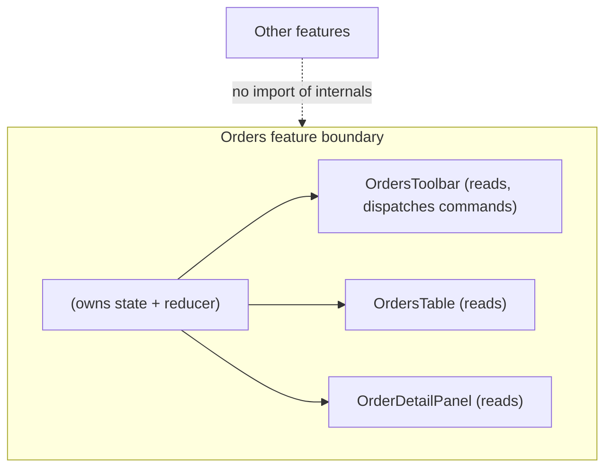
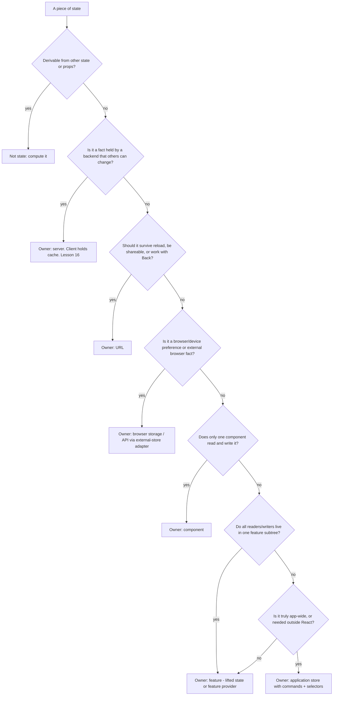
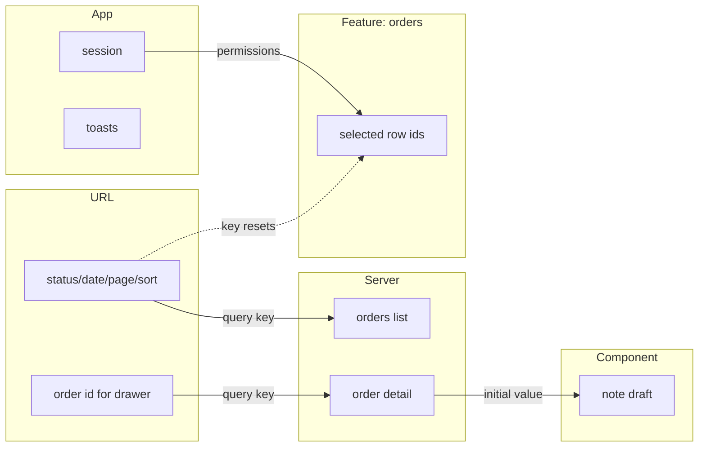

# 04 / 15 — State Ownership: Who Is Allowed to Change What

## 1. Lesson metadata

| | |
|---|---|
| **Level** | Advanced |
| **Study time** | 5–6 hours (reading 2.5 h, experiments 1 h, exercises 2 h) |
| **Prerequisites** | [03/18 — State colocation and lifting](../03-react-state-and-hooks/18-state-colocation-and-lifting.md), [03/19 — UI, server, URL and shared state](../03-react-state-and-hooks/19-ui-server-url-and-shared-state.md), [03/03 — useReducer and reducer architecture](../03-react-state-and-hooks/03-usereducer-and-reducer-architecture.md), [03/13 — useContext and propagation](../03-react-state-and-hooks/13-usecontext-and-propagation.md), [03/20 — useSyncExternalStore and external stores](../03-react-state-and-hooks/20-usesyncexternalstore-and-external-stores.md), [04/05 — Composition and dependency direction](./05-composition-and-dependency-direction.md), [04/06 — Feature vs layer structure](./06-feature-vs-layer-structure.md) |
| **Next** | [16 — Server state vs client state](./16-server-vs-client-state.md) |
| **Related later** | [Phase 6/10 — Zustand](../06-data-fetching-and-state-ecosystems/10-zustand.md), [Phase 6/09 — Redux Toolkit](../06-data-fetching-and-state-ecosystems/09-redux-toolkit.md), [Phase 11/08 — State architecture at scale](../11-senior-and-architect-mastery/08-state-architecture-at-scale.md) |

**Learning objectives.** After this lesson you can:
1. Define *state ownership* precisely and distinguish it from *state location* and *state access*.
2. Classify any piece of state by owner (component, feature, application, URL, server, browser) and justify the classification.
3. Choose among local state, lifted state, feature-scoped providers, global stores, and URL state using explicit criteria, and state each approach's dependency rules and failure modes.
4. Design a *state ownership map* for a feature and use it in code review.
5. Migrate state from one owner to another (up and down) without a rewrite.
6. Diagnose ownership bugs: duplicated truth, stale copies, "who reset this?", cross-feature coupling.

**Concepts covered:** ownership vs location vs access, single source of truth, write authority, read fan-out, state lifetime, state scope, owner taxonomy, command/query separation for state, ownership map, derived vs owned state, promotion and demotion of state, store slicing, boundary APIs for state, failure modes of each strategy.

---

## 2. Deep conceptual explanation

### 2.1 What problem does this lesson solve?

[Phase 3](../03-react-state-and-hooks/18-state-colocation-and-lifting.md) taught you the *mechanics* of putting state somewhere: `useState` next to the component that needs it; lifting to the nearest common ancestor; context; external stores. Those lessons answer "where can I put this so it works?".

At application scale the question changes to "where *should* this live so that a team of twelve can change it without breaking each other?" The failure patterns are recognizable:

- A modal's open/closed flag lives in a global store, so five features import the store to open it, and nobody can delete the modal without touching five features.
- The same user list is held in a Redux slice, a React Query cache, *and* a local `useState` initialized from props. They disagree after an edit.
- A `useState` initial value comes from a prop; the parent changes the prop; the child ignores it. Two owners, one fact.
- "Reset the form when the dialog closes" is implemented by an effect in an unrelated component that reaches into a shared store.

All four are *ownership* problems, not *mechanics* problems. The code works; the **responsibility is unclear**.

### 2.2 Definition

> **State ownership** is the assignment of *write authority* over a piece of state to exactly one module (component, hook, store slice, URL, or remote system), together with a *defined interface* through which others may read it and request changes.

Three words that people confuse:

| Term | Question it answers | Example |
|---|---|---|
| **Location** | Which line of code holds the `useState`/store field? | `useState` in `<OrdersPage>` |
| **Ownership** | Who may decide the next value, and who is responsible for its validity and lifetime? | The orders feature owns "selected order id"; nobody else may set it directly |
| **Access** | Who may read it, and how? | Any descendant via `useSelectedOrder()` |

Location is an implementation choice. Ownership is a design decision. Access is an interface. A healthy design keeps all three explicit. An unhealthy one lets location decide ownership implicitly ("it's in the global store, so anybody can change it").

### 2.3 The six owners

Every piece of state in a browser application has one of these owners. If you cannot say which, you do not yet understand the state.

| Owner | Source of truth | Lifetime | Typical examples | Mechanism (React) |
|---|---|---|---|---|
| **Component** | The component instance | Mount → unmount | Hover state, input draft, accordion open | `useState`, `useReducer`, `useRef` |
| **Feature/subtree** | A provider or lifted state inside a feature | Feature subtree mount | Multi-step wizard state, table selection | Lifted state, feature context + reducer |
| **Application** | An application-wide store | Page session | Auth session, theme, feature flags, toast queue | Context, external store (Zustand/Redux) |
| **URL** | The address bar | Navigable, shareable, survives reload | Filters, sort, page, selected tab, entity id | Router search/path params |
| **Server** | A remote system | Persistent, multi-user | Orders, users, prices | A server-state cache (Phase 6) |
| **Browser/platform** | Browser storage or APIs | Per device/profile | Draft in `localStorage`, online status, media query, scroll position | `useSyncExternalStore`, storage APIs |

Two rules follow from first principles:

1. **A fact has exactly one owner.** Copies are not owners; they are *caches* or *derivations* and must be explicitly labelled and invalidated (see [derived state](../03-react-state-and-hooks/17-derived-state.md)).
2. **State should be owned by the narrowest owner that satisfies *all* of its readers and its lifetime requirement.** Narrow = easy to delete, easy to test, small blast radius.

### 2.4 Write authority and read fan-out

Two measurable properties decide the right owner:

- **Write fan-out**: how many distinct modules need to *change* the state?
- **Read fan-out**: how many distinct modules need to *read* it, and how far apart are they in the tree?

| Write fan-out | Read fan-out | Natural owner |
|---|---|---|
| 1 | 1 | Component (`useState` where used) |
| 1 | few, close | Lift to common parent; pass props |
| 1 | many, far | Feature provider or store with a *read-only* selector API |
| many | many | Store with *commands* (named actions) — not raw setters |
| many (users, devices) | many | Server owns it; the client holds a cache |
| any, but must be shareable/bookmarkable | any | URL |

The important column is *write fan-out*. Reading is cheap to share (props, context, selectors). Writing is where coupling lives. **Prefer a design where many modules read but few write.** When many must write, expose *intent-revealing commands* (`openCheckout()`, `selectOrder(id)`) instead of a raw setter (`setState`). Commands let the owner enforce invariants.

### 2.5 State machine view: invariants belong to the owner

A piece of state usually has *invariants*: "if `status` is `'submitting'`, `error` must be `null`"; "selected id must exist in the list". The owner is the only party able to protect these invariants, because only the owner sees every write. If three modules can call `setStatus` and `setError` separately, the invariant is enforced by convention — i.e., not enforced. This is the deepest reason ownership matters, and why Phase 3's [`useReducer`](../03-react-state-and-hooks/03-usereducer-and-reducer-architecture.md) belongs in the architecture conversation: a reducer is a *write interface that guards invariants*.

### 2.6 What React exposes, and what it does not

- React gives you **mechanisms** (`useState`, `useReducer`, context, `useSyncExternalStore`, `useRef`) and **one rule** (data flows down via props; state changes go up via callbacks/dispatch).
- React has **no concept of ownership**. A context value can be written by anyone who is given the setter; a module-level store can be written by anyone who imports it. The language of ownership is *yours*, expressed via module boundaries, exports and naming.
- The *boundary* of ownership is therefore enforced by **what you export**. If a module exports `useStore` (the whole store), every importer is an owner. If it exports `useSelectedOrderId()` and `selectOrder(id)`, there is one owner and a narrow interface.

### 2.7 Relation to JavaScript and the browser

- JavaScript modules are singletons per realm: a module-level `const store = createStore()` is shared by every importer. That is *convenient* and *dangerous* — it is global mutable state in module clothing, and in SSR it can leak between requests ([Phase 9/03](../09-advanced-rendering-and-ecosystem/03-server-components-in-depth.md) and the SSR lessons treat this; the rule: create stores per request/per tree).
- The browser owns some state on your behalf: URL, history, scroll, focus, form control values (uncontrolled inputs), storage, connectivity. Fighting the browser's ownership (re-implementing scroll restoration, tab history, focus) is a classic source of bugs. Prefer to *project* browser state into React (via `useSyncExternalStore`) rather than copy it.

### 2.8 Common misconceptions

| Misconception | Reality |
|---|---|
| "Shared state means global state." | Shared across *some* components ≠ shared across the app. Feature-scoped ownership is usually enough. |
| "Putting it in the store makes it easier to access." | It makes it easier to *write* from anywhere — i.e. harder to reason about. Access can be narrow even when the store is global. |
| "Lifting state up is always the fix." | Lifting increases read/write distance and re-render scope. If only one subtree needs it, ownership belongs there, not at the root. |
| "Context is a state manager." | Context is a *distribution* mechanism for a value someone else owns ([03/13](../03-react-state-and-hooks/13-usecontext-and-propagation.md)). Ownership is whatever holds the `useState`/`useReducer` feeding the provider. |
| "Server data goes in Redux." | Server data is *owned by the server*; the client holds a replica with staleness and invalidation concerns. See [lesson 16](./16-server-vs-client-state.md). |
| "Duplicating state is fine if I sync it with an effect." | A synced duplicate has two owners and a race window. [You Might Not Need an Effect](../03-react-state-and-hooks/07-you-might-not-need-an-effect.md) explains why. |
| "URL state is only for routing." | The URL is the only owner whose state survives reload, back/forward and sharing for free. Filters/sort/pagination belong there by default ([Phase 6/18](../06-data-fetching-and-state-ecosystems/18-url-state-management.md)). |

---

## 3. Internal mechanics

### 3.1 What "owning" means mechanically in React

*Public guarantee.* State created by `useState`/`useReducer` is **private to the component instance** that calls the hook; its identity is determined by *position in the tree and key* ([Phase 2 reconciliation lessons](../02-react-rendering-and-internals/01-what-triggers-a-render.md) and [03/01](../03-react-state-and-hooks/01-usestate-internals-and-update-semantics.md)). When the component unmounts (or its position/key changes), the state is discarded.

Consequences for ownership:

1. **Lifetime is structural.** A feature that must keep state when a tab is hidden must either not unmount the tab panel, lift the state above the unmounting boundary, or store it elsewhere (URL, store, session storage). "My state keeps resetting" is almost always an ownership/lifetime mismatch.
2. **`key` is an ownership lever.** Changing a `key` deliberately transfers ownership to a *fresh instance* (state reset). This is the correct tool for "reset the form when the entity changes", rather than an effect that calls five setters.
3. **Only the owner's `set` function schedules a render of the owner.** A re-render of the owner re-renders children by default, regardless of whether they read the state ([Phase 7 later](../07-performance/03-why-components-rerender.md)). Ownership at a high level means *potentially* wide re-render scope; this is the performance face of ownership.

### 3.2 Context providers as ownership boundaries

A provider component is the natural **owner boundary for a feature**:



*Teaching model.* The provider owns the state; consumers hold only an interface (read selectors + command functions). The provider's value must be **stable** and **split** (state vs dispatch) to avoid wide re-renders ([03/14](../03-react-state-and-hooks/14-context-performance.md)).

### 3.3 External stores as ownership boundaries

An external store (Redux Toolkit, Zustand, or hand-rolled with `useSyncExternalStore`) holds state *outside the React tree*. Mechanically ([03/20](../03-react-state-and-hooks/20-usesyncexternalstore-and-external-stores.md)): components subscribe; the store notifies; React re-renders subscribers whose *selected snapshot* changed.

*Public guarantee.* `useSyncExternalStore` requires `getSnapshot` to return a cached/stable value when the store has not changed; and subscribing components re-render synchronously for store changes (store updates are not time-sliced).

*Ownership implications.*

- The store is **module-global by default**: lifetime = page session; any importer can write unless the API is narrowed.
- Selector subscription gives *fine-grained read fan-out* — a big advantage over context for wide-read state.
- Because store updates are outside React's state queue, they bypass transitions' ability to defer them. ⚠ Behavior with concurrent features has evolved; verify against the current `useSyncExternalStore` documentation before relying on transition behavior with external stores.

### 3.4 URL ownership mechanics

The URL is owned by the browser's history stack; the router reads it and re-renders subscribers. Setting URL state means *navigating* (push/replace), which has side effects: history entries, scroll restoration, possibly route data loading. Reads are synchronous snapshots; writes are asynchronous in the sense that the new location becomes visible after the router processes the navigation.

Consequences: URL state is *serialized* (strings). Complex objects need parse/stringify and validation; invalid or hand-edited URLs are an **untrusted input** you must handle ([lesson 18](./18-routing-architecture.md)).

### 3.5 The server as owner

Server state is owned by the backend: other users and processes change it concurrently. The client copy is a **cache with a validity window**. Mechanics (fetch, cache keys, invalidation) are in [Phase 6/07](../06-data-fetching-and-state-ecosystems/07-server-state-management.md); the ownership implication is: the client may *request* a change (mutation) but does not *decide* it, and must tolerate rejection and staleness. This is why forms editing server entities keep a **draft** (client-owned) separate from the **entity** (server-owned) and commit by mutation.

### 3.6 Implementation detail warnings

- Whether a dispatch from a store triggers one or many renders in a batched event is a React/batching detail (React 18+ batches broadly). Don't write ownership logic that depends on render counts.
- In StrictMode development, component bodies and reducers may be invoked twice; **owner code must be pure** or ownership logic will appear to "run twice".

---

## 4. Step-by-step walkthrough: assigning ownership for a real feature

Scenario: an **Orders page** with a filter bar (status, date range), a paginated table, row multi-select with bulk actions, and a detail drawer for one order. Walk the *design process* chronologically.

**Step 1 — Inventory every piece of state.** Write them as nouns:

`orders list`, `order detail`, `status filter`, `date range`, `page`, `sort`, `selected row ids`, `drawer open + which order`, `bulk-action in-flight flag`, `column visibility`, `draft note text in drawer`, `toast messages`, `current user`, `user permissions`.

**Step 2 — For each, ask the five questions.**

1. Does it survive a reload or need to be shareable/bookmarkable? → URL candidate.
2. Is it a fact held by the backend and changed by others? → server.
3. Does it outlive the component that displays it? → lifetime above component.
4. How many modules write it? How many read it?
5. Is it derivable from something else? → not state.

**Step 3 — Fill the ownership map.**

| State | Owner | Why | Read via | Write via |
|---|---|---|---|---|
| orders list | Server | Multi-user, changes remotely | server-cache hook `useOrders(params)` | mutations only |
| order detail | Server | same | `useOrder(id)` | mutation |
| status filter, date range, page, sort | URL | Shareable, back/forward, reload | `useOrdersSearchParams()` | `setOrdersSearch(patch)` |
| drawer open + order id | URL (`?order=123`) | Deep-linkable; back closes drawer | same hook | same hook |
| selected row ids | Feature (orders page) | Not shareable, discarded when leaving; many readers (toolbar + rows) | `useSelection()` | `toggle`, `clear`, `selectAll` |
| bulk-action in-flight | Mutation hook state | Owned by the mutation | `mutation.isPending` | — |
| column visibility | Browser storage via small store | Per-device preference | `useColumnPrefs()` | `setColumnVisible` |
| draft note text | Component (`NoteEditor`) | Only it reads/writes; discarded on close | local | local |
| toasts | Application | Cross-feature | `useToasts()` | `toast.show()` |
| current user, permissions | Application (derived from a server query) | Everyone reads; one writer (auth) | `useSession()` | `signIn/signOut` |

**Step 4 — Eliminate derivations.** `selectedCount`, `allSelected`, `hasFilters`, `isDrawerOpen` are *derived*; they are computed in render or selectors, not stored.

**Step 5 — Resolve cross-ownership flows.** "When filters change, clear the selection." Who does it? Two options: (a) the **selection owner** resets itself when a *key* derived from the filters changes (`<SelectionProvider key={filterKey}>`), or (b) the filter-setter command also calls `clear()`. Option (a) keeps the invariant in the owner; (b) couples two owners. Prefer (a) unless you need to preserve selection across some filter changes.

**Step 6 — Decide the module boundaries and exports** (folder structure in §5.2 below), and **write the ownership map into the feature README or the PR description**. Reviewers can now enforce it.

**Step 7 — Re-check on change.** When a new requirement arrives ("preserve selection across pages"), re-run Step 2 for the affected state only. Move ownership deliberately (§5.6, migration).

---

## 5. Code examples

### 5.1 Minimal: ownership at the narrowest level

```tsx
import { useState } from "react";

export function Disclosure({ title, children }: { title: string; children: React.ReactNode }) {
  const [open, setOpen] = useState(false); // owner: this component. Nobody else cares.
  return (
    <section>
      <button aria-expanded={open} onClick={() => setOpen((o) => !o)}>{title}</button>
      {open && <div>{children}</div>}
    </section>
  );
}
```

**Why correct:** write fan-out 1, read fan-out 1, lifetime = mount. Making this global "in case someone needs it" is speculative generality.
**When it stops being appropriate:** the moment another module needs to *command* it ("expand all"). Then either accept `open` / `onOpenChange` props (controlled — see [Phase 5/11](../05-design-patterns/11-controlled-component-pattern.md)) or give it a handle through an explicit API.

### 5.2 Practical: a feature-scoped owner with a narrow interface

Representative folder structure for a feature that owns its state:

```text
src/features/orders/
  index.ts                     # PUBLIC API of the feature (the only import path for others)
  OrdersPage.tsx               # composition root of the feature
  state/
    selection.tsx              # feature-scoped provider + hook (owner of selection)
    useOrdersSearchParams.ts   # URL owner adapter (parses + validates)
  data/
    useOrders.ts               # server-state hooks (owner: server cache)
    ordersApi.ts
  ui/
    OrdersTable.tsx
    OrdersToolbar.tsx
    OrderDrawer.tsx
    NoteEditor.tsx             # component-owned draft state
```

**Dependency rules (enforceable, see [lesson 25](./25-architectural-fitness-and-enforcement.md)):**

- `ui/*` may import `state/*` and `data/*` hooks, never `ordersApi.ts` directly.
- `state/*` imports nothing from `ui/*`.
- Other features import **only** from `features/orders/index.ts`, which exports components and a few hooks, never the provider's raw state or setters.
- No module outside `state/selection.tsx` imports its reducer or context object.

```tsx
// state/selection.tsx
import { createContext, useContext, useMemo, useReducer, type ReactNode } from "react";

type State = { readonly ids: ReadonlySet<string> };
type Action =
  | { type: "toggle"; id: string }
  | { type: "selectMany"; ids: readonly string[] }
  | { type: "clear" };

function reducer(state: State, action: Action): State {
  switch (action.type) {
    case "toggle": {
      const next = new Set(state.ids);
      if (next.has(action.id)) next.delete(action.id); else next.add(action.id);
      return { ids: next };
    }
    case "selectMany":
      return { ids: new Set(action.ids) };
    case "clear":
      return state.ids.size === 0 ? state : { ids: new Set() };
  }
}

// Two contexts: reads change often, commands never change identity.
const SelectionStateContext = createContext<State | null>(null);
const SelectionCommandsContext = createContext<{
  toggle(id: string): void;
  selectMany(ids: readonly string[]): void;
  clear(): void;
} | null>(null);

export function SelectionProvider({ children }: { children: ReactNode }) {
  const [state, dispatch] = useReducer(reducer, { ids: new Set<string>() });
  const commands = useMemo(
    () => ({
      toggle: (id: string) => dispatch({ type: "toggle", id }),
      selectMany: (ids: readonly string[]) => dispatch({ type: "selectMany", ids }),
      clear: () => dispatch({ type: "clear" }),
    }),
    [], // dispatch is stable
  );
  return (
    <SelectionCommandsContext value={commands}>
      <SelectionStateContext value={state}>{children}</SelectionStateContext>
    </SelectionCommandsContext>
  );
}

export function useIsSelected(id: string): boolean {
  const s = useContext(SelectionStateContext);
  if (!s) throw new Error("useIsSelected outside SelectionProvider");
  return s.ids.has(id);
}
export function useSelectedIds(): ReadonlySet<string> {
  const s = useContext(SelectionStateContext);
  if (!s) throw new Error("useSelectedIds outside SelectionProvider");
  return s.ids;
}
export function useSelectionCommands() {
  const c = useContext(SelectionCommandsContext);
  if (!c) throw new Error("useSelectionCommands outside SelectionProvider");
  return c;
}
```

**Line notes.**
- `<SelectionStateContext value={…}>` uses the React 19 form where the context object is rendered directly as a provider (`.Provider` is the older form; verify against current react.dev reference for your version).
- The reducer returns the *same* `state` when `clear` is a no-op, which lets React bail out of re-rendering.
- Only hooks are exported by the feature; the reducer, action types and contexts stay private.
- Splitting state vs commands means components that only dispatch (the toolbar's "Clear" button) do not re-render on selection changes via context. (The toolbar that *shows* a count reads state and does.)
- `useIsSelected` still re-renders every consumer on any change because context has no selectors. For tables with thousands of rows this is a known limit (see failure modes, and [Phase 7/06](../07-performance/06-context-propagation-cost.md)); the migration path is an external store with selectors.

Composition root resets selection by key:

```tsx
// OrdersPage.tsx
export function OrdersPage() {
  const search = useOrdersSearchParams();          // owner: URL
  const filterKey = JSON.stringify([search.status, search.from, search.to]);
  return (
    <SelectionProvider key={filterKey}>            {/* new filter → fresh owner instance */}
      <OrdersToolbar />
      <OrdersTable />
      <OrderDrawer orderId={search.order} />
    </SelectionProvider>
  );
}
```

**Predict:** the user selects 3 rows, then changes the status filter. What is the selection afterwards, and what is mounted? 
**Result:** empty selection; the entire `SelectionProvider` subtree is *unmounted and remounted* (including `OrdersTable`, so its local state such as scroll position inside it is also reset). **Why:** `key` changed → new component identity → state discarded. **Trade-off:** simple and impossible to forget, but the remount is heavy; if the table has expensive local state, put the `key` only on a *small* provider that wraps nothing heavy, or reset via a command (`clear()`) in the filter-change handler instead.

### 5.3 Incorrect: duplicated truth with an effect "sync"

```tsx
function UserForm({ user }: { user: User }) {
  const [name, setName] = useState(user.name);
  useEffect(() => { setName(user.name); }, [user]);        // "keep in sync"
  // ...
}
```

**Predict:** the user is typing a new name; a background refetch returns a *new object identity* for the same user. What happens?
**Result:** the typed text is overwritten by the server value mid-typing. **Why:** two owners (the prop, which mirrors the server cache, and the local draft) were declared to be the same fact; the effect arbitrates by always letting the server win, destroying the draft. Also, the effect causes a second render per sync (see [03/07](../03-react-state-and-hooks/07-you-might-not-need-an-effect.md)).

### 5.4 Corrected: separate *draft* (client-owned) from *entity* (server-owned)

```tsx
function UserForm({ user }: { user: User }) {
  // Draft is initialised once per `user.id`; the parent keys this component by id.
  const [draft, setDraft] = useState({ name: user.name });
  const dirty = draft.name !== user.name;      // derived, not stored
  // submit → mutation; on success the server cache updates `user` and `dirty` becomes false
  // ...
}

// parent
<UserForm key={user.id} user={user} />
```

**Why correct:** the draft has *one owner* (this component); the entity has one owner (server). The relationship "dirty" is derived. The key resets the draft only when the *identity* of the entity changes, not when its fields refresh. **Trade-off:** if the server value changes while the user edits, the form silently keeps the draft; you may need an explicit "this record changed" banner (a product decision, not a state-management one).

### 5.5 Advanced: store with a narrow boundary, a selector API, and an ownership guard

A module that owns application-level UI state but exposes only commands and selectors (shown with `useSyncExternalStore` so it has no dependency; Zustand/Redux Toolkit produce the same shape — see [Phase 6](../06-data-fetching-and-state-ecosystems/10-zustand.md)).

```ts
// shared/toasts/toastStore.ts  (owner: application "notifications" module)
import { useSyncExternalStore } from "react";

export type Toast = { id: string; kind: "info" | "error"; message: string };

let toasts: readonly Toast[] = [];                     // private: no export
const listeners = new Set<() => void>();
const emit = () => listeners.forEach((l) => l());

function subscribe(l: () => void) { listeners.add(l); return () => listeners.delete(l); }
const getSnapshot = () => toasts;                       // stable until we reassign
const getServerSnapshot = () => [] as readonly Toast[]; // ⚠ constant reference for SSR

export const toast = {                                  // commands: the ONLY write API
  show(kind: Toast["kind"], message: string) {
    toasts = [...toasts, { id: crypto.randomUUID(), kind, message }];
    emit();
  },
  dismiss(id: string) {
    toasts = toasts.filter((t) => t.id !== id);
    emit();
  },
};

export function useToasts(): readonly Toast[] {         // read API
  return useSyncExternalStore(subscribe, getSnapshot, getServerSnapshot);
}
```

**Line notes.** `toasts` is not exported; `getSnapshot` returns the same array reference until a command replaces it (a hard requirement of `useSyncExternalStore`: unstable snapshots cause infinite loops). `getServerSnapshot` must also return a stable value, hence the hoisted constant-like pattern (here a new `[]` each call would be a bug — see the exercise D3; use a module-level `const EMPTY: readonly Toast[] = []`).

> **Correction applied to the snippet above:** `const getServerSnapshot = () => [] as readonly Toast[]` returns a *new array every call*. Use `const EMPTY: readonly Toast[] = []; const getServerSnapshot = () => EMPTY;`. The incorrect form is retained here deliberately; find why in exercise D3.

**Ownership properties of this design:** one write API (`toast`), one read hook, no way to hold a raw reference and mutate it (arrays are replaced, typed `readonly`). Callable *outside React* (e.g., from an HTTP interceptor) — a legitimate reason to prefer an external store over context. **Caveat:** module-level state is shared across tests (reset between tests) and across requests in SSR (do not use for per-user server-rendered state).

### 5.6 Migration code: promoting component state to the URL

Before: `const [tab, setTab] = useState<"overview" | "billing">("overview")`.
After (router-agnostic sketch; the specific search-param API is router-specific — verify against your router's docs):

```tsx
const TABS = ["overview", "billing"] as const;
type Tab = (typeof TABS)[number];

function parseTab(raw: string | null): Tab {
  return (TABS as readonly string[]).includes(raw ?? "") ? (raw as Tab) : "overview"; // untrusted input
}

function useTab(): [Tab, (t: Tab) => void] {
  const [params, setParams] = useSearchParams();     // e.g. React Router's hook; verify signature in docs
  const tab = parseTab(params.get("tab"));
  const setTab = (t: Tab) =>
    setParams((prev) => { const n = new URLSearchParams(prev); n.set("tab", t); return n; }, { replace: true });
  return [tab, setTab];
}
```

The call sites change from `useState` to `useTab()` with the same tuple shape — a deliberate *interface-preserving migration*. Decide `replace` vs `push` by whether Back should step through tab changes.

---

## 6. Visual explanations

### 6.1 Decision tree: who should own this state?



### 6.2 Ownership map for the Orders page



Arrows are *dependencies in data direction*, and every arrow crosses an ownership boundary through an explicit interface (a hook or a prop), never through shared mutable access.

### 6.3 Blast radius vs. owner level

```text
Owner level:      Component   Feature      Application      URL/Server
Re-render scope: ■            ■■■          ■ to ■■■■■ (depends on selectors)
Delete cost:     trivial      one folder   grep the whole app
Test setup:      render       render+prov  reset module state
Shareable:       no           no           no               yes (URL) / yes (server)
```

---

## 7. Alternative approaches and trade-offs

Each approach below is documented with the required architecture facts. Sizes are **guidelines** from common experience, not laws.

### 7.1 Approach A — Component-local state (colocation)

- **Original problem it solved:** global state made every change a cross-cutting risk; learners and teams "stored everything in Redux".
- **Representative structure:** none beyond the component file; hook next to the component.
- **Dependency rules:** state is not exported; parent communicates via props. No import of stores.
- **Example:** §5.1.
- **Advantages:** deletion is trivial; no re-render beyond the subtree; no coupling; easy to test.
- **Disadvantages:** state is lost on unmount; siblings cannot see it; "just this once" duplication when requirements grow.
- **Appropriate size:** any size, as the default for state with one reader/writer. The total number of local states is unbounded; what matters is each one's fan-out.
- **Failure modes:** a prop-mirroring local copy (§5.3); local state that needed to be shareable (lost deep link); state lost because an ancestor conditionally unmounts.
- **Migration considerations:** promote when a second module needs write or when lifetime must exceed the component; keep the hook interface the same (see §5.6).

### 7.2 Approach B — Lifted state (feature composition root)

- **Original problem:** sibling coordination (filters ↔ table).
- **Structure:** `OrdersPage.tsx` holds `useState`/`useReducer`; children are presentational with props. (See [lesson 04](./04-presentational-vs-container.md).)
- **Dependency rules:** children never import the page; props only flow down; callbacks flow up.
- **Advantages:** explicit data flow; trivially debuggable; no hidden coupling; no context performance issue if depth is small.
- **Disadvantages:** prop drilling through intermediate components (mitigated by composition — pass elements/slots, not data, through the middle layers; see [lesson 05](./05-composition-and-dependency-direction.md)); owner re-render re-renders its subtree.
- **Appropriate size:** 2–3 levels of depth, ≲ 5–8 props at the boundary. Beyond that consider §7.3.
- **Failure modes:** "god page" with 15 `useState`s and 40 props; owners at the app root "because three things need it".
- **Migration:** to a feature provider by wrapping the same state in a provider and replacing prop passing with hooks one component at a time.

### 7.3 Approach C — Feature-scoped provider (context + reducer)

- **Original problem:** drilling through many layers; a feature's internal state needed by deep descendants.
- **Structure:** §5.2 (`state/` folder with provider, hooks, private reducer).
- **Dependency rules:** consumers import hooks only; provider is mounted by the feature's root; no cross-feature context imports; lower layers (`shared/`) cannot import feature contexts.
- **Advantages:** lifetime = feature subtree (reset via key/unmount); testable by mounting the provider; narrow exports.
- **Disadvantages:** context re-renders all consumers on change (no selectors); provider "pyramids" at the root if every feature uses one; implicit dependency (consumer fails without provider).
- **Appropriate size:** tens of consumers, low-frequency updates (selection toggles, wizard steps). Not for high-frequency state (cursor position, streaming prices) read by hundreds of components.
- **Failure modes:** a single `AppContext` holding everything (every update re-renders every consumer); missing-provider errors in tests; unstable `value` object created inline.
- **Migration:** to an external store: keep the hook names, change their implementation to `useStore(selector)`; consumers unchanged.

### 7.4 Approach D — Application store (Redux Toolkit / Zustand / custom)

- **Original problem:** state needed by distant, unrelated parts and outside React; time-travel/devtools requirements; coordination of many writers.
- **Structure:**

```text
src/app/store/            # composition: creates the store, wires slices
src/features/cart/model/  # slice or store module owned by the feature
src/features/cart/index.ts# exports hooks/selectors/commands only
```

- **Dependency rules:** feature slices register with the app store but **do not import each other's internals**; cross-feature reaction via events/listeners (RTK listener middleware, Zustand subscriptions) or an explicit mediator in an application layer ([lesson 13](./13-application-services-and-adapters.md)).
- **Advantages:** selectors give fine-grained re-render; usable outside React; devtools; explicit actions/commands log.
- **Disadvantages:** global mutable singleton (SSR/test isolation); temptation to put everything (server data, form drafts, UI flags) in; boilerplate (Redux) or looseness (Zustand).
- **Appropriate size:** state with many distant readers or non-React writers: session, flags, notifications, cart, cross-route wizard. Typical apps have a *small* store (≲ 10–20 slices of genuinely global state). If most store content is server data, you are using the wrong owner ([lesson 16](./16-server-vs-client-state.md)).
- **Failure modes:** "reducer soup"/god store; slice A reading slice B state directly (hidden coupling); stale server copies; selectors returning new objects every call (needless re-renders); persisted state shape drift across deploys.
- **Migration:** adopting: start with one slice for one cross-cutting concern; shrinking: move server data to a cache, UI flags to feature/URL.

### 7.5 Approach E — URL as owner

- **Problem:** state lost on refresh; no deep links; Back button useless.
- **Structure:** `useXSearchParams.ts` adapters per route/feature that parse, validate, default and serialize.
- **Dependency rules:** only the adapter touches raw `URLSearchParams`; components consume typed values.
- **Advantages:** free persistence, sharing, history, analytics context; survives crashes.
- **Disadvantages:** serialization; each change is navigation; length limits; sensitive data must not go in URLs; browser history pollution if overused.
- **Appropriate size:** a handful of scalar/array parameters per page. Large structured state (a whole query builder) is better serialized as a single compact param or stored server-side as a "saved view" referenced by id.
- **Failure modes:** unvalidated params crash components; double ownership with local state mirrors (`useState` initial from URL, never updated); push vs replace mistakes flood history; keystroke-per-navigation for text inputs (debounce or keep a draft locally and commit on submit).
- **Migration:** see §5.6; keep an in-memory draft when each keystroke would navigate.

### 7.6 Approach F — Server-state cache as owner of replicas

Covered in depth in [lesson 16](./16-server-vs-client-state.md) and [Phase 6/08](../06-data-fetching-and-state-ecosystems/08-tanstack-query.md). Included here because it changes ownership vocabulary: the **client does not own server data** — it owns *requests* and *drafts*.

### 7.7 Comparison

| Criterion | Local | Lifted | Feature provider | App store | URL |
|---|---|---|---|---|---|
| Readability of data flow | Highest | High | Medium | Medium–Low | High |
| Re-render control | Excellent | Subtree-wide | Subtree-wide, no selectors | Selector-level | Router-dependent |
| Coupling created | None | Parent↔children | Feature internal | Global singleton | Route contract |
| Testability | Trivial | Easy | Needs provider | Needs reset/provider | Needs router |
| Survives reload | No | No | No | Only if persisted | Yes |
| Usable outside React | No | No | No | Yes | Yes (via history) |
| Delete cost | Trivial | Low | Low | High | Medium (links break) |
| Team scalability | Excellent | Good | Good | Needs rules | Needs param registry |

**Scenario where the recommended default (narrowest owner) is NOT best.** A trading terminal: price ticks arrive ~50×/second and are displayed in a watchlist, a chart, an order ticket and a notification system. Narrow ownership (lifting into the page, or feature context) would re-render everything at 50 Hz. A *store with per-symbol selectors* (or a subscription layer outside React feeding `useSyncExternalStore`) is the right owner even though the state is "only" used by one page — **read fan-out and update frequency** override the "narrowest" heuristic. Likewise, an auth session is truly app-wide and used by non-React code (HTTP client), so it belongs in an application owner immediately.

---

## 8. Best practices and anti-patterns

**Practices**
1. Write the ownership map for any feature with more than ~3 pieces of non-trivial state; keep it with the feature.
2. **Export commands and selectors, not setters and stores.**
3. Keep *drafts* and *entities* separate; derive `dirty`, `valid`, `canSubmit`.
4. Use `key` to reset an owner instead of effects that zero out state.
5. Promote state only when a concrete second consumer or lifetime requirement exists (YAGNI — see [Phase 5/02](../05-design-patterns/02-dry-kiss-yagni.md)).
6. Give every store slice/provider a *single reason to change*.
7. Make state types encode invariants (discriminated unions) so illegal combinations are unrepresentable.

**Beginner mistakes**
- Everything in one `useState` object at the root; or everything in the global store.
- Copying props into state (`useState(props.x)`) without a reason, or without a `key`.
- Using context as the state and forgetting that it just distributes.

**Experienced-developer mistakes**
- Over-engineering: a store per feature "for consistency" when local state suffices.
- Global store as an event bus: components dispatch "open modal X" actions that anything listens to, creating invisible dependencies.
- Normalizing UI state like a database because "it's cleaner".
- Persisting entire stores to `localStorage` without versioning or migration.

**Smells**
- A selector or hook named `useAppState` / `useStore` with no domain noun.
- Effects whose only job is "when A changes, set B".
- A boolean prop explosion (`isOpen`, `isLoading`, `isError`, `isEmpty`) all stored, not derived.
- Features importing `../otherFeature/store`.
- Tests that need to know which global slice to seed to render a leaf component.

**Justified exceptions**
- Duplicating a value *deliberately* as an optimistic copy with a documented reconciliation rule ([Phase 6/05](../06-data-fetching-and-state-ecosystems/05-optimistic-updates.md)).
- A global store for a UI flag like "command palette open" because a *global keyboard shortcut outside React* must open it — expose `openPalette()`, not the flag.
- Context for an *immutable* value (theme tokens, i18n function): ownership is trivially the root; there is nothing to protect.

---

## 9. Real-world application

**E-commerce checkout (multi-step).** Cart contents: server-owned if the cart is persisted per user (with a client cache), otherwise application-owned and persisted to `localStorage` with versioning. Checkout step: URL (`/checkout/shipping`) so Back works and refresh is safe. Address/payment drafts: feature-owned (a `CheckoutProvider` reducer) because the steps are separate routes sharing a draft; payment card input: component-owned (and handled by the PSP's hosted fields; never stored in your store). Constraint: PCI scope — what you *don't* own is a feature. Failure mode: storing card data in a global store "for convenience" widens audit scope and leaks via devtools/persistence.

**Finance dashboard.** Dozens of widgets; each widget owns its parameters (component/URL per widget id), a shared **time range** (URL, application-wide read, one writer: the header). Streaming quotes owned by a subscription store with per-symbol selectors. Constraint: widgets are developed by different teams; they may read the time range through `useTimeRange()` and must not write it.

**Auth.** One owner (session module) with `useSession()`, `signIn`, `signOut`, and a non-React `getAccessToken()` for the HTTP layer. Permissions are *derived* from the session, never separately stored. Failure mode: components copying `user.role` into local state, so role revocation is not reflected until remount.

**Forms.** Draft = component or feature; submitted state = mutation; validation errors from server = mutation result, merged into the form display ([Phase 3/21](../03-react-state-and-hooks/21-forms-and-complex-state.md)).

**Multi-team product.** Each team owns its feature's state, and a short *shared state contract* (session, time range, locale, notifications) is owned by the platform team with a versioned API ([lesson 23](./23-multi-team-ownership.md)).

---

## 10. Debugging and troubleshooting

### Symptom 1: "The value is stale in one place and fresh in another."
- **Repro:** edit a user's name in a drawer; the list still shows the old name until reload.
- **Investigation:** React DevTools → Components → find both components; inspect hooks. Search the codebase for every `useState(` seeded from the entity and every store field holding the entity. Network panel: was the list refetched after the mutation?
- **Root cause:** two owners (a copy in a slice/state and the server cache), or a cache not invalidated.
- **Fix:** delete the copy; read from the single owner; invalidate/update the cache after mutation.
- **Validate:** change the entity from a second tab/mutation and observe both views update; add a test that mutates and asserts both views.

### Symptom 2: "State resets when I switch tabs/routes."
- **Investigation:** Profiler/Components panel: is the owner remounting (new instance, hooks reset)? Check for conditional rendering, `key` changes (including `key={Math.random()}` or index keys), or layout components defined *inside* another component's body (new type each render → remount).
- **Root cause:** lifetime shorter than required.
- **Fix:** lift above the unmounting boundary, move to URL/store, or stop remounting.

### Symptom 3: "I changed X and something unrelated broke."
- **Investigation:** find *writers* of the state: search for setter/dispatch usage (or store `set(`). In Redux DevTools, inspect the action log and which module dispatched; in Zustand, use devtools middleware names. Count writers.
- **Root cause:** write fan-out too wide; no command boundary.
- **Fix:** introduce named commands; make raw setters private; move the invariant into the owner.

### Symptom 4: "Too many re-renders when something unrelated changes."
- **Investigation:** React DevTools Profiler with "Record why each component rendered"; look for "context changed" on many consumers; check whether the provider's `value` is recreated each render.
- **Root cause:** wide context for volatile state; unstable provider value.
- **Fix:** split contexts, memoize the value, or move to selector-based store (migration in §7.3).

### Symptom 5: "Reloading loses the user's place."
- **Root cause:** state owned by component but conceptually navigational.
- **Fix:** promote to URL (§5.6).

---

## 11. Exercises

### Level A — Knowledge
A1. Define state ownership and distinguish it from state location and state access.
A2. List the six owners and give one example of each.
A3. What two properties (fan-out) decide the owner, and which of them is the main source of coupling?
A4. Why is a copy of server data in a component not an "owner" of that data?
A5. What does changing a component's `key` do to its state, and why is that an ownership tool?
A6. Why might a context provider be a *good* owner boundary yet a *poor* state-manager?

### Level B — Code comprehension
B1. What does this render after the user clicks "Next" twice, then the parent passes `step={0}`?
```tsx
function Wizard({ step }: { step: number }) {
  const [current, setCurrent] = useState(step);
  return <button onClick={() => setCurrent((c) => c + 1)}>{current}</button>;
}
```
B2. Identify every owner in this snippet and any violation of single ownership:
```tsx
const [query, setQuery] = useState(searchParams.get("q") ?? "");
useEffect(() => { setSearchParams({ q: query }); }, [query]);
useEffect(() => { setQuery(searchParams.get("q") ?? ""); }, [searchParams]);
```
B3. Why does every `useIsSelected(id)` consumer in §5.2 re-render when any row is toggled, and is that a correctness issue?
B4. In §5.5 what breaks if `getSnapshot` returned `[...toasts]`?

### Level C — Implementation
C1. Build a `useUrlState<T>(key, parse, serialize, defaultValue)` hook (router-agnostic: accept `searchParams` and `setSearchParams` as arguments) that validates input and never throws on invalid URLs.
C2. Write a feature-scoped `WizardProvider` with a reducer that enforces "cannot go to step N+1 unless step N is valid", exposing only `useWizardStep()` and `useWizardCommands()`.
C3. Convert the `SelectionProvider` of §5.2 so that `useIsSelected(id)` only re-renders for its own row (hint: `useSyncExternalStore` per feature instance, with a per-id subscription).

### Level D — Debugging
D1. A modal "reset on close" is implemented by `useEffect(() => { if (!open) { setA(""); setB(""); setC(null); } }, [open])`. Users see the fields visibly blank out while the close animation is still playing, and the reset costs an extra render pass. Explain and fix without effects.
D2. After refactoring `useUser` to read from a store, a profile screen shows the previous user for one frame when navigating between users. Find the ownership cause and propose two fixes.
D3. In §5.5, `getServerSnapshot = () => [] as readonly Toast[]` causes a React warning/loop during hydration. Explain precisely and fix.
D4. A list page keeps `selectedIds` in a global store. Navigating to another list page shows rows pre-selected that don't exist. Why, and what owner should have been used?

### Level E — Architecture decisions
E1. For a product catalog with search, facets, pagination, compare-tray (up to 4 items), and a quick-view modal, produce an ownership map (state, owner, read via, write via). Justify each owner.
E2. Your team debates "one global Zustand store for everything" vs "no global state, only context". Provide evaluation criteria, and a recommendation for a 15-developer team with three features sharing session and notifications only.
E3. Design the migration from a 40-slice Redux store holding server data to a layered model, without a feature freeze.

### Level F — Expert challenge
F1. A realtime collaborative document editor has: document content (CRDT), cursors of others, local selection, toolbar formatting state, sidebar open state, and comments (server). Assign owners, discuss which are external to React entirely, and specify how React reads each without excessive re-renders. State where the ownership model above is insufficient.

---

## 12. Detailed answers and explanations

> Attempt the exercises first.

**A1.** *Ownership* = the module with write authority and responsibility for validity and lifetime; *location* = where the storage code physically lives; *access* = the interface for reading and requesting changes. They can diverge: a store (location: global) can have a narrow owner (the cart module) and a narrow access API. Wrong answer: "ownership = which component calls `useState`" — that conflates location and ownership.

**A2.** Component (`useState` draft), feature (selection provider), application (session/toasts), URL (filters), server (orders), browser/platform (column preferences in `localStorage`, `navigator.onLine`).

**A3.** Write fan-out and read fan-out. Write fan-out is the coupling source: each additional writer needs the invariant knowledge; reads are cheap to share. Plausible wrong: "number of components" — total count isn't the issue; *distinct writing modules* is.

**A4.** Other users/processes can change the truth; the component cannot decide the value and its copy can become stale. It owns, at most, a *replica with a validity window*.

**A5.** A new `key` produces a new component identity: the old instance unmounts (state, effects cleaned up) and a new one mounts with fresh state. It's an ownership tool because it *transfers* ownership to a fresh instance, declaratively, with no effect code.

**A6.** A provider is a boundary where the owner (the `useState`/`useReducer` beside it) is clearly defined and lifetime is the subtree. But context has no selectors: every consumer re-renders on any value change, and it provides no actions, middleware or non-React access; so it lacks state-manager features for high-frequency/wide-read state.

**B1.** The button shows `2` after two clicks; when the parent passes `step={0}`, **it still shows `2`**. `useState(step)` uses `step` only on mount. Two owners declared for one fact (parent's `step`, child's `current`). Fix: make it controlled (`step` + `onStepChange`), or reset via `key={step}` if the intent is "parent changes → restart", or rename the prop to `initialStep` to make the one-time seed explicit.

**B2.** Owners: the URL (`q`) and component state (`query`) — two owners for one fact, synchronized by two effects, creating a loop risk and race: typing sets state → effect 1 navigates → searchParams changes → effect 2 sets the same state (usually a no-op, but with normalization or debouncing differences it can fight the user's cursor/input). Intermediate renders show disagreeing values. Fix: make URL the owner and derive `query` from it, with a *draft* only if keystroke-per-navigation is unacceptable: keep a local draft, commit on submit/debounce, and reset the draft with a `key` or an explicit "external change" handler.

**B3.** Every consumer reads the single context value `state`; when the reducer returns a new `state` object, all consumers of `SelectionStateContext` re-render (context has no selector). Not a correctness issue (each computes the right boolean), a performance concern at thousands of rows. Mitigations: memoize rows (`React.memo` does *not* prevent context-triggered re-renders), use a store with per-id subscriptions, or virtualize.

**B4.** `[...toasts]` creates a new array on every `getSnapshot` call, so React sees the snapshot as always changed → it re-renders and re-checks, producing an infinite render loop/warning ("The result of getSnapshot should be cached"). `getSnapshot` must return the same value until the store really changes.

**C1. Reference solution**
```ts
export function useUrlState<T>(
  searchParams: URLSearchParams,
  setSearchParams: (next: URLSearchParams, opts?: { replace?: boolean }) => void,
  key: string,
  parse: (raw: string) => T | undefined,   // return undefined for invalid
  serialize: (value: T) => string,
  defaultValue: T,
): [T, (next: T) => void] {
  const raw = searchParams.get(key);
  const parsed = raw === null ? undefined : parse(raw);
  const value = parsed === undefined ? defaultValue : parsed;
  const set = (next: T) => {
    const p = new URLSearchParams(searchParams);
    if (Object.is(next, defaultValue)) p.delete(key); else p.set(key, serialize(next));
    setSearchParams(p, { replace: true });
  };
  return [value, set];
}
```
Notes: never throws on invalid input; omits default values to keep URLs clean; `parse` must not throw (wrap `JSON.parse` in try/catch). Edge cases: arrays (use repeated params), stale `searchParams` captured in `set` when called multiple times in one tick (use the functional form of your router's setter if available).

**C2. Evaluation criteria.** Reducer rejects invalid transitions by returning the same state; step validity is data in state (`validity[step]`); invariants tested via pure reducer tests; no exported context/reducer; commands: `next`, `back`, `setValid(step, boolean)`, `reset`. Example sketch:
```ts
type S = { step: number; valid: Record<number, boolean> };
type A = { type: "next" } | { type: "back" } | { type: "setValid"; step: number; valid: boolean } | { type: "reset" };
function reducer(s: S, a: A): S {
  switch (a.type) {
    case "next": return s.valid[s.step] ? { ...s, step: s.step + 1 } : s;
    case "back": return s.step > 0 ? { ...s, step: s.step - 1 } : s;
    case "setValid": return { ...s, valid: { ...s.valid, [a.step]: a.valid } };
    case "reset": return { step: 0, valid: {} };
  }
}
```

**C3. Evaluation criteria.** Per-feature-instance store object created in the provider (`useState(() => createSelectionStore())` — one store per provider instance, *not* module-global); `useIsSelected(id)` subscribes with `useSyncExternalStore` and `getSnapshot = () => store.has(id)` (a boolean: stable by value); listeners notified on any change but components only re-render if their boolean changed (React compares snapshots with `Object.is`). Reference outline:
```tsx
function createSelectionStore() {
  let ids: ReadonlySet<string> = new Set();
  const ls = new Set<() => void>();
  return {
    has: (id: string) => ids.has(id),
    all: () => ids,
    toggle(id: string) { const n = new Set(ids); n.has(id) ? n.delete(id) : n.add(id); ids = n; ls.forEach((l) => l()); },
    subscribe(l: () => void) { ls.add(l); return () => { ls.delete(l); }; },
  };
}
```
Trade-off: more code and an escape from React's data flow; justified only above roughly hundreds–thousands of subscribers.

**D1.** The effect runs after the render in which `open` became false, and the dialog (still mounted for its exit animation) then re-renders with the cleared state, so the user sees fields empty out mid-animation; each reset is also a second render pass (see [03/07](../03-react-state-and-hooks/07-you-might-not-need-an-effect.md)). The ownership fix: let the body component own the draft and make its lifetime match the dialog's open lifetime, either by mounting the body only while open (`{open && <DialogBody />}`, after the exit animation if you use an animation library that keeps it mounted) or by giving it `key={openCount}` so each opening gets a fresh owner. Reset happens by identity, not by writes.

**D2.** Cause: the store retains the previous user until the new fetch completes; the screen reads "current user" (a singleton) rather than "user by id" — wrong owner/shape: *selected user id* (URL) and *user entities* (server cache keyed by id) are different facts. Fix 1: key the data by id (`useUser(id)` with cache key including id; show loading state or placeholder for the new id). Fix 2: if keeping the singleton, reset it synchronously on id change by keying the owner by id, or store per-id and select by id. Never rely on an effect to clear it.

**D3.** `getServerSnapshot` (used during server render and hydration) is also required to return a stable, cached value; a fresh `[]` each call is a different reference every time, so React treats it as changing and errors/loops ("getServerSnapshot should be cached"). Fix: hoist `const EMPTY: readonly Toast[] = []` and return it. Also, the server snapshot must match the first client snapshot during hydration, or you get a mismatch.

**D4.** The store is application-owned (lifetime = session) but selection is *feature/page-scoped* (lifetime = list view). IDs from the previous list remain. Owner should be the list page's feature provider (reset by unmount/key), or keyed by list id if it must be retained across navigation deliberately.

**E1. Example answer and criteria.**
| State | Owner | Reason |
|---|---|---|
| query, facets, sort, page | URL | Shareable/SEO/back; via typed adapter |
| results | Server cache keyed by URL params | Replica |
| compare tray (≤ 4 ids) | Feature provider, persisted to `sessionStorage` if the product requires surviving reload | Not shareable; read by cards + tray + header badge → lift above the catalog and the header; the header is outside the catalog, so the provider must be at app shell *or* use a small store |
| quick-view modal + product id | URL (`?quickview=sku`) | Deep link, Back closes |
| hover/zoom of gallery image | Component | one reader |
| facet drawer open on mobile | Component/feature | not shareable |
Evaluation criteria: each state has exactly one owner; derived values not stored; header/catalog cross-boundary handled explicitly (this is the interesting part: the compare tray must be reachable from the header, so app-shell-level owner with a narrow API); no server data in a client store.

**E2.** Criteria: coupling, re-render control, testability, onboarding cost, SSR safety, non-React access, team size. Recommendation (reasoned): neither extreme. Feature-local state and a server-state cache by default; a *small* application store (or two) for session and notifications, exposing commands/selectors only; context for immutable values. "Everything global" fails on coupling and blast radius; "context only" fails when you need non-React access (HTTP interceptor needing the token) or selector granularity. With three features sharing only session and notifications, the global surface is tiny — a store is justified for those two, not for the rest. State the revisit trigger: when a third piece of cross-feature state appears, hold a design review (not an automatic yes).

**E3.** Strategy (strangler): (1) inventory slices; classify each as server/UI/global (§4 method). (2) Introduce the server cache beside Redux; new features use it. (3) For each server-data slice: build `useX()` hooks with the *same return shape* as the old selectors; switch consumers by editing only the hook implementation; remove the slice's reducer and thunks when no imports remain. (4) Move UI flags to feature/URL. (5) Enforce with lint rules forbidding new imports from migrated slices ([lesson 25](./25-architectural-fitness-and-enforcement.md)). Risks: dual-write periods (avoid: one owner at a time per entity), cache key design, optimistic update parity. Criteria: no feature freeze, each step shippable and reversible, measurable shrinking of slice count.

**F1. Evaluation criteria and sketch.** Document content (CRDT library state): external to React entirely; React reads a *projection* through `useSyncExternalStore` or the editor library's own view layer; the editor (e.g., ProseMirror-style) owns its DOM — do not make React render every character. Remote cursors: external ephemeral presence store with per-user selectors, throttled. Local selection: editor-owned; toolbar reads a *derived, coarse snapshot* (e.g., `isBold`) via selector to avoid re-render per keystroke. Sidebar open: component/feature (or URL if linkable). Comments: server cache plus realtime updates (Phase 6/17). Insufficient: the model assumes React state transitions are the unit of change; here the *engine* is the owner and React is a view over a subscription — so ownership boundary = adapter around the engine, with rules for snapshot stability and throttling. A strong answer also mentions undo history ownership (the engine) and offline/merge semantics.

---

## 13. Senior engineer interview questions

**Q1. "Where would you put this state?" — how do you answer systematically?**
*Strong answer:* Classify the *fact* first: is it derivable, server-owned, navigational, device-level, or UI-ephemeral? Then determine write fan-out, read fan-out, and lifetime. Pick the narrowest owner that satisfies those. Mention that the answer can change as requirements change, and that you'd design the interface (hooks/commands) so migration doesn't touch consumers.

**Q2. "Why not put everything in Redux/Zustand? It's simpler to have one place."**
*Strong answer:* One place for *storage* is not one place for *responsibility*. Global writability destroys invariants and increases blast radius; server data in the store forces you to reimplement caching, deduplication, invalidation and staleness; tests need global setup; SSR leaks. Keep the store for truly global/non-React state with a narrow API.

**Q3. "A bug: two components show different values for the same field. Walk me through it."**
*Strong answer:* Suspect duplicated ownership. Find all sources (props → state mirrors, stores, caches); identify which is the truth; look for a missing invalidation or an effect-based sync; delete the copy; add a regression test that exercises both views.

**Q4. "When is `useState(props.x)` OK?"**
*Strong answer:* When `x` is explicitly an *initial value* (name it `initialX`), and the parent either doesn't need to change it afterward or resets via `key`. Otherwise it creates two owners.

**Q5. "Context vs external store for shared state?"**
*Strong answer:* Context distributes a value owned by a component; no selectors; fine for low-frequency, narrow-fan-out, or immutable values. External store: selectors, outside-React access, high-frequency updates; costs: global singleton hazards and extra API. Choose on update frequency × read fan-out × need for non-React access.

**Q6. "How do you keep ownership rules from eroding?"**
*Strong answer:* Make them mechanical: narrow `index.ts` public APIs, lint/dependency rules ([lesson 25](./25-architectural-fitness-and-enforcement.md)), an ownership map in the PR template for state-heavy changes, code review checklist, and tests at the feature boundary. Rules in a wiki erode; rules in CI persist.

---

## 14. Further learning resources

| Resource | URL | Covers / why | Level | Study |
|---|---|---|---|---|
| React docs — Choosing the State Structure | <https://react.dev/learn/choosing-the-state-structure> | Principles: group, avoid contradictions, avoid redundancy, avoid duplication | Intermediate | Whole page |
| React docs — Sharing State Between Components | <https://react.dev/learn/sharing-state-between-components> | Lifting state, controlled vs uncontrolled, single source of truth | Beginner–Int. | "A single source of truth for each state" |
| React docs — Preserving and Resetting State | <https://react.dev/learn/preserving-and-resetting-state> | Position/key identity and state lifetime | Intermediate | Resetting state with a key |
| React docs — Scaling Up with Reducer and Context | <https://react.dev/learn/scaling-up-with-reducer-and-context> | Feature provider pattern | Intermediate | Whole page |
| React docs — `useSyncExternalStore` | <https://react.dev/reference/react/useSyncExternalStore> | Snapshot caching rules, server snapshot | Advanced | Caveats |
| TanStack Query docs | <https://tanstack.com/query> | Server-state cache ownership model | Intermediate | "Important Defaults", "Queries" |
| Redux docs — Style Guide | <https://redux.js.org/style-guide/> | Official guidance incl. "Keep state minimal and derive additional values" | Intermediate | Priority A/B rules |
| Zustand repository | <https://github.com/pmndrs/zustand> | Store design with selectors | Intermediate | README |

---

## 15. Knowledge checkpoint

**You should now understand**
- Ownership as write authority + lifetime + invariants, separate from location and access.
- The six owners and how fan-out and lifetime select among them.
- The costs and failure modes of each ownership approach, and the scenario where "narrowest owner" loses.

**You should be able to explain without notes**
- Why `useState(props.x)` is a two-owner bug and the three ways to repair it.
- Why server data in a client store is a category error.
- Why exporting commands/selectors instead of setters is an ownership control.

**You should be able to implement**
- A feature provider with split contexts and a private reducer.
- A URL adapter with validated parsing.
- A narrow external store with a stable snapshot API.

**You should be able to debug**
- Stale/duplicated values, unexpected resets, wide re-renders, and "who wrote this?" problems by locating writers and owners.

**Before moving on:** read [16 — Server state vs client state](./16-server-vs-client-state.md), which applies this vocabulary to the most frequent mis-owned category.
