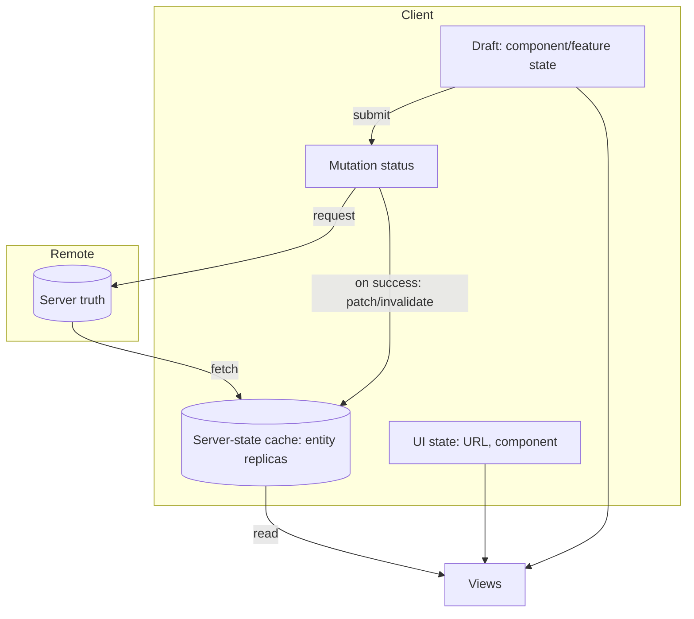
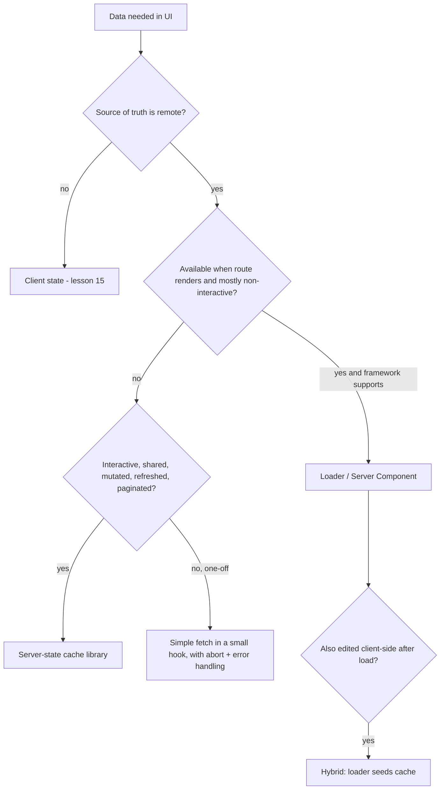

# 04 / 16 — Server State vs Client State: Replicas, Drafts, and Where Each Lives

## 1. Lesson metadata

| | |
|---|---|
| **Level** | Advanced |
| **Study time** | 5 hours (reading 2 h, experiments 1 h, exercises 2 h) |
| **Prerequisites** | [03/19 — UI, server, URL and shared state](../03-react-state-and-hooks/19-ui-server-url-and-shared-state.md), [04/14 — API boundaries and data access](./14-api-boundaries-and-data-access.md), [04/15 — State ownership](./15-state-ownership.md) |
| **Next** | [17 — Data flow architecture](./17-data-flow-architecture.md) |
| **Related later** | [Phase 6/07 — Server state management](../06-data-fetching-and-state-ecosystems/07-server-state-management.md), [6/08 — TanStack Query](../06-data-fetching-and-state-ecosystems/08-tanstack-query.md), [6/06 — Cache consistency and invalidation](../06-data-fetching-and-state-ecosystems/06-cache-consistency-and-invalidation.md), [9/03 — Server Components in depth](../09-advanced-rendering-and-ecosystem/03-server-components-in-depth.md) |

**Learning objectives.** After this lesson you can:
1. Explain, from first principles, why server state and client state have different properties and need different tools.
2. List the seven properties that make server state hard (remote persistence, shared ownership, asynchrony, staleness, caching, deduplication, invalidation) and map each to an architectural decision.
3. Separate *entity* (server-owned replica), *draft* (client-owned), *request status*, and *UI state* in a feature design.
4. Compare architectural approaches (hand-rolled `useEffect` fetching, global store as cache, server-state cache library, framework loaders/Server Components, hybrid) with structure, dependency rules, advantages, disadvantages, size guidance, failure modes and migration.
5. Design the boundary between the server-state layer and UI so that the transport/cache tool can be replaced.
6. Diagnose stale data, duplicate requests, double sources of truth, and "loading flicker" problems.

**Concepts covered:** server state, client state, replica, staleness, cache key, deduplication, invalidation, optimistic update (conceptual), draft vs entity, normalization vs per-query caching, server-state library, loader/RSC-based data, boundary hooks, query key factories, ownership of mutations.

---

## 2. Deep conceptual explanation

### 2.1 What problem is this lesson solving?

Early React applications stored *everything* in a single client store (Redux was the dominant pattern) and wrote the same boilerplate for every endpoint: `LOAD_START`, `LOAD_SUCCESS`, `LOAD_FAIL`, flags `isLoading`/`error`, manual caching by id, manual refetch after mutations. Many teams discovered that most of what they stored was *not application state at all*; it was a **local copy of data that lives somewhere else**. Treating a copy as if it were the truth produced characteristic bugs: stale lists after edits, duplicate requests, race conditions where an old response overwrote a new one, and endless "refresh" buttons.

The insight that reorganized the ecosystem: **server state has different properties from client state, and therefore wants a different management strategy.** That insight is now mainstream (TanStack Query, SWR, RTK Query, Apollo for GraphQL, framework data loaders, Server Components all embody variants of it). This lesson gives you the architectural vocabulary; Phase 6 gives you the tools and mechanics.

### 2.2 Definitions

> **Client state**: data whose *only source of truth is the running client* (or the user's device). If you lose the tab, it is gone or recreated from defaults. Examples: whether a menu is open, which tab is selected (unless in URL), a draft that has not been submitted, a drag in progress, which row is hovered.

> **Server state**: data whose *source of truth is a remote system*, which the client displays and may ask to change. The client holds a **replica** that can be outdated at any moment. Examples: a list of orders, a user profile, inventory counts, prices.

A quick test: **"If I closed the tab and reopened it, would this data come back without the user doing anything?"** If yes (it comes from a backend), it is server state. If no, it is client state.

| Property | Client state | Server state |
|---|---|---|
| Source of truth | The client | The remote system |
| Who else can change it | Nobody | Other users, jobs, other tabs, admins |
| Access | Synchronous | Asynchronous (can be loading, fail, be cancelled) |
| Can be wrong without you knowing | No | **Yes** (staleness) |
| Persistence | Lost on reload (unless stored) | Survives |
| Shared between components | By ownership design | Naturally; same entity shown in many places |
| Needs caching, dedup, retries | No | Yes |
| Validity rules | Decided locally | Decided by server (the client may be rejected) |

### 2.3 Why server state is intrinsically hard

Seven properties (the "why we need a different tool" list):

1. **Remote persistence.** The write path is a network call that can fail, be slow, or partially succeed.
2. **Shared ownership.** Others modify it; the client does not control it.
3. **Asynchronous APIs.** Every read has loading/error/success; every write has pending/success/error.
4. **Potentially stale.** The moment data arrives it begins to age.
5. **Caching.** Fetching on every mount is wasteful; caching creates *consistency* problems.
6. **Deduplication.** Ten components needing `/me` should cause one request.
7. **Invalidation.** After a mutation, which cached reads are now wrong? ("There are only two hard things in Computer Science: cache invalidation and naming things" — a quotation commonly attributed to Phil Karlton; the attribution is folklore-level, not verified here.)

Client state has none of these, which is why a client store that handles state well (synchronous, minimal, invariant-protected) is a poor place to implement caching and staleness, and a cache library is a poor place to keep a "sidebar collapsed" flag.

### 2.4 The four things people lump together as "data state"

When you design a feature that edits a server entity, four different kinds of state are present. **Name them separately**:

| Kind | Owner | Example | Lifetime |
|---|---|---|---|
| **Entity (replica)** | Server cache | The `Order` as last fetched | Cache lifetime / until invalidated |
| **Request status** | Request/mutation machinery | `isPending`, `error`, `isFetching` | Duration of the request |
| **Draft** | Component/feature | Form field values being edited | Edit session |
| **UI state** | Component/feature/URL | Which row is expanded; drawer open | View lifetime |

A very common bug source is merging two of these into one variable, for example putting the draft *into* the cached entity (editing the cache directly), or copying the entity into local state to "make it editable" and never reconciling.

### 2.5 What React exposes, and what it does not

React (including 19) provides *mechanisms* related to server data but not a server-state manager:

- `use(promise)` + Suspense: read a promise in render; the promise must be **stable across renders** (created outside render or cached), otherwise each render creates a new request ([Phase 6/13](../06-data-fetching-and-state-ecosystems/13-suspense-data-loading.md)).
- Actions, `useActionState`, `useOptimistic`: model *mutations* and optimistic client-side projections ([03/22](../03-react-state-and-hooks/22-modern-hooks-and-apis.md)).
- Server Components (framework-provided): fetch on the server and send rendered output — server data without a client cache for that content ([9/03](../09-advanced-rendering-and-ecosystem/03-server-components-in-depth.md)).
- ⚠ React itself does **not** specify a client data cache, a cache-key scheme, or invalidation. Those come from libraries and frameworks. Verify the current state of any React-provided caching helpers against react.dev before depending on them.

### 2.6 Relation to JavaScript and the browser

- `fetch` returns a promise and is cancellable via `AbortSignal` ([Phase 6/02](../06-data-fetching-and-state-ecosystems/02-cancellation-and-race-conditions.md)); responses may be cached by the HTTP cache independently of your JS cache (`Cache-Control`, `ETag`). You therefore have **layers of cache**: browser HTTP cache, CDN, your in-memory cache, and the server's own caches. Staleness is the composition of them all.
- The browser provides signals relevant to freshness: window focus, `online`/`offline` events, `visibilitychange`. Server-state libraries use these to refetch; if you hand-roll, you must as well.
- Memory: an in-memory cache is gone on reload; persisting it (IndexedDB/`localStorage`) introduces versioning and security questions (data at rest on shared devices).

### 2.7 Common misconceptions

| Misconception | Reality |
|---|---|
| "Server state is just state that happens to be async." | It has a different *owner*; the client cannot make it true, only request a change. |
| "A server-state library replaces Redux/Zustand." | It replaces the *server-data* use of them. Client state still needs owners ([lesson 15](./15-state-ownership.md)). |
| "After a mutation, I should write the response into the store." | Sometimes (when the response is authoritative and complete), often you should *invalidate and refetch*, or update the specific cache entries by key. Which one is a design choice with trade-offs. |
| "Caching = performance feature." | Caching is a *consistency* decision first. A cache changes what users see (stale-while-revalidate). |
| "Loading spinners are a UI concern only." | Loading/error/empty/stale are *states of the data* that the architecture must represent; the UI renders them. |
| "Copying fetched data into `useState` is how you make it editable." | That creates a second owner. Keep a *draft* of the changes, not a copy of the entity. |
| "Server Components make client server-state libraries obsolete." | They remove the need for client fetching for *non-interactive, server-rendered* content. Interactive, frequently updated, mutated, or client-only-driven data still benefit from a client cache. They're complementary. ⚠ Verify against your framework's docs. |

---

## 3. Internal mechanics

### 3.1 The anatomy of a server-state cache (teaching model)

Most server-state libraries share a conceptual structure. This is a **teaching model**; each library differs in details (verify in its docs).

```mermaid
flowchart LR
  C1[Component A: useOrder id=1] --> K[(Cache keyed by ['orders', 1])]
  C2[Component B: useOrder id=1] --> K
  K -->|miss or stale| F[Fetcher: fetch + abort signal]
  F --> S[(Server)]
  S --> F --> K
  M[Mutation: updateOrder] -->|on success| INV[Invalidate keys / update entries]
  INV --> K
  K -->|notify subscribers| C1
  K -->|notify subscribers| C2
  EV[Window focus / reconnect / interval] --> K
```

Key elements:

- **Query key**: a serializable identity of the request (`['orders', { status: 'open', page: 2 }]`). Equal keys share one cache entry → deduplication.
- **Entry status**: loading / success / error, plus *fetching* (a refetch may be in progress while old data is displayed).
- **Freshness policy**: `staleTime`-like (how long data is considered fresh) and `gcTime`/cache-lifetime-like (how long unused entries are retained). Names are TanStack Query's; concepts are common.
- **Subscribers**: components observing an entry; unused entries become garbage-collectable.
- **Invalidation**: mark entries stale; if observed, refetch.
- **Mutations**: separate from queries; they have status and callbacks and typically trigger invalidation or cache writes.

*Public guarantee (library-level, varies):* identical keys deduplicate in-flight requests; invalidating marks stale and refetches active observers. *Implementation detail:* garbage collection timing, scheduler, structural sharing. Specific defaults (e.g., default stale time of zero in TanStack Query v5) are version-sensitive; verify in the current docs.

### 3.2 Normalized vs per-query (document) caches

Two caching models:

| Model | How it stores | Update behavior | Used by (typically) |
|---|---|---|---|
| **Per-query (document) cache** | Each query key stores the response as-is | The same entity may appear in multiple entries; after a mutation you invalidate or patch each relevant entry | TanStack Query, SWR |
| **Normalized cache** | Entities stored once by `(type,id)`; queries store references | An update to one entity propagates to all views automatically | Apollo Client (GraphQL, with ids), Relay, RTK Query uses per-endpoint caches (tag-based invalidation) — verify per library |

Per-query caches are simpler and more predictable; they push *invalidation design* onto you. Normalized caches give automatic cross-view consistency but require stable ids, a schema, and care with lists/pagination/ordering. Neither is universally better; see §7.

### 3.3 Mutations and consistency

A mutation changes the server truth. The client replica is now wrong. Strategies:

1. **Invalidate and refetch**: simplest; correct by construction; costs a request and a loading/refetching state.
2. **Patch the cache from the response**: fast; requires the response to contain the full new entity and to know every entry containing it.
3. **Optimistic update**: apply the expected result immediately, roll back on failure. Highest complexity; correctness requires rollback and reconciliation (see [Phase 6/05](../06-data-fetching-and-state-ecosystems/05-optimistic-updates.md)).

*Architectural rule:* **mutation code owns its invalidation policy**, expressed next to the mutation hook; components do not decide which keys to invalidate.

### 3.4 Server-rendered data (loaders and Server Components)

In frameworks, data for a route may be loaded before rendering (route loaders) or inside Server Components. Mechanically (conceptually): the server runs the data-fetching code, renders output (HTML and/or an RSC payload), and the client receives results rather than fetching. The client then may *hydrate* into an interactive tree ([Phase 9](../09-advanced-rendering-and-ecosystem/01-spa-ssr-ssg-streaming.md)).

Architectural implications: (1) the **initial** data is owned by the server render, not the client cache, unless the framework hands it into the cache ("hydrating" query caches); (2) *navigation and mutation* invalidate by re-running loaders/revalidation (framework-specific); (3) the boundary between server-fetched and client-fetched data must be deliberate to avoid duplicating the same fetch in both places. ⚠ Framework behavior changes quickly; treat this section as the model and verify against your framework's current docs.

### 3.5 Where the drafts live

Because the entity is replica data, edits must live elsewhere: a *draft*. The submit action sends the draft to the server (a mutation). When the mutation settles, the cache is updated/invalidated and the draft is cleared or re-seeded. With React 19 Actions the form is typically uncontrolled with `<form action={...}>` and `useActionState` for result state, which means the *draft is in the DOM* until submit ([03/21](../03-react-state-and-hooks/21-forms-and-complex-state.md), [03/22](../03-react-state-and-hooks/22-modern-hooks-and-apis.md)).

---

## 4. Step-by-step walkthrough: editing an order's shipping address

Setting: a page lists orders (`['orders', {status:'open'}]`); a drawer shows an order (`['orders', 'detail', 42]`) with an address form.

1. **Page mounts.** `useOrders({status:'open'})` observes key K1. Cache miss → fetch starts; UI shows skeleton (status `pending`).
2. **Response arrives.** K1 filled; `status: success`, `isFetching: false`. The server's `ETag`/`Cache-Control` headers are independent of the in-memory cache.
3. **User opens drawer for #42.** `useOrder(42)` observes K2. Cache miss for detail; the architecture may seed K2 from the list item as *placeholder data* (visible immediately, still refetched) — an explicit design choice, not automatic.
4. **User edits the address.** Form fields change *draft state* (component-owned). The cache is untouched.
5. **User submits.** A mutation starts: `mutation.isPending = true`; the submit button disables.
6. **Server validates and rejects** (e.g., postcode invalid): response 422 with field errors. The mutation enters error state; the cache is untouched; the drawer displays the field errors next to the draft (the draft is still there).
7. **User fixes and resubmits.** Server accepts; returns the updated order.
8. **Mutation `onSuccess` policy** (defined in the mutation hook): write the returned order to K2 (`setQueryData` in TanStack terms) **and** invalidate the list key prefix `['orders']`-lists, because the list item may have changed (e.g., display address, status). Active observers refetch.
9. **UI updates**: drawer shows the saved entity; the draft's `dirty` becomes false because `dirty` is derived (`draft !== entity`).
10. **Concurrent change.** Another user changed the order's status in the meantime. On window focus the list refetches (`refetchOnWindowFocus`-style policy) and the UI shows the new status. The draft in the drawer is unaffected; a product decision determines whether to warn.

The walkthrough shows each owner doing exactly one job: cache (entity), mutation (status), component (draft), URL (which order is open).

---

## 5. Code examples

All examples use TanStack Query v5-style API for concreteness. **Verify exact API names, option names and defaults against the current TanStack Query docs** before copying: <https://tanstack.com/query>. The architecture, not the API, is the lesson.

### 5.1 Minimal: the anti-pattern everyone writes first

```tsx
function Orders() {
  const [orders, setOrders] = useState<Order[] | null>(null);
  const [error, setError] = useState<Error | null>(null);
  useEffect(() => {
    fetch("/api/orders").then((r) => r.json()).then(setOrders).catch(setError);
  }, []);
  if (error) return <p>Failed</p>;
  if (!orders) return <p>Loading…</p>;
  return <ul>{orders.map((o) => <li key={o.id}>{o.id}</li>)}</ul>;
}
```

**Predict:** what goes wrong when the component mounts twice (StrictMode in development, or navigation back to it), or when the `status` filter changes quickly (if there were one)?

**Result:** (a) in StrictMode dev, the effect runs twice → two requests; (b) with a changing parameter, an older, slower response can resolve after a newer one and overwrite it (a race); (c) no error typing (`r.json()` unchecked; HTTP 500 is not a rejected promise); (d) no cache, so every mount refetches and flashes "Loading…"; (e) no cancellation on unmount; (f) the same data used in another component is fetched again.

This is the *teaching* baseline: it is acceptable for a throwaway prototype. It is not an architecture.

### 5.2 Practical: boundary hooks over a server-state cache

Representative structure:

```text
src/features/orders/
  index.ts                  # exports: OrdersPage, useOrder (read-only hook) maybe
  api/
    ordersApi.ts            # transport: functions returning typed data (no React)
    ordersSchemas.ts        # runtime validation (e.g., zod) — optional but recommended
  queries/
    ordersKeys.ts           # key factory (single place that knows key shapes)
    useOrders.ts            # read hook (wraps useQuery)
    useOrder.ts
    useUpdateOrder.ts       # mutation hook owns invalidation policy
  ui/
    OrdersTable.tsx
    OrderDrawer.tsx
    AddressForm.tsx         # draft state lives here
```

**Dependency rules.**
- `ui/*` imports from `queries/*` only; **never** imports `api/*` or the cache library directly.
- `queries/*` imports `api/*` and the cache library; it is the **only** place that imports the cache library.
- `api/*` knows nothing about React or the cache library (pure async functions + types). It is the seam for tests and replacement.
- Other features import only `index.ts`.

```ts
// api/ordersApi.ts  (no React, no cache library)
export type Order = { id: string; status: "open" | "shipped"; address: Address; updatedAt: string };
export type OrdersFilter = { status?: Order["status"]; page: number };

async function http<T>(input: string, init?: RequestInit): Promise<T> {
  const res = await fetch(input, init);
  if (!res.ok) throw new HttpError(res.status, await safeText(res)); // fetch doesn't reject on 4xx/5xx
  return (await res.json()) as T; // ⚠ validate at the boundary in real code (see §5.5)
}

export const ordersApi = {
  list: (f: OrdersFilter, signal?: AbortSignal) =>
    http<{ items: Order[]; total: number }>(`/api/orders?${toSearch(f)}`, { signal }),
  get: (id: string, signal?: AbortSignal) => http<Order>(`/api/orders/${id}`, { signal }),
  updateAddress: (id: string, address: Address) =>
    http<Order>(`/api/orders/${id}/address`, {
      method: "PUT",
      headers: { "Content-Type": "application/json" },
      body: JSON.stringify(address),
    }),
};
```

```ts
// queries/ordersKeys.ts — the single source of truth for key shapes
import type { OrdersFilter } from "../api/ordersApi";
export const ordersKeys = {
  all: ["orders"] as const,
  lists: () => [...ordersKeys.all, "list"] as const,
  list: (f: OrdersFilter) => [...ordersKeys.lists(), f] as const,
  details: () => [...ordersKeys.all, "detail"] as const,
  detail: (id: string) => [...ordersKeys.details(), id] as const,
};
```

```ts
// queries/useOrders.ts
import { useQuery, keepPreviousData } from "@tanstack/react-query";
export function useOrders(filter: OrdersFilter) {
  return useQuery({
    queryKey: ordersKeys.list(filter),
    queryFn: ({ signal }) => ordersApi.list(filter, signal),   // signal enables cancellation
    placeholderData: keepPreviousData,                         // avoid flash when paging
  });
}

// queries/useUpdateOrderAddress.ts — mutation owns invalidation policy
import { useMutation, useQueryClient } from "@tanstack/react-query";
export function useUpdateOrderAddress(id: string) {
  const qc = useQueryClient();
  return useMutation({
    mutationFn: (address: Address) => ordersApi.updateAddress(id, address),
    onSuccess: (order) => {
      qc.setQueryData(ordersKeys.detail(id), order);           // authoritative response → patch
      qc.invalidateQueries({ queryKey: ordersKeys.lists() });  // lists may be affected → refetch
    },
  });
}
```

```tsx
// ui/AddressForm.tsx — the draft is component-owned; entity is read-only input
function AddressForm({ order }: { order: Order }) {
  const [draft, setDraft] = useState<Address>(order.address);   // seeded once per order id (parent keys by id)
  const update = useUpdateOrderAddress(order.id);
  const dirty = !addressEquals(draft, order.address);           // derived
  return (
    <form onSubmit={(e) => { e.preventDefault(); update.mutate(draft); }}>
      {/* fields bound to draft */}
      <button disabled={!dirty || update.isPending}>Save</button>
      {update.isError && <ErrorSummary error={update.error} />}
    </form>
  );
}
// parent: <AddressForm key={order.id} order={order} />
```

**Line notes.** `signal` ties the request to the cache entry's lifecycle (cancel when no longer needed — library-dependent). The key factory prevents typos and enables *prefix* invalidation (`lists()` invalidates all list variants while leaving details alone). `setQueryData` + `invalidateQueries` is a deliberate combination: patch the one entry we know, refetch the ones we can't cheaply patch. The form doesn't know a cache exists.

**Trade-offs.** Three small files per concern is overhead for a tiny feature; fine for features with ≥ 2 queries or any mutation. For a one-off read, `useQuery` inside a hook in the feature folder is enough.

### 5.3 Incorrect: copying server data into a global store

```ts
// ordersSlice.ts (Redux Toolkit style)
const ordersSlice = createSlice({
  name: "orders",
  initialState: { items: [] as Order[], loading: false, error: null as string | null },
  reducers: { /* setLoading, setItems, setError, updateItem... */ },
});
// plus thunks: fetchOrders, saveOrder, ...
```

and in components `useEffect(() => { dispatch(fetchOrders()) }, [])`.

**Predict:** three screens show orders (list, dashboard widget, header counter). User edits an order in screen 1. Which screens are updated, and what code must exist to make that true?

**Result:** only the ones whose code the author remembered to wire: each mutation thunk must patch `items` and anyone holding a derived list (`filteredItems` in another slice, etc.). No dedup (three `dispatch(fetchOrders())`), no staleness policy, no cancellation, no cache lifetime. **Why this fails:** the store is designed for *synchronous owned* state; you are using it to emulate a cache, and every cache feature is hand-written, per endpoint. It *can* work (RTK Query exists precisely to do this inside Redux), but then you are using a server-state tool, not hand-written slices.

### 5.4 Corrected variants (three legitimate options)

1. **Server-state library** (§5.2) — default for client-fetched, interactive data.
2. **RTK Query inside an existing Redux app** — same ownership model (server cache owns replicas), with Redux as the storage. See [Phase 6/09](../06-data-fetching-and-state-ecosystems/09-redux-toolkit.md).
3. **Route loader / Server Component** — for data needed to render the route, with revalidation after mutation by the framework. Choose when the framework offers it and the data is not highly interactive.

### 5.5 Advanced: validate at the boundary, keep the type honest

```ts
import { z } from "zod";                       // example validation library; any works
const AddressSchema = z.object({ line1: z.string(), city: z.string(), postcode: z.string() });
const OrderSchema = z.object({
  id: z.string(),
  status: z.enum(["open", "shipped"]),
  address: AddressSchema,
  updatedAt: z.string(),
});
export type Order = z.infer<typeof OrderSchema>;

async function getOrder(id: string, signal?: AbortSignal): Promise<Order> {
  const res = await fetch(`/api/orders/${id}`, { signal });
  if (!res.ok) throw new HttpError(res.status, await res.text());
  return OrderSchema.parse(await res.json());  // throws ZodError if the contract is broken
}
```

**Why:** `as Order` after `res.json()` is a *lie to the compiler*: types are erased at runtime, so a backend change produces a failure far from its cause. Parsing at the boundary converts "undefined is not a function in a random component" into "contract violation at the API layer", which also feeds error monitoring ([Phase 10/05](../10-production-engineering/05-error-monitoring.md)). Trade-off: bundle size and runtime cost; justified at trust boundaries (third-party/unstable APIs), optional for generated, type-checked clients.

### 5.6 Hybrid: initial data from the server, interactions from a client cache

Conceptual sketch (framework-specific details vary; **verify in your framework's docs**): the route loader/Server Component fetches the first page of orders and passes it as `initialData` or hydrates the client cache; subsequent client-side filtering uses the same query key shape, so the server-provided data and client-fetched data **share one cache entry** rather than duplicating. The invariant that makes this safe: *one key factory, used on both sides*.

---

## 6. Visual explanations

### 6.1 Ownership picture for a CRUD feature



### 6.2 Request lifecycle with staleness

```text
t0: mount            cache miss ─────────────► fetch ──────────► data (fresh)
t1: +30s (staleTime 60s)  mount another consumer ► cache hit, no request
t2: +90s             mount another consumer ──► cache hit (stale) + background refetch
t3: refetch returns  ───────────────────────────► subscribers update (no spinner: data already shown)
t4: all unmounted    entry kept for cache lifetime, then garbage-collected
```

### 6.3 Which tool for which data



---

## 7. Alternative approaches and trade-offs

### 7.1 Approach A — Hand-rolled `useEffect` + `useState` fetching

- **Original problem solved:** the lowest-ceremony way to display remote data when React had no data story.
- **Structure:** `useFetch` hooks per feature; no shared cache.
- **Dependency rules:** hooks import `fetch`/API functions; components import hooks.
- **Example:** §5.1, improved with abort/cleanup ([Phase 6/02](../06-data-fetching-and-state-ecosystems/02-cancellation-and-race-conditions.md)).
- **Advantages:** no dependency; fully transparent; fine for prototypes and truly one-off reads (e.g., a settings page read once).
- **Disadvantages:** you re-implement dedup, cache, retries, staleness, invalidation, focus refetch, and race handling — poorly and inconsistently.
- **Appropriate size:** ≤ ~3 endpoints, no shared data between screens, no mutations that affect other views.
- **Failure modes:** races, duplicate requests, stale cross-view data, memory leaks on unmount, inconsistent loading UIs.
- **Migration:** wrap the fetch function (`api/`) and replace the hook body with `useQuery`; components unchanged if the hook's return shape is kept.

### 7.2 Approach B — Global client store as the cache (Redux/Zustand + thunks)

- **Original problem:** pre-hooks apps needing shared remote data across components.
- **Structure:** `features/x/slice.ts`, thunks, selectors; UI selects from the store.
- **Dependency rules:** components only through selectors/hooks; thunks call the API layer; slices do not import each other.
- **Advantages:** one mental model for all state; devtools; offline/persist integration; full control; existing investment.
- **Disadvantages:** all cache features hand-built; server data and client data mixed; boilerplate; stale-state bugs; harder to get cancellation/dedup right.
- **Appropriate size:** small apps or those with unusual caching needs; or where Redux Toolkit **RTK Query** (the server-state layer of that ecosystem) is used.
- **Failure modes:** "loading flags" proliferation; refetch-everything-on-mount; slices denormalizing the same entity; thunks order races.
- **Migration:** introduce a server-state cache alongside; migrate read selectors to cache-backed hooks slice by slice; delete thunks last (strangler; see [lesson 24](./24-refactoring-legacy-react.md)).

### 7.3 Approach C — Server-state cache library (TanStack Query / SWR / RTK Query / Apollo)

- **Original problem:** exactly the seven properties in §2.3.
- **Structure:** §5.2.
- **Dependency rules:** library imported only in `queries/` (or equivalent); UI sees domain hooks; key factories centralized; mutation hooks own invalidation.
- **Advantages:** dedup, cache, retry, focus/reconnect refetch, race-safety, devtools, small API; makes the client store tiny.
- **Disadvantages:** another concept (keys, staleness) for the team; invalidation design is still on you (per-query caches); cache is not a database; SSR/hydration requires care; risk of leaking library types into UI.
- **Appropriate size:** the default for client-fetched data in apps from a handful to hundreds of endpoints.
- **Failure modes:** key collisions or drifting key shapes; invalidating too broadly (request storms) or too narrowly (stale views); `staleTime` zero everywhere (refetch on every mount) or too high (stale data); copying query data into `useState`; `select` creating unstable references; unbounded cache growth with high-cardinality keys.
- **Migration:** adopt per feature behind domain hooks; when replacing the library, only `queries/` changes.

### 7.4 Approach D — Framework loaders / Server Components

- **Original problem:** client-side waterfalls (render → fetch → render) and large client bundles; data needed for first paint.
- **Structure:** route modules with loader functions or server components that call data-access modules; client components receive data as props or via hydrated cache.
- **Dependency rules:** data-access modules are server-only (⚠ bundler enforcement is framework-specific, e.g., "server-only" markers; verify); components never import server-only modules into client bundles; secrets never cross the boundary ([Phase 9/04](../09-advanced-rendering-and-ecosystem/04-client-server-boundaries-and-serialization.md)).
- **Advantages:** no loading spinner for initial content; secrets and heavy dependencies stay on the server; fewer client requests; SEO.
- **Disadvantages:** couples you to a framework; mutation + revalidation model differs per framework; interactive freshness (polling, realtime) still needs client mechanisms; testing needs framework integration.
- **Appropriate size:** content- and route-centric apps; any app on a framework that provides it.
- **Failure modes:** double fetching (loader and client query); over-fetching for props that the client does not need; passing non-serializable values; using client state libraries for data that should have been server-rendered; unclear caching semantics at the framework level.
- **Migration:** SPA → framework: move first-paint data into loaders, keep client queries for interactive parts, share key factories/data functions.

### 7.5 Approach E — Hybrid (recommended for most mature apps)

Loader/RSC for initial and navigational data, client cache for interactive/live data, client store for UI/global state, URL for navigational state, and a **single data-access layer** ([lesson 14](./14-api-boundaries-and-data-access.md)) beneath all of them.

- **Dependency rules:** a single API layer; one key factory shared; UI components agnostic to who fetched.
- **Failure modes:** complexity; unclear "who owns freshness"; two caches for the same entity. Mitigate by documenting, per entity, *who is the cache* (§4 style ownership map).

### 7.6 Comparison

| Criterion | Hand-rolled | Store-as-cache | Cache library | Loader/RSC | Hybrid |
|---|---|---|---|---|---|
| Readability (small app) | High | Medium | High | High | Medium |
| Dedup/cache/retry | None unless built | Built by you | Built-in | Framework-level | Mixed |
| Cross-view consistency | Poor | Manual | Via keys/invalidation | Via revalidation | Needs a policy |
| Client bundle | Smallest | Medium | +library | Smallest | Medium |
| Realtime/polling | Manual | Manual | Supported patterns | Needs client piece | Yes |
| Testability | Easy | Medium | Medium (provider, mock network) | Framework-dependent | Mixed |
| Lock-in | None | Store lib | Cache lib (mitigable) | Framework | Both |
| Team onboarding | Low | Medium | Medium | Medium–High | High |

**Scenario where the recommended approach (a cache library) is NOT best:** a mostly-static marketing/docs site with a handful of reads at build or request time — server rendering/static generation with no client cache is simpler, faster and smaller. Also: a tiny internal tool with two reads and no sharing — a 15-line hook with `AbortController` is fine and avoids adding a dependency and a concept to learn.

---

## 8. Best practices and anti-patterns

**Practices**
1. **Name the four kinds** (entity, status, draft, UI state) and keep them in different variables.
2. **One key factory per domain**; the *only* place key shapes are known.
3. **Expose domain hooks** (`useOrder`), not raw `useQuery` calls scattered in components.
4. **Mutation hooks own invalidation.** Components call `mutate`, nothing else.
5. **Model all four data states in UI:** loading, error, empty, and *stale/refreshing* (subtle indicator, not a spinner replacing content).
6. **Validate at the API boundary** where the contract is not compile-time enforced.
7. **Choose freshness per entity**, not globally: price/inventory short; user profile long; reference data very long.
8. **Cancel and ignore** obsolete requests (abort signals, key-based identity).
9. Treat *errors as state with ownership*: transport/retry in the data layer, user-facing recovery in UI ([lesson 19](./19-error-boundaries.md), [Phase 6/15](../06-data-fetching-and-state-ecosystems/15-error-recovery-and-retries.md)).

**Beginner mistakes**
- `useEffect` + `useState` for every read.
- Storing fetched data in context and calling it "state management".
- Seeding `useState` with query data to make it editable.

**Experienced-developer mistakes**
- Invalidating everything (`invalidateQueries()` with no key) after every mutation → request storms.
- Hand-normalizing a per-query cache "to be consistent", rebuilding Apollo badly.
- Putting server data into a global store *and* a cache for "performance".
- Over-using optimistic updates where rollback semantics are unclear (payments, inventory).
- Persisting the entire cache to storage with no versioning or logout purge (security).

**Smells**
- `isLoading` booleans in a Redux slice per endpoint.
- Components importing `fetch`, the cache library, *and* the store.
- Query keys as string literals scattered in files.
- `useEffect(() => { refetch() }, [x])` to emulate keys (put `x` in the key).
- `staleTime: Infinity` as a "fix" for flicker.

**Justified exceptions**
- Disabling caching for sensitive or strictly real-time views (`staleTime`/`gcTime` near zero, or a subscription instead of polling).
- Keeping a *copy* of an entity as an optimistic projection — a documented, temporary second owner.
- Using a store as a cache for **non-HTTP** server-like data (WebSocket-fed streams) where a request/response cache doesn't fit ([Phase 6/17](../06-data-fetching-and-state-ecosystems/17-real-time-websockets-subscriptions.md)).

---

## 9. Real-world application

**E-commerce product listing.** Facets/pagination in URL → key `['products','list',params]`. Prices and stock change; short freshness for product detail, long for category trees. Add-to-cart is a mutation with optimistic UI limited to the cart badge; checkout totals always come from the server (never optimistic) because correctness trumps latency. Constraint: Core Web Vitals — server-render the first listing via loader/RSC; hydrate cache for subsequent filter changes (hybrid).

**Finance dashboard.** Account balances: short stale time plus refetch on focus; positions streaming over WebSocket: subscription store, *not* a polling query. Constraint: audit — each displayed number needs its *as-of* timestamp visible, because a replica's staleness is user-visible information, not an implementation detail.

**Auth/session.** `/me` is a server query with a long stale time; **token handling and redirect-on-401** belong in the transport layer (a single interceptor), not in components. Permissions derived from `/me`. Failure mode: components catching 401 individually.

**Realtime (chat).** Initial history by query (paginated, infinite), new messages by subscription writing into the same cache entries (`setQueryData`-style). Constraint: dedupe messages by id; reconcile ordering; handle reconnect gaps with a refetch.

**Forms (large).** Draft in form library/state; server validation errors merged by field; submit → mutation → patch cache. Constraint: concurrent edits (ETag/version field for optimistic concurrency control) — the server rejects stale writes with 409/412 and the UI offers "reload" or "merge".

**Multi-team.** The platform team owns the API layer and key conventions; feature teams own domain hooks. Breaking API changes surface in the typed/validated boundary, not in 30 components.

---

## 10. Debugging and troubleshooting

### Symptom 1: "The list doesn't update after I save."
- **Repro:** edit item, close the drawer; list shows old data until reload.
- **Investigation:** open the cache devtools (e.g., TanStack Query Devtools): is the list entry marked stale after the mutation? Network panel: was the list refetched? Check the invalidation key against the actual key (`['orders','list',…]` vs `['order', …]`).
- **Root cause:** key mismatch or missing invalidation; or the list is a *copy* in local state.
- **Fix:** use key factories; invalidate by prefix; delete the copy.
- **Validate:** test: mutate → assert the list request fires and the new value renders.

### Symptom 2: "Typing in the search box shows results out of order."
- **Investigation:** Network panel timeline: two responses returning out of order; check whether the key includes the query and whether requests are aborted.
- **Root cause:** hand-rolled fetch without abort/key identity.
- **Fix:** key by params + `signal`; debounce the input into the key ([Phase 7/14](../07-performance/14-debounce-and-throttle.md)).

### Symptom 3: "Spinner on every navigation back to the page."
- **Root cause:** stale time zero + cache lifetime expired, or component unmounts the observer and the entry is garbage-collected too soon.
- **Fix:** tune per-entity `staleTime`/cache lifetime; show cached data while refetching (stale-while-revalidate).

### Symptom 4: "Too many requests."
- **Investigation:** Network panel; count by URL; query devtools show multiple observers and refetch triggers (focus, reconnect, interval, invalidation).
- **Root cause:** broad invalidation; unstable keys (object created with new identity but also non-serializable pieces; timestamps in the key); refetch-on-mount with zero stale time on many components.
- **Fix:** stabilize the key (only serializable, normalized inputs), narrow invalidations, set freshness.

### Symptom 5: "Form values jump while typing."
- **Root cause:** draft synchronized from the entity by an effect when a refetch returns.
- **Fix:** draft keyed by entity id, seeded once; show a "changed on server" notice instead of overwriting.

### Symptom 6: "Hydration mismatch / duplicate request on first load" (framework hybrid)
- **Root cause:** server and client keys differ, so the client does not find the hydrated entry and refetches; or timestamps/random in rendered output.
- **Fix:** shared key factory; same serialization; verify with framework devtools and network.

---

## 11. Exercises

### Level A — Knowledge
A1. State the "closed the tab" test and apply it to: a shopping cart for logged-in users, an open dropdown, a draft comment, a stock price.
A2. List the seven properties of server state. For each, name the feature a server-state library provides.
A3. Define entity, request status, draft, and UI state, with an example of each in a "profile edit" feature.
A4. What is the difference between a per-query cache and a normalized cache? Name one trade-off each.
A5. Why does `fetch` not reject on HTTP 404/500, and where should that be handled architecturally?

### Level B — Code comprehension
B1. What's wrong with this and what is displayed after the server returns a new name?
```tsx
const { data: user } = useUser(id);
const [name, setName] = useState(user?.name ?? "");
```
B2. A mutation does `qc.invalidateQueries({ queryKey: ['orders'] })` while the list uses `['orders','list',f]` and detail uses `['order', id]`. What gets invalidated?
B3. Explain what `placeholderData: keepPreviousData` changes visibly when paging and what risk it introduces.
B4. A hook returns `data.items.map(toViewModel)` from inside the component each render with `select` absent. What is a potential problem and how would `select` help?

### Level C — Implementation
C1. Write a key factory and `useProducts(filter)` / `useProduct(id)` hooks with an `AbortSignal`-aware API layer.
C2. Write `useUpdateProduct` that patches the detail entry from the response and invalidates lists, plus a unit test sketch with a mocked API layer.
C3. Implement an `ErrorState`-aware `<Remote<T>>` render-prop/utility component that renders loading / error / empty / data / refreshing states consistently from a query result.
C4. Write the API-layer function `getOrder` that validates its response with a schema and throws a typed `ContractError`.

### Level D — Debugging
D1. After deploying, users see a stale "inventory: 5" on the product page, yet the checkout says out of stock. Network shows one request on first load. Diagnose with at least three hypotheses and how to test each.
D2. The list refetches ten times when one mutation succeeds. Find likely causes.
D3. Editing an item in a drawer sometimes loses the user's typing. List two mechanisms that could cause this.
D4. A component using `use(fetchOrders())` in render re-requests infinitely. Why? Fix.

### Level E — Architecture decisions
E1. A team has 60 Redux slices, 45 of which hold fetched data. Propose a migration plan, order of work, success metrics, and risks.
E2. Choose between loader-based data and client cache for: (a) a blog article page; (b) an admin orders table with filters and bulk edit; (c) a live auction page. Justify.
E3. Design the freshness policy table for entities: product price, product description, user profile, feature flags, notifications count.
E4. Decide whether to normalize the cache in a project with a REST API without stable ids for nested resources.

### Level F — Expert challenge
F1. Design the data layer for an offline-capable field-service app: reads cached, writes queued, conflict resolution on reconnect. Define owners (entity replica, pending mutations, drafts), identifiers for client-created entities, and conflict policy. State which parts a standard server-state library does not give you.

---

## 12. Detailed answers and explanations

> Attempt the exercises first.

**A1.** Cart for logged-in users: server state (reappears after reopen) — even if you also keep a local optimistic copy; open dropdown: client; draft comment: client (unless you persist drafts — then browser storage); stock price: server state (and highly volatile). Wrong answer to watch: "cart is client state because the user edits it". Editing doesn't make it client-owned; the persistence location does.

**A2.** Remote persistence → mutation lifecycle/retries; shared ownership → refetch on focus/reconnect and polling; async → status model (pending/error/success); stale → freshness policy; caching → keyed cache and lifetimes; dedup → same key = one in-flight request; invalidation → invalidate APIs/tag systems.

**A3.** Entity: the saved profile from the server; status: `mutation.isPending`/error; draft: form field values; UI state: which section is expanded, or the active tab.

**A4.** Per-query: simple/predictable, but the same entity appears in several entries so you must invalidate/patch each. Normalized: updates propagate automatically, but needs stable ids/schema and complex list/pagination/ordering updates. Either might be wrong for a given API; REST with unstable ids tilts toward per-query.

**A5.** `fetch` rejects only on network failures/aborts; HTTP error statuses resolve with `ok: false` (specified by the Fetch standard). The API layer should convert non-2xx to typed errors so retry policy and UI see failures uniformly.

**B1.** `useState` captures `user?.name` **once** (first render). While loading it is `""`; when the data arrives, `name` stays `""` — and when the server changes the name later, `name` doesn't update. Two owners, with the local one initialized from a not-yet-loaded value. Fix: don't render the form until the entity is loaded, then mount `<Form key={user.id} user={user} />` with a draft seeded from props.

**B2.** The key prefix `['orders']` matches `['orders','list',f]`, so lists are invalidated; `['order', id]` doesn't match (different first element, `'order'` vs `'orders'`), so the detail is *not* invalidated. Typo-class bug, prevented by key factories.

**B3.** While the next page loads, the previous page's data stays on screen (marked as placeholder) instead of dropping to a loading state, eliminating flashes. Risk: users may interact with data that doesn't match the new parameters (e.g., click an item belonging to page 1 while the header says page 2); indicate `isPlaceholderData` visually and disable actions.

**B4.** The component creates new arrays/objects every render, defeating referential equality in downstream memoized children and effects. `select` lets the library compute the derived value and share structure/memoize by input (library-specific; verify), so unchanged results keep identity. Alternative: `useMemo` in the hook.

**C1. Reference solution** (key factory in §5.2); hooks:
```ts
export const useProducts = (f: ProductFilter) =>
  useQuery({ queryKey: productKeys.list(f), queryFn: ({ signal }) => productsApi.list(f, signal) });
export const useProduct = (id: string) =>
  useQuery({ queryKey: productKeys.detail(id), queryFn: ({ signal }) => productsApi.get(id, signal), enabled: id !== "" });
```
Evaluation: key includes every input to the request; signal passed; no component imports `productsApi`; `enabled` handles missing ids.

**C2.** Mirrors §5.2's `useUpdateOrderAddress`. Test sketch: mock `productsApi.update` to resolve; render hook inside a `QueryClientProvider` with a fresh client (no retries), pre-populate detail and list entries, call `mutate`, assert `getQueryData(detail)` equals the response and that the list is marked invalidated (`getQueryState(key).isInvalidated`, ⚠ verify API name) or refetched. Edge cases: failure leaves the cache untouched; concurrent mutation.

**C3. Evaluation criteria.** Handles `isPending` (skeleton), `isError` (error with retry), success with empty array (empty state, distinct from loading), success with data (render), `isFetching && !isPending` (subtle refreshing indicator), and `isPlaceholderData`. Generic in `T`. Does not swallow errors. Sketch:
```tsx
function Remote<T>({ q, isEmpty, children }: {
  q: { status: "pending" | "error" | "success"; data?: T; error: unknown; isFetching: boolean; refetch(): void };
  isEmpty?: (d: T) => boolean;
  children: (d: T) => React.ReactNode;
}) {
  if (q.status === "pending") return <Skeleton />;
  if (q.status === "error") return <ErrorState error={q.error} onRetry={q.refetch} />;
  const d = q.data as T;
  if (isEmpty?.(d)) return <EmptyState />;
  return <>{q.isFetching && <RefreshingBadge />}{children(d)}</>;
}
```

**C4. Evaluation criteria.** Parses with a schema; distinguishes network error, HTTP error, and contract error classes; includes the endpoint and issue paths in the message for monitoring; does not leak the schema library into UI.

**D1.** Hypotheses: (1) *Freshness policy too long* — `staleTime` large or persisted cache hydrating old data; test: devtools show entry fresh with old `dataUpdatedAt`; (2) *CDN/HTTP cache* serving stale `GET` (`Cache-Control` public, long max-age); test: response headers, `Age` header, bypass cache with a cache-buster; (3) *Hydrated server data* from SSR cached by CDN; test: view-source HTML shows old value; (4) *Inventory is a replica by nature*: product page needs a short-lived or non-cached read, or the display should be approximate ("low stock") while checkout is authoritative. Fix: per-entity freshness (short for inventory), revalidate on focus, and make the checkout response carry the authoritative number back into the cache. Business decision: show "5" at all?

**D2.** Candidates: invalidation with an overly broad key (e.g., root key) → every active query refetches; multiple observers of the same keys with `refetchOnMount` and zero stale time; `onSettled` plus `onSuccess` both invalidating; several mutations fired (double click) each invalidating; an `useEffect` calling `refetch()` on data change (feedback loop). Investigate via devtools' refetch count/triggers and the Network initiator column.

**D3.** (a) An effect that resets the draft from the entity whenever the entity reference changes (refetch brings a new reference); (b) the form is remounted because the parent's `key` changes or a wrapper component is defined inside another component's render (new type each render); (c) controlled input value taken directly from `data` rather than the draft. Fix: draft seeded once per id; stable component identity.

**D4.** `fetchOrders()` is called during each render, creating a **new promise each time**; `use(promise)` suspends on the new promise, the component re-renders when it resolves and creates yet another new promise → loop. The promise must be created outside render or cached with a stable identity (by a cache/loader/RSC). Fix: create it in a parent/loader/cache keyed by params, pass it as a prop, or use a cache-aware API. ⚠ Verify the current `use` documentation for rules about promises created in render.

**E1. Evaluation criteria and sketch.** Classify slices (server data vs client). Pilot with one high-churn slice. Introduce the library with domain hooks that match existing selector return shapes. Migrate consumers per feature; retire thunks; measure: slice count, number of manual loading flags, duplicate requests, stale-data bugs, bundle size. Risks: dual sources of truth during migration (choose one owner per entity, switch by feature flag), cache key conventions, SSR hydration, test infrastructure changes, optimistic update parity. Don't freeze features; each step shippable.

**E2.** (a) Blog article: loader/RSC/static — no interactivity, SEO, cacheable; client cache adds nothing. (b) Admin table with filters/bulk edit: client cache (or loader + client cache hybrid) — interactive, mutated, paginated, filters in URL, invalidation after bulk edit. (c) Live auction: subscription (WebSocket/SSE) feeding a store/cache; loader for the initial snapshot; polling is a fallback. Criteria: interactivity, freshness requirement, SEO/first paint, mutation frequency.

**E3.** Example: product price — short stale (seconds) plus refetch on focus, but checkout re-validates; description — long (minutes–hours) since rarely changes; user profile — medium, invalidated on own edits; feature flags — long with refetch on app focus and a kill-switch path for emergencies; notification count — short polling or subscription. Evaluation: policy is per entity, justified by cost of staleness vs cost of fetching, and includes who overrides it (mutation invalidation).

**E4.** Probably not: without stable ids, normalization requires synthesizing identities, causing merge bugs. Stay per-query with careful invalidation, or normalize only the few entities with stable ids. Revisit if the API gains a global id scheme or a GraphQL layer.

**F1. Evaluation criteria.** Owners: entities (persisted replica store, e.g., IndexedDB, with schema versions), a **mutation outbox** (queue of intents with client-generated ids/idempotency keys, owned by the sync engine), drafts (component/feature, flushed to the outbox on save). Client-created entities use temporary ids mapped to server ids upon sync. Conflict policy by entity: last-write-wins for low-stakes fields; version-checked merge or user-resolved conflicts for contract-critical data; server returns authoritative state. Not provided by a standard cache library: durable write queue, replay/ordering guarantees, conflict resolution, storage migrations, security (encryption at rest, purge on logout). Candidate approaches: library persistence plugins plus a custom outbox, or a sync engine; acknowledge that this lesson only states ownership — implementation is [Phase 6/16](../06-data-fetching-and-state-ecosystems/16-offline-considerations.md).

---

## 13. Senior engineer interview questions

**Q1. "Why shouldn't we put API data in Redux?"**
*Strong answer:* Not "never"; the issue is *ownership and feature set*. API data is a replica with staleness, dedup and invalidation needs. A plain store gives none, so you rebuild a cache by hand per endpoint. Use a server-state tool (including RTK Query inside Redux), and keep the store for client state. Mention cross-view consistency, race conditions and removing hand-written loading flags.

**Q2. "How do you edit server data in a form?"**
*Strong answer:* Separate entity and draft. Seed the draft once per entity id (key), derive dirty/valid, submit via mutation, update/invalidate the cache from the mutation hook, show server validation errors against the draft, and decide an explicit policy for concurrent server changes (banner, version check, or merge).

**Q3. "Invalidate or update the cache after a mutation?"**
*Strong answer:* If the response is the full authoritative entity and you know every entry containing it, patching is fast and avoids a request. For lists with sort/filter/pagination that the change may reorder or move between, invalidate. Often both: patch the detail, invalidate lists. Optimistic updates add rollback complexity and belong where latency matters and failure is cheap.

**Q4. "Where does server state live with Server Components?"**
*Strong answer:* For server-rendered output, the "cache" is the server render (with framework caching/revalidation); the client doesn't hold that data as state. For interactive client features, you still need a client cache. Design one data-access layer and shared key semantics, avoid duplicating fetches, and verify framework caching semantics because they change between versions.

**Q5. "What goes wrong with `staleTime: Infinity`?"**
*Strong answer:* It disables background freshness; data never refreshes unless invalidated manually; it hides problems (flicker) by removing the freshness mechanism. Acceptable for truly immutable reference data; dangerous for anything others can change.

**Q6. "How would you make the data layer replaceable?"**
*Strong answer:* Hide the library behind domain hooks (`useOrders`), keep transport in a React-free API layer, centralize keys, don't leak library result types into UI (map to a small `Remote<T>` shape if needed), and enforce imports with lint rules ([lesson 25](./25-architectural-fitness-and-enforcement.md)). Be honest about the cost: an adapter layer is itself overhead; justify by team size and expected lifetime.

---

## 14. Further learning resources

| Resource | URL | Covers / why | Level | Study |
|---|---|---|---|---|
| TanStack Query docs | <https://tanstack.com/query> | Queries, mutations, invalidation, caching, SSR | Intermediate | "Important Defaults", "Queries", "Mutations", "Query Invalidation" |
| TanStack Query — Overview/Philosophy | <https://tanstack.com/query/latest/docs/framework/react/overview> | Server-state framing | Beginner–Int. | Motivation section |
| SWR docs | <https://swr.vercel.app> | Alternative cache library; stale-while-revalidate | Intermediate | Getting started, Mutation |
| Redux Toolkit — RTK Query | <https://redux-toolkit.js.org/rtk-query/overview> | Server-state inside Redux | Intermediate | Overview |
| React docs — `use` | <https://react.dev/reference/react/use> | Reading promises in render, caveats | Intermediate | Caveats |
| React docs — Server Components | <https://react.dev/reference/rsc/server-components> | Server/client data boundary | Advanced | Whole page |
| MDN — Fetch API / `Response.ok` | <https://developer.mozilla.org/en-US/docs/Web/API/Fetch_API> | Why 4xx/5xx do not reject | Beginner | Using Fetch |
| MDN — HTTP caching | <https://developer.mozilla.org/en-US/docs/Web/HTTP/Caching> | Layers of cache underneath your cache | Intermediate | Whole page |

---

## 15. Knowledge checkpoint

**You should now understand**
- Why server state is a replica with seven special properties and why that demands a cache-oriented tool.
- The four kinds of data state (entity, status, draft, UI) and why mixing them causes bugs.
- The architecture options for server data, with their structure, dependency rules, trade-offs, failure modes and migration paths.

**You should be able to explain without notes**
- Why `useState(data.x)` is wrong for editing, and what to do instead.
- Why mutation hooks should own invalidation.
- When *not* to use a cache library.

**You should be able to implement**
- A feature data layer: API module, key factory, query and mutation hooks, draft-based form.
- A validated API boundary.

**You should be able to debug**
- Stale lists, duplicate requests, out-of-order responses, and draft-jumping forms.

**Before moving on:** read [17 — Data flow architecture](./17-data-flow-architecture.md), which composes ownership (15) and server/client separation (16) into whole-application data flow.
