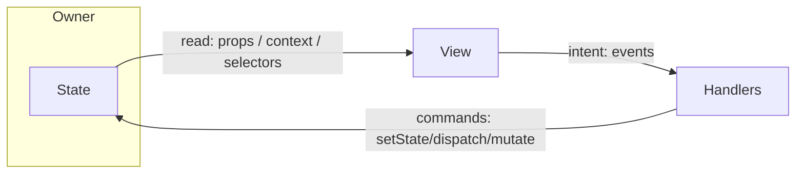
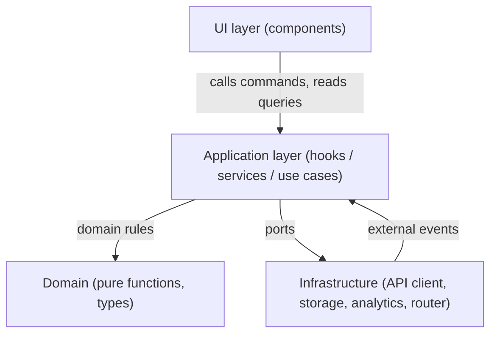
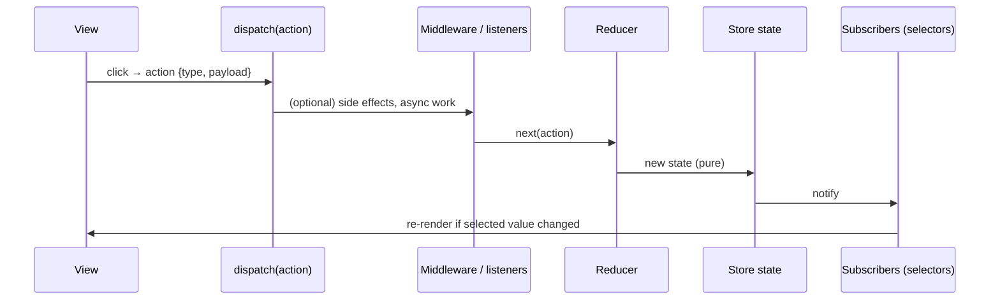
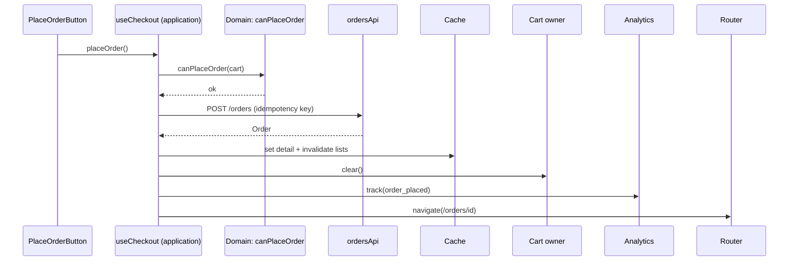
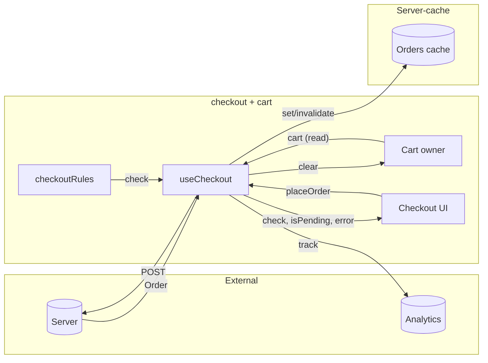
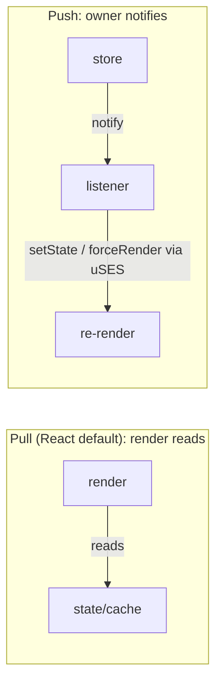

# 04 / 17 — Data Flow Architecture: How Information and Intent Move Through an Application

## 1. Lesson metadata

| | |
|---|---|
| **Level** | Advanced |
| **Study time** | 5 hours (reading 2 h, experiments 1 h, exercises 2 h) |
| **Prerequisites** | [04/05 — Composition and dependency direction](./05-composition-and-dependency-direction.md), [04/13 — Application services and adapters](./13-application-services-and-adapters.md), [04/14 — API boundaries and data access](./14-api-boundaries-and-data-access.md), [04/15 — State ownership](./15-state-ownership.md), [04/16 — Server vs client state](./16-server-vs-client-state.md), [03/03 — useReducer and reducer architecture](../03-react-state-and-hooks/03-usereducer-and-reducer-architecture.md) |
| **Next** | [18 — Routing architecture](./18-routing-architecture.md) |
| **Related later** | [Phase 5/12 — Reducer pattern](../05-design-patterns/12-reducer-pattern.md), [5/14 — Observer and subscription](../05-design-patterns/14-observer-and-subscription.md), [6/17 — Real-time, WebSockets, subscriptions](../06-data-fetching-and-state-ecosystems/17-real-time-websockets-subscriptions.md), [11/08 — State architecture at scale](../11-senior-and-architect-mastery/08-state-architecture-at-scale.md) |

**Learning objectives.** After this lesson you can:
1. Separate the two flows in every UI application: **data flows down** (state → view) and **intent flows up** (events → commands → state changes), and describe the extra *side-effect* and *external-event* flows.
2. Trace any user-visible value to its origin and any user action to its consequences, and document this as a data-flow diagram.
3. Compare flow architectures: props/callbacks, context, store with actions (Flux/Redux-style), reactive subscription/event bus, URL-driven, loader/server-driven, and mediator/application-service flows, each with structure, rules, trade-offs, failure modes and migration.
4. Identify flow smells: backward flows via refs/effects, event-bus spaghetti, cyclic dependencies, hidden synchronization, and "action at a distance".
5. Place side effects (fetching, analytics, persistence, navigation) deliberately in the flow, not wherever it happens to work.
6. Make a flow *observable and testable*.

**Concepts covered:** unidirectional data flow, command/event/query vocabulary, derived data, selectors, dispatch, effects as flow edges, event buses, mediator, reactive subscriptions, push vs pull, optimistic flows, cycles, determinism, traceability, back-pressure and batching.

---

## 2. Deep conceptual explanation

### 2.1 What problem is this lesson solving?

Ownership ([15](./15-state-ownership.md)) says *who holds* a fact. Server/client separation ([16](./16-server-vs-client-state.md)) says *what kind* of fact it is. **Data flow architecture says how facts and intentions travel between owners and views** and what *must happen* when something changes.

Applications fail at this level in recognizable ways:

- A change in one panel causes an unexpected change in another, and no one can find the code path ("action at a distance").
- Two pieces of code each trigger the other (A's effect sets B; B's effect sets A) — an update cycle or a ping-pong.
- A business rule is applied in three places (UI, a hook, and a reducer) at different times, so results differ by route.
- A analytics/audit call is missing from one of five code paths that perform "the same" action.
- A bug can only be understood by running the app, because there is no way to read the code and predict behavior.

Flow architecture makes the answers to two questions *mechanical*:

1. **"Why does this value on screen have this value?"** — follow data edges backward to the owner.
2. **"What happens when the user does this?"** — follow command/event edges forward.

### 2.2 Two directions, one rule

React's founding architectural rule is **unidirectional data flow**: data goes *down* the tree as props (and context); changes go *up* as callbacks or dispatches that cause the *owner* to compute new state, which flows down again.



Why this rule? *First principles*: if any component may directly change any other's state, then the program state is a function of the **order of all mutations**. If data can only change at its owner, state is a function of **the owner's inputs** — a reduction over a log of commands. The second is far easier to reason about, test and replay. Unidirectionality is what makes "UI = f(state)" ([React's founding idea](https://react.dev/learn/thinking-in-react)) practical.

### 2.3 The vocabulary: queries, commands, events

Use these three words precisely in design discussions:

| Term | Direction | Meaning | Example |
|---|---|---|---|
| **Query / read** | Data flows to the view | Ask for the current value; no side effects | `useCartTotal()`, `useOrders(filter)` |
| **Command** | Intent flows to an owner | A request to change something; *may be rejected* | `addToCart(sku)`, `submitOrder(draft)` |
| **Event** | Fact flows outward | Something *has happened*; the emitter doesn't know who listens | `OrderSubmitted`, `UserSignedOut` |

Commands are *imperative and addressed* (one handler decides). Events are *past tense and broadcast* (zero or more listeners). Mixing them up creates the worst smell in flow design: **commands disguised as events** ("`OpenSettingsModal` event" — someone is expecting exactly one listener to do exactly one thing) or **events disguised as commands** (callers telling modules "now update your cache because order was submitted", coupling them to each other's internals).

### 2.4 The four flows in a React application

1. **Data (read) flow:** owner → derivation (selectors, memos) → view.
2. **Intent (write) flow:** user/system event → handler → command → owner.
3. **Effect flow:** owner changes → synchronize with something external (network, storage, DOM APIs, analytics).
4. **External event flow:** the outside world pushes in (WebSocket message, timer, `storage` event, `popstate`, online/offline) → adapter → command/event → owner.

React gives primitives for (1) (props, context), (2) (event handlers, dispatch), (3) (`useEffect` — **for synchronization with external systems**; [03/04](../03-react-state-and-hooks/04-useeffect-synchronization.md)), and (4) (`useSyncExternalStore`, effects subscribing). It prescribes *nothing* about how to arrange cross-feature flow: that is architecture.

### 2.5 Derived data is a flow, not state

Any value that can be computed from other values *is a flow edge in the data graph*, not a node to be stored ([03/17](../03-react-state-and-hooks/17-derived-state.md)). Storing it creates a *synchronization flow* you must maintain. The architecture question becomes: **where is the derivation computed and cached?** Options: inline in render; `useMemo`; a selector next to the owner; a server-side computed field. Choose by cost and number of consumers: one consumer → inline; many consumers → a selector (domain hook) so all agree.

### 2.6 What flows where: layered view

A common layering (see [lesson 10](./10-clean-and-hexagonal-architecture.md), [13](./13-application-services-and-adapters.md)):



Flow rules: **data goes up the dependency graph by return values; control goes down by calls; events from infrastructure enter through application-layer adapters**. The UI never calls infrastructure directly; the domain never calls anything with side effects.

### 2.7 React's exposure and what it does not guarantee

- *Public guarantees:* props are read-only; state updates are queued; a component re-renders when its state, props from a re-rendering parent, or a subscribed context changes ([Phase 2](../02-react-rendering-and-internals/01-what-triggers-a-render.md)); effects run after commit; batching of updates inside events (React 18+) — **do not depend on the number of renders**.
- *Not guaranteed:* the order of independent effects across unrelated components beyond documented rules; that every intermediate state is rendered (batching skips them); that a render is committed (concurrent features may discard renders). Therefore **flow logic must be idempotent and not depend on render timing**.

### 2.8 Relation to JavaScript and the browser

- Browser events (click, input) propagate through the DOM (capture/bubble) — that's the *first* unidirectional upward flow before React sees anything; React's synthetic event system delegates at the root ([Phase 1/2 events lessons](../01-react-fundamentals/) and [00/11](../00-web-and-javascript-foundations/11-event-loop-tasks-microtasks.md) for task/microtask ordering).
- Order of events matters: microtasks (promise continuations) run before the next task; a flow that depends on "after the click handler finishes but before paint" must be reasoned about with the event loop model.
- Message channels (`postMessage`, `BroadcastChannel`, `storage` events) deliver flows across tabs/iframes/workers: these are *external* flows that arrive asynchronously, possibly out of order.

### 2.9 Common misconceptions

| Misconception | Reality |
|---|---|
| "Unidirectional flow means no callbacks go up." | Callbacks are exactly how intent goes up. What is forbidden is a child *mutating* parent data directly. |
| "Context makes data flow bidirectional." | Context distributes values downward; if you pass a setter through it, intent flows up through the same, still-unidirectional loop. |
| "Redux = unidirectional flow; hooks = not." | Hooks + props are also unidirectional. A store is a *shared* owner, with the same loop. |
| "Effects are how components talk to each other." | Effects synchronize with *external systems*; using them as a message bus between components makes cycles ([03/07](../03-react-state-and-hooks/07-you-might-not-need-an-effect.md)). |
| "An event bus decouples modules." | It removes *compile-time* coupling and replaces it with *runtime, invisible* coupling: names, payload shapes, ordering. Sometimes the trade is good; often not. |
| "More layers = cleaner flow." | Each layer is a place to lose traceability. A layer must earn its keep by hiding a decision. |

---

## 3. Internal mechanics

### 3.1 A render is a pure function of inputs; the loop closes via state

Teaching model of the React loop:

1. Owner holds state *S*.
2. React calls render(S, props, context) → element tree (pure; may run more than once).
3. Commit applies DOM changes; effects run after commit.
4. A user event invokes a handler; the handler *schedules* an update (it does not change S immediately; `setState` queues).
5. React computes S′ by applying the queued updates (reducers run here), re-renders, commits.

*Public guarantee:* update functions are applied in order; state seen by a render is consistent within that render (a snapshot). *Consequence for flow design:* handlers see the *snapshot of the render that created them* ("stale closure" — [03/05](../03-react-state-and-hooks/05-effect-dependencies-and-stale-closures.md)). Flows that need "latest" must route through reducers/functional updates or refs, not closures.

### 3.2 Store-based flow (Flux family)

Teaching model, shared by Redux and similar designs:



*Public guarantee (Redux-style):* reducers are pure; state is updated by replacing, never mutating (Redux Toolkit uses Immer to let you *write* mutations; ⚠ details vary by library). *Teaching model:* actions are a **log of intents/events**, which enables logging, devtools replay, and uniform instrumentation (analytics, persistence) in one place — the architectural payoff of routing all changes through a single narrow channel.

### 3.3 Event-bus/pub-sub flow

A bus maintains a map `eventName → listeners`. `emit(name, payload)` synchronously (typically) invokes listeners in registration order. Properties:

- *Synchronous* buses: handlers run inside `emit`; exceptions propagate to the emitter unless caught; ordering is registration order, and listener registration order depends on **mount order** (a hidden dependency).
- *Asynchronous* buses: ordering and error handling are by queue.
- Listeners registered in components need cleanup on unmount; **leaks** are the common failure.
- React's rendering does not know about the bus; updates triggered from bus callbacks into `setState` behave like any other setState call (batched in React 18+).

### 3.4 Reactive streams (conceptual)

A stream model (RxJS-style) expresses flows as pipelines: `input$ → debounce → switchMap(fetch) → state`. Advantages: time-based logic (debounce, retry, cancel) is declarative. Disadvantages: new paradigm, learning curve, subscription management. In React it is typically confined to **a service/adapter layer** (e.g., realtime feed handling) and projected into React via `useSyncExternalStore` ([03/20](../03-react-state-and-hooks/20-usesyncexternalstore-and-external-stores.md)). ⚠ Library details (RxJS, signals libraries) are outside this lesson; verify in each library's docs.

### 3.5 URL- and loader-driven flow

In router-driven designs ([lesson 18](./18-routing-architecture.md)) the flow starts at the URL: **navigation → match → loaders (data) → render → actions (mutations) → revalidate**. This is a *server-like* request/response loop run in the client (or on the server) with React rendering the result. Properties: data dependencies are declared per route; navigation is the trigger for data flow; mutations flow through route actions or form submissions; revalidation closes the loop. ⚠ API shapes are framework-specific; verify.

### 3.6 Implementation details to avoid depending on

- Exact render counts for a single dispatch.
- Order in which sibling effects run (documented: children before parents for effects of the same commit; siblings in order — but don't encode business logic on this).
- Store library internals (whether listeners fire before or after React batching).
- StrictMode (development) double-invokes render functions and, on mount, effects (setup→cleanup→setup) to surface impure flows. Flows that "work only once" are bugs surfaced, not StrictMode bugs.

---

## 4. Step-by-step walkthrough: "Place order" end to end

We trace one command through a layered design (UI → application hook → domain → API → cache → views) and the consequences.

**Setting:** checkout page. `useCheckout()` is the application-layer hook; `placeOrder` is the command. Domain rule: *order total must be ≥ minimum and cart non-empty*. After success: cart cleared, order list invalidated, confirmation route shown, analytics event recorded, toast displayed.

1. **User clicks "Place order".** DOM `click` → React event system → `onClick` handler in `<PlaceOrderButton>`.
2. **Handler calls the command** `checkout.placeOrder()` (from `useCheckout()`); the button doesn't know about the API, router, cache, analytics.
3. **Application layer validates with the domain** (pure): `canPlaceOrder(cart, minimum)` returns `{ok:false, reason}` or `{ok:true}`. If not ok → return a result; UI shows reason; **no network**. (Business rule lives once.)
4. **Mutation starts** (`useMutation` in the checkout hook): status `pending`; button disabled via derived `isPending`.
5. **API layer sends request** with an idempotency key (to protect against double submit and retries).
6. **Server responds** success with the new `Order`.
7. **Success flow (single place):** the hook's `onSuccess` (a) writes the order to the detail cache entry, (b) invalidates order lists, (c) calls `cart.clear()` (a command on the cart owner — *not* by reaching into its state), (d) calls `analytics.track('order_placed', …)`, (e) `toast.show(...)`, (f) `navigate('/orders/'+id)`.
8. **Views update** from owners: cart badge (cart owner), orders list (refetch), confirmation page (detail cache entry).
9. **Failure flow:** error → mutation `error` state; UI displays; **cart is untouched**; no analytics success event; retry allowed with the same idempotency key.



*Key observation:* the **side-effect fan-out is explicit and in one place** (step 7). The alternative, spreading "after success" duties across components that happen to be mounted, is the root of "missing analytics in one path" bugs.

---

## 5. Code examples

### 5.1 Minimal: unidirectional flow in its simplest form

```tsx
function Counter() {
  const [n, setN] = useState(0);                       // owner
  return <Display value={n} onIncrement={() => setN((c) => c + 1)} />;
}
function Display({ value, onIncrement }: { value: number; onIncrement(): void }) {
  return <button onClick={onIncrement}>{value}</button>;   // reads down, intent up
}
```

`Display` never mutates `value`; it requests a change. The owner decides.

### 5.2 Practical: an application-layer hook as the flow orchestrator

Representative structure:

```text
src/features/checkout/
  index.ts
  domain/
    checkoutRules.ts         # pure functions: canPlaceOrder, totals
  application/
    useCheckout.ts           # orchestrates: domain → api → cache → other owners → effects
  api/
    checkoutApi.ts
  ui/
    CheckoutPage.tsx
    PlaceOrderButton.tsx
```

**Dependency rules.** `ui → application → (domain, api, other features' public hooks)`. `domain` imports nothing from React or infrastructure. `application` is the only layer allowed to *combine* owners (cart, cache, router, analytics) and is where cross-owner flows are written. Other features expose **commands via their `index.ts`** (`useCartCommands`), never state internals.

```ts
// domain/checkoutRules.ts  (pure; trivially unit-testable)
export type Cart = { lines: { sku: string; qty: number; unitPriceCents: number }[] };
export type Check = { ok: true } | { ok: false; reason: "EMPTY_CART" | "BELOW_MINIMUM" };

export const totalCents = (c: Cart) => c.lines.reduce((s, l) => s + l.qty * l.unitPriceCents, 0);

export function canPlaceOrder(cart: Cart, minimumCents: number): Check {
  if (cart.lines.length === 0) return { ok: false, reason: "EMPTY_CART" };
  if (totalCents(cart) < minimumCents) return { ok: false, reason: "BELOW_MINIMUM" };
  return { ok: true };
}
```

```ts
// application/useCheckout.ts
import { useMutation, useQueryClient } from "@tanstack/react-query";   // ⚠ verify API vs current docs
import { useNavigate } from "react-router";                            // ⚠ verify package/API vs your router version

export function useCheckout() {
  const cart = useCart();                       // query: current cart (from cart feature public API)
  const { clear } = useCartCommands();          // command: owned by cart feature
  const qc = useQueryClient();
  const navigate = useNavigate();
  const analytics = useAnalytics();             // port; implementation injected at app root (see lesson 11)

  const mutation = useMutation({
    mutationFn: (key: string) => checkoutApi.placeOrder(cart, key),
    onSuccess: (order) => {
      qc.setQueryData(ordersKeys.detail(order.id), order);
      qc.invalidateQueries({ queryKey: ordersKeys.lists() });
      clear();
      analytics.track("order_placed", { orderId: order.id, totalCents: totalCents(cart) });
      navigate(`/orders/${order.id}`);
    },
  });

  const check = canPlaceOrder(cart, MIN_ORDER_CENTS);           // derived each render, not stored
  return {
    check,
    isPending: mutation.isPending,
    error: mutation.error,
    placeOrder: () => {
      if (!check.ok || mutation.isPending) return;              // domain + double-submit guard
      mutation.mutate(crypto.randomUUID());                     // new idempotency key per user intent
    },
  };
}
```

**Line notes.**
- `check` is *derived*, not state — no sync bugs.
- `placeOrder` is a **command**; the component receives a function and flags, not owners.
- `onSuccess` is the **single success fan-out**. Because it's inside the hook, a second UI (a mobile footer button) reuses the flow.
- Idempotency key per *user intent*: one click = one key; retries of the same intent should reuse it (a refinement: store the key in a ref until success/fail — see exercise C3).
- Closure caveat: with TanStack Query v5 the `onSuccess` passed to `useMutation` sees the **latest rendered** closure, not the one from the click (executed on @tanstack/react-query 5.104 + React 19.3: the cart changed from 1 to 2 while the request was pending and the hook-level `onSuccess` logged `cart=2`). Since the cart might change between click and success (user edits during request), prefer to **capture the values you need at submit time** (`totalCents` at click) or pass them as the mutation variable. Exercise B3 explores this.

### 5.3 Incorrect: effect-driven flow between siblings ("ping-pong")

```tsx
function Filters({ onChange }: { onChange(f: Filter): void }) { /* ... */ }

function Page() {
  const [filter, setFilter] = useState<Filter>(initial);
  const [page, setPage] = useState(1);
  const [results, setResults] = useState<Item[]>([]);

  useEffect(() => { setPage(1); }, [filter]);                  // when filter changes, reset page
  useEffect(() => { search(filter, page).then(setResults); }, [filter, page]);   // fetch
  useEffect(() => { if (results.length === 0 && page > 1) setPage(1); }, [results, page]); // fix
  // ...
}
```

**Predict:** user is on page 3 and changes the filter. How many fetches occur, with which `(filter, page)` pairs, and can an old response overwrite a newer one?

**Result:** render 1 with `(newFilter, 3)` → effect 2 runs **a fetch for `(newFilter, 3)`** *and* effect 1 sets page to 1; render 2 with `(newFilter, 1)` → effect 2 runs again (page changed). Two fetches; the first (page 3) may resolve *after* the second and overwrite results (race; also semantically wrong data). Effect 3 adds a further feedback edge when page-3 results are empty. **Why it's a flow bug:** state B (`page`) is *derived from an event* (filter change), but implemented as an effect reacting to state, creating an extra render and an intermediate invalid state `(newFilter, 3)`.

### 5.4 Corrected: put the rule where the event is handled, and key the data by inputs

```tsx
function Page() {
  const [{ filter, page }, setQuery] = useState({ filter: initial, page: 1 });

  const changeFilter = (f: Filter) => setQuery({ filter: f, page: 1 });  // one atomic transition
  const changePage = (p: number) => setQuery((q) => ({ ...q, page: p }));

  const results = useSearch(filter, page);   // key = [filter, page]; stale responses are ignored by key identity
  // ...
}
```

**Why correct:** the invariant "filter change resets page" is enforced in **one place at the moment of the event**; there is never an intermediate `(newFilter, 3)` render, so no wasted fetch; the data hook keys by inputs and handles races. (If the query state lives in the URL, `changeFilter` becomes one navigation updating both params — same logic, different owner.)

### 5.5 Advanced: a typed event bus used sparingly (cross-feature notifications)

When many unrelated modules must *react* to a fact and the emitter should not know them, an event channel is legitimate. Keep it **typed, small, synchronous-free of ordering assumptions, and cleaned up**.

```ts
// shared/events/appEvents.ts
type AppEvents = {
  "auth/signedOut": { reason: "user" | "expired" };
  "order/placed": { orderId: string };
};
type Handler<K extends keyof AppEvents> = (payload: AppEvents[K]) => void;

const handlers: { [K in keyof AppEvents]?: Set<Handler<K>> } = {};

export function on<K extends keyof AppEvents>(name: K, h: Handler<K>): () => void {
  const set = (handlers[name] ??= new Set() as never) as Set<Handler<K>>;   // `as never`: TS cannot correlate the mapped-type slot with K (tsc 5.9 rejects the plain form, TS2322)
  set.add(h);
  return () => set.delete(h);
}

export function emit<K extends keyof AppEvents>(name: K, payload: AppEvents[K]): void {
  const set = handlers[name] as Set<Handler<K>> | undefined;
  set?.forEach((h) => {
    try { h(payload); } catch (e) { reportError(e); }   // one bad listener must not break the emitter
  });
}
```

```tsx
// in a feature that must clear its caches on sign-out
function useClearOnSignOut() {
  const qc = useQueryClient();
  useEffect(() => on("auth/signedOut", () => qc.clear()), [qc]);   // returns the unsubscribe
}
```

**Line notes.** Event names are namespaced and typed; payloads typed; a try/catch isolates listeners; `on` returns its cleanup, which `useEffect` uses directly. **Rules for using a bus:** events are *facts in the past tense*, not commands; no listener may emit the event it listens to (cycle); maintain a registry (this file *is* the registry); never use for "parent-child" communication (props exist). **Trade-offs:** invisible subscribers — add dev-time logging of emit + listener counts; it's module-global state (reset in tests; do not use for per-request state in SSR).

### 5.6 Reducer-centered flow with an effects boundary

```ts
type State = { status: "idle" | "submitting" | "done" | "failed"; error?: string };
type Action = { type: "submit" } | { type: "succeeded" } | { type: "failed"; error: string };

function reducer(s: State, a: Action): State {
  switch (a.type) {
    case "submit": return s.status === "submitting" ? s : { status: "submitting" };
    case "succeeded": return { status: "done" };
    case "failed": return { status: "failed", error: a.error };
  }
}
```

The reducer is the *only* place state transitions are defined (pure, testable). Side effects (the network call) live in the **handler/effects boundary** that dispatches `submit`, then `succeeded`/`failed` — the reducer never fetches. This is the same shape as Redux middleware and sagas, scaled down ([Phase 5/12](../05-design-patterns/12-reducer-pattern.md), [5/13](../05-design-patterns/13-state-machine-pattern.md)).

---

## 6. Visual explanations

### 6.1 Data flow diagram (DFD) for the checkout feature



Every arrow is labelled with **what flows**; every box has **one reason to change**. If you can't label an arrow, you don't understand the flow.

### 6.2 Flow smells (picture them)

```text
Healthy:          UI ──cmd──► Owner ──state──► UI              (a loop through one owner)

Ping-pong:        A ──effect──► B ──effect──► A                 (cycle; extra renders; races)

Backdoor:         UI ──ref/import──► Other feature's internals  (bypasses owner API)

Bus spaghetti:    X ─emit─► ??? ─► Y ─emit─► ??? ─► Z           (unreadable; order-dependent)

Hidden global:    any ──writes──► module-level variable ──read──► any   (no re-render, no trace)
```

### 6.3 Push vs pull data flow



React's render is a *pull* model over the snapshot of state; external stores are *push* sources adapted into pull via `useSyncExternalStore`. Understanding where push becomes pull tells you where batching and consistency are handled.

---

## 7. Alternative approaches and trade-offs

For each architectural approach: problem, structure, dependency rules, example, advantages, disadvantages, sizes, failure modes, migration.

### 7.1 Approach A — Props down, callbacks up (plain composition)

- **Original problem:** coordinate view and state without hidden coupling; the baseline React model.
- **Structure:** owner component (page) passes props and callbacks to children; children are mostly presentational ([lesson 04](./04-presentational-vs-container.md)).
- **Dependency rules:** children don't import the owner; callbacks typed by intent (`onSelect(id)`), not by mechanism (`setSelected`).
- **Example:** §5.1, §5.4.
- **Advantages:** maximal traceability; works with plain TypeScript; no runtime magic; easiest testing (render with props).
- **Disadvantages:** prop drilling through passive layers; owner re-render re-renders subtree; cross-subtree flows require lifting.
- **Appropriate size:** local to a feature; ≤ 3 levels deep; ≤ ~8 props per boundary.
- **Failure modes:** god component; callback hell; intermediate components forced to know irrelevant props.
- **Migration:** to composition (pass elements/children to skip layers) first; to context/store if truly distant ([lesson 05](./05-composition-and-dependency-direction.md)).

### 7.2 Approach B — Context-distributed owner (feature provider)

- **Problem:** distant descendants need read/command access to feature state.
- **Structure/rules:** [lesson 15 §5.2](./15-state-ownership.md): state context + commands context; hooks exported; provider private.
- **Advantages:** removes drilling; lifetime tied to subtree; testable with a provider.
- **Disadvantages:** no selectors → broad re-renders; implicit dependency (provider required); flow harder to trace through hooks than props.
- **Appropriate size:** one feature, tens of consumers, low update frequency.
- **Failure modes:** god context; unstable provider values; context used to pass *server data* around, bypassing the cache; setters exposed.
- **Migration:** → selector store by swapping hook internals.

### 7.3 Approach C — Store with actions (Flux/Redux-style), including middleware/listeners

- **Problem:** many writers/readers with uniform instrumentation; need a *log of what happened*, devtools, cross-cutting reactions; flows outside React.
- **Structure:**

```text
src/app/store.ts                    # composes slices, middleware/listeners
src/features/cart/model/cartSlice.ts
src/features/cart/model/cartListeners.ts   # reactions: when order/placed → clear cart
src/features/cart/index.ts          # exports hooks + command creators only
```

- **Dependency rules:** features contribute slices and listeners; **reactions to other features' events are declared in the *reacting* feature** (listener subscribes to the other feature's *public action*), or in an app-layer composition module — avoiding slice-to-slice imports of state.
- **Advantages:** one narrow write channel; action log/time-travel; centralized cross-cutting concerns; testable pure reducers; usable outside React.
- **Disadvantages:** ceremony; indirection (action → reducer → selector); risk of "everything is an action"; async flows need conventions (thunks/listeners/sagas); global singleton.
- **Appropriate size:** large teams with many cross-feature flows; apps requiring audit logs; otherwise overkill.
- **Failure modes:** action explosion with getters like `SET_X`; reducers doing business logic duplicated elsewhere; listeners forming cycles (A's listener dispatches action that triggers B's listener that triggers A's); storing derived data; huge serialized state.
- **Migration:** introduce per feature; keep component APIs as hooks so replacement is local.

### 7.4 Approach D — Event bus / pub-sub / observer

- **Problem:** emitters must not know consumers (plugin systems, cross-feature notifications, non-React producers).
- **Structure:** §5.5; registry file lists all events; per-feature subscribers.
- **Dependency rules:** features depend on the **registry (types)**, not on each other; events are facts; no emit-in-listener of the same event; every `on` has cleanup.
- **Advantages:** loose compile-time coupling; easy to add listeners; works across non-React code, iframes (with `postMessage` bridges).
- **Disadvantages:** runtime coupling by convention; hard to trace; ordering and exception semantics; leaks; testing requires bus reset.
- **Appropriate size:** a *small* number (≲ 10–30) of well-named domain events; not for fine-grained UI chatter.
- **Failure modes:** event used as command; "who handles this?" archaeology; cycles; unreleased listeners (memory leak, duplicate side effects when the component remounts); handlers depending on registration order.
- **Migration:** replace an event with an explicit command when exactly one consumer exists; replace with a store listener when you need an action log.

### 7.5 Approach E — Reactive streams / signals

- **Problem:** time-based, multi-source flows (debounce, merge, retry, cancel), high-frequency updates, fine-grained reactivity.
- **Structure:** a `services/` module exposes observables/signals; React adapters (hooks) subscribe.
- **Dependency rules:** stream code stays out of components; components see snapshots via adapter hooks.
- **Advantages:** declarative composition of async/time; precise updates.
- **Disadvantages:** paradigm learning curve; subscription lifecycle management; debugging marble-diagram logic; competing mental model with React's pull rendering; ⚠ library ecosystem differences (RxJS vs signals libraries).
- **Appropriate size:** realtime/market-data/collaboration modules, not whole-app CRUD.
- **Failure modes:** leaked subscriptions; subscription inside render; double-subscription under StrictMode (must be idempotent); reinventing state management in streams.
- **Migration:** wrap an existing module with an adapter hook; migrate consumers incrementally.

### 7.6 Approach F — URL/loader-driven flow

- **Problem:** data tied to navigation; waterfalls; shareable state.
- **Structure:** route definitions with loaders/actions (or file-based equivalents); components read loader data via hooks; mutations via actions/forms; revalidation.
- **Dependency rules:** loaders call data-access modules (not UI); components don't fetch what the route already loads; forms post to route actions.
- **Advantages:** declarative data dependencies; parallel loading; consistent error/loading boundaries; progressive enhancement.
- **Disadvantages:** framework/router coupling; client-interactive freshness (polling, optimistic) needs extra; testing needs router harness.
- **Appropriate size:** route-centric apps of any size using a data-capable router/framework.
- **Failure modes:** loader + client fetch duplicates; over-fetching in parent loaders; revalidation storms after every action; unclear error ownership (route vs component).
- **Migration:** move first-paint fetches from component effects into loaders, keep key/identity shared.

### 7.7 Approach G — Mediator / application service (orchestration layer)

- **Problem:** multi-owner business flows ("place order" touches cart, orders cache, analytics, router) need one place.
- **Structure:** §5.2 `application/` hooks or plain services receiving ports ([lesson 13](./13-application-services-and-adapters.md)).
- **Dependency rules:** the application layer may depend on many features' *public commands*; features do not depend on it.
- **Advantages:** explicit, readable, testable orchestration; business flow documented by code; single place for cross-cutting effects.
- **Disadvantages:** can become a god service; more files; indirection for trivial flows.
- **Appropriate size:** any flow touching ≥ 3 owners or having ≥ 3 side effects; not for single-owner updates.
- **Failure modes:** orchestrator that also holds state (becomes a hidden owner); orchestrator importing UI; orchestration duplicated in multiple hooks.
- **Migration:** extract from component handlers → hook → service as flow complexity grows; inline back if it shrinks.

### 7.8 Comparison

| Criterion | Props/callbacks | Context owner | Store+actions | Event bus | Streams | URL/loaders | Mediator |
|---|---|---|---|---|---|---|---|
| Traceability | Highest | High | High (action log) | Low | Medium | High | High |
| Coupling | Parent–child | Feature | Via store API | Runtime/implicit | Via streams | Route contract | App layer → features |
| Performance control | Manual | Weak | Strong (selectors) | N/A | Strong | Router-level | N/A |
| Cross-feature reaction | Poor | Poor | Good (listeners) | Excellent | Good | Revalidation | Excellent |
| Testability | Excellent | Good | Good | Medium | Medium | Needs router | Excellent |
| Learning cost | Low | Low | Medium–High | Low | High | Medium | Medium |
| Misuse risk | God component | God context | God store | Spaghetti | Leaks | Duplication | God service |

**Scenario where the recommended approach (props/callbacks + mediator hooks, minimal global machinery) is NOT best:** a **multi-tool trading/analytics workstation** or **plugin-based app** where third-party or independently deployed modules must react to many domain events without being known at compile time. A typed event channel (or a store with a published action/event contract) is the right primary mechanism there; forcing props/mediators would require the shell to import every module. Similarly, a collaborative editor's flow is dominated by an **engine** (CRDT) emitting change events: a push model adapted at the boundary is the architecture.

---

## 8. Best practices and anti-patterns

**Practices**
1. **Draw the flow before coding** any feature with ≥ 3 owners or ≥ 3 side effects (DFD like §6.1). Keep it in the feature README.
2. **Put each rule once**, at the point where the *event* is handled or in the *domain* function; never in "reactive patches".
3. **Handle consequences of an event in the event handler / command**, not in an effect reacting to resulting state ([03/07](../03-react-state-and-hooks/07-you-might-not-need-an-effect.md)).
4. **One success/failure fan-out per command** (as in §4 step 7).
5. **Expose commands and queries**, hide owners; name commands by intent (`placeOrder`) and events in past tense (`OrderPlaced`).
6. **Derive, don't sync.** Any value computable from others is a selector/derivation.
7. **Make flows idempotent** (idempotency keys, guards) because renders, effects and requests can repeat.
8. **Instrument the flow:** log commands in development (a tiny wrapper or store devtools), tag errors with the command name ([Phase 10/04](../10-production-engineering/04-observability-and-logging.md)).
9. **Test flows at the application-layer boundary** with fake ports (cart, API, analytics) rather than through full UI each time.

**Beginner mistakes**
- Effects that "watch" state to trigger other state.
- Passing setters down 5 levels.
- Mutating props or state objects.

**Experienced-developer mistakes**
- A bus/store for *everything* "for decoupling".
- Orchestrators holding state.
- Over-abstracted pipelines (middleware chains no one can follow).
- Cross-feature listeners forming cycles.

**Smells**
- `useEffect(() => { setX(f(y)) }, [y])`.
- Component names like `Mediator`, `Manager`, `Handler`, `Controller` without a domain noun.
- `emit('update')` with `any` payload.
- Flow logic in `useEffect` cleanup.
- Data passed through refs to "avoid re-renders" (invisible flow).

**Justified exceptions**
- Effect-driven flow for *true external synchronization* (subscribe to a socket, mirror a value to `localStorage`, focus management).
- Refs for flows that must **not** cause render (mouse position feeding an imperative canvas) — documented and contained.
- A bus for plugin boundaries and non-React producers.

---

## 9. Real-world application

**E-commerce.** "Add to cart" from product tile, quick-view, and recommendation carousel: one `addToCart` command on the cart owner; analytics `add_to_cart` emitted *inside* the command's application hook, so all three entry points are instrumented identically. Constraint: price changes between add and checkout — flow must revalidate on the server in checkout and show a diff.

**Finance dashboard.** Market ticks (external push) → adapter (throttled to animation frames) → store with per-symbol selectors → widgets. Commands (place order) go through an application service with domain validations (limits) *before* any network; every command is logged with correlation id for audit. Constraint: ordering — a late tick must not overwrite a newer price (sequence numbers in the adapter).

**Auth.** Sign-out is an **event** with many reactors: clear caches, close sockets, reset stores, redirect, analytics. Implement as a single `signOut` command in the session owner that (a) calls the API, (b) emits `auth/signedOut`; reactors subscribe. Failure mode: each reactor wired into the sign-out button's handler → forgotten reactor leaks the previous user's data.

**Forms.** Field → draft → validation (domain) → submit command → mutation → server errors mapped to fields. Flow rule: server errors enter via the same *field error* channel as client errors.

**Realtime collaboration.** Local edit → optimistic apply → send operation → ack/transform → reconcile. The flow is a protocol; React renders projections of the engine.

**Multi-team.** Publish a *flow contract* for cross-team interactions (events/commands with schemas, versioned); teams can change internals freely.

---

## 10. Debugging and troubleshooting

### Symptom 1: "Changing X also changes Y somewhere unrelated."
- **Investigation:** find *writers* of Y (search setters/dispatches/event emits); in store devtools see which action changed Y and its dispatcher (stack trace if available); in React DevTools Profiler, see which component re-rendered and "why".
- **Root cause:** hidden coupling: an effect or listener mapping X→Y, or a shared mutable object.
- **Fix:** make the relation explicit at the event boundary or derive Y from X.

### Symptom 2: "Maximum update depth exceeded" / infinite loop.
- **Repro:** two effects setting each other's dependencies; or an effect setting state to a new object each run.
- **Investigation:** React reports the component; add a temporary `console.trace` in the effect; check dependency identity (objects/functions created in render).
- **Root cause:** flow cycle.
- **Fix:** collapse to one owner/derivation; handle in event handler; stabilize identities only when needed after the structure is right.

### Symptom 3: "Analytics/audit missing in one path."
- **Root cause:** consequences implemented at call sites instead of in the command.
- **Fix:** move to the command's single fan-out; add a test asserting analytics for all entry points.

### Symptom 4: "Works, but only on first click" or "runs twice in dev."
- **Root cause:** impure flow relying on one-shot effects; StrictMode double-invokes setup/cleanup on mount to expose it.
- **Fix:** make the effect idempotent with proper cleanup; move user-initiated actions out of effects entirely.

### Symptom 5: "Events fire multiple times."
- **Investigation:** count listeners (`handlers[name].size` in dev); look for `on()` calls in components without cleanup or with unstable deps.
- **Root cause:** listener leak/duplicates after remount.
- **Fix:** return the unsubscribe from the effect; use a stable subscription; dev-time assertions on listener counts.

### Symptom 6: "UI shows data from before the action completed" (ordering).
- **Investigation:** Network timeline: response ordering; store log: action order; check for missing sequence/identity checks.
- **Fix:** key by inputs, abort superseded requests, include version/sequence in push adapters.

**Validation habit:** reproduce with a failing test at the application-layer boundary, fix, and keep the test.

---

## 11. Exercises

### Level A — Knowledge
A1. Distinguish query, command, and event with an example of each in a shopping cart.
A2. State the unidirectional data flow rule and why it makes behavior more predictable.
A3. Name four flows in a React application and the React primitive typically used for each.
A4. Why are effects a poor mechanism for communication between sibling components?
A5. What makes an event bus "runtime coupling"?
A6. Why should flows be idempotent in React apps?

### Level B — Code comprehension
B1. In §5.3, list the sequence of renders and fetches when the user on page 3 changes the filter, in order.
B2. In the following snippet, what is logged when the button is clicked once in development StrictMode?
```tsx
function Page() {
  const [n, setN] = useState(0);
  useEffect(() => { console.log("effect", n); return () => console.log("cleanup", n); }, [n]);
  return <button onClick={() => setN(n + 1)}>click</button>;
}
```
(assume the initial mount already happened and was logged; describe only the click.)
B3. In §5.2, `onSuccess` calls `analytics.track(..., totalCents(cart))`. If the user removes an item while the request is in flight, which total is reported and why is it a problem? Propose a fix.
B4. A listener in feature A dispatches an action `a/changed` on `b/changed`; a listener in feature B dispatches `b/changed` on `a/changed`. What happens? How do you prevent it?

### Level C — Implementation
C1. Implement a `useCommandLog` dev-only wrapper that logs the name and arguments of commands returned by a hook, without changing their behavior.
C2. Write a typed event bus with `once(name, handler)` in addition to `on`/`emit`, with cleanup returned.
C3. Modify `useCheckout` so that retrying after a network error reuses the same idempotency key, but a new user intent after success uses a new one.
C4. Write a reducer-based flow for a three-step wizard with a `back`, `next`, and `submit` command, and a handler that performs the network call and dispatches results.

### Level D — Debugging
D1. A "mark all as read" action updates the notification badge but not the list. Both read from the same store. Enumerate five hypotheses and how to test each.
D2. Clicking "Save" sends two POST requests in production but one in development. Give three plausible causes (not StrictMode).
D3. After sign-out and sign-in as another user, the first screen shows the previous user's data for a moment. Identify the flow gap and fix it.
D4. A component subscribes to a bus inside the render body (not in an effect). What breaks?

### Level E — Architecture decisions
E1. Document the data flow for "apply a coupon" (cart, pricing server, analytics, toast) and decide where the orchestration lives.
E2. Your app has 12 features; leadership wants "event-driven architecture on the frontend". Evaluate pros/cons and propose boundaries and governance.
E3. Choose between context-owned, store-owned, and URL-owned for a filter set used by a table, a chart, and an export button on the same page; justify.
E4. Decide whether to introduce RxJS for a search-as-you-type + suggestions + recent-searches feature.

### Level F — Expert challenge
F1. Design the data-flow architecture of a collaborative whiteboard: local pointer input at 120 Hz, remote operations, undo/redo, persistence, and a React toolbar/inspector. Define flows, owners, batching, and what React renders vs what is imperative. Identify failure modes and tests.

---

## 12. Detailed answers and explanations

> Attempt the exercises first.

**A1.** Query: `useCartTotal()` returns the total (no side effects). Command: `addToCart(sku)` — a request to the cart owner that may be rejected (out of stock). Event: `CartItemAdded` — a fact others may react to (analytics). Common wrong answer: "an event is a click" — a DOM click is an *input event*; in architecture vocabulary we distinguish it from domain events, though a click handler turns it into a command.

**A2.** Data goes down (props/context/selectors); changes go up as callbacks/dispatch to the owner, which produces new state that flows down. Predictability: all mutations to a fact pass through one place (its owner), so the state at time *t* is a function of that owner's input history, enabling reasoning, logging, replay and testing.

**A3.** Data read: props/context/selectors (or `use` for promises); intent write: event handlers + setState/dispatch/mutation; effect: `useEffect` for external synchronization; external events: `useSyncExternalStore`/subscribing effects.

**A4.** Effects run after commit, so each hop costs an extra render and introduces intermediate inconsistent states; the dependency chain is implicit and can cycle; and the relationship is hidden from readers. Intent should be handled at the event (single atomic update) or via a common owner.

**A5.** Listener sets are determined at runtime by what is mounted/registered, names and payloads are not checked by imports, and ordering depends on registration order. Static analysis cannot show who reacts to an emit unless you have a registry and conventions.

**A6.** Because renders may be repeated or discarded (StrictMode in dev, concurrent rendering), effects may run, clean up and re-run, requests can be retried, and users can double-click. Non-idempotent flows duplicate side effects (orders, emails).

**B1.** Initial: `(filterOld, 3)` rendered, results shown. User changes filter → `setFilter(new)`. Render A: `(new, 3)`. After commit, effects run in order: effect 1 → `setPage(1)` (queued); effect 2 → `search(new, 3)` fetch #1 starts; effect 3 conditions evaluate with old `results` (`results.length === 0` likely false). Render B: `(new, 1)`. Effects with changed deps: effect 2 → `search(new, 1)` fetch #2. If fetch #1 resolves after #2, `setResults` overwrites with the page-3 data (wrong). Two fetches, one intermediate invalid state. (Effects 1 and 3 dependency arrays: effect 1 depends on `filter` only, so on Render B it doesn't re-run; effect 3 re-runs since `page` changed.)

**B2.** A click triggers an update to `n`; render with `n=1`; during the commit effect phase: `cleanup 0` then `effect 1`. In StrictMode, the *double-invoke of effects* (setup → cleanup → setup) happens on **mount**, not on updates; renders may be double-invoked (component function called twice) but that doesn't log here. So the answer: `cleanup 0`, `effect 1`. A plausible wrong answer is "cleanup 0, effect 1, cleanup 1, effect 1" — which is the mount-only simulation. (Executed on React 19.3.1 under `<StrictMode>`: mount logged `effect 0, cleanup 0, effect 0`; the update logged `cleanup 0, effect 1`.)

**B3.** `cart` in `onSuccess` is the closure from the render when `useMutation` options were evaluated; with TanStack Query v5 the hook-level options are refreshed on every render, so `onSuccess` sees the *latest* cart (executed: `cart=2` after the cart changed mid-request); other libraries may capture at mutation start. Either way the reported total may differ from the total *actually submitted*. Problem: analytics/audit mismatch with the order. Fix: derive values from the **mutation variables/response** (`order.totalCents`) or capture at submit time and pass as variables. Rule: after-success logic should use the *server's response and submit-time snapshot*, not live state.

**B4.** Infinite ping-pong (or until a loop guard triggers/stack/memory), since each listener produces the event the other listens to. Prevention: events as *facts with a defined origin*: reactors may only emit **different** events (e.g., `a/derivedUpdated`), avoid bidirectional reactions, check equality before dispatch (no-op if already consistent), and review cycle graphs of listeners (docs table of "reacts to → emits").

**C1. Reference.**
```ts
export function withCommandLog<T extends Record<string, (...a: any[]) => any>>(name: string, commands: T): T {
  if (import.meta.env.PROD) return commands;     // ⚠ env var syntax is bundler-specific (Vite shown)
  return Object.fromEntries(
    Object.entries(commands).map(([k, fn]) => [
      k,
      (...args: unknown[]) => { console.debug(`[cmd] ${name}.${k}`, args); return fn(...args); },
    ]),
  ) as T;
}
```
Evaluation: no behavior change; stripped in production; stable identity if used in a memoized hook (wrap in `useMemo`); avoids logging sensitive args.

**C2.** Add `once` as `const off = on(name, (p) => { off(); h(p); }); return off;`. Check: unsubscribing before the first emit works; `off` called twice is safe (Set delete); handler exceptions don't leave the listener registered (call `off()` first).

**C3. Evaluation criteria and sketch.** Keep a `useRef<string | null>` for the *current intent key*; on `placeOrder`, `keyRef.current ??= crypto.randomUUID()`; pass it; on success `keyRef.current = null`; on *client-side validation failure* don't allocate; on error keep it (retry reuses). Edge cases: if the *cart changes* between attempts, the intent changed → regenerate (key derived from cart version). The server must honor idempotency keys with the same payload; if payload differs for the same key, the server should reject (HTTP 422/409 depending on contract).

**C4. Evaluation criteria.** Reducer pure; `submit` transitions to `submitting` only from `review` step; handler (outside reducer) calls API and dispatches `succeeded`/`failed`; double-submit guard in reducer; `back` disabled while submitting. Example reducer in the style of §5.6 with `step` union.

**D1.** (1) The list reads a *different slice* or a derived copy not updated (check selectors in devtools); (2) the list component is memoized with props not changing (inspect props; `React.memo` + mutated object); (3) the reducer mutates state in place (badge uses `.length` which updated, list uses array identity) — check Immer/strict equality; (4) list is a server-cache entry not invalidated (check cache devtools/network); (5) selector returns a new array each call and a `useEffect` with that dependency (loop) or equality function hides updates. Test each by logging selectors/store snapshots at action time and verifying the list's props.

**D2.** (1) Two handlers attached to the same click (parent and child both call submit; or both `onClick` and form `onSubmit`); (2) a retry policy on mutations/requests (`retry` enabled for non-idempotent POST) after a timeout; (3) a service worker or proxy duplicating requests; (4) the button isn't disabled while pending and users double-click; (5) the prod build includes both an old and new code path (feature flag misconfiguration). Investigation: Network initiator column, request headers (idempotency key identical?), server logs correlation ids.

**D3.** Flow gap: sign-out doesn't clear user-scoped caches/stores. Fix: single sign-out command that emits `auth/signedOut`; reactors clear caches; plus key user-scoped queries by `userId` so stale entries can't match; key the app subtree by user id to remount owners. Validate with a test that signs in as A, out, in as B and asserts no A data.

**D4.** The subscription happens on every render (and during discarded or double renders), never cleaned up: duplicate listeners, memory leaks, and `setState` on subscription during render triggering warnings ("Cannot update a component while rendering a different component"). Subscriptions belong in effects (or `useSyncExternalStore`) with cleanup.

**E1. Example answer.** Flow: UI `applyCoupon(code)` → application hook validates format (domain) → mutation `POST /cart/coupon` → on success: patch cart cache with the new totals returned by server (authoritative pricing), toast success, analytics `coupon_applied`; on failure: map error codes (`EXPIRED`, `INELIGIBLE`) to messages shown inline (not toast). Orchestration lives in `useApplyCoupon` in the cart feature's application layer (single owner: cart) — no mediator across features is needed unless analytics/toasts are app-level ports (inject). Criteria: pricing authority on server; no client-side price recomputation as truth; error taxonomy; idempotency; accessibility of announcements.

**E2. Evaluation criteria.** Pros: decoupling of modules, extensibility, audit trail. Cons: traceability loss, ordering/consistency problems, testing/debug costs. Propose: use events for *domain facts across feature boundaries* only (≈ dozens), keep commands explicit, publish an event registry with schemas and owners, forbid event use within a feature, add dev tooling (log/inspector), review new events like public APIs, measure cost (incidents/debug time). Reject "events everywhere".

**E3.** URL-owned: filters need to be shared by table, chart, export (all read), are navigational/shareable and survive reload; export uses current URL params as the request. Context-owned would work but loses shareability; a store adds nothing. Exceptions: if filters contain huge or sensitive structures, store server-side as a saved view and reference by id in the URL.

**E4.** Probably not at first: debounce + cancellation can be done with a debounced value into a keyed query ([Phase 7/14](../07-performance/14-debounce-and-throttle.md)); recent searches are simple persisted client state. Introduce streams if the feature expands to multi-source merging (server suggestions + local index + AI suggestions) with ordering/cancel rules. Criteria: complexity of time-based logic, team familiarity, bundle cost, alternatives.

**F1. Evaluation criteria.** Pointer input at 120 Hz handled imperatively: events → a scene engine/canvas layer outside React state (pull via refs/rAF), operations batched per frame; operations are commands into an **operation log** (local-first); remote ops arrive via adapter (ordered, deduped by id) → engine; React reads **coarse projections** (selected object properties, tool, zoom) via `useSyncExternalStore` selectors throttled to what the UI shows; undo/redo owned by the engine; persistence debounced snapshot + log; presence (cursors) in a separate high-frequency store not triggering toolbar renders. Failure modes: React state per pointer move; unordered remote ops; undo semantics with concurrent edits; memory growth in logs; tearing between engine and React (use snapshot semantics). Tests: deterministic replay of op logs; property tests for convergence; profiler budget tests.

---

## 13. Senior engineer interview questions

**Q1. "Explain unidirectional data flow and where it breaks down in real apps."**
*Strong answer:* Data down, intent up; one owner per fact. It breaks down in cross-feature reactions, external pushes, and side effects, where the single-loop picture gains extra edges. Solve by making those edges explicit: application-layer commands for multi-owner flows, adapters for external events, a small typed event contract for cross-feature facts. The goal is not purity but *traceability*.

**Q2. "When would you use an event bus on the frontend?"**
*Strong answer:* For broadcast of domain facts to unknown listeners (sign-out cleanup, plugin systems, non-React producers) with a typed registry, past-tense naming, cleanup discipline and dev tooling. Not for parent-child communication or for commands expecting one handler. Mention the traceability cost.

**Q3. "Why not just `useEffect` to keep two states in sync?"**
*Strong answer:* Extra renders with inconsistent intermediate state, cycles, races, and hidden dependency. Compute derived values; apply the rule in the event handler or reducer so the update is atomic; use `key` or an owner reset for resets.

**Q4. "Where do side effects of a user action belong?"**
*Strong answer:* In the command that represents the action — an application-layer function/hook — as a single fan-out, so every entry point to the action behaves the same. Effects (`useEffect`) are for synchronizing with external systems on render, not for responding to user intents.

**Q5. "How do you test a data flow?"**
*Strong answer:* Unit-test domain rules (pure); test the application hook with fake ports (API, router, analytics) asserting the fan-out and failure path; contract-test adapters; a few end-to-end tests for the integrated path. Assert idempotency and ordering for external events. ([Phase 8](../08-testing-and-quality/08-integration-testing.md).)

**Q6. "Redux vs hooks+context — which flow is better?"**
*Strong answer:* Neither is a flow *architecture*; both implement owner/dispatch loops. Redux adds a single action channel, devtools, middleware and selector subscriptions (value at large cross-feature scale); hooks+context are lighter and sufficient for localized flows. The decision is about the number of cross-feature reactions, the need for an action log, and performance of wide reads, not ideology.

---

## 14. Further learning resources

| Resource | URL | Covers / why | Level | Study |
|---|---|---|---|---|
| React docs — Thinking in React | <https://react.dev/learn/thinking-in-react> | Data flow in a component hierarchy | Beginner | Steps 4–5 |
| React docs — You Might Not Need an Effect | <https://react.dev/learn/you-might-not-need-an-effect> | Event-handler vs effect for flow | Intermediate | Whole page |
| React docs — Extracting State Logic into a Reducer | <https://react.dev/learn/extracting-state-logic-into-a-reducer> | Pure transition functions | Intermediate | Whole page |
| React docs — Synchronizing with Effects | <https://react.dev/learn/synchronizing-with-effects> | Effects as external sync; StrictMode behavior | Intermediate | "How to handle the Effect firing twice in development" |
| React docs — `useSyncExternalStore` | <https://react.dev/reference/react/useSyncExternalStore> | Adapting push sources | Advanced | Whole page |
| Redux docs — Essentials/Style Guide | <https://redux.js.org/> | Flux-style flow, action log | Intermediate | Core concepts |
| Redux Toolkit — Listener middleware | <https://redux-toolkit.js.org/api/createListenerMiddleware> | Reactions to actions | Advanced | Overview |
| React Router docs | <https://reactrouter.com> | Loader/action flow | Intermediate | Data loading, actions *(verify against your version)* |
| TanStack Router docs | <https://tanstack.com/router> | Typed route-driven flow | Intermediate | Data loading *(verify against your version)* |
| MDN — Event bubbling and capture | <https://developer.mozilla.org/en-US/docs/Learn_web_development/Core/Scripting/Event_bubbling> | Browser-level event flow | Beginner | Whole page |

---

## 15. Knowledge checkpoint

**You should now understand**
- Data down / intent up as the core loop, plus effect and external-event flows.
- The query/command/event vocabulary and the cost of confusing them.
- The strengths, limits, failure modes and migration of each flow architecture.

**You should be able to explain without notes**
- Why consequences of an action belong in the command, not in effects watching state.
- When an event bus is justified and how to keep it safe.
- Why flows must be idempotent in modern React.

**You should be able to implement**
- An application-layer hook orchestrating domain rules, API, cache, other owners and side effects.
- A typed event channel with cleanup; a reducer-based flow with an effects boundary.

**You should be able to debug**
- Cycles, ping-pong, missing instrumentation, listener leaks and ordering problems using the flow-tracing methods of §10.

**Before moving on:** read [18 — Routing architecture](./18-routing-architecture.md), where navigation becomes the trigger of the data flow.
