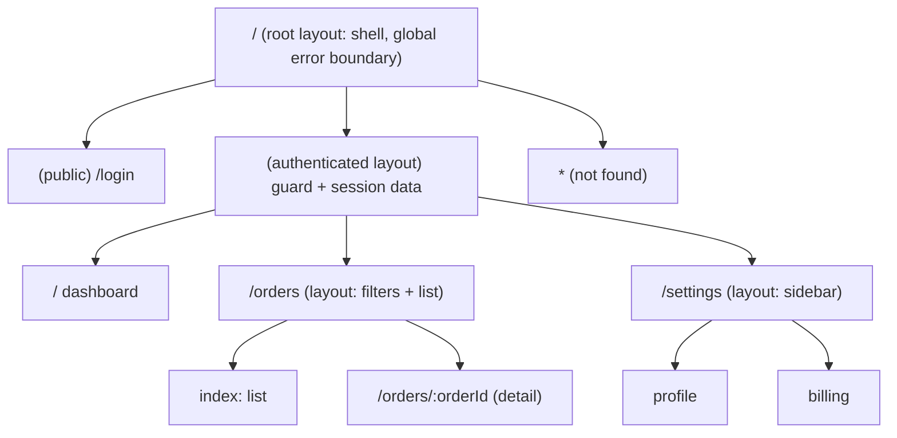
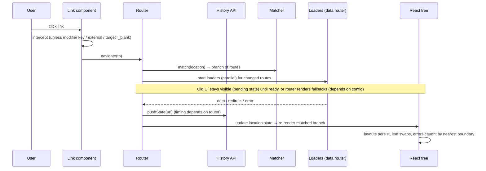
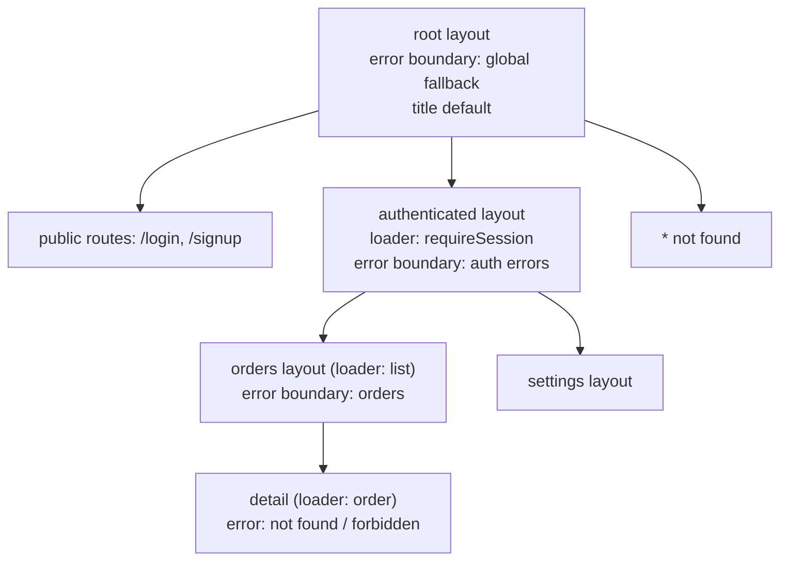

# 04 / 18 — Routing Architecture: The URL as the Spine of the Application

## 1. Lesson metadata

| | |
|---|---|
| **Level** | Advanced |
| **Study time** | 5–6 hours (reading 2.5 h, experiments 1 h, exercises 2 h) |
| **Prerequisites** | [04/06 — Feature vs layer structure](./06-feature-vs-layer-structure.md), [04/07 — Modular architecture](./07-modular-architecture.md), [04/15 — State ownership](./15-state-ownership.md), [04/16 — Server vs client state](./16-server-vs-client-state.md), [04/17 — Data flow architecture](./17-data-flow-architecture.md) |
| **Next** | [19 — Error boundaries](./19-error-boundaries.md) |
| **Related later** | [Phase 6/18 — URL state management](../06-data-fetching-and-state-ecosystems/18-url-state-management.md), [7/15 — Code splitting and lazy loading](../07-performance/15-code-splitting-and-lazy-loading.md), [9/09 — Framework architecture](../09-advanced-rendering-and-ecosystem/09-framework-architecture.md), [9/10 — Routing and nested layouts](../09-advanced-rendering-and-ecosystem/10-routing-and-nested-layouts.md), [9/12 — Auth boundaries](../09-advanced-rendering-and-ecosystem/12-auth-boundaries.md) |

> ⚠ **API-stability warning.** This lesson teaches routing *architecture* and refers to React Router and TanStack Router *conceptually*. Every concrete API name, option, import path and file-naming convention below is marked **verify-against-docs**: both libraries have changed their APIs significantly across major versions (React Router v6 → v7 reorganized packages and framework features; TanStack Router is comparatively young and evolves quickly). Treat code as *shape-illustrating pseudo-API that is believed accurate for current versions*, and check <https://reactrouter.com> and <https://tanstack.com/router> before copying.

**Learning objectives.** After this lesson you can:
1. Explain what a client-side router does mechanically (History API, URL matching, rendering) and what problems it solves.
2. Design a route tree as an architectural artifact: nested layouts, route-level data dependencies, route-level error and loading boundaries, route-level code splitting, and access control.
3. Compare route-definition architectures — central route table, feature-owned route modules, file-based routing, framework-integrated routing, and non-URL navigation — with structure, rules, trade-offs, failure modes and migration.
4. Decide what belongs in the URL (path vs search vs hash) and validate untrusted URL input.
5. Place authentication/authorization checks correctly (and know what client-side guards can and cannot guarantee).
6. Reason about waterfalls, preloading, scroll/focus restoration, and accessibility of navigation.
7. Compare React Router and TanStack Router at the conceptual level (data APIs, type-safety, search params) without memorizing API.

**Concepts covered:** History API, location, route matching, route tree, nested routes and outlets, layout routes, index routes, dynamic segments, search params, loaders/actions (data routers), route-level code splitting, lazy routes, preloading/prefetching, guards, redirects, 404 handling, route errors, modal/overlay routes, type-safe routing, link components, scroll and focus restoration, navigation blocking, base paths, SSR considerations.

---

## 2. Deep conceptual explanation

### 2.1 What problem does a router solve?

A multi-page website maps *URLs to documents* using the server. A single-page application (SPA) loads one document and swaps what is displayed using JavaScript. Without a router, you lose what the web gives for free:

- **Addressability:** a stable address for each "place" in the app that can be bookmarked, shared, and indexed.
- **History:** Back/Forward buttons that behave as users expect.
- **Reload safety:** F5 returns you to where you were.
- **Deep linking:** an email can link to *this* invoice, *this* filter state.
- **Entry points for analytics and error reporting:** "which screen was the user on?"

A client-side router restores these by (1) **reading the URL**, (2) **matching it** to a configured structure, (3) **rendering** the matched components, and (4) **intercepting link navigations** to avoid full page loads, updating the URL through the History API.

Architecturally, the router also became the **organizing principle** of the application: *the route tree is the application's top-level structure.* It decides which code loads, which data is fetched, which layout wraps which screen, where errors are contained, and who may see what. Hence "routing architecture" is not about links; it is about *what the URL controls*.

### 2.2 URL anatomy and what belongs where

```text
https://app.example.com/orders/42/items?status=open&sort=date#notes
        └────host────┘ └────path────────┘└────search────┘ └hash┘
```

| Part | Typical role | Server sees it? | Guideline |
|---|---|---|---|
| **Path** | *Which resource/screen*: identity of the thing viewed | Yes | Hierarchical identity: `/orders/42/items`. Use path segments for required identifiers. |
| **Search (query string)** | *How to view it*: filters, sort, pagination, tab, optional modal | Yes | Optional, order-independent, shareable view state. |
| **Hash (fragment)** | In-page anchor; sometimes client-only state | **No** (never sent in HTTP requests) | In-page anchors; client-only state. It is also kept in browser history, so never place secrets in it. |

Decision rule: *if two URLs differing only in this value are different "places" for navigation/SEO, put it in the path; if they are different "views" of the same place, put it in search.* ([Phase 6/18](../06-data-fetching-and-state-ecosystems/18-url-state-management.md) expands.) Never put secrets or tokens in the URL (history, referrer headers, logs).

### 2.3 The History API (what routers sit on)

Routers use the browser's **History API**: `history.pushState(state, "", url)` and `history.replaceState(...)` change the URL without a document load; the `popstate` event fires when the user navigates Back/Forward (not on `pushState`). The router subscribes to `popstate` and its own navigation calls, re-matches, and re-renders. Key facts ([MDN History API](https://developer.mozilla.org/en-US/docs/Web/API/History_API)):

- `pushState` adds a history entry; `replaceState` replaces the current entry.
- Changing the URL this way never triggers a network request.
- A reload requests the *current URL* from the server, so the server must serve your app's HTML for every client route ("SPA fallback") or the reload yields 404. This is a deployment concern ([Phase 10/02](../10-production-engineering/02-deployment-workflows.md)).
- Scroll restoration is partially the browser's (`history.scrollRestoration`) and partially the router's.
- Alternative history modes: **hash routing** (`/#/orders`) works without server fallback but is worse for SEO and sharing; **memory routing** (no browser URL) for tests and embedded widgets.

### 2.4 Routes as a tree, not a list

Most real screens are nested: a shell (header/nav) wraps a section (settings sidebar) wraps a screen (billing). Modeling routes as a **tree** with *layout routes* gives:

- Layout components that **persist** across child navigations (state in the sidebar survives moving between children).
- Per-node **data dependencies**, **error boundaries**, **loading states**, and **guards** that apply to the entire subtree.
- URL segments composed hierarchically.



*Teaching model.* The **matched branch** from root to leaf is rendered as nested components: each layout renders an **outlet** where its matched child goes. When navigating from `/settings/profile` to `/settings/billing`, the root, app and settings layouts remain mounted; only the leaf changes — this persistence is *a state ownership decision* ([lesson 15](./15-state-ownership.md)): layout-level state survives, leaf state does not.

### 2.5 React's exposure

React itself has **no router**. It provides the primitives routers use: context, effects/`useSyncExternalStore`, Suspense, transitions (`useTransition` to keep the old screen during navigation — [Phase 7/12](../07-performance/12-usetransition-in-practice.md)), lazy loading (`React.lazy`), and error boundaries. Routing is supplied by libraries (React Router, TanStack Router, Wouter, …) or **frameworks** (Next.js, Remix/React Router framework mode, TanStack Start, etc.), where routing is integrated with server rendering, bundling, and data loading ([Phase 9/09](../09-advanced-rendering-and-ecosystem/09-framework-architecture.md)). ⚠ Which router/framework combination is recommended by the React team and community evolves; the React documentation advises using a framework for new full-stack apps—verify the current wording at <https://react.dev/learn/start-a-new-react-project>.

### 2.6 Two generations of router architecture

1. **Component-driven routing (older style).** Routes are components rendered during render; data fetching happens *after* the matched component mounts (in effects or query hooks). Navigation → render → fetch → render again. Produces **request waterfalls** in nested routes: the parent fetches, then renders the child, which fetches...
2. **Data routers (loader-driven routing).** Routes are declared as data (objects/files) with *loaders* (data), *actions* (mutations), *error elements*, *lazy modules*. On navigation the router matches the branch and **starts all matched routes' loaders in parallel** before (or while) rendering, so data dependencies are known at the route-tree level rather than discovered by rendering. React Router (v6.4+ data APIs; framework mode in v7) and TanStack Router (loaders, search param validation, preloading) both offer this; verify details in docs.

The shift is conceptual: **navigation is the trigger for data loading, and the route tree declares dependencies**, which unlocks parallel fetching, preloading on hover/intent, centralized pending UI, and consistent error handling.

### 2.7 Conceptual comparison: React Router and TanStack Router

| Concern | React Router (concepts; verify per version) | TanStack Router (concepts; verify) |
|---|---|---|
| Route definition | Config objects or JSX; in framework mode, file-system conventions | Code-based route trees or file-based generation via tooling |
| Type safety of links/params | Increasing in recent versions (type generation in framework mode); traditionally weakly typed | A core design goal: typed paths, params, and search params end-to-end |
| Search params | URLSearchParams-style APIs; validation is your job (a library helps) | First-class, schema-validated, typed search params with serialization/inheritance across the route tree |
| Data loading | `loader`/`action` per route; revalidation after actions | `loader` per route with built-in caching/stale options; designed to integrate with an external cache (e.g., TanStack Query) |
| Code splitting | Lazy route modules | Lazy route files/components; automatic splitting through tooling |
| Preloading | Prefetch on link intent (verify) | Preload on intent/viewport (verify) |
| SSR/full-stack | Framework mode (v7) integrates SSR/RSC direction (verify) | TanStack Start (full-stack framework; verify maturity) |
| Ecosystem/maturity | Very large install base, long history | Newer, rapidly evolving; strong typing story |

⚠ This table is a **conceptual orientation as of this lesson's writing**, not a feature checklist. Always check each project's docs and release notes.

### 2.8 Common misconceptions

| Misconception | Reality |
|---|---|
| "The router is just for navigation/links." | It is the structural backbone: layouts, data, errors, splitting, and guards hang off it. |
| "Client-side route guards secure the app." | A guard only hides UI. Authorization must be enforced by the **server/API** ([9/12](../09-advanced-rendering-and-ecosystem/12-auth-boundaries.md)). Anything shipped to the client is inspectable. |
| "Put all state in the URL." | Only navigational/shareable state. Drafts, ephemeral UI, and secrets stay out. |
| "Nested routes means nested folders in the URL only." | It means *nested rendering with persistent layouts*, which is a state and data design decision. |
| "`<a href>` vs `<Link>` is cosmetic." | `<a>` reloads the document (loses client state); the router's link intercepts the click, preserves SPA state, supports preloading, and keeps modifier-click/middle-click/new-tab behavior intact. |
| "Lazy-load every route." | Splitting trades bundle size for navigation latency and waterfalls; preload strategies are needed ([7/15](../07-performance/15-code-splitting-and-lazy-loading.md)). |
| "404 is just a catch-all." | 404 for *unknown paths* vs 404 for *known path with missing resource* (`/orders/999`) are different cases handled by different layers (route matching vs loader/error). |

---

## 3. Internal mechanics

### 3.1 From click to rendered screen (teaching model)



⚠ Whether the URL changes *before* or *after* loaders complete, and what UI shows during pending navigation, is configuration/version-specific. The *concept*: the router coordinates **match → load → commit** and can keep the old UI until the new route's data is ready.

### 3.2 Matching

A matcher ranks candidate routes: static segments beat dynamic (`/orders/new` vs `/orders/:id`), dynamic beat splat/catch-all, more specific beat less, index routes match the parent's exact path. *Public guarantee:* documented ranking rules in each router; *do not rely on declaration order* unless documented; test ambiguous paths explicitly (`/orders/new` must not hit `:id = "new"`).

### 3.3 Route modules and code splitting

A route can be split into a **lazy module** loaded when matched. Sequence: match → (in parallel) load module + run loader → render. If the module's loader is defined *inside* the lazy module, loader execution waits for module download (a waterfall); keeping the `loader` (small) eager and the component lazy, or using a router feature that parallelizes them, avoids it. ⚠ Specific lazy-route APIs differ; verify. This interplay — *loader in the lazy chunk or outside* — is a real design decision with latency consequences ([7/17](../07-performance/17-network-waterfalls.md)).

### 3.4 Data revalidation

After an *action* (mutation) completes, data routers **revalidate** loaders for the affected routes to keep the UI consistent with the server: the router-level analog of cache invalidation ([lesson 16](./16-server-vs-client-state.md)). Rules to learn from docs: which loaders re-run after which navigations/actions, how to opt out, how to key (params/search). If you also use a client cache (TanStack Query), decide **which system is the cache**: loaders can *warm* the query cache (`ensureQueryData`-style) so components read from one cache — a standard integration pattern, particularly with TanStack Router; verify the idiom in current docs.

### 3.5 Pending and optimistic navigation UI

Because the old screen can remain while the next loads, the router exposes navigation state (idle/loading/submitting). Combine with transitions to avoid blank flashes. Architecturally, a **global pending indicator** (thin progress bar) tied to router state plus **per-route skeletons** for deferred data gives responsive feel without per-component spinners.

### 3.6 Errors in the route tree

Each route can define an **error element/boundary**; thrown errors (loader failures, render errors) bubble to the nearest route error boundary, so a failing sidebar widget route does not blank the whole app. HTTP-like "not found" thrown from a loader is a *route-level* result, not a crash. Details and layering with React error boundaries are in [lesson 19](./19-error-boundaries.md).

### 3.7 Scroll and focus management (accessibility)

On SPA navigation the browser does not reset scroll or move focus as it would for a page load; screen reader users get no "page changed" signal unless you provide one. Architecturally: (1) restore scroll on Back/Forward and reset on forward navigation (routers offer helpers; verify), (2) move focus to the new page's main heading or announce route changes via a live region, (3) update `document.title` per route. Treat this as part of the routing layer ([Phase 9/14](../09-advanced-rendering-and-ecosystem/14-accessibility-and-seo.md), [Phase 10/08](../10-production-engineering/08-accessibility-as-architecture.md)).

### 3.8 Implementation details to avoid depending on

- Internal match-ranking algorithm beyond documented behavior.
- When exactly `pushState` fires relative to loaders.
- Loader parallelism details across versions.
- ⚠ Navigation transitions with React `startTransition`: router libraries integrate with React's scheduling in version-specific ways (`flushSync` or transition options exist in some APIs); verify.

---

## 4. Step-by-step walkthrough: navigating from the orders list to an order detail, then pressing Back

Assumptions: data router; routes: `/orders` (layout with list), `/orders/:orderId` (child), loaders at both levels; a TanStack-Query cache beneath; lazy component for detail.

1. **Initial state.** URL `/orders?status=open`. Matched branch: `root → app → orders → index`. The orders loader previously warmed the cache for key `['orders','list',{status:'open'}]`.
2. **User hovers the "Order 42" link.** The link component's *intent preloading* (configurable; verify) starts the detail route's lazy module download and the detail loader (which calls `ensureQueryData` for `['orders','detail','42']`). Network panel shows early requests.
3. **User clicks.** The router checks it's a plain left click without modifiers, no `target`, same-origin; prevents the default full-page navigation.
4. **Match.** New location `/orders/42`; matcher yields branch `root → app → orders → :orderId`. Routes `root`, `app`, `orders` are *unchanged* (same match, same params) → their loaders are **not** re-run (unless revalidation rules say so); only the `:orderId` loader runs (already warm from preload).
5. **Pending.** Router state is `loading` until the loader resolves; the old list stays visible; global progress bar shows. If the loader were slow, a per-route pending component might show.
6. **Commit.** The router updates location state; React re-renders the branch inside a transition (so the old UI isn't replaced by a fallback prematurely; version-specific). `pushState` adds `/orders/42` to history.
7. **Render.** `orders` layout remains mounted (its state, such as list scroll position if it's kept mounted, survives); the outlet swaps `index` for the detail leaf. Focus and document title are updated by routing-layer code.
8. **Back button.** Browser fires `popstate`; router matches `/orders?status=open`; loaders for changed routes run (the list data is cached, so no spinner if still fresh); scroll position restored (router/browser).
9. **Stale data.** If the cache considers the list stale, a background refetch updates the list silently after Back.
10. **Failure variant.** If `/orders/999` doesn't exist: the loader throws a "not found" response/error → nearest route error boundary (at `orders` level) renders "Order not found" **inside** the orders layout (list/sidebar still visible), not a full-page crash.

---

## 5. Code examples

> ⚠ API names (`createBrowserRouter`, `Outlet`, `loader`, `createFileRoute`, `validateSearch`, etc.) are used to illustrate **concepts**. Verify against the current docs of your chosen router/version.

### 5.1 Minimal: a route tree as data (React Router-style, conceptual)

```tsx
// app/router.tsx  (verify-against-docs: package names and API differ between React Router v6/v7)
import { createBrowserRouter, RouterProvider, Outlet, Link } from "react-router";

function Shell() {
  return (
    <>
      <nav><Link to="/">Home</Link> <Link to="/orders">Orders</Link></nav>
      <main><Outlet /></main>          {/* where matched child routes render */}
    </>
  );
}

const router = createBrowserRouter([
  {
    path: "/",
    Component: Shell,                  // layout route (verify: element vs Component prop naming)
    children: [
      { index: true, Component: Home },
      { path: "orders", Component: OrdersLayout, children: [
        { index: true, Component: OrdersList },
        { path: ":orderId", Component: OrderDetail },
      ]},
      { path: "*", Component: NotFound },
    ],
  },
]);

export function App() { return <RouterProvider router={router} />; }
```

**Line notes.** The tree is *data*; the layout is a component with an outlet; `index` handles the parent's exact URL; `*` is a catch-all not-found. Declaration order should not matter, but verify the router's ranking.

### 5.2 Practical: feature-owned route modules composed at the app root

The problem with a single central route file grows with the app: every feature edits it (merge conflicts), and it imports every screen (tight coupling). **Feature-owned route modules** export their subtree; the app composes them.

Representative structure:

```text
src/
  app/
    router.tsx               # composition root: root layout + feature route modules
    routes.ts                # typed path builders for CROSS-feature links (public contract)
    layouts/RootLayout.tsx
  features/
    orders/
      routes.tsx             # exports ordersRoutes (subtree) — the feature's ONLY routing export
      routes.paths.ts        # path builders: ordersPaths.detail(id)
      loaders.ts             # data loaders: use features' data layer (lesson 16)
      ui/...
    settings/
      routes.tsx
    auth/
      routes.tsx
      requireSession.ts      # guard utilities (UX-level)
```

**Dependency rules.**
- `app/router.tsx` imports each feature's `routes.tsx` (and nothing deeper).
- A feature **never imports another feature's routes**; cross-feature links use **path builders from a shared, dependency-free module** (`app/routes.ts` or a feature's *public* `paths` export) so URL changes are a one-file edit.
- Loaders live in the feature and call its data layer, not `fetch` directly ([lesson 14](./14-api-boundaries-and-data-access.md)).
- Layout components belong to the app shell or the owning feature; leaf screens never render the app shell themselves.

```tsx
// features/orders/routes.tsx
import type { RouteObject } from "react-router";            // verify type name per version
import { ordersLoader, orderLoader } from "./loaders";

export const ordersRoutes: RouteObject = {
  path: "orders",
  lazy: () => import("./ui/OrdersLayout"),                  // verify lazy-route API/shape
  loader: ordersLoader,
  children: [
    { index: true, lazy: () => import("./ui/OrdersList") },
    { path: ":orderId", lazy: () => import("./ui/OrderDetail"), loader: orderLoader },
  ],
};

// features/orders/routes.paths.ts
export const ordersPaths = {
  list: (q?: { status?: "open" | "shipped" }) => `/orders${q?.status ? `?status=${q.status}` : ""}`,
  detail: (id: string) => `/orders/${encodeURIComponent(id)}`,
};
```

```tsx
// app/router.tsx
const router = createBrowserRouter([
  {
    path: "/",
    Component: RootLayout,
    ErrorBoundary: RootError,                               // global fallback (lesson 19)
    children: [
      authRoutes,
      { loader: requireSession, Component: AuthedLayout,    // pathless layout route + guard (UX only)
        children: [ordersRoutes, settingsRoutes, dashboardRoutes] },
      { path: "*", Component: NotFound },
    ],
  },
]);
```

**Advantages realised:** each feature team owns its URL subtree; code splitting follows feature boundaries; the root file is small. **Cost:** conventions must be enforced; cross-feature navigation needs the shared path module.

### 5.3 Incorrect: component-level data fetching in nested routes (waterfall) and client-only guards as security

```tsx
function OrdersLayout() {
  const { data: user } = useUser();                  // request 1
  if (!user) return <Spinner />;
  return <Outlet />;
}
function OrderDetail() {
  const { orderId } = useParams();
  const { data: user } = useUser();                  // cached from the layout: no new request
  const { data: order } = useOrder(orderId!);        // request 2 starts only after request 1 resolved and children mounted
  const { data: items } = useOrderItems(orderId!);   // request 3: starts with request 2 (in parallel), but only after request 1 resolved
  if (!order) return <Spinner />;
  if (user?.role !== "admin") return <p>Forbidden</p>;   // “security”
  /* ... */
}
```

**Predict:** user opens a deep link to `/orders/42` on a cold cache with 300 ms latency per request. When does the order's content appear? And what does a user with devtools see?

**Result:** content appears after about **600 ms** (request 1 for `user` → 300 ms; only then is `<Outlet/>` rendered, so request 2 and 3 start and take another 300 ms in parallel). With data-router loaders for `user` and `order` declared on the route tree, both could start at navigation time and finish in ≈ 300 ms. Furthermore: the "Forbidden" check hides UI only; the API call `GET /orders/42` has already executed and the bundle contains the admin UI; an attacker can call the API directly. If the API doesn't enforce authorization, this is a vulnerability. The guard is a **UX affordance**, not security.

### 5.4 Corrected: loader-driven parallel dependencies; server enforces authorization

```tsx
// features/orders/loaders.ts (conceptual; verify signature in docs)
export async function orderLoader({ params, request }: LoaderArgs) {
  const id = params.orderId!;
  // Start both in parallel, with the shared client cache as the single source (lesson 16)
  const [order] = await Promise.all([
    queryClient.ensureQueryData(orderQuery(id)),
    queryClient.ensureQueryData(orderItemsQuery(id)),
  ]);
  return null;                       // components read from the cache via useSuspenseQuery / useQuery
}
```

Notes:
- `queryClient` access in loaders is a *design choice*: pass it via router context or closure; avoid module-global singletons for SSR.
- `Promise.all` makes dependencies parallel; truly dependent fetches (item list depends on order) remain sequential — model them honestly.
- **Authorization** is enforced by the API: the loader should treat 401 as "redirect to login" and 403 as "show forbidden route error" **based on server responses**, while client UI hides what the user can't do.

### 5.5 Advanced: typed, validated search params (TanStack Router-style, conceptual)

```tsx
// features/orders/routes.tsx — verify-against-docs: createFileRoute / validateSearch / zod adapter names
import { createFileRoute } from "@tanstack/react-router";
import { z } from "zod";

const OrdersSearch = z.object({
  status: z.enum(["open", "shipped"]).optional(),
  page: z.number().int().min(1).catch(1),         // invalid → default; never crashes
  sort: z.enum(["date", "total"]).catch("date"),
});

export const Route = createFileRoute("/orders/")({
  validateSearch: OrdersSearch,                    // untrusted URL → typed object
  loaderDeps: ({ search }) => ({ search }),        // loader cache keys from validated search
  loader: ({ deps: { search }, context }) => context.queryClient.ensureQueryData(ordersQuery(search)),
  component: OrdersList,
});

function OrdersList() {
  const search = Route.useSearch();                // typed: { status?: ..., page: number, sort: ... }
  const navigate = Route.useNavigate();
  return (
    <button onClick={() => navigate({ search: (prev) => ({ ...prev, page: prev.page + 1 }) })}>Next</button>
  );
}
```

**Why this matters.** The URL is **untrusted input** (users edit it, old links persist across deploys). Validation at the route boundary yields typed values for everything downstream, and invalid values degrade to defaults. The same discipline applies in React Router with a parse/validate function in the loader or a hook adapter (as in [lesson 15 §5.6](./15-state-ownership.md)).

### 5.6 Modal/overlay routes (URL-addressable dialogs)

Concept: the quick-view modal for a product is *both* an overlay on the list and a deep-linkable URL `/products/sku-1`. Two typical implementations: (1) **search param** `?quickview=sku-1` rendered on top of the list route; (2) **nested route** whose component renders into a portal while the parent list stays mounted. If opened directly (deep link/refresh), (2) needs a policy: render as a full page or render list + modal. Decide explicitly; Back should close the modal. ⚠ Mechanisms differ across routers; verify.

### 5.7 Guard patterns (UX level)

```tsx
// features/auth/requireSession.ts (conceptual loader)
export async function requireSession({ request }: LoaderArgs) {
  const session = await sessionQuery.ensure();           // from server (cookie-based) — source of truth is the server
  if (!session) {
    const url = new URL(request.url);
    throw redirect(`/login?next=${encodeURIComponent(url.pathname + url.search)}`);
  }
  return null;
}
```

Rules: guard in **route loaders** (before render) rather than in components (flash of protected UI); `next` param **must be validated** to be a same-origin relative path (open-redirect vulnerability otherwise); the server must still authorize every API call.

---

## 6. Visual explanations

### 6.1 Route tree with boundaries



### 6.2 Component-driven vs loader-driven timelines (cold load of `/orders/42`)

```text
Component-driven:
  nav ──► render layout ──► fetch user ───────► render Outlet ──► fetch order ───────► render detail
  t=0                        t=0..300                              t=300..600           t≈600

Loader-driven:
  nav ──► [fetch user ‖ fetch order ‖ lazy module] ───────────────────► render everything
  t=0      t=0..300 (parallel)                                           t≈300
```

### 6.3 URL as state owner (cross-reference to lesson 15)

```mermaid
flowchart LR
  URL[URL path+search] -->|parse + validate| ADAPT[typed route params / search]
  ADAPT --> LOADER[loaders]
  ADAPT --> VIEWS[components]
  VIEWS -->|navigate(patch)| URL
  LOADER --> CACHE[(server-state cache)]
  CACHE --> VIEWS
```

### 6.4 Preloading strategies

```text
none         : fastest build, slowest navigation (download + fetch after click)
on intent    : hover/focus/touchstart → start module + data (good default for desktop)
on viewport  : link scrolls into view → preload (costly on long lists; use sparingly)
on render    : preload all linked routes (only for small, critical sets)
```

---

## 7. Alternative approaches and trade-offs

### 7.1 Approach A — Central route table (one file)

- **Original problem:** router adoption: define all routes in one place for visibility.
- **Structure:** `src/router.tsx` (or `routes.ts`) listing every route, importing screens (often lazily).
- **Dependency rules:** the table depends on screens; screens depend on nothing about the table (use path builders for links).
- **Example:** §5.1.
- **Advantages:** whole URL structure at a glance; trivial onboarding; easy review of URL changes; works for small apps.
- **Disadvantages:** merge-conflict hotspot; knows about every feature; grows to hundreds of lines; layouts/guards/lazy rules repeated; no feature ownership.
- **Appropriate size:** up to ~15–30 routes and 1–3 teams.
- **Failure modes:** URL strings duplicated in components; route-order bugs; guards forgotten for new routes; the file imports (eagerly) the whole app, defeating code splitting if lazy isn't used.
- **Migration:** extract subtrees into feature `routes.tsx` and compose; replace string literals with path builders.

### 7.2 Approach B — Feature-owned route modules (composed at root)

- **Problem:** scaling ownership and code splitting by feature.
- **Structure/rules:** §5.2.
- **Advantages:** team ownership; splitting aligned to features; small root; features can be developed and tested in isolation (render a feature's routes in a memory router).
- **Disadvantages:** global URL picture is distributed (generate a route manifest/docs); cross-feature links need shared path contract; duplicated layout conventions unless centralized.
- **Appropriate size:** 30–500+ routes; multiple teams.
- **Failure modes:** features import each other's routes (cycles); URL collisions between features (two claim `/reports`); inconsistent guard/error conventions; feature routes duplicating shell concerns.
- **Migration:** from A (extract incrementally); to micro-frontends: each module becomes a remote-loaded subtree ([Phase 11/12](../11-senior-and-architect-mastery/12-microfrontends.md)).

### 7.3 Approach C — File-based routing

- **Original problem:** route config drift and boilerplate; convention over configuration; enables tooling (type generation, automatic splitting).
- **Structure (illustrative; conventions differ by tool and version — verify):**

```text
routes/
  __root.tsx                 # root layout
  index.tsx                  # "/"
  orders/
    index.tsx                # "/orders"
    $orderId.tsx             # "/orders/:orderId" (TanStack-style param naming; React Router uses different conventions)
  _authed.tsx                # pathless layout (guard)
  _authed/settings.tsx
```

- **Dependency rules:** route files are *thin* — they declare route config and import feature code; business logic lives in `features/`. Generated route trees are build artifacts.
- **Advantages:** URL ↔ file mapping is discoverable; automatic code splitting; type generation; fewer merge conflicts; consistency.
- **Disadvantages:** conventions to learn (special characters/prefixes differ between tools); file names encode behavior; refactoring URLs = moving files; generated code in repos; weaker control over atypical structures; routes dir becomes a second architecture parallel to `features/` (risk of logic in route files).
- **Appropriate size:** any; particularly strong at medium–large.
- **Failure modes:** business logic accumulates in route files (hard to reuse/test outside the router); inconsistent naming; ambiguous route-collisions; tool-version lock-in.
- **Migration:** from code-based: adopt the tool's codemod/conventions gradually; keep route files as adapters to features.

### 7.4 Approach D — Framework-integrated routing (SSR/RSC frameworks)

- **Problem:** routing coupled with server rendering, streaming, data fetching, and bundling.
- **Structure:** framework conventions (e.g., app directory with layouts/pages/loading/error files, or route modules with loaders/actions) — **verify per framework**.
- **Dependency rules:** server-only and client-only boundaries enforced by the framework ([Phase 9/04](../09-advanced-rendering-and-ecosystem/04-client-server-boundaries-and-serialization.md)); route-level files are the unit of splitting/caching.
- **Advantages:** first-class SSR/streaming; integrated data and mutations; per-route metadata/SEO; optimized bundling.
- **Disadvantages:** framework lock-in; operational model (servers/edge); learning curve; fast-moving APIs.
- **Appropriate size:** public/content/e-commerce apps where SEO and first paint matter; any app on the framework.
- **Failure modes:** accidental client-bundling of server code; waterfalls through nested layouts without parallel data; cache semantics confusion; mixed conventions across versions.
- **Migration:** SPA → framework: move the route tree conventions, loaders for first-paint data, keep client code mostly unchanged; staged route-by-route if the framework permits.

### 7.5 Approach E — State-based "navigation" (no URL routing)

- **Problem solved:** embedded widgets, kiosks, wizards in modals, or tiny apps where URLs add nothing.
- **Structure:** a `screen` state (discriminated union) in a navigator owner; a stack for Back.
- **Dependency rules:** screens don't know the navigator; commands `push`, `pop`, `replace`.
- **Advantages:** no router dependency; full control; simple tests.
- **Disadvantages:** no deep links, no browser Back (unless you wire it), no reload safety, no sharing, no per-route splitting for free, re-implementing history.
- **Appropriate size:** ≤ ~5 screens, no sharing requirement; embedded contexts.
- **Failure modes:** Back button leaves the app; lost state on reload; users cannot link to screens; ad-hoc history bugs.
- **Migration:** lift screen id to the URL (path) and map `push`→`navigate`.

### 7.6 Comparison

| Criterion | Central table | Feature modules | File-based | Framework | State-based |
|---|---|---|---|---|---|
| Overview at a glance | Excellent | Medium (needs manifest) | Good (tree view) | Good | Excellent |
| Team ownership | Poor | Excellent | Good | Good | N/A |
| Code splitting | Manual | Manual/aligned | Automatic (tooling) | Automatic | Manual |
| Type-safe links | Manual (path builders) | Manual | Often generated | Framework-dependent | Compile-time (unions) |
| SSR/SEO | Add-on | Add-on | Add-on / framework | Built-in | None |
| Lock-in | Router | Router | Router + tool conventions | Framework | None |
| Refactoring URLs | Edit table | Edit module + builders | Move files | Move files | Edit union |
| Risk | God file | Cycles/collisions | Logic in route files | Boundary mistakes | Missing URL features |

**Scenario where the recommended approach (feature-owned modules / file-based with loaders) is NOT best:** a small internal admin tool with six screens, one team, and no SEO — a single central route table with lazy screens is simpler and equally maintainable. And for an **embedded widget** inside a host page (the host owns the URL), state-based navigation or a memory router is correct.

### 7.7 Route-level concerns: choices within any approach

| Concern | Options | Guidance |
|---|---|---|
| Auth guard | route loader redirect; pathless guard layout; component wrapper | Loader/guard layout (no flash of protected content); server still authorizes |
| Code splitting | lazy components; lazy route modules; automatic | Split at route level first; preload on intent; keep loaders eager if small |
| Error boundaries | per route; per layout; global only | Per layout + global fallback; local boundaries for independent widgets ([19](./19-error-boundaries.md)) |
| Data | loaders; query hooks in components; hybrid | Loader to *start* fetch, cache as owner, components read from cache |
| Modals | search param; nested route; local state | URL if shareable/Back-closable; local state otherwise |
| Not found | catch-all; resource-level thrown 404 | Both: unknown path (matcher) and missing resource (loader) |
| Redirects | declarative; loader; server | Server-side for SEO/canonical; loader for auth |
| Base path | router `basename` | Needed for sub-path deployments; test deep links |

---

## 8. Best practices and anti-patterns

**Practices**
1. **Treat the route tree as architecture**: layouts, boundaries, data and guards declared on it.
2. **One path-builder module** for URLs used across features; never concatenate strings in components.
3. **Validate all URL input** (params, search, `next` redirects) at the boundary; provide safe defaults.
4. **Use loaders (or equivalent) to start data fetching at navigation time**; keep a cache as the owner.
5. **Preload on intent** for primary navigation.
6. **Per-layout error boundaries** so failures are contained (and a global fallback).
7. **Keep route files thin**; logic lives in features and is testable without a router.
8. **Handle both kinds of 404** and both kinds of auth failures (401 vs 403) distinctly.
9. **Accessibility:** title per route, focus management or announcements, skip link, correct link semantics (`<a>` with `href` so middle-click and open-in-new-tab work).
10. **Test routes with a memory router** (feature in isolation) and a small number of E2E deep-link tests ([Phase 8/09](../08-testing-and-quality/09-e2e-with-playwright.md)).

**Beginner mistakes**
- Using `<a href>` for internal navigation (full reload); or `onClick` + `navigate` on a `<div>` (no keyboard/middle-click/semantics).
- Storing navigational state in `useState` (lost on refresh).
- Forgetting server fallback → 404 on refresh in production.
- Index-route confusion (`/orders` renders nothing).

**Experienced-developer mistakes**
- Giant layouts that fetch everything at the top, blocking every child.
- Lazy-loading everything including tiny routes → waterfalls and spinner chains.
- Treating client guards as security.
- Putting application logic into route files (no reuse; hard to test).
- Encoding complex state as URL JSON blobs (unreadable, fragile, long).

**Smells**
- URL strings (`"/orders/" + id`) scattered through components.
- Route components doing `useEffect(() => { navigate(...) })` to redirect.
- Layouts that conditionally render `<Outlet>` after client fetches.
- Search params read via `new URLSearchParams(window.location.search)` inside components (bypasses the router, no re-render).
- Duplicate route definitions for "modal" and "page" variants.

**Justified exceptions**
- Hash routing for static hosting without server rewrites (e.g., some intranet/GitHub Pages cases), accepting SEO and sharing limitations.
- Eager (non-lazy) routes for the critical first screens to avoid a chunk waterfall.
- Component-level data fetching for deeply nested, *optional* widgets that should not block navigation (with Suspense boundaries).

---

## 9. Real-world application

**E-commerce.** Public catalog routes are SEO-critical: server-rendered (framework) with canonical URLs, path for category/product identity (`/c/shoes/p/sku-1`), search params for filters (`?color=red&size=42`); canonical tags avoid duplicate-content explosion from filter permutations. Checkout is a nested route flow (`/checkout/shipping` → `/checkout/payment`) with guards ensuring a non-empty cart — enforced again server-side. Constraint: 404 for removed products must return real HTTP 404 (needs SSR or edge handling; client-only apps cannot set response status).

**Dashboard (multi-team).** Shell owned by platform team; features register route subtrees; each feature declares required permissions in route metadata (`handle`-style data; verify) which the shell uses to render navigation — *one declaration drives route guard and menu*. Constraint: independent deploys → route manifest versioning, URL stability (never break bookmarked URLs without redirects).

**Finance.** Deep links in notifications ("Review transaction 123") must work from cold start and across authentication (preserve `next`). Sensitive IDs: avoid PII in URLs (they land in logs, history, analytics). Back/Forward must not re-submit mutations (use POST-redirect-GET-style flows in data routers; actions then navigate).

**Auth.** Login redirect with validated `next`; token refresh handled in API layer; on 401 mid-session → route-level redirect via a central error mapper.

**Realtime.** Routes subscribe/unsubscribe to channels on enter/leave (effects tied to the route component or loaders with cleanup). Constraint: route transitions mustn't leak sockets.

**Forms.** Block navigation when the form is dirty (router "blocker" APIs; verify) but remember `beforeunload` is separate and constrained by browsers.

---

## 10. Debugging and troubleshooting

### Symptom 1: "Refreshing `/orders/42` returns 404 in production but works in dev."
- **Investigation:** Network panel: the HTML request for the deep URL returns 404 from the host/CDN.
- **Root cause:** no SPA fallback (rewrite all non-asset paths to `index.html`).
- **Fix:** configure server/CDN rewrite; ensure assets with hashed names are excluded; verify `basename` if deployed on a sub-path.
- **Validate:** curl the deep URL; E2E deep-link test.

### Symptom 2: "State in my page resets when I navigate between sibling routes."
- **Investigation:** React DevTools: is the layout remounting? Look for different layout instances per route (layout rendered *inside* each leaf instead of as a parent route), or `key` on `<Outlet>` derived from location.
- **Root cause:** layout not shared in the route tree.
- **Fix:** restructure as a layout route; move state ownership appropriately ([15](./15-state-ownership.md)).

### Symptom 3: "Slow navigation; spinner chains."
- **Investigation:** Network waterfall (Initiator column and timing): requests start in sequence; Performance panel for lazy chunk download before data fetch.
- **Root cause:** component-level fetching in nested layouts; lazy module containing the loader; blocking parent data.
- **Fix:** loaders at route level (parallel), preload on intent, keep small loaders eager, split data from heavy UI.

### Symptom 4: "Flash of protected content before redirect to login."
- **Root cause:** guard implemented in component effect after first render.
- **Fix:** guard in loader/guard layout (before render) and show a neutral shell.

### Symptom 5: "Back button doesn't do what users expect / history filled with duplicates."
- **Investigation:** inspect `history.length` and entries; check `navigate` calls using `push` for every filter keystroke.
- **Fix:** `replace` for incremental state (typing, tab changes if undesired), `push` for meaningful navigations; debounce text-driven navigations.

### Symptom 6: "Invalid URL crashes the page."
- **Root cause:** unvalidated params (`page=abc` → NaN).
- **Fix:** schema validation with catch/defaults; error boundary for impossible cases.

### Symptom 7: "Route works locally but not when mounted under `/app`."
- **Root cause:** missing base path configuration for the router/assets.
- **Fix:** set router `basename` and bundler `base`; test through the real proxy path.

---

## 11. Exercises

### Level A — Knowledge
A1. List five problems that a client-side router solves relative to a bare SPA.
A2. What is the difference between `pushState` and `replaceState`, and which event fires on Back?
A3. When should state go in the URL path vs search params vs not at all?
A4. What is a layout route and an index route?
A5. What is the architectural difference between component-driven and loader-driven routing?
A6. Why can a client-side route guard not be a security control?

### Level B — Code comprehension
B1. Given routes `/orders/new`, `/orders/:id`, and `*`, which route matches `/orders/new`, `/orders/42`, `/orders/42/edit`? What would you change to handle the third?
B2. In §5.3, what is the total latency if each request takes 300 ms and requests `order` and `items` are made in the child? Compare with §5.4.
B3. What is wrong with this redirect helper?
```ts
const next = new URLSearchParams(location.search).get("next") ?? "/";
window.location.href = next;
```
B4. A layout renders `{user ? <Outlet/> : <Spinner/>}` where `user` comes from `useQuery`. What happens to children's loaders in a data router and to perceived performance?

### Level C — Implementation
C1. Design a `paths.ts` shared module for `orders`, `customers`, and `settings` features with typed builders, and show two usages that avoid string concatenation. Include encoding rules.
C2. Write `parseOrdersSearch(searchParams: URLSearchParams)` returning `{ status?: 'open'|'shipped'; page: number; sort: 'date'|'total' }` with defaults and no throwing.
C3. Write a feature `routes.tsx` for `settings` with a layout, an index redirect to `profile`, two children, and a lazy-loaded `billing` screen (conceptual API; mark verify points).
C4. Write a function `safeNext(next: string | null, fallback = "/"): string` that returns only same-origin relative paths.
C5. Write a memory-router test (React Testing Library style) rendering the orders feature at `/orders/42` asserting the detail renders and the layout is present.

### Level D — Debugging
D1. After deploy to a CDN, deep links return 403/404 for `/orders/42`. Provide the investigation and two possible fixes (CDN config differences).
D2. A modal route, opened by clicking a list item, works; on refresh, the page shows the modal without the list behind it. Why, and what are two correct designs?
D3. Navigation between tabs in a settings layout re-fetches the user profile each time though the data is unchanged. List causes and fixes (loader revalidation, query cache config, key mismatch).
D4. Users report that after login they land on `/` instead of the deep link they clicked. Find three causes.

### Level E — Architecture decisions
E1. Choose a routing architecture (A–E in §7) for: (a) a 7-screen internal tool; (b) a 400-route multi-team SaaS; (c) a content-heavy e-commerce site; (d) a widget embedded in third-party sites. Justify each.
E2. Design the route tree (layouts, guards, error boundaries, loaders) for an app with public marketing pages, an authenticated app with org switching (`/org/:orgId/...`), and an admin area.
E3. Decide between React Router and TanStack Router (or a framework) for a new TypeScript project; provide criteria and what you'd verify in the docs before deciding.
E4. Propose a plan to migrate a component-driven routing app with effect-based fetching to loader-driven routes without a rewrite.

### Level F — Expert challenge
F1. Design the routing architecture for a micro-frontend shell where five independently deployed teams own subtrees under one domain. Address URL ownership/collisions, shared layout, auth, error isolation, versioning/backward compatibility of URLs, preloading across bundles, and failure when a remote is down.

---

## 12. Detailed answers and explanations

> Attempt the exercises first.

**A1.** Addressability (bookmark/share), history/Back/Forward, reload safety, deep linking (email/notifications), analytics/error context per screen, nested layouts and data/error scoping, code splitting per route.

**A2.** `pushState` adds a new history entry; `replaceState` modifies the current entry. Back/Forward fires `popstate` (not fired by `pushState`/`replaceState` themselves). Routers subscribe to `popstate` to re-match.

**A3.** Path: identity of the resource/screen (required, hierarchical). Search: optional view parameters (filters/sort/page/tab/open dialog). Neither: secrets, drafts, ephemeral UI (hover), large objects, sensitive identifiers. Also consider whether you want history entries per change.

**A4.** A layout route renders shared UI and an outlet for matched children; it persists across child navigation. An index route renders at the parent's exact path when no child segment is given.

**A5.** Component-driven discovers data needs while rendering (leading to waterfalls and scattered loading UI); loader-driven declares data needs on routes so the router can start them at navigation time, in parallel, with centralized pending/error handling and revalidation.

**A6.** All client code and data are controllable by the user: devtools, modified bundles, direct HTTP calls. Guards prevent *accidental* access and hide UI; real authorization must be enforced by the server on every request.

**B1.** `/orders/new` → static `new` route (static beats dynamic); `/orders/42` → `:id`; `/orders/42/edit` → falls to `*` (no child under `:id`) unless a nested route exists. Add `{ path: ":id/edit" }` or make `:id` a layout with children `edit`. Verify ranking rules in the router's docs.

**B2.** §5.3: `user` request 300 ms; then the child mounts and `order` + `items` in parallel 300 ms → ≈ 600 ms. §5.4: `user`, `order`, `items` all start at navigation (if the loaders are declared) → ≈ 300 ms, subject to concurrency limits. A stricter note: if `items` truly depends on data from `order`, sequential cost returns for that edge.

**B3.** Open redirect (attacker-supplied `?next=https://evil.example`) and `javascript:` URL risk; also a full document navigation instead of SPA navigation. Fix: validate same-origin relative path (start with a single `/`, not `//`, not containing backslashes or schemes), and use the router's navigate.

**B4.** The layout waits for a client fetch before rendering `<Outlet/>`, so children (and component-level fetches) don't start; in a data router, route loaders still start at navigation time (loaders don't depend on the layout rendering), so *loader* data would already be loading — but components dependent on `user` render late and users see a spinner. Better: ensure `user` through the parent loader (so it's available before render) or render the shell immediately with skeletons.

**C1. Reference.**
```ts
// app/routes.ts — dependency-free
const enc = encodeURIComponent;
export const paths = {
  orders: {
    list: (q?: { status?: "open" | "shipped"; page?: number }) => {
      const p = new URLSearchParams();
      if (q?.status) p.set("status", q.status);
      if (q?.page && q.page > 1) p.set("page", String(q.page));
      const s = p.toString();
      return `/orders${s ? `?${s}` : ""}`;
    },
    detail: (id: string) => `/orders/${enc(id)}`,
  },
  customers: { detail: (id: string) => `/customers/${enc(id)}` },
  settings: { section: (s: "profile" | "billing") => `/settings/${s}` },
} as const;
// usage: <Link to={paths.orders.detail(order.id)}>; navigate(paths.orders.list({ status: "open" }))
```
Evaluation: encoding of dynamic segments; no features importing each other; defaults omitted for clean URLs; return types are strings (or branded types for stricter safety). Router-generated typed links, if available, can supersede this (verify).

**C2. Reference.**
```ts
export function parseOrdersSearch(sp: URLSearchParams) {
  const status = sp.get("status");
  const sort = sp.get("sort");
  const pageRaw = Number(sp.get("page"));
  return {
    status: status === "open" || status === "shipped" ? status : undefined,
    sort: sort === "total" ? "total" : "date",
    page: Number.isInteger(pageRaw) && pageRaw >= 1 ? pageRaw : 1,
  } as const;
}
```
Edge cases: `page=` (empty → `Number("")` = 0 → defaults to 1), `page=1.5`, huge numbers; repeated params (`getAll`) if arrays are supported.

**C3. Evaluation criteria.** Layout component with `<Outlet/>` and sidebar; index route redirecting (`<Navigate replace>` or loader redirect — verify API) to `profile`; `lazy` for `billing`; thin file; no direct fetch in components; error element on the layout. Mark API names to verify.

**C4. Reference.**
```ts
export function safeNext(next: string | null, fallback = "/"): string {
  if (!next) return fallback;
  if (!next.startsWith("/") || next.startsWith("//") || next.includes("\\")) return fallback;
  try {
    const u = new URL(next, "http://placeholder.invalid");   // parse relative to a dummy origin
    if (u.origin !== "http://placeholder.invalid") return fallback;
    return u.pathname + u.search + u.hash;
  } catch { return fallback; }
}
```
Notes: reject `//evil.com` (protocol-relative), `/\evil.com` (browsers normalize backslashes), absolute URLs, and `javascript:`. Consider an allow-list of path prefixes for high-risk apps.

**C5. Evaluation criteria.** Create a memory router with the feature routes and initial entry `/orders/42`; mock the data layer (MSW or mocked API functions); `render(<RouterProvider router={router}/>)`; assert via `findByRole` that the detail heading and the layout's navigation render; ensure the test awaits loaders; avoid asserting on internal router state. (Exact test utilities differ by router; verify.)

**D1.** Investigate: request the deep URL with `curl -I`; see the status and server header (S3/CloudFront/NGINX). Root cause: missing SPA fallback. Fixes: (a) NGINX `try_files $uri /index.html`; (b) CloudFront custom error response mapping 403/404 → `/index.html` with 200 (only for the SPA distribution; beware masking true 404s for assets/API) or an edge function rewriting non-asset paths. Alternatives: SSR/framework hosting returning real 404s for unknown routes.

**D2.** If the modal is a nested route that renders *instead of* the list on a cold load, the list parent isn't part of the matched branch unless the route design includes it. Design 1: a search-param modal (`/products?quickview=sku`) — the list is the route; the modal an overlay; refresh restores both. Design 2: nested modal route under the list layout, with the list rendered by the *layout* (so both render); define the "direct visit" behavior intentionally.

**D3.** Causes: loader revalidation re-running parent loaders on every navigation (configurable `shouldRevalidate`-style hooks; verify); cache key mismatch (profile queried with different keys per tab); `staleTime` zero causing refetch on mount; the data fetched in the leaf instead of the shared layout. Fix: fetch in the layout/parent once, share via cache with a common key and appropriate stale time; avoid unnecessary revalidation.

**D4.** (1) Guard redirect drops the original URL (`next` not captured); (2) login success handler navigates to `/` ignoring `next`; (3) `next` is URL-encoded twice or lost across an OAuth redirect (state must carry it); (4) `safeNext` rejects valid paths (e.g., encoded characters); (5) SSO callback route clobbers history. Verify with logs of each hop.

**E1.** (a) Central table with lazy screens — small, one team. (b) Feature-owned modules (or file-based) with loaders and enforced boundaries; manifest for visibility; shared path contract. (c) Framework-integrated routing for SSR/SEO/streaming and real HTTP status codes. (d) State-based or memory routing — the host owns the address bar. Criteria: SEO, team count, deep-link needs, ownership, infrastructure.

**E2. Example answer.** Root layout (global error boundary, analytics/title); `(marketing)` layout (public, SSR/SSG if framework); `/login`; `app` layout (loader: session; error boundary for auth) → `org/:orgId` layout (loader: org membership and org data; 403 error element; org switcher changes the param, which remounts children by key semantics) → feature subtrees (`projects`, `billing`) each with layouts/loaders; `admin` subtree with additional guard loader (role) + server-side authorization; `*` not-found at root and org levels (distinct messages). Cross-cutting: path builders include `orgId`; preloading for main nav; scroll/focus utilities in root. Evaluation criteria: guards at appropriate nodes, no duplicated guard logic, parameter-based identity, error containment, 401 vs 403 differences.

**E3. Evaluation criteria.** Type-safety needs (search params typed end-to-end?), team familiarity, ecosystem and maturity, SSR/framework needs, data-loading integration with your cache, file-based vs code-based preference, release/migration history (breaking changes), community/support, bundle size. Verify: current major versions and migration guides, docs for validated search params, loader/cache integration, preloading, SSR story, TypeScript inference performance on large trees, test utilities. Decision recorded as an ADR ([Phase 10/16](../10-production-engineering/16-architecture-decision-records.md)) with revisit conditions.

**E4. Plan.** (1) Introduce the data router shell with one route using loaders; keep others as-is via wrapper routes. (2) Move first-paint fetches to loaders/`ensureQueryData` while components keep reading from the same query cache (no component change). (3) Add error elements and pending UI per layout. (4) Convert guards to loaders. (5) Replace string URLs with path builders. (6) Delete effects that fetch/redirect. Each step shippable; measure waterfalls (Network panel, RUM), error rates, and navigation timings. Risks: double-fetching during transition, different key shapes, scroll/focus regressions.

**F1. Evaluation criteria.** URL ownership registry (prefix per team; collision checks in CI); shell owns root layout/auth/session; each remote exports a route subtree *contract* (paths, required permissions, preload hooks) loaded lazily via manifest; shared dependencies (React, router) singleton management; error isolation: per-remote error boundary and a failure UI when a remote chunk fails to load (with retry and reporting); URL compatibility: redirects maintained per remote, deprecation policy; preloading: manifest-based hints, intent-based chunk preloading; auth: single session source, token propagation via shell API, server enforces; observability: route-level tracing with team tags. Acknowledge cost: micro-frontends add operational complexity—justify by organizational constraints rather than technical preference ([Phase 11/12](../11-senior-and-architect-mastery/12-microfrontends.md)).

---

## 13. Senior engineer interview questions

**Q1. "Why did data routers (loaders) become popular?"**
*Strong answer:* Component-driven fetching discovers dependencies during render, creating waterfalls through nested layouts and scattered loading/error UI. Loaders declare dependencies on the route tree so the router can fetch in parallel at navigation time, preload on intent, centralize pending/error handling and revalidate after mutations. The trade-off is coupling to a router's data model and having to decide who owns the cache (router loader vs query library).

**Q2. "Where do you put authorization?"**
*Strong answer:* The server on every request is the source of truth. The client uses route guards (loader-level redirect) for UX, hides unauthorized affordances, and maps 401/403 to appropriate screens. Never rely on client checks; avoid leaking sensitive data into the bundle or the URL.

**Q3. "What should be in the URL?"**
*Strong answer:* Resource identity (path) and shareable view state (search): filters, sort, pagination, selected tab, open entity. Not drafts, secrets, or ephemeral UI. Validate on read, use `replace` vs `push` thoughtfully, keep it short and human-readable, and treat it as a public contract (stability matters).

**Q4. "How do you structure routes for a large multi-team app?"**
*Strong answer:* Feature-owned route modules (or file-based routes with thin files) composed at an app root, shared path builders as the public URL contract, per-layout error/loader/guard conventions, CI checks for collisions and dependency rules, a route manifest for visibility. Each team owns a subtree; the platform team owns shell and conventions.

**Q5. "Code splitting by route: any pitfalls?"**
*Strong answer:* Waterfalls (module download then loader/data), spinner chains, too-fine splitting; mitigate with intent-based preloading, keeping small loaders eager, splitting heavy UI from data, grouping tiny routes, and measuring with bundle analysis and network waterfalls.

**Q6. "React Router vs TanStack Router?"**
*Strong answer:* Conceptually similar (nested routes, loaders, preloading); differences are emphasis (TanStack: end-to-end type-safety and validated search params; React Router: longevity, ecosystem, framework mode) and maturity/stability of APIs. Decide on type-safety needs, SSR/framework plans, team familiarity and migration risk, and verify current docs because both change. I would not pick on feature lists alone; I'd prototype one nested feature and compare ergonomics and type inference at scale.

---

## 14. Further learning resources

| Resource | URL | Covers / why | Level | Study |
|---|---|---|---|---|
| React Router documentation | <https://reactrouter.com> | Route config, data loading, actions, framework mode | Intermediate | Main concepts, Data loading, Error handling *(verify current structure)* |
| TanStack Router documentation | <https://tanstack.com/router> | Type-safe routing, search params, preloading, loaders | Intermediate | Guides: routing concepts, search params, data loading *(verify current structure)* |
| MDN — History API | <https://developer.mozilla.org/en-US/docs/Web/API/History_API> | `pushState`, `popstate`, scroll restoration | Intermediate | Whole page |
| MDN — URL / URLSearchParams | <https://developer.mozilla.org/en-US/docs/Web/API/URL> | Parsing and building URLs safely | Beginner | Both interface pages |
| React docs — Start a New React Project | <https://react.dev/learn/start-a-new-react-project> | React team's guidance on frameworks and routing | Beginner | Whole page |
| React docs — `lazy` | <https://react.dev/reference/react/lazy> | Route-level code splitting primitive | Intermediate | Whole page |
| React docs — Suspense | <https://react.dev/reference/react/Suspense> | Loading boundaries per route | Intermediate | Whole page |
| web.dev — Accessible routing / SPA a11y (search for current articles) | <https://web.dev> | Focus/announcement on route change *(no specific link asserted)* | Intermediate | Search "SPA accessibility route announcements" |
| Phase 9 lessons in this course | [10 — Routing and nested layouts](../09-advanced-rendering-and-ecosystem/10-routing-and-nested-layouts.md) | Framework-level routing in depth | Advanced | Whole lesson |

---

## 15. Knowledge checkpoint

**You should now understand**
- Why routers exist (addressability, history, deep links) and how they sit on the History API.
- The route tree as the structural backbone for layouts, data, errors, splitting and guards.
- Five routing architectures with their dependency rules, trade-offs and failure modes.
- Why client-side guards are UX, not security, and why URL input must be validated.

**You should be able to explain without notes**
- Component-driven vs loader-driven routing and the waterfall difference.
- What belongs in path vs search vs nowhere.
- How preloading and lazy routes interact with loaders.

**You should be able to implement**
- A feature-owned route module with path builders, loaders, error boundaries and a lazy screen.
- Search-param parsing/validation and a safe `next` redirect.

**You should be able to debug**
- Production deep-link 404s, layout remounts, waterfalls, guard flashes and history pollution.

**Before moving on:** read [19 — Error boundaries](./19-error-boundaries.md), which finishes the route-level error story begun in §3.6.
