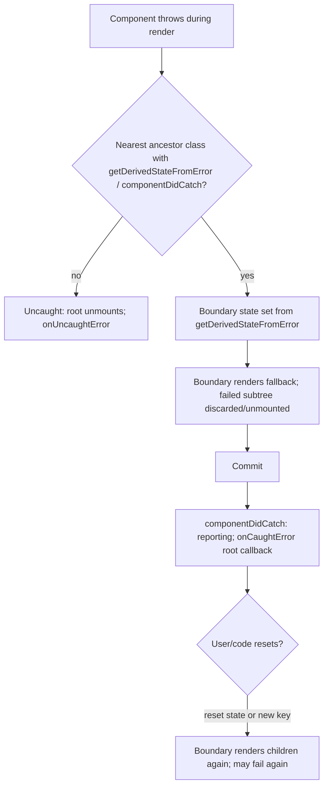
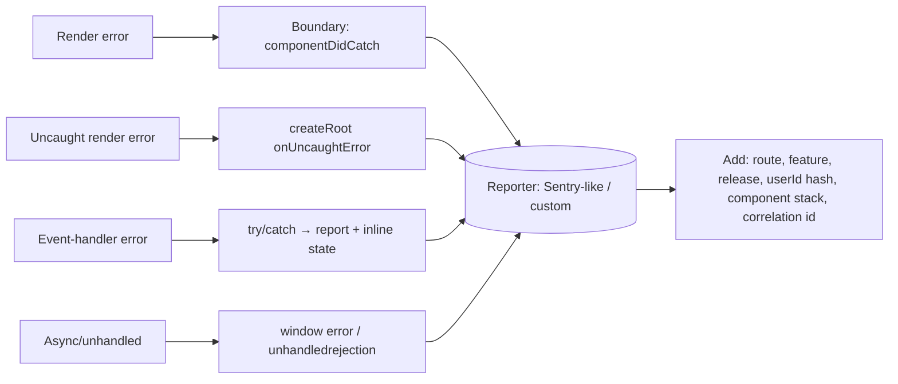
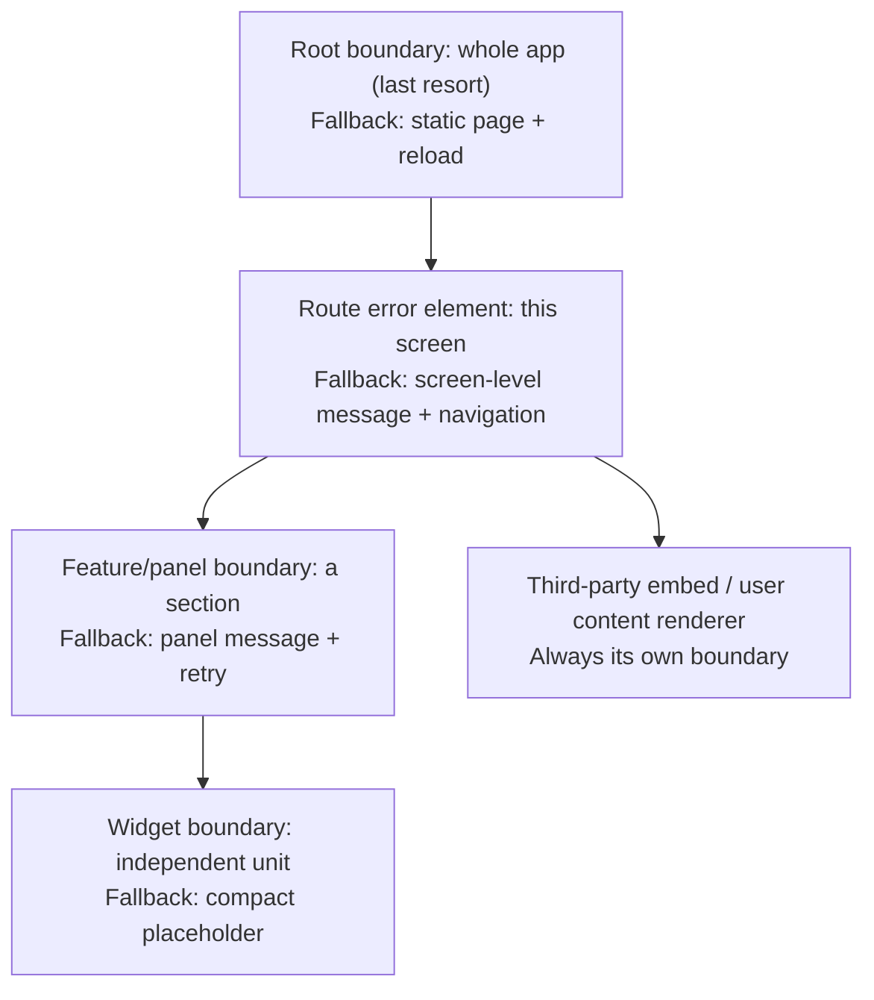

# 04 / 19 — Error Boundaries: Containing Failure as an Architectural Decision

## 1. Lesson metadata

| | |
|---|---|
| **Level** | Advanced |
| **Study time** | 5 hours (reading 2 h, experiments 1 h, exercises 2 h) |
| **Prerequisites** | [04/15 — State ownership](./15-state-ownership.md), [04/16 — Server vs client state](./16-server-vs-client-state.md), [04/17 — Data flow architecture](./17-data-flow-architecture.md), [04/18 — Routing architecture](./18-routing-architecture.md), [03/04 — useEffect synchronization](../03-react-state-and-hooks/04-useeffect-synchronization.md) |
| **Next** | [20 — Design systems](./20-design-systems.md) |
| **Related later** | [Phase 5/21 — Error handling patterns](../05-design-patterns/21-error-handling-patterns.md), [6/03 — Loading and error states](../06-data-fetching-and-state-ecosystems/03-loading-and-error-states.md), [6/15 — Error recovery and retries](../06-data-fetching-and-state-ecosystems/15-error-recovery-and-retries.md), [9/05 — Suspense architecture](../09-advanced-rendering-and-ecosystem/05-suspense-architecture.md), [10/05 — Error monitoring](../10-production-engineering/05-error-monitoring.md), [10/10 — Resilience and degradation](../10-production-engineering/10-resilience-and-degradation.md) |

**Learning objectives.** After this lesson you can:
1. Explain what an error boundary is, what it catches and, just as important, **what it does not catch**.
2. Describe the mechanics: error thrown during render → React unwinds to the nearest boundary → boundary state set → fallback rendered; and how the React 19 root-level error callbacks fit in.
3. Design a **layered boundary strategy** (root, route, feature, widget) and place boundaries by *blast radius* and *recoverability*, not by habit.
4. Implement a boundary (class-based, since boundaries still require a class or a library wrapper) and a reset strategy that actually recovers.
5. Integrate boundaries with data fetching, Suspense, routers, event handlers and async errors, and with error reporting.
6. Compare boundary architectures with structure, dependency rules, trade-offs, failure modes and migration.
7. Diagnose "white screen" incidents, boundaries that never trigger, and boundaries that trigger forever.

**Concepts covered:** render-phase errors, `getDerivedStateFromError`, `componentDidCatch`, fallback UI, reset/recovery, blast radius, boundary granularity, error taxonomy (expected vs unexpected), propagating async/event errors into boundaries, Suspense + error boundary pairing, root error callbacks (`onCaughtError`, `onUncaughtError`, `onRecoverableError`), reporting with component stacks, SSR/hydration errors, route-level error elements, graceful degradation.

---

## 2. Deep conceptual explanation

### 2.1 What problem does this lesson solve?

React renders a tree by calling your component functions. If one of them throws during rendering, there are only three possible policies:

1. **Leave the UI partially updated and continue.** Result: a UI in an inconsistent state that may show wrong data, or hide an error with misleading output (e.g., a payment form missing the error banner).
2. **Crash the entire application and show nothing.** The white screen of death.
3. **Contain the failure to a region, show a fallback there, and keep the rest of the app alive.**

Early React (before 16) effectively did (1): errors in render corrupted internal state and later renders emitted cryptic errors. React 16 chose a principled rule: **an uncaught error during rendering unmounts the whole React tree** (policy 2, because showing corrupted UI is worse than showing none — particularly for apps handling money or access) — **unless you place an error boundary** which opts in to policy 3 for its subtree.

So the architectural job is *choosing where failure stops*. Each boundary defines a **blast radius**: what the user loses when something inside breaks. Boundaries are to UI what bulkheads are to ships.

### 2.2 Definition and the two class methods

> An **error boundary** is a component that catches errors thrown while rendering its descendants (and in their lifecycle methods/constructors), and renders a fallback UI instead of the crashed subtree.

In React, as documented, **only class components can be error boundaries**, by defining one or both of:

- `static getDerivedStateFromError(error)`: *render-phase* method; returns a state update so the next render shows the fallback. Must be pure.
- `componentDidCatch(error, info)`: *commit-phase* method for side effects, notably **reporting** (`info.componentStack` provides the component stack).

There is no Hook equivalent in React (react.dev/reference/react/Component, checked 2026-10-22: "There is currently no way to write an Error Boundary as a function component"; the docs recommend `react-error-boundary`). In practice teams write **one** small class (or use the widely used `react-error-boundary` package, which wraps the class and adds reset helpers) and never write another class component. This is the principal *non-legacy* use of class components today.

### 2.3 What error boundaries catch — and do not catch

| Error origin | Caught by boundary? | Why / what to do |
|---|---|---|
| Throw during **render** of a descendant | **Yes** | Core case |
| Throw in a descendant's **constructor** / class lifecycle (`componentDidMount`, `componentDidUpdate` …) | Yes | Part of render/commit work React supervises |
| Throw in a **Hook** body during render (`useState` initializer, `useMemo` callback…) | Yes | Executes during render |
| Throw in a **layout effect / effect** callback or cleanup (`useLayoutEffect`/`useEffect`) | Yes (executed on React 19.3.1: a throw inside `useEffect` and inside `useLayoutEffect` callbacks rendered the boundary fallback; a throw inside an effect *cleanup* was not tested) | Effects are React-called code, unlike event handlers |
| **Event handlers** (`onClick`…) | **No** | Not in render; React doesn't unwind. Catch yourself (try/catch) and either handle or *rethrow into render via state* |
| **Asynchronous code**: `setTimeout`, promise callbacks, `async` functions (not awaited in render) | **No** | Not on the React call stack |
| **Server-side rendering** errors | Boundaries don't act the same way; see §3.8 | Framework error handling and streaming specifics |
| Errors thrown **in the boundary itself** (its own render or fallback) | **No** (propagates to the next boundary above) | Keep fallbacks trivial and dependency-light |
| Errors in `ReactDOM` root callbacks and code outside React | No | Global handlers |
| **Promises thrown for Suspense** | Not errors; handled by Suspense | A *rejected* promise read by `use`/a Suspense data library surfaces as an error to the nearest boundary |

First-principles reason: boundaries piggy-back on React's call stack. React can only "unwind to the nearest boundary" for code that React itself called within its render/commit work. An event handler runs from the browser's event dispatch; an `await` continuation runs in a later microtask. Neither lives inside React's stack, so there is nothing to unwind.

### 2.4 Error taxonomy: not everything is a boundary matter

Distinguish **expected** from **unexpected** errors; handle them in different places.

| Class | Example | Where handled | Why |
|---|---|---|---|
| **Expected, recoverable, local** | Validation error; 404 on a search; 409 conflict | In the owner (form state, mutation result, query `error`), rendered inline | Part of the happy-path state machine; the user can fix it |
| **Expected, route-level** | "Order not found"; "Forbidden"; 401 → redirect | Router loader errors/redirects → route error element | Whole screen meaning changes |
| **Unexpected, bounded** | A chart widget throws on malformed data | Widget/feature error boundary | Contain; rest of the screen works |
| **Unexpected, global** | Bug in shell; corrupt state; bundle chunk missing | Root boundary → "Something went wrong, reload" | Last line of defense |
| **Non-React, async** | Unhandled rejection in a timer | `window.onerror` / `unhandledrejection` handlers + reporting | Outside React; boundaries cannot help |

Rule: **never use error boundaries as flow control for expected errors**; they signal *"this subtree cannot render"*, which is the wrong abstraction for "your password is wrong".

### 2.5 Blast radius and recoverability: the two axes

Place a boundary where both are satisfied:

- **Blast radius:** the region lost when the boundary trips should be *the smallest region that can fail independently* (a widget, a panel, a route) and *no larger*.
- **Recoverability:** the fallback should offer a way forward: retry (re-render), reset (clear state/key), navigate elsewhere, or reload.

A boundary that wraps the entire app (blast radius = everything) is necessary as the last resort but not sufficient. A boundary around every component is noise (each has fallback UI, reporting, test cost) and many sibling failures produce a confetti UI. The right level is typically: **root → route/layout → feature panel → independent widget**, plus special cases (third-party embeds, user-generated content renderers, plugin areas).

### 2.6 React's exposure (React 19) and version-sensitive behavior

**Verify against the current React 19 docs** (<https://react.dev/reference/react-dom/client/createRoot>, <https://react.dev/blog/2024/04/25/react-19-upgrade-guide>).

- In React 19, error reporting was reworked: errors caught by an error boundary are no longer logged by React via re-throw to `window.reportError` in the same way as before; instead, **root options** let you handle them: `onCaughtError` (errors caught by a boundary), `onUncaughtError` (errors not caught by any boundary), and `onRecoverableError` (errors React recovered from automatically, e.g., hydration mismatches recovered by client re-render). These are options to `createRoot`/`hydrateRoot`. This is where centralized reporting belongs.
- Behavior of duplicate console output in dev for caught errors changed vs React 18; if you relied on specific logging, re-check.
- Class components remain supported; error boundaries remain class-based.
- Errors during render in **concurrent** rendering: React may retry rendering synchronously once before giving up, because some errors are caused by concurrent data changes (a documented behavior in React 18+ ⚠ treat the retry count as an implementation detail) — so *boundary reporting can show a given error once even if your component ran multiple times*, and your render must be pure/idempotent regardless.

### 2.7 Relation to JavaScript and the browser

- JS `throw` unwinds the call stack to the nearest `catch`. React effectively wraps its calls to your render code in try/catch and routes the error to the nearest boundary — **a boundary is a `catch` block expressed as a component**.
- Browser global channels: `window.addEventListener("error")`, `window.addEventListener("unhandledrejection")`. These see errors *outside* React's control and are the complement to boundaries.
- `Error` objects carry `message`, `name`, `stack`, and `cause` (ES2022 `new Error(msg, { cause })`) — use `cause` to preserve the original when wrapping. Non-`Error` values can be thrown (`throw "oops"`, a `Response`, a promise): handle by normalizing before reporting.
- Stack traces in production are minified; **source maps** are needed to symbolicate ([Phase 10/05](../10-production-engineering/05-error-monitoring.md)).

### 2.8 Common misconceptions

| Misconception | Reality |
|---|---|
| "Wrap the app in one error boundary and you're done." | That prevents a white screen but makes every failure total. Real resilience is layered. |
| "Error boundaries catch all errors." | Only errors inside React's render/commit supervision. Not events, async, SSR-as-such, or the boundary itself. |
| "`try/catch` around `<Component />` JSX catches render errors." | JSX creates an element object; the render happens later, elsewhere. The `try` finishes before the child renders. |
| "A boundary resets itself when the problem is fixed." | A boundary stays in the error state until *you* reset it (state change) or it is remounted (key). |
| "Use boundaries to handle failed fetches." | Use query/mutation error state for expected failures; use boundaries when you opt in to *throwing* errors into render (e.g., Suspense-style data) or for unexpected failures. |
| "Boundaries make apps robust." | They contain *visible* failures. They don't fix data corruption, retry storms, or silent wrong output. |
| "Fallback UI is the designer's job only." | The fallback is *architecture*: it must work when state and context may be broken, with minimal dependencies. |

---

## 3. Internal mechanics

### 3.1 The unwinding model (teaching model)

React renders by walking the fiber tree ([Phase 2](../02-react-rendering-and-internals/01-what-triggers-a-render.md)). Conceptually:

1. During the **render phase**, when a component function (or class render) throws, React catches the exception at its work-loop boundary.
2. It looks up the **fiber ancestry** for the nearest class component that defines `getDerivedStateFromError` or `componentDidCatch`.
3. If found: React schedules an **update on that boundary** carrying the error; it re-renders the boundary with state from `getDerivedStateFromError(error)`; the boundary's `render` now returns the fallback instead of children; the previously-in-progress subtree is **discarded** (not committed; for subtrees already mounted, they are unmounted, running their effect cleanups).
4. In the **commit phase** `componentDidCatch(error, info)` is called (after the fallback commit) so side effects such as reporting happen outside of render.
5. If **no** boundary is found, the error becomes *uncaught*: React unmounts the root and reports through the root's `onUncaughtError` (React 19) or by rethrowing/logging (earlier versions).

*Public guarantee:* the above observable behavior (nearest boundary; fallback; whole-root unmount if none; `getDerivedStateFromError` for render-time state, `componentDidCatch` for side effects). *Implementation detail:* the exact work-loop code path, the synchronous retry before committing error state, how many times a component re-executes. Verify in the React source if you need details; do not rely on specific function names.



### 3.2 State loss is part of the contract

When a boundary trips, everything below it that was mounted is **unmounted**: local state, refs, effects cleaned up, subscriptions torn down. Consequences:

- Anything inside the boundary the user was editing (a form draft) is **lost**. If drafts matter, they must be owned *above* the boundary (feature-level state, storage) — ownership design ([lesson 15](./15-state-ownership.md)) interacts directly with boundary placement.
- On reset, children mount **fresh**; if the cause is persistent (bad data in the parent's props), they throw again → immediate re-trip. Resetting without changing the cause creates an **error loop** (not an infinite render loop, since the boundary re-renders fallback again, but repeated reports and flicker).

### 3.3 Resetting: three mechanisms

| Mechanism | How | When |
|---|---|---|
| **Boundary state reset** | A "Try again" button calls the boundary's reset method → `setState({error: null})` → children re-render | Transient errors (network blip, race) where re-render may now succeed |
| **`key` change** | `<ErrorBoundary key={entityId}>` | When the cause is tied to inputs (switching to another entity should clear the error) |
| **Reset keys** | A prop array (e.g., `resetKeys` in `react-error-boundary`) — when a value changes, the boundary resets automatically | Reset when the *inputs that caused it* change |

Prefer `key`/reset keys for *input-driven* errors and a "Try again" for *transient* errors. For failed **queries** the reset must also reset the data cache's error state (e.g., a query-error reset hook from the data library; verify its API), or the retry re-throws immediately from cached error.

### 3.4 Throwing into boundaries deliberately

Because boundaries only catch render-phase errors, code that wants to escalate an *async* or *event* error must **move it into render**:

```tsx
function useThrowAsync() {
  const [, setState] = useState<unknown>();
  return (error: unknown) => setState(() => { throw error; });   // thrown during the state updater → during render
}
```

The state-updater function runs during the next render of that component; throwing there makes React treat it as a render error → nearest boundary. This is a documented-by-community idiom (and used by `react-error-boundary`'s `useErrorBoundary`'s `showBoundary`), not an official React API ⚠ — verify the current idiom. Use sparingly: it converts an *expected-able* error into a UI replacement.

### 3.5 Suspense and boundaries as a pair

Suspense handles *waiting*; error boundaries handle *failing*. A component that reads data via `use(promise)` (or a Suspense-enabled library) can be in three states: pending (promise unresolved → nearest `<Suspense>` fallback), resolved (renders), rejected (error thrown on read → nearest error boundary). **Therefore every Suspense boundary that wraps data reading needs an error boundary in the same region** — otherwise a rejected promise escalates to a distant boundary and replaces too much UI. The standard pairing:

```tsx
<ErrorBoundary FallbackComponent={PanelError} resetKeys={[id]}>
  <Suspense fallback={<PanelSkeleton />}>
    <Panel id={id} />
  </Suspense>
</ErrorBoundary>
```

Order matters: the error boundary is **outside** the Suspense boundary so the skeleton is displayed while pending and the error UI replaces both when rejected. ([Phase 9/05](../09-advanced-rendering-and-ecosystem/05-suspense-architecture.md).)

### 3.6 Router integration

Data routers provide **route error elements**, effectively boundaries scoped to the matched route branch node: a thrown loader error or render error inside the route is caught by the nearest route's error element, with access to the thrown value (including HTTP-like "response" errors). Architecturally, they **replace** hand-placed boundaries at layout level ([lesson 18 §3.6](./18-routing-architecture.md)). You still place component-level boundaries *inside* routes for independent widgets. ⚠ Verify API names in your router docs.

### 3.7 Reporting pipeline



The architecture rule: **one reporting function**, called from every path, adding consistent context. Boundaries differ in *UI*, not in *how they report*.

### 3.8 SSR and hydration notes (conceptual; verify with your framework)

- On the server, rendering errors inside a Suspense boundary during *streaming* can cause the server to send a client-render fallback for that boundary rather than failing the whole response; the client then retries rendering and, if it fails again, an error boundary catches it. ⚠ This is framework/React-version specific; verify in [Phase 9/01–05](../09-advanced-rendering-and-ecosystem/01-spa-ssr-ssg-streaming.md) and your framework docs.
- Hydration mismatches are reported via `onRecoverableError` when React recovers by client rendering; if it cannot, the error surfaces to boundaries.

---

## 4. Step-by-step walkthrough: a chart widget throws on malformed data

Setting: a dashboard page with route-level layout, a `<RevenueChart>` widget, a `<RecentOrders>` table, and a header. Boundaries: root, route layout, and a widget-level boundary around each widget (with Suspense).

1. **Data arrives.** The revenue endpoint returns a series containing `null` for one point (a backend bug). The query cache stores it (no validation) — see [lesson 16 §5.5](./16-server-vs-client-state.md): validating at the boundary would have produced a contract error earlier.
2. **Render.** `RevenueChart` maps points and calls `point.value.toFixed(2)`; `null.toFixed` throws `TypeError` during render.
3. **React catches.** The error unwinds to the nearest boundary: the widget-level `ErrorBoundary` around `RevenueChart`.
4. **Boundary state updates.** `getDerivedStateFromError(error)` returns `{ error }`. React re-renders the boundary; it returns the fallback `<WidgetError onRetry=...>`.
5. **Discard.** `RevenueChart`'s fibers (and its effects) are unmounted: its subscriptions are cleaned up (`useEffect` cleanup runs); the in-progress render output is thrown away.
6. **Commit.** The DOM now shows the fallback in the chart slot; the header and the orders table remain mounted and interactive (state preserved).
7. **Report.** `componentDidCatch` calls `reportError(error, { feature: "dashboard", widget: "RevenueChart", componentStack })`; in React 19 the root's `onCaughtError` is also invoked (measured in React 19.3.1 + jsdom on a first mount: the throwing child executed several times because React retries the render, then `getDerivedStateFromError`, the fallback render, `onCaughtError`, and *then* `componentDidCatch`; do not rely on the relative order or the retry count; ensure you don't double-report—choose one place; see §5.5).
8. **User action.** The user clicks "Try again". The boundary calls its reset → state cleared → `RevenueChart` renders again with the same cached data → throws again → fallback again (an error loop). The fallback should detect repeated failure (e.g., count attempts, or a reset that also invalidates the query) and offer "Reload data" (which invalidates the query, causing a refetch) rather than just re-rendering.
9. **Data fixed server-side.** On "Reload data" the query refetches; the new payload is valid; the boundary reset occurs after invalidation; the chart renders.

Important features of the trace: *the rest of the page never noticed*, the failure produced one report with context, and the retry strategy must address the **cause** (cached bad data), not just the symptom.

---

## 5. Code examples

### 5.1 Minimal: a class error boundary

```tsx
import { Component, type ErrorInfo, type ReactNode } from "react";

type Props = { fallback: ReactNode; children: ReactNode };
type State = { error: Error | null };

export class ErrorBoundary extends Component<Props, State> {
  state: State = { error: null };

  static getDerivedStateFromError(error: unknown): State {
    return { error: error instanceof Error ? error : new Error(String(error)) };  // normalize non-Errors
  }

  componentDidCatch(error: unknown, info: ErrorInfo) {
    reportError(error, { componentStack: info.componentStack });   // side effects belong here (not in getDerivedStateFromError)
  }

  render() {
    return this.state.error ? this.props.fallback : this.props.children;
  }
}
```

**Line notes.**
- `getDerivedStateFromError` is **static and pure**: no logging, no network.
- `componentDidCatch` receives `info.componentStack` (a string of the component stack; format not guaranteed).
- `reportError` here is *your* function (`reportError` also exists as a global in modern browsers, `window.reportError`, which dispatches a global `error` event — don't confuse them; name yours differently in real code, e.g., `captureError`).
- Class syntax is **not legacy here**: it is the only way to get a boundary without a library.

**Predict:** `<ErrorBoundary fallback={<p>Oops</p>}><Broken /></ErrorBoundary>` where `Broken` throws in render. What shows in the DOM, and what happens if the *fallback* itself throws?

**Result:** `<p>Oops</p>`; if the fallback throws, **this** boundary can't catch it (it's the boundary's own render) so the error propagates to the next boundary above (or uncaught). *Keep fallbacks trivial.*

### 5.2 Practical: a reusable boundary with reset and render-prop fallback

```tsx
type FallbackProps = { error: Error; reset: () => void };

type Props = {
  fallback: (p: FallbackProps) => ReactNode;
  onError?: (error: Error, info: ErrorInfo) => void;
  /** When any value changes between renders while in error state, the boundary resets. */
  resetKeys?: readonly unknown[];
  children: ReactNode;
};
type State = { error: Error | null; prevKeys?: readonly unknown[] };

const changed = (a: readonly unknown[] = [], b: readonly unknown[] = []) =>
  a.length !== b.length || a.some((v, i) => !Object.is(v, b[i]));

export class Boundary extends Component<Props, State> {
  state: State = { error: null, prevKeys: this.props.resetKeys };

  static getDerivedStateFromError(error: unknown): Partial<State> {
    return { error: error instanceof Error ? error : new Error(String(error)) };
  }

  static getDerivedStateFromProps(props: Props, state: State): Partial<State> | null {
    // Reset automatically when the inputs that caused the failure change.
    if (state.error && changed(state.prevKeys, props.resetKeys)) {
      return { error: null, prevKeys: props.resetKeys };
    }
    return state.prevKeys !== props.resetKeys && !state.error ? { prevKeys: props.resetKeys } : null;
  }

  componentDidCatch(error: unknown, info: ErrorInfo) {
    this.props.onError?.(error as Error, info);
  }

  reset = () => this.setState({ error: null });

  render() {
    return this.state.error
      ? this.props.fallback({ error: this.state.error, reset: this.reset })
      : this.props.children;
  }
}
```

**Line notes.**
- `resetKeys` implements the **input-driven reset** (§3.3). The compare uses `Object.is` elementwise.
- A subtle trap: if the boundary resets in the *same* render pass in which the error was thrown by children for the *new* keys, it could loop; the above only resets when keys differ from those stored at the time of the error (we update `prevKeys` on reset). This is why most teams use the maintained `react-error-boundary` library rather than hand-rolling — **recommended unless you have a reason not to**: <https://github.com/bvaughn/react-error-boundary>.
- A fallback needs `reset`; offering "Try again" without changing the cause creates the error loop discussed in §3.2.

Usage with Suspense and the data cache reset:

```tsx
function OrderPanel({ id }: { id: string }) {
  const { reset: resetQueries } = useQueryErrorResetBoundary();   // TanStack Query; ⚠ verify name/version
  return (
    <Boundary
      resetKeys={[id]}
      onError={(e, info) => captureError(e, { feature: "orders", widget: "OrderPanel", stack: info.componentStack })}
      fallback={({ error, reset }) => (
        <PanelError
          title="We couldn't load this order"
          error={error}
          onRetry={() => { resetQueries(); reset(); }}   // clear cached error, then re-render
        />
      )}
    >
      <Suspense fallback={<PanelSkeleton />}>
        <OrderDetails id={id} />
      </Suspense>
    </Boundary>
  );
}
```

### 5.3 Incorrect: expecting a boundary to catch event-handler and async errors

```tsx
function SaveButton() {
  const save = async () => {
    const res = await fetch("/api/save", { method: "POST" });
    if (!res.ok) throw new Error("Save failed");     // thrown inside an async event handler
  };
  return <button onClick={save}>Save</button>;
}

// parent
<ErrorBoundary fallback={<p>Something went wrong</p>}><SaveButton /></ErrorBoundary>
```

**Predict:** the server returns 500. What does the user see? Does the boundary trip?

**Result:** nothing visible happens (the button just stops responding as the click's promise rejects). The boundary does **not** trip: the throw occurs in an async function called from an event handler; the returned promise rejects → an `unhandledrejection` event (console error), not a React render error. The user gets no feedback — arguably worse than a crash.

### 5.4 Corrected: handle expected failure in state; escalate only the unexpected

```tsx
function SaveButton() {
  const save = useMutation({ mutationFn: saveDraft });        // owns status/error (lesson 16)
  return (
    <>
      <button disabled={save.isPending} onClick={() => save.mutate()}>Save</button>
      {save.isError && <p role="alert">We couldn't save. {friendly(save.error)} <button onClick={() => save.mutate()}>Retry</button></p>}
    </>
  );
}
```

The expected failure (server rejected the save) is **part of the component's state machine**: rendered inline, `role="alert"` for assistive technology, retry available, draft preserved (the component remains mounted). A boundary would have unmounted the form and destroyed the draft. Escalate to a boundary only for errors you *can't* meaningfully handle locally (programmer errors), via `showBoundary`-style escalation (§3.4).

### 5.5 Advanced: layered boundary architecture with a single reporting path

Representative folder structure:

```text
src/
  app/
    main.tsx                        # createRoot with onCaughtError / onUncaughtError / onRecoverableError
    RootErrorScreen.tsx             # last-resort fallback: NO app dependencies, plain HTML/CSS
  shared/
    errors/
      captureError.ts               # the ONE reporting function (adds context, redacts PII)
      AppError.ts                   # typed errors: NotFoundError, ForbiddenError, ContractError ...
      Boundary.tsx                  # class boundary (or re-export of library)
      PanelError.tsx                # standard widget fallback (design-system primitives, minimal deps)
      useThrowToBoundary.ts         # escalation helper
  features/
    orders/
      ui/OrderPanel.tsx             # uses <Boundary> + <Suspense> pairing
```

**Dependency rules.**
- `captureError` depends on nothing in `features/`; features depend on it.
- `RootErrorScreen` must not import app state, router, i18n, or the design system's context-dependent components (any of these may be what broke). Hardcode text; plain markup; a reload link.
- Feature code never imports a monitoring SDK directly; only `captureError` does (replaceable vendor).
- Route-level error elements call `captureError` too, with route info.

```tsx
// app/main.tsx
import { createRoot } from "react-dom/client";

createRoot(document.getElementById("root")!, {
  onCaughtError(error, info)      { captureError(error, { source: "boundary", componentStack: info.componentStack }); },
  onUncaughtError(error, info)    { captureError(error, { source: "uncaught", componentStack: info.componentStack, fatal: true }); },
  onRecoverableError(error, info) { captureError(error, { source: "recoverable", componentStack: info.componentStack, level: "warning" }); },
}).render(<App />);
```

Option names are React 19 `createRoot`/`hydrateRoot` options (verified against react.dev/reference/react-dom/client/createRoot, 2026-10-22); each callback receives `(error, errorInfo)` with `errorInfo.componentStack`. **Choose one reporting site per path:** if boundaries report through `onCaughtError`, `componentDidCatch` should not also report (double reporting), or vice-versa. A pragmatic rule: *boundaries add context via `onError` props and the root callback does the sending*, or the reverse — but not both sending.

```ts
// shared/errors/captureError.ts
export function captureError(error: unknown, ctx: Record<string, unknown> = {}) {
  const err = error instanceof Error ? error : new Error(`Non-Error thrown: ${safeString(error)}`, { cause: error });
  const payload = { name: err.name, message: err.message, stack: err.stack, ...redact(ctx), release: __APP_RELEASE__, route: location.pathname };
  if (import.meta.env.DEV) console.error("[captureError]", payload);
  else transport.send(payload);        // vendor SDK or beacon; must never throw
}
```

(`__APP_RELEASE__` and `import.meta.env` are bundler conventions — placeholders here.) Reporting must be **fail-safe**: an error in the reporter must not create a new error loop; guard with try/catch and rate-limit duplicates.

```tsx
// Layering
<RootBoundary>                       {/* last resort: whole app; fallback = RootErrorScreen */}
  <RouterProvider router={router} /> {/* route error elements: per layout (lesson 18) */}
</RootBoundary>

// Inside a dashboard route: independent widgets
<Dashboard>
  <WidgetFrame title="Revenue"><RevenueChart /></WidgetFrame>   {/* WidgetFrame = Boundary + Suspense + skeleton */}
  <WidgetFrame title="Recent orders"><RecentOrders /></WidgetFrame>
</Dashboard>
```

`WidgetFrame` is the **architectural unit**: a standard composition of boundary + Suspense + title + fallback + reporting tags. Teams get consistent containment without thinking; reviewers can enforce "every dashboard widget lives in a `WidgetFrame`" ([lesson 25](./25-architectural-fitness-and-enforcement.md)).

### 5.6 Typed errors and mapping to UI

```ts
export class AppError extends Error {
  constructor(message: string, readonly kind: "not-found" | "forbidden" | "unauthenticated" | "contract" | "unknown", opts?: { cause?: unknown }) {
    super(message, opts);
    this.name = "AppError";
  }
}

export function PanelError({ error, onRetry }: { error: Error; onRetry(): void }) {
  const kind = error instanceof AppError ? error.kind : "unknown";
  switch (kind) {
    case "not-found":   return <EmptyPanel message="This item no longer exists." />;      // no retry: pointless
    case "forbidden":   return <EmptyPanel message="You don't have access to this panel." />;
    case "unauthenticated": return <SessionExpired />;                                    // route-level redirect better
    default:            return (
      <div role="alert">
        <p>Something went wrong in this panel.</p>
        <button onClick={onRetry}>Try again</button>
      </div>
    );
  }
}
```

**Why.** The fallback's *behavior* depends on the **kind**: retrying a "forbidden" is useless; a "not found" deserves content-level messaging; an unknown error deserves retry and reporting. Never display raw error messages/stack traces to end users (information leak, confusing) — show them in development or behind a "details" disclosure only when appropriate.

---

## 6. Visual explanations

### 6.1 Layered boundaries and blast radius



### 6.2 What a boundary catches (stack picture)

```text
Browser event loop
 ├─ click handler ──► your onClick() ......... NOT supervised by React render stack (no boundary)
 ├─ timer/promise ──► async callback ......... NOT supervised
 └─ React render/commit work
       └─ render(Parent)
            └─ render(<ErrorBoundary>)          ◄── catches errors thrown below
                 └─ render(Child)
                      └─ render(Grandchild)  💥 throw
```

### 6.3 Reset decision

```mermaid
flowchart TD
  F[Fallback shown] --> Q1{Cause tied to inputs/props/route?}
  Q1 -- yes --> K[Reset via key / resetKeys when inputs change]
  Q1 -- no --> Q2{Transient (network, race)?}
  Q2 -- yes --> R[Try again: clear data-layer error + reset boundary]
  Q2 -- no --> Q3{Programming/data bug?}
  Q3 -- yes --> P[Report; offer navigation or reload; no pointless retry]
```

### 6.4 State loss when a boundary trips

```text
Before:   [Header][Form(draft="abc")][Chart]         all mounted
Chart throws, boundary is around Chart only:
After:    [Header][Form(draft="abc")][Fallback]      Form preserved
Chart throws, boundary is around the whole page:
After:    [Fallback]                                 draft lost, header gone
```

---

## 7. Alternative approaches and trade-offs

### 7.1 Approach A — Single root boundary

- **Original problem:** React ≥16 unmounts the whole tree on an uncaught render error → white screen. A root boundary at least shows a message.
- **Structure:** one boundary at the app root with a static fallback; plus global `error`/`unhandledrejection` handlers.
- **Dependency rules:** fallback imports nothing app-specific.
- **Example:** §5.1 at root; §5.5 `RootBoundary`.
- **Advantages:** trivial; guarantees *something* displays; one place for reporting; always required as the last layer.
- **Disadvantages:** every failure is total; poor UX; errors in a trivial widget remove the whole app; recovery usually "reload".
- **Appropriate size:** prototypes and tiny apps (≲ 5 screens) — and **every** app as the final safety net.
- **Failure modes:** fallback itself fails (it depends on app code); no logging; reload loops when a persisted bad state re-crashes after reload (e.g., corrupt `localStorage`) — provide "reset app data".
- **Migration:** add route and widget boundaries inside; keep the root.

### 7.2 Approach B — Route-level boundaries (router error elements)

- **Problem:** the screen is the natural unit of failure and navigation: if one screen breaks, other routes still work.
- **Structure:** an error element per layout/route (shell stays), with 401/403/404 distinctions ([lesson 18](./18-routing-architecture.md)).
- **Dependency rules:** error elements may use the router and design system; they report via `captureError`.
- **Advantages:** consistent containment with little code; navigation remains possible (nav shell stays when error element is at a child layout); integrates with loader errors.
- **Disadvantages:** the whole screen is lost for any failure inside it; router-specific API; may not cover errors thrown above the router.
- **Appropriate size:** all multi-route apps.
- **Failure modes:** error element placed at root only (whole-app loss); error element rendering the same broken layout (loop); mixing expected (404) and unexpected errors in one message.
- **Migration:** add child-level error elements one layout at a time.

### 7.3 Approach C — Feature/widget boundaries (fine-grained containment)

- **Problem:** dashboards and composite pages with independent panels; third-party or user-controlled content.
- **Structure:** `WidgetFrame`/`PanelBoundary` in `shared/`; used by feature composition roots.
- **Dependency rules:** boundary components in shared; features use them at *composition points*, not inside every leaf.
- **Advantages:** smallest blast radius; partial functionality preserved; clear ownership of fallback per panel; supports retry per panel.
- **Disadvantages:** many fallbacks (visual noise during bad outages); more tests; potential for masking systemic failures ("everything is a small error" while the real cause is global); resource waste if all retry simultaneously.
- **Appropriate size:** pages composed of ≥ 3 independently failing regions; dashboards; plugin areas.
- **Failure modes:** boundary at the leaf-of-leaf level (every button); error fallback too heavy or dependent on broken context; silent masking (users don't notice error, no alert) → ensure reporting and visible indicators; retry storms.
- **Migration:** introduce around known-fragile areas (charts, 3rd-party), driven by incident data.

### 7.4 Approach D — Library-based boundaries (`react-error-boundary` or equivalent) with Suspense/query integration

- **Problem:** re-implementing reset logic, hooks (`useErrorBoundary`), and integration is error-prone.
- **Structure:** wrap library component in `shared/errors/Boundary`, set conventions.
- **Dependency rules:** only `shared/errors` imports the library; features import the wrapper.
- **Advantages:** battle-tested edge cases; reset keys; hook to escalate; smaller code to own.
- **Disadvantages:** dependency; API drift; may hide the class mechanics from learners.
- **Appropriate size:** the default for most teams.
- **Failure modes:** misuse of `useErrorBoundary` for expected errors; reset without clearing data errors; version mismatch with React.
- **Migration:** swap behind the wrapper.

### 7.5 Approach E — Framework conventions (e.g., per-route error files, global error files)

- **Problem:** SSR/streaming plus routing need error handling at server and client.
- **Structure:** framework-defined files/components per route segment (⚠ names differ by framework and version).
- **Dependency rules:** per framework; client/server boundaries apply to fallbacks.
- **Advantages:** consistent, SSR-aware, integrated with data errors and redirects.
- **Disadvantages:** framework-specific semantics; subtle differences between server and client errors (e.g., error messages redacted in production to avoid leaking server details — verify); less control.
- **Appropriate size:** framework-based apps.
- **Failure modes:** assuming client-boundary semantics for server errors; swallowed errors during streaming; inconsistent reporting between server and client paths.
- **Migration:** follow framework upgrade guides; unify reporting through a single function.

### 7.6 Approach F — Result-type/explicit error handling (no throwing in render)

- **Problem:** exceptions are invisible in types; teams want explicit handling.
- **Structure:** functions return `{ok:true,value} | {ok:false,error}`; components switch on the result; boundaries remain only for programmer errors.
- **Advantages:** expected errors modeled in types; fewer surprises; no state loss.
- **Disadvantages:** verbosity; every layer must thread results; third-party code still throws; can't remove boundaries.
- **Appropriate size:** domain logic and API layers (any size); complements boundaries.
- **Failure modes:** inconsistent adoption; swallowing errors into "ok:false" with no reporting.
- **Migration:** adopt at the API layer first.

### 7.7 Comparison

| Criterion | Root only | Route-level | Widget-level | Library wrapper | Framework | Result types |
|---|---|---|---|---|---|---|
| Blast radius | Whole app | Screen | Widget | Configurable | Segment | None (inline) |
| State preserved | None | Layout | Most of page | Configurable | Layout | All |
| Implementation cost | Minimal | Low | Medium | Low | Low | Medium–High (culture) |
| UX quality | Poor | OK | Best | Depends | OK–Good | Best (expected errors) |
| Risk | Total failure | Screen failure | Masking / noise | API drift | Lock-in | Inconsistent adoption |
| Needed always? | Yes | Yes (with router) | Selective | Recommended | If framework | Complementary |

**Scenario where the recommended layered approach is NOT best:** a **checkout payment step**. Finer containment may be *harmful*: if the card form or totals widget fails but the "Pay" button remains active, the user could submit an order in an inconsistent state. Here the correct policy is **fail the whole step** (route-level or checkout-level boundary) with a clear "we couldn't load payment, try again/contact support" and a disabled pay action — i.e., *coarser* containment to preserve correctness. Containment size is a *safety* decision, not just a UX one: contain at the boundary of *what must be consistent together*.

---

## 8. Best practices and anti-patterns

**Practices**
1. **Layer: root → route → feature/widget**, with the root as an independent, dependency-free last resort.
2. **Place boundaries at composition points** (`WidgetFrame`, route layouts), not in leaf components.
3. **Pair Suspense with an error boundary** in the same region, boundary outside.
4. **Model expected errors in state**; reserve boundaries for the unexpected and for deliberate throw-based data flows.
5. **Reset on cause change** (`key`/`resetKeys`) and clear the data layer's error cache with the reset.
6. **Keep fallbacks simple and independent** of the failing context; accessible (`role="alert"` where appropriate, focus management on error replacement).
7. **One reporting function** with redaction and context (route, feature, release, component stack, correlation id).
8. **Test fallbacks** (render with a throwing child; assert reset works).
9. **Own drafts above boundaries** when losing them is unacceptable ([lesson 15](./15-state-ownership.md)).
10. **Set a retry policy:** limited attempts with backoff; escalate to "reload" or contact support.

**Beginner mistakes**
- Expecting boundaries to catch event/async errors.
- Wrapping nothing at all (white screen).
- Putting `console.log` in `getDerivedStateFromError` (side effect in render phase).

**Experienced-developer mistakes**
- Boundaries everywhere → UI confetti and untested fallbacks.
- Fallbacks that import app context/state (they fail in the very situations they're needed).
- Swallowing errors (empty fallback) → silent data loss.
- Over-catching: boundaries around payment-critical components that allow partial inconsistent UI.
- Retrying without addressing cached errors → infinite error flicker.
- Showing raw `error.message` to users.

**Smells**
- `catch (e) {}` or `.catch(() => {})` in data code; `ErrorBoundary` without any `onError`/reporting.
- Error boundary placed *inside* Suspense (the fallback shown for pending hides the error).
- Many near-identical bespoke fallback components.
- Boundaries that reset on every render (resetKeys array literal compared by identity incorrectly — compare elementwise).

**Justified exceptions**
- No local boundary in tiny, tightly coupled screens (the route boundary suffices).
- Using the throw-into-boundary escalation for truly unrecoverable states in an otherwise state-based flow.
- Deliberately coarse containment for correctness (§7.7 scenario).

---

## 9. Real-world application

**Finance dashboard.** Widgets (balances, positions, news) are independently sourced. Each is wrapped in `WidgetFrame` with retry; the *order ticket* is a separate boundary with stricter rules: if the quote feed errors, the ticket disables submission and shows a banner rather than allowing blind orders. Reporting includes the widget id and market-data feed version; incident response uses these tags ([Phase 10/19](../10-production-engineering/19-incident-debugging.md)).

**E-commerce.** Product page: gallery, price, reviews, recommendations. Reviews and recommendations are non-critical → widget boundaries with silent degradation (hide section, report). Price/add-to-cart are critical → if price fails, the page-level boundary shows a clear error with reload; never show "Add to cart" without price. Third-party widgets (chat, reviews iframes) each in own boundary; their script failures also require `window` error filtering (cross-origin "Script error." messages).

**Auth.** Session expiry arrives as 401 from the API layer: **not** an error-boundary matter; the API layer triggers the sign-out/redirect flow ([lesson 17](./17-data-flow-architecture.md)). Boundaries handle a corrupted persisted session state (parse failure) by clearing it and redirecting to login.

**Forms.** Server validation errors → inline field errors (state). A render error inside a rich-text field plugin → boundary around the *editor field only*, with the rest of the form intact and a fallback textarea (graceful degradation).

**Realtime.** A malformed message must not crash the subscription consumer: the adapter validates and **drops/quarantines** bad messages (reporting them), not throwing into render. Boundaries around streaming widgets catch genuinely unexpected render errors.

**Multi-team.** Each team owns the boundary and fallback of its feature; the platform team owns the root and the standard `WidgetFrame`; error budgets and SLOs include "fallback render rate" per feature as a signal ([Phase 10](../10-production-engineering/05-error-monitoring.md)).

---

## 10. Debugging and troubleshooting

### Symptom 1: White screen in production, nothing in logs.
- **Investigation:** open DevTools console: is there an uncaught error? Check Network for failed chunks (`ChunkLoadError`/dynamic import failure) — these happen after deploys when old HTML references removed chunks. Check that reporting is initialized *before* the app renders and that `onUncaughtError`/global handlers exist. Reproduce with source maps.
- **Root cause examples:** no boundary; error in the root fallback; failure before React mounts (script error); missing chunk.
- **Fix:** add root boundary + global handlers; retry strategy for chunk load errors (one automatic reload with a guard against loops); versioned asset retention for rolling deploys ([Phase 10/02](../10-production-engineering/02-deployment-workflows.md)).

### Symptom 2: "My boundary doesn't catch it."
- **Investigation:** is the error thrown in an event handler, `setTimeout`, promise callback, or in the boundary's own render? Is the boundary *below* the thrower (a boundary only catches descendants)? Is it a server-side error? In React DevTools, confirm the component tree position.
- **Fix:** handle async/event errors explicitly (state or escalation helper); move the boundary above the thrower; keep fallback pure.

### Symptom 3: "Clicking Try again flashes the fallback again."
- **Investigation:** does the failing child re-read a cached error (query cache) or the same bad props? Log the number of resets and errors; React Query Devtools shows the query in error state.
- **Fix:** reset the data layer too (clear/invalidate), or change inputs; cap retries.

### Symptom 4: "Duplicate error reports."
- **Investigation:** count reports per incident: `componentDidCatch` + `onCaughtError` + window `error` handler could all fire; in dev React logs; StrictMode double-render duplicates logs in dev only.
- **Fix:** define the single reporting path per source; dedupe by fingerprint within a time window; ignore dev duplicates.

### Symptom 5: "Error fallback never shows, spinner forever."
- **Root cause:** rejected promise outside a boundary pair (library swallowed error) or Suspense fallback masks the error because the boundary is inside Suspense.
- **Fix:** boundary outside Suspense; ensure the data library throws errors on read (e.g., `throwOnError`-style option; verify) or surfaces `error` state handled inline.

### Symptom 6: "State vanished after an error."
- **Root cause:** state owned below the boundary; boundary unmounted it.
- **Fix:** move the owner above the boundary or persist drafts.

### Symptom 7: "Errors only in production, not dev."
- **Root cause:** minification hides names (`Cannot read properties of undefined`), production-only data, build differences (`process.env` flags), strict caching.
- **Fix:** source maps uploaded to the monitoring tool; reproduce with production build locally; capture breadcrumbs.

---

## 11. Exercises

### Level A — Knowledge
A1. State what an error boundary is and which two class methods define one.
A2. List five error origins a boundary does not catch.
A3. Why must `getDerivedStateFromError` be pure while `componentDidCatch` may log/report?
A4. What happens if there is no error boundary above a component that throws during render?
A5. What are the three React 19 root callbacks for errors and what does each report? (Verify names in docs.)
A6. Why should a Suspense boundary's sibling error boundary be *outside* it?

### Level B — Code comprehension
B1. In the code below, does the boundary trip when the button is clicked? What does the user see?
```tsx
<Boundary fallback={<p>Oops</p>}>
  <button onClick={() => { throw new Error("click"); }}>Go</button>
</Boundary>
```
B2. What does this render, and why?
```tsx
try { return <Child />; } catch { return <p>Oops</p>; }
```
(assume `Child` throws during render).
B3. A boundary's fallback contains `<UserName />` which reads `useContext(UserContext)` and throws if the context is missing. What happens when the error boundary is *above* the `UserContext.Provider`?
B4. In the following structure, which boundary handles a throw in `Chart`, and which UI remains?
```tsx
<RootBoundary><Layout><Sidebar/><Main><PanelBoundary><Chart/></PanelBoundary><Table/></Main></Layout></RootBoundary>
```

### Level C — Implementation
C1. Implement a class `ErrorBoundary` with `fallback` render-prop `({error, reset})` and an `onError` prop; add a test using React Testing Library that throws in a child and verifies reset.
C2. Implement `useThrowToBoundary()` escalating an async error into the nearest boundary; write a usage and explain when it is inappropriate.
C3. Implement `WidgetFrame` combining boundary + Suspense + skeleton + standardized error fallback with retry that also invalidates a provided query key (conceptual; mark library API as verify).
C4. Implement `captureError` with dedupe (same fingerprint within 10 s ignored) and a guard that makes it never throw.

### Level D — Debugging
D1. After a deploy, some users see a blank page; console shows "Failed to fetch dynamically imported module". Explain, reproduce, fix.
D2. A boundary around a data panel shows the fallback; "Try again" immediately shows it again. The network tab shows no new request. Diagnose.
D3. The root boundary's fallback uses the app's `<Button>` from the design system, which reads a theme context. A bug in the theme provider crashes the app, and the root fallback then crashes too. Explain and fix.
D4. Error reports are duplicated three times per incident. Enumerate causes and design a dedupe policy.
D5. A form loses the user's input when a nested rich-text plugin throws. Redesign boundary placement and state ownership.

### Level E — Architecture decisions
E1. Define the boundary layout for a dashboard with 8 widgets, a header, and a global search. Specify fallbacks, retry behavior, and reporting tags.
E2. For a checkout flow decide boundary granularity and justify (including the "Pay" button).
E3. Decide whether to use `react-error-boundary` or a hand-rolled class. Provide criteria.
E4. Propose a policy for expected vs unexpected errors for a team of 20, including lint/review rules.

### Level F — Expert challenge
F1. Design the failure-handling architecture for a plugin-based application where third-party plugins render arbitrary React inside your shell. Address isolation (render errors, infinite loops, memory), reporting attribution, kill switches, and the limits of error boundaries as a security/isolation mechanism.

---

## 12. Detailed answers and explanations

> Attempt the exercises first.

**A1.** A component that catches render-time errors from descendants and displays fallback UI. Defined by a class implementing `static getDerivedStateFromError` and/or `componentDidCatch`. (No Hook equivalent as of react.dev, 2026-10-22.)

**A2.** Event handlers; async callbacks (timers, promises, `await` continuations); errors thrown in the boundary's own render/fallback; server-side rendering errors (handled by the server renderer/framework); errors outside React (global scripts, module load errors before mount). Also errors in non-React callbacks (e.g., third-party library event emitters).

**A3.** `getDerivedStateFromError` runs in the **render phase**, which can be invoked multiple times, paused or discarded in concurrent rendering and StrictMode; side effects there would duplicate or occur for renders that never commit. `componentDidCatch` runs in the commit phase once the fallback has been committed, the correct place for logging/reporting.

**A4.** React unmounts the whole root (policy: don't leave corrupted UI), reporting through the uncaught-error path (`onUncaughtError` in React 19; earlier versions rethrow/log). The user sees a blank page.

**A5.** `onCaughtError`: errors caught by an error boundary; `onUncaughtError`: errors not caught by any boundary; `onRecoverableError`: errors React recovered from automatically (e.g., hydration mismatch → client render). Names and signatures verified against react.dev's `createRoot` reference (2026-10-22).

**A6.** A boundary only catches errors thrown by its *descendants*. If the data read rejects inside the Suspense subtree, the error must find a boundary above the thrower. With the boundary outside `<Suspense>`, it sits above the thrower and its fallback replaces both the skeleton and the content. A boundary placed *inside* Suspense (between Suspense and the component) would also catch the thrower, but the Suspense fallback would then no longer cover pending states for components above it, and a boundary placed only far above would replace too much UI. The convention (boundary outside, Suspense inside) gives: pending -> skeleton, rejected -> panel error, both scoped to the same region.

**B1.** The boundary does **not** trip. The error is thrown in an event handler, outside React's render stack; the browser reports an uncaught error (console). The UI remains unchanged (the click appears to do nothing). To show feedback: try/catch → state, or escalation helper.

**B2.** It renders `<Child />` (the element), not `<p>Oops</p>`. JSX only creates an element; `Child` is invoked later by React, after the `try` block has finished. The throw occurs in React's render work, outside the `try`; only a boundary can catch it.

**B3.** The fallback's `useContext(UserContext)` returns the default/`undefined` (no provider above), and the component throws; since the throw occurs in the boundary's own fallback, the boundary can't catch it; the error propagates to the next boundary above, or becomes uncaught → white screen. Fix: fallbacks must not depend on contexts that might be absent or broken; provide plain static root fallback; or place the boundary *inside* the providers it needs *only if* those providers are not the failure source.

**B4.** `PanelBoundary` catches it; the panel area shows its fallback; `Sidebar`, `Table`, `Layout` remain. If `PanelBoundary`'s fallback throws, `RootBoundary` catches and the whole app shows the root fallback.

**C1. Evaluation criteria and sketch.** Class as in §5.2. Test (the child reads an external flag, because a reset re-renders the *same child element with the same props*; changing a closure variable that was already passed as a prop would not help):
```tsx
const flag = { explode: true };
function Bomb() { if (flag.explode) throw new Error("boom"); return <p>ok</p>; }

test("recovers after reset", async () => {
  const user = userEvent.setup();
  const spy = vi.spyOn(console, "error").mockImplementation(() => {});   // React logs caught errors
  render(
    <ErrorBoundary fallback={({ reset }) => <button onClick={() => { flag.explode = false; reset(); }}>retry</button>}>
      <Bomb />
    </ErrorBoundary>,
  );
  await user.click(screen.getByRole("button", { name: "retry" }));
  expect(screen.getByText("ok")).toBeInTheDocument();
  spy.mockRestore();
});
```
Utilities shown are Vitest (`vi`); Jest uses `jest.spyOn`. Edge cases: assert `onError` was called once; assert the fallback has `role="alert"` if applicable.

**C2. Reference.** See §3.4. Usage: `const throwToBoundary = useThrowToBoundary(); useEffect(() => { socket.onerror = (e) => throwToBoundary(new Error("socket failed", { cause: e })); }, [...])`. Inappropriate when the error is recoverable locally (retry connection, show banner) — escalate only if the component cannot function and a fallback replacement is the right UX.

**C3. Evaluation criteria.** `WidgetFrame` = `<Boundary resetKeys fallback={({error, reset}) => <PanelError error={error} onRetry={() => { invalidate(queryKey); reset(); }} />}><Suspense fallback={<Skeleton/>}>{children}</Suspense></Boundary>`; accepts `title`, `queryKey?`, `resetKeys`; uses `captureError` with `widget` tag; fallback accessible (`role="alert"`); no heavy dependencies; tested. Mark query-library API (`useQueryErrorResetBoundary`, `invalidateQueries`) as verify.

**C4. Reference.**
```ts
const seen = new Map<string, number>();
const WINDOW_MS = 10_000;

export function captureError(error: unknown, ctx: Record<string, unknown> = {}) {
  try {
    const err = error instanceof Error ? error : new Error(`Non-Error thrown: ${String(error)}`, { cause: error });
    const fingerprint = `${err.name}:${err.message}:${(err.stack ?? "").split("\n")[1] ?? ""}`;
    const now = Date.now();
    const last = seen.get(fingerprint);
    if (last !== undefined && now - last < WINDOW_MS) return;
    seen.set(fingerprint, now);
    transport.send({ name: err.name, message: err.message, stack: err.stack, ...ctx });
  } catch { /* the reporter must never throw */ }
}
```
Edge cases: unbounded `seen` map (prune); minified stacks make fingerprints less distinct; PII in messages (redact).

**D1.** After a deploy, the old `index.html`/entry chunk (cached by the user's tab) refers to hashed chunk files that no longer exist on the server; the dynamic import fails (404) → promise rejection in `lazy`, which surfaces as a render error at the Suspense/lazy boundary (or as an unhandled rejection if outside). Fix: keep old assets for a retention window; catch chunk-load errors and perform a **single** guarded reload (session flag to avoid loops) or prompt "A new version is available"; add the boundary; version-skew monitoring. Reproduce by building twice and deleting the old chunks with a tab open on the old build.

**D2.** The failing child re-reads a cached error or the same bad cached data; reset re-renders but nothing triggers a refetch (no network request). Fix: clear/invalidate the query error before reset (query library error reset), or change the key; verify with Query devtools showing the query still in error state.

**D3.** The fallback depends on the theme context supplied by the very provider that crashed (or is below the root boundary). The fallback is rendered in the boundary's position — if the boundary is outside the provider, the context is absent → throw. The root fallback must be *dependency-free* (static HTML/CSS, no context, no design-system components that read context; can use a minimal inline-styled markup). Add a test that renders the root fallback with no providers.

**D4.** Causes: both `componentDidCatch` and `onCaughtError` reporting; global `error` handler also firing for re-thrown errors (React 18 rethrew to `window.reportError` — version-specific); StrictMode dev double-invocations; the same error from multiple boundaries (propagated through nested boundaries each reporting); retries/reset loops. Policy: choose a single source of truth per error source (root callbacks report; boundaries only add context), fingerprint dedupe within a window, mark errors as `handled` once reported (a symbol/WeakSet on the Error object), exclude dev.

**D5.** Put a boundary around the *plugin/rich-text field* only, with a fallback `<textarea>`; keep the form's draft state in the form owner **above** the boundary (not inside the editor component), so the fallback textarea can show the draft. The editor syncs to the owner on change (controlled value), and the fallback reads from it. Evaluate: draft preserved, unrelated fields unaffected, error reported with plugin version, fallback accessible and labeled.

**E1. Example answer.** Layers: root (static fallback) → route (dashboard layout error element: shows nav and a "dashboard failed" panel) → `WidgetFrame` per widget (fallback: compact card with retry, limited to 3 attempts then "Report problem"); header and global search each in own boundary (search fallback: disables, shows "search unavailable" without hiding header). Retry: invalidate widget query + reset; exponential backoff for auto-retry of transient data errors (in data layer, not boundary). Reporting tags: `{feature:'dashboard', widget, route, release, correlationId}`. Metrics: fallback render count per widget (SLO input). Evaluation: no leaf-level boundaries; critical vs non-critical widgets differentiated; fallbacks accessible and consistent.

**E2.** Coarse: one boundary at the checkout step/route layout; if any of totals/payment/shipping rendering fails, the entire step shows an error with retry/support and the Pay action is unavailable. Rationale: the invariant "the user sees accurate totals and payment form together before paying" must not be violated by partial rendering. Inside, non-critical widgets (promo carousel) have their own boundaries and can disappear safely. Server authoritative totals; idempotent submission; reporting with high severity.

**E3.** Criteria: reset-keys behavior, hooks for escalation, TS types, maintenance, team familiarity, bundle size (tiny), ability to customize, need for exact control. Recommendation: use the library behind a wrapper unless constraints prohibit dependencies; hand-roll only for learning or special semantics. Verify the library's compatibility with the React version in use.

**E4.** Policy: expected errors modeled as data (result types/query states) and rendered inline; boundaries for unexpected errors only; every boundary reports via `captureError`; every `Suspense` that reads rejecting data has a paired boundary; no empty catch blocks (lint rule `no-empty` + custom rule banning `.catch(() => {})` without reporting); fallback components from the shared library; code-review checklist; dashboards for fallback rates. Evaluation: enforceable, measurable, minimal bureaucracy.

**F1. Evaluation criteria.** Each plugin render root wrapped in its own boundary (attribution via plugin id/version); lifecycle timeouts/watchdogs (render time budget measured via instrumentation — errors boundaries can't interrupt an infinite loop in render; only process-level isolation can); heavy isolation via iframes/Web Workers/sandboxed realms for untrusted code; capability-limited APIs for plugins; kill switch via remote config disabling a plugin version; memory/CPU budgeting out of scope for boundaries; CSP and permissions; honest statement: **error boundaries are a resilience tool, not a security boundary** — third-party code in the same JS realm can access globals, DOM, storage, network. Reporting attribution by plugin identity and component stack; error budgets per plugin; auto-disable after N crashes per session.

---

## 13. Senior engineer interview questions

**Q1. "What do error boundaries catch and not catch, and why?"**
*Strong answer:* They catch errors thrown in React-supervised work (render, lifecycles/effects of descendants) because React can unwind its own work-loop to the nearest boundary; they don't catch event handlers, async callbacks, SSR-as-such, or errors in themselves because those aren't within React's render stack/unwind path. Therefore you pair boundaries with local try/catch, query error states, and global handlers.

**Q2. "Where do you put error boundaries in a large app?"**
*Strong answer:* Layered by blast radius and recoverability: independent root; route/layout-level via router error elements; panel/widget boundaries at composition points with a standard `WidgetFrame`; special isolation for third-party/user content. Coarser where consistency matters (checkout). Don't wrap leaves. Reporting is centralized and fallbacks are dependency-light.

**Q3. "A user clicks 'Try again' and the same error appears. Why?"**
*Strong answer:* Reset re-renders the same subtree with the same inputs and the same cached error/bad data; nothing changed. Make resets cause-aware: reset keys, invalidating the data layer, or change the inputs; cap retries; offer an alternative action.

**Q4. "How do you handle async errors with boundaries?"**
*Strong answer:* Prefer local handling (mutation/query error state, inline UI). For unrecoverable async failures, escalate by throwing during render via state (library `showBoundary`), recognizing it replaces the subtree and loses local state. Also have global `unhandledrejection` reporting.

**Q5. "How do error boundaries interact with Suspense and routers?"**
*Strong answer:* Suspense handles pending, boundaries handle rejection; boundary outside Suspense in the same region. Data routers provide route-level error elements that catch loader and render errors in the matched branch; component-level boundaries remain for widgets. Errors, redirects and not-found are distinct kinds.

**Q6. "How would you measure whether your error handling works?"**
*Strong answer:* Fallback render rate per feature; error-free sessions %; mean time to detect via alert on new fingerprints; share of errors with sourcemapped stacks; retry success rate; user-visible failure funnels; chaos tests (throwing components in staging via feature flags) verifying containment; E2E tests that simulate API failures per widget.

---

## 14. Further learning resources

| Resource | URL | Covers / why | Level | Study |
|---|---|---|---|---|
| React docs — `Component` (catching rendering errors) | <https://react.dev/reference/react/Component> | `getDerivedStateFromError`, `componentDidCatch`, caveats | Intermediate | "Catching rendering errors with an error boundary" |
| React docs — `createRoot` | <https://react.dev/reference/react-dom/client/createRoot> | Root error callbacks (React 19) *(verify option names)* | Intermediate | Options |
| React 19 upgrade guide | <https://react.dev/blog/2024/04/25/react-19-upgrade-guide> | Error handling changes in 19 | Intermediate | "Errors in render are not re-thrown" *(verify section title)* |
| React docs — `Suspense` | <https://react.dev/reference/react/Suspense> | Pending states; interplay with errors | Intermediate | Whole page |
| `react-error-boundary` | <https://github.com/bvaughn/react-error-boundary> | Library API for boundaries, reset, hooks | Intermediate | README |
| MDN — `Error`, `Error.cause` | <https://developer.mozilla.org/en-US/docs/Web/JavaScript/Reference/Global_Objects/Error> | Error objects and cause chains | Beginner | `cause` section |
| MDN — `unhandledrejection` event | <https://developer.mozilla.org/en-US/docs/Web/API/Window/unhandledrejection_event> | Global async error channel | Intermediate | Whole page |
| MDN — `reportError()` | <https://developer.mozilla.org/en-US/docs/Web/API/Window/reportError> | Global error reporting function | Intermediate | Whole page |
| React Router / TanStack Router docs | <https://reactrouter.com> / <https://tanstack.com/router> | Route error elements/components *(verify current API names)* | Intermediate | Error handling guides |

---

## 15. Knowledge checkpoint

**You should now understand**
- That boundaries are `catch` blocks for React's render/commit work, with a defined set of things they cannot catch.
- Blast radius and recoverability as the placement criteria; coarse containment where correctness demands it.
- Why reset must address the cause and why state below a boundary is lost on trip.

**You should be able to explain without notes**
- Why a boundary can't catch event-handler and async errors, and what to do instead.
- The Suspense + boundary pairing and its ordering.
- The React 19 root error callbacks and the single-reporting-path rule.

**You should be able to implement**
- A class boundary with reset keys, a standard `WidgetFrame`, a dependency-free root fallback, typed errors mapped to fallback behavior, and a fail-safe `captureError`.

**You should be able to debug**
- White screens, boundaries that don't trigger, retry loops, duplicate reports, lost state, and chunk-load failures after deploy.

**Before moving on:** read [20 — Design systems](./20-design-systems.md) — the shared `WidgetFrame`, `PanelError` and fallbacks you designed here are exactly the kind of cross-cutting UI a design system should own.
