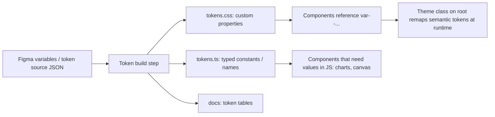
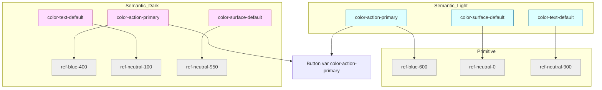
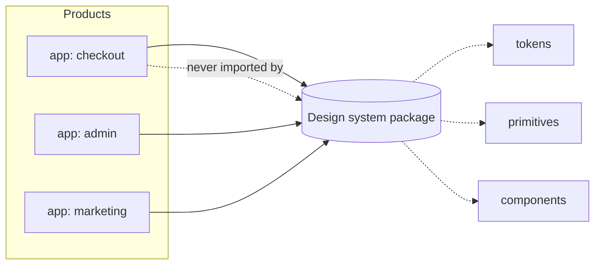

# 04 / 20 — Design Systems: Tokens, Primitives, Components, Documentation, and Governance as Architecture

## 1. Lesson metadata

| | |
|---|---|
| **Level** | Advanced |
| **Study time** | 4–5 hours (reading 2 h, token/theming lab 1.5 h, exercises 1.5 h) |
| **Prerequisites** | [01 — Architecture fundamentals](./01-architecture-fundamentals.md), [05 — Composition and dependency direction](./05-composition-and-dependency-direction.md), [06 — Feature vs layer structure](./06-feature-vs-layer-structure.md), [03 — Component responsibility](./03-component-responsibility.md), Phase 1 [07 — Composition and children](../01-react-fundamentals/07-composition-and-children.md) |
| **Next** | [21 — Component libraries](./21-component-libraries.md) |
| **Related** | [22 — Monorepos and shared packages](./22-monorepos-and-shared-packages.md), [23 — Multi-team ownership](./23-multi-team-ownership.md), [27 — Styling architecture](./27-styling-architecture.md), Phase 10 [11 — Design system governance](../10-production-engineering/11-design-system-governance.md), Phase 11 [07 — Design system architecture](../11-senior-and-architect-mastery/07-design-system-architecture.md) |

**Learning objectives.** After this lesson you can:
1. Define a design system precisely and separate its layers: principles, tokens, primitives, components, patterns, documentation, governance.
2. Design a three-tier token model (primitive → semantic → component) and implement theming (light/dark/brand) with CSS custom properties.
3. Decide where a design system lives in a codebase (in-app layer, workspace package, published package) and state the dependency rules that protect it.
4. Build a small set of accessible, composable components on top of tokens, with typed variants and a stable public API.
5. Explain the cost model: what a design system saves, what it costs, and the team size/number-of-products at which it pays off.
6. Describe contribution, versioning, deprecation, and release processes that keep a system adopted rather than bypassed.
7. Diagnose failure modes: forks, "snowflake" overrides, token drift, god-components, abandoned systems, breaking releases.
8. Plan a migration from ad-hoc shared components to a governed system without stopping feature work.

**Concepts covered:** design system vs component library vs style guide, design token, primitive/semantic/component token, theming, CSS custom property, variant API, headless primitive, composition API, accessibility contract, documentation (Storybook-style), contribution model (centralised, federated, hybrid), semantic versioning, deprecation policy, codemod, adoption metric, visual regression.

---

## 2. Deep conceptual explanation

### 2.1 What problem does a design system solve?

A product with one team and one screen needs no design system. The problem appears with **repetition across people and time**:

- Ten screens each implement "a button" slightly differently: different padding, different focus ring, different disabled colour.
- A brand colour change touches 340 files.
- Accessibility fixes (focus visible, `aria-*`) are made in one place and forgotten in others.
- Designers hand over mock-ups that do not match what ships, and nobody knows which is right.
- A new developer cannot tell which of three `Modal` implementations to use.

A **design system** is the *shared, governed set of decisions and reusable parts* that make a family of interfaces consistent: the design decisions (colour, spacing, type, motion), the implementation (tokens, components), the rules for use (guidelines, accessibility requirements), and the process for changing them.

Three things are commonly confused:

| Term | What it is | Scope |
|---|---|---|
| **Style guide** | Documentation of visual rules (colours, type, tone) | Document only; no code guarantees |
| **Component library** | A *package of reusable components* (see [21](./21-component-libraries.md)) | Code artifact; may or may not encode a design language |
| **Design system** | Tokens + components + patterns + documentation + **governance**, owned and versioned | Product *and* process |

A component library is one **deliverable** of a design system. A design system without governance is a component library; a component library without an opinionated design language is a toolkit. Both are legitimate; the confusion causes mismatched expectations ("why won't the design system team add my screen-specific widget?").

### 2.2 The layers

```
┌───────────────────────────────────────────────────────┐
│ Principles & guidelines (when to use what, voice, a11y)│
├───────────────────────────────────────────────────────┤
│ Patterns       (form layout, empty state, data table)  │  compositions, often with UX rules
├───────────────────────────────────────────────────────┤
│ Components     (Button, TextField, Dialog, Tabs)       │  styled, accessible, variant API
├───────────────────────────────────────────────────────┤
│ Primitives     (Box/Stack, Text, VisuallyHidden, Portal,│  layout + behaviour without opinions
│                 focus management, positioning)          │
├───────────────────────────────────────────────────────┤
│ Tokens         (colour, space, radius, type, motion)   │  the single source of visual decisions
└───────────────────────────────────────────────────────┘
        + documentation, tooling (Storybook-style), tests, release process, governance
```

**Dependency direction is strictly downward**: components use primitives and tokens; primitives use tokens; tokens depend on nothing. This is the same rule as in [05 — Composition and dependency direction](./05-composition-and-dependency-direction.md), applied to a sub-system.

### 2.3 Design tokens

A **design token** is a named design decision stored as data (`color.text.primary`, `space.4`, `radius.md`) rather than as a literal in each component. Tokens are the *API between design and code*. They are platform-neutral in concept and are emitted to CSS custom properties, TypeScript constants, native platforms, or Figma variables by a build step.

The W3C Design Tokens Community Group (DTCG) published its first stable version of the JSON token format spec, 2025.10 (designtokens.org, checked 2026-10-22); check the current version before building tooling that depends on it. The *architecture* below does not depend on the exact format.

#### Three tiers

| Tier | Also called | Example | Rule |
|---|---|---|---|
| **Primitive** | core, reference, global | `color.blue.600 = #1f5fd1`, `space.4 = 16px` | Raw values. **Components never use these directly.** |
| **Semantic** | alias, system | `color.action.primary = {color.blue.600}`, `color.text.default`, `color.surface.raised` | Names express *role*, not appearance. Themes remap these. |
| **Component** | component-scoped | `button.primary.background = {color.action.primary}` | Optional; useful for large systems or heavy theming. Adds indirection. |

Why the semantic tier exists: dark mode is not "invert colours". In dark mode `color.text.default` points to a *different primitive* (`neutral.100` instead of `neutral.900`) and `color.surface.raised` becomes *lighter* than `surface.default`. If components referenced `neutral.900` directly, theming would require editing every component. **Theming = remapping the semantic tier**; components stay unchanged.

Why the component tier is optional: it lets a brand override only `button.primary.background` without changing every "action" colour. It costs a larger token set and more indirection. Most product-team systems stop at two tiers; multi-brand platforms often need three.

#### Naming

Good token names describe **intent**, not value: `color.feedback.danger.text`, not `color.red.text`; `space.inset.md`, not `space.16`. Avoid encoding the theme in the name (`color.dark.background` defeats theming).

### 2.4 Primitives vs components vs patterns

- **Primitives** supply *behaviour or layout without visual opinion*: `Stack`, `Inline`, `Text` (typography via tokens), `VisuallyHidden`, `Portal`, focus-trap, popover positioning. Headless libraries (Radix UI primitives, React Aria, Headless UI, Ark UI, Base UI) provide behaviour+a11y for complex widgets (dialog, combobox, menu) without styling. See Phase 5 [07 — Headless components](../05-design-patterns/07-headless-components.md).
- **Components** are *styled, accessible, token-bound* building blocks with a deliberately small API: `Button`, `TextField`, `Select`, `Dialog`, `Tabs`, `Toast`.
- **Patterns** are *recipes* that combine components with UX rules: an inline-edit field, a filter bar, a page header with actions, a destructive-confirmation flow. Patterns are often **documented, not packaged**, because their variation across products is high; promoting a pattern into code before three products need it is a classic over-abstraction.

### 2.5 The accessibility contract

A design-system component is a **contract** that includes accessibility: keyboard behaviour, focus management, ARIA semantics, contrast against tokens, reduced-motion handling, and touch target size. This is the system's highest-leverage benefit: one correct, tested implementation replaces dozens of inconsistent ones. It is also its highest *risk*: a bug in `Dialog` ships to every product. Hence the testing requirements in §8 and Phase 8 [10 — Accessibility testing](../08-testing-and-quality/10-accessibility-testing.md) and [11 — Component contract testing](../08-testing-and-quality/11-component-contract-testing.md).

### 2.6 Governance is part of the architecture

Governance answers: *who decides, how do changes enter, how are breaking changes released, how is adoption measured?* Without it, the failure modes are predictable (§10): products fork components, the system stalls waiting for a central team, or releases break consumers.

### 2.7 Misconceptions

| Misconception | Reality |
|---|---|
| "A design system is a Figma file / Storybook." | Those are views. The system is the *versioned, governed source of decisions* plus its implementation. |
| "Build the whole system first, then adopt." | Systems built without consumers encode guesses. Extract from real products; grow by demand. |
| "More components = better system." | Every component is a permanent maintenance and a11y liability. Coverage of *used* needs matters; breadth for its own sake does not. |
| "Tokens are just CSS variables." | CSS variables are one *output format*. Tokens are the decision layer; they also feed design tools and other platforms. |
| "One system must fit every product." | Systems have a *scope*. Marketing sites and dense admin tools often need different density and motion rules; model them as themes/density modes or separate layers on a shared core. |
| "A design system removes the need for design." | It removes *repeated* decisions and frees designers for novel ones. |

---

## 3. Internal mechanics

### 3.1 Public guarantees, teaching model, implementation details

| Category | Content |
|---|---|
| **Public guarantee (platform)** | CSS custom properties cascade and inherit, and can be redefined per subtree; `prefers-color-scheme` and `prefers-reduced-motion` media queries exist; `var(--x, fallback)` fallback syntax; custom properties are resolved at *computed-value time*, so changing one on an ancestor re-styles descendants without JavaScript re-rendering them. |
| **Public guarantee (React)** | `ref` is a regular prop for function components in React 19 ([Phase 1](../01-react-fundamentals/06-props-and-one-way-data-flow.md)); components compose via `children` and props; context propagates values to a subtree. |
| **Teaching model** | "Tokens flow down, theme = remap semantic layer." |
| **Implementation detail / tooling** | Token build tools (e.g. Style Dictionary), the exact token JSON format, bundler handling of CSS in packages, Storybook versions. ⚠ Verify tool versions and options. |

### 3.2 Why CSS custom properties are the usual runtime theming mechanism

A theme switch has to change *many* visual values at once. Options:

1. **Re-render React with new JS theme objects** (CSS-in-JS theme context): every consumer re-renders ([context propagation cost](../07-performance/06-context-propagation-cost.md)) and styles are recomputed. See [27](./27-styling-architecture.md).
2. **Swap a class on `<html>`/a wrapper**, where the class redefines the custom properties. The browser recomputes styles for the subtree; React does **no work**. The cost is browser style recalculation, a rendering-pipeline concern ([Phase 0 — 03](../00-web-and-javascript-foundations/03-browser-rendering-pipeline.md)), not a React render.

Mechanism (2) is why most modern systems emit tokens as CSS variables. React is needed only to *choose* the theme (state/preference), not to *apply* it.

### 3.3 Design-time vs build-time vs run-time



Some values need JS (a canvas chart needs concrete colours; an animation library needs a duration in ms). Emit a **typed token module** for those, but read themed colours via `getComputedStyle(el).getPropertyValue("--color-…")` so JS stays in sync with CSS themes.

### 3.4 Variant APIs

A `Button` has *finite* appearance states. Express them as a **closed union**, not free-form props:

```ts
type ButtonProps = {
  variant?: "primary" | "secondary" | "danger" | "ghost";
  size?: "sm" | "md" | "lg";
};
```

Closed unions: (1) are type-checked, (2) are enumerable in docs and visual tests, (3) make design review tractable (the Cartesian product is the test matrix). Free-form `style`/`className` escape hatches allow one-off deviations; their governance is a recurring decision (§7, §8).

### 3.5 Public API surface = the thing you version

For a design-system package the **public API** is: exported component names, props (names, types, defaults, semantics), exported token names, CSS custom property names (if documented as stable), and documented DOM/ARIA behaviour. Everything else (internal class names, DOM structure beyond documented roles) is *private*. Consumers' tests that select internal class names are **their** fragility; but undocumented DOM structure changes still cause real breakage, so treat "DOM structure used by many snapshot tests" as a soft contract and communicate changes.

---

## 4. Step-by-step execution walkthrough

**Scenario:** the brand changes primary blue and a new dark theme is requested. Walk through two worlds.

**World A — no tokens, literals in components.**
1. Designer announces `#1f5fd1 → #1650b0`.
2. Developer greps for the old hex: 87 matches in CSS files, 14 in TS (inline styles), 6 in SVGs, 3 in chart configs.
3. Two matches are for a *different* use of the same blue (a link vs a button); the fix cannot be a blind replace.
4. Dark mode requires per-component overrides: `.dark .card { background: … }` scattered across files; specificity battles begin.
5. A month later, 9 hex values remain in rarely visited screens.

**World B — three-tier tokens.**
1. Designer updates `color.blue.600` in the token source.
2. Token build regenerates `tokens.css`. `color.action.primary` still references `blue.600`. All 101 usages follow automatically.
3. Dark theme: add a `[data-theme="dark"]` block remapping `color.surface.*`, `color.text.*`, `color.action.*`. No component edits.
4. CI visual regression ([Phase 8 — 12](../08-testing-and-quality/12-visual-regression.md)) flags the screens whose contrast changed; the design system team reviews the diffs.
5. Release: a **minor** version (new theme) plus a **patch/minor** for the colour update; consumers upgrade at their pace; the visual change is announced in the changelog.

**Rendering walkthrough of the runtime theme switch (World B):**
1. User toggles theme. A handler sets `document.documentElement.dataset.theme = "dark"` (and stores the preference).
2. No React state is read by components for colours; **no component re-renders** due to the theme (React may re-render the toggle itself).
3. The browser invalidates style for elements whose computed custom property values changed → style recalculation → paint (and layout only if a token influenced geometry; colour tokens do not).
4. DOM effect: attribute change on the root; every descendant's computed colours change.

⚠ If the theme preference must be correct at *first paint* (avoid flash of wrong theme), the attribute must be set before the stylesheet applies, typically via a tiny inline script in the HTML head or via `prefers-color-scheme` CSS. In an SSR/RSC framework this interacts with hydration; see Phase 9 [11 — Progressive enhancement](../09-advanced-rendering-and-ecosystem/11-progressive-enhancement.md) and verify framework guidance.

---

## 5. Code examples

All code is TypeScript/React 19 style (`ref` as a prop; no `forwardRef`).

### 5.1 Minimal: a token file and a themed component

```css
/* packages/design-system/src/tokens/tokens.css */
:root {
  /* primitives (private by convention: components must not use these) */
  --ref-blue-600: #1f5fd1;
  --ref-blue-700: #1650b0;
  --ref-neutral-0: #ffffff;
  --ref-neutral-100: #f3f4f6;
  --ref-neutral-900: #111827;
  --ref-red-600: #c62828;

  --space-1: 4px;
  --space-2: 8px;
  --space-3: 12px;
  --space-4: 16px;
  --radius-md: 6px;

  /* semantic (public API of the system) */
  --color-surface-default: var(--ref-neutral-0);
  --color-surface-sunken: var(--ref-neutral-100);
  --color-text-default: var(--ref-neutral-900);
  --color-action-primary: var(--ref-blue-600);
  --color-action-primary-hover: var(--ref-blue-700);
  --color-on-action: var(--ref-neutral-0);
  --color-feedback-danger: var(--ref-red-600);
  --focus-ring: 2px solid var(--ref-blue-600);
}

[data-theme="dark"] {
  --color-surface-default: #0b1220;
  --color-surface-sunken: #131c2e;
  --color-text-default: #e5e7eb;
  --color-action-primary: #5b8def;
  --color-action-primary-hover: #7aa2f7;
  --color-on-action: #0b1220;
}
```

Notes: the dark block remaps only **semantic** tokens. Remapping a primitive such as `--ref-neutral-0` would silently change every semantic token and component that references it (including `--color-on-action`), which is exactly the coupling the tiers exist to avoid. Primitives are shared by many roles; remap roles, not primitives. (Exercise B2 revisits this.)

```tsx
// packages/design-system/src/components/Button/Button.tsx
import type { ComponentPropsWithRef, ReactNode } from "react";
import styles from "./Button.module.css";

type Variant = "primary" | "secondary" | "danger";
type Size = "sm" | "md";

export type ButtonProps = Omit<ComponentPropsWithRef<"button">, "className" | "style"> & {
  variant?: Variant;
  size?: Size;
  loading?: boolean;
  children: ReactNode;
};

export function Button({
  variant = "primary",
  size = "md",
  loading = false,
  disabled,
  type = "button",
  children,
  ...rest
}: ButtonProps) {
  return (
    <button
      {...rest}
      type={type}
      disabled={disabled || loading}
      aria-busy={loading || undefined}
      data-variant={variant}
      data-size={size}
      className={styles.root}
    >
      {children}
    </button>
  );
}
```

```css
/* Button.module.css */
.root {
  font: inherit;
  padding: var(--space-2) var(--space-4);
  border-radius: var(--radius-md);
  border: 1px solid transparent;
  cursor: pointer;
}
.root[data-size="sm"] { padding: var(--space-1) var(--space-3); }
.root[data-variant="primary"] { background: var(--color-action-primary); color: var(--color-on-action); }
.root[data-variant="primary"]:hover:not(:disabled) { background: var(--color-action-primary-hover); }
.root[data-variant="secondary"] { background: var(--color-surface-sunken); color: var(--color-text-default); }
.root[data-variant="danger"] { background: var(--color-feedback-danger); color: var(--color-on-action); }
.root:focus-visible { outline: var(--focus-ring); outline-offset: 2px; }
.root:disabled { opacity: 0.6; cursor: not-allowed; }
```

Line notes:
- `Omit<…, "className" | "style">` is a *design decision*: the component refuses arbitrary styling. Consumers who need a layout position wrap it in a layout primitive. (Trade-off in §7.)
- `type = "button"` default prevents the classic accidental form submit.
- `ref` arrives through `rest` because `ComponentPropsWithRef<"button">` includes `ref` as a prop in React 19 types. In React 18 you would need `forwardRef`; that is legacy now.
- `data-*` attributes drive variants: selectors are readable, there is no class-name concatenation, and tests/visual stories can target state.
- `aria-busy` communicates loading; `disabled` prevents double submit. ⚠ A disabled button is removed from the tab order and not announced as focusable by many screen readers; for a *loading* state you may prefer `aria-disabled` and ignoring clicks so focus is not lost. This is a known design-system trade-off; document the choice.

**Predict:** `<Button variant="danger" size="lg">Delete</Button>`: does it compile? *No*: `"lg"` is not in `Size`; the compiler reports the error at the call site. That is the benefit of closed unions.

### 5.2 Layout primitives with tokenised spacing

```tsx
// packages/design-system/src/primitives/Stack.tsx
import type { ComponentPropsWithRef, ElementType } from "react";

type SpaceToken = 1 | 2 | 3 | 4 | 6 | 8;

type StackProps<T extends ElementType> = {
  as?: T;
  gap?: SpaceToken;
} & Omit<ComponentPropsWithRef<T>, "as" | "style" | "className">;

export function Stack<T extends ElementType = "div">({
  as,
  gap = 4,
  ...rest
}: StackProps<T>) {
  const Component: ElementType = as ?? "div";
  return (
    <Component
      {...rest}
      style={{ display: "flex", flexDirection: "column", gap: `var(--space-${gap})` }}
    />
  );
}
```

Notes: the `style` accepts only token-derived gaps, so layout stays on the 4-point scale. Using an inline `style` with a *CSS variable reference* is not "CSS-in-JS runtime cost": no style computation or injection occurs, only a style attribute. A CSS Module with `data-gap` attributes is an equally valid choice and avoids CSP concerns with inline styles (⚠ strict CSP configurations may restrict inline `style` attributes via `style-src-attr`; verify your policy. See Phase 10 [06 — Security](../10-production-engineering/06-security-xss-csrf-csp.md)).

### 5.3 Practical: wrapping a headless primitive (Dialog)

Rolling your own modal focus trap is a well-known source of a11y bugs. Wrap a battle-tested headless primitive and confine the dependency to the design system.

```tsx
// packages/design-system/src/components/Dialog/Dialog.tsx
import * as RadixDialog from "@radix-ui/react-dialog";  // ⚠ package names/versions: verify
import type { ReactNode } from "react";
import styles from "./Dialog.module.css";

export type DialogProps = {
  open: boolean;
  onOpenChange: (open: boolean) => void;
  title: string;                // required: dialogs must have an accessible name
  description?: string;
  children: ReactNode;
  footer?: ReactNode;
};

export function Dialog({ open, onOpenChange, title, description, children, footer }: DialogProps) {
  return (
    <RadixDialog.Root open={open} onOpenChange={onOpenChange}>
      <RadixDialog.Portal>
        <RadixDialog.Overlay className={styles.overlay} />
        <RadixDialog.Content className={styles.content}>
          <RadixDialog.Title className={styles.title}>{title}</RadixDialog.Title>
          {description ? (
            <RadixDialog.Description className={styles.description}>{description}</RadixDialog.Description>
          ) : null}
          <div className={styles.body}>{children}</div>
          {footer ? <div className={styles.footer}>{footer}</div> : null}
        </RadixDialog.Content>
      </RadixDialog.Portal>
    </RadixDialog.Root>
  );
}
```

Design decisions: (a) **`title` is a required prop**, so inaccessible dialogs cannot be written; the type system enforces the accessibility contract. (b) The Radix import never leaks into consumers' code: consumers import `Dialog` from `@acme/ds`. Replacing the headless library later is a *non-breaking* change if the public props remain. (c) Controlled `open` state is chosen so consumers own it ([state ownership](./15-state-ownership.md)); an uncontrolled `defaultOpen` variant could be added if usage demands.

### 5.4 Theme switching in React (choose, don't apply)

```tsx
// packages/design-system/src/theme/useTheme.ts
import { useCallback, useSyncExternalStore } from "react";

type Theme = "light" | "dark";
const KEY = "theme";

function subscribe(cb: () => void) {
  window.addEventListener("storage", cb);
  window.addEventListener("theme-change", cb);
  return () => {
    window.removeEventListener("storage", cb);
    window.removeEventListener("theme-change", cb);
  };
}

function getSnapshot(): Theme {
  return document.documentElement.dataset.theme === "dark" ? "dark" : "light";
}

export function useTheme() {
  const theme = useSyncExternalStore(subscribe, getSnapshot, () => "light" as Theme);
  const setTheme = useCallback((next: Theme) => {
    document.documentElement.dataset.theme = next;
    try { localStorage.setItem(KEY, next); } catch { /* storage may be unavailable */ }
    window.dispatchEvent(new Event("theme-change"));
  }, []);
  return [theme, setTheme] as const;
}
```

Notes: `useSyncExternalStore` ([Phase 3](../03-react-state-and-hooks/)) reads an external source (the DOM attribute) consistently; the server snapshot returns `"light"` to avoid hydration mismatch; a head script (not shown) sets the attribute before paint. Components consuming colour **do not** call `useTheme`; only the toggle does.

### 5.5 Incorrect: the escape-hatch explosion

```tsx
// ❌ API invites divergence
<Button variant="primary" style={{ background: "#ff6a00", borderRadius: 20 }} className="mt-4 big-cta">
  Buy now
</Button>
```

Problems: bypasses tokens (the orange will not follow rebrands or dark mode), `className` overrides depend on CSS order/specificity (fragile across bundler/CSS ordering), and the *real* need (a "promotional" appearance) is never surfaced to the system team.

**Corrected:** raise a variant request (`variant="promo"`), or compose with a layout primitive for spacing: `<Stack gap={4}><Button variant="primary">Buy now</Button></Stack>`. If a controlled escape hatch is justified, offer **one** documented slot rather than raw `style`: e.g. an `asChild`/`render`-style prop to change the rendered element, or a `data-*`-based layout hook.

### 5.6 Advanced: token typing and a contract test

```ts
// packages/design-system/src/tokens/index.ts  (generated or hand-maintained)
export const space = { 1: "var(--space-1)", 2: "var(--space-2)", 3: "var(--space-3)", 4: "var(--space-4)" } as const;
export type SpaceToken = keyof typeof space;
```

```tsx
// Button.test.tsx  (Vitest + Testing Library; see Phase 8)
import { render, screen } from "@testing-library/react";
import userEvent from "@testing-library/user-event";
import { describe, expect, it, vi } from "vitest";
import { Button } from "./Button";

describe("Button contract", () => {
  it("defaults to type=button so it never submits a form by accident", () => {
    render(<form onSubmit={(e) => e.preventDefault()}><Button>Go</Button></form>);
    expect(screen.getByRole("button", { name: "Go" })).toHaveAttribute("type", "button");
  });

  it("does not fire onClick while loading", async () => {
    const onClick = vi.fn();
    render(<Button loading onClick={onClick}>Save</Button>);
    await userEvent.click(screen.getByRole("button", { name: "Save" }));
    expect(onClick).not.toHaveBeenCalled();
  });

  it("forwards ref as a regular prop (React 19)", () => {
    const ref = { current: null as HTMLButtonElement | null };
    render(<Button ref={ref}>Ref</Button>);
    expect(ref.current).toBeInstanceOf(HTMLButtonElement);
  });
});
```

(`toHaveAttribute` requires `@testing-library/jest-dom` matchers configured in setup.)

---

## 6. Visual explanations

### 6.1 Token flow and theme remap



The component references the *same semantic name* in both themes; only the mapping differs.

### 6.2 Where the system sits



The arrow never points from the system to a product (dependency rule in §7.1).

### 6.3 Contribution flow (hybrid model)

```mermaid
sequenceDiagram
  participant P as Product team
  participant S as DS core team
  participant R as Release
  P->>S: RFC / issue: need "promo" Button variant
  S-->>P: Triage within SLA: accept / defer / "solve locally"
  P->>S: PR with component + stories + tests + a11y notes
  S->>S: Review (API, tokens, a11y, docs)
  S->>R: Merge → changeset → minor release
  R-->>P: Upgrade; deprecation notices if any
```

---

## 7. Alternative approaches and trade-offs

For each approach: the problem it solves, folder structure, dependency rules, code, pros/cons, size guidance, failure modes, migration path.

### 7.1 Approach A — In-app "ui" layer (no package boundary)

**Problem solved.** One app, one or two teams; need consistency without package overhead.

**Folder structure**
```
src/
  shared/
    ui/            # Button, TextField, Dialog, Stack  (design-system layer)
      Button/
        Button.tsx
        Button.module.css
        Button.test.tsx
        index.ts
      index.ts     # public API of the layer
    styles/
      tokens.css
      reset.css
  features/ ...
  app/ ...
```

**Dependency rules.** `shared/ui` imports only `shared/styles`, third-party headless libs, React. It **never** imports `features/*`, data fetching, or router. Features import from `shared/ui` through its `index.ts` only. Enforce per [25](./25-architectural-fitness-and-enforcement.md).

**Code.** As in §5.1; consumers `import { Button } from "@/shared/ui"`.

**Pros.** Zero versioning or publishing; atomic changes across components and call sites; refactoring is a find-and-replace.
**Cons.** Not reusable by a second app without extraction; storybook/docs are optional and often skipped; no formal API stability, so changes are free but also unreviewed.

**Size guidance.** 1 app, ≤ ~8 contributors, ≤ ~40 components. Tokens in one CSS file.

**Failure modes.** `shared/ui` grows feature-specific components (`<OrderStatusBadge />`), turning into a dumping ground ([06](./06-feature-vs-layer-structure.md)). Mitigation: rule "UI layer components know no domain nouns."

**Migration.** To B: the folder is already isolated; move to `packages/ui`, add `package.json` with `exports`, replace path alias with package name (codemod: rewrite `@/shared/ui` → `@acme/ui`).

### 7.2 Approach B — Workspace package, consumed from source (just-in-time)

**Problem solved.** Two or more apps in one repo need the same components, with atomic changes and fast feedback.

**Folder structure**
```
repo/
  apps/
    checkout/  admin/
  packages/
    design-tokens/     # tokens source + build → tokens.css, tokens.ts
    ui/                # components + primitives
      src/ ...
      package.json     # "exports": { ".": "./src/index.ts", "./tokens.css": "./src/tokens/tokens.css" }
    ui-docs/           # Storybook (private, not published)
```

**Dependency rules.** `apps/* → ui → design-tokens`. `ui` must not import from `apps/*`. `ui` lists `react`/`react-dom` as **peerDependencies** (avoid duplicate React: see [22](./22-monorepos-and-shared-packages.md)). Enforce with workspace dependency checks and lint.

**Code.**
```jsonc
// packages/ui/package.json (excerpt)
{
  "name": "@acme/ui",
  "private": true,
  "sideEffects": ["**/*.css"],
  "exports": {
    ".": "./src/index.ts",
    "./tokens.css": "./src/tokens/tokens.css"
  },
  "peerDependencies": { "react": "^19.0.0", "react-dom": "^19.0.0" }
}
```
`sideEffects` lets bundlers tree-shake unused components while keeping CSS imports ([Phase 0 — 10](../00-web-and-javascript-foundations/10-modules-and-dependency-graphs.md)).

**Pros.** Atomic change + call-site update in one PR; no publish pipeline; shared tooling.
**Cons.** Every app must transpile the package (bundler config for TS/JSX/CSS Modules in node_modules-like paths); no consumer isolation: a breaking change blocks everyone's CI until all call sites are fixed; cannot serve consumers outside the repo.

**Size.** 2–10 apps, ≤ ~25 contributors to the system and its consumers, 30–100 components.

**Failure modes.** The system team becomes a bottleneck for every product's needs; "monorepo means we can just edit it" leads to product teams changing core components without a11y review. Mitigation: CODEOWNERS on `packages/ui`, required review, visual regression gates.

**Migration.** To C: add a build step (e.g. a library bundler) emitting ESM + types, switch `exports` to `dist`, add Changesets, set `private: false`. Move docs to a hosted URL.

### 7.3 Approach C — Published, versioned design-system package

**Problem solved.** Many consuming repos/teams, different release cadences, possibly external consumers.

**Folder structure**
```
design-system/                # its own repo or a dedicated workspace
  packages/
    tokens/    components/    icons/    eslint-plugin/   codemods/
  apps/docs/                  # Storybook + guidelines site
  .changeset/
```

**Dependency rules.** Consumers depend on a **semver range**; the system never depends on consumers. Public API is *only* what `exports` lists; deep imports (`@acme/ds/dist/internal/...`) are forbidden by `exports`. Peer deps on React; minimal runtime deps.

**Code.** Release flow with Changesets-style files:
```md
---
"@acme/ds-components": minor
---
Add `promo` variant to Button. Existing variants unchanged.
```
Deprecation example:
```tsx
type ButtonProps = {
  /** @deprecated Use `variant="secondary"`. Removed in v5. */
  outline?: boolean;
  variant?: "primary" | "secondary" | "danger" | "promo";
};
```
A codemod package (`jscodeshift`/ts-morph-based) accompanies each major release.

**Pros.** Consumers upgrade independently; clear contract and changelog; usable by external/other-org teams; stability pressure produces better APIs.
**Cons.** Release overhead; **version skew** (apps on v3 and v5 coexist, so support multiple majors or accept inconsistency); breaking changes expensive; slower feedback; contributor friction (publish + link to test).

**Size.** ≥ 4 consuming teams or any external consumers; a dedicated core team of ≥ 2–3 (below that, upkeep starves).

**Failure modes.** *Upgrade debt* (consumers stuck on old majors); *snowflake forks*; *breaking release without codemod*; *bundle bloat* from non-tree-shakeable barrels; duplicate React via bundled (not peer) dependency. Mitigate with upgrade dashboards (adoption metric by version), codemods, `sideEffects`, size budgets ([Phase 7 — 21](../07-performance/21-web-vitals-and-budgets.md)).

**Migration.** From B: see B→C above. Run both for a period (`workspace:*` internally, published for external).

### 7.4 Approach D — Headless primitives + tokens, thin styled layer

**Problem solved.** Need robust a11y behaviour for complex widgets without building it; want full control of look.

**Folder structure.** Same as A or B, with `ui/primitives/` wrapping headless libs, `ui/components/` adding tokens-based styles.

**Dependency rules.** Headless libraries are imported **only** inside the system (an adapter boundary: [13 — Application services and adapters](./13-application-services-and-adapters.md)). Product code never imports the headless library directly.

**Pros.** Correct focus management, keyboard handling, ARIA; swap implementation behind your API.
**Cons.** Dependency on third-party release cycles; abstraction leaks when you need a prop the wrapper omitted; bundle weight per primitive (typically small, measure).

**Failure modes.** Wrapper API drifts from the primitive's capabilities, with the team re-exposing every prop (a "leaky wrapper") until the wrapper adds nothing. Rule: expose *intent-level* props only; if consumers need the primitive's full power, the right answer may be a different component, not more props.

**Migration.** Replace in-house widget implementations one component at a time behind the unchanged public API, validating with the component's contract tests.

### 7.5 Approach E — Web Components–based system (framework-neutral)

**Problem solved.** Multiple frameworks (React, Angular, server-rendered pages) must share one component set.

**Pros.** One implementation across frameworks; encapsulation via Shadow DOM.
**Cons.** React integration has friction around properties vs attributes, events, form association, and SSR/hydration; Shadow DOM styling and theming require explicit custom-property/part APIs; ⚠ React 19 improved custom element support (props/events handling), but verify current behaviour and your framework's SSR story before committing. Often a React wrapper layer is still generated.
**Size.** Justified mainly by genuine multi-framework requirements; otherwise Approaches A–D are simpler for React-only organisations.
**Failure modes.** Accessibility across shadow boundaries (ARIA id references do not cross shadow roots), form participation, SSR flashes.
**Migration.** Wrap existing React components or rebuild behind custom elements, one component at a time; keep React wrappers as the supported consumption route.

### 7.6 Comparison table

| Criterion | A: in-app layer | B: workspace JIT | C: published | D: headless + tokens | E: Web Components |
|---|---|---|---|---|---|
| Setup cost | Very low | Low–medium | High | Medium | High |
| Atomic refactors | Excellent | Excellent (within repo) | Poor | Depends on host | Poor |
| Multi-repo consumers | No | No | Yes | Depends | Yes (multi-framework) |
| Breaking-change cost | Low | Medium (all call sites) | High (versions) | Medium | High |
| A11y confidence | Depends on team | Depends | Depends | Highest (reuses tested behaviour) | Depends |
| Needs dedicated team | No | Soft yes | Yes | No | Yes |
| Typical team size | ≤ 8 | 8–40 | 30+ / many teams | Any | Mixed-stack orgs |

**Scenario where the recommended approach is NOT best.** The default advice "build a system and package it" is wrong for a 5-person startup with one app and a pivoting UI: design decisions will change weekly, and a governed system would freeze decisions that are not yet understood. Keep Approach A, use tokens in CSS from day one (cheap), adopt a headless library for hard widgets, and delay packaging until a *second consumer* exists. Conversely, for an agency shipping many short-lived sites, a heavyweight versioned system is also wrong; a starter template copied per project may be cheaper than maintaining a shared dependency.

### 7.7 Contribution models

| Model | How it works | Strength | Failure mode |
|---|---|---|---|
| **Centralised** | Core team builds everything | Consistency, quality | Bottleneck; product teams route around |
| **Federated** | Product teams contribute; core reviews | Scales; closer to needs | Inconsistency; reviewer overload |
| **Hybrid** | Core owns foundations (tokens, primitives, a11y-critical components); products contribute components via a promotion path | Balanced | Needs explicit criteria for promotion and an SLA |

Promotion criteria that work in practice: used by ≥ 2–3 products; passes the a11y checklist; has docs, stories, tests; API reviewed by core.

---

## 8. Best practices and anti-patterns

### 8.1 Practices

1. **Extract, don't invent.** Build components from at least two real usages (the "rule of three" as a heuristic, not a law).
2. **Semantic tokens only in components.** Lint for raw hex/px values and `--ref-*` usage in component CSS ([25](./25-architectural-fitness-and-enforcement.md)).
3. **Closed variant unions; small APIs.** Add props when forced by real use; removing props is a breaking change.
4. **Accessibility is not optional per component**: keyboard map, focus, roles, names, contrast, reduced motion, tested.
5. **Docs with live examples** per component (props table, do/don't, a11y notes). Documentation that is generated from types (props) stays in sync better than prose.
6. **Visual regression + interaction tests** on the component matrix ([Phase 8](../08-testing-and-quality/12-visual-regression.md)).
7. **Measure adoption and drift**: percentage of UI built from system components; number of local overrides; versions in use.
8. **Deprecate before removing**: warn (types + dev-only runtime console message), provide a codemod, state a removal version/date.
9. **Keep domain out.** A system component never knows what an "order" is.
10. **Own the escape hatch policy**: decide once, document, and review exceptions.

### 8.2 Anti-patterns

| Anti-pattern | Why it hurts | Better |
|---|---|---|
| Building the system before products exist | Encodes guesses; rewrites | Extract from real screens |
| God component with 40 props (`<Table>` that does everything) | Untestable, unstable API | Composition (`Table.Head`, `Table.Row`) or headless table logic ([compound components](../05-design-patterns/05-compound-components.md)) |
| Boolean-prop soup (`primary secondary danger`) | Invalid combinations representable | Single `variant` union |
| Accepting arbitrary `className`/`style` everywhere | Defeats consistency; specificity wars | Variants, slots, layout primitives |
| Components fetching data | Couples system to API | Keep system presentational |
| Mirroring Figma 1:1 | Design-tool artefacts leak into code | Design for the *code* API; align on tokens and behaviour |
| Token explosion (3,000 tokens) | Nobody knows which to use | Few semantic tokens; add on proven need |
| "Dark mode by inversion" | Contrast failures | Designed semantic remap |
| No owner | Slow decay | Named team + CODEOWNERS |

### 8.3 Justified exceptions

- A one-off marketing hero may use raw values *if* it is outside the product UI layer and explicitly allow-listed.
- Allowing `className` is reasonable for a **primitive** (e.g. `Box`) if the project decides on utility-class styling ([27](./27-styling-architecture.md)); the opinion is a trade-off, not universal law.
- Temporary forks are justified when a product has a hard deadline, *provided* an issue links the fork to an upstream contribution with an expiry.

---

## 9. Real-world application

| Domain | Constraints | Design-system implications |
|---|---|---|
| **E-commerce** | Conversion-sensitive; many experiments; promo campaigns | Variants for promotional states; experiment-safe tokens; performance budgets since the system is on every page |
| **Dashboards / back office** | Density, data tables, keyboard-heavy use | Density modes (`comfortable`/`compact` as a token set), table primitives, focus management |
| **Finance** | Regulated accessibility (e.g. WCAG conformance obligations), audit | A11y contract with evidence (test reports); stable releases; locale-aware number/currency components |
| **Forms** | Validation messaging, error summaries | Field wrapper that wires `label`, `aria-describedby`, `aria-invalid`; integrates with form libraries without depending on one |
| **Auth** | Sensitive flows | Password field with show/hide, correct `autocomplete` attributes; no domain logic |
| **Realtime** | Frequent updates | Presentational components should be cheap to re-render; avoid per-component subscriptions |
| **Multi-team** | Different cadences | Published versions, deprecation policy, upgrade dashboards, hybrid contribution |
| **Multi-brand** | White-label products | Three-tier tokens; brand = a token overlay, not forks |

**Engineering constraints.** Bundle cost is multiplicative: a 3 KB component imported by 40 routes shows in every route's budget; internationalisation requires components to accept strings, not hard-code them (Phase 10 [09 — Internationalization](../10-production-engineering/09-internationalization.md)); RTL requires logical CSS properties (`margin-inline-start`) in the system.

**Rough size numbers (order of magnitude, not benchmarks).** A pragmatic product-team system: 20–50 components, 100–300 semantic+primitive tokens, 2–3 contributors part-time. A platform-scale system: 100+ components, dedicated team of 4–10 plus designers, documentation site, codemods. Measure your own gzip size per component via bundle analysis ([Phase 7 — 16](../07-performance/16-bundle-analysis.md)).

---

## 10. Debugging and troubleshooting

### 10.1 "Dark mode: one panel stays white"
- **Symptom:** after theme toggle, a card keeps a white background.
- **Repro:** toggle theme on a screen using a third-party widget.
- **Investigation:** DevTools → Elements → select the card → Computed → find `background-color` → click to the Styles pane. See a literal `#fff` or `var(--ref-neutral-0)` instead of `var(--color-surface-default)`.
- **Root cause:** component bypasses semantic tokens.
- **Fix:** replace with the semantic token; add a lint rule against `--ref-*` and raw colours in component styles.
- **Validate:** visual regression snapshot in dark theme.

### 10.2 "Styles from our system lose to the app's CSS"
- **Symptom:** padding differs between dev and production.
- **Investigation:** Styles pane shows both rules; order differs because CSS chunk order changed in the production bundle; specificity ties are resolved by order.
- **Root cause:** reliance on source order across stylesheets. CSS Modules + single-class selectors make ties likely with global CSS.
- **Fix:** CSS **cascade layers** (`@layer ds, app;`) to make precedence explicit rather than order-based; ⚠ verify browser support targets and bundler behaviour with layers in your toolchain.

### 10.3 "Invalid hook call" after consuming the package
- **Symptom:** error only in the app using the published system.
- **Investigation:** `pnpm why react` / `npm ls react` shows two copies; the system bundled React or listed it as a `dependency`.
- **Root cause:** duplicate React ([22](./22-monorepos-and-shared-packages.md)).
- **Fix:** peerDependency + bundler `external`; validate with a single `react` in the lockfile graph.

### 10.4 "Bundle grew 80 KB after importing one Button"
- **Investigation:** bundle analyzer shows the entire barrel; `sideEffects` missing or components have top-level side effects (e.g. registering icons).
- **Fix:** `sideEffects` field, avoid import-time side effects, prefer per-component entry points when tree shaking cannot be trusted; measure again.

### 10.5 "Focus is lost when the dialog closes"
- **Investigation:** keyboard-only test; Elements → `document.activeElement` after close is `<body>`.
- **Root cause:** custom dialog does not restore focus to the trigger; or the trigger unmounted.
- **Fix:** use the headless primitive's focus restoration or restore manually; add a contract test.

---

## 11. Exercises

### Level A — Knowledge
A1. Distinguish style guide, component library, and design system in one sentence each.
A2. Name the three token tiers and state which tier components may reference.
A3. Why does remapping semantic tokens implement theming without re-rendering components?
A4. List four items that belong to a component's public API and two that do not.
A5. What is the difference between a primitive and a component in this lesson's vocabulary?
A6. Name two reasons peerDependencies are used for React in a published design system.

### Level B — Code comprehension
B1. In §5.1 the `Button` omits `className` and `style`. Give two benefits and two costs.
B2. Consider:
```css
[data-theme="dark"] { --ref-neutral-0: #0b1220; }
.card { background: var(--ref-neutral-0); color: var(--color-on-action); }
```
What goes wrong when the theme changes, and what is the architectural rule violated?
B3. Predict the TypeScript result: `<Stack gap={5}>…</Stack>` using §5.2 with `SpaceToken = 1|2|3|4|6|8`.
B4. `Dialog`'s `title` is required. What failure mode does that prevent? What does it cost?

### Level C — Implementation
C1. Add a `Badge` component with `tone: "neutral" | "success" | "danger"` using only semantic tokens, plus a test that every tone renders text with the badge's accessible role semantics (decide whether `role="status"` is appropriate and justify it).
C2. Write a token file adding a `[data-density="compact"]` mode that reduces `--space-*` and verify with a short test plan.
C3. Write a deprecation shim: `Button` accepts `outline?: boolean` (deprecated) and maps it to `variant="secondary"`, logging a development-only warning once per mount site.

### Level D — Debugging
D1. After publishing v2.4.0, three consumers report visual regressions: the focus ring is gone. Diff shows you moved the focus style from `.root:focus-visible` to `.root:focus-visible:not(.pressed)` for a new feature. List investigation steps and fix, and propose a process change.
D2. The dark theme looks right in the app but wrong in Storybook. List four plausible causes.

### Level E — Architecture decisions
E1. A company has three React apps in three repos, each with its own buttons. Propose a staged plan to a design system, including the first six weeks, team structure, and adoption metrics.
E2. Product team X needs a data grid with column pinning that no one else needs. Decide: build in the system, build locally, or buy/adopt a library. Justify using promotion criteria.
E3. Argue for and against CSS-variable theming vs a JS theme object for a design system that must also render charts on canvas.

### Level F — Expert challenge
F1. Design the governance and release system for a design system consumed by 12 teams across 7 repositories, including: contribution flow, SLA, versioning/deprecation policy, support window for old majors, codemod strategy, visual/a11y test gates, and metrics for deciding whether the system succeeds. State what you would deliberately *not* standardise.

---

## 12. Detailed answers and explanations

> Attempt the exercises first.

**A1.** *Style guide*: documentation of visual and content rules. *Component library*: a package of reusable UI components. *Design system*: tokens + components + patterns + docs + governance, versioned and owned. Plausible wrong answer: "a design system is Storybook"; Storybook is a documentation/dev tool, one view of the system.

**A2.** Primitive (core), semantic, component. Components may reference **semantic** (or component-scoped, which themselves alias semantic) tokens, never primitives, because primitives carry no role and cannot be remapped per theme.

**A3.** Custom properties are resolved by the browser per element through the cascade. Changing which value `--color-surface-default` has on an ancestor changes computed values for all descendants referencing it; React's output (the element tree) is unchanged, so there is nothing to re-render. Wrong answer: "context re-renders update it", which describes JS-theme approaches.

**A4.** Public: component names, prop names/types/defaults, exported token/CSS-variable names (if documented), documented a11y behaviour. Not public: internal class names, undocumented DOM nesting, private helpers, `--ref-*` tokens (by convention). Edge case: DOM structure that many consumers' tests rely on is a *soft* contract; communicate changes.

**A5.** Primitives give behaviour/layout without visual opinion (`Stack`, `Portal`, headless dialog); components are styled, token-bound, accessible and opinionated about appearance.

**A6.** (1) Avoid two React copies (hooks break; "Invalid hook call"), (2) let the consumer pick/upgrade React version within the supported range; also keeps bundle smaller.

**B1.** *Benefits*: consistent look (no one-off overrides), no specificity/ordering issues, fewer API surfaces to version. *Costs*: consumers cannot apply layout (margin) without a wrapper, and legitimate needs (analytics attributes handled via rest props, but not styling) force system change requests; more wrapper elements. Good answers also mention `data-*`/`aria-*` still pass via `...rest`.

**B2.** In dark theme `--ref-neutral-0` changes for everything using it, and the card uses a *primitive* directly plus `--color-on-action` (a colour intended for text on action backgrounds), a semantic-misuse. The card's background and text may both become dark (text `--color-on-action` was white in light but is `#0b1220` in the system's dark block), so text on the card is dark on dark: unreadable. Violated: components use semantic tokens by *role*; primitives are not used in components; and tokens aren't reused for unrelated roles.

**B3.** Compile error: `5` is not assignable to `SpaceToken`. The union enforces the spacing scale.

**B4.** Prevents dialogs without accessible names (screen reader users hear no context). Costs: consumers must supply a title even when design has none; solved by a visually hidden title option (`hideTitle`) that still renders it for assistive tech.

**C1.** Sample:
```tsx
type Tone = "neutral" | "success" | "danger";
export function Badge({ tone = "neutral", children }: { tone?: Tone; children: ReactNode }) {
  return <span data-tone={tone} className={styles.root}>{children}</span>;
}
```
CSS maps tone → `--color-surface-sunken` / semantic feedback tokens. Justification on role: `role="status"` makes a live region that announces changes; a *static* badge should have **no** role (a plain `span`), and only a badge whose content changes dynamically should be in a live region owned by the consumer. A test asserting `role="status"` for every badge would be a design error. Test: renders children text; `data-tone` set; axe check passes. Edge cases: colour must not be the only carrier of meaning (include text/icon for "danger").

**C2.**
```css
[data-density="compact"] { --space-2: 6px; --space-3: 8px; --space-4: 12px; }
```
Test plan: story for each component in both densities; visual regression; verify touch target ≥ the minimum your a11y policy specifies (compact modes are for pointer-heavy desktop contexts and must not shrink targets below policy); check text does not clip. Remap spacing semantics, not hard-coded paddings.

**C3.**
```tsx
import { useEffect, useRef } from "react";
function useDeprecationWarning(active: boolean, message: string) {
  const warned = useRef(false);
  useEffect(() => {
    if (process.env.NODE_ENV !== "production" && active && !warned.current) {
      warned.current = true;
      console.warn(message);
    }
  }, [active, message]);
}
// in Button: const effective = outline ? "secondary" : variant;
```
Notes: the warning lives in an effect (not render) because render must be pure; under StrictMode dev double-invoking effects the warning may print twice for a mount-unmount-remount cycle, because the ref persists only across the simulated remount in some versions; acceptable in dev. `process.env.NODE_ENV` replacement depends on bundler; verify in a library build.

**D1.** Steps: reproduce in the consumer's version; compare computed `outline` in DevTools; `git bisect`/diff between v2.3 and v2.4 to find the selector; discover `.pressed` class applied during `:active`/keyboard activation (e.g. Space key) or always applied due to bug; because the selector now excludes states, any state where `.pressed` persists hides the ring. Fix: restore the unconditional focus rule, patch release v2.4.1, deprecate 2.4.0 on the registry, add a visual test and an interaction test asserting focus-visible outline for keyboard focus. Process: a11y regression tests and visual regression on focus states are required for every release; a release checklist includes keyboard states; changelog review.

**D2.** (1) Storybook's preview does not load `tokens.css`, (2) theme attribute is applied to `<html>` in the app but Storybook renders in an iframe `body`/different root without the decorator, (3) Storybook bundler handles CSS ordering/layers differently, (4) fonts/OS preference differ (`prefers-color-scheme`), (5) a global app stylesheet remaps tokens and Storybook lacks it.

**E1.** Evaluation criteria: starts with an audit (inventory of components, duplicated usages), establishes tokens first (cheapest, biggest consistency), picks a starting point (extract the best existing implementation of the 5 most used components), forms a small cross-product team (e.g. 1 designer + 2 engineers + product-team liaisons), chooses Approach B (monorepo extraction) or C depending on whether repos can merge, defines adoption metrics (share of buttons from the system, number of raw hex values, a11y violations), and avoids a big-bang rewrite. Example: Weeks 1–2: audit and token source of truth + Storybook; weeks 3–4: Button/Input/Link/Dialog extracted with tests; weeks 5–6: first app migrated route-by-route using codemods; publish v0.x with explicit instability; set quarterly deprecation reviews.

**E2.** Criteria: reuse count (1 product → not yet), a11y risk (a data grid is high risk), cost to maintain, availability of an adequate library. Recommended: *build locally using an adopted headless grid library*, wrapped with the system's tokens; promote later if a second product needs it. Counter-case: if the grid is a core product capability across the roadmap, invest centrally. Wrong: pushing it into the system now (turns the system into a dumping ground).

**E3.** For CSS variables: no React re-render on switch, SSR-friendly, cheap. Against: canvas/JS charts cannot consume `var()`; must read computed styles after theme change (and re-draw). For JS theme object: easy typed access in JS; cost: re-render/propagation and runtime style work. A good answer proposes CSS variables as the source for DOM and a small JS adapter reading computed values for canvas, re-drawing on a theme-change event.

**F1.** Evaluation criteria: contribution model hybrid with promotion criteria; SLA (e.g. triage within a week, stated rather than guaranteed); semver with deprecation window (e.g. one major of overlap, removal only at majors, codemods for each major); support window for the previous major (e.g. critical fixes); CI gates (types, unit, a11y automated, visual regression on matrix); release automation (Changesets-style); metrics (adoption %, version distribution, time-to-upgrade, number of local forks/overrides, a11y issue counts, contribution lead time); design-side alignment (tokens as single source). Deliberately not standardised: domain components, page layouts, state/data libraries, build tooling choices of consuming apps. Success measurement should include consumer satisfaction, not just adoption.

---

## 13. Senior engineer interview questions

1. **"Why three token tiers?"** — Primitives hold raw values, semantics assign roles, component tokens allow local overrides. Theming works by remapping the semantic tier, so components never change; skipping the semantic tier forces per-component theme overrides.
2. **"How would you decide whether to build or adopt a component library?"** — Compare a11y risk, brand specificity, team capacity and rate of change. Adopting headless primitives and building the style layer keeps control of look while buying hard behaviour; building everything is justified only with dedicated capacity.
3. **"How do you stop teams from bypassing the system?"** — Make the right path cheaper: fast contribution, docs, codemods; add lint for raw values; measure drift. Bypassing is a signal about the system's responsiveness, not just discipline.
4. **"Breaking change in a design system used by 10 teams: how?"** — Deprecate first with dev warnings and docs, ship a codemod, release on a major with a changelog, support the previous major for a window, track adoption. Because the cost of a breaking change is multiplied by consumers.
5. **"Why avoid `className` on components?"** — It permits arbitrary override with order/specificity-dependent behaviour, undermining consistency and tokens; providing variants and layout primitives keeps variation explicit. It is a trade-off: it pushes needs into system change requests.
6. **"CSS variables vs JS theme?"** — Variables move theming into the browser's cascade (no React work); JS themes provide typed access but incur re-render/runtime cost; canvas needs computed values either way.
7. **"What does 'accessibility contract' mean for a component?"** — Documented, tested keyboard/ARIA/focus behaviour that every consumer inherits; enforced by types (required title), tests, and review.
8. **"When is a design system a bad investment?"** — One small team, one product, high design churn; the system freezes decisions and adds overhead. Use tokens and a shared folder until a second consumer or team appears.

---

## 14. Further learning resources

| Resource | URL | Covers / why | Level | Study |
|---|---|---|---|---|
| MDN — Using CSS custom properties | <https://developer.mozilla.org/en-US/docs/Web/CSS/Using_CSS_custom_properties> | Cascade/inheritance, fallbacks, runtime behaviour | Beginner–Int. | Whole page |
| MDN — `prefers-color-scheme` | <https://developer.mozilla.org/en-US/docs/Web/CSS/@media/prefers-color-scheme> | OS-level theme detection | Beginner | Whole page |
| MDN — CSS cascade layers (`@layer`) | <https://developer.mozilla.org/en-US/docs/Web/CSS/@layer> | Explicit precedence | Intermediate | Whole page |
| W3C Design Tokens Community Group | <https://www.w3.org/community/design-tokens/> | Token format standardisation (evolving) | Intermediate | Overview |
| Style Dictionary | <https://styledictionary.com/> | Token build pipeline | Intermediate | Getting started |
| WAI-ARIA Authoring Practices Guide | <https://www.w3.org/WAI/ARIA/apg/> | Keyboard/ARIA patterns for widgets | Intermediate | Patterns relevant to your components |
| Radix Primitives | <https://www.radix-ui.com/primitives> | Headless accessible primitives | Intermediate | Dialog, Popover |
| React Aria | <https://react-spectrum.adobe.com/react-aria/> | Hooks-based accessible behaviour | Advanced | Overview |
| Storybook docs | <https://storybook.js.org/docs> | Component documentation/testing workbench | Intermediate | Writing stories |
| Changesets | <https://github.com/changesets/changesets> | Versioning/release flow in workspaces | Intermediate | README |
| react.dev — Passing props / `ref` as a prop | <https://react.dev/learn/passing-props-to-a-component> | Props basics; verify `ref` prop in current reference | Beginner | Whole page |
| Brad Frost — *Atomic Design* (book) | No URL (book) | Vocabulary for layering components | Beginner | Core chapters |

URLs in this table were checked for HTTP 200 on 2026-10-22; any still marked *(unverified)* could not be checked automatically (blocked or unreachable). A 200 response does not guarantee the page content still matches the description; if a link has moved, search the site for the quoted title.

---

## 15. Knowledge checkpoint

**You should now understand**
- Design system = tokens + primitives + components + docs + governance; a library is one deliverable.
- Why the semantic token tier makes theming a remap, and why CSS variables avoid React work on theme change.
- How placement (in-app layer, workspace package, published package) changes versioning, cost and failure modes.

**You should be able to explain without notes**
- The dependency direction inside the system and between system and products.
- Why accessibility is a type-level and test-level contract.
- When *not* to build a design system.

**You should be able to implement**
- A tokenised, variant-typed, accessible `Button`; a theme switch; a wrapped headless `Dialog`; a deprecation path with a dev-only warning.

**You should be able to debug**
- Theme leaks (primitive misuse), CSS precedence/order issues, duplicate React, barrel bloat, lost focus.

**Prerequisite for next lesson:** [21 — Component libraries](./21-component-libraries.md), which treats the *package* concerns (API design, build, tree shaking, peer dependencies, publishing) in depth.
