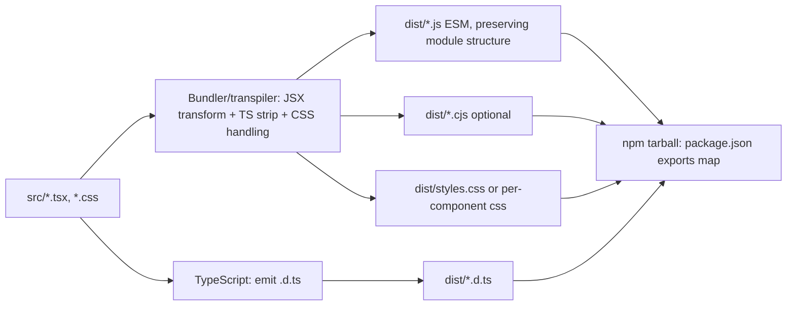
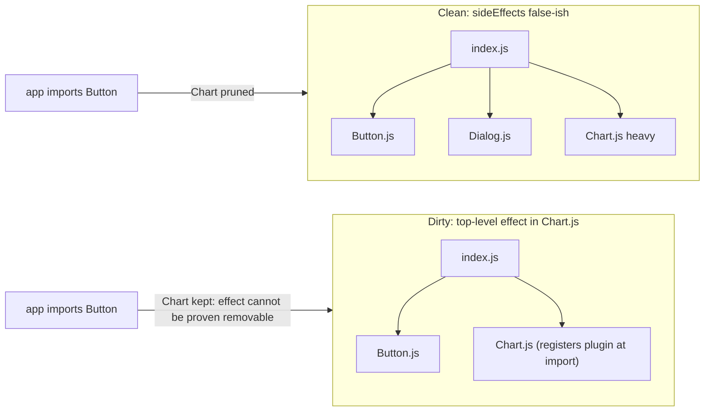
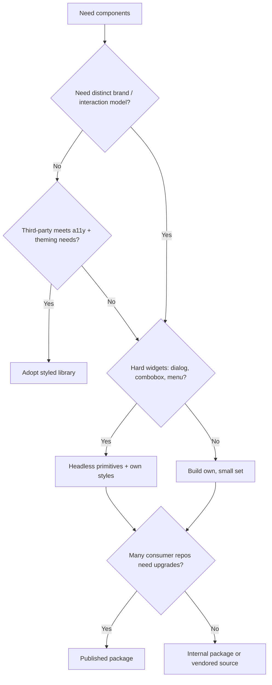

# 04 / 21 — Component Libraries: API Design, Packaging, Tree Shaking, and the Adopt / Build / Copy Decision

## 1. Lesson metadata

| | |
|---|---|
| **Level** | Advanced |
| **Study time** | 4–5 hours (reading 2 h, packaging lab 1.5 h, exercises 1.5 h) |
| **Prerequisites** | [20 — Design systems](./20-design-systems.md), [05 — Composition and dependency direction](./05-composition-and-dependency-direction.md), [07 — Modular architecture](./07-modular-architecture.md), Phase 0 [10 — Modules and dependency graphs](../00-web-and-javascript-foundations/10-modules-and-dependency-graphs.md), Phase 0 [20 — Tooling, transpilation, bundling](../00-web-and-javascript-foundations/20-tooling-transpilation-and-bundling.md), Phase 0 [19 — TypeScript generics and utility types](../00-web-and-javascript-foundations/19-typescript-generics-and-utility-types.md) |
| **Next** | [22 — Monorepos and shared packages](./22-monorepos-and-shared-packages.md) |
| **Related** | [27 — Styling architecture](./27-styling-architecture.md), [25 — Architectural fitness and enforcement](./25-architectural-fitness-and-enforcement.md), Phase 5 [22 — Patterns for reusable libraries](../05-design-patterns/22-patterns-for-reusable-libraries.md), Phase 7 [16 — Bundle analysis](../07-performance/16-bundle-analysis.md), Phase 9 [03 — Server components in depth](../09-advanced-rendering-and-ecosystem/03-server-components-in-depth.md), Phase 10 [12 — Backward compatibility](../10-production-engineering/12-backward-compatibility.md) |

**Learning objectives.** After this lesson you can:
1. Distinguish an *internal shared folder*, an *internal package*, a *published library*, and a *vendored (copied) component set*, and choose among them.
2. Design a component's public API: props, composition (children/slots/compound), controlled vs uncontrolled, escape hatches, polymorphism, and refs, in modern React 19 terms.
3. Package a React component library correctly: ESM output, type declarations, `exports` map, `sideEffects`, peer dependencies, CSS delivery.
4. Explain why a library may or may not tree-shake and diagnose bloat from barrels and side effects.
5. Handle server rendering and React Server Components boundaries in a library (`"use client"` directive placement) with appropriate verification caveats.
6. Choose and apply a versioning, deprecation, and compatibility policy including peer-range support.
7. Decide between adopting a third-party library, building, and the copy-into-your-repo model, using explicit criteria.
8. Test a library as a consumer would, and detect packaging defects before release.

**Concepts covered:** library vs application code, public API, semver, `exports`/`main`/`module`/`types`, dual package hazard, ESM/CJS, declaration files, tree shaking, `sideEffects`, barrel file, subpath exports, peerDependencies, duplicate React, CSS delivery strategies, `"use client"`, controlled/uncontrolled API, compound components, polymorphic `as`, slots, `asChild`/`render` props, vendoring (copy-paste distribution), bundle budgets, consumer-driven testing, `publint`-style linting, changelog and deprecation.

---

## 2. Deep conceptual explanation

### 2.1 What problem is this lesson solving?

[Lesson 20](./20-design-systems.md) described the *system* of decisions. This lesson addresses the *artifact*: code that **other code, written by people you do not sit next to, imports**. Application code can be changed freely along with its callers. Library code cannot: every exported name, prop, DOM behaviour and CSS variable is a promise. The central shift is:

> **In application code, the compiler tells you every caller. In library code, you do not know your callers.**

That single fact explains most library practices: small API surface, semver, deprecation cycles, peer dependencies, rigorous packaging, consumer-style tests, and conservative defaults.

### 2.2 Four distribution models

| Model | Where code lives | Consumers get | Typical use |
|---|---|---|---|
| **Internal folder** | `src/shared/ui` in one app | Path alias imports | Single app ([20 §7.1](./20-design-systems.md)) |
| **Internal package** | `packages/ui` in a workspace, consumed from source or built output | Workspace link | Several apps, one repo |
| **Published library** | Registry (public npm or private registry) | Versioned, immutable releases | Many repos/teams or external users |
| **Vendored / copy model** | Files copied into each consumer repo by a CLI or by hand | Source they own and can edit | Teams wanting full control over appearance and behaviour |

The vendored model (popularised by shadcn/ui-style distribution: ⚠ verify the current project's mechanics) gives up *automatic upgrades* in exchange for *no API-compat problem*: you own the source. Upgrades become manual diffs. It suits product teams that value customisation over centralised updates; it is unsuitable where consistency across many apps must be enforced by upgrades.

### 2.3 What makes a good component API

A component's API is a language. Good languages are **small, consistent, hard to misuse, and composable**.

#### 2.3.1 Prefer composition over configuration

```tsx
// Configuration (prop explosion)
<Card title="Fleet" subtitle="12 vehicles" icon={<TruckIcon/>} actions={[{label:"Edit", onClick}]} footer="…" />

// Composition (children, slots)
<Card>
  <Card.Header>
    <Card.Title>Fleet</Card.Title>
    <Card.Subtitle>12 vehicles</Card.Subtitle>
  </Card.Header>
  <Card.Actions><Button onClick={…}>Edit</Button></Card.Actions>
</Card>
```

Configuration is easier for the 80% case and impossible to extend for the 20%. Composition is more verbose and handles unplanned layouts. Common compromise: a **simple component** built from **composable parts** (both exported). See Phase 5 [05 — Compound components](../05-design-patterns/05-compound-components.md) and [20 — Slot patterns](../05-design-patterns/20-slot-patterns.md).

#### 2.3.2 Controlled and uncontrolled

Any component with user-changeable state (input, tabs, dialog, accordion, select) should support:
- **Controlled:** `value` + `onValueChange` (caller owns state);
- **Uncontrolled:** `defaultValue` (component owns state);
- never both simultaneously (switching between them at runtime is a bug, as React warns for inputs).

This is [state ownership](./15-state-ownership.md) made into an API. Phase 5 [11 — Controlled component pattern](../05-design-patterns/11-controlled-component-pattern.md) implements a reusable `useControllableState` hook.

#### 2.3.3 Rest props and refs

Elements that wrap a DOM node should forward unknown props (`...rest`) so consumers can add `aria-*`, `data-*`, event handlers, `id`. In React 19, **`ref` is a regular prop** for function components, so no `forwardRef` wrapper is needed; `forwardRef` remains only for libraries that still support React 18 peers (legacy path; see §5.5 and verify the current React upgrade guide).

#### 2.3.4 Polymorphism and `asChild`

A `Button` that sometimes must render an `<a>` (router link) needs a mechanism:
1. **`as` prop** (`<Button as="a" href=…>`): simple; typing requires generics (see §5.3), and components like router `Link` must accept the same props.
2. **`asChild` / `render` prop** (Radix/Base UI-style): the component merges its props into the single child you pass; keeps child's type separate. Implementation uses `cloneElement`-style prop merging or the `Slot` utility pattern; correct event-handler and ref merging is subtle, so prefer a vetted utility over hand-rolled.

See Phase 5 [19 — Polymorphic components](../05-design-patterns/19-polymorphic-components.md).

#### 2.3.5 Escape hatches, deliberately

Every library needs a story for "my case is different": `className`, `style`, `slots`/`slotProps`, `unstyled`, or `render`. The *design question* is not "should we allow it?" but "what is the smallest escape hatch that handles the real cases and leaves invariants intact?" (a11y attributes, focus management).

#### 2.3.6 Type design

- **Export prop types** (`ButtonProps`) so consumers can wrap components.
- Prefer **discriminated unions** for mutually-exclusive props (`{ href: string } | { onClick: () => void }`), but weigh error-message quality; complex generic types produce unreadable errors and slow type-checking.
- Avoid exporting types that expose internal implementation (private helpers).
- Use `ComponentPropsWithRef<"button">` (React 19) or `ComponentProps<"button">`; ⚠ semantics of these helpers differ across React type versions, so verify with your `@types/react` version.

### 2.4 The packaging model (what a consumer's bundler sees)

A consumer's bundler resolves `import { Button } from "@acme/ui"` through the package's **`exports` map** (preferred, supported by Node and modern bundlers), falling back to legacy fields (`module`, `main`) only for tools that ignore `exports`. TypeScript resolves types through `exports` (with `moduleResolution: "bundler"` or `"node16"/"nodenext"`) or the `types` field.

Key packaging facts (public guarantees of the module/package ecosystem; verify field details in the Node.js and bundler docs):

| Concern | Guarantee / rule |
|---|---|
| **ESM-first** | Ship ES modules so bundlers can tree-shake; CJS is optional for legacy consumers/tests. |
| **`exports` encapsulation** | Only listed subpaths are importable; deep imports of internals fail. |
| **`types` condition ordering** | Within an `exports` entry, the `types` condition should appear first so TS picks it (⚠ verify current TS guidance). |
| **`sideEffects`** | A hint to bundlers: `false` (or an array of files with effects) lets them drop unused modules entirely. CSS imports are side effects and must be listed. |
| **`peerDependencies`** | Declares "the consumer provides this", ensuring a single React instance. |
| **Dual package hazard** | If both ESM and CJS builds are loaded in one process, two copies of module state can exist. Components are mostly stateless, but module-level context objects (`createContext`) *are* state: two copies of a context means providers and consumers do not connect. |

### 2.5 Tree shaking: what actually matters

Tree shaking (Phase 0 [10](../00-web-and-javascript-foundations/10-modules-and-dependency-graphs.md)) removes unused exports when: the code is **ESM**, import/export is **static**, and the bundler can prove removed modules have **no side effects**. In libraries, bloat typically comes from:

1. A **single barrel** (`index.ts` re-exporting 300 components) *combined with* modules that have top-level side effects (registering something, calling a function at import, `styled(...)` calls in some CSS-in-JS libraries). The bundler must keep every module whose evaluation might matter.
2. **Missing `sideEffects`** metadata.
3. **Compiled-to-CJS output** published as the main entry.
4. **Cross-component imports of heavy dependencies** (a date library inside `Button` by accident).
5. **Icon packs** exported as one object (`import * as Icons`) or giant barrels.

Whether a barrel is a problem depends on the toolchain: modern bundlers in production mode often handle well-formed ESM barrels with `sideEffects: false` correctly, but **dev-server** behaviour is different (⚠ barrel files can slow dev servers and test runners, because the whole graph is parsed/transformed, independent of production tree shaking). Measure both.

### 2.6 Server rendering and Server Components

A library consumed by frameworks that support React Server Components must be explicit about which modules are **Client Components**. In RSC frameworks, a module with hooks, state or event handlers must be marked with the `"use client"` directive (or be imported by a client module). Bundlers that concatenate or reorder modules can drop directives, so libraries typically preserve them per entry/module in the build output. ⚠ **Volatile:** RSC/bundler integration details change; verify against the current React docs on directives and your bundler's guidance for libraries (see Phase 9 [04 — Client/server boundaries](../09-advanced-rendering-and-ecosystem/04-client-server-boundaries-and-serialization.md)).

Design implication: **pure presentational components** (no hooks, no handlers) can be Server-Component-compatible; interactive ones are Client Components. Splitting `Card` (server-safe) from `Tabs` (client) lets consumers keep server-rendering benefits.

### 2.7 Misconceptions

| Misconception | Reality |
|---|---|
| "If it builds in our app it's packaged correctly." | Apps often resolve source or workspace aliases; real packaging defects appear only when installing the *tarball* in a clean consumer. |
| "`sideEffects: false` is always safe." | It will drop CSS imports and polyfill-registering modules unless listed. |
| "Barrels are always bad." | They are a trade-off: great ergonomics, risk of dev slowness and bloat if side-effectful modules exist. |
| "`peerDependencies` installs React for me." | It declares a requirement; modern package managers may auto-install peers, but the *consumer* controls the version. |
| "`forwardRef` is required for refs." | Not in React 19 for function components; it is legacy compatibility. |
| "Semver means safe to upgrade." | Semver is a *claim by the author*; behavioural/visual changes are often argued about. Publish a clear definition of breaking (§8). |
| "Copying components is the same as a library." | Copying removes upgrade paths and central a11y fixes; it trades them for ownership. |

---

## 3. Internal mechanics

### 3.1 Public guarantee / teaching model / implementation detail

| Category | Content |
|---|---|
| **Public guarantee** | Node/bundler `exports` resolution semantics; ESM static analysability; `package.json` `peerDependencies` meaning; React's contract that components are pure functions of props/state/context and that hooks must be called from a single React instance. |
| **Teaching model** | "Your library is a *sealed box with a few doors* (`exports`); everything inside is private; React and any provider-context libraries are *shared outside the box*." |
| **Implementation detail** | Specific bundler heuristics for tree shaking, how a given bundler handles `sideEffects` globs, build tools' defaults (⚠ version-sensitive: verify tsup/Vite/Rollup/Rolldown/Rslib options in current docs), how a framework recognises `"use client"` boundaries. |

### 3.2 Why two copies of React break a library

Hooks rely on React's *current dispatcher*, which is set by the React renderer instance rendering the tree. A library's components call `useState` from *its* copy of `react`; if the app's renderer is the *other* copy, the library's copy has no active dispatcher, and the "Invalid hook call" error appears (Phase 2). This is why `react` and `react-dom` must be **peerDependencies** (and `external` in the library build), never bundled.

Context follows the same logic at module level: `createContext` creates an object identity. If `@acme/ui` is loaded twice (e.g. one copy via ESM and one via CJS, or two versions installed), providers from copy A are invisible to consumers from copy B (dual package hazard).

### 3.3 What the build produces



Two important build choices:
- **Preserve modules** (many output files mirroring source) vs **bundle** (one or few files). Preserved modules aid tree shaking and per-component imports; one bundle simplifies distribution but risks all-or-nothing loading.
- **JSX runtime:** compile with the automatic JSX runtime (`react/jsx-runtime`) so the library does not need `import React` and so the output depends only on the runtime entry points that React exports (verify your toolchain's setting). The **React Compiler** (⚠ volatile, see Phase 9 [08](../09-advanced-rendering-and-ecosystem/08-react-compiler.md)) can be applied at library build time but shipping compiled output has compatibility considerations with the consumer's React version; verify current guidance before doing so.

### 3.4 CSS delivery, the hardest packaging question

A component library has four ways to ship styles (details in [27](./27-styling-architecture.md)):

| Strategy | Mechanism | Consumer must | Trade-off |
|---|---|---|---|
| **One global stylesheet** | `dist/styles.css` | `import "@acme/ui/styles.css"` once | Simple, cacheable; ships CSS for unused components |
| **Per-component CSS** | Each component module imports its `.css` | Have a bundler that handles CSS imports from `node_modules` | Tree-shakable CSS; fails in tooling that cannot process CSS in dependencies (some SSR, Jest, plain Node) |
| **CSS-in-JS runtime** | Styles injected at runtime | Provide providers/SSR collection | No CSS file, but runtime cost, SSR plumbing, RSC friction |
| **Unstyled/headless** | No CSS; classes/data-attributes hooks | Style themselves | Maximum freedom, higher consumer cost |

⚠ Library CSS Modules produce hashed class names; consumers cannot (and should not) target them; offer `data-*` attributes and CSS custom properties as the **stable styling interface**.

---

## 4. Step-by-step execution walkthrough

**Scenario:** you publish `@acme/ui@1.0.0`; `apps/shop` does `import { Button } from "@acme/ui"` and uses only `Button`. What happens, in order?

1. **Install.** The package manager downloads the tarball (only `files` listed in `package.json`; typically `dist/`), links `@acme/ui` into `node_modules`, resolves `peerDependencies` (`react ^18.3 || ^19`) against the app's React. If the app has React 17, a peer warning appears (npm may error under strict peer settings).
2. **Type-check.** TypeScript resolves `@acme/ui` via `exports["."].types` → `dist/index.d.ts`. Props are typed; the app's editor autocompletes variants.
3. **Dev server.** Vite/webpack resolves `exports["."].import` → `dist/index.js` (ESM). A dev server may pre-bundle dependencies (dependency optimisation) for speed. ⚠ Behaviour is tool-specific.
4. **Production build, tree shaking.** The bundler parses `dist/index.js`, which re-exports from `./Button.js`, `./Dialog.js`, …. With `"sideEffects": ["**/*.css"]` (or `false` if CSS is separate), it sees only `Button` is imported, prunes the other modules' *code*. CSS imported by pruned modules is pruned too (if per-component CSS), or remains if one global stylesheet is imported.
5. **Rendering.** `Button` runs inside the app's React renderer: same `react` instance (peer), so hooks work. CSS custom properties from `tokens.css` (imported by the app once) style it.
6. **Runtime.** User clicks; the handler passed as `onClick` in `...rest` fires. The library holds no hidden global state.

**Failure branch (Dual instance):** the library's build bundled `react` because it was listed in `dependencies` → two React copies → step 5 fails with "Invalid hook call" at first hook. Fix: peer + `external`.

---

## 5. Code examples

### 5.1 Minimal: `package.json` for an ESM-first library

```jsonc
{
  "name": "@acme/ui",
  "version": "1.0.0",
  "type": "module",
  "files": ["dist"],
  "sideEffects": ["**/*.css"],
  "exports": {
    ".": {
      "types": "./dist/index.d.ts",
      "import": "./dist/index.js"
    },
    "./styles.css": "./dist/styles.css",
    "./tokens.css": "./dist/tokens.css",
    "./package.json": "./package.json"
  },
  "peerDependencies": {
    "react": "^18.3.0 || ^19.0.0",
    "react-dom": "^18.3.0 || ^19.0.0"
  },
  "devDependencies": {
    "react": "^19.0.0",
    "react-dom": "^19.0.0",
    "typescript": "^5.6.0"
  }
}
```

Line notes:
- `"type": "module"` makes `.js` files ESM.
- `files` limits the tarball to built output; source and tests do not ship.
- `sideEffects` lists CSS so a bundler does not discard `import "./Button.css"`.
- `exports` is the *only* public surface; there is no `./dist/internal/*` entry, so deep imports are blocked.
- `./package.json` is exported because some tools read it.
- React is in `peerDependencies` (consumer-provided) **and** `devDependencies` (so you can build and test locally). That duplication is intentional, a standard pattern.
- Supporting both 18.3 and 19 in `peerDependencies` is a **policy decision** (§8): it forces you to avoid React-19-only APIs (or feature-detect), and to keep `forwardRef` for refs. Verify current React release guidance when choosing the supported range.

### 5.2 Practical: controllable state hook and a Tabs compound component

```tsx
// src/internal/useControllableState.ts
import { useCallback, useRef, useState } from "react";

export function useControllableState<T>({
  value,
  defaultValue,
  onChange,
}: {
  value: T | undefined;
  defaultValue: T;
  onChange?: (next: T) => void;
}): readonly [T, (next: T) => void] {
  const [internal, setInternal] = useState(defaultValue);
  const isControlled = value !== undefined;
  const wasControlled = useRef(isControlled);

  if (process.env.NODE_ENV !== "production" && wasControlled.current !== isControlled) {
    console.error(
      "A component changed between controlled and uncontrolled. Decide for the component's lifetime."
    );
  }

  const current = isControlled ? value : internal;

  const set = useCallback(
    (next: T) => {
      if (!isControlled) setInternal(next);
      onChange?.(next);
    },
    [isControlled, onChange]
  );
  return [current as T, set] as const;
}
```

Notes: (a) `value !== undefined` is the controlled test (a controlled `null`/`""` is valid). If `T` can legitimately be `undefined`, require an explicit sentinel. (b) The dev warning reads and compares a ref during render: acceptable for a dev-only diagnostic (it does not affect output), but note [render purity](../01-react-fundamentals/12-component-purity.md): the ref is read, never written, during render. (c) `process.env.NODE_ENV` replacement is performed by the *consumer's* bundler; ⚠ libraries commonly rely on this, but verify with your support matrix (some environments define it differently).

```tsx
// src/components/Tabs/Tabs.tsx
import { createContext, use, useId, type ReactNode } from "react";
import { useControllableState } from "../../internal/useControllableState";

type TabsCtx = { value: string; setValue: (v: string) => void; baseId: string };
const Ctx = createContext<TabsCtx | null>(null);

function useTabs(part: string): TabsCtx {
  const ctx = use(Ctx);
  if (!ctx) throw new Error(`<Tabs.${part}> must be rendered inside <Tabs>`);
  return ctx;
}

export type TabsProps = {
  value?: string;
  defaultValue: string;
  onValueChange?: (v: string) => void;
  children: ReactNode;
};

export function Tabs({ value, defaultValue, onValueChange, children }: TabsProps) {
  const [current, setValue] = useControllableState({ value, defaultValue, onChange: onValueChange });
  const baseId = useId();
  return <Ctx value={{ value: current, setValue, baseId }}>{children}</Ctx>;
}

Tabs.List = function TabsList({ children }: { children: ReactNode }) {
  return <div role="tablist">{children}</div>;
};

Tabs.Tab = function Tab({ value, children }: { value: string; children: ReactNode }) {
  const { value: current, setValue, baseId } = useTabs("Tab");
  const selected = current === value;
  return (
    <button
      role="tab"
      id={`${baseId}-tab-${value}`}
      aria-selected={selected}
      aria-controls={`${baseId}-panel-${value}`}
      tabIndex={selected ? 0 : -1}
      onClick={() => setValue(value)}
    >
      {children}
    </button>
  );
};

Tabs.Panel = function Panel({ value, children }: { value: string; children: ReactNode }) {
  const { value: current, baseId } = useTabs("Panel");
  if (current !== value) return null;
  return (
    <div role="tabpanel" id={`${baseId}-panel-${value}`} aria-labelledby={`${baseId}-tab-${value}`}>
      {children}
    </div>
  );
};
```

Notes: `use(Ctx)` and `<Ctx value=…>` as a provider are React 19 forms (`<Ctx.Provider>` is the older form; `use` is valid for context in React 19; if you support React 18 peers use `useContext` and `Ctx.Provider`). The arrow-key navigation required by the WAI-ARIA tabs pattern (Left/Right/Home/End with roving tabindex) is **omitted here**; a production `Tabs` must implement it, which is precisely why teams wrap a headless primitive. Do not ship the above as accessible without it.

**Predict:** rendering `<Tabs.Tab>` outside `<Tabs>`: result? It throws an error naming the part: a *fail-fast* message is part of good library API design (the alternative, a silent `null` context, yields confusing "cannot read properties of null").

### 5.3 Polymorphic `as` with correct typing

```tsx
import type { ComponentPropsWithoutRef, ElementType, ReactNode } from "react";

type PolymorphicProps<T extends ElementType, Extra = object> = Extra &
  Omit<ComponentPropsWithoutRef<T>, keyof Extra | "as"> & { as?: T };

type TextOwnProps = { tone?: "default" | "muted" | "danger"; children?: ReactNode };

export function Text<T extends ElementType = "span">({
  as,
  tone = "default",
  ...rest
}: PolymorphicProps<T, TextOwnProps>) {
  const Component: ElementType = as ?? "span";
  return <Component data-tone={tone} {...rest} />;
}

// <Text as="a" href="/x">link</Text>   ✔ href accepted
// <Text as="span" href="/x">           ✘ compile error: span has no href
```

Notes: `Omit<…, keyof Extra | "as">` prevents the element's own props from clashing with yours; refs are intentionally omitted from this version (`ComponentPropsWithoutRef`), because typing `ref` across arbitrary elements is complex. Libraries often accept this limitation or use `asChild`. ⚠ Polymorphic generics can slow type-checking and produce long error messages; many libraries therefore choose `asChild`/`render`.

### 5.4 `asChild`-style slot (prop merging)

```tsx
import { cloneElement, isValidElement, type ReactElement, type HTMLAttributes } from "react";

export function Slot({ children, ...slotProps }: HTMLAttributes<HTMLElement> & { children: ReactElement<HTMLAttributes<HTMLElement>> }) {
  if (!isValidElement(children)) return null;
  const childProps = children.props;
  return cloneElement(children, {
    ...slotProps,
    ...childProps,
    className: [slotProps.className, childProps.className].filter(Boolean).join(" ") || undefined,
    style: { ...slotProps.style, ...childProps.style },
    // Note: spreading childProps after slotProps means the child's handlers REPLACE the slot's.
  });
}
```

This is **illustrative and incomplete**: it does not merge refs or event handlers (the child's props simply override the slot's, so a slot-provided `onClick` is lost whenever the child has its own). Production libraries use well-tested slot utilities; reproducing one correctly is Exercise C3 and demonstrates why you should not hand-roll it. `cloneElement` is "less common" API ([React docs: legacy/alternatives](https://react.dev/reference/react/cloneElement)); it is valid but fragile, as it depends on the child's props shape.

### 5.5 Legacy compatibility: `forwardRef` for React 18 peers

```tsx
// ⚠ Legacy path: only if you support React 18 as a peer.
import { forwardRef, type ComponentPropsWithoutRef } from "react";

export const Input = forwardRef<HTMLInputElement, ComponentPropsWithoutRef<"input">>(
  function Input(props, ref) {
    return <input ref={ref} {...props} />;
  }
);
```

In React 19-only libraries write `function Input({ ref, ...props }: ComponentPropsWithRef<"input">)`. A library supporting both ranges must keep the `forwardRef` form until it drops 18 (a *major* version for the library). Verify the current React guidance on `forwardRef` deprecation timing.

### 5.6 Incorrect: a package that works only inside the monorepo

```jsonc
// ❌ library package.json
{
  "name": "@acme/ui",
  "main": "src/index.ts",              // source, not built output
  "dependencies": { "react": "^19.0.0" } // bundles/duplicates React
}
```

Problems: consumers outside your build setup cannot import TypeScript source from `node_modules` (many bundlers do not transpile `node_modules`); no types for CJS tools; React as a regular dependency can create a second copy; `src/` shipped; no `exports` encapsulation.

**Corrected:** build to `dist` as in §5.1 (or, for internal-only workspace packages, a documented just-in-time setup where *all* consumers transpile it, see [22](./22-monorepos-and-shared-packages.md)).

### 5.7 Advanced: consumer-style tests of the packed artifact

```jsonc
// package.json scripts (illustrative; ⚠ verify tool names/flags)
{
  "scripts": {
    "build": "tsc -p tsconfig.build.json --emitDeclarationOnly && vite build",
    "lint:package": "publint && attw --pack .",
    "test:pack": "node scripts/test-pack.mjs"
  }
}
```

```js
// scripts/test-pack.mjs  (conceptual outline)
// 1. `npm pack` → tarball
// 2. create a temp consumer project (Vite + React 18 AND React 19 variants)
// 3. install the tarball (not the workspace link)
// 4. run `tsc --noEmit` and `vite build` on a file importing every public export
// 5. assert bundle contains no copy of react; assert Button-only import < size budget
```

`publint` (checks `package.json` correctness) and "Are the Types Wrong?" (`@arethetypeswrong/cli`, checks type resolution under different module resolution modes) are widely used ⚠ *(verify current names/options in their docs)*. The principle is durable: **test what you ship, as it is consumed.**

---

## 6. Visual explanations

### 6.1 Resolution from consumer code to library files

```mermaid
flowchart TB
  C["import { Button } from '@acme/ui'"] --> R{exports map}
  R -->|types condition| D[dist/index.d.ts  -> TypeScript]
  R -->|import condition| J[dist/index.js ESM -> bundler]
  R -.->|"@acme/ui/dist/internal/x"| X[(blocked: not exported)]
  J --> B1[./Button.js]
  J --> B2[./Dialog.js]
  J --> B3[./Tabs.js]
  B1 --> RC[react/jsx-runtime  (peer, external)]
```

### 6.2 Barrel + side effects vs clean ESM



### 6.3 Decision flow: adopt, build, or copy



---

## 7. Alternative approaches and trade-offs

### 7.1 Approach A — Adopt a third-party styled library (MUI, Mantine, Chakra, Ant Design, etc.)

**Problem solved.** Ship product UI quickly with a coherent, tested component set.
**Folder structure.** None for the library itself; a thin `src/shared/ui/` *adapter layer* re-exports or wraps the third-party components (`Button.tsx` imports from `@mui/material` and exposes your API).
**Dependency rules.** Product code imports from `shared/ui`, not directly from the third-party package (eases replacement, enforces defaults). Lint with `no-restricted-imports` ([25](./25-architectural-fitness-and-enforcement.md)).
```tsx
// shared/ui/Button.tsx  (adapter: your API, their implementation)
import MuiButton from "@mui/material/Button";   // ⚠ verify current import path conventions
export type ButtonProps = { variant?: "primary" | "secondary"; children: React.ReactNode; onClick?: () => void };
export function Button({ variant = "primary", ...rest }: ButtonProps) {
  return <MuiButton variant={variant === "primary" ? "contained" : "outlined"} {...rest} />;
}
```
**Pros.** Speed; mature a11y; docs; ecosystem.
**Cons.** Look-and-feel constraints; bundle size and styling-engine coupling (⚠ some libraries ship runtime CSS-in-JS; see [27](./27-styling-architecture.md)); upgrade treadmill; harder to match a bespoke brand.
**Size.** Any team size; strongest for small–medium teams and internal tools.
**Failure modes.** Direct imports scattered through the code base (lock-in); theme overrides becoming a parallel design system; major-version migrations of the vendor landing during a deadline.
**Migration.** Adapter layer first (centralise imports), then replace component-by-component with your own or a headless-based implementation without touching call sites.

### 7.2 Approach B — Build and publish your own library

Covered in §§3–5. **Folder structure:**
```
packages/ui/
  src/
    components/Button/{Button.tsx,Button.module.css,Button.test.tsx,Button.stories.tsx,index.ts}
    primitives/ internal/ tokens/
    index.ts                # public API; explicit named exports only
  scripts/ (pack tests)
  package.json  tsconfig.json  tsconfig.build.json
  .changeset/ CHANGELOG.md
```
**Dependency rules.** `components → primitives → tokens`; `internal/` never exported; no imports from consumers; third-party runtime dependencies kept minimal, and each justified in a review ("every dependency is your consumers' dependency").
**Code.** Public entry:
```ts
// src/index.ts: explicit, curated; no `export *`
export { Button } from "./components/Button";
export type { ButtonProps } from "./components/Button";
export { Tabs } from "./components/Tabs";
```
Prefer **named explicit exports** over `export *`: they make the public API reviewable in a diff and prevent accidental exposure of internals.
**Pros.** Total control; consistent with brand; a11y tuned to your needs.
**Cons.** Ongoing cost: a11y, browsers, React upgrades, docs, support. Typical minimum: part-time ownership of 2–3 people; full-time team at platform scale.
**Failure modes.** Abandonment (after the original author leaves); version skew; API sprawl; breaking changes without codemods; shipping CSS that depends on consumer resets.
**Migration.** From internal folder → package ([20 §7.1→7.2](./20-design-systems.md)).

### 7.3 Approach C — Vendored / copy-in distribution

**Problem solved.** Teams need full control and zero abstraction between them and the component source, and can accept manual updates.
**Folder structure.** Files land in the consumer repo, e.g. `src/components/ui/button.tsx`, generated or updated by a CLI that fetches from a registry. Tokens live in the consumer's CSS.
**Dependency rules.** The copied components depend on a small set of third-party primitives (headless libraries, a class-merging utility). The product owns the files: local edits are expected.
**Code.** Typical shape: a component with variants defined via a utility-class approach and a `cn()` merge helper; ⚠ exact tooling varies; treat as an example of the *model*, not a specification.
**Pros.** Maximum customisation; no API-compat problem; no waiting for a release; small bundle (only what you copy).
**Cons.** No automatic fixes: a11y/security fixes must be pulled manually; divergence between teams; diffs on upgrade are noisy; consistency across many apps is only as good as manual discipline.
**Size.** Product teams or single apps wanting ownership; poor fit for 10+ apps requiring uniformity.
**Failure modes.** Components are copied once and never updated (silent a11y debt); each app edits them differently; no semver to communicate change.
**Migration.** To a package: consolidate the most-edited copies into `packages/ui`; replace local copies with imports; keep diffs reviewed.

### 7.4 Approach D — Unstyled/headless internal package + product-specific styling

**Problem solved.** Many products with different looks must share behaviour and a11y.
**Structure.** `packages/headless/` exports hooks/components with no styles; each product has `ui/` that styles them.
**Dependency rules.** Headless never imports tokens or CSS; products import headless (and possibly third-party headless libs through it).
**Pros.** Behaviour shared once; branding independent.
**Cons.** Duplicate styling effort per product; weaker visual consistency.
**Failure modes.** Products diverge in UX; headless API becomes an unstable fork of a third-party headless library.
**Migration.** Extract behaviour hooks from existing components first (they're the least visual part), then products re-style.

### 7.5 Comparison table

| Criterion | A: adopt styled lib | B: build & publish | C: vendor / copy | D: headless internal |
|---|---|---|---|---|
| Time to first screen | Fastest | Slowest | Fast | Medium |
| Brand flexibility | Medium (theming layer) | Full | Full | Full |
| A11y effort | Low (vendor) | High | Medium (inherit initial, own after) | Medium (shared behaviour) |
| Upgrade path | Vendor majors | Your semver | Manual diff | Your semver (internal) |
| Bundle control | Medium | High | High | High |
| Consistency across apps | High | High | Low–medium | Medium |
| Ongoing cost | Low–medium | High | Medium | Medium |
| Lock-in | Medium–high | Low | Low | Low |
| Typical team | ≤ 30 | ≥ 30 or many consumers | ≤ 10 per app | Mixed multi-product |

**Where the "recommended" approach is NOT best.** For a *time-boxed internal tool* with one team and a fixed 3-month lifespan, adopting a styled library (A) beats building a published library (B) by an order of magnitude in cost. For a *brand-led consumer product*, A's theming overrides can cost more than building small. For a *single app*, B's packaging overhead (build, pack tests, semver) is wasted; stay with an internal folder until a second consumer exists.

### 7.6 Entry-point strategies

| Strategy | Example import | Pros | Cons |
|---|---|---|---|
| Single barrel | `import { Button } from "@acme/ui"` | Ergonomic; one path | Dev-server slowness; relies on tree shaking |
| Subpath per component | `import { Button } from "@acme/ui/button"` | Predictable bundles; fast dev | Verbose; `exports` map grows (can use pattern `./*`) |
| Both | Barrel for DX + subpaths for budget-sensitive routes | Flexible | Two paths to support/document |

Measure before choosing ([Phase 7 — 16](../07-performance/16-bundle-analysis.md)); do not subpath-export hundreds of paths without evidence.

---

## 8. Best practices and anti-patterns

### 8.1 Best practices

1. **Define "breaking" in writing.** Typical definition: removed/renamed exports or props, narrowed prop types, changed default behaviour, changed documented DOM/ARIA semantics, raised minimum peer versions, removed CSS variables; visual changes are *minor* unless documented otherwise. Whatever you choose, publish it.
2. **Explicit public entry; no `export *`; `exports` map as the only door.**
3. **Peer-depend on React; externalise it in the build.** Test against the **lowest and highest** supported peer versions in CI.
4. **Keep dependencies minimal.** Each runtime dependency is a supply-chain and bundle-size decision for all consumers ([Phase 10 — 07](../10-production-engineering/07-dependency-security.md)).
5. **Types are the API.** Export prop types; keep types readable; test types (e.g. with `tsd`-style or `expectTypeOf` tests ⚠ verify tool).
6. **Fail fast in development.** Helpful errors for misuse (missing provider, invalid combination), stripped or no-op in production.
7. **Docs as part of "done".** Props table, examples, a11y behaviour, "when not to use".
8. **Changelogs and codemods** for every major.
9. **Size budget per component and per entry** in CI.
10. **Test as a consumer**: pack, install in a fixture app, build, run.

### 8.2 Anti-patterns

| Anti-pattern | Consequence | Fix |
|---|---|---|
| Shipping source TS without telling consumers | Compile errors in consumer toolchains | Build, or document JIT requirements |
| Bundled React | Invalid hook call | Peer + external |
| Hidden global state (singletons, injected global CSS) | Conflicts, SSR leaks | Props/context; scoped CSS |
| Requiring a specific consumer reset/CSS framework | Fragile rendering | Self-contained styles |
| Props named after implementation (`styleOverrides`, `muiProps`) | Leaks internals | Intent-level props |
| Boolean flags for mutually exclusive states | Impossible states | Unions |
| Wide, deep, auto-generated barrels (`export *` from every file) | Accidental public API | Curated index |
| `console.log` / unconditional warnings in production | Noise | Dev-only diagnostics |
| Unstable IDs (random, counter) in SSR | Hydration mismatch | `useId` ([Phase 3](../03-react-state-and-hooks/)) |
| Using `window`/`document` at module top level | Breaks SSR/imports in Node | Access inside effects/handlers or guard |

### 8.3 Justified exceptions

- Bundling a tiny dependency (< 1 KB) *inside* the library can be better than adding a runtime dependency (reduces duplication risk); do so knowingly and keep the license notice.
- A single bundled ESM file is acceptable for a library with ≤ 10 components where tree shaking granularity is irrelevant.
- `peerDependencies` ranges narrower than "all current majors" are fine when you genuinely rely on a version-specific API (document it).

---

## 9. Real-world application

| Domain | Concern | Library implication |
|---|---|---|
| **E-commerce, many micro-sites** | Consistent components across sites, performance-critical | Published library, subpath imports, tight size budgets, SSR-safe components |
| **Fintech dashboards** | Accessibility compliance evidence, audits | A11y test reports shipped with releases; stable semver; avoiding third-party churn |
| **Forms-heavy apps** | Integrate with form libs | Components accept `value/onChange/name/ref` and `aria-invalid`; no hard dependency on a specific form library |
| **Auth/identity UI** | Embeddable in multiple apps | Minimal global CSS; CSP-compatible styling (no inline script; check inline style requirements) |
| **Realtime** | Rapidly updating tables/charts | Library components must tolerate frequent prop updates; avoid expensive per-render work; document memoisation expectations |
| **Multi-team enterprise** | Version skew | Support window for previous majors; automated upgrade PRs; adoption dashboards |
| **Micro-frontends** | Several bundles each shipping the library | Singleton sharing via module federation or accept duplication; contexts break across copies (Phase 11 [12](../11-senior-and-architect-mastery/12-microfrontends.md)) |

**Engineering constraints.** Browser support policy (modern evergreen vs older), SSR frameworks (Next/Remix/React Router, Astro islands), strict CSP, i18n (no hard-coded strings; accept `labels` props or a messages provider), RTL, reduced-motion, and testing environments (Jest/Vitest with jsdom may not process CSS imports; provide a documented mock or CSS-less entry).

**Size ranges (rough orders; always measure).** A well-built `Button`/`Input`/`Stack` primitives set can be a few KB gzipped total. Dialog/Select/Combobox with headless dependencies are typically tens of KB gzipped together; data grids and date pickers are often the largest components and benefit from separate entry points or lazy loading ([Phase 7 — 15](../07-performance/15-code-splitting-and-lazy-loading.md)). These are guidance, not benchmarks: use bundle analysis on your own build.

---

## 10. Debugging and troubleshooting

### 10.1 "Invalid hook call" only in the consuming app
- **Reproduce:** install the packed tarball into a fresh app.
- **Investigate:** `npm ls react` / `pnpm why react`; in browser DevTools Sources, search for two copies of `react.development.js`; React DevTools shows no tree or errors.
- **Root cause:** React bundled or duplicated via `dependencies` or alias mismatch.
- **Fix:** peer + external; dedupe in consumer; for linked development (`npm link`), alias `react` to the app's copy in the bundler.
- **Validate:** pack test asserts bundle has one React.

### 10.2 "Types resolve in my IDE but not in the consumer"
- **Investigate:** `tsc --traceResolution` in the consumer; compare `moduleResolution` modes; run the types-checking tool on the tarball.
- **Root cause:** missing `types` condition or `.d.ts` extension mismatch (`.d.ts` vs `.d.cts` for CJS).
- **Fix:** ensure `types` first in each `exports` condition and emitted declaration files align.

### 10.3 "CSS missing in production / in SSR"
- **Investigate:** Network → is `styles.css` requested? In the built HTML, is there a link? In unit tests, are CSS imports processed?
- **Root cause:** `sideEffects: false` dropped the CSS import; or consumer never imported the stylesheet; or SSR toolchain cannot process CSS from `node_modules`.
- **Fix:** list CSS in `sideEffects`; document one required import; consider a global stylesheet entry.

### 10.4 "Bundle includes everything"
- **Investigate:** bundle analyzer; check each module for top-level effects; check if `dist` is ESM.
- **Fix:** remove import-time effects, set `sideEffects`, split heavy components into separate entry points.

### 10.5 "Hydration mismatch coming from a library component"
- **Symptom:** console warning about attributes/ids differing.
- **Root cause:** `Math.random()` ids, reading `window`/`localStorage` during render, or locale-dependent formatting in render.
- **Fix:** `useId`, read browser-only values after mount (effect/`useSyncExternalStore` with a server snapshot) ([Phase 9 — 02](../09-advanced-rendering-and-ecosystem/02-hydration-internals-deep-dive.md)).

---

## 11. Exercises

### Level A — Knowledge
A1. Why must `react` be a peer dependency of a component library, and why also a devDependency?
A2. What does the `exports` map provide that `main` does not?
A3. State the three conditions that enable tree shaking of a library's unused components.
A4. Give two reasons to avoid `export *` in a library's public entry.
A5. What is the dual package hazard, and why does it matter for React Context specifically?
A6. Name the four CSS delivery strategies and one failure mode for each.

### Level B — Code comprehension
B1. A library ships `"sideEffects": false` and `Button.js` contains `import "./Button.css"`. What happens in a production build when the app imports `Button`? Why?
B2. In §5.2, `useControllableState` treats `value !== undefined` as controlled. A consumer passes `value={maybeUser?.id}` where the value is sometimes `undefined`. What happens, and how would you redesign?
B3. In §5.3 what does `<Text as="button" href="/x">` do at compile time and at runtime?
B4. What problem does the `title` required prop on the `Dialog` of lesson 20 address, and how does that parallel the "fail fast" `useTabs` error here?

### Level C — Implementation
C1. Write the `package.json` `exports` for a library with a main entry plus subpath entries for `button` and `tabs`, each with types, and a CSS entry.
C2. Implement `useControllableState` improvements: avoid calling `onChange` when the value does not change; support functional updates (`set(prev => next)`).
C3. Implement a `Slot` that merges `className`, `style`, event handlers (child's first, then slot's, unless `defaultPrevented`) and refs (both). State which cases remain unhandled.
C4. Write a pack test script outline (steps and assertions) that verifies a fixture app builds with React 18.3 and 19.

### Level D — Debugging
D1. Consumers report `Cannot read properties of null (reading 'value')` thrown from `useTabs` only in an app using micro-frontends where `@acme/ui` is loaded by two remotes. Diagnose and propose fixes.
D2. After switching the library build from preserved modules to a single bundle, a route's size grew by 140 KB although it still imports only `Button`. List causes and your investigation order.
D3. Vitest tests in a consumer fail with "Unknown file extension .css" after upgrading `@acme/ui` to a version with per-component CSS. Explain and give two remedies (one library-side, one consumer-side).

### Level E — Architecture decisions
E1. A 12-person product team is about to start a new dashboard product. Choose among A, B, C, D (§7), justify with criteria and name the trigger events that would change your decision.
E2. Argue whether a library should support React 18 and 19 simultaneously vs 19 only, considering consumers, API design (`forwardRef`, `use`), testing matrix, and maintenance cost.
E3. Design a deprecation policy for a library consumed by 30 teams: stages, durations, communication, tooling, metrics.

### Level F — Expert challenge
F1. You must provide a library that works in (a) a Vite SPA, (b) a server-rendered framework with Server Components, and (c) a server-rendered legacy app embedding the library as islands. Specify packaging, entry points, directive handling, CSS strategy, testing matrix, and the risks you cannot eliminate. Mark every assumption that needs verification against current docs.

---

## 12. Detailed answers and explanations

> Attempt the exercises first.

**A1.** Peer: ensures the consumer's single React instance is used (hooks/context rely on one renderer/dispatcher) and lets the consumer choose the version within a range. DevDependency: so the library's own development, tests, and Storybook can install and run React. Wrong: "peer installs React for you" (declares a requirement; installation behaviour depends on the package manager).

**A2.** Encapsulation (only listed entries importable), conditional resolution (types/import/require/browser/etc.), and per-subpath mapping. `main` is a single entry and exposes the whole file tree by path.

**A3.** (1) ESM with static imports/exports, (2) modules the bundler can prove side-effect free (via analysis or `sideEffects` metadata), (3) a build/entry structure whose unused exports aren't retained by other reachable code (e.g. barrel modules calling functions on import). Also acceptable: not transpiled to CJS.

**A4.** `export *` accidentally exposes internals and makes API reviews impossible in diffs; can cause name collisions, and complicates tree shaking analysis for some tools. Also: it makes semver judgments unclear.

**A5.** If both the ESM and CJS copies of the library are loaded, module-level state is duplicated. `createContext` creates a context object; providers from one copy do not provide for consumers from the other, giving "missing provider" errors even though the tree looks correct.

**A6.** Global stylesheet (ships unused CSS / forgotten import); per-component CSS (tooling cannot process CSS from `node_modules`, e.g. Node/Jest); CSS-in-JS runtime (runtime cost, SSR collection issues, RSC friction); unstyled (consumer cost; inconsistent look).

**B1.** The CSS is **dropped**: `sideEffects: false` tells the bundler no module has effects other than its exports, so `import "./Button.css"` with no used bindings can be removed. The button renders unstyled in production but perhaps styled in dev (dev mode often does not tree-shake). Fix: `"sideEffects": ["**/*.css"]`.

**B2.** When the value is `undefined`, the component becomes *uncontrolled* and shows its internal state/default; later defined values flip it to controlled; in dev the library logs the controlled/uncontrolled switch error. Redesign options: require `value: T | null` as controlled with `null` meaning "no selection", or accept the consumer's responsibility to pass `value` explicitly (separate `controlled` flag is unusual). Mirror React's input behaviour: `undefined` = uncontrolled.

**B3.** Compile: `<button>` accepts `href`? No: `ComponentPropsWithoutRef<"button">` does not include `href`, so TypeScript errors. Runtime (if forced with a cast): renders `<button href="/x">`; the attribute is invalid on a button, and ignored.

**B4.** The Dialog title prop makes inaccessible usage impossible at compile time; `useTabs` makes incorrect composition (part outside the root) fail immediately at runtime with a precise message. Both move failures from silent a11y/behaviour bugs to early, explicit errors.

**C1.**
```jsonc
{
  "exports": {
    ".":        { "types": "./dist/index.d.ts",   "import": "./dist/index.js" },
    "./button": { "types": "./dist/button.d.ts",  "import": "./dist/button.js" },
    "./tabs":   { "types": "./dist/tabs.d.ts",    "import": "./dist/tabs.js" },
    "./styles.css": "./dist/styles.css",
    "./package.json": "./package.json"
  }
}
```
Check: type files exist and correspond to emitted paths; with preserved-module builds, ensure `button.js` etc. are emitted as entries.

**C2.**
```tsx
export function useControllableState<T>({ value, defaultValue, onChange }: {
  value: T | undefined; defaultValue: T; onChange?: (next: T) => void;
}) {
  const [internal, setInternal] = useState(defaultValue);
  const isControlled = value !== undefined;
  const current = (isControlled ? value : internal) as T;
  const currentRef = useRef(current);
  currentRef.current = current;   // ⚠ writing a ref during render: acceptable only if you accept the purity trade-off; alternatively update in an effect/layout effect.

  const set = useCallback((next: T | ((prev: T) => T)) => {
    const resolved = typeof next === "function" ? (next as (p: T) => T)(currentRef.current) : next;
    if (Object.is(resolved, currentRef.current)) return;
    if (!isControlled) setInternal(resolved);
    onChange?.(resolved);
  }, [isControlled, onChange]);
  return [current, set] as const;
}
```
Evaluation criteria: no-op when unchanged; functional updates; discussion of the ref-write-in-render impurity (stricter solutions update the ref in `useLayoutEffect` or `useEffect`, accepting a window where the ref is stale); `typeof next === "function"` misfires when `T` itself is a function type (document the limitation).

**C3.** Key points: `cloneElement(child, merged)`; `className` joined; `style` spread (child wins); handlers: for each `on*` key in either props, compose `(e) => { child(e); if (!e.defaultPrevented) slot(e); }`; refs: compose a callback ref assigning both (React 19 permits callback refs with cleanup return; ⚠ composed cleanup semantics are subtle). Unhandled: child that is a Fragment, text, or multiple children; non-element children; `data-*` merging conflicts; React 19's ref-as-prop access via `child.props.ref` (⚠ differs in 18: `child.ref`). Evaluation: correct merge order, awareness of limitations.

**C4.** Steps: `npm pack`; for each React version create a fixture from template; install tarball + React version; `tsc --noEmit` on a file importing every export; build; assert (a) `grep` of the build output finds a single React copy, (b) per-entry size budget, (c) run a smoke test (render each component under `react-dom/server` and `jsdom`, ensure no throw); fail on peer warnings. Edge: run with and without `moduleResolution: "bundler"`/`"node16"`.

**D1.** Root cause: two instances of `@acme/ui` (different remotes loaded their own copy) → two `Ctx` objects; `Tabs.Tab` from copy B reads context created by copy A's `Tabs` → `null`. (The error shown suggests the throw guarded `ctx` null; "Cannot read properties of null" would arise if the guard were missing.) Investigate: DevTools Sources shows two files; `window` module registry; federation config. Fixes: share `@acme/ui` and `react` as singletons in module federation config with version ranges; or ensure each remote only uses components inside its own provider boundaries (no cross-remote composition); or make the context via `Symbol.for` registry on `globalThis` (hacky; last resort). Validate by loading both remotes and checking one `Ctx`. ⚠ Verify federation configuration against your tool's docs.

**D2.** Causes: tree-shaking can no longer prune within a single bundled file if the bundler cannot prove side effects; a heavy dependency now hoisted into the shared chunk; CSS is now one file; `sideEffects` metadata is per-file, and with one file it applies to the whole file → no pruning. Order: bundle analyzer diff; inspect for retained modules; check output format (ESM vs CJS); check `sideEffects`; try preserved modules or splitting heavy entries.

**D3.** Vitest (Vite-based) generally processes CSS imports for app code, but dependencies in `node_modules` are *externalised* and executed by Node, which cannot import `.css`. Remedies: consumer-side: configure `server.deps.inline: ["@acme/ui"]` (⚠ verify option name for your Vitest version) so it is transformed; or mock CSS. Library-side: offer a CSS-free entry or ship a single stylesheet instead of per-component imports; document test setup.

**E1.** Evaluation criteria: states constraints (brand needs? a11y requirements? lifespan? number of consumers = 1 product), recommends **A (adopt) or D (headless + own styles) behind an internal adapter folder**, not B; reasons: a single product doesn't need publishing; decide based on brand uniqueness. Triggers to revisit: a second product, brand redesign making overrides costly, vendor major migration cost > threshold, bundle budget violations, a11y gaps in vendor components. Example answer: "Adopt a mature styled library behind `shared/ui` adapters now; reassess at a second product or when theme overrides exceed N files."

**E2.** Criteria: consumers' upgrade states; API cost (`forwardRef`, no `use`/Context-as-provider on 18); testing matrix doubling; React 19-only simplifies. Example: support both while significant consumers are on 18, drop 18 at the next major, with a published sunset date; use only APIs available in both; feature-detect rarely. Counter-case: a greenfield library for new apps supports 19 only.

**E3.** Example policy: *Announce* (changelog + docs banner) → *Warn* (TypeScript `@deprecated` + dev-only console warning) for ≥ 1 minor cycle / N months → *Codemod available* before removal → *Remove at next major*. Tooling: ESLint rule for deprecated imports, upgrade dashboard of versions and deprecated usage counts, office hours. Metrics: % of consumers on latest major, deprecated-usage count trend, upgrade time. Edge: security fixes may shortcut the policy.

**F1.** Evaluation criteria and example: ESM entries per component + barrel with `sideEffects` listing CSS; `"use client"` placed on interactive modules, with the build verified to preserve directives (⚠ verify bundler handling); server-safe presentational components without directive; CSS: a static stylesheet (no runtime CSS-in-JS) plus `data-*` hooks, so RSC and islands both work; for the legacy app, ship an optional pre-built UMD/ESM "islands" bundle that includes its own React (accepting the duplication, isolated by not sharing context) ⚠ risks; testing matrix: Vite SPA fixture, framework fixture with RSC, SSR renderToString smoke test, React 18/19; unavoidable risks: bundler directive handling changes, hydration with third-party scripts, duplicates in the legacy host, CSP for inline styles. State assumptions to verify: current RSC directive rules, bundler library mode options, React DOM server APIs.

---

## 13. Senior engineer interview questions

1. **"What's different about writing library code vs app code?"** — You don't control or see the callers, so the public surface is a contract: minimal API, semver, deprecation, peers, and consumer-style testing. Because breaking changes multiply across consumers you cannot refactor atomically.
2. **"Why do component libraries keep `react` as a peer dependency?"** — Hooks/context depend on a single React instance; bundling a second copy gives "Invalid hook call" and broken context. Peer lets the app pick and dedupe.
3. **"How does tree shaking work for libraries and when does it fail?"** — Static ESM plus provable side-effect freedom; fails with CJS, import-time effects, missing `sideEffects`, or when everything is in one module.
4. **"Barrel files, good or bad?"** — A trade-off: DX and single entry vs dev-time graph cost and bloat risk if effects exist; measure with analyzers and decide per project.
5. **"Controlled vs uncontrolled API: why support both?"** — Different ownership needs ([state ownership](./15-state-ownership.md)): simple usage vs integration with external state; implement via one hook and forbid switching mid-life.
6. **"How do you ship CSS from a library?"** — Choose between global stylesheet, per-component CSS, runtime CSS-in-JS, or unstyled based on consumer tooling (SSR/RSC/test runners); expose CSS variables and data attributes as the stable styling API.
7. **"Library for React Server Components?"** — Preserve `"use client"` on interactive modules, keep presentational parts server-safe, avoid runtime style injection, verify with current framework docs.
8. **"Adopt, build, or copy?"** — Compare time-to-value, brand needs, a11y capacity, number of consumers, upgrade model; adopt behind an adapter by default for small teams, build for many consumers with distinctive brand, copy when ownership outweighs upgrades.
9. **"How do you prove a package is correct before release?"** — Pack it and install the tarball in fixture apps across supported React/TS/bundler versions; lint `package.json`/types; assert bundle composition and size.

---

## 14. Further learning resources

| Resource | URL | Covers / why | Level | Study |
|---|---|---|---|---|
| Node.js — Packages (`exports`, conditions) | <https://nodejs.org/api/packages.html> | Authoritative `exports` semantics | Intermediate | "Package entry points", "Conditional exports" |
| TypeScript — Modules reference | <https://www.typescriptlang.org/docs/handbook/modules/reference.html> | `moduleResolution`, `exports` handling | Advanced | Resolution sections |
| MDN — JavaScript modules | <https://developer.mozilla.org/en-US/docs/Web/JavaScript/Guide/Modules> | ESM basics | Beginner | Whole page |
| webpack — Tree shaking guide | <https://webpack.js.org/guides/tree-shaking/> | `sideEffects`, usedExports | Intermediate | Whole page |
| Vite — Library mode | <https://vite.dev/guide/build.html#library-mode> | Building libraries, externals | Intermediate | Library Mode |
| react.dev — Reference: `'use client'` | <https://react.dev/reference/rsc/use-client> | Directive semantics | Intermediate | Whole page; ⚠ verify currency |
| react.dev — Reference: `cloneElement` | <https://react.dev/reference/react/cloneElement> | Caveats and alternatives | Intermediate | Whole page |
| react.dev — Reference: `use` | <https://react.dev/reference/react/use> | Reading context/promises | Intermediate | Reading context |
| publint | <https://publint.dev/> | Package lint rules | Intermediate | Rules |
| Are the Types Wrong? | <https://arethetypeswrong.github.io/> | Type-resolution checks | Intermediate | Tool |
| WAI-ARIA Authoring Practices | <https://www.w3.org/WAI/ARIA/apg/> | Widget keyboard/ARIA patterns (Tabs etc.) | Intermediate | Tabs, Dialog patterns |
| Semantic Versioning | <https://semver.org/> | Versioning contract | Beginner | Spec |
| Storybook docs | <https://storybook.js.org/docs> | Documenting/testing components | Intermediate | Docs |

URLs in this table were checked for HTTP 200 on 2026-10-22; any still marked *(unverified)* could not be checked automatically (blocked or unreachable). A 200 response does not guarantee the page content still matches the description; if a link has moved, search the site for the quoted title.

---

## 15. Knowledge checkpoint

**You should now understand**
- Why library code requires a different discipline than app code, and the four distribution models.
- How `exports`, `sideEffects`, peers, and ESM combine to determine what a consumer's bundler and type-checker see.
- Controlled/uncontrolled, composition, polymorphism and escape-hatch API design.

**You should be able to explain without notes**
- Why bundling React breaks hooks and context.
- When barrels are acceptable and how to measure.
- When adopting, building, or copying is the right call.

**You should be able to implement**
- A correct `package.json` for a React library; a controllable-state hook; a compound component with fail-fast errors; a pack-and-consume test plan.

**You should be able to debug**
- Duplicate React/context, missing CSS in production, type-resolution failures, bundle bloat, hydration mismatches from libraries.

**Prerequisite for next lesson:** [22 — Monorepos and shared packages](./22-monorepos-and-shared-packages.md).
