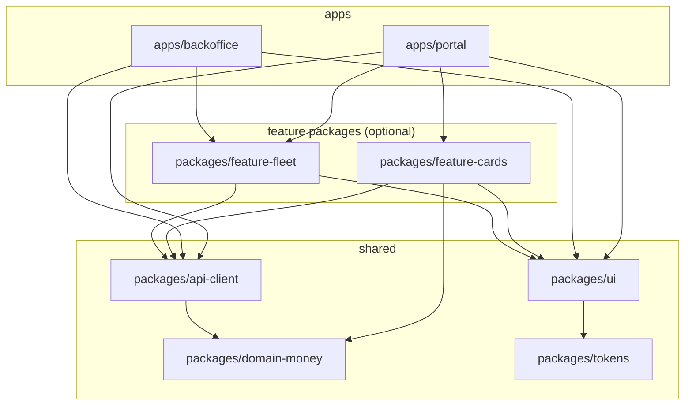
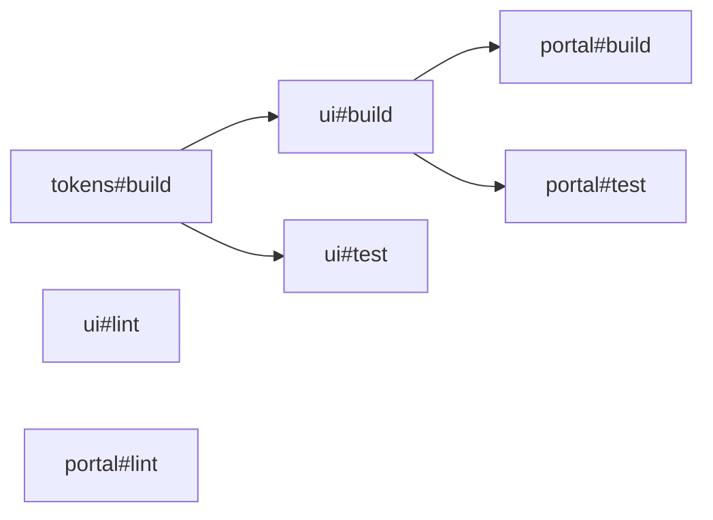
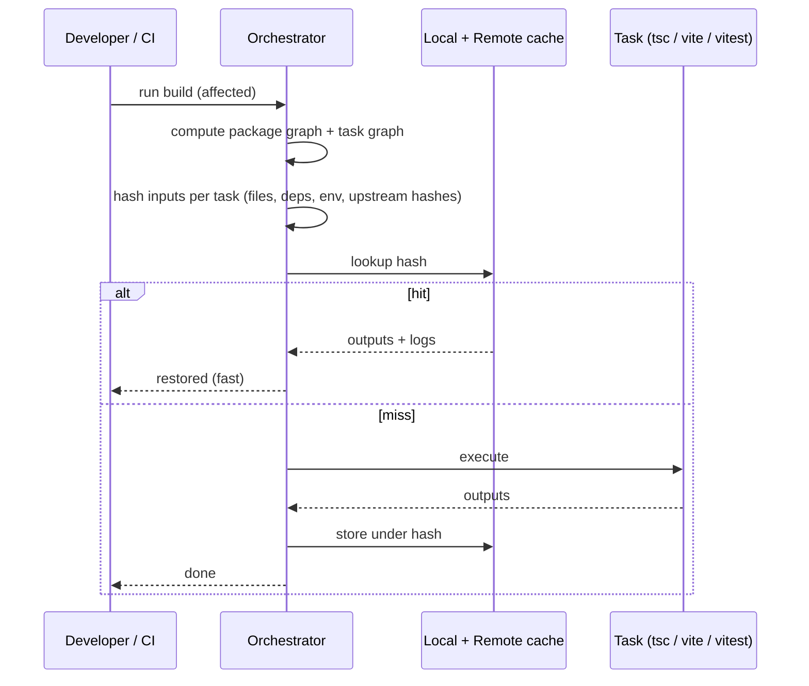
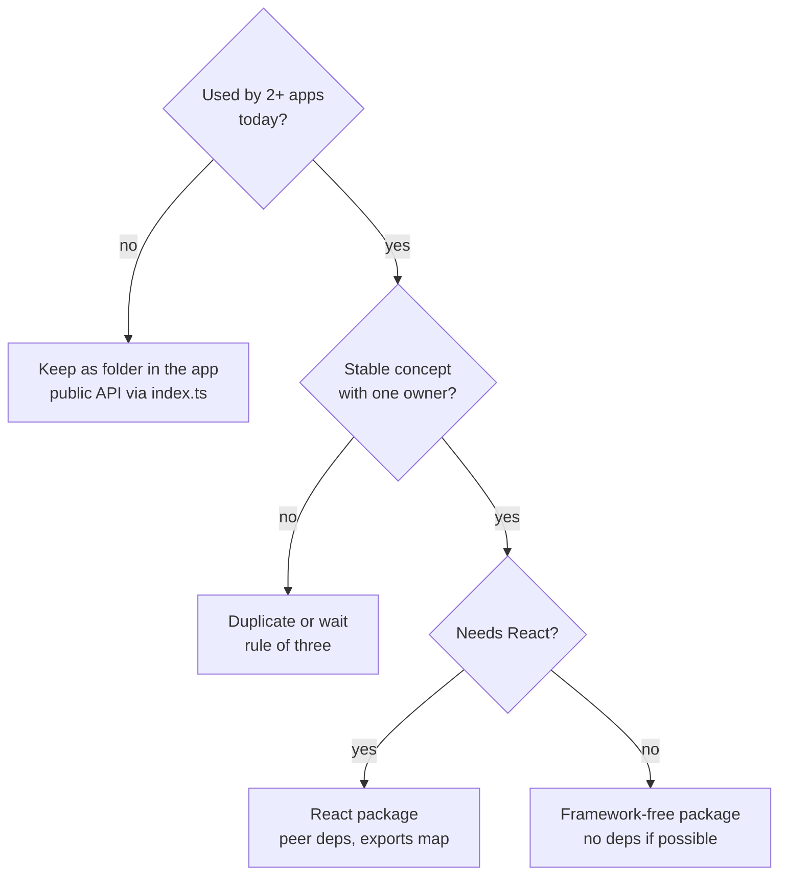

# 04 / 22 — Monorepos and Shared Packages: Workspaces, Internal Packages, Versioning, and the Cost of Sharing

## 1. Lesson metadata

| | |
|---|---|
| **Level** | Advanced |
| **Study time** | 4–5 hours (reading 2 h, hands-on workspace setup 1.5 h, exercises 1.5 h) |
| **Prerequisites** | [01 — Architecture fundamentals](./01-architecture-fundamentals.md), [07 — Modular architecture](./07-modular-architecture.md), [08 — Domain-driven frontend](./08-domain-driven-frontend.md), [20 — Design systems](./20-design-systems.md), [21 — Component libraries](./21-component-libraries.md) |
| **Next** | [23 — Multi-team ownership](./23-multi-team-ownership.md) |
| **Related** | [06 — Feature vs layer structure](./06-feature-vs-layer-structure.md), [14 — API boundaries and data access](./14-api-boundaries-and-data-access.md), [25 — Architectural fitness and enforcement](./25-architectural-fitness-and-enforcement.md), Phase 10 [01 — Repository organization](../10-production-engineering/01-repository-organization.md), Phase 11 [13 — Monorepo vs multirepo](../11-senior-and-architect-mastery/13-monorepo-vs-multirepo.md) |

**Learning objectives.** After this lesson you can:
1. Explain what a monorepo is and is not (one repository, many independently-described packages and apps — not "one big app").
2. Set up a package-manager workspace with an app and two internal packages, using the `workspace:` protocol and a correct `exports` map.
3. Distinguish *just-in-time* (source-consumed) internal packages from *compiled* internal packages and choose between them.
4. Explain how task orchestration (task graph, caching, affected-only runs) works conceptually, and what a build tool such as Turborepo or Nx adds on top of the package manager.
5. Prevent the classic React-in-a-monorepo failures: duplicate React copies ("Invalid hook call"), phantom dependencies, circular package dependencies, "shared" dumping grounds.
6. Decide what deserves to be a package and what should remain a folder inside an app.
7. Choose a versioning strategy (fixed internal version, Changesets-style independent versioning, or no versions at all) for internal vs published packages.
8. Plan an incremental migration from several repositories (or from one big `src/`) into a workspace.

**Concepts covered:** monorepo vs polyrepo vs monolith, workspace, package manager workspace protocol, hoisting, phantom dependency, `exports` map, `peerDependencies`, TypeScript project references, just-in-time package, compiled package, task graph, remote cache, affected analysis, Changesets, shared package anti-patterns, package boundaries as architecture boundaries.

---

## 2. Deep conceptual explanation

### 2.1 What problem is this lesson solving?

Phase 4 so far has described boundaries *inside* one application: features, bounded contexts, layers, public APIs. A boundary inside a folder is enforced by convention and lint rules. As the number of apps and teams grows, three pressures appear that a single `src/` cannot absorb:

1. **More than one deployable.** A customer portal, an admin back office, a marketing site, a Storybook, and a mobile web view all want the same button, the same API client, the same `Money` formatting. Copy-paste diverges; extracting to another repository creates the *publish-then-bump* problem (below).
2. **Different change cadences and owners.** A design-system team changes weekly; a payments feature team changes daily; an auth module changes quarterly. They need independent test/build units, and clear ownership of each ([23](./23-multi-team-ownership.md)).
3. **Boundary enforcement.** Folders can be imported through relative paths (`../../../billing/internal/x`). A *package* has a manifest, a declared public entry point (`exports`) and declared dependencies. The package system itself — not just a lint rule — refuses undeclared imports (when configured strictly), making the architecture partially self-enforcing.

The **publish-then-bump problem** deserves precision, because it is the main reason monorepos exist. With separate repositories, changing a shared `ui` library means: edit, review, merge, version, publish to a registry, then open a PR in every consuming repo to bump the version, then discover the new API does not fit consumer B, and loop. Feedback latency is hours to days, and consumers lag across many versions. In a monorepo, the library change and every consumer's adaptation are *one atomic commit* tested by one CI run.

The cost is real and is the subject of §7–§8: tooling complexity, CI time growth, the temptation to couple everything, and permission/ownership problems.

### 2.2 Definitions

| Term | Meaning | Misconception it corrects |
|---|---|---|
| **Monorepo** | A single version-control repository containing multiple distinct projects (apps and libraries) with defined relationships. | It is *not* a monolith. A monolith is one deployable with no internal boundaries; a monorepo can contain 40 independently deployable apps. |
| **Polyrepo** | One repository per project. | Not "microservices" — a repository layout choice, orthogonal to runtime architecture. |
| **Workspace** | A package-manager feature (npm, Yarn, pnpm, Bun) that links local packages together by name so that `import "@acme/ui"` resolves to the local directory. | A workspace is *not* a build system. It links; it does not know the order in which to build, cache, or skip. |
| **Internal package** | A package consumed only inside the monorepo; usually `"private": true`. | Does not need to be published, versioned semantically, or even built. |
| **Published package** | A package released to a registry for external consumers. | Needs stable `exports`, types, semver discipline, changelogs. |
| **Task runner / build orchestrator** | Tool (Turborepo, Nx, Bazel, Rush, Lage, etc.) that computes a graph of tasks across packages, runs them in dependency order with parallelism, and caches results by input hash. | Orchestrators do not replace the bundler (Vite, webpack, tsup...). They run it. |

### 2.3 The structure of a monorepo: apps, packages, tooling

The most common layout (shown in the documentation of several tools; names are conventions, not requirements):

```
repo/
├─ apps/
│  ├─ portal/            # customer-facing SPA (Vite)
│  ├─ backoffice/        # internal admin SPA
│  └─ storybook/         # documentation app
├─ packages/
│  ├─ ui/                # design-system components (React peer dep)
│  ├─ tokens/            # design tokens (no React) – see lesson 27
│  ├─ api-client/        # typed HTTP client + DTO types
│  ├─ domain-money/      # framework-free domain logic (shared kernel)
│  ├─ config-typescript/ # shared tsconfig bases
│  └─ config-eslint/     # shared lint configs, boundary rules
├─ package.json          # root: devDependencies, scripts, workspaces
├─ pnpm-workspace.yaml   # (if pnpm)
├─ turbo.json | nx.json  # (if an orchestrator is used)
└─ .changeset/           # (if versioning with Changesets)
```

**Dependency direction.** The same rule as inside an application, applied at package granularity:



Rules (the ones you will enforce in [25](./25-architectural-fitness-and-enforcement.md)):

1. **Apps depend on packages; packages never depend on apps.**
2. **Shared packages never depend on feature packages.**
3. **Feature packages do not import each other directly** (they talk through shared contracts, events, or the app shell — see [23](./23-multi-team-ownership.md)).
4. **No cycles.** Package graphs must be DAGs; orchestrators cannot order cyclic tasks.
5. **Leaf packages have the fewest dependencies** (`tokens`, `domain-money` should be pure).

### 2.4 Hoisting, linking and the phantom-dependency problem

When you run `npm install` (or `pnpm`, `yarn`) in a workspace repository, three mechanisms interact:

- **Linking.** Local packages are symlinked into `node_modules` under their package name, so `@acme/ui` resolves to `packages/ui`.
- **Hoisting.** npm and classic Yarn lay out dependencies in a flat `node_modules` at the root where possible. Any package can then `require("lodash")` even if it never declared it, as long as *some* package did. This is a **phantom dependency**: it works today and breaks when an unrelated package drops lodash.
- **Strict layout (pnpm default).** pnpm uses a content-addressable store and a nested symlinked structure so each package can only resolve the dependencies it declares. This is the strongest default against phantom dependencies. ⚠ Tool defaults and flags (e.g. `shamefully-hoist`, `node-linker`, `public-hoist-pattern`) change between versions; verify against current pnpm documentation.

Why this matters for architecture: an import that is not declared in `package.json` is an *undeclared architectural dependency*. Strict resolution turns it into an immediate error, which is a free fitness function.

### 2.5 What the package manager gives you vs what the orchestrator gives you

| Capability | Package manager workspaces | Orchestrator (Turborepo / Nx / ...) |
|---|---|---|
| Link local packages by name | Yes | Reuses it |
| Install one lockfile for all | Yes | — |
| Run a script in all packages | Yes (filter flags, e.g. `pnpm -r`, `--filter`) — typically in topological order for some commands; verify per tool | Yes, with parallelism and explicit task graph |
| Know that `ui#build` must precede `portal#build` | Only via package dependency graph, tool-specific | Yes: declarative task dependencies (e.g. "my dependencies' build first") |
| Skip work whose inputs did not change | No | Yes: hash inputs → cache hit replays logs and restores outputs |
| Share cache between developers/CI | No | Yes with a *remote cache* (hosted or self-hosted) |
| Run only what a PR affects | No | Yes ("affected"/"since" filters, graph-based) |
| Boundary rules, generators, code ownership hooks | No | Nx: module boundary lint rule, generators; Turborepo: `turbo boundaries` (documented at turborepo.com/docs/reference/boundaries) |

Public guarantee: *workspaces link packages*. Teaching model: *an orchestrator is a content-addressed memoization of your scripts, ordered by a DAG*. Implementation detail: hashing algorithms, daemon processes, cache layouts — different per tool, not stable.

### 2.6 Internal package strategies: just-in-time vs compiled

This is the most consequential practical decision for React packages.

| | **Just-in-time (source) package** | **Compiled package** |
|---|---|---|
| `main`/`exports` point at | `.ts`/`.tsx` source files | `dist/*.js` + `dist/*.d.ts` |
| Build step in package | None | Required (tsup, tsc, Vite library mode, Rollup) |
| Who compiles it | The consuming app's bundler (Vite/webpack/Next transpile) | The package itself, once |
| Dev feedback | Instant HMR across packages | Need watch-build, or rebuild |
| Type-checking | Consumer type-checks the source (slower, may report errors from the package) | Consumer reads `.d.ts` (fast, isolated) |
| Works for non-bundler consumers (Node scripts, Jest without transform) | Poorly | Yes |
| Publishable to npm as is | No | Yes |
| Config coupling | Consumer's bundler must transpile TS and JSX with compatible settings | Package controls its output |
| Typical use | Internal UI kits, config, hooks used by two apps with the same toolchain | Libraries published externally; packages used by heterogeneous toolchains |

⚠ **Version-sensitive/tool-sensitive:** the "just-in-time package" pattern is documented by Turborepo under that name; bundler support for transpiling workspace packages differs (Vite handles it for linked sources; Next.js needs an explicit option such as `transpilePackages`, ⚠ name and behavior verify in current Next docs). Recommendation: **start just-in-time for internal packages that all share one bundler, switch to compiled when a package needs a second consumer type or external publication.**

### 2.7 React exposure: peer dependencies and the duplicate-React problem

React tolerates exactly **one copy per rendered tree** for anything that uses hooks, context, or the renderer's internals. Two copies of `react` produce the famous error:

> `Invalid hook call. Hooks can only be called inside of the body of a function component.`

(One of the documented causes on react.dev's error page is "you might have more than one copy of React in the same app".)

How a monorepo creates two copies:

1. `packages/ui` lists `react` in **`dependencies`** at version `19.0.0`; `apps/portal` lists `react` `19.1.0`. Package managers install both. Components from `ui` call hooks from copy A while the renderer (copy B, from `react-dom`) holds the dispatcher in copy B's internals → hooks have no active dispatcher.
2. Symlink resolution: with a symlinked package, Node resolves `react` from the *real path* of the package (`packages/ui/node_modules/react`), not from the app. Bundlers have settings to mitigate (Vite: `resolve.dedupe`; webpack: `resolve.alias` / `resolve.modules`; both ⚠ verify names).

The architectural rule: **React-aware shared packages declare `react` and `react-dom` as `peerDependencies`** (and as `devDependencies` for their own tests/Storybook), never as `dependencies`. The *app* owns the React version. Combine with a single-version policy (pnpm `catalog:` or syncpack-style tooling, ⚠ verify) so every package agrees on the range.

### 2.8 Relationship to the module system and the browser

- `exports` in `package.json` is the Node/bundler-level public API of a package (Node documents the `exports` field and conditional exports). It *encapsulates*: files not listed cannot be deep-imported by consumers that honour `exports`. This is your module-boundary enforcement for free.
- Conditions: `"types"`, `"import"`, `"require"`, `"default"`, and bundler-specific ones (`"browser"`, `"development"`). Order matters — the first matching condition wins, and `"types"` should come first for TypeScript. TypeScript honours `exports` only with suitable `moduleResolution` (`node16`/`nodenext`/`bundler`); ⚠ with legacy `node`/`node10` resolution it ignores `exports`.
- `sideEffects: false` in a package manifest tells bundlers it can tree-shake unused modules (a bundler hint widely supported by webpack/Rollup/Vite, see [Phase 7 — Bundle analysis](../07-performance/16-bundle-analysis.md)). One barrel file that re-exports 400 components from a package marked incorrectly can defeat tree-shaking; see §8.

### 2.9 Common misconceptions

| Misconception | Reality |
|---|---|
| "A monorepo means a monolith." | It is a repository layout. Deployables remain independent. |
| "Monorepo = everyone can change everything." | Ownership (CODEOWNERS, [23](./23-multi-team-ownership.md)) and boundary rules constrain this. Google-style "one repo" works with extensive ownership tooling. |
| "A shared package is always good reuse." | Premature sharing couples teams; rule of three, and sharing *stable* concepts only ([§8](#8-best-practices-and-anti-patterns)). |
| "The orchestrator will make CI fast by itself." | Caching works only if tasks are deterministic and inputs are declared correctly; otherwise you get cache misses (slow) or, worse, false hits (wrong). |
| "Each package needs its own React." | The opposite: exactly one. |
| "Monorepo requires Nx/Turborepo." | Small monorepos run fine with plain workspaces and `pnpm -r`. Add an orchestrator when task time hurts. |

---

## 3. Internal mechanics

### 3.1 Public guarantee vs teaching model vs implementation detail

| Layer | Content |
|---|---|
| **Public guarantee** | `package.json` fields (`name`, `version`, `exports`, `main`, `module`, `types`, `peerDependencies`, `sideEffects`, `private`) behave per the Node and package-manager docs. Workspaces link local packages by name. `workspace:*` (pnpm, Yarn berry) resolves to the local package and, on publish, is replaced by the concrete version. TypeScript project references (`composite`, `references`, `tsc -b`) build projects in dependency order and emit declaration files. |
| **Teaching model** | "Orchestrator = DAG + content hash + cache." "Package = module with a manifest-enforced public API." "Phantom dependency = import not covered by the manifest." |
| **Implementation detail** | pnpm's virtual store layout, Turborepo's hashing inputs and daemon, Nx's project-graph computation and plugin inference, caching directories, remote-cache protocols. Treat as volatile (⚠). |

### 3.2 The task graph

Two graphs exist and must not be confused:

- **Package graph:** edges from `package.json` dependencies (`portal → ui → tokens`).
- **Task graph:** nodes are `(package, task)` pairs (`ui#build`, `portal#test`), edges from task-dependency declarations ("`build` depends on `^build`" in Turborepo's notation, where `^` means *the same task in my dependencies*).



`lint` has no dependency edges, so lint tasks run in parallel with everything. `portal#build` waits for `ui#build`, which waits for `tokens#build`. If `tokens` is unchanged and cached, `tokens#build` is a *cache hit* and downstream tasks start immediately.

### 3.3 Cache correctness = input declaration

A cache key is a hash of: the task's source files, the lockfile-resolved dependency versions, relevant environment variables, task configuration, and the cache keys of dependency tasks. If your build reads `process.env.API_URL` but the config does not declare it as an input, two builds with different `API_URL` values produce the same key → **false cache hit**, deploying the wrong URL. Conversely, if you include a file that changes on every run (e.g. a generated timestamp), you get permanent misses. ⚠ Config key names (`inputs`, `env`, `globalEnv`, `outputs`, `dependsOn`) are tool- and version-specific; verify.

### 3.4 TypeScript in a workspace

Two common approaches:

1. **Path aliases / source resolution.** Each package exposes `src/index.ts` as `types`/`exports`; consumers type-check source directly. Simple; type-check time grows with the whole dependency graph.
2. **Project references.** Each package has `composite: true` and emits `.d.ts` (`declaration`, `emitDeclarationOnly`); the app has `references: [{ "path": "../../packages/ui" }]` and is checked with `tsc -b`. Incremental, scalable; more config.

Teaching rule: *references make type-check cost proportional to what changed; source resolution is cheaper to set up.* Choose references when `tsc` for an app exceeds your patience threshold (a team-specific number; often measured in tens of seconds).

---

## 4. Step-by-step execution walkthrough

**Scenario:** a developer changes `packages/ui/src/Button.tsx` (adds `loading` prop) and uses it in `apps/portal`. What happens, chronologically, in dev and in CI?

**Dev (just-in-time package + Vite):**
1. `pnpm --filter portal dev` starts Vite for the portal. Vite resolves `@acme/ui` through the workspace symlink to `packages/ui`, whose `exports` points at `./src/index.ts`.
2. Vite transforms the TypeScript/JSX of `ui` on demand with the app's configuration (no separate build).
3. Developer edits `Button.tsx`. Vite's file watcher sees a change inside the linked package (⚠ for linked packages outside the project root, `server.fs.allow` may need to include the workspace root; verify).
4. HMR boundary: `Button` is a React component module → React Fast Refresh updates it in place; state preserved. DOM effect: only the button re-renders.
5. The TS language server (IDE) type-checks `portal` against `ui` source live.

**CI on the pull request (orchestrator with cache):**
1. CI checks out with enough git history for "since main" comparison (shallow clones break affected analysis).
2. Install: `pnpm install --frozen-lockfile`.
3. The orchestrator computes the package graph. Changed files: `packages/ui/src/Button.tsx` → package `ui` is *directly affected*; `portal` and `backoffice` depend on `ui` → *transitively affected*; `domain-money`, `api-client`, `tokens` unaffected.
4. Task graph for `lint test build typecheck` over affected packages is built. Unaffected packages are skipped (or are cache hits).
5. `ui#test` runs: inputs changed → cache miss → executes. `portal#build` runs after `ui#build` (if `ui` has a build). Outputs are stored under their hash.
6. Result is uploaded to the remote cache, so the next PR that touches only `backoffice` will restore `ui#test` and `ui#build` from cache.
7. Total CI time ≈ critical path through affected tasks, not the sum of all tasks.

**Predict:** if a developer changes only `README.md` in `packages/ui`, which tasks run? *(Answer: depends on declared inputs. If the orchestrator's default inputs include every file in the package, the cache key changes and tasks re-run; a well-tuned config excludes `*.md` from `test`/`build` inputs. This is the practical meaning of "cache correctness = input declaration".)*

---

## 5. Code examples

### 5.1 Minimal example — pnpm workspace with one app and one package

`pnpm-workspace.yaml`:
```yaml
packages:
  - "apps/*"
  - "packages/*"
```

Root `package.json`:
```json
{
  "name": "acme-monorepo",
  "private": true,
  "packageManager": "pnpm@9.15.0",
  "scripts": {
    "dev": "pnpm --filter @acme/portal dev",
    "build": "pnpm -r build",
    "typecheck": "pnpm -r typecheck",
    "lint": "pnpm -r lint"
  },
  "devDependencies": {
    "typescript": "^5.6.0"
  }
}
```

`packages/ui/package.json` (just-in-time):
```json
{
  "name": "@acme/ui",
  "version": "0.0.0",
  "private": true,
  "type": "module",
  "sideEffects": false,
  "exports": {
    ".": {
      "types": "./src/index.ts",
      "default": "./src/index.ts"
    },
    "./button": {
      "types": "./src/button/index.ts",
      "default": "./src/button/index.ts"
    }
  },
  "peerDependencies": {
    "react": "^19.0.0",
    "react-dom": "^19.0.0"
  },
  "devDependencies": {
    "@acme/tokens": "workspace:*",
    "@types/react": "^19.0.0",
    "react": "^19.0.0",
    "react-dom": "^19.0.0"
  },
  "scripts": {
    "typecheck": "tsc --noEmit",
    "lint": "eslint src"
  }
}
```

`apps/portal/package.json` (excerpt):
```json
{
  "name": "@acme/portal",
  "private": true,
  "type": "module",
  "dependencies": {
    "@acme/ui": "workspace:*",
    "react": "^19.0.0",
    "react-dom": "^19.0.0"
  },
  "scripts": {
    "dev": "vite",
    "build": "tsc --noEmit && vite build",
    "typecheck": "tsc --noEmit"
  }
}
```

`packages/ui/src/button/Button.tsx`:
```tsx
import type { ComponentPropsWithRef } from "react";

export interface ButtonProps extends ComponentPropsWithRef<"button"> {
  variant?: "primary" | "secondary";
  loading?: boolean;
}

export function Button({ variant = "primary", loading = false, children, disabled, ...rest }: ButtonProps) {
  return (
    <button data-variant={variant} aria-busy={loading || undefined} disabled={disabled || loading} {...rest}>
      {children}
    </button>
  );
}
```

**Line notes**
- `"private": true` prevents accidental publication. The root is private too.
- `exports` has two entries, `"."` and `"./button"`; anything else (`@acme/ui/src/internal/x`) is **not importable** under `exports`-aware resolution. This is the module boundary.
- `types` precedes `default`: TypeScript matches conditions in order.
- `react` is a **peer** dependency plus a **dev** dependency: the package states "the host provides React", while still being installable/testable alone.
- `workspace:*` links the local `tokens` package; on publish it would be rewritten to a concrete version (pnpm/Yarn behavior; ⚠ verify the exact rewrite rules for ranges like `workspace:^`).
- `ref` is accepted as a normal prop through `ComponentPropsWithRef` (React 19: ref as prop; no `forwardRef` needed).
- Requirement: the app must use `moduleResolution: "bundler"` (or NodeNext) so TypeScript honours `exports`.

`apps/portal/tsconfig.json` (excerpt):
```json
{
  "extends": "@acme/config-typescript/react-app.json",
  "compilerOptions": {
    "moduleResolution": "bundler",
    "module": "ESNext",
    "jsx": "react-jsx",
    "noEmit": true
  },
  "include": ["src"]
}
```

### 5.2 Practical example — a shared kernel package, an API client package, and a feature using both

Problem: portal and backoffice both need `Money`, a typed API client, and consistent error handling.

```
packages/
  domain-money/
    package.json
    src/index.ts
    src/money.ts
    src/money.test.ts
  api-client/
    package.json
    src/index.ts
    src/http.ts
    src/cards/index.ts        # public sub-entry: @acme/api-client/cards
    src/cards/types.ts
    src/cards/cards-api.ts
```

Dependency rules for these:
- `domain-money` has **zero** runtime dependencies and no React.
- `api-client` may depend on `domain-money`, never on `ui` or React.
- Neither depends on any app.

`packages/domain-money/src/money.ts`:
```ts
export type CurrencyCode = "EUR" | "GBP" | "PLN" | "CZK";

declare const brand: unique symbol;
export type Money = Readonly<{ minor: number; currency: CurrencyCode }> & { readonly [brand]?: true };

export function money(minor: number, currency: CurrencyCode): Money {
  if (!Number.isSafeInteger(minor)) throw new RangeError(`Money.minor must be a safe integer, got ${minor}`);
  return Object.freeze({ minor, currency });
}

export function add(a: Money, b: Money): Money {
  if (a.currency !== b.currency) throw new TypeError(`Currency mismatch: ${a.currency} vs ${b.currency}`);
  return money(a.minor + b.minor, a.currency);
}

export function format(m: Money, locale: string): string {
  return new Intl.NumberFormat(locale, { style: "currency", currency: m.currency }).format(m.minor / 100);
}
```

`packages/api-client/src/http.ts`:
```ts
export class ApiError extends Error {
  constructor(readonly status: number, readonly body: unknown, message: string) {
    super(message);
    this.name = "ApiError";
  }
}

export interface HttpClientOptions {
  baseUrl: string;
  getToken: () => string | undefined;
  fetchImpl?: typeof fetch;
}

export function createHttpClient({ baseUrl, getToken, fetchImpl = fetch }: HttpClientOptions) {
  return async function request<T>(path: string, init: RequestInit = {}): Promise<T> {
    const token = getToken();
    const res = await fetchImpl(`${baseUrl}${path}`, {
      ...init,
      headers: { "content-type": "application/json", ...(token ? { authorization: `Bearer ${token}` } : {}), ...init.headers },
    });
    if (!res.ok) throw new ApiError(res.status, await res.json().catch(() => null), `HTTP ${res.status}`);
    return (await res.json()) as T;
  };
}
export type HttpClient = ReturnType<typeof createHttpClient>;
```

`packages/api-client/src/cards/cards-api.ts`:
```ts
import { money, type Money } from "@acme/domain-money";
import type { HttpClient } from "../http";

interface CardDto { id: string; masked_pan: string; limit_minor: number; currency: "EUR" | "GBP" | "PLN" | "CZK" }
export interface Card { id: string; maskedPan: string; limit: Money }

const toCard = (d: CardDto): Card => ({ id: d.id, maskedPan: d.masked_pan, limit: money(d.limit_minor, d.currency) });

export function createCardsApi(http: HttpClient) {
  return {
    list: async (): Promise<Card[]> => (await http<CardDto[]>("/cards")).map(toCard),
    get: async (id: string): Promise<Card> => toCard(await http<CardDto>(`/cards/${encodeURIComponent(id)}`)),
  };
}
export type CardsApi = ReturnType<typeof createCardsApi>;
```

**Why the client takes `getToken` and `fetchImpl` instead of reading global state.** A package that reaches for `window.localStorage` or a global store has a hidden dependency on its host; injecting the dependency keeps it testable and usable by both apps (the dependency inversion of [11](./11-dependency-inversion.md)).

App composition (`apps/portal/src/app/api.ts`):
```ts
import { createHttpClient } from "@acme/api-client";
import { createCardsApi } from "@acme/api-client/cards";
import { tokenStore } from "./auth/token-store";

const http = createHttpClient({ baseUrl: import.meta.env.VITE_API_URL, getToken: () => tokenStore.get() });
export const cardsApi = createCardsApi(http);
```

The *app* decides the base URL and token source, the packages stay environment-agnostic. See [14 — API boundaries and data access](./14-api-boundaries-and-data-access.md) for why the DTO→domain mapper sits in the client package rather than in each component.

### 5.3 Incorrect example — the "shared" dumping ground and the leaky dependency

```
packages/shared/
  src/
    components/ (60 components)
    hooks/ (useAuth, useCards, useDebounce)
    utils/ (formatMoney, cardsReducer, validators)
    store/ (redux store for everything)
    index.ts   // export * from everything
```

`packages/shared/package.json`:
```json
{
  "name": "@acme/shared",
  "dependencies": { "react": "^18.3.0", "react-redux": "^8", "lodash": "^4" },
  "main": "src/index.ts"
}
```

Problems — try to list them before reading on:

1. **Everything depends on everything.** `shared` contains domain logic (`cardsReducer`), UI (`components`), state (`store`), and cross-cutting hooks. Every change invalidates every consumer's cache and review ownership is unclear.
2. **`react` in `dependencies`** (and version 18 while apps use 19) → two React copies → "Invalid hook call" in production builds, or silent context mismatch (a `React.createContext` in copy A is invisible to `useContext` in copy B).
3. **`main` only, no `exports`/`types`:** deep imports (`@acme/shared/src/utils/x`) are possible; the package has no encapsulation.
4. **`export *` barrel:** importing one icon pulls the module graph of the whole package unless `sideEffects` and tree-shaking cooperate; also creates circular-import risk inside the package.
5. **Feature-to-feature coupling through shared:** `useCards` in shared imports the cards API; the fleet feature now transitively depends on cards.
6. **Phantom dependencies:** `lodash` used by components but declared nowhere else; apps start importing `lodash` unlisted.

### 5.4 Corrected implementation

Split by *reason to change* and *dependency direction*:

```
packages/
  tokens/            # no deps
  ui/                # peer: react; deps: tokens
  domain-money/      # no deps
  api-client/        # deps: domain-money
  config-typescript/ config-eslint/
apps/portal/src/features/cards/   # useCards lives here, not in shared
```

- `useCards`, `cardsReducer`, and the Redux store move **into the portal feature** that owns them (state ownership, [15](./15-state-ownership.md)); another app that wants them can extract a `feature-cards` package *later*, when the second consumer is real.
- `react` becomes a peer dependency of `ui`; pinned once by a catalog/single policy.
- `exports` limited to documented entry points.
- `lodash` removed or declared where used.

**Predict:** after this change, which packages rebuild when `portal`'s cards reducer changes? *(Only `portal`. `ui`, `tokens`, `domain-money`, `api-client` are untouched and cache-hit.)*

### 5.5 Advanced example — task pipeline, versioning, and a duplicate-React guard

**Task graph configuration (Turborepo-style; key names changed between major versions: `pipeline` in v1, `tasks` in v2, current 2.x).**

`turbo.json`:
```json
{
  "$schema": "https://turborepo.dev/schema.json",
  "tasks": {
    "build": {
      "dependsOn": ["^build"],
      "inputs": ["src/**", "package.json", "tsconfig*.json", "vite.config.*"],
      "outputs": ["dist/**"]
    },
    "typecheck": { "dependsOn": ["^typecheck"] },
    "test": { "dependsOn": ["^build"], "outputs": ["coverage/**"] },
    "lint": {},
    "dev": { "cache": false, "persistent": true }
  }
}
```

Notes: `^build` = my dependencies' `build` first. `dev` is never cached and is long-running. `outputs` tells the orchestrator which files to restore on a cache hit; forgetting `dist/**` gives "cache hit but nothing built".

**Nx equivalent (conceptual):** `nx.json` has `targetDefaults` with `dependsOn: ["^build"]`, `inputs` (named inputs such as `production`), and `cache: true` per target. Nx additionally computes the project graph from imports (not just manifests) and offers an `enforce-module-boundaries` lint rule driven by project *tags* ([25](./25-architectural-fitness-and-enforcement.md)). ⚠ Verify names in current Nx docs.

**Versioning with Changesets (conceptual workflow).** Applies only to packages you publish or want changelogs for:
1. A contributor runs the changeset CLI, selects packages and bump type (patch/minor/major), writes a summary → a markdown file in `.changeset/`.
2. On release, `changeset version` consumes those files, bumps versions, updates dependents' ranges, writes changelogs.
3. `changeset publish` publishes changed packages. ⚠ Configuration (`.changeset/config.json` keys such as `access`, `ignore`, `updateInternalDependencies`) — verify.

For **purely internal** packages with `workspace:*` dependencies, versions carry no information; keep `0.0.0` and skip changesets. Do not invent semver ceremony nobody reads.

**Single React guard in the app (Vite):**

`apps/portal/vite.config.ts`:
```ts
import { defineConfig } from "vite";
import react from "@vitejs/plugin-react";

export default defineConfig({
  plugins: [react()],
  resolve: {
    // Defensive: if any linked package accidentally resolves its own react copy, force the app's.
    dedupe: ["react", "react-dom"],
  },
});
```

**Line notes.** `resolve.dedupe` is a Vite option for forcing a single copy of listed dependencies. It is a *safety net*, not the fix: the fix is peer dependencies. Detect duplicates with `pnpm why react` (or `npm ls react`) at the repo root; there should be one resolved version across the workspace. A CI check can fail when `pnpm why react --json` shows more than one (script details are tool-specific).

---

## 6. Visual explanations

### 6.1 Build/cache flow



### 6.2 What belongs where



### 6.3 Scale ladder

| Size | Shape | Tooling that is enough |
|---|---|---|
| 1 app, ≤ 3 devs | Single package | None |
| 2 apps + 1–3 packages, ≤ 10 devs | Workspaces, JIT packages | pnpm/npm workspaces; scripts with `--filter` |
| 3–10 apps, 5–15 packages, 10–50 devs | Workspaces + orchestrator, project references | Turborepo or Nx, remote cache, CODEOWNERS, boundary lint |
| 10+ apps, 50+ packages, 50+ devs | Orchestrator with generators, affected CI, ownership metadata, boundary tags, release automation | Nx/Bazel/Rush-class tooling; dedicated platform/DevEx team |

(These bands are heuristics from experience, not measurements.)

---

## 7. Alternative approaches and trade-offs

### 7.1 Repository strategy comparison

| Criterion | Single app (no packages) | Monorepo + workspaces | Polyrepo + published packages | Monorepo + micro-frontends |
|---|---|---|---|---|
| Atomic cross-project change | Yes (trivially) | Yes | No (publish/bump) | Partly (contracts versioned) |
| Setup cost | Lowest | Medium | Medium per repo | Highest |
| CI time at scale | Grows with app | Needs caching/affected | Per repo small, but integration is late | Per MFE small |
| Boundary enforcement | Lint only | Manifest + lint | Strong (hard repo wall) | Strong (runtime wall) |
| Consumer version lag | None | None (always head) | Common | Possible |
| Access control | Whole repo | Coarse (CODEOWNERS, not read ACL) | Per repo | Per repo or monorepo |
| Independent deploy | No | Yes per app | Yes | Yes per MFE |
| Tooling lock-in | None | Moderate | Low | High |

### 7.2 Approach profile: monorepo with internal packages

- **Problem solved:** shared code between apps without publish friction; atomic refactors; unified tooling.
- **Folder structure:** §2.3.
- **Dependency rules:** §2.3, enforced in [25](./25-architectural-fitness-and-enforcement.md).
- **Code:** §5.
- **Pros:** atomic changes; one lockfile; consistent tooling; boundary enforcement via manifests; cache-driven speed.
- **Cons:** CI/IDE scaling work; tool upgrades affect everyone; coarse access control; "everyone can import everything" drift without lint; onboarding complexity; git history noise.
- **Team sizes:** pays off when ≥ 2 deployables share code or ≥ ~3 teams work on related projects; below that, extra packages are overhead.
- **Failure modes:** dumping-ground `shared`; cycles; duplicate React; cache poisoning from undeclared inputs; permanently red main because of cross-package breakage landed without affected tests; version drift of tooling.
- **Migration:** §8.4.

### 7.3 Approach profile: polyrepo with published packages

- **Problem solved:** hard isolation, independent release of a library to unknown consumers, per-repo access control.
- **Structure:** one repo per app/library; registry (npm private/GitHub Packages).
- **Rules:** semver is the contract; consumers pin ranges; deprecations announced.
- **Pros:** strict boundaries; small CI per repo; fits external/open-source libraries; clear ownership.
- **Cons:** publish-then-bump latency; version skew; cross-repo refactors need coordinated PRs; duplicated config.
- **Sizes:** good for ≥ 100 developers with independent teams and rare cross-cutting changes, or when consumers are outside the company.
- **Failure modes:** "dependency hell" across versions of the internal library; abandoned old majors; tooling drift between repos.
- **Migration:** consolidating polyrepo into monorepo preserves history with subtree/filter tooling (§8.4).

### 7.4 A scenario where a monorepo is NOT the best approach

An agency maintains 25 unrelated client sites, each by different small teams, each with different React versions, hosting, and contractual access rules (clients must not see each other's code). A monorepo would force a common toolchain, expose all code to all contributors (git access control is per-repository), and one client's emergency upgrade would block the shared lockfile. Polyrepo (with a small template repo and a published base config package) fits better. Also: a library that is open-source with outside contributors is usually better in its own repository.

---

## 8. Best practices and anti-patterns

### 8.1 Best practices

1. **Package for a reason.** A package is justified when it has (a) at least two real consumers or a hard isolation need, (b) a single owner, (c) a stable public API. Otherwise it is a folder.
2. **`exports` is the contract.** Define explicit entry points; do not rely on `main` + deep imports.
3. **`react` as peer + dev dependency.** One version policy.
4. **Prefer many small, cohesive leaf packages over one `shared`.** Name packages by capability (`@acme/domain-money`), not by place (`@acme/common`).
5. **Dependency inversion at package edges.** Inject environment (base URL, token getter, logger) rather than importing globals.
6. **Keep config packages.** `config-typescript`, `config-eslint` reduce drift and host the boundary rules.
7. **Declare task inputs/outputs explicitly** and test cache correctness: change an env var, observe a miss.
8. **Run affected-only on PRs, full on main/nightly** to catch graph-computation gaps.
9. **Make `main` green by design:** merge queue or required checks on affected packages.
10. **Lockfile-first installs in CI** (`--frozen-lockfile`).
11. **Document the package graph** and treat adding an edge as an architectural decision (see [Phase 10 — Architecture decision records](../10-production-engineering/16-architecture-decision-records.md)).

### 8.2 Beginner mistakes

- Putting `react` in `dependencies` of a UI package.
- Relative imports across package boundaries (`../../packages/ui/src/x`) that bypass the manifest.
- A single giant `index.ts` barrel exporting everything.
- Committing generated `dist/` folders by accident.
- Forgetting `"private": true` and publishing internal code.
- Creating a package for every folder ("package-per-component") before any consumer exists.

### 8.3 Experienced-developer mistakes

- **Premature extraction** guided by DRY rather than by stable concepts (see [Phase 5 — DRY, KISS, YAGNI](../05-design-patterns/02-dry-kiss-yagni.md)): two screens look similar, so a shared component with 14 props and 6 boolean flags is born.
- **Shared kernel growth:** `domain-*` packages gaining team-specific rules until every team must approve each change.
- **Compiled packages with stale outputs:** apps type-check against old `dist` types because the watch build is not running; the fix is orchestrated `dev` tasks or JIT packages.
- **Over-tuned cache:** excluding files from inputs "for speed" and producing false hits.
- **Tooling monoculture without an owner:** nobody owns the build config; upgrades stall.
- **Circular dependency through "types only" packages:** `api-client` imports types from `feature-cards` that imports `api-client`. `import type` hides the runtime cycle but not the conceptual one (and project references will still reject it).

### 8.4 Migration considerations

**From several repositories to a monorepo (incremental, reversible at each step):**
1. **Inventory** the repos, their React versions, build tools, release cadence, owners.
2. **Create the monorepo skeleton** (workspace config, config packages) without moving code.
3. **Import histories** of one repo at a time into `apps/<name>` using history-preserving techniques (e.g. `git subtree`, `git filter-repo`; ⚠ verify commands in current docs). Keep the old repo read-only with a pointer.
4. **Unify the toolchain gradually:** first TypeScript/ESLint base configs, then the React version (use a *temporary* per-app version exception documented in an ADR), then test runner.
5. **Extract shared packages bottom-up** from observed duplication: tokens and pure domain utilities first (no React), UI later, API client after.
6. **Introduce the orchestrator** when `pnpm -r` time hurts; add the remote cache last.
7. **Add boundary rules** ([25](./25-architectural-fitness-and-enforcement.md)) *before* teams add many cross-package imports; start in "warn" mode.

**From one big `src/` into packages:** only extract directories that already obey dependency direction (leaf-first). Use the existing public `index.ts` as the future `exports`. Move, do not redesign. See [24 — Refactoring legacy React](./24-refactoring-legacy-react.md).

### 8.5 Justified exceptions

- A temporary **vendored copy** of a package in an app to unblock an urgent fix before the shared version lands.
- **Two React majors** during an incremental upgrade, when the apps are isolated deployables and no package is shared between the two versions (never in one rendered tree).
- A **single combined package** for a small team (≤ 5 devs, 2 apps) even if the concepts are separable — splitting is a cost.

---

## 9. Real-world application

| Domain | Example | Engineering constraints |
|---|---|---|
| **E-commerce** | Storefront (SSR) + admin + email-template renderer share `ui`, `pricing` (pure domain), `catalog-client` | Pricing must be identical in storefront and admin → single pure package with property tests. SSR app needs compiled/transpiled packages compatible with the server bundler. |
| **Fleet/finance dashboard** | Driver portal, back office, partner API console | Currency/`Money` kernel is a **shared kernel** (lesson 08) with two named owners; regulated rounding rules versioned; strong CODEOWNERS for the kernel. |
| **Realtime** | Trading-style console with a WebSocket client package | Package exposes a subscription API with injected transport; avoid leaking sockets into UI package; test with a fake transport. |
| **Auth** | `auth-client` package used by all apps | Security-sensitive; dependency policy (lockfile review), single owner, minimal API: `getSession`, `signIn`, `signOut`. Do not let apps reach token storage directly. |
| **Multi-team** | 6 squads, 4 apps | Feature packages per squad, enforced boundaries, platform team owns config/orchestration; see [23](./23-multi-team-ownership.md). |
| **Forms** | Shared form-field components and validation schemas (client + shared with Node BFF) | Schema package must be framework-free to run in Node; validation messages in a separate i18n layer. |

**Operational constraints to plan for:** CI minutes budget, cache storage cost, IDE memory on large TS graphs, onboarding doc ("how to run one app"), security scanning at the lockfile level, deployment per app (each app's build pipeline filtered to its dependency closure).

---

## 10. Debugging and troubleshooting

### 10.1 "Invalid hook call" only in the monorepo

- **Symptom:** works in the standalone `ui` Storybook, crashes in `portal` with the hook-call error; or `useContext` returns `undefined` for a provider that clearly wraps the tree.
- **Reproduce:** `pnpm why react` shows two paths/versions, or `ls packages/ui/node_modules/react` exists.
- **Investigate:** in the browser, set a breakpoint or log in the package and the app: `console.log(React === window.__reactCopy)` style check, or import `react` in both places and compare `React.version`. In the bundle analyzer ([Phase 7/16](../07-performance/16-bundle-analysis.md)), look for two `react` entries.
- **Root cause:** `react` in `dependencies` of a package, different semver range, or resolution from a real path.
- **Fix:** peer dependency; align versions; `resolve.dedupe` as a net; reinstall (delete `node_modules` and lockfile entries for the stray copy).
- **Validate:** single `react` in analyzer; hook works; add CI check for one resolved version.

### 10.2 "Cannot find module '@acme/ui'" or types resolve to `any`

- Missing `workspace:*` dependency in the consumer's manifest (hoisting hid it before pnpm); or TypeScript `moduleResolution: "node"` ignoring `exports`; or the package has no `types` condition. Fix manifest/resolution; do not add path-alias hacks that bypass `exports`.

### 10.3 Cache hit but stale or missing output

- `outputs` not declared, or build writes outside declared dirs. Verify by running with cache disabled for that task, compare file trees.

### 10.4 CI is slow after the monorepo migration

- Check whether affected analysis works (shallow clone? wrong base ref?), whether the remote cache is configured, and whether one task (e.g. root-level `lint`) defeats caching by taking the whole repo as input. Profile with the orchestrator's run summary/trace output (⚠ tool-specific).

### 10.5 Circular dependency between packages

- Orchestrator or project references report a cycle; or runtime `undefined` at module init (see [08 §10](./08-domain-driven-frontend.md)). Fix by extracting the shared concept into a lower package or by inverting the dependency through an interface owned by the lower layer.

### 10.6 HMR does not update when editing a linked package

- Vite: the linked package is outside the project root or pre-bundled as a dependency optimized by `optimizeDeps`; check `server.fs.allow`, `optimizeDeps.exclude`, symlink handling (`resolve.preserveSymlinks`) — ⚠ verify options in current Vite docs.

---

## 11. Exercises

### Level A — Knowledge
A1. Define monorepo and explain why it is not synonymous with monolith.
A2. What is a phantom dependency, and which package-manager behaviour causes it?
A3. Why must React-aware shared packages declare `react` as a peer dependency?
A4. Give two reasons to prefer a compiled package over a just-in-time package.
A5. What does the `^` in `"dependsOn": ["^build"]` mean conceptually?
A6. List four dependency-direction rules for a monorepo package graph.

### Level B — Code comprehension
B1. What problem do you see in this manifest?
```json
{ "name": "@acme/ui", "main": "src/index.ts", "dependencies": { "react": "^18.3.0", "@acme/portal": "workspace:*" } }
```
B2. Predict whether this import works under `exports`-aware resolution, given the §5.1 manifest, and explain: `import { x } from "@acme/ui/src/internal/x";`
B3. A `turbo.json` task `build` lacks `outputs`. A cache hit occurs. What does the developer observe?

### Level C — Implementation
C1. Create a workspace with `apps/web`, `packages/ui`, `packages/tokens` using pnpm. Make `ui` depend on `tokens` with `workspace:*`, and `web` consume `ui`. Provide the three manifests and `pnpm-workspace.yaml`.
C2. Write the `exports` map of `@acme/api-client` exposing `.` and `./cards`, as a JIT package, with types.
C3. Write a script (Node or shell) outline that fails CI if more than one resolved `react` version exists in the workspace; name the commands you would use and what you must verify about their output format.

### Level D — Debugging
D1. After adding `@acme/ui` to `backoffice`, every component using `useState` throws "Invalid hook call". `pnpm why react` shows `react@19.0.0` for the app and `react@18.3.1` under `ui`. Diagnose and fix, and say what you would add to prevent recurrence.
D2. Developers report that after merging the "monorepo speedup" PR, production shipped with the staging API URL once. The PR added `inputs` to `build` listing only `src/**`. Diagnose.

### Level E — Architecture decisions
E1. Your company has 3 React apps in 3 repos (shared button library published to a private registry at v3.2, apps on v1.9, v2.4, v3.2). Propose a migration to a monorepo, including order of steps and risks.
E2. A team proposes extracting every feature into its own package immediately "for clean boundaries". Argue for or against, with criteria.
E3. Choose between pnpm workspaces alone, plus Turborepo, plus Nx for: (a) 2 apps, 6 devs; (b) 8 apps, 60 devs.

### Level F — Expert challenge
F1. Design the package graph, boundary rules, ownership, CI strategy and versioning policy for a fintech with a customer SPA, a back-office SPA, a partner-facing SDK published to npm, and a shared money/rounding kernel subject to audit. Identify which packages are published and compiled, which are internal JIT, and the failure modes you would monitor.

---

## 12. Detailed answers and explanations

> Attempt the exercises first.

**A1.** A monorepo is a single repository holding many projects (apps and libraries) with explicit relationships. A monolith is a single deployable unit with no enforced internal boundaries. A monorepo may contain dozens of independently deployable apps and strongly bounded packages; a polyrepo may contain monoliths. The two axes (repository layout, runtime architecture) are orthogonal. *Common wrong answer:* "monorepo = one big app" — it conflates source layout with deployment.

**A2.** A phantom dependency is an import that resolves at runtime/build time only because another package's dependency happens to be hoisted into reach, without being declared in the importing package's manifest. Flat hoisting (npm, classic Yarn) causes it; pnpm's strict layout largely prevents it. Consequence: breakage when an unrelated package changes its dependencies. Edge: tools like `eslint-plugin-import`'s `no-extraneous-dependencies` detect it statically (⚠ verify rule name).

**A3.** React requires a single copy per rendered tree; hooks and context rely on shared internals. If the package lists `react` in `dependencies`, the package manager may install a second copy (different range or nested resolution), producing hook errors or invisible context. Peer dependency says "the host app supplies React", ensuring one copy. Wrong answer: "to reduce bundle size" — that's a side-effect, not the reason; correctness is.

**A4.** (1) Consumers with heterogeneous toolchains (Node scripts, Jest without transforms, a different bundler) cannot use raw TS/JSX source. (2) Publishing to npm requires built artifacts. Also valid: faster consumer type-checking via `.d.ts`; independent control over compile target and JSX runtime; build caching at the package level.

**A5.** `^` refers to the same task in the package's *dependencies* (upstream packages) rather than the package itself: `build` in `portal` waits for `build` in `ui` and `tokens`. Without `^`, `"dependsOn": ["build"]` refers to another task of the same name in the *same* package. (Notation is Turborepo's; Nx uses the same caret convention in `dependsOn`.)

**A6.** Any four of: apps → packages only; shared packages must not import feature packages; feature packages don't import each other directly; no cycles; leaf packages stay minimal/pure; React-free domain packages must not import React packages; no package imports an app.

**B1.** Problems: (1) `react` in `dependencies` at ^18.3 while apps may be on 19 → duplicate copies; (2) `@acme/portal` as a dependency of a shared package: **a package depends on an app**, inverting direction and likely a cycle (portal → ui → portal); (3) `main` only: no `exports`, no `types` condition; deep imports possible. (4) `workspace:*` in `dependencies` of a UI package that is meant to be published would be rewritten to the app's version, and apps are not published. Fix: peer dependency, remove the app edge (inject whatever the package needed from the app via props/context), add `exports`.

**B2.** It fails (for resolvers honouring `exports`): `./src/internal/x` is not an exported subpath, so Node and bundlers raise a "Package subpath not exported" style error. TypeScript with `moduleResolution: bundler` also reports it is not resolvable. If the consumer uses legacy `node` resolution, TypeScript may ignore `exports` and allow it — the boundary then holds only at bundling time. That inconsistency is why consumer `tsconfig` must be standardized (config package).

**B3.** The orchestrator restores logs and reports "cache hit", but no `dist/` is restored because it does not know which files are outputs. Downstream tasks fail ("cannot find dist/...") or an app deploys stale/empty output. Fix: declare `outputs`. Edge: on a *miss* the build works, which makes it intermittent and confusing.

**C1.** Sample:
```yaml
# pnpm-workspace.yaml
packages: ["apps/*", "packages/*"]
```
```json
// packages/tokens/package.json
{ "name": "@acme/tokens", "private": true, "version": "0.0.0", "type": "module",
  "exports": { ".": { "types": "./src/index.ts", "default": "./src/index.ts" } } }
// packages/ui/package.json
{ "name": "@acme/ui", "private": true, "version": "0.0.0", "type": "module",
  "exports": { ".": { "types": "./src/index.ts", "default": "./src/index.ts" } },
  "peerDependencies": { "react": "^19.0.0" },
  "dependencies": { "@acme/tokens": "workspace:*" },
  "devDependencies": { "react": "^19.0.0", "@types/react": "^19.0.0" } }
// apps/web/package.json
{ "name": "@acme/web", "private": true, "type": "module",
  "dependencies": { "@acme/ui": "workspace:*", "react": "^19.0.0", "react-dom": "^19.0.0" } }
```
Evaluation: `workspace:*` used; react peer in ui; exports present; all `private`. Edge: `tokens` is a runtime *dependency* of `ui` here (JIT), fine; for a published `ui` it must be a real dependency version.

**C2.**
```json
"exports": {
  ".": { "types": "./src/index.ts", "default": "./src/index.ts" },
  "./cards": { "types": "./src/cards/index.ts", "default": "./src/cards/index.ts" }
}
```
Evaluation: `types` first; each subpath maps to a real file; no wildcard exposing internals (`"./*"` would defeat encapsulation).

**C3.** Outline: run `pnpm ls -r react --json` (or `pnpm why react -r --json`), collect distinct `version` values, exit non-zero if size > 1. You must verify the JSON shape for your pnpm version and whether `peerDependencies` appear as separate entries; also test with a deliberately introduced second version. Also run for `react-dom`. Evaluation criteria: handles `react-dom`, handles nested paths, fails with actionable message.

**D1.** Cause: `ui` has `react@18.3.1` in `dependencies` (or devDependencies resolved through its real path) while the app's renderer is 19. Fix: change `ui` to `peerDependencies` with `^19` (and dev), align versions through catalog/policy, reinstall, and optionally add `resolve.dedupe`. Prevent: CI one-version check, boundary lint rule banning `dependencies.react` in packages (custom check), renovate/dependabot grouping. Wrong fix: aliasing `react` in the app only, which hides the second copy for the bundle but leaves tests/Storybook inconsistent.

**D2.** `API_URL` (probably `VITE_API_URL`, inlined at build time) is not part of the cache key, because `inputs` was narrowed to `src/**` and the env var was not declared. A staging build's cache entry was restored for the production build. Fix: declare the env var(s) as task inputs (`env`/`globalEnv` in Turborepo-style config, ⚠ verify), or build per environment with environment-specific cache namespaces; verify by changing the env var and observing a miss. Lesson: caches memoize; undeclared inputs are bugs.

**E1.** Sample well-reasoned answer: (1) Skeleton monorepo with config packages. (2) Move the **library first** (it is the shared dependency; v3.2 is the highest) into `packages/ui`, keep publishing it for external use if required, otherwise stop publishing. (3) Import the v3.2 app; then the v2.4 and v1.9 apps. For apps on old versions, first upgrade them to the library's current major *in their own repos* if feasible — this separates the migration risk; else temporarily consume the old versions via compat shims. (4) Align React to one version across apps (peer dependency). (5) Add affected-only CI and, afterward, remote cache. Risks: history loss, CI duplication, release freeze coordination, coarse access control; mitigation: read-only old repos, CODEOWNERS, phased cutover per app. Evaluation criteria: library-first order, one-React policy, reversibility, no big-bang.

**E2.** Against (by default): packages add manifest, build, and release overhead; a feature with one consumer gains nothing from package isolation that folder + lint boundary doesn't give; the boundaries drawn up front are guesses (see lesson 08: boundaries should follow discovered contexts). For: when a feature needs independent ownership/CI, a different release cadence, or strict isolation for security/compliance, packaging is justified. Criteria: consumer count, ownership, rate of change, enforcement need. Recommendation: folders with public APIs and lint rules first; promote to packages on demand. Scenario where the proposal wins: a regulated payments feature requiring audit and restricted CODEOWNERS.

**E3.** (a) Plain pnpm workspaces; maybe Turborepo if CI > ~10 min; skip Nx. (b) Orchestrator with remote cache and boundary enforcement: Nx if you want integrated graph/boundary tags/generators; Turborepo if you want lighter task orchestration and pair it with dependency-cruiser/ESLint boundaries. Justify with criteria: need for generators and graph-based tags (Nx), simplicity and incremental adoption (Turborepo), team familiarity. No single right answer; evaluate on reasoning. ⚠ Feature sets move; re-check.

**F1.** Evaluation criteria and example: Published & compiled: `@acme/partner-sdk` (semver, Changesets, exports map with `types`, ESM+CJS if needed, no React unless needed). Internal JIT: `ui`, `tokens`, `api-client`. `money-kernel`: framework-free, compiled or JIT but with 100% property-test coverage; two named CODEOWNERS (domain + compliance); changes require an ADR and consumer test pass; used by SDK too → compile + publish, pin exact version in audit docs. Boundary rules: apps → feature/shared only; SDK may import only `money-kernel`, not `ui` or `api-client`. CI: affected tests on PR, full nightly, remote cache, per-app deploy pipeline filtered by dependency closure, provenance for published artifacts. Failure modes to monitor: SDK API breakage (API-extractor-style diff, ⚠ tool), cache false hits for env-specific builds, kernel rounding drift (golden tests), duplicate React in apps, drift between audit docs and code. A strong answer also names rollback strategy for SDK releases.

---

## 13. Senior engineer interview questions

1. **"When would you introduce a monorepo?"** — When ≥ 2 deployables need to share code that changes together, and publish-then-bump latency or version skew is costing more than tooling complexity. Because the primary benefit is atomic change; if there is no cross-project change, there is little to gain.
2. **"Why do UI libraries in monorepos break with hook errors?"** — Duplicate React copies: package-level `dependencies` or real-path resolution create a second React; hooks/context rely on module-level state shared by exactly one copy. Fix with peer deps and dedupe.
3. **"JIT or compiled internal packages?"** — JIT for same-toolchain internal consumers: instant HMR, no build config. Compiled when consumers are heterogeneous or when publishing. Cost of JIT: consumers compile and type-check the package; the consumer's config becomes an implicit contract.
4. **"How does remote caching go wrong?"** — Undeclared inputs (env vars, files outside the package, tool versions) cause false hits; missing outputs cause hollow hits; nondeterministic outputs cause permanent misses; and trust: cache poisoning from untrusted PR builds should be mitigated by read-only cache for forks.
5. **"How do you stop a `shared` package from becoming a landfill?"** — Name by capability, require an owner and a second consumer, limit entry points via `exports`, add lint rules for direction, review the package list regularly, and delete dead exports (tooling such as `knip` can find unused exports; ⚠ verify config).
6. **"How do you version internal packages?"** — Generally you don't: always head, `workspace:*`; the commit is the version. Version published packages with Changesets or equivalent. Because semver communicates risk to *external* consumers; internal consumers are tested together.
7. **"What happens to CI time as the repo grows?"** — Without affected/caching it grows linearly (or worse); with it, it tracks the change's blast radius. Blast radius is an architectural property: high fan-in packages (`ui`, `tokens`) make every change touch everything — design them for stability.
8. **"Monorepo access control?"** — Git repo permissions are coarse; CODEOWNERS enforces review ownership but not read access. If read isolation is required, use separate repos or a monorepo tool with path-level ACL, accepting cost.

---

## 14. Further learning resources

| Resource | URL | Covers / why | Level | Study |
|---|---|---|---|---|
| pnpm — Workspaces | <https://pnpm.io/workspaces> | `workspace:` protocol, workspace layout | Intermediate | Whole page |
| pnpm — Catalogs | <https://pnpm.io/catalogs> | Single-version policy across packages | Intermediate | Whole page |
| Node.js — Packages (`exports`) | <https://nodejs.org/api/packages.html> | Conditional exports and encapsulation | Intermediate | "Package entry points", "Conditional exports" |
| TypeScript — Project References | <https://www.typescriptlang.org/docs/handbook/project-references.html> | `composite`, `tsc -b` | Advanced | Whole page |
| TypeScript — `moduleResolution` | <https://www.typescriptlang.org/tsconfig/#moduleResolution> | Why `exports` needs modern resolution | Intermediate | Whole entry |
| Turborepo docs | <https://turbo.build/repo/docs> | Task graph, caching, internal packages (verify current URL; the project has moved docs before) | Intermediate | "Core concepts" |
| Nx docs | <https://nx.dev/docs> | Project graph, module boundaries, affected | Intermediate | Concepts, "Enforce module boundaries" |
| Changesets | <https://github.com/changesets/changesets> | Versioning and changelogs in monorepos | Intermediate | README |
| React — Rules of Hooks / Invalid hook call | <https://react.dev/warnings/invalid-hook-call-warning> | Duplicate React as a documented cause | Beginner–Int. | "Duplicate React" section |
| Vite — `resolve.dedupe` | <https://vite.dev/config/shared-options.html> | Forcing a single copy | Intermediate | `resolve.dedupe` |
| Phase 10 lesson 01 | [Repository organization](../10-production-engineering/01-repository-organization.md) | Repo-level operations | Advanced | Whole |

URLs in this table were checked for HTTP 200 on 2026-10-22; any still marked *(unverified)* could not be checked automatically (blocked or unreachable). A 200 response does not guarantee the page content still matches the description; if a link has moved, search the site for the quoted title.

---

## 15. Knowledge checkpoint

**You should now understand**
- What a workspace does vs what an orchestrator does.
- Why packages are architectural boundaries and how `exports` and `peerDependencies` implement them.
- JIT vs compiled packages, and when each fits.
- How caching correctness depends on declared inputs/outputs.
- Why `shared` is the most dangerous package name.

**You should be able to explain without notes**
- The publish-then-bump problem and how monorepos remove it.
- How duplicate React copies arise and how to prevent them.
- Why a package graph must be a DAG.

**You should be able to implement**
- A workspace with an app and two packages, correct manifests, and an `exports` map.
- A dependency-injected API client package.
- A migration plan from polyrepo to monorepo.

**You should be able to debug**
- Invalid hook calls caused by duplicate React; phantom dependencies; stale-cache builds; package cycles.

**Before moving on:** read [23 — Multi-team ownership](./23-multi-team-ownership.md), which adds the human side of boundaries (CODEOWNERS, contracts, platform teams) and [25 — Architectural fitness and enforcement](./25-architectural-fitness-and-enforcement.md) for making the rules in §2.3 automatic.
