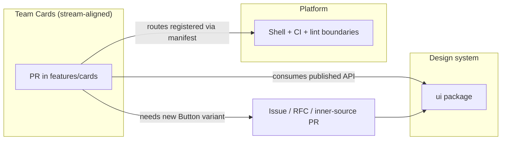
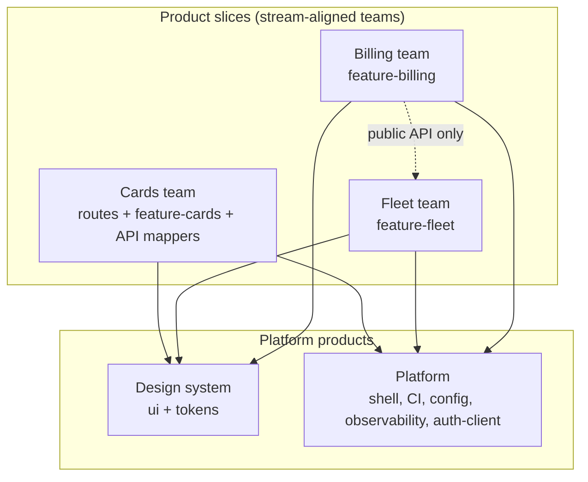
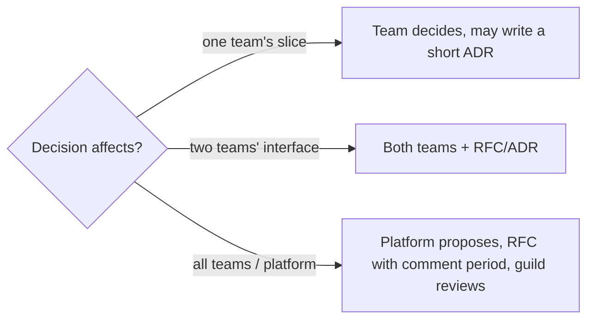

# 04 / 23 — Multi-Team Ownership: Conway's Law, Contracts Between Teams, and Making Boundaries Social as Well as Technical

## 1. Lesson metadata

| | |
|---|---|
| **Level** | Advanced |
| **Study time** | 4–5 hours (reading 2 h, ownership-mapping workshop 1 h, exercises 1.5 h) |
| **Prerequisites** | [08 — Domain-driven frontend](./08-domain-driven-frontend.md), [07 — Modular architecture](./07-modular-architecture.md), [09 — Feature-Sliced Design](./09-feature-sliced-design.md), [15 — State ownership](./15-state-ownership.md), [22 — Monorepos and shared packages](./22-monorepos-and-shared-packages.md) |
| **Next** | [24 — Refactoring legacy React](./24-refactoring-legacy-react.md) |
| **Related** | [14 — API boundaries and data access](./14-api-boundaries-and-data-access.md), [18 — Routing architecture](./18-routing-architecture.md), [20 — Design systems](./20-design-systems.md), [25 — Architectural fitness and enforcement](./25-architectural-fitness-and-enforcement.md), Phase 10 [14 — Multi-team collaboration](../10-production-engineering/14-multi-team-collaboration.md), Phase 11 [12 — Microfrontends](../11-senior-and-architect-mastery/12-microfrontends.md), [16 — Supporting multiple teams](../11-senior-and-architect-mastery/16-supporting-multiple-teams.md) |

**Learning objectives.** After this lesson you can:
1. State Conway's Law, explain why it is a constraint and a tool, and apply the "inverse Conway manoeuvre" to a React codebase.
2. Define ownership at four levels: code (CODEOWNERS), runtime (on-call), product (roadmap), and contract (API/package).
3. Compare ownership models: feature (stream-aligned) teams, component teams, platform teams, enabling teams, and "everyone owns everything".
4. Design the *interfaces between teams* in a React application: route-level composition, typed public APIs, event contracts, slot/extension points, design-system tokens, feature flags.
5. Choose an integration style: modular monolith in one build, packages in a monorepo, or runtime composition (micro-frontends), with sizes at which each starts to make sense.
6. Set up review, release, and flag workflows that allow teams to ship independently without breaking each other.
7. Recognise failure modes: shared-component bottleneck, ownerless code, "platform team as ticket queue", lowest-common-denominator shell, contract drift.
8. Plan a migration from an unowned shared codebase to explicit team ownership.

**Concepts covered:** Conway's law, inverse Conway manoeuvre, team cognitive load, stream-aligned/platform/enabling/complicated-subsystem teams (Team Topologies vocabulary), CODEOWNERS, ownership matrix, inner source, contract (API/event/slot), consumer-driven contract tests, feature flags as decoupling, release train vs continuous delivery, shell/host application, ownership of cross-cutting concerns.

---

## 2. Deep conceptual explanation

### 2.1 What problem is this lesson solving?

Technical boundaries without social boundaries erode. A lint rule can forbid `features/cards` importing `features/fleet/internal`, but cannot answer:

- Who approves a change to `useCurrentUser`, which twelve features depend on?
- Who is paged when the checkout page breaks because a shared `Table` component regressed?
- Whose roadmap includes adding the `density` prop to `Button`: the design-system team's, or the team that needs it?
- When two teams both need a "notification preferences" form, who owns it?

Multi-team ownership is the practice of **making the answer to "who owns this?" explicit, discoverable, and enforced** for every part of the codebase, and of designing the *interfaces between owners* so teams are not blocked on each other for routine changes.

### 2.2 Conway's Law

Melvin Conway (1968): *organisations which design systems are constrained to produce designs which are copies of the communication structures of these organisations.* Paraphrased for front ends:

> If three teams share one `components/` folder and one Redux store, you will get one tightly coupled UI whose seams follow meeting boundaries, not domain boundaries.

Two consequences:

1. **Descriptive:** your architecture will mirror your org chart, whether you intend it or not. A "frontend team" and a "backend team" produce a front end/back end split with a contract negotiated at their border; a "mobile team" and a "web team" produce two code bases.
2. **Prescriptive (inverse Conway manoeuvre):** shape the teams to match the architecture you want. If the target architecture has bounded contexts "cards", "fleet", "billing" ([08](./08-domain-driven-frontend.md)), organise teams around them, each with full-stack ownership of that slice.

The law is an observation, not a theorem; strong tooling and explicit contracts can partially decouple structure from org (a platform team can serve many streams). Use it as a diagnostic: *if the architecture hurts in a place where two teams meet, the interface between those teams is under-designed.*

### 2.3 Four kinds of ownership

"Owner" is overloaded. Distinguish:

| Ownership | Question answered | Mechanism | Failure when missing |
|---|---|---|---|
| **Code ownership** | Who must review changes to these files? | CODEOWNERS file, review rules | Silent breaking changes; nobody feels responsible for quality |
| **Runtime ownership** | Who is paged and fixes it in production? | On-call rotation, service catalog, error-monitoring routing by owner | Incidents bounce between teams |
| **Product ownership** | Who decides what this area does next? | Roadmap, product manager | Features without direction; competing requests |
| **Contract ownership** | Who defines and versions the public interface? | Package `exports`, API schema, event catalogue, ADRs | Interface drift; breaking changes without notice |

A healthy slice has *the same team* hold all four. Mismatches (code owned by team A, runtime owned by team B) are the leading cause of slow incident response.

### 2.4 Team models and what they imply for React code

(Vocabulary adapted from *Team Topologies*, Skelton & Pais, 2019.)

| Team type | Purpose | Typical React ownership |
|---|---|---|
| **Stream-aligned (feature/product) team** | Delivers a flow of value for a segment of the product (e.g. "Card management") | A vertical slice: routes, pages, feature components, hooks, API mappers, tests, a section of the data layer |
| **Platform team** | Provides internal products that reduce other teams' cognitive load | Build config, CI, shared tooling, the shell/host, observability SDK, auth client |
| **Enabling team** | Temporarily helps others adopt practices | Accessibility, performance, migration coaching |
| **Complicated-subsystem team** | Owns a part requiring deep specialist knowledge | Pricing engine, charting/map engine, rich text editor, real-time sync client |
| **Design-system team** | A special platform team for UI primitives and tokens | `ui`, `tokens`, Storybook, a11y guarantees; see [20](./20-design-systems.md), [21](./21-component-libraries.md) |
| **Component team (anti-pattern when taken alone)** | Owns a horizontal layer (e.g. "all forms") | Tends to become a bottleneck: every feature depends on them |

Rule of thumb: **vertical ownership by default (stream-aligned), horizontal ownership only for products with real internal customers (platform, design system).** Component/layer teams as the *primary* structure make every feature a cross-team change.

### 2.5 Interfaces between teams (the part code can express)

Between two teams' code you need explicit seams. The following are the legitimate seam types in a React application; each is a contract with an owner:

| Seam | Mechanism | Owner | Example |
|---|---|---|---|
| **Route/composition seam** | Shell mounts each team's route subtree | Platform (shell) + feature team (subtree) | `/cards/*` → `CardsRoutes` exported from `@acme/feature-cards` |
| **Public module API** | `index.ts` / package `exports` | Providing team | `@acme/feature-fleet` exports `<VehiclePicker />` and `useVehicle(id)` only |
| **Data contract** | Typed API client, schema | API/back-end team + consumer | OpenAPI/GraphQL schema, DTO mappers (ACL) |
| **Event contract** | Typed event bus or query-invalidation keys | Publisher | `TransactionDisputed { id, at }` |
| **Slot/extension point** | Component accepts slots/render props or registry | Host team | Dashboard shell accepts "widgets" registered by teams |
| **Design contract** | Tokens + primitives | Design-system team | `Button` variants, `--space-4` token ([27](./27-styling-architecture.md)) |
| **Flag contract** | Feature-flag keys | Flag owner | `cards.new-limit-editor` |
| **Shared state contract** | Narrow context or store slice with defined API | Platform / identity team | `useSession()` returns `{ user, hasPermission }` |

The design goal: **a team can complete its work by touching only its own code plus consuming others' *published* seams.** If a routine feature requires editing three teams' code, the seams are in the wrong places.

### 2.6 Integration styles by degree of independence

| Style | Build/deploy | Team independence | When it fits |
|---|---|---|---|
| **Modular monolith (one app, folders + lint)** | One build, one deploy | Low–medium: shared release | ≤ ~4 teams, one product, tight UX coherence |
| **Monorepo with packages (workspace)** | Per-app deploy; shared repo | Medium: independent changes, shared CI | 3–12 teams; shared design system; common platform |
| **Runtime composition / micro-frontends** | Independent builds and deploys per team, composed in browser or edge | High: also high operational cost | Many teams (often ≥ 8–10), different release cadences, legacy coexistence, acquisitions |
| **Separate products/apps** | Fully separate | Highest | Different user journeys, different audiences |

(Size bands are heuristics, not thresholds; the true driver is *coordination cost* vs *integration cost*.) Micro-frontends are explored in [Phase 11 — Microfrontends](../11-senior-and-architect-mastery/12-microfrontends.md); this lesson focuses on what you can do *before* paying that price.

### 2.7 Misconceptions

| Misconception | Reality |
|---|---|
| "CODEOWNERS means only the owners may change this code." | It requests/requires *review* from owners (depending on branch protection); anyone may propose a change. This is the basis of inner source. |
| "Shared code should be owned by everybody." | Shared code owned by everybody is owned by nobody. Name a team. |
| "The platform team approves everything." | A platform team provides paved roads; gatekeeping every change turns it into a queue (§8). |
| "Micro-frontends solve team coupling." | They remove build coupling; domain, UX and contract coupling remain and now cross a runtime boundary. |
| "Feature flags are only for experiments." | They are also a decoupling mechanism: merge unfinished work behind a flag so teams integrate continuously. |
| "Ownership = blame." | Ownership = authority and responsibility for quality. Blame culture produces ownership avoidance. |

---

## 3. Internal mechanics

### 3.1 Public guarantee vs teaching model vs implementation detail

| Layer | Content |
|---|---|
| **Public guarantee** | CODEOWNERS file semantics are defined by the hosting platform (GitHub documents it: last matching pattern wins; owners can be users or teams; "require review from Code Owners" is a branch-protection setting). Package `exports` encapsulates modules ([22](./22-monorepos-and-shared-packages.md)). |
| **Teaching model** | "Ownership = a function from every path/route/package/flag to exactly one accountable team." "Seams are contracts with owners." |
| **Implementation detail** | Platform-specific CODEOWNERS quirks (path syntax, team visibility rules, behaviour for deleted owners), GitHub/GitLab/Bitbucket differences. ⚠ Verify in your platform's documentation. |

### 3.2 The ownership function

Think of ownership as a total function:

```
owner(path)      -> team          (CODEOWNERS)
owner(route)     -> team          (route manifest metadata)
owner(package)   -> team          (package.json "owner"/catalog metadata)
owner(flag)      -> team          (flag registry)
owner(alert)     -> team          (monitoring routing)
```

"Total" means no unowned path. A CI job can *verify totality*: fail when a file in the repository matches no CODEOWNERS entry, or a package manifest lacks an owner field. Gaps in the function are the architectural debt.

### 3.3 How a change flows between teams



If Team Cards needs `Button size="xs"`, there are three paths: (1) *request* (backlog the DS team), (2) *contribute* (inner-source PR reviewed by DS), or (3) *fork locally* (a wrapper in the feature). The ownership model should state which path is default and the SLA for reviews. Without that, teams choose path (3) silently and the design system fragments.

---

## 4. Step-by-step execution walkthrough

**Scenario.** A product with five teams (Cards, Fleet, Billing, Design System, Platform) in one monorepo. Billing needs the Fleet team's vehicle picker, and wants to add a "plate number" column to it.

1. **Discover the owner.** Billing's engineer searches the service catalogue/CODEOWNERS: `packages/feature-fleet/` → `@acme/fleet-team`. The `VehiclePicker` is listed in the package `exports` as public.
2. **Use the published seam.** Billing imports `VehiclePicker` from `@acme/feature-fleet`. Lint boundary rules ([25](./25-architectural-fitness-and-enforcement.md)) allow the import because `billing → fleet` is declared in the dependency policy (public API only).
3. **Need a change.** The picker has no `plate` column. Options: configure through a prop (`columns`), or change the picker.
4. **Contract-first discussion.** Billing opens an issue/RFC in Fleet's tracker: "Add optional `columns` prop; backwards compatible." Fleet agrees to the API shape within a day (agreed SLA).
5. **Inner-source PR.** Billing's engineer implements the change in `packages/feature-fleet`. CODEOWNERS requires `@acme/fleet-team` review. Contract tests (below) run.
6. **CI evaluates blast radius.** Affected graph: `feature-fleet` changed → dependents (`portal`, `backoffice`, `feature-billing`) are re-tested; the cards feature is unaffected.
7. **Merge behind a flag if risky.** New `columns` default maintains old behaviour; no flag needed because the change is additive and defaulted.
8. **Release.** Portal deploys independently on its pipeline; the change goes live with the next portal release.
9. **Retro/documentation.** The Fleet team's README documents `columns`. Ownership map unchanged.

**Predict:** if Billing instead copies `VehiclePicker` into its feature "to move faster", what happens six months later? *(Two pickers diverge: the fleet bug fix for plate normalisation lands in one; accessibility fixes are applied inconsistently; the copy becomes unowned code that the ownership function cannot see — a "shadow fork".)*

---

## 5. Code examples

### 5.1 Minimal example — CODEOWNERS

```gitignore
# .github/CODEOWNERS  (GitHub syntax; last matching pattern takes precedence)

# Default: platform team is the backstop owner so no path is ownerless
*                                @acme/platform

# Apps
/apps/portal/                    @acme/platform @acme/portal-leads
/apps/backoffice/                @acme/backoffice-team

# Feature packages: owned by stream-aligned teams
/packages/feature-cards/         @acme/cards-team
/packages/feature-fleet/         @acme/fleet-team
/packages/feature-billing/       @acme/billing-team

# Shared kernel: two owners must agree
/packages/domain-money/          @acme/billing-team @acme/compliance-team

# Design system
/packages/ui/                    @acme/design-system
/packages/tokens/                @acme/design-system

# Tooling that shapes every team's workflow
/packages/config-eslint/         @acme/platform
/.github/                        @acme/platform
/pnpm-lock.yaml                  # intentionally no owner: bots and anyone may update
```

**Notes.** (a) The wildcard `*` as a backstop makes the ownership function total. (b) Multiple owners on one line means *any* of them can satisfy the code-owner review requirement on GitHub (documented behaviour; verify for your platform) — for the money kernel, use branch rules or a second CODEOWNERS-like check if you need *both*. (c) An empty owner list (as for the lockfile) means no owner required for that pattern. ⚠ Syntax and semantics (e.g. section syntax in GitLab) differ by platform.

### 5.2 Practical example — a team-owned feature package with a public API and a registered route

```
packages/feature-cards/
  package.json            # "name": "@acme/feature-cards", exports: ".", "./routes"
  OWNERS.md               # team, Slack channel, on-call alias, escalation, SLAs
  src/
    index.ts              # public API
    routes.tsx            # route subtree factory
    ui/…                  # internal (not exported)
    model/…
    api/…
```

`packages/feature-cards/package.json` (excerpt):
```json
{
  "name": "@acme/feature-cards",
  "private": true,
  "exports": {
    ".": { "types": "./src/index.ts", "default": "./src/index.ts" },
    "./routes": { "types": "./src/routes.tsx", "default": "./src/routes.tsx" }
  },
  "acme": { "owner": "cards-team", "slack": "#team-cards", "tier": 1 }
}
```

(The `acme` key is a made-up convention for a custom manifest field; tools ignore unknown fields, and a CI script can read it.)

`packages/feature-cards/src/routes.tsx`:
```tsx
import type { RouteObject } from "react-router";
import { lazy } from "react";

const CardsListPage = lazy(() => import("./ui/CardsListPage"));
const CardDetailPage = lazy(() => import("./ui/CardDetailPage"));

export const cardsRoutes: RouteObject[] = [
  { path: "cards", element: <CardsListPage /> },
  { path: "cards/:cardId", element: <CardDetailPage /> },
];
```

Shell (`apps/portal/src/app/router.tsx`), owned by platform, **imports route manifests only**:
```tsx
import { createBrowserRouter } from "react-router";
import { cardsRoutes } from "@acme/feature-cards/routes";
import { fleetRoutes } from "@acme/feature-fleet/routes";
import { billingRoutes } from "@acme/feature-billing/routes";
import { AppLayout } from "./AppLayout";

export const router = createBrowserRouter([
  { path: "/", element: <AppLayout />, children: [...cardsRoutes, ...fleetRoutes, ...billingRoutes] },
]);
```

**Line notes.** The shell knows *that* a team exposes routes, not *what is inside*. Adding a team's pages is a one-line change in the shell; changing the insides of a team's pages never touches the shell. ⚠ Router API names (`createBrowserRouter` import path for React Router v7 is `react-router`; verify in current docs; see [18 — Routing architecture](./18-routing-architecture.md)).

`OWNERS.md` template:
```md
# feature-cards
- Team: Cards (@acme/cards-team), Slack #team-cards
- On-call: pager alias `cards-oncall`
- Public API: see src/index.ts. Everything else is internal.
- Review SLA for external PRs: 2 working days
- Breaking changes: announce in #frontend-changes, deprecate for 1 release train
- Flags: cards.*  (registry: flags/registry.ts)
```

### 5.3 Incorrect example — the shared components folder and the global store

```
src/
  components/    # 340 components from all teams
  store/         # one Redux store; slices from all teams
  hooks/
  utils/
```

CODEOWNERS:
```
* @acme/frontend-guild
```

What goes wrong, in order of appearance:
1. Every PR needs `frontend-guild` (40 people) review → "someone will look" → nobody does carefully, or three seniors become a bottleneck.
2. Cards team edits `components/Table` for its needs; Billing's reconciliation view breaks; discovered in QA.
3. `store/` slices import each other (`billingSlice` reads `cardsSlice.selected`); a change to the cards state shape breaks billing selectors.
4. A production incident in "the table component" is routed to `#frontend-help` and sits for an hour.
5. No one can delete anything because no one knows who uses it.

Identify the broken ownership types: code (diffuse), runtime (undefined), contract (no public API).

### 5.4 Corrected implementation — typed event contract between features

Instead of `billing` reading `cards` state, define a narrow, typed event contract owned by the *publisher*.

`packages/contracts/package.json` is a tiny package owned by platform: only types and an event-bus factory. (Alternative: each feature publishes its own events from its public API; choose by whether you want a central catalogue.)

`packages/contracts/src/events.ts`:
```ts
export interface DomainEvents {
  "card.blocked": { cardId: string; reason: "lost" | "stolen" | "fraud"; at: string };
  "vehicle.assigned": { vehicleId: string; driverId: string; at: string };
}
export type EventName = keyof DomainEvents;
```

`packages/contracts/src/bus.ts`:
```ts
import type { DomainEvents, EventName } from "./events";

type Handler<K extends EventName> = (payload: DomainEvents[K]) => void;

export function createEventBus() {
  const handlers = new Map<EventName, Set<Handler<EventName>>>();
  return {
    on<K extends EventName>(name: K, handler: Handler<K>): () => void {
      const set = handlers.get(name) ?? new Set();
      set.add(handler as Handler<EventName>);
      handlers.set(name, set);
      return () => set.delete(handler as Handler<EventName>);
    },
    emit<K extends EventName>(name: K, payload: DomainEvents[K]): void {
      handlers.get(name)?.forEach((h) => h(payload));
    },
  };
}
export type EventBus = ReturnType<typeof createEventBus>;
```

Provided by the app shell through context, consumed in features:

`apps/portal/src/app/EventBusProvider.tsx`:
```tsx
import { createContext, use, useMemo, type ReactNode } from "react";
import { createEventBus, type EventBus } from "@acme/contracts";

const EventBusContext = createContext<EventBus | null>(null);

export function EventBusProvider({ children }: { children: ReactNode }) {
  const bus = useMemo(() => createEventBus(), []);
  return <EventBusContext value={bus}>{children}</EventBusContext>;
}

export function useEventBus(): EventBus {
  const bus = use(EventBusContext);
  if (!bus) throw new Error("useEventBus must be used inside <EventBusProvider>");
  return bus;
}
```

**Line notes.** `<EventBusContext value={bus}>` — React 19 allows the context object itself as the provider (the `.Provider` form is legacy-style but still supported); `use(Context)` reads it (and may be called conditionally, unlike `useContext`). `useMemo` creates one bus per provider instance; as a performance hint it is semantically a cache, but here we rely on stability — `useState(() => createEventBus())` is the safer guarantee. See [Phase 3 — useContext and propagation](../03-react-state-and-hooks/13-usecontext-and-propagation.md).

In `feature-billing`:
```tsx
import { useEffect } from "react";
import { useQueryClient } from "@tanstack/react-query";
import { useEventBus } from "@acme/portal-shell-api"; // hypothetical shell-provided hook package

export function useRefreshOnCardBlocked() {
  const bus = useEventBus();
  const qc = useQueryClient();
  useEffect(() => bus.on("card.blocked", () => qc.invalidateQueries({ queryKey: ["billing", "cards"] })), [bus, qc]);
}
```

Note: the effect returns the unsubscribe function from `bus.on`, which is the cleanup. Under StrictMode in development the effect runs, cleans up, runs again; the subscription is idempotent by design ([Phase 3 — useEffect cleanup](../03-react-state-and-hooks/06-effect-cleanup.md)).

**Trade-offs.** Events decouple *compile-time* dependencies but introduce implicit runtime coupling: you can no longer "find usages" of a handler by import graph; mitigate with a typed catalogue and docs. For read data, prefer querying the owner's public hook/API (`useCard(id)`) over events; events fit "something happened" notifications. See [17 — Data flow architecture](./17-data-flow-architecture.md).

### 5.5 Advanced example — consumer-driven contract test and flag-gated rollout

**Contract test:** the *consumer* (Billing) states what it needs from `VehiclePicker`; the *provider* (Fleet) runs it in its CI. This catches breaking changes before merge.

`packages/feature-fleet/src/contract/billing.contract.test.tsx` (owned jointly: written by Billing, executed in Fleet's CI):
```tsx
import { render, screen } from "@testing-library/react";
import userEvent from "@testing-library/user-event";
import { describe, expect, it, vi } from "vitest";
import { VehiclePicker } from "../index";

describe("contract: billing uses VehiclePicker", () => {
  it("calls onChange with a vehicle id string when a vehicle is chosen", async () => {
    const onChange = vi.fn();
    render(<VehiclePicker vehicles={[{ id: "v1", plate: "AB123CD", label: "Van 1" }]} onChange={onChange} />);
    await userEvent.click(screen.getByRole("combobox"));
    await userEvent.click(await screen.findByRole("option", { name: /Van 1/ }));
    expect(onChange).toHaveBeenCalledWith("v1");
  });

  it("is labelled so billing forms can associate a label", () => {
    render(<VehiclePicker vehicles={[]} onChange={() => {}} aria-label="Vehicle" />);
    expect(screen.getByLabelText("Vehicle")).toBeInTheDocument();
  });
});
```

(The tests assume `@testing-library/jest-dom` is configured for `toBeInTheDocument`, and that the component is a combobox pattern. Details of testing libraries: [Phase 8 — React Testing Library](../08-testing-and-quality/03-react-testing-library.md) and [11 — Component contract testing](../08-testing-and-quality/11-component-contract-testing.md).)

**Typed flag registry owned per team:**

`packages/feature-flags/src/registry.ts`:
```ts
export const flagRegistry = {
  "cards.new-limit-editor": { owner: "cards-team", default: false, expires: "2027-03-01" },
  "billing.invoice-v2": { owner: "billing-team", default: false, expires: "2027-01-15" },
} as const;
export type FlagKey = keyof typeof flagRegistry;
```

```tsx
import { useFlag } from "@acme/feature-flags";

export function LimitEditorEntry() {
  const enabled = useFlag("cards.new-limit-editor");
  return enabled ? <NewLimitEditor /> : <LegacyLimitEditor />;
}
```

**Why `owner` and `expires`.** Every flag has a team and an expiry; a CI job lists expired flags. Flags without owners are a classic form of ownerless code. (A flag service/provider supplies runtime values; here only the registry typing is shown.)

---

## 6. Visual explanations

### 6.1 Ownership map (inverse Conway)



Arrows are "depends on". Teams depend on platform products; feature teams depend on each other only through declared public APIs.

### 6.2 Where decisions live



### 6.3 Integration style vs team count (heuristic)

| Teams | Typical fit |
|---|---|
| 1–2 | Single app, folders, light lint rules |
| 3–5 | Modular monolith or small monorepo; CODEOWNERS; design system emerging |
| 6–12 | Monorepo with packages, boundary rules, platform team, flags, contract tests |
| 12+ | Consider runtime composition for the most independent areas; strong platform/DevEx investment |

---

## 7. Alternative approaches and trade-offs

### 7.1 Comparison of ownership models

| Criterion | Everyone owns everything | Layer/component teams | Feature (stream-aligned) teams + platform | Micro-frontends per team |
|---|---|---|---|---|
| Speed for a feature | Fast early, slows with size | Slow: cross-team handoffs | Fast within slice | Fast within slice, integration extra |
| Consistency | Whatever the loudest does | High within layer | Needs design system & rules | Needs strong shared contracts |
| Bus factor | Poor (diffuse) | Concentrated by layer | Per slice; cross-train | Per MFE |
| Incident clarity | Poor | Ambiguous (layer vs feature) | Clear per slice | Clear per MFE |
| Coordination cost | Informal, high | Handoffs | Contracts at seams | Contracts + runtime composition |
| Fits team size | 1–5 | Small–mid orgs with rigid specialties | 6–100 | 15+ |
| Tooling needed | None | Layer lint | CODEOWNERS, boundaries, contract tests | Module federation/ import maps etc. ⚠ vendor-specific |

### 7.2 Approach profile: stream-aligned feature teams with a platform and a design system

- **Problem solved:** unclear ownership and cross-team bottlenecks.
- **Folder structure:** §5.2 (packages) or `src/features/<context>/` inside one app with the same public-API discipline ([06](./06-feature-vs-layer-structure.md), [09](./09-feature-sliced-design.md)).
- **Dependency rules:** apps → features → shared; features do not deep-import each other; features may import another feature only through its public API *and* only if the dependency is declared in the architecture policy; shared never imports features.
- **Code:** CODEOWNERS, `OWNERS.md`, route manifests, event contracts, flag registry.
- **Pros:** clear accountability; parallel delivery; incidents route to the right team; architecture mirrors domains.
- **Cons:** duplication between teams; inconsistent UX without strong design-system governance; cross-cutting changes (e.g. a new auth flow) need coordination; requires mature platform.
- **Sizes:** best for 6–100 engineers in one product family. With 3 engineers it is ceremony.
- **Failure modes:** shared-component bottleneck; platform team as gatekeeper; "ownership by org chart not by code" (teams reorganised but CODEOWNERS stale); contract rot; teams optimising local metrics at global expense.
- **Migration:** §8.4.

### 7.3 Approach profile: runtime composition (micro-frontends)

- **Problem solved:** teams that must deploy independently, different release cadences or legacy/modern coexistence.
- **Structure:** a host shell loads remote bundles per team (module federation, import maps, iframes, web components, or server-side composition; ⚠ tooling volatile).
- **Rules:** remotes never import each other's code; shared dependencies (React) are singletons with version policy; shared state restricted to contracts (events, URL, session).
- **Pros:** independent deploys, technology freedom, failure isolation.
- **Cons:** runtime complexity, duplicated bundles, version skew, UX inconsistency, harder local dev and testing, performance cost (extra network, hydration complexity), observability fragmentation.
- **Sizes:** usually justified only past ~10 teams or for acquisition/legacy integration.
- **Failure modes:** distributed monolith (remotes coupled by shared global state); shared-dependency mismatch → duplicate React; contract drift without version negotiation; slow page loads.
- **Migration:** start with modular monolith + route manifests; make features lazy-loaded by route; if needed, replace the route import with a remote import — the *seam* is the same. See Phase 11 lesson.

### 7.4 A scenario where stream-aligned feature teams are NOT the best approach

A company with a single 7-person team building an internal tool with two large screens. Splitting into "teams" and packages with CODEOWNERS would create paper boundaries. Likewise a short-lived project: a specialised "migration squad" for a 6-month framework migration is better organised by *activity* (enabling/migration team across slices) than by feature. And a hard-to-learn subsystem (a map renderer) benefits from a complicated-subsystem team even though it is "horizontal".

---

## 8. Best practices and anti-patterns

### 8.1 Best practices

1. **Make the ownership function total and machine-checked** (CODEOWNERS backstop, package owner field, flag owner, route owner).
2. **Use one team as accountable owner per area**, even if many contribute.
3. **Publish seams, hide internals.** Package `exports`/index files; deep imports forbidden by lint ([25](./25-architectural-fitness-and-enforcement.md)).
4. **Treat shared platform code as a product:** owner, roadmap, docs, SLAs, support channel, deprecation policy.
5. **Prefer inner source with a review SLA** over ticket queues for small contributions.
6. **Consumer-driven contract tests** for the highest-traffic seams.
7. **Additive, backwards-compatible changes by default;** deprecate then remove across a documented window.
8. **Flags for decoupled integration**, each with an owner and an expiry.
9. **Keep the shell thin:** routing, layout, providers, error boundaries; no feature logic ([19](./19-error-boundaries.md) for boundary placement).
10. **Align alerts, error monitoring and on-call to ownership:** tag errors with the owning team by route/package.
11. **Review ownership quarterly** and after any re-org; stale CODEOWNERS are worse than none, because they route reviews to the wrong people.
12. **Record cross-team decisions** as ADRs ([Phase 10 — ADRs](../10-production-engineering/16-architecture-decision-records.md)).

### 8.2 Beginner mistakes

- Treating CODEOWNERS as access control (it is review routing).
- Copying other teams' components instead of requesting or contributing.
- Importing another team's internals because "it's right there in the monorepo".
- Putting feature state into a global store because "everyone can get to it" ([15](./15-state-ownership.md)).
- No documentation of who to ask.

### 8.3 Experienced-developer mistakes

- **Platform-as-gatekeeper:** a platform team that must approve every change to anything shared becomes a queue; teams route around it with forks.
- **Component team as the only way to build UI:** every feature blocked by DS backlog. Mitigate with composition primitives and contribution paths.
- **Premature micro-frontends** for organisational reasons that could be solved with ownership and contracts.
- **Silent contract changes:** changing a prop's behaviour (not signature) without notice; TypeScript does not catch behavioural breaks → contract tests.
- **Ownership by title rather than by capacity:** assigning a package to a team that has no engineers who know it. Ownership requires people.
- **Over-centralised flags/config:** one team owning all flags becomes a bottleneck; flags should be owned by the team whose feature they gate.
- **Hero culture:** an individual is the real owner; no team backup. Use at least two named maintainers.

### 8.4 Migration considerations

**From unowned shared code to explicit ownership:**
1. **Map reality.** Use git history and error-monitoring data to see who actually changes and debugs each directory (e.g. `git log --format=%an -- path` summarised; treat as input, not truth).
2. **Add a backstop owner** (`*`) to make the function total. Requests will flow to the platform team initially — accept short-term load.
3. **Assign feature areas** by routes: each route has exactly one owning team; moves the folder and CODEOWNERS pattern for that route.
4. **Split `components/` and `store/`**: move single-team components into the owning feature; the remainder is candidate shared code with a nominated owner (design system or platform).
5. **Introduce public APIs** (`index.ts`) per feature and ban deep imports in *warn* mode, then error ([25](./25-architectural-fitness-and-enforcement.md)).
6. **Introduce contracts** for the top 3 cross-team interactions (e.g. session, vehicle picker, notifications).
7. **Align on-call and error routing** with the new owners; run a game day.
8. **Measure:** time-to-first-review, PRs requiring ≥ 3 teams, incident reroute rate. Adjust seams where numbers are bad.

Avoid big-bang reorganisations; move one route/feature at a time (see [24 — Refactoring legacy React](./24-refactoring-legacy-react.md), strangler technique).

### 8.5 Justified exceptions

- A **temporary joint ownership** of a package during a hand-over.
- **Wide ownership of a tiny stable utility** (e.g. `formatDate`) where governance cost exceeds change cost: own it by platform, make it low-ceremony.
- **Fork-and-diverge** a component deliberately when a team's UX is legitimately different (documented in the design system as a variant or an explicit exception).

---

## 9. Real-world application

| Domain | Multi-team situation | Constraint and approach |
|---|---|---|
| **E-commerce** | Catalogue, cart/checkout, account, search teams on one storefront | Checkout is revenue-critical: strictest review/flags; shared `cart` contract (events + `useCart()` API); performance budget owned by platform ([Phase 7 — web vitals and budgets](../07-performance/21-web-vitals-and-budgets.md)). |
| **Fleet/finance dashboards** | Cards, transactions, compliance, billing teams | Shared kernel (`Money`) with joint ownership; audit trails; contract tests on report components; compliance review on rules packages. |
| **Realtime** | Trading or monitoring widgets by different teams in one workspace | Widget registry (slot contract), per-widget error boundaries, shared socket client owned by platform. |
| **Auth** | Identity team vs every feature | Single `useSession()` contract; permission checks via a narrow `can(action, resource)`; do not let features read tokens. |
| **Forms** | Many teams building forms | Design-system form primitives, shared validation schemas owned by domain owners; accessibility enabling team reviews. |
| **Acquisitions** | Merged companies with legacy apps | Runtime composition at the route level (the shell loads legacy app via iframe or separate route) while migrating gradually. |

**Engineering constraints:** release trains vs continuous delivery (feature flags allow trunk-based development even when release is scheduled); regulatory sign-off for some areas (CODEOWNERS with compliance); different SLAs per tier (tier-1 revenue vs tier-3 internal).

---

## 10. Debugging and troubleshooting

### 10.1 "Nobody reviews my PR"

- **Symptom:** PRs wait days.
- **Investigate:** CODEOWNERS entry for the path (platform tools show required reviewers); team membership current? Owners include a team with 40 members? Last matching pattern overriding a specific rule?
- **Root cause:** too-broad or stale owner; no SLA.
- **Fix:** narrow patterns; two named maintainers per area; auto-assign; review SLA dashboard.
- **Validate:** median time-to-first-review drops.

### 10.2 "Our change broke another team's page"

- **Symptom:** regression found in QA/production in code you did not touch.
- **Investigate:** use the package/import graph to list dependents of what you changed (Nx/Turborepo/dependency-cruiser outputs); check for deep imports into your internals.
- **Root cause:** consumer relying on an implementation detail or behaviour not covered by contract tests.
- **Fix:** restore behaviour/add deprecation path; add contract test; make the dependency go through the public API.
- **Validate:** contract test fails on the old change.

### 10.3 "Production incident bounced between teams"

- **Investigate:** error monitoring tags (route, package, team); runbook; who is on-call for the failing route?
- **Root cause:** runtime ownership not aligned with code ownership.
- **Fix:** tag errors with owner via route manifest metadata; page the owner; update ownership docs.

### 10.4 Two features show inconsistent UI for the same concept

- Likely a forked component or divergent tokens. Search for duplicated component names; diff. Resolve via design-system contribution; add a lint rule/visual regression test.

### 10.5 Expired or ownerless feature flags

- List flags past `expires` or with no owner; trace usage; remove code paths. A flag stuck in "50% rollout" for a year is a hidden permanent fork.

### 10.6 Circular dependencies between feature teams

- Billing imports fleet, fleet imports billing (via a "just this one helper"). Extract the shared concept to a lower layer (shared kernel) or invert via events/props. See [08 §10](./08-domain-driven-frontend.md).

---

## 11. Exercises

### Level A — Knowledge
A1. State Conway's Law and explain the "inverse Conway manoeuvre".
A2. Name the four ownership types and an artifact that records each.
A3. What does CODEOWNERS do, and what does it not do?
A4. Why is a component team a risky *primary* team structure?
A5. Give three examples of seams between two teams' React code.
A6. What attributes should every feature flag carry, and why?

### Level B — Code comprehension
B1. Read the CODEOWNERS file below. Who must review a change to `/packages/ui/src/Button.tsx`? To `/packages/feature-cards/README.md`? To `/scripts/release.sh`?
```gitignore
* @acme/platform
/packages/ @acme/frontend-guild
/packages/ui/ @acme/design-system
/packages/feature-cards/ @acme/cards-team
```
B2. In §5.4, why does `bus.on` return a function, and why is it directly returned from `useEffect`'s callback? What happens in StrictMode development?
B3. A route manifest exports `{ path: "cards", element: <CardsRoot /> }` where `CardsRoot` imports `useFleetStore` from `@acme/feature-fleet/internal/store`. List what is wrong from an ownership viewpoint.

### Level C — Implementation
C1. Write a CODEOWNERS file for a repo with apps `web` and `admin`, packages `ui`, `tokens`, `feature-orders`, `feature-inventory`, `domain-money`, requiring two teams for `domain-money`, and a backstop owner.
C2. Write a small Node script outline (pseudo-code OK) that fails CI when a package's manifest lacks an `owner`. State what you'd verify about JSON parsing and workspace discovery.
C3. Implement a typed `registerWidget` registry for a dashboard shell where teams register `{ id, title, owner, component }`, rejecting duplicate ids, in TypeScript.

### Level D — Debugging
D1. Billing's release has been blocked three times by a failing test in `packages/feature-fleet` that Billing did not change. Diagnose possible root causes (at least three) and a process fix.
D2. After a team reorganisation, review requests for `/packages/feature-cards/` go to an inactive team handle. Customers report a bug unfixed for 2 weeks. Explain how this happened and what automation prevents it.

### Level E — Architecture decisions
E1. You have 4 teams in a single app; the design-system team (2 engineers) has a 6-week backlog and other teams are copying components. Propose a contribution model and metrics.
E2. Decide: should "notifications" be (a) a feature owned by its own team, (b) a platform capability, (c) a shared kernel? Argue for a context with 8 consuming features.
E3. A VP proposes micro-frontends "so teams stop blocking each other". Your measurements show most blocking is on shared design-system changes and on a 25-minute CI. Respond.

### Level F — Expert challenge
F1. Design the ownership and integration architecture for a 60-engineer, 8-team product with a design system, a shared auth/session module, a regulated `Money` kernel, per-team on-call, trunk-based development with weekly regulated releases for one team and continuous deploy for others. Specify structure, contracts, flags, CI and governance, and list five metrics that would tell you it is failing.

---

## 12. Detailed answers and explanations

> Attempt the exercises first.

**A1.** Conway's Law: systems mirror the communication structure of the organisations that build them. Inverse Conway: deliberately structure teams (and their communication) to produce the target architecture — e.g. create a Cards team that owns the whole cards slice, so the cards bounded context emerges naturally rather than being fought for across teams. Wrong answer: "Conway's law means you should organise by technology"; that is the *descriptive* outcome that tends to cause layered coupling.

**A2.** Code → CODEOWNERS; runtime → on-call rotation/service catalogue/alert routing; product → roadmap/PM assignment; contract → public API definition (`exports`, schema, event catalogue, ADRs). Also acceptable: `OWNERS.md`, package manifest `owner` field.

**A3.** It routes review requests (and, with branch protection, requires approval) based on path patterns. It does not restrict who can write code, does not give read/write permission, does not assign runtime responsibility, and relies on correct, up-to-date team handles. On GitHub the last matching pattern wins and a required review can be satisfied by any listed owner (⚠ verify for your platform).

**A4.** Because every feature needs UI/forms/state, so every feature depends on the component team's queue and priorities; the team becomes a bottleneck, lacks product context, and features are delivered across hand-offs. It is acceptable for a *design-system platform team* if it offers composition primitives and a contribution path; the failure is making it the *only* path.

**A5.** Route manifests; public package API (`index.ts`/`exports`); typed API/data contract; event contract; slot/widget registry; design tokens; flags; `useSession()` context. Any three.

**A6.** An `owner` (who removes/maintains it), a `default` value, an `expires`/review date, and ideally a description and kill-switch semantic. Because flags create code forks; without owner and expiry they become permanent, untested paths.

**B1.** `/packages/ui/src/Button.tsx` → last matching pattern is `/packages/ui/` → `@acme/design-system` only (not guild, not platform). `/packages/feature-cards/README.md` → `@acme/cards-team`. `/scripts/release.sh` → `*` → `@acme/platform`. Edge case: specific patterns override less specific ones; ownership is not additive across lines, so the guild is *not* included for `ui`. Common wrong answer: "guild and design-system" (assuming accumulation).

**B2.** `on` returns an unsubscribe function so the caller can clean up; `useEffect` runs a returned function as its cleanup, so returning the unsubscribe directly gives correct cleanup on dependency change/unmount. In StrictMode dev, React mounts, unmounts (cleanup), re-mounts effects to surface missing cleanup: you subscribe, unsubscribe, subscribe again; the net result is one active subscription. If you forgot to return the unsubscribe, you would end with two handlers (duplicated invalidations) in dev, which reveals the bug. The `set.delete` returns a boolean, so the arrow function returns a boolean — note: `useEffect` cleanup must be a function or undefined; here `bus.on(...)` returns a *function* (the arrow `() => set.delete(...)`), which is correct. The effect callback returns that function.

**B3.** (1) A feature route manifest of `cards` imports `fleet`'s *internal* module: bypasses fleet's public API; (2) cards now depends on fleet's state shape and implicitly on fleet's runtime; fleet cannot refactor store without breaking cards; (3) the dependency is invisible in the declared architecture; (4) no contract test; (5) incident routing: a bug in `useFleetStore` may appear as a cards error. Fix: fleet exports a narrow hook/API, cards consumes it, dependency is declared.

**C1.**
```gitignore
* @acme/platform
/apps/web/ @acme/web-team
/apps/admin/ @acme/admin-team
/packages/ui/ @acme/design-system
/packages/tokens/ @acme/design-system
/packages/feature-orders/ @acme/orders-team
/packages/feature-inventory/ @acme/inventory-team
/packages/domain-money/ @acme/orders-team @acme/finance-eng
```
Note: two owners listed means *either* satisfies the default requirement. To require both, use two protection mechanisms (platform-specific; e.g. rulesets or a status check script verifying approvals from both teams). Evaluation: backstop present; specific paths; recognises the "both" limitation.

**C2.** Outline: discover workspace package directories (parse the workspace globs from `pnpm-workspace.yaml` or use `pnpm ls -r --json` — verify output); read each `package.json`; check `acme.owner` (or chosen field) is a non-empty string and exists in a list of known teams; print offending packages; exit 1. Verify: JSON parse errors handled, private packages included, cross-platform paths. Bonus: cross-check that the owner is also in CODEOWNERS for that path.

**C3.**
```tsx
import type { ComponentType } from "react";

export interface WidgetDefinition {
  id: string;
  title: string;
  owner: string;
  component: ComponentType;
}

export function createWidgetRegistry() {
  const widgets = new Map<string, WidgetDefinition>();
  return {
    register(def: WidgetDefinition): void {
      if (widgets.has(def.id)) throw new Error(`Widget id "${def.id}" is already registered by ${widgets.get(def.id)!.owner}`);
      widgets.set(def.id, def);
    },
    list: (): readonly WidgetDefinition[] => [...widgets.values()],
  };
}
```
Evaluation: duplicate check, readable error naming the owner, no global mutable singleton (registry instance injected by the shell). Edge: registration order determinism; module-level registration side effects can be duplicated by HMR, so prefer explicit registration from a manifest file.

**D1.** Candidates: (1) Billing depends on fleet via deep imports/implementation details, so internal changes break Billing's CI through transitive test execution; (2) a flaky fleet test (time, network, ordering) fails affected-runs; (3) shared mutable test fixtures/global mocks; (4) the affected graph includes fleet tests even though only a transitive dependency changed; (5) ownership: fleet's tests are red on main and nobody fixes them. Process fix: main must stay green (required checks, rollback policy), quarantine flaky tests with an owner and deadline, run each package's tests in its own pipeline stage, require public-API-only dependencies, contract tests instead of pulling in provider tests.

**D2.** Teams were renamed/dissolved but CODEOWNERS retained the old handle; GitHub may still show the entry or silently ignore invalid owners (⚠ platform behaviour; verify), so no one is requested. Prevention: CI job that validates all CODEOWNERS handles against the org's team list (platform APIs offer CODEOWNERS validation/errors), a quarterly ownership audit, backstop `*` owner, and re-org checklist that includes ownership updates.

**E1.** Evaluation criteria: root-cause (queue, not skill); recommended answer: (1) publish a contribution guide and component acceptance criteria (a11y, tokens, tests, docs); (2) inner-source with review SLA (e.g. first response in 1 working day), (3) DS "office hours" and a rotating DS embedded engineer; (4) composition primitives (headless/slots) so features can build without new DS components; (5) track metrics: DS backlog age, % of new UI using DS components, number of forked components, time-to-merge for external contributions, visual-regression failures. Mention risk: contributions lowering quality → reviewers and automated checks. See [20](./20-design-systems.md).

**E2.** Model answer: Notifications with 8 consumers is generic/supporting rather than core ([08](./08-domain-driven-frontend.md) subdomain classification). Provide as a *platform capability* with a small public API: `notify({kind, severity, message, action})` and a `<NotificationCenter />` slot in the shell; domain-specific notification *content* stays with each feature. Not a shared kernel (the kernel is for shared domain models). Not a stream-aligned team unless the product has notification preferences as a feature with its own roadmap. Contracts: event or function API, accessibility (live regions), rate limits. Alternative views accepted if criteria are argued.

**E3.** Respond with evidence: micro-frontends reduce *build/deploy* coupling; the measured blockers are (a) design-system contribution flow and (b) CI duration. Solve those first: contribution model, remote cache + affected testing ([22](./22-monorepos-and-shared-packages.md)), route manifests. Risks of MFE: duplicated deps, UX inconsistency, operational cost, shared dependency versions. Propose a staged plan: modular monolith + boundaries; revisit MFE if after 2 quarters coupled *release* cadence is still the top blocker. A good answer shows respect for the goal, not dismissal.

**F1.** Evaluation criteria and sketch: Stream-aligned teams own packages `feature-*` with `OWNERS.md`; platform owns shell, CI, config, observability, session; DS team owns `ui/tokens`; compliance co-owns `domain-money` with a required-two-approvals ruleset and golden-file tests. Regulated weekly release for one team: its package is deployed as its own app or as a release-branch stream; others deploy continuously; the shared surface between them is the contract layer (flags and API versions) so the regulated team's release does not freeze others. Trunk-based development with flags; flag registry with owners/expiry. CI: affected tests, remote cache, contract tests, boundary lint; per-team error routing. Metrics of failure: median PR review latency by area; % of PRs touching ≥ 3 owners; flag count past expiry; incident reroute count; DS fork count; build time P90; revert rate on shared packages. Strong answers also address on-call tiering and a path to extract a team to a micro-frontend later using the same route seam.

---

## 13. Senior engineer interview questions

1. **"How do you structure front-end ownership for eight teams?"** — Vertical slices per stream-aligned team, a small platform team and a design system as products with contribution paths; route/package seams; CODEOWNERS and boundary lint to keep it real. Because vertical ownership minimises cross-team handoffs and aligns code, runtime and product accountability.
2. **"A shared component keeps breaking other teams. What do you do?"** — Identify the contract (what consumers rely on), add consumer-driven tests, deprecate-then-remove for behaviour changes, make deep imports impossible, and examine whether the component is shared prematurely. Root cause is usually implicit contracts.
3. **"When do micro-frontends make sense?"** — When teams need independent deployment and the coordination cost of a shared release exceeds the operational cost of runtime composition: many teams, different cadences, legacy/acquisition integration. Not for fixing unclear ownership or slow CI.
4. **"How do you prevent platform teams from becoming bottlenecks?"** — Paved roads over gates; self-service; inner source; published SLAs; measure lead time for requests; keep policy in automated checks, not approvals.
5. **"What goes wrong with feature flags in multi-team systems?"** — No owner/expiry → permanent forks; flags used as config; exponential test combinations; stale flags in shared packages. Registry, expiry and cleanup budget.
6. **"How do cross-team events differ from imports?"** — Events remove compile-time coupling but not semantic coupling; you lose static discoverability and must govern payload contracts; they suit notifications, not queries.
7. **"How do you handle a team re-org?"** — Treat ownership as data: update CODEOWNERS, alerts, flags, docs and package metadata in one change; validate with CI; transfer knowledge with pairing before the ownership flip.
8. **"Conway's law—what does it change in your daily decisions?"** — Before adding a dependency or a shared module, ask who will have to talk to whom; if the answer is "two teams who rarely talk", expect friction at that seam and invest in the contract, or move the boundary.

---

## 14. Further learning resources

| Resource | URL | Covers / why | Level | Study |
|---|---|---|---|---|
| Conway, "How Do Committees Invent?" (1968) | <http://www.melconway.com/Home/Committees_Paper.html> | Original statement of Conway's law | Intermediate | Whole paper |
| Skelton & Pais — *Team Topologies* (book, 2019) | No URL (book); site <https://teamtopologies.com/> | Team types and interaction modes | Intermediate | Parts on team types, interaction modes |
| GitHub Docs — About code owners | <https://docs.github.com/en/repositories/managing-your-repositorys-settings-and-features/customizing-your-repository/about-code-owners> | CODEOWNERS syntax and semantics | Beginner | Whole page |
| Martin Fowler — Micro Frontends (Cam Jackson) | <https://martinfowler.com/articles/micro-frontends.html> | Concepts, integration approaches, trade-offs | Intermediate | Whole article |
| Feature toggles article (Pete Hodgson) | <https://martinfowler.com/articles/feature-toggles.html> | Categories of toggles, lifecycle | Intermediate | Whole article |
| React — Passing data deeply with context | <https://react.dev/learn/passing-data-deeply-with-context> | Context for shell-provided contracts | Beginner | Whole page |
| React — `use` | <https://react.dev/reference/react/use> | Reading context with `use` | Intermediate | Whole page |
| Phase 10 lesson 14 | [Multi-team collaboration](../10-production-engineering/14-multi-team-collaboration.md) | Process side: RFCs, reviews | Advanced | Whole |
| Phase 11 lesson 12 | [Microfrontends](../11-senior-and-architect-mastery/12-microfrontends.md) | Runtime composition in depth | Advanced | Whole |

URLs in this table were checked for HTTP 200 on 2026-10-22; any still marked *(unverified)* could not be checked automatically (blocked or unreachable). A 200 response does not guarantee the page content still matches the description; if a link has moved, search the site for the quoted title.

---

## 15. Knowledge checkpoint

**You should now understand**
- Conway's Law as diagnostic and design tool.
- The four ownership types and why they must align.
- Which team models fit which sizes, and how component/layer teams create bottlenecks.
- The set of seams between teams and how each is a contract with an owner.

**You should be able to explain without notes**
- Why CODEOWNERS is routing, not access control.
- Why events decouple compile-time but not semantic coupling.
- Why a platform team must be a product team, not a gate.

**You should be able to implement**
- A CODEOWNERS file with a backstop; a route-manifest composition; a typed event bus provider; a contract test; a flag registry with owner and expiry.

**You should be able to debug**
- Review bottlenecks, cross-team regressions, incident bouncing, ownerless flags and forks.

**Before moving on:** read [24 — Refactoring legacy React](./24-refactoring-legacy-react.md), which applies these ownership and boundary ideas to systems that already violate them, and then [25 — Architectural fitness and enforcement](./25-architectural-fitness-and-enforcement.md) to automate the rules.
