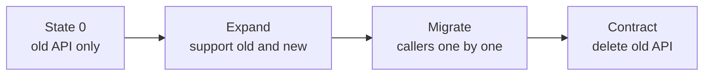
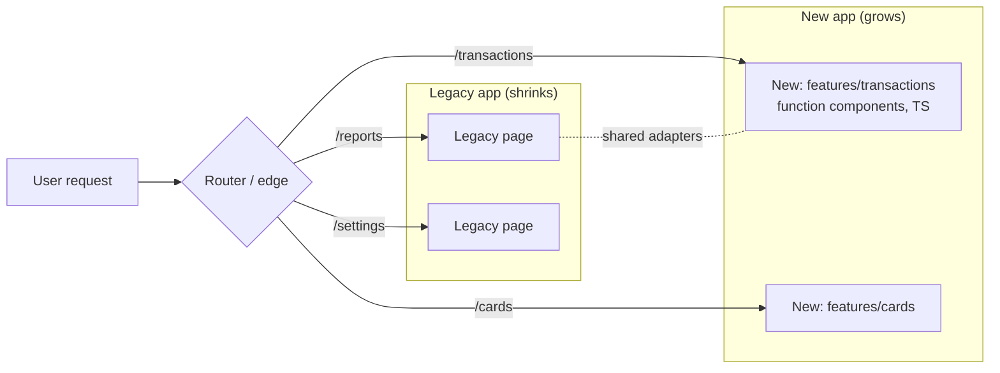
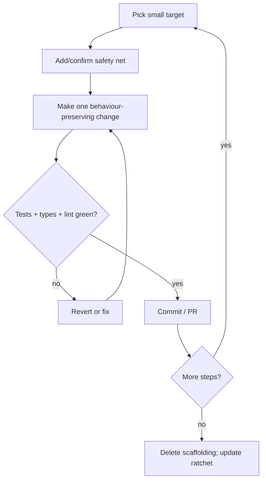
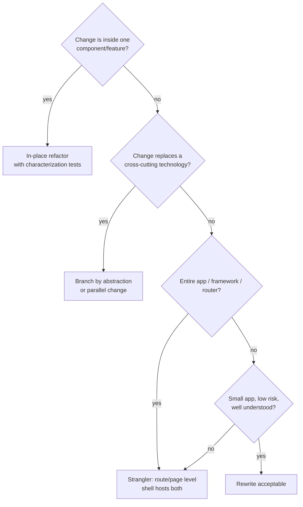

# 04 / 24 — Refactoring Legacy React: Characterization Tests, Seams, Strangler Migrations, and Codemods

## 1. Lesson metadata

| | |
|---|---|
| **Level** | Advanced |
| **Study time** | 5–6 hours (reading 2.5 h, refactoring kata 1.5 h, exercises 1.5 h) |
| **Prerequisites** | [01 — Architecture fundamentals](./01-architecture-fundamentals.md), [03 — Component responsibility](./03-component-responsibility.md), [11 — Dependency inversion](./11-dependency-inversion.md), [12 — Domain logic vs UI logic](./12-domain-logic-vs-ui-logic.md), [13 — Application services and adapters](./13-application-services-and-adapters.md), [15 — State ownership](./15-state-ownership.md), [22 — Monorepos and shared packages](./22-monorepos-and-shared-packages.md), [23 — Multi-team ownership](./23-multi-team-ownership.md) |
| **Next** | [25 — Architectural fitness and enforcement](./25-architectural-fitness-and-enforcement.md) |
| **Related** | Phase 3 [07 — You might not need an effect](../03-react-state-and-hooks/07-you-might-not-need-an-effect.md), [15 — Custom hooks](../03-react-state-and-hooks/15-custom-hooks.md), Phase 8 [01 — Test strategy and pyramid](../08-testing-and-quality/01-test-strategy-and-pyramid.md), Phase 10 [13 — Application migrations](../10-production-engineering/13-application-migrations.md), [15 — Technical debt](../10-production-engineering/15-technical-debt.md), Phase 11 [03 — Large-scale refactoring](../11-senior-and-architect-mastery/03-large-scale-refactoring.md) |

**Learning objectives.** After this lesson you can:
1. Define "legacy code" operationally (code without a safety net) and assess a legacy React codebase with a structured audit.
2. Write characterization tests that pin down current behaviour before changing it.
3. Find and create seams (component, hook, module, network, route) that allow change in small steps.
4. Choose a migration strategy: in-place incremental refactor, strangler fig at route/feature level, branch by abstraction, parallel run, or rewrite — and justify it.
5. Decompose a god component into a presentational component, a custom hook, and a pure domain function, without changing behaviour.
6. Migrate class components, HOCs/render props, Redux-connect code, `forwardRef`, legacy context, and JavaScript to modern React 19 + TypeScript incrementally.
7. Automate mechanical changes with codemods and lint autofixes, and know their limits.
8. Sequence work so that every commit is shippable, rollbackable, and reviewable; track progress with ratchets.

**Concepts covered:** legacy code (Feathers), characterization test, seam, golden master, strangler fig, branch by abstraction, anti-corruption layer for migration, parallel change (expand/contract), feature flag as migration switch, codemod (AST transform), ratchet, boy-scout rule, big-bang rewrite risk, Chesterton's fence.

---

## 2. Deep conceptual explanation

### 2.1 What problem is this lesson solving?

Every earlier lesson in Phase 4 describes a *target* architecture. Most professional work starts somewhere else: a five-year-old app with class components, a global Redux store, 1,800-line components, `any` everywhere, a half-finished migration to hooks, and 11% test coverage. Reaching the target is a **sequence of small, safe transformations under delivery pressure**, not a project you pause features for.

Michael Feathers (*Working Effectively with Legacy Code*, 2004) defines legacy code as **code without tests** — more broadly, code you cannot change confidently. That definition shifts the problem from age/style to *safety*: the first deliverable of any refactoring is not cleaner code; it is **the ability to detect when behaviour changed**.

### 2.2 Refactoring vs rewriting vs migrating

| Activity | Definition | Behaviour change? | Typical size | Risk |
|---|---|---|---|---|
| **Refactoring** | Changing structure without changing observable behaviour | No | Minutes to days | Low if tests exist |
| **Migration** | Moving to a new technology/approach (class → function, JS → TS, CRA → Vite, Redux connect → hooks/RTK) | Intended: none | Weeks to years | Medium; long-lived dual state |
| **Rewrite** | Replacing a system with a new implementation | Often yes (hidden) | Months to years | High: lost behaviour, moving target, no value delivered until switch |
| **Re-architecture** | Changing boundaries and dependency rules | Possibly | Months | Medium–high |

**Why rewrites fail** (a recurring industry observation, not a law): the old system encodes years of undocumented business rules, edge cases and bug fixes; the new system re-discovers them slowly; the old system keeps changing while the rewrite runs; stakeholders see no value until the end; the team under-estimates. The strangler approach *replaces piece by piece while the system stays in production*.

### 2.3 The safety hierarchy: types, tests, tooling, observability

Order the safety nets by cost and by what they detect:

| Net | Detects | Cost to add to legacy | Notes |
|---|---|---|---|
| **Compiler/TypeScript** | Interface mismatches | Medium (incremental via `allowJs`/`checkJs`) | Strongest per-line value for refactors that change signatures |
| **Linter** | Hooks rule violations, unused code, forbidden imports | Low | Introduce in "warn", ratchet to "error" ([25](./25-architectural-fitness-and-enforcement.md)) |
| **Characterization tests** | Behavioural change at the unit/component level | Medium | Pin current behaviour, even if wrong |
| **Integration/e2e smoke tests** | Broken critical journeys | Medium–high | Few, on revenue-critical flows |
| **Visual regression** | Unintended UI change | Medium | Great for markup-only refactors (Phase 8 [12](../08-testing-and-quality/12-visual-regression.md)) |
| **Observability** (error monitoring, web vitals, feature adoption) | Production regressions | Medium | Needed for gradual rollouts |
| **Feature flags / canary** | Limits blast radius | Medium | Migration switch |

### 2.4 Characterization tests

A **characterization test** records what the code *currently does*, not what it *should* do. The workflow:

1. Call the code (render the component, run the function) with realistic inputs.
2. Assert something you expect; run it; when the actual output differs, **update the assertion to the actual output** (after judging it as "current behaviour").
3. Repeat across representative scenarios until important branches are covered.
4. Refactor; tests must remain green; any red is either a regression or a conscious behaviour change (decide separately, in a different commit).

Characterization tests are *provisional*: they lock in bugs. Mark known-bug expectations with comments (`// BUG-123: current behaviour; correct would be ...`) so they are corrected deliberately later. **Golden master** (snapshot) tests are a coarse form: serialise a large output (HTML, JSON) and compare. Useful as a first net, brittle as a long-term one (Phase 8 [16 — Avoiding brittle tests](../08-testing-and-quality/16-avoiding-brittle-tests.md)).

### 2.5 Seams

A **seam** is a place where you can alter behaviour without editing in that place (Feathers). In React, practical seams:

| Seam | How it works | Use |
|---|---|---|
| **Module seam** | Mock/replace an imported module (`vi.mock`) | Isolate a legacy component from network/global state in tests |
| **Network seam** | Intercept HTTP (MSW) | Characterize components without touching their data code (Phase 8 [06](../08-testing-and-quality/06-mocking-strategies-and-msw.md)) |
| **Props seam** | Pass new behaviour via props | Inject callbacks/data into a formerly self-fetching component |
| **Context seam** | Provide test or new implementation through a provider | Swap a legacy store accessor for an adapter |
| **Component seam** | Replace a child with another component | Strangle a subtree |
| **Route seam** | Router decides which implementation serves a URL | Strangle at page level |
| **Hook seam** | Extract logic into a hook with the same interface | Reuse logic across class→function conversions |
| **Build seam** | Alias/flag at build time | Dual implementations |

Prefer seams that already exist; **create** a seam with the smallest *behaviour-preserving* edit (e.g. extracting a function without changing any logic), known as a "sprout" or "wrap" technique when adding new behaviour.

### 2.6 Core strategies

| Strategy | Idea | Fits |
|---|---|---|
| **In-place incremental refactor** | Small commits improving structure behind tests | Single feature/component areas |
| **Strangler fig** | New implementation grows around the old; traffic is routed per piece; old pieces die | Big UI areas, route-level, whole-app framework migrations |
| **Branch by abstraction** | Introduce an interface, implement old and new behind it, switch via flag, delete old | Cross-cutting infrastructure (state library, API client, UI kit) |
| **Parallel change (expand/contract)** | Add new API alongside old, migrate callers, remove old | Changing a shared component/hook/API signature |
| **Parallel run/shadow** | Run both, compare outputs, serve old | Calculation-heavy logic (pricing) |
| **Big-bang rewrite** | Replace everything at once | Small, well-understood, low-risk apps only |

### 2.7 React-specific legacy patterns and their modern direction

| Legacy pattern | Why it hurts | Modern direction (⚠ choose per context) |
|---|---|---|
| Class components with lifecycle methods | Logic split by lifecycle not concern; `this` binding; no hooks composition | Function components + hooks; keep classes only for error boundaries (still the only way: react.dev, 2026-10-22) |
| HOCs (`connect`, `withRouter`, `withX`) | Wrapper hell, prop collisions, typing pain | Hooks (`useSelector`, `useNavigate`), composition |
| Render props for logic reuse | Nesting, readability | Custom hooks |
| `componentDidUpdate` syncing props → state | Derived-state bugs | Compute during render / key reset ([Phase 3 — Derived state](../03-react-state-and-hooks/17-derived-state.md)) |
| `useEffect` for fetching and syncing everywhere | Races, waterfalls, duplicated caching | Query library or framework loaders ([16](./16-server-vs-client-state.md)) |
| `forwardRef` | Boilerplate | `ref` as a prop in React 19 (function components); `forwardRef` still works; react.dev says it "will be deprecated in a future release" |
| Legacy context (`contextTypes`) | Removed in React 19 | `createContext` |
| `defaultProps` on function components | Removed for function components in 19 (class `defaultProps` still work) | Default parameter values |
| `ReactDOM.render` / `ReactDOM.hydrate` | Removed in 19 | `createRoot` / `hydrateRoot` |
| String refs, `findDOMNode` | Removed in 19 | Callback/object refs |
| `PropTypes` runtime checks | Silently ignored in 19 | TypeScript |
| Global mutable singletons, event emitters | Hidden coupling | Explicit providers/stores ([15](./15-state-ownership.md)) |
| God components (fetch + transform + render + handlers) | Unreviewable, untestable | Split per [03](./03-component-responsibility.md), [12](./12-domain-logic-vs-ui-logic.md) |
| Index-based keys, mutation in state | Bugs hidden by luck | Stable keys, immutable updates |
| JavaScript without types | Refactors are blind | Incremental TS |

The React 19 removals above were checked against the React 19 upgrade guide (react.dev/blog/2024/04/25/react-19-upgrade-guide, 2026-10-22): propTypes/function `defaultProps`, legacy context, string refs, `ReactDOM.render`/`hydrate`/`unmountComponentAtNode`/`findDOMNode`, `createFactory` and module-pattern factories are removed. The guide also lists codemods.

### 2.8 Misconceptions

| Misconception | Reality |
|---|---|
| "We need 80% coverage before refactoring." | You need *relevant* coverage around the code you are about to change. Characterize the area under change only. |
| "Refactoring means improving the code in the PR." | A refactor commit changes **no behaviour**. Mixed refactor+feature commits cannot be reviewed for equivalence. |
| "Rewrite is faster because we know the domain." | Rewrites hide the cost: edge-case rediscovery, parity chase, dual maintenance. |
| "Converting classes to hooks is purely mechanical." | Lifecycle semantics differ (effects run after paint, cleanup, closures, StrictMode double-invocation); each conversion is a behavioural decision. |
| "Codemods remove the need for tests." | Codemods apply syntactic rules; semantics (e.g. closures) still need verification. |
| "Legacy code is code by someone else." | Code you wrote last month without tests is legacy. |

---

## 3. Internal mechanics

### 3.1 Public guarantee vs teaching model vs implementation detail

| Layer | Content |
|---|---|
| **Public guarantee** | React 19 removals/deprecations are specified in the official upgrade guide; function components with hooks are fully supported; class components remain supported for existing code (verify current stance). TypeScript `allowJs`/`checkJs` allow incremental typing. |
| **Teaching model** | Safety = detect change; seams = places to cut; strangler = route-by-route replacement; expand/contract = never break callers in one step. |
| **Implementation detail** | Codemod runner specifics (jscodeshift transform API, Codemod CLI registry), lint autofix coverage, TS migration tools. Check current tool docs. |

### 3.2 Why class → hook conversion is not mechanical

Class lifecycle ↔ hooks mapping is *approximate*:

| Class | Hook form | Differences that bite |
|---|---|---|
| `constructor` / field initialisers | `useState(initialiser)` / `useRef` | Hook initialiser runs per mount (and twice in StrictMode dev); not on each render |
| `componentDidMount` | `useEffect(fn, [])` | Hook effect runs after paint; with StrictMode dev it runs, cleans up, and runs again ([Phase 3 — Effect cleanup](../03-react-state-and-hooks/06-effect-cleanup.md)). Not equivalent to "once ever". |
| `componentDidUpdate(prev)` | `useEffect` with dependencies | Hooks capture values per render (closures); class `this.props` is mutable and reads the latest |
| `componentWillUnmount` | effect cleanup | Cleanup also runs on dependency change |
| `getDerivedStateFromProps` | derive during render, or reset state with `key` | Avoid mirroring props to state |
| `shouldComponentUpdate` / `PureComponent` | `React.memo` (and hooks comparisons) | Memoization is a performance hint; do not rely on it for correctness |
| `this.setState(partial)` | `useState` per field or `useReducer` | Hooks state replaces, not merges |
| `setState` callback | `useEffect` on state or functional updater | Different timing |
| `getSnapshotBeforeUpdate` | `useLayoutEffect` patterns | Rare, careful |
| Error boundary lifecycle methods | Still class (`componentDidCatch`, `getDerivedStateFromError`) | ⚠ verify; libraries like `react-error-boundary` wrap it ([19](./19-error-boundaries.md)) |

Because the *timing and capture semantics* differ, conversion requires characterization tests for timing-sensitive behaviour (e.g. "fetches once per `id` change", "unsubscribes on unmount").

### 3.3 Expand/contract (parallel change) mechanics

For changing a widely used API (`<Modal visible onClose>` → `<Modal open onOpenChange>`):



Each arrow is a separate deployable commit. The key invariant: **the build and tests pass after every step**, so the migration can pause at any step without breaking anything — that is what makes it compatible with feature delivery.

---

## 4. Step-by-step execution walkthrough

**Scenario.** A 1,100-line `TransactionsPage.jsx` class component: fetches in `componentDidMount`, filters and sorts in `render`, formats money with floating-point maths, handles selection state, and dispatches Redux actions through `connect`. Product asks for a new "dispute" column. The team has no tests for it. Plan the safe route.

1. **Audit** (30–60 min). Entry points: routes using it; props; Redux slices touched; network calls; shared components used; known bugs; business owner. Record in a short refactoring ticket. Measure baseline: bundle size of the page chunk, render time via React Profiler ([Phase 7 — Profiler workflows](../07-performance/02-profiler-workflows.md)), error rate.
2. **Network seam.** Add MSW handlers for the endpoints the page calls, using recorded real responses (sanitised). Now you can render the page in a test with deterministic data.
3. **Characterize.** Write ~8 RTL tests: renders rows for fixture; filter by status; sort by amount; selecting rows updates the summary; empty state; error state on 500; pagination; the money display for tricky amounts (e.g. 19.99 × 3). Record outputs, including wrong ones (annotated).
4. **Add a smoke e2e** (Playwright) for the happy path in a test environment — one test, not twenty.
5. **Commit 1 (refactor, no behaviour change):** extract pure functions: `filterTransactions`, `sortTransactions`, `summarize` into `domain/transactions.ts` (still imported by the class). Add unit tests. Run characterization tests: green.
6. **Commit 2:** extract formatting to a `Money` helper (expand: keep the old float calculation behind the same function name, add tests with failing "correct" expectations marked `.fails`/skipped *separately*; do not fix behaviour inside the refactor).
7. **Commit 3:** extract presentational `TransactionsTable` (props only). Class renders it. Visual regression snapshot optional.
8. **Commit 4:** convert the class shell to a function component with a `useTransactionsPage()` hook that holds fetch + selection logic. Run the tests with StrictMode on in the test render to catch double-effect issues. (Network: fetch via the existing thunk/action first; replacing the data layer is a *separate* migration.)
9. **Commit 5:** remove `connect`; use `useSelector`/`useDispatch` (or the query hook) behind the same hook interface.
10. **Only now:** implement the dispute column as a normal feature commit with tests.
11. **Fix known bugs** (money rounding) in separate commits that update the annotated characterization tests deliberately.
12. **Ship each commit** behind the same deploy pipeline; monitor errors; keep the old code path for one release if the changes were risky (flag).

**Predict:** why is step 10 *after* the refactor and not before? *(The feature change is easier, reviewed in smaller diff, and safer once the structure is testable; mixing makes any regression ambiguous: is it the new feature or the refactor?)* **Predict 2:** what could make step 8 change behaviour even though the logic was copied verbatim? *(Effect timing, closure capture of stale props/state, StrictMode double mount, cleanup on dependency change, a `setState` callback relied on for ordering.)*

---

## 5. Code examples

### 5.1 Minimal example — a characterization test

Legacy function:
```ts
// legacy/pricing.js
export function totalWithVat(items, rate) {
  let t = 0;
  for (const i of items) t += i.price * i.qty;
  return Math.round(t * (1 + rate) * 100) / 100;
}
```

Characterization test:
```ts
import { describe, expect, it } from "vitest";
import { totalWithVat } from "./pricing";

describe("totalWithVat (characterization)", () => {
  it("sums items and applies VAT, rounding to cents", () => {
    expect(totalWithVat([{ price: 10, qty: 2 }], 0.2)).toBe(24);
  });

  it("handles empty list", () => {
    expect(totalWithVat([], 0.2)).toBe(0);
  });

  // BUG-482: floating-point accumulation. Current behaviour pinned; the correct value is 59.97.
  it("floating point: three items at 19.99", () => {
    expect(totalWithVat([{ price: 19.99, qty: 3 }], 0)).toBe(59.97);
  });

  it("negative qty is not rejected (current behaviour)", () => {
    expect(totalWithVat([{ price: 10, qty: -1 }], 0)).toBe(-10);
  });
});
```

**Notes.** The third test happens to pass today (59.97 after rounding) — characterization tests also reveal that "known" bug claims need evidence; the comment should be corrected when you find the true failing input (a different amount may fail). The fourth test documents a questionable behaviour without endorsing it. Keep such tests in a `characterization` describe block to signal "provisional".

### 5.2 Practical example — decomposing a god component with a seam-first approach

**Before (legacy class + connect):**
```jsx
// TransactionsPage.jsx (excerpt, JavaScript)
class TransactionsPage extends React.Component {
  state = { selected: [], sort: "date" };
  componentDidMount() { this.props.fetchTransactions(this.props.accountId); }
  componentDidUpdate(prev) {
    if (prev.accountId !== this.props.accountId) this.props.fetchTransactions(this.props.accountId);
  }
  toggle = (id) => this.setState(({ selected }) => ({
    selected: selected.includes(id) ? selected.filter((x) => x !== id) : [...selected, id],
  }));
  render() {
    const { transactions, loading, error } = this.props;
    const rows = [...transactions]
      .filter((t) => t.status !== "VOID")
      .sort((a, b) => (this.state.sort === "date" ? b.date.localeCompare(a.date) : b.amount - a.amount));
    const total = rows.filter((r) => this.state.selected.includes(r.id)).reduce((s, r) => s + r.amount, 0);
    if (loading) return <Spinner />;
    if (error) return <p>Error</p>;
    return (
      <div>
        <h2>Total selected: {total.toFixed(2)}</h2>
        <table>{/* …rows with checkboxes calling this.toggle… */}</table>
      </div>
    );
  }
}
export default connect(
  (s, own) => ({ transactions: s.tx.items, loading: s.tx.loading, error: s.tx.error }),
  { fetchTransactions }
)(TransactionsPage);
```

**After step 5 (pure domain extraction; still the same behaviour):**
```ts
// features/transactions/domain/transactions.ts
export interface Transaction { id: string; date: string; amount: number; status: "OK" | "VOID" | "DISPUTED" }
export type SortKey = "date" | "amount";

export function visibleTransactions(all: readonly Transaction[], sort: SortKey): Transaction[] {
  return all
    .filter((t) => t.status !== "VOID")
    .toSorted((a, b) => (sort === "date" ? b.date.localeCompare(a.date) : b.amount - a.amount));
}

export function selectedTotal(rows: readonly Transaction[], selected: readonly string[]): number {
  const set = new Set(selected);
  return rows.filter((r) => set.has(r.id)).reduce((s, r) => s + r.amount, 0);
}

export function toggle(selected: readonly string[], id: string): string[] {
  return selected.includes(id) ? selected.filter((x) => x !== id) : [...selected, id];
}
```
`toSorted` is ES2023; supported by modern browsers and Node 20 (check your browserslist/target and TS `lib`). If not available, copy with `[...all].sort(...)` as the legacy code did.

**After step 8 (function component + hook; Redux unchanged):**
```tsx
// features/transactions/model/useTransactionsPage.ts
import { useCallback, useEffect, useMemo, useState } from "react";
import { useDispatch, useSelector } from "react-redux";
import { fetchTransactions } from "../../../legacy/store/transactions"; // legacy thunk: unchanged
import { selectedTotal, toggle, visibleTransactions, type SortKey } from "../domain/transactions";
import type { RootState } from "../../../legacy/store";

export function useTransactionsPage(accountId: string) {
  const dispatch = useDispatch<any>(); // legacy thunk typing; narrowed in a later migration step
  const { items, loading, error } = useSelector((s: RootState) => s.tx);
  const [selected, setSelected] = useState<string[]>([]);
  const [sort, setSort] = useState<SortKey>("date");

  useEffect(() => {
    dispatch(fetchTransactions(accountId));
  }, [dispatch, accountId]);

  const rows = useMemo(() => visibleTransactions(items, sort), [items, sort]);
  const total = useMemo(() => selectedTotal(rows, selected), [rows, selected]);
  const onToggle = useCallback((id: string) => setSelected((s) => toggle(s, id)), []);

  return { rows, total, loading, error, selected, sort, setSort, onToggle };
}
```

```tsx
// features/transactions/ui/TransactionsPage.tsx
import { useTransactionsPage } from "../model/useTransactionsPage";
import { TransactionsTable } from "./TransactionsTable";

export function TransactionsPage({ accountId }: { accountId: string }) {
  const { rows, total, loading, error, selected, onToggle } = useTransactionsPage(accountId);
  if (loading) return <Spinner />;
  if (error) return <p>Error</p>;
  return (
    <div>
      <h2>Total selected: {total.toFixed(2)}</h2>
      <TransactionsTable rows={rows} selected={selected} onToggle={onToggle} />
    </div>
  );
}
```

**Line notes**
- The effect deps `[dispatch, accountId]` correspond to `componentDidMount` + `componentDidUpdate` comparison of `accountId`. The class dispatched on mount and when `accountId` changed; the hook does the same, plus runs twice on mount in StrictMode dev (the legacy thunk is idempotent, but if it were not, that is a behaviour difference to characterize).
- `useDispatch<any>()` is a *deliberate, labelled* escape hatch confined to the adapter hook; the migration to Redux Toolkit/typed hooks or TanStack Query is a later step ([Phase 6](../06-data-fetching-and-state-ecosystems/08-tanstack-query.md)).
- `useMemo` here is not for correctness; remove if profiling shows no value ([Phase 7 — Memoization trade-offs](../07-performance/04-memoization-trade-offs.md)); it is kept because the legacy code re-derived on every render and `rows` identity feeds the table.
- File is now `.tsx` in a feature folder; the legacy store is imported through a single *adapter seam* (`../../../legacy/store/...`) so the later replacement touches one import.

**Predict:** the legacy `connect` called `fetchTransactions` only in `componentDidMount`/`componentDidUpdate`; a parent re-renders the page with the *same* `accountId` 20 times. How many fetches in the class vs hook? *(Both: one on mount (hook: two in StrictMode dev), none on same-id re-renders, because the hook effect depends on `[dispatch, accountId]` which are stable.)*

### 5.3 Incorrect example — the mixed-concern "refactor"

A PR titled "Refactor TransactionsPage" contains: class → function conversion, a switch to `date-fns`, a fix for the rounding bug, the new dispute column, renamed CSS classes, and a dependency upgrade. Failures:
- Reviewers cannot verify equivalence; the diff is 2,400 lines.
- A regression in sorting has five possible causes.
- Rolling back reverts the new feature as well.
- QA retests everything.

**Rule:** one kind of change per commit/PR: *refactor*, *behaviour fix*, *feature*, *dependency bump* — separately shippable.

### 5.4 Corrected implementation — expand/contract for a shared component API

Goal: `<Modal visible onClose>` → `<Modal open onOpenChange>` for a modal used in 140 places.

**Step 1 — expand (backward compatible, with deprecation warning in dev):**
```tsx
import type { ReactNode } from "react";

type NewProps = { open: boolean; onOpenChange: (open: boolean) => void };
type LegacyProps = { visible: boolean; onClose: () => void };
type ModalProps = (NewProps | LegacyProps) & { children: ReactNode };

function isLegacy(p: ModalProps): p is LegacyProps & { children: ReactNode } {
  return "visible" in p;
}

export function Modal(props: ModalProps) {
  if (isLegacy(props) && process.env.NODE_ENV !== "production") {
    console.warn("<Modal visible/onClose> is deprecated; use open/onOpenChange (see docs).");
  }
  const open = isLegacy(props) ? props.visible : props.open;
  const requestClose = () => (isLegacy(props) ? props.onClose() : props.onOpenChange(false));
  if (!open) return null;
  return (
    <div role="dialog" aria-modal="true">
      <button onClick={requestClose} aria-label="Close">×</button>
      {props.children}
    </div>
  );
}
```

**Step 2 — migrate** callers using a codemod (below) or by team, tracking progress with a count (`grep -r "visible=" | wc -l`-style, or a lint rule that counts deprecated usage).

**Step 3 — contract:** when the count is zero, delete the legacy branch and the union; TypeScript will fail the build anywhere a straggler remains.

**Notes.** `process.env.NODE_ENV` is replaced by bundlers at build time (Vite exposes `import.meta.env.DEV` as an alternative; ⚠ verify per toolchain). The discriminated check `"visible" in p` works because the types are disjoint. This pattern generalises: add the new API, keep the old, migrate, delete.

### 5.5 Advanced example — a codemod and a ratchet

**A small jscodeshift-style transform** (conceptual; verify the current jscodeshift API) that renames `visible` → `open` and `onClose` → `onOpenChange` on `<Modal>` JSX elements. `onClose` takes no arguments while `onOpenChange` takes a boolean, so a pure rename is **not** semantically safe; the codemod wraps the handler.

```ts
// codemods/modal-open-api.ts
import type { API, FileInfo } from "jscodeshift";

export default function transform(file: FileInfo, api: API) {
  const j = api.jscodeshift;
  const root = j(file.source);
  let changed = false;

  root
    .find(j.JSXOpeningElement, { name: { type: "JSXIdentifier", name: "Modal" } })
    .forEach((path) => {
      const attrs = path.node.attributes ?? [];
      for (const attr of attrs) {
        if (attr.type !== "JSXAttribute") continue;
        if (attr.name.name === "visible") {
          attr.name.name = "open";
          changed = true;
        } else if (attr.name.name === "onClose" && attr.value?.type === "JSXExpressionContainer") {
          const handler = attr.value.expression;
          if (handler.type === "JSXEmptyExpression") continue;
          attr.name.name = "onOpenChange";
          // (open) => { if (!open) handler(); }
          attr.value.expression = j.arrowFunctionExpression(
            [j.identifier("open")],
            j.blockStatement([
              j.ifStatement(
                j.unaryExpression("!", j.identifier("open")),
                j.expressionStatement(j.callExpression(handler as never, []))
              ),
            ])
          );
          changed = true;
        }
      }
    });

  return changed ? root.toSource() : undefined;
}
```

**Limits to state out loud.** (1) It only matches a JSX element literally named `Modal`: aliased imports, re-exports, and wrapper components escape it. (2) Spread props (`<Modal {...props}>`) are not handled → manual list. (3) The handler expression is evaluated per call, which differs subtly if it was an inline function with side effects at creation (rare). (4) It formats via the printer, which may reformat code; combine with Prettier. (5) Run on a branch; review the diff; tests + type-check must pass (the expand step ensures the old API still compiles, so the codemod can be run in batches per directory). ⚠ Verify the jscodeshift API and the parser option for TSX (`--parser=tsx`) in its docs; React publishes official codemods for React 19 upgrades (see the upgrade guide) — prefer those over writing your own for framework-level changes.

**A ratchet: only allow things to get better.**
```ts
// scripts/ratchet.ts — fail CI if deprecated usage increases
import { readFileSync, writeFileSync } from "node:fs";
import { execSync } from "node:child_process";

const BASELINE_FILE = "ratchet-baseline.json";
const count = Number(
  execSync(`git grep -E "<Modal[^>]*\\bvisible=" -- "src/**/*.tsx" | wc -l`, { encoding: "utf8" }).trim()
);
const baseline: { modalVisible: number } = JSON.parse(readFileSync(BASELINE_FILE, "utf8"));

if (count > baseline.modalVisible) {
  console.error(`Deprecated <Modal visible> usages increased: ${baseline.modalVisible} -> ${count}`);
  process.exit(1);
}
if (count < baseline.modalVisible) {
  writeFileSync(BASELINE_FILE, JSON.stringify({ modalVisible: count }, null, 2) + "\n");
  console.log(`Ratchet lowered to ${count}. Commit the updated baseline.`);
}
```
This crude grep is a demonstration; production ratchets use ESLint (warning counts) or AST scanning ([25](./25-architectural-fitness-and-enforcement.md)). Shell portability (`wc`, quoting) must be checked on your CI OS.

---

## 6. Visual explanations

### 6.1 Strangler fig at route level



Each time a route is rewritten, the router entry moves from Legacy to New. The legacy remains deployable throughout. When Legacy is empty, delete it.

### 6.2 Refactoring loop



### 6.3 Which strategy?



---

## 7. Alternative approaches and trade-offs

### 7.1 Comparison

| Criterion | In-place refactor | Strangler (route-level) | Branch by abstraction | Parallel run | Big-bang rewrite |
|---|---|---|---|---|---|
| Delivers value continuously | Yes | Yes | Yes | Yes | No |
| Handles framework swap | No | **Yes** | Partly | Partly | Yes |
| Needs two runtimes | No | Often (two roots/bundles) | No (both in one app) | Yes | No |
| Risk of long-lived dual code | Low | Medium–High | Medium | Medium | Low (post-switch) |
| Test need | Characterization | Contract at seams + smoke | Contract tests on abstraction | Output comparison harness | Full parity suite |
| Typical duration | Days–weeks | Months–years | Weeks–months | Weeks | Months–years |
| Rollback | Revert commit | Route flag | Flag | Serve old | Hard |
| Team size sweet spot | any | ≥ 3 devs | any | specialised | ≤ 3 devs, small app |

### 7.2 Approach profile: strangler migration of a legacy React app

- **Problem solved:** replacing a large legacy application (e.g. CRA + class components + Redux + React Router v5) without a freeze.
- **Folder structure:**
  ```
  apps/
    shell/              # new host: router, layout, auth, providers
    legacy/             # the old app, mounted under catch-all routes
  packages/
    ui/ api-client/ …   # new shared packages (see lesson 22)
  features/ (or packages/feature-*)
  ```
  or, in a single repo/app: `src/legacy/` and `src/features/`, with the router deciding.
- **Dependency rules:** new code never imports legacy internals except through **adapters** (`src/legacy-adapters/`); legacy may import new shared packages (ui, tokens) to get convergence; one-way: *new → adapter → legacy*. The adapter layer is deleted at the end.
- **Code:** a shell route table with `legacyRoutes` catch-all; shared auth/session passed via a thin adapter; navigation between legacy and new either via full-page link or shared history (decide explicitly).
- **Pros:** continuous delivery; reversible by route; pays down debt where change happens; measurable (routes migrated).
- **Cons:** two stacks live for a long time (bundle size, dev ergonomics, UX seams, duplicated providers); state sharing is awkward; the project can stall at 70% leaving a permanent dual system.
- **Team sizes:** 3+ developers and a platform owner; below that, in-place refactoring is usually enough.
- **Failure modes:** migration fatigue/stall; adapters becoming permanent; new code copying legacy conventions; two design languages visible to users; auth/session divergence; double React copies if the legacy app is a separate bundle ([22](./22-monorepos-and-shared-packages.md)).
- **Migration (of the migration):** order routes by *business value × change frequency ÷ difficulty*; migrate hot (frequently changed) areas first, leave stable cold areas for last (or never); define "done" and a sunset date per legacy area.

### 7.3 Approach profile: branch by abstraction (state-library or data-layer swap)

- **Problem solved:** replacing a cross-cutting technology used in hundreds of files (e.g. `connect`ed Redux data → TanStack Query hooks).
- **Structure:**
  ```
  features/transactions/
    data/
      useTransactions.ts         # the abstraction (hook interface), stable
      useTransactions.legacy.ts  # Redux implementation
      useTransactions.query.ts   # TanStack Query implementation
  ```
- **Rules:** UI imports only `useTransactions`; implementations are selected by a flag/config in one place; both satisfy the same TypeScript interface and the same contract test.
- **Pros:** gradual; flag-controlled; easy A/B and rollback; leaves interface better than before.
- **Cons:** temporary duplication; interface might leak legacy shape (design it from the *consumer's* need, not the old store's shape); both implementations must stay in sync until switch.
- **Sizes:** any, but especially mid-size features with multiple consumers.
- **Failure modes:** abstraction leaks (consumers rely on Redux selectors' referential behaviour); forgetting to delete the old implementation; flag permanently at 50%.
- **Migration:** after all consumers are on the abstraction and the new implementation is at 100% for a release, delete the old file and the flag; optionally inline the abstraction.

### 7.4 A scenario where incremental refactoring is NOT the best approach

A 4,000-line internal admin tool in React 15 + Flux with no users beyond 15 employees, no tests, 3 screens, and a stable spec: a **rewrite** is cheaper than characterising and strangling — the behaviour is small enough to re-verify manually against the old tool side by side. Likewise, when the legacy stack is a *different paradigm* (e.g. a jQuery server-rendered app) and the target is a framework with SSR, the "strangler" usually becomes page-by-page replacement at the server/proxy level rather than component-level refactoring.

---

## 8. Best practices and anti-patterns

### 8.1 Best practices

1. **Safety before structure:** types/lint/tests/observability for the area you will touch.
2. **One kind of change per commit.** Refactor ≠ fix ≠ feature ≠ upgrade.
3. **Small, shippable steps;** each leaves main deployable.
4. **Refactor where change happens** (hot paths): measure change frequency with version-control history; do not refactor stable cold code "because it is ugly".
5. **Chesterton's fence:** before deleting a strange condition, find why it exists (git blame, issue history, ask).
6. **Prefer seams and adapters over editing in place** when behaviour is unknown.
7. **Use expand/contract** for any API with many callers.
8. **Automate the mechanical** (codemods, lint autofix, TypeScript errors as a to-do list) but review the diff.
9. **Ratchet.** New code must meet the new standard; a counter forbids regression of old metrics ([25](./25-architectural-fitness-and-enforcement.md)).
10. **Make progress visible:** a dashboard of "legacy routes remaining", "files with `any`", "class components left".
11. **Plan the end:** define done, delete scaffolding, set sunset dates. Document decisions as ADRs ([Phase 10 — ADRs](../10-production-engineering/16-architecture-decision-records.md)).
12. **Feature flags for risky swaps,** with owners/expiry ([23](./23-multi-team-ownership.md)).

### 8.2 Beginner mistakes

- Refactoring without running the app or any test.
- Converting every class to hooks in one PR.
- "Fixing" behaviour while moving code, then being unable to bisect.
- Renaming and moving files in the same commit as logic changes (history is lost; use separate commits for pure moves so `git log --follow`/blame stays useful).
- Deleting "dead-looking" code that was used via string-based dynamic access.
- Adding `any` or `// @ts-ignore` and never revisiting (use `@ts-expect-error` with a ticket reference, which fails when the error disappears).

### 8.3 Experienced-developer mistakes

- **Second-system effect:** the new architecture is over-engineered relative to the old problem.
- **Perfect target, no path:** a diagram of the end state without sequenced steps.
- **Migrating cold code first** because it is easy; hot code stays painful.
- **Letting the migration become a permanent second system** (no sunset).
- **Replacing a symptom:** introducing a state library to fix prop-drilling that a colocation change would fix ([Phase 3 — State colocation](../03-react-state-and-hooks/18-state-colocation-and-lifting.md)).
- **Neglecting performance baselines:** a clean architecture that renders 3× more is a regression; measure before/after ([Phase 7](../07-performance/01-measure-before-optimizing.md)).
- **Relying on snapshot tests as the only net,** then updating snapshots blindly.
- **Ignoring people:** not reserving capacity (e.g. 15–20% per sprint, a heuristic) leads to either no migration or burnout.

### 8.4 Migration checklists for common React upgrades

⚠ Verify each against the official upgrade guides for your exact versions.

**Class → function components**
1. Characterize timing-sensitive behaviour. 2. Extract logic to pure functions. 3. Convert leaf components first (no children classes depending on instance methods/refs). 4. Replace lifecycles using the mapping in §3.2. 5. Convert error boundaries last (or keep as class). 6. Test with StrictMode.

**HOCs / render props → hooks**
1. Provide a hook alongside the HOC (expand). 2. Migrate consumers. 3. Keep HOC as a thin wrapper around the hook for stragglers; delete later.

**`forwardRef` / `defaultProps` / legacy context / `ReactDOM.render` (React 19 direction)**
1. Run the official codemods listed in the upgrade guide (some exist for `ReactDOM.render` → `createRoot`; verify current list). 2. Replace `defaultProps` with default parameters. 3. Convert string refs to callback/object refs. 4. Replace legacy context with `createContext`. 5. Convert `forwardRef` wrappers to `ref` props gradually (still works; low priority).

**JavaScript → TypeScript**
1. Add `tsconfig.json` with `allowJs: true`, `checkJs: false`, `noEmit: true`. 2. Rename leaf modules to `.ts/.tsx` first (data/domain code, then leaf components). 3. Turn on `strict` per directory via extended tsconfig or per-file comments, ratcheting. 4. Type boundaries first (API DTOs, public props), internals later. 5. Ban new `any` via lint; track count.

**CRA → Vite (or a framework)**
1. Freeze feature work briefly or do on a branch for hours/days, not months (small app) — or strangle via a new shell. 2. Move env vars (`REACT_APP_*` → `VITE_*`), `process.env` → `import.meta.env`. 3. Replace `src/setupTests` with the test runner config. 4. Verify the production build outputs (asset paths, source maps). ⚠ Tool specifics change; check docs.

**Redux (connect) → hooks/RTK/Query**
1. Introduce typed hooks; replace `connect` mechanically (official guidance exists for hooks). 2. Move server data to a query library by feature (branch by abstraction). 3. Keep truly client-owned state in slices ([15](./15-state-ownership.md), [16](./16-server-vs-client-state.md)).

### 8.5 Justified exceptions

- **Do not refactor** code scheduled for deletion within a quarter.
- **Quick-and-dirty hotfix** first in an incident; refactor after (record the debt).
- **Leave a legacy island** (e.g. a stable PDF-report module) behind an adapter indefinitely if its change rate is near zero and it has an owner.
- **Skip characterization tests** for trivially mechanical changes validated by the compiler (e.g. pure rename via IDE).

---

## 9. Real-world application

| Domain | Typical legacy | Safe path |
|---|---|---|
| **E-commerce** | CRA + class-based checkout, jQuery payment widget | Strangle: new checkout behind a flag with percentage rollout; parallel-run price calculation; keep payment widget in an adapter component; guard conversion metrics in the dashboard during rollout. |
| **Fleet/finance dashboard** | 600-line report components, floating-point money, global Redux | Characterize with golden-master CSVs from real reports (sanitised); extract `Money` and domain functions ([08](./08-domain-driven-frontend.md), [12](./12-domain-logic-vs-ui-logic.md)); fix rounding in a separate, signed-off change because totals shown to customers change. |
| **Forms** | Class-based wizard with `setState` merges, string refs | Reducer-based state ([Phase 3 — useReducer](../03-react-state-and-hooks/03-usereducer-and-reducer-architecture.md)); characterise validation; introduce schema validation shared with server. |
| **Auth** | Tokens in localStorage read by 40 components | Branch by abstraction: `useSession()` facade; migrate callers; change storage mechanism behind it (security change coordinated with backend). |
| **Realtime** | Socket connections inside components' `componentDidMount` | Extract a subscription service with explicit lifecycle; one connection; hook adapter with cleanup; test unsubscribe on unmount and reconnect. |
| **Multi-team** | Several teams editing the same giant folder | Ownership first ([23](./23-multi-team-ownership.md)); migrate per-team slices; shared parts via the design system. |

**Constraints:** compliance (change approvals), regression cost (finance), SEO (e-commerce: route changes and redirects), accessibility regressions, support load, release freeze periods (seasonal peaks) — plan migrations to finish before peaks and avoid risky switches during them.

---

## 10. Debugging and troubleshooting

### 10.1 A refactor changed behaviour and tests did not catch it

- **Symptom:** bug reported after "behaviour-preserving" change.
- **Investigate:** which commit (bisect across small commits; this is why commits are small): `git bisect` with a failing reproduction test. Write the missing characterization test *first*, confirm it fails on the bad commit and passes before.
- **Root cause patterns:** effect timing differences, stale closures, object identity changes causing extra effect runs/renders, removed `key`, reordered side effects, `setState` merge vs replace.
- **Validate:** the new test fails on the regression and passes after the fix; add to the permanent suite.

### 10.2 After class→hook conversion: infinite loop or double fetch

- **Symptom:** network tab shows repeated requests, or two requests on mount in dev.
- **Investigate:** React DevTools Profiler to find re-render cause; inspect effect dependencies (object/array created each render); StrictMode double-invocation explains exactly two dev requests on mount ([Phase 3 — effect dependencies](../03-react-state-and-hooks/05-effect-dependencies-and-stale-closures.md)).
- **Fix:** stabilise dependencies, derive inside effect, abort in cleanup; accept the dev double-run as a diagnostic.

### 10.3 Legacy and new code both fail with "Invalid hook call"

- Strangler apps with separate bundles load two React copies. Check bundle analyzer, singleton sharing policy ([22 §10.1](./22-monorepos-and-shared-packages.md)).

### 10.4 Styles break when strangling a route

- Global CSS in legacy leaking into new components, or the reverse. Investigate specificity in DevTools; scope the new styles (CSS Modules/cascade layers — [27](./27-styling-architecture.md)) and isolate legacy CSS to a legacy wrapper selector.

### 10.5 Migration stalls at 70%

- Symptom: no progress for two quarters. Investigate: is remaining legacy hot or cold? Is ownership clear? Is the ratchet visible? Fix: reprioritise by change frequency; convert remainder via codemod; or consciously declare the cold remainder an island with an owner and exit criteria.

### 10.6 Codemod changed more than expected

- Review diffs by category; run tests/types; narrow the matcher (import-source check rather than identifier name only); run per directory.

---

## 11. Exercises

### Level A — Knowledge
A1. Give Feathers' definition of legacy code and explain why it reframes refactoring.
A2. What is a characterization test and how does it differ from a regular unit test?
A3. Name four seams available in a React app and one technique for creating a missing seam.
A4. What are the three phases of expand/contract?
A5. Why is "refactor and add the feature in the same PR" a bad idea?
A6. List three class-lifecycle behaviours that do not map one-to-one onto hooks.

### Level B — Code comprehension
B1. Predict how many times `fetch` is called on mount in development (StrictMode on) and in production for:
```tsx
function User({ id }: { id: string }) {
  useEffect(() => { fetch(`/api/users/${id}`); }, [id]);
  return null;
}
```
B2. A class component runs `componentDidUpdate(prev) { if (prev.items !== this.props.items) this.recompute(); }`. A hook conversion uses `useEffect(() => recompute(items), [items])`. Name two behavioural differences possible.
B3. In §5.4, why is `"visible" in p` a safe discriminant? What would break the type narrowing?

### Level C — Implementation
C1. Write three characterization tests (RTL + Vitest) for a `Counter` class component whose behaviour is: starts at 0, `+` increments, `−` disallowed below 0 (but silently ignored), and shows "Max" at 10. State assumptions.
C2. Convert this class to a function component without changing behaviour; explain each lifecycle mapping:
```jsx
class Ticker extends React.Component {
  state = { n: 0 };
  componentDidMount() { this.id = setInterval(() => this.setState(s => ({ n: s.n + 1 })), 1000); }
  componentWillUnmount() { clearInterval(this.id); }
  render() { return <span>{this.state.n}</span>; }
}
```
C3. Write an expand-step version of a `Button` that supports both `isLoading` (legacy) and `loading` (new), warns in dev for the legacy prop, and a TypeScript type that forbids passing both.

### Level D — Debugging
D1. After converting a component to hooks, a chat room subscribes twice in development and messages appear duplicated. Production is fine. Diagnose and say whether the duplicate in dev indicates a real bug.
D2. A codemod renamed `visible` → `open` on `<Modal>`; a page using `<Modal {...modalProps} />` still passes `visible` inside the spread and the modal never opens in the new version. Explain and fix.

### Level E — Architecture decisions
E1. A 400-component CRA application (React 16, Redux connect, no tests) must be modernised in 12 months with a team of 6 shipping features. Propose a plan with phases, strategies per area, safety nets, and success metrics.
E2. Decide: rewrite vs strangler for (a) a 3-screen internal tool, (b) a 200-route customer portal. Justify using the criteria from §7.1.
E3. Your strangler migration has two React roots (legacy and new). Choose how to share auth, routing and design tokens, and name failure modes.

### Level F — Expert challenge
F1. Design a measurement and governance system for a 2-year migration of a 1M-line React codebase across 8 teams: what is tracked, what is automated, what are the ratchets, how are exceptions approved, and how do you prevent stall at 80%?

---

## 12. Detailed answers and explanations

> Attempt the exercises first.

**A1.** Legacy code = code without tests / code you cannot change with confidence (Feathers). It reframes refactoring: the first task is building a safety net (detect behaviour change), not restructuring. Age, language, and style are secondary. A well-written new module without tests is "legacy" by this definition.

**A2.** A characterization test pins *current* behaviour — whatever it is — as a baseline to detect change during refactoring. A unit test asserts *intended* behaviour from a specification. Characterization tests may encode bugs and are provisional; unit tests are permanent specs. You write characterization tests by observing outputs and then asserting them.

**A3.** Module (mock imports), network (MSW), props, context/provider, component replacement, route, hook, build alias — any four. Creating a missing seam: extract function/parameterise a dependency with a behaviour-preserving edit (e.g., pass a callback as a prop, wrap the global in a module), "sprout" a new function for new behaviour, or "wrap" the old function.

**A4.** Expand (support old and new), migrate (move callers), contract (remove old). Each is a separate shippable change; the build is green between them.

**A5.** Reviewers cannot verify equivalence; regressions are unattributable; rollback of one forces rollback of the other; bisecting is useless; QA must retest everything. Separate commits/PRs make each independently reviewable and revertible.

**A6.** E.g.: `componentDidMount` ≈ effect but runs after paint and twice in StrictMode dev; `componentDidUpdate` reads latest `this.props` while hook effects capture per-render values; `setState` merges while `useState` replaces; `shouldComponentUpdate` vs memo (hint, not guarantee); `setState` callback timing; `getSnapshotBeforeUpdate`; error boundaries have no hook equivalent.

**B1.** Development with StrictMode: effects mount, unmount, re-mount → the effect runs twice → 2 `fetch` calls (no cleanup/abort is defined, so both proceed). Production: 1 call. Edge: if `id` changes later, one more per change. Wrong answer "1 always" ignores StrictMode; the dev behaviour is documented and intentional (it surfaces missing cleanup). Fix by adding `AbortController` cleanup or using a query library.

**B2.** (1) `componentDidUpdate` does not run on the initial mount; `useEffect` does → `recompute` now runs on mount (an extra initial computation or side effect). (2) The class compares to *previous props* explicitly; the hook compares dependency array entries with `Object.is` — equivalent here, but if `recompute` uses other props/state, the class reads latest `this.props` while the effect closure captures render-time values; lint warnings about missing deps reveal it. Also timing: class `componentDidUpdate` fires in the commit phase synchronously (layout timing), while `useEffect` is passive (after paint), so visible flicker is possible; `useLayoutEffect` mirrors class timing more closely.

**B3.** `in` narrows because the two prop shapes are disjoint (`visible` exists only on legacy). It breaks if a caller spreads an object containing both props or if `NewProps` later gains `visible` (then neither narrowing nor behaviour are correct). TypeScript does not forbid passing both through a spread; add `never`-typed optional props (`visible?: never` on `NewProps`) to forbid mixing.

**C1.**
```tsx
import { render, screen } from "@testing-library/react";
import userEvent from "@testing-library/user-event";
import { describe, expect, it } from "vitest";
import { Counter } from "./Counter";

describe("Counter (characterization)", () => {
  it("starts at 0", () => {
    render(<Counter />);
    expect(screen.getByTestId("count")).toHaveTextContent("0");
  });
  it("+ increments", async () => {
    render(<Counter />);
    await userEvent.click(screen.getByRole("button", { name: "+" }));
    expect(screen.getByTestId("count")).toHaveTextContent("1");
  });
  it("− below 0 is silently ignored", async () => {
    render(<Counter />);
    await userEvent.click(screen.getByRole("button", { name: "−" }));
    expect(screen.getByTestId("count")).toHaveTextContent("0");
  });
  it("shows Max at 10", async () => {
    render(<Counter />);
    for (let i = 0; i < 10; i++) await userEvent.click(screen.getByRole("button", { name: "+" }));
    expect(screen.getByText("Max")).toBeInTheDocument();
  });
});
```
Assumptions: element names/roles; `data-testid` exists (adding one is a behaviour-preserving seam); `jest-dom` matchers configured. Evaluation: tests use the public UI, not instance methods; they would survive the class→function conversion; the "ignored" case documents behaviour.

**C2.**
```tsx
import { useEffect, useState } from "react";

export function Ticker() {
  const [n, setN] = useState(0);
  useEffect(() => {
    const id = setInterval(() => setN((c) => c + 1), 1000);
    return () => clearInterval(id);
  }, []);
  return <span>{n}</span>;
}
```
Mapping: `state` → `useState`; `componentDidMount` → effect with `[]`; `componentWillUnmount` → cleanup; functional `setN` avoids stale closure (the class used a functional `setState` too). In StrictMode dev, the effect runs, cleans up, runs again — only one interval is active at the end, so the ticker behaves the same; if cleanup were missing there would be two intervals and the counter would increment twice per second. Edge: the class stored the id on `this`; here it is a local effect variable.

**C3.**
```tsx
import type { ComponentPropsWithRef } from "react";

type Base = ComponentPropsWithRef<"button">;
type NewLoading = { loading?: boolean; isLoading?: never };
type LegacyLoading = { isLoading?: boolean; loading?: never };
export type ButtonProps = Base & (NewLoading | LegacyLoading);

export function Button({ loading, isLoading, children, disabled, ...rest }: ButtonProps) {
  if (isLoading !== undefined && import.meta.env.DEV) {
    console.warn("<Button isLoading> is deprecated; use `loading`.");
  }
  const busy = loading ?? isLoading ?? false;
  return (
    <button {...rest} disabled={disabled || busy} aria-busy={busy || undefined}>
      {children}
    </button>
  );
}
```
Notes: `never` on the other prop forbids both at the type level; `import.meta.env.DEV` is Vite-specific (adapt to your bundler); `ref` flows via `...rest` (React 19 ref prop).

**D1.** StrictMode in development intentionally mounts, unmounts and re-mounts effects. The conversion lacks cleanup (unsubscribe/disconnect), so the first subscription remains while the second is added → duplicate messages. Production runs the effect once so it appears fine. It *is* a real bug (a leak on unmount/prop change): fix with a cleanup that unsubscribes (`return () => connection.disconnect()`). Validate: dev shows one subscription; navigating away leaves no subscriptions (check the network/WebSocket panel).

**D2.** The codemod only renames explicit JSX attributes; `visible` lives inside the spread object, invisible to the AST rule. TypeScript might not flag it if the old prop is still accepted (expand phase). Fix: manual migration of spread sites (find via grep `{...` with `<Modal`), then contract: remove legacy props so TypeScript flags any remaining `visible` in typed objects. This shows why contract is the real verifier.

**E1.** Evaluation criteria: safety nets first; strategies per area; hot-first prioritization; capacity allocation; metrics. Example plan: **Phase 0 (month 0–1)** audit, measurement of change frequency per directory, add TypeScript (`allowJs`), ESLint with hooks rules in warn, Playwright smoke tests for top 5 journeys, error monitoring, bundle/Profiler baselines. **Phase 1 (1–3)** Vite migration via a small branch (or leave if CRA works and no pain; verify cost-benefit), upgrade React incrementally (16 → 17 → 18 → 19 in steps, each with codemods and tests; ⚠ follow official upgrade guides, since each major has unique removals). **Phase 2 (3–9)** feature-by-feature: hot areas first; characterize; extract domain functions; class → hooks; data layer behind abstraction → query library for server state; boundaries per [06–09]. **Phase 3 (9–12)** remove adapters, enforce architecture with lint ([25]), delete legacy. Capacity: ~20% of sprint plus feature-adjacent refactors ("leave it better"). Metrics: % hot files migrated, classes remaining, `any` count, test coverage in changed files, crash-free sessions, lead time, Core Web Vitals not regressing. Risk list: stall, dual stacks, team churn. Wrong approach: 12-month freeze rewrite.

**E2.** (a) Rewrite (or very light refactor): small scope, can run side by side, owners can verify manually, no value in strangler infrastructure; define parity checklist; keep the old tool until sign-off. (b) Strangler: 200 routes cannot be replaced at once; revenue risk; need continuous delivery; prioritise by change rate; reversible per route. Criteria used: continuous value, two runtimes cost, rollback, risk, size.

**E3.** Auth: single source of truth — the shell owns session; legacy receives it via an adapter (prop or global accessor) rather than reading tokens itself; or both read the same cookie-based session. Routing: one router at the top (new shell) that mounts legacy under catch-all with `basename`; avoid two routers fighting over `history`; cross-navigation by either shared history object or full navigations (simpler, with UX cost). Tokens: publish CSS custom properties from `tokens` package consumed by both ([27](./27-styling-architecture.md)); isolate legacy CSS via wrapper scope. Failure modes: two React copies, duplicated providers, double analytics page views, focus management and scroll restoration inconsistencies, memory leak when unmounting legacy root.

**F1.** Evaluation criteria and sketch. Track: legacy route share by traffic; files per legacy category (class components, `connect`, `any`, JS files, deprecated API usage) via AST scripts and lint counters; migration velocity; change failure rate in migrated vs legacy areas; Core Web Vitals; bundle size; flaky test rate. Automate: ratchet baselines in repo (counts can only go down), lint rules for forbidden new usage, codemods per category, dashboards from CI. Governance: owners per legacy island with exit dates; an exception process (ADR with expiry); monthly review of hot-file list (top 50 changed files, highest defect rate) to reprioritise; "migration tax" on every PR touching legacy files (leave file in better state or justify). Preventing 80% stall: define the long tail explicitly (declare islands, move to maintenance mode), budget a dedicated tail squad, use codemods for the mechanical tail, and make deletion a celebrated deliverable. A strong answer also covers incentives and the cost of running two stacks (CI time, onboarding).

---

## 13. Senior engineer interview questions

1. **"How do you refactor code with no tests?"** — Create seams that need minimal edits (network/module/props), write characterization tests around the area, refactor in tiny behaviour-preserving steps with types/lint, and ship incrementally with monitoring. Because without detection, any change is a gamble; with seams and golden-master tests you can detect divergence even without understanding intent.
2. **"Rewrite or refactor?"** — Default to incremental/strangler because rewrites hide parity cost and deliver nothing until the end; choose rewrite for small, well-understood, low-risk systems or when the platform makes incremental change impossible. State the criteria, not a preference.
3. **"Why isn't class-to-hooks a find-and-replace?"** — Hooks close over per-render values; effect timing is passive; StrictMode double-invokes in dev; state replaces not merges. Behaviour depends on lifecycle details that need tests.
4. **"What is expand/contract and why does it matter for large teams?"** — Backward-compatible change in three steps allowing callers to migrate on their own schedule; the repo never breaks, so work can be parallelised and paused.
5. **"How do you keep a migration from stalling?"** — Hot-first prioritisation, ratchets, visible metrics, ownership and sunset dates, codemods for the tail, and a defined "done" including deletion of scaffolding.
6. **"How do you introduce TypeScript into a large JS codebase?"** — `allowJs`, rename leaf modules first, type boundaries (API, props), per-directory strictness, ban new `any`, track counts. Because whole-repo strict conversion blocks delivery.
7. **"What are the risks of codemods?"** — Syntactic matching misses aliases/spreads/dynamic usage, may change formatting, and cannot preserve semantics that depend on timing/closures. Mitigate with narrow matchers, tests/types, per-directory batches, and expand/contract so the old API still compiles.
8. **"How do you measure that a refactoring was worth it?"** — Compare lead time and defect rate for changes in the area before/after, test coverage of changed files, review time, onboarding feedback, and performance/bundle metrics to ensure no regression. If nothing measurable improves, it was probably cosmetic.

---

## 14. Further learning resources

| Resource | URL | Covers / why | Level | Study |
|---|---|---|---|---|
| Michael Feathers — *Working Effectively with Legacy Code* (book, 2004) | No URL (book) | Seams, characterization tests, dependency-breaking techniques | Advanced | Parts I–II, ch. on seams and characterization |
| Martin Fowler — *Refactoring* (2nd ed., book, 2018; JavaScript examples) | No URL (book); catalogue <https://refactoring.com/catalog/> | Catalogue of behaviour-preserving refactorings | Intermediate | Catalogue entries relevant to extract/move |
| Martin Fowler — Strangler Fig Application | <https://martinfowler.com/bliki/StranglerFigApplication.html> | Origin of the strangler pattern | Intermediate | Whole page |
| Martin Fowler — Parallel Change | <https://martinfowler.com/bliki/ParallelChange.html> | Expand/contract | Intermediate | Whole page |
| React 19 Upgrade Guide | <https://react.dev/blog/2024/04/25/react-19-upgrade-guide> | Removals, codemods, breaking changes | Intermediate | Whole page; verify current URL |
| React docs — You Might Not Need an Effect | <https://react.dev/learn/you-might-not-need-an-effect> | Typical effect misuse when converting classes | Intermediate | Whole page |
| React docs — Synchronizing with Effects | <https://react.dev/learn/synchronizing-with-effects> | StrictMode double effect, cleanup | Intermediate | Whole page |
| TypeScript — Migrating from JavaScript | <https://www.typescriptlang.org/docs/handbook/migrating-from-javascript.html> | Incremental adoption | Beginner–Int. | Whole page |
| jscodeshift | <https://github.com/facebook/jscodeshift> | AST codemod runner | Intermediate | README |
| Mock Service Worker | <https://mswjs.io/> | Network seam | Intermediate | Getting started |
| Phase 11 lesson 03 | [Large-scale refactoring](../11-senior-and-architect-mastery/03-large-scale-refactoring.md) | Organisation-level execution | Advanced | Whole |

URLs in this table were checked for HTTP 200 on 2026-10-22; any still marked *(unverified)* could not be checked automatically (blocked or unreachable). A 200 response does not guarantee the page content still matches the description; if a link has moved, search the site for the quoted title.

---

## 15. Knowledge checkpoint

**You should now understand**
- Legacy = no safety net; the first goal is detection of change.
- Characterization tests, seams, and the strategies (in-place, strangler, branch by abstraction, expand/contract, rewrite).
- Why class→hooks conversion is a behavioural change, not a syntactic one.
- How ratchets, codemods and metrics prevent stalled migrations.

**You should be able to explain without notes**
- Why one kind of change per commit.
- When a rewrite is actually appropriate.
- The three phases of expand/contract.

**You should be able to implement**
- Characterization tests for a component using a network seam; a god-component decomposition into domain function + hook + presentational component; an expand-step component API; a simple codemod and a ratchet.

**You should be able to debug**
- Behaviour drift after refactors; double-effect issues; duplicate React in strangler apps; stalled migrations.

**Before moving on:** read [25 — Architectural fitness and enforcement](./25-architectural-fitness-and-enforcement.md) to turn the ratchets and boundary rules in this lesson into automated, continuously-checked constraints.
