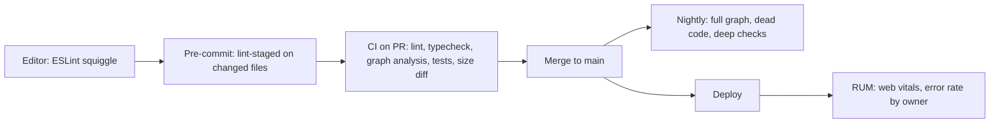
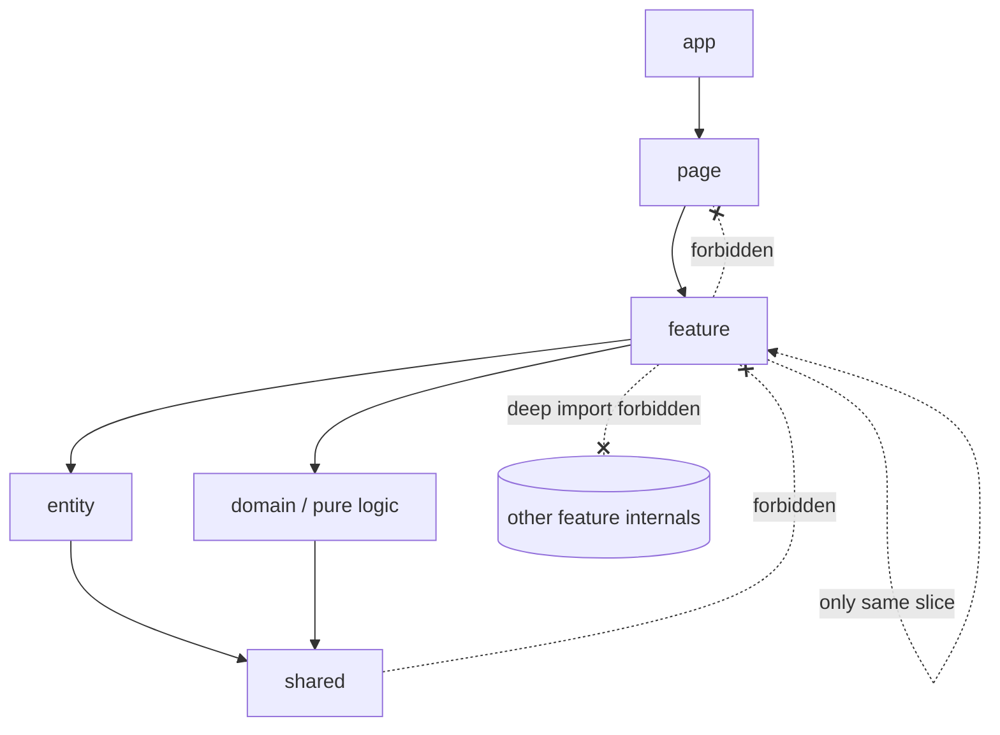
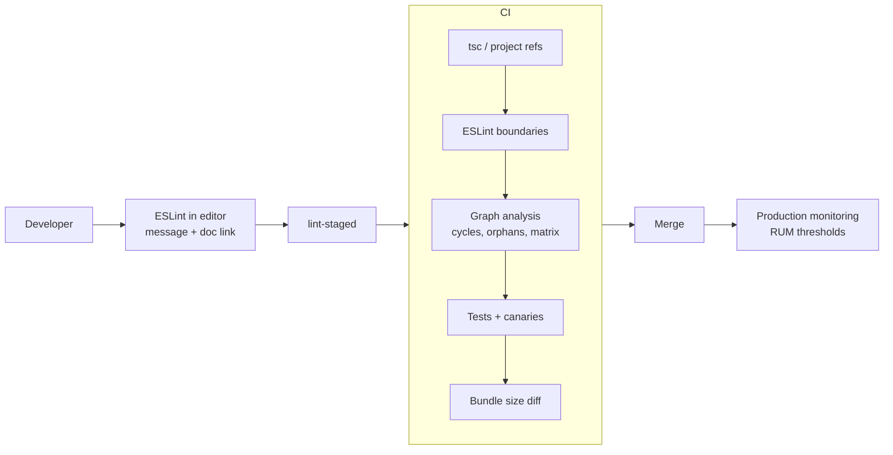
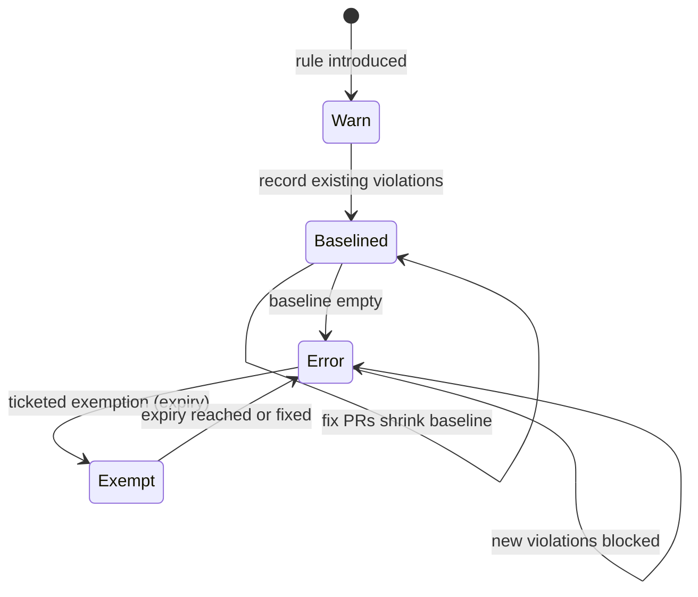

# 04 / 25 — Architectural Fitness and Enforcement: Fitness Functions, Boundary Linting, Dependency Graphs, and Ratchets

## 1. Lesson metadata

| | |
|---|---|
| **Level** | Advanced |
| **Study time** | 4–5 hours (reading 2 h, tool lab 1.5 h, exercises 1.5 h) |
| **Prerequisites** | [01 — Architecture fundamentals](./01-architecture-fundamentals.md), [05 — Composition and dependency direction](./05-composition-and-dependency-direction.md), [07 — Modular architecture](./07-modular-architecture.md), [09 — Feature-Sliced Design](./09-feature-sliced-design.md), [22 — Monorepos and shared packages](./22-monorepos-and-shared-packages.md), [23 — Multi-team ownership](./23-multi-team-ownership.md), [24 — Refactoring legacy React](./24-refactoring-legacy-react.md) |
| **Next** | [26 — Phase assessment](./26-phase-assessment.md) (after [27 — Styling architecture](./27-styling-architecture.md)) |
| **Related** | Phase 8 [13 — TypeScript correctness](../08-testing-and-quality/13-typescript-correctness.md), [14 — Linting and static analysis](../08-testing-and-quality/14-linting-and-static-analysis.md), [15 — CI checks](../08-testing-and-quality/15-ci-checks.md), Phase 7 [21 — Web vitals and budgets](../07-performance/21-web-vitals-and-budgets.md), Phase 10 [16 — Architecture decision records](../10-production-engineering/16-architecture-decision-records.md) |

> **Tool-configuration notice.** This lesson teaches *concepts* and shows *illustrative* configurations for ESLint (flat config), `eslint-plugin-boundaries`, `dependency-cruiser`, Nx module-boundary rules, `madge`, and `knip`. Option names, file formats and defaults of third-party tools change between versions. Every configuration block is marked ⚠ **verify** and must be checked against the tool's current documentation before use. The *design* of the rules (what to forbid and why) is the durable part.

**Learning objectives.** After this lesson you can:
1. Define an architectural fitness function and classify it (atomic vs holistic, triggered vs continuous, static vs dynamic).
2. Translate an architecture document ("features do not import each other's internals") into machine-checkable rules.
3. Compare enforcement mechanisms: TypeScript project boundaries and `exports`, ESLint restrictions, boundary plugins, graph analysers, Nx tags, custom scripts, tests and CI gates.
4. Design a rule set for a layered/feature-based React app and for a monorepo, including exemptions that expire.
5. Introduce rules into an existing violating codebase using ratchets/baselines without halting delivery.
6. Detect cycles, orphans, deep imports, unused exports, and dependency-direction violations; read a dependency graph.
7. Add non-structural fitness functions: bundle size budgets, test-boundary rules, accessibility checks, performance thresholds.
8. Avoid failure modes: over-strict rules, rules as ritual, slow checks, bypasses, false confidence.

**Concepts covered:** fitness function, evolutionary architecture, guardrail vs gate, dependency rule, layer/slice/tag, public API enforcement, circular dependency, orphan module, fan-in/fan-out, baseline/ratchet, warn-then-error, exemption with expiry, architecture test, CI check, ADR link.

---

## 2. Deep conceptual explanation

### 2.1 What problem is this lesson solving?

Architecture documents decay. Phase 4 has defined rules such as:

- shared code never imports feature code ([01](./01-architecture-fundamentals.md), [06](./06-feature-vs-layer-structure.md));
- features expose a public API and nobody deep-imports ([07](./07-modular-architecture.md), [09](./09-feature-sliced-design.md));
- domain logic imports neither React nor the HTTP client ([10](./10-clean-and-hexagonal-architecture.md), [12](./12-domain-logic-vs-ui-logic.md));
- packages form a DAG ([22](./22-monorepos-and-shared-packages.md)).

A rule that exists only in a wiki is a *wish*. Under deadline pressure, one convenient `import { x } from "../../other-feature/internal/x"` is invisible in review (diffs show a line, not a graph). After a year, the rule has dozens of exceptions and no one trusts it.

**Architectural fitness functions** (Ford, Parsons, Kua — *Building Evolutionary Architectures*) make architectural characteristics *objectively checkable*: an automated test of a property the architecture must keep. They convert architecture from "reviewed in meetings" to "continuously verified".

### 2.2 Definitions and classification

A **fitness function** is any mechanism that provides an objective integrity assessment of some architectural characteristic.

| Dimension | Options | Example |
|---|---|---|
| **Scope** | *Atomic* (one characteristic) vs *holistic* (several in combination) | "No cycles between features" vs "bundle size stays under budget while LCP < 2.5 s on the test profile" |
| **Trigger** | *Triggered* (on commit/CI) vs *continuous* (in production) | Boundary lint in CI vs production Web Vitals monitoring |
| **Nature** | *Static* (analyse code) vs *dynamic* (run something) | Import graph analysis vs a Lighthouse CI run |
| **Strictness** | *Gate* (fail the build) vs *signal* (report, dashboard) | Error vs warning/trend |
| **Cost** | Fast (< 10 s, run in editor/pre-commit) vs slow (minutes, CI only) | ESLint rule vs full-graph analysis vs e2e |

Design guidance: put **fast, deterministic, local-fix** checks as close to the developer as possible (editor, pre-commit), **cross-cutting graph/budget** checks in CI, and **behavioural/performance** checks in monitoring.

### 2.3 What to enforce: a catalogue of architectural properties in a React codebase

| # | Property | Typical rule | Mechanism |
|---|---|---|---|
| 1 | **Layer direction** | `shared` ← `entities` ← `features` ← `pages` ← `app` (imports only point downward; see FSD [09](./09-feature-sliced-design.md)) | Boundary plugin, dep-cruiser, Nx tags |
| 2 | **Slice isolation** | A feature must not import another feature (or only via declared public API) | Same |
| 3 | **Public API only** | Imports from `features/x` allowed only via `features/x/index.ts` | ESLint `no-restricted-imports`/boundary plugin, package `exports` |
| 4 | **Framework-free domain** | `domain/**` cannot import `react`, `react-dom`, router, HTTP | Restricted imports by path |
| 5 | **No cycles** | Dependency graph acyclic at module or package level | Graph tool, TypeScript project references, orchestrator |
| 6 | **No orphans / dead exports** | Unused files and exports flagged | `knip`-class tools |
| 7 | **Dependency hygiene** | Imports match declared dependencies; no phantom deps; forbidden libraries banned (e.g. moment) | ESLint import plugin rules, dep-cruiser, package manager strictness |
| 8 | **Test boundary** | Production code cannot import test utilities; tests cannot import another feature's internals | Path rules |
| 9 | **API boundary** | Only the `api/` layer may call `fetch`/axios; components never construct URLs | Restricted globals/imports in UI layers |
| 10 | **State boundary** | UI components import stores through hooks, not store instances | Restricted imports |
| 11 | **Size budgets** | Initial JS ≤ N kB gzip; feature chunk ≤ M kB | Bundler plugin/bundle-size tool, CI compare ([Phase 7 — Bundle analysis](../07-performance/16-bundle-analysis.md)) |
| 12 | **Type strictness** | `strict` on; `any` count cannot increase | `tsc`, ESLint `no-explicit-any`, ratchet |
| 13 | **Accessibility baseline** | Components pass axe checks in tests | Test-time checks ([Phase 8 — Accessibility testing](../08-testing-and-quality/10-accessibility-testing.md)) |
| 14 | **Ownership totality** | Every path/package has an owner | CODEOWNERS validation script ([23](./23-multi-team-ownership.md)) |
| 15 | **Naming / structure conventions** | Feature folder contains `index.ts`; routes in `routes.tsx` | Script/file-structure lint |
| 16 | **Runtime budgets** | Web Vitals thresholds; long-task counts | Synthetic + RUM ([Phase 7](../07-performance/21-web-vitals-and-budgets.md)) |

The most valuable first three: **layer direction, public-API-only, no cycles.**

### 2.4 Mechanisms, from cheapest to most powerful

| Mechanism | What it can express | Strength | Weakness |
|---|---|---|---|
| **TypeScript visibility** (`export` vs not; `internal` conventions) | Module-level privacy | Always on | Only file-level; cannot express layers |
| **`package.json` `exports`** | Package public API | Enforced by resolvers | Needs packages (monorepo); TS must use modern resolution |
| **TypeScript project references** | Package-level acyclic builds, allowed deps by `references` | Compiler-enforced | Config heavy; does not express feature rules inside one project |
| **ESLint `no-restricted-imports`** | Pattern-based forbidden imports per file glob | Built-in, flexible, fast | Cannot know *which element* the importing file belongs to without per-folder overrides; verbose |
| **ESLint boundary plugins** (e.g. `eslint-plugin-boundaries`, `eslint-plugin-import` `no-restricted-paths`; ⚠ verify) | Elements/types, allowed dependency matrix | Declarative matrices | Plugin-specific config; resolver setup for aliases |
| **Graph analysers** (`dependency-cruiser`, `madge`; ⚠ verify) | Forbidden/allowed/required edges across the whole graph, cycles, orphans, reachability, reports/graphs | Whole-graph view, custom regex rules, visualisation | Separate CLI, no editor feedback by default, tuning for TS path aliases |
| **Nx module boundaries** (`@nx/enforce-module-boundaries`; ⚠ verify) | Tag-based constraints between projects (e.g. `type:feature` may depend on `type:ui`) | Integrates with project graph, lint in editor | Requires Nx project graph/tags |
| **Dead-code tools** (`knip`; ⚠ verify) | Unused files/exports/dependencies | Finds rot | False positives with dynamic usage |
| **Custom tests** (a Vitest/Jest test that scans files or imports) | Anything | Full control, runs in the same CI | You own maintenance; careful with performance |
| **Budget tools** (bundle size, Lighthouse CI; ⚠ verify) | Non-structural characteristics | Direct user impact | Environment variance, flakiness |

### 2.5 Guardrails vs gates

- **Guardrail:** helps the developer stay on the paved road *before* the violation (editor squiggle, helpful message pointing to the doc).
- **Gate:** blocks merge in CI.

Both need **good error messages**: "Do not import `features/billing/internal` from `features/cards`. Use `@/features/billing` (public API) or move shared code to `shared/`. See ADR-014." A rule with an opaque message is resented and bypassed.

### 2.6 Baselines and ratchets: enforcing on an already-violating codebase

You cannot turn on an error-level rule that fails on 412 existing violations. Techniques:

| Technique | How | Trade-off |
|---|---|---|
| **Warn-then-error** | Rule at `warn`, track count, flip to `error` when zero | Warnings get ignored without a count/owner |
| **Baseline file** | Tool records existing violations (e.g. dependency-cruiser "known violations" baseline; ESLint suppressions file in recent ESLint versions; ⚠ verify) and fails only on new ones | Baseline can become permanent; commit it and review shrinkage |
| **Ratchet** | A counter in repo; CI fails if count increases, and auto-lowers when it decreases ([24 §5.5](./24-refactoring-legacy-react.md)) | Aggregate counts hide shifting violations (one fixed, one added) — baseline per file is stricter |
| **Scoped enforcement** | Strict rules on new directories (`features/**` created after date X) and relaxed on legacy | Needs a clear boundary; migration adds new directories |
| **Expiring exemptions** | Inline disables or config entries carry a ticket and date; CI fails after expiry | Requires tooling support (custom rule or script) |

### 2.7 Misconceptions

| Misconception | Reality |
|---|---|
| "Linting architecture is over-engineering." | Below ~5 contributors it may be; above, convention without checks erodes. Cost is small relative to a broken boundary. |
| "If CI is green the architecture is good." | Rules only encode what you thought of. They catch drift, not bad design. |
| "More rules = better architecture." | Each rule has cost: false positives, config maintenance, friction. Enforce a few high-value invariants. |
| "Cycle detection is solved by TypeScript." | TypeScript allows import cycles at module level; many cycles only fail at runtime (undefined at init). |
| "A barrel `index.ts` is the same as encapsulation." | A barrel is a convention; without a rule forbidding deep imports, it is optional. And barrels create cycle and tree-shaking risks. |
| "Dependency graph tools replace code review." | They remove the mechanical part; reviewers can focus on design. |

---

## 3. Internal mechanics

### 3.1 Public guarantee vs teaching model vs implementation detail

| Layer | Content |
|---|---|
| **Public guarantee** | ESLint's `no-restricted-imports` and flat-config file-matching semantics are documented ESLint behaviour. Package `exports` semantics are Node's. `tsc --build` project references behaviour is TypeScript's. |
| **Teaching model** | "Code is a graph of modules; the architecture is a set of constraints on edges (which node *kinds* may point to which) plus constraints on node properties (size, ownership)." "Fitness function = automated assertion on that graph or on runtime metrics." |
| **Implementation detail** | How each tool resolves imports (ESLint resolvers for aliases, dep-cruiser's TS pre-compilation, Nx's project graph computation), config schemas, caching. Volatile; ⚠ verify. |

### 3.2 How import-based tools see your code

Static analysers parse each file, collect `import`/`export ... from`/`require`/dynamic `import()` specifiers, resolve each specifier to a file (using TypeScript path aliases, `exports`, `node_modules` layout), and build a directed graph. Consequences you must know:

1. **Resolution configuration is the #1 source of false negatives.** If the tool cannot resolve `@/features/billing` (path alias), the edge is *unresolved* and the rule never fires; the check passes while checking nothing. Always add a **canary test**: a deliberate violation in a fixture that the rule must catch.
2. **Type-only imports** (`import type`) are erased at runtime. Decide whether rules apply to them: a cycle through types is a design smell but not a runtime hazard; many teams relax some rules for `import type`.
3. **Dynamic imports** (`import("./x")`) create edges for lazy chunks; variable specifiers cannot be resolved.
4. **Barrels and re-exports** hide the true provider; the graph shows `consumer → barrel → provider`. Rules that say "feature A must not depend on feature B" still see the right edge, but cycle reports pass through barrels and look noisy.
5. **Side-effect imports** (`import "./polyfill"`) are edges too.
6. **JSX / non-JS assets:** CSS imports, SVG imports are edges to non-code nodes; decide what rules apply.

### 3.3 Element and dependency-matrix model

Most boundary tools share this model (names differ):

1. **Define element types** by path pattern: `app`, `page`, `feature`, `entity`, `shared`, `domain`.
2. **Define the allowed matrix**: for each type, the types it may import.
3. **Optionally capture an identity** (the feature name, from the path) to forbid same-type cross-imports: "a `feature` may import a `feature` only if it is the same one."
4. **Optionally restrict entry points**: "imports into a `feature` must target its `index`."

|  from \ to | app | page | feature | entity | shared | domain |
|---|---|---|---|---|---|---|
| **app** | – | ✔ | ✔ | ✔ | ✔ | ✔ |
| **page** | ✘ | – | ✔ | ✔ | ✔ | ✔ |
| **feature** | ✘ | ✘ | only self | ✔ | ✔ | ✔ |
| **entity** | ✘ | ✘ | ✘ | only self | ✔ | ✔ |
| **shared** | ✘ | ✘ | ✘ | ✘ | – | ✘ |
| **domain** | ✘ | ✘ | ✘ | ✘ | limited | – |

This matrix *is* the architecture (see [09](./09-feature-sliced-design.md) for the FSD reasoning). The tool's job is to compare the real graph against it.

### 3.4 Where checks run



Rule of thumb: the earlier a check runs the cheaper the fix; the later it runs the more it can see.

---

## 4. Step-by-step execution walkthrough

**Scenario.** You are the tech lead of a 7-team React app with 1,300 modules and a documented rule: *"features do not import other features' internals; shared never imports features; no cycles."* A recent audit found 38 deep imports between features, 4 shared→feature imports, and 21 cycles. You must enforce without a freeze.

1. **Write the rules as a matrix** (§3.3) and agree in an ADR: allowed edges, public API definition (`features/<x>/index.ts`), exemption policy (ticket + expiry ≤ 3 months).
2. **Measure.** Run the graph analyser to produce counts and a graph. Save as `architecture-baseline.json` (violations list with file pairs). Review the top offenders: they usually concentrate in 5 files (hubs).
3. **Add the guardrail in the editor** at `warn` level for the three rule families; ensure resolver config handles aliases; add a **canary fixture** with a known violation to prove detection.
4. **Gate only the new**: CI fails when a violation is *not in the baseline*. Existing violations are allowed but listed.
5. **Fix by category.** (a) 4 shared→feature: move code or invert dependency (usually the shared module imports a type or constant; move it down). (b) Deep imports: add the missing export to the feature's public API (if the thing is truly public) or move the helper to shared (if it is generic). (c) Cycles: break at the weakest edge (see [§8](#8-best-practices-and-anti-patterns)).
6. **Shrink the baseline** with each fix PR; the PR diff shows baseline lines deleted — easy to review. A weekly report posts remaining counts to the team channel.
7. **Flip to error** per rule when its baseline hits zero, deleting the baseline entry for that rule.
8. **Add non-structural fitness functions**: bundle budget on the initial chunk, with a size-diff comment on PRs.
9. **Review quarterly:** which rules were bypassed with exemptions? which fired false positives? Retire or fix.

**Predict:** a developer adds `import { priceFormat } from "../../billing/internal/format"` inside `features/cards`. What happens at each stage? *(Editor: squiggle with message. Pre-commit: lint-staged fails the commit if rule is error at that scope (or warns). CI: graph check fails because the edge is not in the baseline. Without the canary and resolver config, none of these happen — which is why configuration is tested.)*

---

## 5. Code examples

**Tool configurations below were executed on 2026-10-22 against ESLint 9.39.5 and 10.13.0, dependency-cruiser 18.7.0 and eslint-plugin-boundaries 7.2.1 (fixture project; results noted per example). They remain illustrative: re-check each tool's docs for your version.**

### 5.1 Minimal example — ESLint `no-restricted-imports` for two rules

`eslint.config.js` (flat config; verified on ESLint 9.39 and 10.13: both report the violations below). `tseslint.config()` from `typescript-eslint` is deprecated in favour of ESLint core's `defineConfig()` from `eslint/config`, used here. Real `.ts`/`.tsx` files also need the `typescript-eslint` parser in a config block (omitted for brevity):
```js
// eslint.config.js
import { defineConfig } from "eslint/config";

export default defineConfig(
  // 1. shared must not import features, pages or app
  {
    files: ["src/shared/**/*.{ts,tsx}"],
    rules: {
      "no-restricted-imports": ["error", {
        patterns: [
          {
            group: ["@/features/*", "@/pages/*", "@/app/*", "../features/*", "../../features/*"],
            message: "shared/ must not depend on features/pages/app. Move the code down into shared/ or invert the dependency. See ADR-007.",
          },
        ],
      }],
    },
  },

  // 2. domain code is framework free
  {
    files: ["src/**/domain/**/*.{ts,tsx}"],
    rules: {
      "no-restricted-imports": ["error", {
        paths: [
          { name: "react", message: "domain/ must not import React. See lesson 12." },
          { name: "react-dom", message: "domain/ must not import React DOM." },
        ],
        patterns: [
          { group: ["react-router*", "@tanstack/*", "axios"], message: "domain/ is framework-free." },
        ],
      }],
    },
  },
);
```

**Line notes.** Flat config's `files` globs scope each block. The `patterns[].group` uses gitignore-style patterns. `message` is the *guardrail text* — it appears in the editor and CI. Limitation to remember: because `no-restricted-imports` evaluates import *strings*, relative paths (`../../features/x`) must be listed explicitly or avoided through an import-style convention (use aliases only for cross-folder imports; relative only within a slice). It cannot tell the importing file's *own feature* from another; for same-type isolation you need a boundary plugin or per-feature overrides.

**Per-feature override trick (isolating features with only built-in rules):**
```js
import { readdirSync } from "node:fs";

const features = readdirSync("src/features", { withFileTypes: true }).filter((d) => d.isDirectory()).map((d) => d.name);

const featureIsolation = features.map((name) => ({
  files: [`src/features/${name}/**/*.{ts,tsx}`],
  rules: {
    "no-restricted-imports": ["error", {
      patterns: [{
        group: features.filter((f) => f !== name).map((f) => `@/features/${f}/*`),
        message: "Import another feature only through its public API: '@/features/<name>' (no deep paths).",
      }],
    }],
  },
}));
```
Reading the pattern: for feature `cards`, it forbids `@/features/fleet/*` (deep) but not `@/features/fleet` (the barrel). This expresses "public API only" using no plugin. The flat-config array is spread into the export. Caveat: a later block for the same files can override `no-restricted-imports` entirely (rule options are replaced, not merged) — keep all restrictions for a file set in one place. (Verified on ESLint 9.39.5: when a later block set `no-restricted-imports` for the same files, only the later block's options applied; the earlier message disappeared.)

### 5.2 Practical example — `eslint-plugin-boundaries`-style element matrix (conceptual)

`eslint.config.js` (**written for eslint-plugin-boundaries 5.x**; the plugin has changed its API since: in 7.2.1, executed 2026-10-22, `boundaries/element-types` still runs but emits deprecation warnings: it is renamed `boundaries/dependencies`, the `rules` option is renamed `policies`, string/tuple selectors give way to object selectors `{ element: { type, captured } }`, `allow`/`disallow` need a `to`/`from` wrapper, and `${from.x}` templates become `{{ from.element.captured.x }}`. A v7 equivalent follows this block):
```js
import boundaries from "eslint-plugin-boundaries";

export default [
  {
    plugins: { boundaries },
    settings: {
      "boundaries/elements": [
        { type: "app", pattern: "src/app/*" },
        { type: "page", pattern: "src/pages/*", capture: ["page"] },
        { type: "feature", pattern: "src/features/*", capture: ["feature"] },
        { type: "entity", pattern: "src/entities/*", capture: ["entity"] },
        { type: "shared", pattern: "src/shared/*" },
      ],
      // import resolution (aliases) must be configured for the tool to see edges:
      "import/resolver": { typescript: { project: "./tsconfig.json" } },
    },
    rules: {
      "boundaries/element-types": ["error", {
        default: "disallow",
        rules: [
          { from: "app", allow: ["page", "feature", "entity", "shared"] },
          { from: "page", allow: ["feature", "entity", "shared"] },
          { from: "feature", allow: ["entity", "shared", ["feature", { feature: "${from.feature}" }]] },
          { from: "entity", allow: ["shared", ["entity", { entity: "${from.entity}" }]] },
          { from: "shared", allow: ["shared"] },
        ],
      }],
    },
  },
];
```

**Line notes.** `default: "disallow"` makes the matrix an *allowlist*: anything not listed is an error — safer than a denylist because new element types start closed. `capture` extracts the folder name so the rule can say "a feature may import a feature only if the captured names match" (same slice). The `import/resolver` setting is the alias-resolution requirement from §3.2. The `${from.feature}` template syntax is the plugin's own (v5-era). The v7 form of the same matrix, which I ran against a fixture and which reported `feature cards -> feature fleet` as a violation (needs `import/resolver` with `eslint-import-resolver-typescript` to resolve aliases/extensionless paths, otherwise nothing is flagged):
```js
"boundaries/dependencies": ["error", { default: "disallow", policies: [
  { from: { element: { type: "page" } }, allow: { to: { element: { type: ["feature", "shared"] } } } },
  { from: { element: { type: "feature" } }, allow: { to: [
      { element: { type: "shared" } },
      { element: { type: "feature", captured: { feature: "{{ from.element.captured.feature }}" } } },
  ] } },
  { from: { element: { type: "shared" } }, allow: { to: { element: { type: "shared" } } } },
] }]
```
A public-API (entry-point) restriction is expressed through the element/file selectors in v7 (see the plugin docs); rule names differ by major version.

### 5.3 Incorrect example — rules that look enforced but are not

```js
// eslint.config.js (wrong)
export default [{
  files: ["src/shared/**"],            // (1) glob misses extensions? '**' matches directories; files need extension globs per config
  rules: {
    "no-restricted-imports": ["warn", { // (2) 'warn' with no baseline tracking
      patterns: ["features/*"],          // (3) matches only the literal string "features/*" – not "@/features/x" or "../features/x"
    }],
  },
}];
```

Problems:
1. Flat-config `files` patterns must match what ESLint lints; `src/shared/**` may need explicit extensions (`**/*.{ts,tsx}`), and the TypeScript parser must be configured for `.ts` files. A glob mismatch means *the rule silently never runs*. (Verified on ESLint 9.39.5: with only `files: ["src/shared/**"]`, linting a `.ts` file reports "File ignored because no matching configuration was supplied"; a `.js` file in the same folder is linted. `.ts` files are linted only when some config object's `files` pattern names their extension.)
2. `warn` with no counting: warnings accumulate and nobody looks.
3. The pattern does not match the real specifiers used (`@/features/cards`, `../../features/cards`). The rule is green because it matches nothing.
4. No canary test: nothing proves the rule can fail.
5. No message: developers see "'features/*' import is restricted" and have no guidance.

### 5.4 Corrected implementation — a canary test for the rules

A **canary** is a fixture file with a known violation, and a test asserting the linter reports it. This prevents silent misconfiguration.

`tools/architecture/__fixtures__/shared-imports-feature.ts` (kept outside regular `src`, linted under a dedicated config or via the ESLint Node API):
```ts
import { x } from "@/features/cards";
export const y = x;
```

`tools/architecture/lint-rules.test.ts` (Vitest; uses ESLint's Node API; `new ESLint({ cwd })` + `lintText(code, { filePath })` verified on ESLint 9.39 and 10.13: the first case returned `['no-restricted-imports']`, the second `[]`):
```ts
import { ESLint } from "eslint";
import { describe, expect, it } from "vitest";

describe("architecture lint rules (canaries)", () => {
  it("flags shared -> feature imports", async () => {
    const eslint = new ESLint({ cwd: process.cwd() });
    const [result] = await eslint.lintText(
      `import { x } from "@/features/cards"; export const y = x;`,
      { filePath: "src/shared/ui/fake.ts" } // path decides which config block applies
    );
    const ids = result.messages.map((m) => m.ruleId);
    expect(ids).toContain("no-restricted-imports");
  });

  it("allows shared -> shared imports", async () => {
    const eslint = new ESLint({ cwd: process.cwd() });
    const [result] = await eslint.lintText(
      `import { z } from "@/shared/lib/z"; export const y = z;`,
      { filePath: "src/shared/ui/fake.ts" }
    );
    expect(result.messages.filter((m) => m.ruleId === "no-restricted-imports")).toHaveLength(0);
  });
});
```

**Why it matters.** The first test fails the day someone changes the glob, plugin version, or resolver such that the rule stops running. The second protects against a rule so broad it blocks legitimate code. Using `lintText` with a pretend `filePath` tests the *config's file matching* without creating real violating files. (Note: `lintText` with a non-existent path works for matching purposes; ESLint returns an "ignored" warning message if the path is ignored or matches no config, which is exactly what the canary should catch.)

### 5.5 Advanced example — dependency-cruiser rules, baseline, and CI

`.dependency-cruiser.cjs` (executed with dependency-cruiser 18.7.0 on a fixture: `no-circular`, `shared-not-to-features`, `features-public-api-only`, `no-cross-feature` and `domain-framework-free` each fired as intended; `react` must be installed for the last one to resolve to `node_modules/react`):
```js
/** @type {import('dependency-cruiser').IConfiguration} */
module.exports = {
  forbidden: [
    {
      name: "no-circular",
      severity: "error",
      comment: "Cycles cause init-order bugs and defeat modular reasoning.",
      from: {},
      to: { circular: true },
    },
    {
      name: "shared-not-to-features",
      severity: "error",
      comment: "shared/ is below features/ in the dependency order (ADR-007).",
      from: { path: "^src/shared/" },
      to: { path: "^src/(features|pages|app)/" },
    },
    {
      name: "features-public-api-only",
      severity: "error",
      comment: "Import a feature only through src/features/<name>/index.ts.",
      from: { path: "^src/(?!features/)", pathNot: "^src/features/" },
      to: {
        path: "^src/features/[^/]+/.+",
        pathNot: "^src/features/[^/]+/index\\.(ts|tsx)$",
      },
    },
    {
      name: "no-cross-feature",
      severity: "error",
      comment: "Features must not import other features (use shared contracts or events).",
      from: { path: "^src/features/([^/]+)/" },
      to: { path: "^src/features/(?!$1/)", },
    },
    {
      name: "domain-framework-free",
      severity: "error",
      from: { path: "/domain/" },
      to: { path: "^node_modules/(react|react-dom|react-router)(/|$)" },
    },
    {
      name: "no-orphans",
      severity: "warn",
      from: { orphan: true, pathNot: "(^|/)\\.[^/]+\\.(js|cjs|mjs|ts|json)$|\\.d\\.ts$|(^|/)tsconfig\\.json$|\\.test\\.tsx?$|main\\.tsx$" },
      to: {},
    },
  ],
  options: {
    tsConfig: { fileName: "tsconfig.json" },
    doNotFollow: { path: "node_modules" },
    exclude: { path: "\\.test\\.tsx?$|__fixtures__" },
    enhancedResolveOptions: { exportsFields: ["exports"], conditionNames: ["import", "require", "node", "default", "types"] },
  },
};
```

**Reading the rules.**
- `from`/`to` are matchers over file paths; `$1` refers to a capture group in `from.path` (dependency-cruiser supports capture-group references in `to.pathNot`/`to.path`; `$1` in `to.path` worked in 18.7.0 (the `no-cross-feature` rule above flagged `cards -> fleet`); a more portable form for "no cross-feature" is `to.path: "^src/features/([^/]+)/"` combined with `to.pathNot: "^src/features/$1/"`).
- `circular: true` flags any edge that is part of a cycle.
- The public-API rule says: from outside features (or any file), a `to` that is *inside* a feature but *not* its `index` is forbidden; files inside the feature are exempt via `from.pathNot`.
- `options.tsConfig` makes the tool resolve TypeScript path aliases — the crucial setting from §3.2.

**Baselines and CI (flags verified in `depcruise --help`, 18.7.0):**
1. Generate a baseline of existing violations with `depcruise src --config .dependency-cruiser.cjs --baseline` (writes `.dependency-cruiser-known-violations.json` by default).
2. CI step: `depcruise src --config .dependency-cruiser.cjs --ignore-known` (flag exists; defaults to the same file).
3. Commit the known-violations file; each cleanup PR shrinks it; a CI check can fail if it *grows* (diff-based gate).
4. Produce a graph artifact for reviewers (dependency-cruiser can emit DOT/SVG/HTML reports).

**Nx module boundaries (conceptual).** In an Nx workspace, give each project tags such as `scope:cards`, `type:feature`, `type:ui`, `type:data-access`, `type:util`, then constrain edges with the `@nx/enforce-module-boundaries` ESLint rule, e.g. "a `type:feature` project may depend on `type:ui`, `type:data-access`, `type:util` and projects with the same `scope:`; `type:util` may depend only on `type:util`". Violations appear in the editor and in lint CI. Tags live in each project's configuration. ⚠ Rule name, option names (`depConstraints`, `sourceTag`, `onlyDependOnLibsWithTags`, `notDependOnLibsWithTags`), and project-config locations change between Nx versions; verify in current Nx docs. Tags are the Nx equivalent of the element types in §3.3, and share their strengths (declarative, editor-integrated, package-level) and their weaknesses (project granularity: they do not police imports *within* a project unless you split it).

**Non-structural fitness function: bundle budget (conceptual).** After `vite build`, a script reads the emitted manifest or output directory, computes gzip size of the entry chunk, and fails if over budget:
```ts
// scripts/check-bundle-budget.ts
import { readdirSync, readFileSync } from "node:fs";
import { gzipSync } from "node:zlib";
import { join } from "node:path";

const dist = "dist/assets";
const BUDGET_BYTES = 180 * 1024; // initial JS budget, gzip; set from your own measured baseline
const entry = readdirSync(dist).find((f) => /^index-.*\.js$/.test(f));
if (!entry) throw new Error("entry chunk not found; check the build output naming");

const gz = gzipSync(readFileSync(join(dist, entry))).length;
console.log(`entry ${entry}: ${(gz / 1024).toFixed(1)} kB gzip (budget ${(BUDGET_BYTES / 1024).toFixed(0)} kB)`);
if (gz > BUDGET_BYTES) {
  console.error("Initial bundle exceeds budget. See lesson Phase 7 / 16 for investigating.");
  process.exit(1);
}
```
The filename pattern depends on bundler config (⚠ Vite's default hashed names; `index-<hash>.js` is conventional, not guaranteed). Production setups read the bundler's manifest instead. The budget number must come from *your* measurements ([Phase 7 — Web vitals and budgets](../07-performance/21-web-vitals-and-budgets.md)), not from a blog.

**Ownership totality check (conceptual).** A script lists tracked files (`git ls-files`) and checks each against CODEOWNERS patterns; or rely on the hosting platform's CODEOWNERS validation plus a `*` backstop ([23](./23-multi-team-ownership.md)).

---

## 6. Visual explanations

### 6.1 Rules as a graph over node kinds



### 6.2 Enforcement pipeline



### 6.3 Baseline lifecycle



### 6.4 Rule value vs cost

| Rule family | Value | Cost | Recommended timing |
|---|---|---|---|
| Layer direction | High | Low–Med | Day 1 |
| Public API only | High | Low | Day 1 |
| No cycles | High | Low | Day 1 (baseline if needed) |
| Domain framework-free | Medium–High | Low | When domain layer exists |
| Orphans / dead exports | Medium | Medium (false positives) | Nightly, warn |
| Bundle budget | High | Medium | After baseline measured |
| Naming/structure | Low–Med | Low | Optional |
| Ownership totality | Medium–High | Low | With CODEOWNERS |

---

## 7. Alternative approaches and trade-offs

### 7.1 Comparison of enforcement mechanisms

| Criterion | ESLint `no-restricted-imports` | Boundary plugin (element matrix) | Graph analyser (dep-cruiser/madge) | Nx tags | Package `exports` + workspace | TypeScript project references |
|---|---|---|---|---|---|---|
| Editor feedback | Yes | Yes | No (CLI; some IDE plugins) | Yes | TS/IDE errors | TS errors |
| Expresses matrix | Awkward | **Yes** | **Yes** | **Yes** | No (just public/private) | Package-level DAG |
| Cycles | No | Limited | **Yes** | Project cycles | n/a | Package cycles |
| Same-slice isolation | Per-feature overrides | Yes (captures) | Yes (capture groups) | Via scope tags | Package per slice | Package per slice |
| Whole-repo reports/graphs | No | No | **Yes** | Nx graph UI | No | No |
| Setup cost | Low | Medium | Medium | High (needs Nx) | Medium (needs packages) | Medium–High |
| Resolver pitfalls | Strings only | Needs resolver | Needs tsconfig/resolve | Nx resolves | Package manager | TS |
| Granularity | File/import | File/element | File/module | Project/package | Package | Package |
| Fits | Any size, quick wins | Single-app feature architecture | Large apps, audits, cycle hunting | Nx monorepos | Monorepos | Large monorepos |

Combine: ESLint (guardrail, fast) + graph analyser in CI (cycles/orphans/reports) + `exports` (hard wall at package edges).

### 7.2 Approach profile: declarative boundary enforcement (matrix + graph analyser)

- **Problem solved:** architecture drift, invisible coupling, rule erosion.
- **Folder structure:** a conventional structure with element types identifiable by path (`src/{app,pages,features,entities,shared}` or packages + tags). Config files at repo root: `eslint.config.js`, `.dependency-cruiser.cjs`; `docs/adr/`; `tools/architecture/` for canaries and scripts.
- **Dependency rules:** the matrix in §3.3; enforcement code itself depends on nothing from `src`.
- **Code:** §5.
- **Pros:** drift caught at the line that causes it; architecture documentation is executable; supports gradual adoption via baselines; makes reviews about design.
- **Cons:** config maintenance and tool upgrades; false positives and resolver bugs; friction for legitimate cross-cutting changes; can ossify a wrong architecture (rules defend the current structure even when it should change); slows CI if graph analysis is heavy.
- **Team sizes:** worthwhile from ~5–8 developers or ≥ 2 teams in a codebase; for solo/small teams, a couple of `no-restricted-imports` rules and a cycle check suffice.
- **Failure modes:** rule never runs (glob/resolver), warnings ignored, mass `eslint-disable`, baseline never shrinks, rules encode accidental structure, team distrust from false positives, checks too slow so people skip local runs.
- **Migration:** §4: matrix → baseline → warn → fix by category → error → budgets.

### 7.3 Approach profile: convention + code review only

- **Problem solved:** none automatically; relies on people.
- **Structure:** a documented structure; PR template checkboxes.
- **Rules:** written down.
- **Pros:** zero tooling; flexible; fine for tiny teams or early exploration where boundaries are still moving.
- **Cons:** erosion; reviewer fatigue; knowledge concentrated in seniors; no objective discussion.
- **Sizes:** 1–4 developers, young product.
- **Failure modes:** rules known only to veterans; inconsistent enforcement across reviewers.
- **Migration:** add the three high-value rules the moment a second team joins or the first cycle bug hits production.

### 7.4 A scenario where heavy enforcement is NOT the best approach

An early-stage product (4 developers, 3 months old) still discovering its domain: slices are renamed weekly; a strict matrix with allowlists causes constant config churn and teaches the team to fight the linter. Prefer minimal guardrails (no cycles; shared doesn't import features) and revisit when boundaries stabilise. Similarly, a throwaway prototype or a short-lived campaign site does not warrant graph analysis.

---

## 8. Best practices and anti-patterns

### 8.1 Best practices

1. **Start with an ADR** stating the rules and *why*; link it from rule messages ([Phase 10 — ADRs](../10-production-engineering/16-architecture-decision-records.md)).
2. **Few, high-value rules**: direction, public API, cycles first.
3. **Allowlist matrices (`default: disallow`)** over denylists.
4. **Write messages that tell the developer what to do**, not only what is forbidden.
5. **Canary tests** for every rule family; run in CI.
6. **Run fast checks locally and in the editor;** keep CI graph checks under a few minutes (cache; analyse changed subgraph where supported).
7. **Baseline, then ratchet,** with shrinking tracked and reported.
8. **Exemptions are data:** ticket, owner, expiry; CI fails after expiry.
9. **Make rule changes reviewable:** CODEOWNERS on the config (platform/architecture owners, [23](./23-multi-team-ownership.md)).
10. **Prefer structure that makes violations impossible** (packages with `exports`) over structure that detects them, where cost-effective.
11. **Break cycles at the weakest edge:** the edge that represents the least essential dependency (often a type, a constant, or a callback). Techniques: extract the shared piece to a lower layer; invert dependency via an interface/prop/context ([11](./11-dependency-inversion.md)); merge modules that are truly one concept.
12. **Include non-structural fitness functions** (size, a11y, performance) so architecture covers user-visible qualities.
13. **Periodically review the rules themselves.**

### 8.2 Beginner mistakes

- Turning on a strict rule in a repo with hundreds of violations and then disabling it.
- Using `// eslint-disable` without a reason or ticket.
- Writing a regex that matches nothing (and never testing it).
- Forgetting resolver/alias configuration.
- Treating warnings as success.
- Banning all barrel files without understanding they are the public-API mechanism.

### 8.3 Experienced-developer mistakes

- **Rules defending structure rather than outcomes.** E.g. enforcing folder naming but not dependency direction.
- **Ossification:** rules forbid a reasonable new shape, so teams hack around them instead of changing the architecture through an ADR.
- **Slow gates:** a 12-minute graph analysis on each PR; developers push `--no-verify`.
- **Aggregate ratchets:** total count unchanged while violations moved to a more critical module.
- **Tooling monoculture without ownership:** tool breaks after an upgrade; nobody owns it; rules silently disabled.
- **Confusing coupling by import with coupling by data/URL/event:** an event bus or URL contract can couple features without any import; imports are one lens only ([17](./17-data-flow-architecture.md), [23](./23-multi-team-ownership.md)).
- **Excluding tests from all rules** and then letting test helpers become production dependencies.
- **Excessive reliance on type-only exemption:** allowing `import type` across features everywhere re-creates semantic coupling; use sparingly and document.

### 8.4 Migration considerations

See §4. Additional: **introduce rules per directory subtree** (new code first), **freeze new violations immediately** (diff-based gate), and **time-box** the baseline: a baseline that has not shrunk in two quarters is a smell requiring either investment or acceptance of the exemption with an owner.

When moving from folder-based to package-based enforcement (monorepo, [22](./22-monorepos-and-shared-packages.md)), keep the same matrix; the enforcement layer changes from ESLint patterns to `exports`+manifest, and the lint rules remain as a second defence.

### 8.5 Justified exceptions

- **Temporary exemptions** during a migration with an expiry and an owner.
- **Composition roots** (the `app/` layer) legitimately import everything; do not apply isolation rules there.
- **Test files** may import internals of the module under test; they must not import other modules' internals.
- **Generated code** (API clients) may violate style rules; scope enforcement to hand-written code.
- **Cycles through types only** may be allowed temporarily (flag with `import type`) while a proper split is planned; still tracked.

---

## 9. Real-world application

| Domain | Fitness functions that pay off | Constraints |
|---|---|---|
| **E-commerce** | Checkout bundle budget; no analytics SDK imported outside `shared/analytics`; no direct `fetch` in components; LCP budget on product page (synthetic) | Third-party scripts and A/B frameworks complicate budgets; budgets per route. |
| **Fleet/finance dashboard** | `Money` only through the kernel (ban `parseFloat` for currency in domain via restricted syntax/custom rule); no `toFixed` for currency; domain framework-free | Rules that ban numeric patterns are heuristic (`no-restricted-syntax` selectors); pair with unit tests. |
| **Auth** | Only `auth-client` touches token storage (restricted imports for `localStorage` usage patterns via `no-restricted-globals`/syntax) | Easy to bypass indirectly; add code-review checklist and e2e checks. |
| **Realtime** | Sockets only constructed in `infrastructure/realtime`; UI imports hooks | Mocks in tests need exemptions in test dirs. |
| **Forms** | Form libraries behind `shared/forms` wrapper; schema package framework-free | Version churn: wrapper boundary reduces upgrade cost. |
| **Multi-team** | CODEOWNERS totality; boundary rules by tags/scopes; cross-team contract tests ([23](./23-multi-team-ownership.md)); expiring flags | Governance must be owned by platform/architecture group with transparent change process. |

**Operational constraints:** keep enforcement runtime within CI budget; make rule failures reproducible locally with one command (`pnpm arch:check`); document how to request an exemption; send weekly baseline-shrink metrics to the team.

---

## 10. Debugging and troubleshooting

### 10.1 A rule never fires

- **Symptom:** you deliberately add a violation and CI is green.
- **Investigate:** run ESLint with the debug/`--print-config <file>` option to see which rules apply to that file (⚠ verify flag availability); check `files` globs and extension coverage; check that the resolver resolves the alias (dependency-cruiser's `--output-type` modes can print resolved deps; verify). Run the canary.
- **Root cause:** glob mismatch, unresolved alias, rule overridden by a later config block, ignored directory.
- **Fix:** correct glob/resolver; merge conflicting blocks; add canary test.
- **Validate:** violation now reported with the intended message.

### 10.2 False positives flood the team

- **Investigate:** sample 20 reports; classify. Common: composition-root files caught by isolation rules; generated code; test files; type-only imports; re-exports.
- **Fix:** narrow `from` scope, add explicit exemptions with reasons, treat type-only imports per policy, adjust the matrix if the architecture really allows it (and update the ADR).
- **Validate:** false-positive rate in the next 50 PRs.

### 10.3 Graph analysis is too slow

- **Investigate:** time the tool; check whether `node_modules` is being followed (should not), whether all test/story files are included, whether TypeScript pre-compilation is on.
- **Fix:** exclude non-source, cache, run on changed modules plus dependents, split nightly deep checks from PR checks.

### 10.4 Cycle report is huge and unreadable

- **Investigate:** cycles through barrels inflate the list; find *strongly connected components* and look for the smallest edge cut. Many cycles disappear after fixing 2–3 hub modules (e.g. a `utils/index.ts` importing everything).
- **Fix:** split the hub; replace barrel imports inside the package with direct relative imports; extract shared pieces downward.

### 10.5 Runtime `undefined` from circular import

- **Symptom:** `Cannot access 'X' before initialization` or `undefined is not a function` at module load, order-dependent.
- **Investigate:** graph tool cycle path; stack trace at the first access; check for barrel re-exports and top-level side effects.
- **Fix:** break the cycle (move shared constant/type down), avoid top-level evaluation that depends on the cycle partner.

### 10.6 Developers bypass with `eslint-disable`

- **Investigate:** count disables per rule (`git grep` or ESLint's reporting of unused/used disables; ⚠ verify options such as `--report-unused-disable-directives`); review the biggest users.
- **Fix:** require a description (`eslint-comments` plugin rules exist for this; ⚠ verify), enforce expiry, and discuss the underlying friction: maybe the rule needs a legitimate escape hatch.

---

## 11. Exercises

### Level A — Knowledge
A1. Define "architectural fitness function" and give one atomic and one holistic example for a React app.
A2. List four properties of a React codebase that can be enforced mechanically.
A3. Why is `default: "disallow"` (allowlist) preferred in a dependency matrix?
A4. What is a canary test for lint rules and what failure mode does it prevent?
A5. Explain the difference between a baseline and a ratchet.
A6. What can `package.json` `exports` enforce that ESLint import patterns cannot, and vice versa?

### Level B — Code comprehension
B1. What does this config actually enforce? Find at least two problems.
```js
{
  files: ["src/shared/**"],
  rules: { "no-restricted-imports": ["warn", { patterns: ["features/*"] }] }
}
```
B2. Given the §3.3 matrix, which imports are allowed? (a) `entities/user` → `shared/ui`, (b) `features/cards` → `features/fleet` (barrel), (c) `shared/ui` → `entities/user`, (d) `pages/home` → `features/cards`, (e) `features/cards/ui/A.tsx` → `features/cards/model/x.ts`.
B3. A dependency-cruiser report shows `src/utils/index.ts` in 14 of 17 cycles. What is likely true of this file and what is the first fix?

### Level C — Implementation
C1. Write flat-config ESLint blocks (using only `no-restricted-imports`) that forbid `src/domain/**` from importing `react` and `axios`, with helpful messages.
C2. Write a Vitest canary test for the rule in C1 using the ESLint Node API (assume the config file is at the project root).
C3. Write a dependency-cruiser-style rule (illustrative) forbidding any module from importing `src/features/*/internal/**` from outside the same feature.

### Level D — Debugging
D1. After adding a boundary rule, CI is green but a deliberate deep import is not flagged. List four causes in the order you would check them.
D2. After a dependency upgrade, the baseline file shows 200 "new" violations although nobody changed code. Explain plausible causes and how to proceed.

### Level E — Architecture decisions
E1. A 25-developer team has no enforcement and a growing cycle count. Propose the first three rules, the rollout plan, and the exemption policy.
E2. Argue for and against putting architecture rules in ESLint vs a separate CLI in CI vs Nx tags, for a single-app (not monorepo) codebase.
E3. How would you enforce "money is never handled as a floating-point number in domain code" and what are the limits of static enforcement?

### Level F — Expert challenge
F1. Design the complete fitness-function suite for a multi-team monorepo (6 teams, 4 apps, 15 packages): structural (boundaries, cycles, ownership), quality (types, a11y), performance (budgets, RUM), and operational (flag expiry). Specify trigger points, owners, failure policy, and how the suite itself is kept healthy.

---

## 12. Detailed answers and explanations

> Attempt the exercises first.

**A1.** A fitness function is an automated mechanism that objectively assesses a characteristic of the architecture. Atomic: "no import from `shared/` to `features/`" (one characteristic, static, triggered). Holistic: "checkout route stays below 170 kB initial JS *and* LCP ≤ 2.5 s in the synthetic profile *and* no accessibility violations on the payment form" (several characteristics together, dynamic).

**A2.** Layer direction; public-API-only imports; no cycles; framework-free domain; ban specific libraries; no phantom dependencies; bundle size; type strictness counters; ownership totality; no `fetch` outside the data layer. Any four.

**A3.** An allowlist fails closed: when a new element type or path appears, it is forbidden until someone decides what it may import. A denylist fails open: new modules can depend on anything the denylist did not anticipate, and the rules decay silently.

**A4.** A canary is a test that deliberately lints a violating snippet (or fixture) and asserts that the rule reports it, plus a compliant snippet that is not reported. It prevents the silent-misconfiguration failure mode: the rule exists but never fires due to glob/resolver/version/override mistakes.

**A5.** A baseline records the *specific existing violations* (e.g., file-pair list) and fails only on violations not in the list. A ratchet records an *aggregate number* and fails if it rises (lowering when it falls). Baselines are stricter (a moved violation counts as new); ratchets are simpler but can mask substitution (fix one, add another).

**A6.** `exports` is enforced by resolvers/bundlers/TypeScript at *resolution time* for external consumers: deep imports to unlisted paths fail regardless of lint. It only works at package granularity and honours only consumers using modern resolution. ESLint patterns work on any folder structure, in any project (no packages needed), per-file-glob, with custom messages, and in the editor — but can be disabled with a comment and only check what is configured.

**B1.** Problems: (1) `patterns: ["features/*"]` is a gitignore-style pattern matched against the import specifier; `@/features/x` and relative paths like `../features/x` do not match "features/*" (it would match a bare specifier `features/x` only) — so it matches nothing in practice; (2) severity `warn` lets violations merge; (3) `src/shared/**` may not match the intended extensions or the TS parser may not be configured for that file type; (4) no message; (5) no canary. Effective enforcement: nothing.

**B2.** (a) allowed (entity → shared). (b) allowed only if the matrix permits feature→feature through the public API; in the §3.3 matrix feature→feature is "only self", so **not allowed** — explain: cross-feature use must go via shared contracts/events or be declared an explicit exception. (c) not allowed (shared → entities). (d) allowed (page → feature). (e) allowed: same feature internal import (within a slice anything goes). Common mistake: reading "barrel import" as automatically allowed; the barrel only fixes *which file*, not *whether the dependency is permitted*.

**B3.** It is a hub/barrel that re-exports many modules and is itself imported by many of them — cycles pass through it. Typical: `utils/index.ts` re-exporting formatters that import types from features. First fix: stop importing from the barrel *inside* the package (import the specific file), then split the hub into cohesive modules or move feature-dependent pieces out; re-run and see the cycle count drop sharply.

**C1.**
```js
{
  files: ["src/domain/**/*.{ts,tsx}"],
  rules: {
    "no-restricted-imports": ["error", {
      paths: [
        { name: "react", message: "domain/ is framework-free. Move React-specific code to ui/ or model/." },
        { name: "axios", message: "domain/ must not perform I/O. Inject a gateway interface instead (lesson 11)." },
      ],
      patterns: [{ group: ["react/*", "react-dom/*"], message: "domain/ is framework-free." }],
    }],
  },
}
```
Edge: `react/jsx-runtime` is an implicit import by the JSX transform; domain files should have no JSX anyway; `patterns` for `react/*` covers subpaths. If a domain file only does `import type { ... } from "react"`, the `paths` rule flags it too unless `allowTypeImports: true` is set (an option of `@typescript-eslint/no-restricted-imports`; executed on ESLint 9.39.5 with the typescript-eslint parser, the core `no-restricted-imports` accepted it too and ignored the `import type` while flagging the value import) — decide policy.

**C2.**
```ts
import { ESLint } from "eslint";
import { expect, it } from "vitest";

const lint = async (code: string, filePath: string) => {
  const eslint = new ESLint({ cwd: process.cwd() });
  const [res] = await eslint.lintText(code, { filePath });
  return res.messages.filter((m) => m.ruleId === "no-restricted-imports");
};

it("domain cannot import react", async () => {
  expect(await lint(`import { useState } from "react"; export const a = useState;`, "src/domain/x.ts")).toHaveLength(1);
});
it("domain cannot import axios", async () => {
  expect(await lint(`import axios from "axios"; export default axios;`, "src/domain/y.ts")).toHaveLength(1);
});
it("domain can import other domain code", async () => {
  expect(await lint(`import { z } from "./z"; export default z;`, "src/domain/w.ts")).toHaveLength(0);
});
```
Evaluation: tests both positive and negative; uses fake file paths for matching; ESLint API usage verified for your version.

**C3.** Illustrative:
```js
{
  name: "no-internal-from-outside",
  severity: "error",
  from: { path: "^src/features/([^/]+)/", pathNot: "^src/features/([^/]+)/" },
  to: { path: "^src/features/[^/]+/internal/" }
}
```
This sketch is *incorrect as written* — a `from` that both matches and excludes the same pattern matches nothing; the correct approach is two cases: (1) from outside features entirely: `from: { pathNot: "^src/features/" }, to: { path: "^src/features/[^/]+/internal/" }`; (2) from another feature: `from: { path: "^src/features/([^/]+)/" }, to: { path: "^src/features/[^/]+/internal/", pathNot: "^src/features/$1/internal/" }` (capture-group reference syntax ⚠ verify). Evaluation: recognises the need for two rules or a capture-group; notes the tool-specific syntax uncertainty.

**D1.** (1) Run the canary or lint the file with debug to confirm the rule applies to that file (glob/extension/ignores). (2) Check the import resolver/aliases: is the specifier resolved? (3) Check later config blocks overriding the rule options (flat config order). (4) Check that the violation matches the pattern (relative vs alias specifier) and the rule's severity (`warn`/`off`), plus `eslint-disable` comments and ignored directories. Others: stale cache, a different config used in CI vs locally, plugin version incompatibility.

**D2.** The tool's resolution changed: new version resolves paths differently (baseline keys by path including resolved extensions), lockfile change altered `node_modules` layout affecting which edges are "to node_modules", TypeScript upgrade changed module resolution, or the baseline stores unstable identifiers (absolute paths, hashes). Proceed: pin tool versions, diff the violation lists structurally, regenerate the baseline *in a dedicated PR* reviewed by the architecture owner after confirming the set difference is purely identity change, and make baseline keys stable (relative paths).

**E1.** Evaluation criteria: pragmatic, staged, transparent. Sample: Rules: (1) no cycles (error for new; baseline existing); (2) shared never imports features; (3) public-API-only imports for features. Rollout: week 1 ADR + measure; week 2 editor `warn` + canary + CI diff gate (new violations fail); weeks 3–10 fix by hub (top 10 files usually cause most cycles), report weekly; after zero for a rule, flip to error and delete baseline entries. Exemption policy: ticket, owner, ≤ 90-day expiry, recorded in config, CI fails after expiry; the architecture group reviews exemptions monthly. Add CODEOWNERS for configs. Risks: friction → mitigate via good messages, office hours.

**E2.** For single app: ESLint (pros: editor feedback, no extra tool, per-file; cons: awkward for matrices, no graph/cycles unless plugin). CLI graph analyser in CI (pros: cycles/orphans/reports, powerful regex rules; cons: no live feedback, separate config). Nx tags (pros: robust constraints; cons: requires adopting Nx project structure, overkill for a single app). Recommended: ESLint boundary plugin or built-in restrictions for guardrails + a graph analyser in CI for cycles. Any reasoned alternative accepted.

**E3.** Partial static enforcement: ESLint `no-restricted-syntax` with AST selectors to ban `parseFloat(...)`, `.toFixed(` in domain money code, and arithmetic on identifiers named `amount`/`price` is heuristic and easy to evade. Better: *make the right thing the only easy thing*: a `Money` type (branded/opaque, [08](./08-domain-driven-frontend.md)) and ban raw `number` fields in domain types via type-level design; add property-based tests on rounding; restrict importing currency formatting to the kernel. Limits: static analysis cannot know that a `number` represents money; reviews and tests cover the rest.

**F1.** Evaluation criteria: coverage across structural/quality/performance/operational; trigger points; ownership; health. Sample: Structural (CI + editor): tag/boundary matrix across packages (Nx tags or boundary plugin + `exports`), cycle check (package and module), ownership totality script, forbidden deps list; owner: platform. Quality (CI): `tsc -b` strict, `any` ratchet per package, axe checks in component tests, contract tests between teams ([23](./23-multi-team-ownership.md)); owners: each team for its packages, DS team for primitives. Performance (CI + production): per-app bundle budgets with PR diff comment, Lighthouse CI on key routes (non-blocking trend + blocking on large regression), RUM Web Vitals by owner; owners: platform + app teams. Operational: flag expiry check, dependency audit, stale-owner check. Failure policy: structural and type checks are gates; budgets are gates with an override label requiring platform approval; a11y gates on new components; RUM alerts to owning team on-call. Health: canary tests, quarterly review of exemptions/false positives, pinned versions with Renovate groups, an owner (platform) with a published SLA, metrics (rule firing counts, bypass counts, CI time of the suite) reviewed monthly. A strong answer also notes avoidance of over-fitting rules to the present structure.

---

## 13. Senior engineer interview questions

1. **"How do you keep an architecture from eroding?"** — Convert the highest-value rules into automated checks (direction, public API, cycles), run them in editor and CI, baseline existing violations and ratchet, and review exemptions. Because erosion happens through small, individually reasonable shortcuts that review does not reliably catch.
2. **"What are fitness functions?"** — Automated assertions on architectural characteristics (structural, performance, operational). They make "-ilities" testable and let architecture evolve safely.
3. **"How do you introduce lint rules to a codebase with hundreds of violations?"** — Don't flip to error. Baseline or ratchet, new code strict, shrink by hubs, report progress, flip when zero.
4. **"Why can a green boundary check be misleading?"** — Resolver/alias/glob misconfiguration yields no edges; rules cover only imports, not runtime coupling (events, URLs, global state); so use canary tests and complement with contract tests.
5. **"How do you deal with circular dependencies?"** — Detect with a graph tool, find hubs (barrels), break at the weakest edge by moving shared pieces down or inverting a dependency, avoid barrel imports inside a module, and enforce no-new-cycles.
6. **"ESLint vs graph tools vs Nx tags?"** — ESLint for fast guardrails, graph tools for whole-graph properties and audits, Nx tags when you already have an Nx workspace and need project-level constraints; combine as needed. Choose by feedback speed, expressiveness, and adoption cost.
7. **"What are the risks of architecture enforcement?"** — Ossification, false positives, slow checks, bypass culture, false confidence, config maintenance. Mitigate with ADR-backed rules, review, exemptions with expiry, and ownership.
8. **"How would you enforce performance as architecture?"** — Budgets in CI (bundle size per route), synthetic checks on key routes, RUM thresholds tied to owners; because performance regressions are architectural (dependency choices, chunking) and need the same continuous verification.

---

## 14. Further learning resources

| Resource | URL | Covers / why | Level | Study |
|---|---|---|---|---|
| Ford, Parsons, Kua — *Building Evolutionary Architectures* (book, 2nd ed. 2022 with Sadalage) | No URL (book) | Fitness functions, governance via automation | Advanced | Chapters on fitness functions |
| ESLint — `no-restricted-imports` | <https://eslint.org/docs/latest/rules/no-restricted-imports> | Built-in import restriction rule, `paths`/`patterns` | Intermediate | Options section |
| ESLint — Configuration files (flat config) | <https://eslint.org/docs/latest/use/configure/configuration-files> | `files`, config arrays, override order | Intermediate | "Configuration objects", "Specifying files" |
| ESLint — Node.js API | <https://eslint.org/docs/latest/integrate/nodejs-api> | `ESLint` class, `lintText` for canary tests | Advanced | `lintText` |
| eslint-plugin-boundaries | <https://github.com/javierbrea/eslint-plugin-boundaries> | Element/dependency-matrix rules | Intermediate | README |
| dependency-cruiser | <https://github.com/sverweij/dependency-cruiser> | Rules, baselines (known violations), reports | Intermediate | README, rules reference |
| madge | <https://github.com/pahen/madge> | Circular dependency detection and graph visuals | Beginner–Int. | README |
| knip | <https://knip.dev/> | Unused files, exports, dependencies | Intermediate | Overview |
| Nx — Enforce module boundaries | <https://nx.dev/features/enforce-module-boundaries> | Tag-based constraints | Intermediate | Whole page |
| Node.js packages (`exports`) | <https://nodejs.org/api/packages.html> | Hard encapsulation | Intermediate | Conditional exports |
| TypeScript — Project References | <https://www.typescriptlang.org/docs/handbook/project-references.html> | Package-level DAG enforcement | Advanced | Whole page |
| web.dev — Performance budgets | <https://web.dev/articles/performance-budgets-101> | Budgets as fitness functions | Beginner | Whole page |

URLs in this table were checked for HTTP 200 on 2026-10-22; any still marked *(unverified)* could not be checked automatically (blocked or unreachable). A 200 response does not guarantee the page content still matches the description; if a link has moved, search the site for the quoted title.

---

## 15. Knowledge checkpoint

**You should now understand**
- What fitness functions are and how to classify them.
- How import graphs, element matrices and package `exports` make architecture checkable.
- Why resolver configuration and canary tests are essential.
- Baselines, ratchets, expiring exemptions, and warn-then-error rollouts.

**You should be able to explain without notes**
- The three highest-value rules and why.
- Why a green rule may check nothing.
- Why enforcement can ossify architecture and how to avoid it.

**You should be able to implement**
- ESLint restricted-import rules with helpful messages; a per-feature isolation config; a canary test; a graph-analyser rule set sketch; a bundle budget check.

**You should be able to debug**
- Rules that never fire; false-positive floods; slow graph checks; circular imports; bypass culture.

**Before moving on:** complete [27 — Styling architecture](./27-styling-architecture.md), then take the [Phase 4 assessment](./26-phase-assessment.md).
