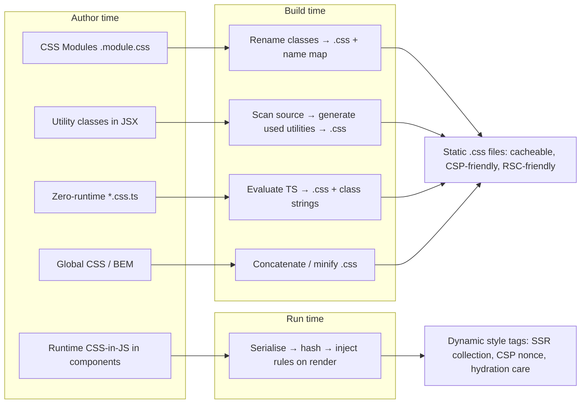
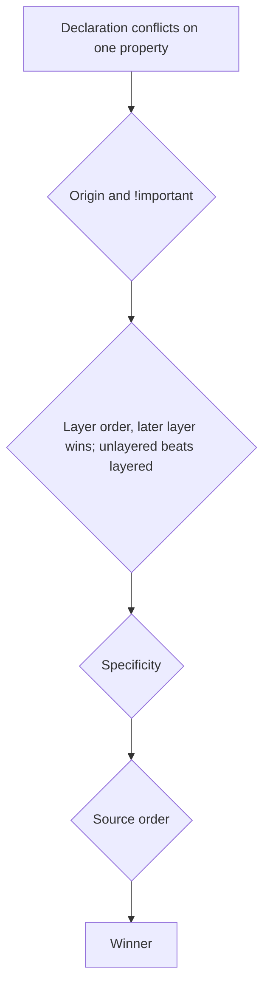
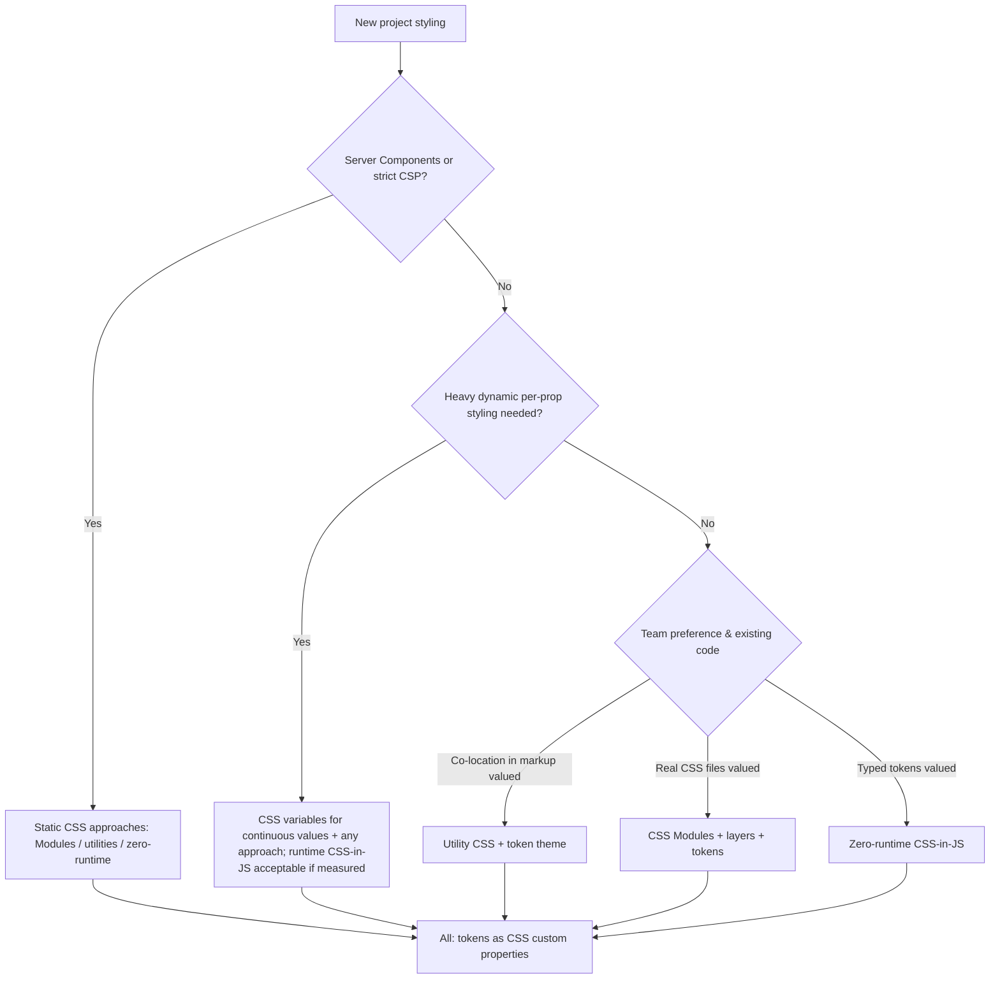

# 04 / 27 — Styling Architecture: CSS Modules, Utility CSS, CSS-in-JS Runtime Cost, Zero-Runtime Styling, and Design Tokens

## 1. Lesson metadata

| | |
|---|---|
| **Level** | Advanced |
| **Study time** | 4–5 hours (reading 2 h, comparison lab 1.5 h, exercises 1.5 h) |
| **Prerequisites** | [20 — Design systems](./20-design-systems.md), [21 — Component libraries](./21-component-libraries.md), [06 — Feature vs layer structure](./06-feature-vs-layer-structure.md), Phase 0 [02 — HTML parsing, DOM, CSSOM, render tree](../00-web-and-javascript-foundations/02-html-parsing-dom-cssom-render-tree.md), Phase 0 [03 — Browser rendering pipeline](../00-web-and-javascript-foundations/03-browser-rendering-pipeline.md), Phase 0 [20 — Tooling, transpilation, bundling](../00-web-and-javascript-foundations/20-tooling-transpilation-and-bundling.md) |
| **Next** | [26 — Phase assessment](./26-phase-assessment.md) |
| **Related** | [25 — Architectural fitness and enforcement](./25-architectural-fitness-and-enforcement.md), Phase 7 [04 — Memoization trade-offs](../07-performance/04-memoization-trade-offs.md), Phase 7 [16 — Bundle analysis](../07-performance/16-bundle-analysis.md), Phase 9 [03 — Server components in depth](../09-advanced-rendering-and-ecosystem/03-server-components-in-depth.md), Phase 10 [06 — Security: XSS, CSRF, CSP](../10-production-engineering/06-security-xss-csrf-csp.md) |

> **Volatility notice.** The styling ecosystem changes quickly: library maintenance status, major versions, configuration formats, and RSC compatibility all move. This lesson teaches the **durable mechanics** (where CSS is generated, when it is injected, what the browser does with it, who owns the cascade) and labels library-specific details ⚠ *verify against current documentation*. Do not choose a tool from this lesson alone; use the criteria and the measurement method.

**Learning objectives.** After this lesson you can:
1. Describe the styling problem in architectural terms: scope, specificity, dead-code elimination, theming, co-location, and the build/runtime split.
2. Explain how each major approach works mechanically: global CSS/BEM, CSS Modules, utility-first CSS, runtime CSS-in-JS, zero-runtime/build-time CSS-in-JS.
3. Explain the runtime cost model of CSS-in-JS (serialisation, hashing, injection, style recalculation, SSR collection, concurrent rendering constraints) and measure it rather than assume it.
4. Explain why Server Components and strict CSP change the calculus.
5. Design a token-driven styling architecture with cascade layers and a defined escape-hatch policy.
6. Choose an approach with explicit criteria and name the team/product contexts where the "default" choice is wrong.
7. Plan a migration between approaches (e.g. runtime CSS-in-JS → CSS Modules or zero-runtime) incrementally.
8. Enforce styling rules (no raw values, no deep selectors, no inline colours) mechanically.

**Concepts covered:** cascade, specificity, source order, cascade layers (`@layer`), scoping, CSS Modules (locally scoped class names), utility-first CSS, atomic CSS, runtime CSS-in-JS, style serialisation, `<style>` injection, CSSOM `insertRule`, zero-runtime CSS-in-JS, static extraction, design tokens as CSS custom properties, theming, critical CSS, FOUC, SSR style collection, `useInsertionEffect`, CSP and `style-src`, dead-CSS removal, co-location, styling escape hatches.

---

## 2. Deep conceptual explanation

### 2.1 What problem is styling architecture solving?

CSS is **global by design**: every rule applies to the whole document, and the winner among competing rules is decided by origin, **layer**, **specificity**, and **source order**. This is powerful and is exactly what makes scale hard:

| Problem | Symptom | Root cause |
|---|---|---|
| **Name collisions** | `.title` in two features clobbers each other | One global namespace |
| **Specificity wars** | `!important`, `#app .page .card .title` | Overrides must out-rank earlier rules |
| **Order dependence** | Works in dev, breaks in prod | Final CSS order depends on bundler chunking/import order |
| **Dead CSS** | 400 KB stylesheet, nobody dares delete | No link from rule → component |
| **Theming** | Dark mode needs edits everywhere | Literal values in rules |
| **Co-location friction** | Change a component → edit 3 files | Style far from markup |
| **Runtime cost** | Slow interactions, large JS | Style computation in JS |
| **Isolation vs consistency** | Components styled in isolation drift apart | No shared constraints |

A styling architecture is the set of decisions that answer: *Where is CSS authored? When is it generated (author-time, build-time, run-time)? How is it scoped? How do tokens reach it? Who may override what?*

### 2.2 The three axes

Every approach is a point in a 3-axis space:

1. **Authoring syntax:** plain CSS files; CSS in JS objects/template literals; utility classes in markup.
2. **Scoping mechanism:** none (convention: BEM); compile-time renamed classes (CSS Modules, extraction tools); generated hashed classes at runtime; atomic classes (one class per declaration).
3. **When CSS is produced:** at author time (hand-written), at **build time** (extracted static `.css`), or at **run time** (computed in the browser from props/theme and injected).

Most debates conflate these. For instance, "CSS-in-JS is slow" is a statement about *run-time generation*, not about co-located authoring; zero-runtime tools keep the authoring but move generation to build time.

### 2.3 The approaches, defined

#### Global CSS / BEM / ITCSS
Hand-authored stylesheets with naming conventions (`.card__title--active`) and layering conventions. Scoping by discipline. Zero runtime. Fails at scale with team turnover because discipline is social, not mechanical.

#### CSS Modules
A `.module.css` file is processed at build time; class names are renamed to unique (hashed) strings and exported as an object. Authored in real CSS; scope is *per-file by default*; no runtime. Dynamic styles are expressed through classes/data-attributes/CSS variables.

#### Utility-first (atomic) CSS (Tailwind CSS and similar)
Markup contains small single-purpose classes (`flex gap-4 p-4 text-sm`). A build step scans source for class names and generates only the CSS used. Scoping problem disappears (classes are global but atomic and stable); design constraints come from a configured scale. Zero runtime for static classes; dynamic values need either predeclared variants, inline style/CSS variables, or arbitrary-value syntax.

#### Runtime CSS-in-JS (styled-components, Emotion, and similar)
Styles are written in JS (template literals/objects), may reference props and theme; at render time the library **serialises** the styles to a string, **hashes** it to a class name, and **injects** rules into a `<style>` element (or CSSOM) if not already present. Strong co-location and dynamic styling; costs at runtime and in server rendering.

#### Zero-runtime / build-time CSS-in-JS (vanilla-extract, Linaria, Panda CSS, StyleX, and similar)
Styles are authored in JS/TS but **evaluated at build time** and emitted as static CSS; the component receives class names. Typed tokens/themes are available; dynamic props must map to precomputed variants or CSS variables. ⚠ Each tool defines "zero-runtime" slightly differently (some ship a tiny runtime helper for variant selection); verify.

#### Native CSS evolution
Modern CSS provides features that reduce the need for tooling: custom properties, `@layer`, `:where()` (zero specificity), `@scope` (MDN lists it as Baseline 2026, newly available since March 2026), container queries, `:has()`, nesting, `color-mix()`. Architectures in 2026 should be evaluated in light of what the platform now offers natively.

### 2.4 Design tokens in styling architecture

Tokens ([20 §2.3](./20-design-systems.md)) are the *integration surface*: whichever approach you choose, **colours, spacing, radii, type, motion come from tokens**, delivered ideally as CSS custom properties. This makes the styling approach **swappable** underneath: CSS Modules, utility classes (configured to emit `var(--…)`), and zero-runtime tools can all consume the same variables. That decoupling is the best migration insurance you can buy.

### 2.5 The runtime-cost model (what actually happens)

For a runtime CSS-in-JS component, per render (conceptual teaching model; libraries differ in caching and optimisations):

1. **Evaluate interpolations** with current props/theme → produces a style string/object.
2. **Serialise** and **hash** → class name. (Cached by input: unchanged inputs reuse the previous result in many libraries.)
3. **Check a registry** whether this class's rules were already inserted.
4. If new: **insert** CSS rules into the document (a `<style>` text append in dev, `CSSStyleSheet.insertRule` in "speedy" modes; ⚠ library specific).
5. The browser **invalidates styles** for matching elements → style recalculation → layout/paint as required ([Phase 0 — 03](../00-web-and-javascript-foundations/03-browser-rendering-pipeline.md)).

Where the cost lands:

| Cost | When | Notes |
|---|---|---|
| JS work per render (steps 1–3) | Every render of every styled component (cache hits are cheaper, not free) | Scales with number of styled elements × render frequency |
| Rule insertion (step 4) | First occurrence of each distinct style | Dynamic props generating *many unique* style combinations create many rules and a growing stylesheet |
| Style recalculation | After any insertion | Insertion into a large stylesheet can invalidate many elements |
| Bundle size | Library runtime (order of several KB to ~tens of KB gzipped depending on library: ⚠ measure current versions) | Plus styled wrappers per component |
| SSR | Collect styles used during render and serialise them into HTML (`<style>` tags) | Requires wiring; with streaming and Suspense it is more delicate |
| Hydration | Class names generated on client must match the server | Mismatch → flash/warnings |

**Concurrent rendering constraint.** Render must be pure ([component purity](../01-react-fundamentals/12-component-purity.md)). Injecting styles *during render* is a side effect; with concurrent rendering a render may be started and discarded. React provides `useInsertionEffect`, which runs before layout effects/DOM reads and is intended for CSS-in-JS libraries to inject styles at the right time (see the React reference for `useInsertionEffect`). Libraries have had to adapt: ⚠ library versions differ in how they comply, and historical versions had issues with React 18 concurrent features and with RSC.

**Server Components constraint.** Server Components do not run client hooks or context; runtime CSS-in-JS that relies on React context for theme and on client-side style registries cannot run in Server Components. Frameworks and libraries have responded in different ways (marking styled components as Client Components; or recommending build-time/CSS-file approaches). ⚠ **Volatile:** check the library's current RSC documentation and Phase 9 [03](../09-advanced-rendering-and-ecosystem/03-server-components-in-depth.md).

**CSP constraint.** Libraries injecting `<style>` tags at runtime need `style-src` allowance (nonce or `'unsafe-inline'`); static CSS files avoid this. Inline `style` attributes are governed by `style-src-attr`. ⚠ Verify policy semantics in the CSP docs.

### 2.6 Misconceptions

| Misconception | Reality |
|---|---|
| "CSS-in-JS is always slow." | Cost depends on the number of styled elements, render frequency, dynamic-style cardinality, and the library. Many apps never feel it; large lists with dynamic styles do. **Measure.** |
| "CSS Modules solve specificity." | They solve *name collisions*. Specificity and order problems remain between modules and global CSS; use layers. |
| "Utility CSS is inline styles." | Inline styles cannot express pseudo-classes, media queries, or share a stylesheet; utility classes can, and are cacheable. |
| "Utility CSS creates huge CSS." | Output is typically small because only used utilities are generated and each is reused; but arbitrary values and huge safelists can inflate it. Measure the built file. |
| "Zero-runtime means no JS at all." | No *style generation* at runtime; variant helpers or small runtime utilities may exist. |
| "Tailwind makes tokens unnecessary." | Its theme *is* a token configuration; the architectural question is whether it maps to your system's tokens. |
| "Switching theme requires re-render." | Not with CSS custom properties. |
| "One approach per repo." | Mixing is common and sometimes right (e.g. layout utilities + CSS Modules for components), if rules for each are explicit. |

---

## 3. Internal mechanics

### 3.1 Public guarantee / teaching model / implementation detail

| Category | Content |
|---|---|
| **Public guarantee (CSS)** | Cascade resolution order (origin/importance → layers → specificity → source order); custom property inheritance; `@layer` ordering semantics; `:where()` has zero specificity. |
| **Public guarantee (React)** | Render must be pure; `useInsertionEffect` exists to insert styles before layout effects fire; `style` prop accepts an object of camelCase properties and CSS custom properties; `className` is a string. |
| **Teaching model** | "Who generates the CSS, and when? Who owns precedence?" |
| **Implementation detail** | Each library's hashing algorithm, caching policy, whether rules are inserted via text nodes or `insertRule`, the specific loader that renames CSS Module classes, the scanner that finds Tailwind class names. ⚠ Not API; verify and measure. |

### 3.2 CSS Modules mechanics

The bundler's CSS pipeline parses the `.module.css`, rewrites each local class (e.g. `.root` → `Button_root__x7f3a`), emits the rewritten CSS into the CSS output, and generates a JS module that exports the name map. At runtime, `styles.root` is just a string lookup. Consequences:

- **No runtime generation**; CSS is a normal cacheable file (per chunk).
- **Dead-code elimination** is not automatic for unused classes inside a file, but unused *files* are not bundled if their JS module is not imported.
- **Dynamic styling** requires: conditional class names, `data-*` attributes with attribute selectors, or CSS custom properties set via `style`.
- Selectors across modules are brittle (`:global`, `composes`); treat each module as private.
- ⚠ Class name format and `composes` behaviour are tool configuration.

```tsx
// Card.tsx
import styles from "./Card.module.css";
export function Card({ tone = "default", children }: { tone?: "default" | "warning"; children: React.ReactNode }) {
  return <section className={styles.root} data-tone={tone}>{children}</section>;
}
```
```css
/* Card.module.css */
@layer components {
  .root { padding: var(--space-4); border-radius: var(--radius-md); background: var(--color-surface-default); }
  .root[data-tone="warning"] { background: var(--color-feedback-warning-surface); }
}
```

### 3.3 Utility CSS mechanics

A scanner reads source files, extracts candidate class tokens, matches them against the configured utility/variant grammar, and **generates the corresponding rules**. Output size is bounded by the number of *distinct* utilities used. Class strings must be **statically discoverable**: `className={"p-" + size}` defeats the scanner because the full class name never appears in source (the classic dynamic-class bug). Mapping tables (`{ sm: "p-2", lg: "p-6" }`) are the correct pattern.

Theme configuration maps names to values; best practice is values referencing CSS variables so the same tokens drive both utilities and component CSS. ⚠ Configuration format changed across major versions (JS config vs CSS-first config); verify current docs.

### 3.4 Runtime CSS-in-JS mechanics, in code

A minimal conceptual implementation to expose the cost (for teaching; not a library):

```tsx
// Conceptual only: what runtime CSS-in-JS does
const registry = new Set<string>();
let sheet: CSSStyleSheet | null = null;

function hash(s: string) { let h = 5381; for (let i = 0; i < s.length; i++) h = (h * 33) ^ s.charCodeAt(i); return (h >>> 0).toString(36); }

function css(style: Record<string, string | number>) {
  const body = Object.entries(style).map(([k, v]) => `${k.replace(/[A-Z]/g, m => "-" + m.toLowerCase())}:${v}`).join(";");  // 1. serialise
  const cls = "c" + hash(body);                                                                                              // 2. hash
  if (!registry.has(cls)) {                                                                                                  // 3. registry
    registry.add(cls);
    sheet ??= (() => { const el = document.createElement("style"); document.head.appendChild(el); return el.sheet!; })();
    sheet.insertRule(`.${cls}{${body}}`, sheet.cssRules.length);                                                             // 4. inject
  }
  return cls;
}

function Box({ size }: { size: number }) {
  return <div className={css({ width: size, height: size, background: "tomato" })} />;
}
```

**Predict:** rendering `<Box size={n}/>` for n = 1…10,000 (e.g. in an animation or a slider driving `size`). *Result:* 10,000 distinct rules in the stylesheet and ten thousand `insertRule` calls with a style recalculation implication each time; memory for the registry and sheet grows monotonically. Real libraries handle this with the same fundamental shape (⚠ some support "dynamic styles via CSS variables" to avoid the rule-per-value explosion). **Lesson:** high-cardinality dynamic values belong in **inline style / CSS custom properties**, not in generated classes, in *every* approach:

```tsx
<div className={styles.box} style={{ "--size": `${n}px` } as React.CSSProperties} />
/* .box { width: var(--size); height: var(--size); background: var(--color-feedback-danger); } */
```

One rule; the variable changes per element: no injection, no growth.

### 3.5 Zero-runtime mechanics

A build plugin evaluates style definitions at build time (executing the TS module in a build-time context), emits `.css`, and replaces call sites by class-name strings. Typed themes (the *contract*) are compile-time constants; theme *values* are emitted as CSS variables. Constraints: style expressions must be statically evaluable (no arbitrary runtime props inside style definitions); dynamic behaviour → variant maps or CSS variables. ⚠ Tooling complexity: the build plugin is part of your critical path (bundler support, test runner support, Storybook support).

### 3.6 Cascade layers as the integration mechanism

`@layer` lets you declare precedence **independent of source order**:

```css
@layer reset, tokens, base, components, utilities, overrides;
```

Rules in later layers beat earlier layers regardless of specificity (unlayered styles beat layered ones, a common surprise: ⚠ verify the precedence rules in MDN). This is the cleanest way to let *design-system CSS* (layer `components`), *utility classes* (layer `utilities`) and *product overrides* (`overrides`) coexist deterministically, solving the order-dependence problem of §2.1. Declare the layer order once, at the top of the entry CSS, before any imports.

---

## 4. Step-by-step execution walkthrough

**Scenario:** a product page with a list of 200 product cards; each card has a "selected" state and a price badge colour that depends on stock level (`low | ok | high`). A user clicks one card to select it. Compare what happens in three architectures. (Counts assume the whole list re-renders; memoisation changes the number of renders but not the style mechanics. See [Phase 7](../07-performance/04-memoization-trade-offs.md).)

**A. CSS Modules + data attributes**
1. Click handler sets `selectedId` state in the list parent. React re-renders `<Card>` elements (parent re-render). Each `Card` is a pure function returning `<article className={styles.root} data-selected={selected} data-stock={stock}>`.
2. React reconciles: only the previously selected and newly selected cards' `data-selected` attribute differ → 2 attribute mutations (commit phase).
3. Browser: attribute selectors `.root[data-selected="true"]` re-match for 2 elements → style recalculation scoped to those elements; paint for 2 cards.
4. JS style cost: **none** (string lookups only).

**B. Runtime CSS-in-JS with props**
1. Same re-render. Each styled `Card` evaluates its interpolation with props → serialise → hash → registry lookup. For 200 cards: 200 evaluations (cache hits: mostly string work). Variants are few (selected × stock = 6), so ~6 rules exist after the first render.
2. Two cards produce a different class → 2 `className` mutations.
3. First time `selected=true`+stock=`low` appears, a **rule insertion** occurs → style recalc may cover the stylesheet-dependent elements.
4. DOM effect equals A's (2 class changes), but **JS work and possible stylesheet mutation** happened on the main thread in the render/commit window.

If instead the style depended on a *continuous* value (e.g. drag position per card), the number of distinct rules would be unbounded (§3.4).

**C. Utility classes**
1. Same re-render; `className` is computed by a lookup (`selected ? "bg-blue-50 ring-2" : "bg-white"`) per card; no style generation at runtime.
2. 2 `className` mutations; CSS already exists.
3. Cost: long `className` strings in markup (bytes in HTML for SSR, DOM size trivial).

**Observation:** with *bounded* variants all three are within a few milliseconds for 200 cards on modern hardware; **differences become visible with large counts, high-cardinality dynamic styles, low-end devices, or hydration of big pages.** Always measure with the Profiler and the Performance panel ([Phase 7 — 02](../07-performance/02-profiler-workflows.md)).

---

## 5. Code examples

### 5.1 Minimal: layered CSS with tokens (architecture skeleton)

```css
/* src/app/styles/index.css: imported once at the app entry */
@layer reset, tokens, base, components, utilities;

@import "./reset.css" layer(reset);
@import "@acme/ui/tokens.css" layer(tokens);
@import "./base.css" layer(base);
```
Notes: `@import ... layer(name)` assigns imported CSS to a layer (⚠ verify bundler support and that your CSS pipeline processes `@import` before layers are evaluated; many setups inline imports at build time). Component modules declare `@layer components { … }` themselves, as in §3.2.

### 5.2 Practical: variant styling without runtime generation (CSS Modules + `data-*`)

```tsx
import styles from "./Badge.module.css";

type Tone = "neutral" | "success" | "danger";
export function Badge({ tone = "neutral", children }: { tone?: Tone; children: React.ReactNode }) {
  return <span className={styles.root} data-tone={tone}>{children}</span>;
}
```
```css
@layer components {
  .root { padding: var(--space-1) var(--space-2); border-radius: var(--radius-md); font-size: 0.875rem; }
  .root[data-tone="neutral"] { background: var(--color-surface-sunken); color: var(--color-text-default); }
  .root[data-tone="success"] { background: var(--color-feedback-success-surface); color: var(--color-feedback-success-text); }
  .root[data-tone="danger"]  { background: var(--color-feedback-danger-surface);  color: var(--color-feedback-danger-text); }
}
```
Why `data-*` over `styles[tone]`: closed set documented in markup and visible in DevTools; attribute selectors have equal specificity (0,2,0) so order inside the layer is predictable; and test queries (`toHaveAttribute("data-tone", "danger")`) do not depend on hashed names.

### 5.3 Utility classes: static discoverability

```tsx
// ❌ The scanner cannot see these class names
function Gap({ n }: { n: number }) { return <div className={`gap-${n}`} />; }

// ✔ Closed mapping; every class appears literally in source
const gapClass = { 1: "gap-1", 2: "gap-2", 4: "gap-4" } as const;
function Gap({ n }: { n: keyof typeof gapClass }) { return <div className={gapClass[n]} />; }
```
**Predict:** with `n = 3` in the first version, what renders? A `div` with class `gap-3` that has *no CSS* if no other file contains the literal string `gap-3`: the page looks unstyled in production, while in a dev environment that happens to include the class elsewhere it may look fine: a classic "works on my machine".

### 5.4 Variant composition with a class-merging helper (utility approach)

```tsx
import { clsx } from "clsx";   // small class-name joiner: verify package/version

type Variant = "primary" | "ghost";
const variants: Record<Variant, string> = {
  primary: "bg-[--color-action-primary] text-[--color-on-action]",  // ⚠ arbitrary-value/variable syntax differs by version; verify
  ghost: "bg-transparent text-[--color-text-default]",
};

export function Button({ variant = "primary", className, ...rest }: React.ComponentProps<"button"> & { variant?: Variant }) {
  return <button {...rest} className={clsx("rounded-md px-4 py-2 focus-visible:outline-2", variants[variant], className)} />;
}
```
Trade-off visible here: utility conflicts (`px-4` vs a consumer's `px-2` in `className`) are resolved by CSS **source order**, not by class order in the attribute. Helpers that merge/dedupe conflicting utilities exist (⚠ verify), and that dependence on a helper is part of the architecture's cost.

### 5.5 Runtime CSS-in-JS with a bounded variant set, and the high-cardinality trap

```tsx
// styled-components/Emotion-style API (illustrative; verify current package APIs)
const Bar = styled.div<{ $pct: number }>`
  width: ${p => p.$pct}%;           /* ❌ unbounded: new class per distinct percentage */
  height: 8px;
  background: var(--color-action-primary);
`;
```
**Corrected** (one class, value via variable):
```tsx
const Bar = styled.div`
  width: var(--pct);
  height: 8px;
  background: var(--color-action-primary);
`;
<Bar style={{ "--pct": `${pct}%` } as React.CSSProperties} />
```
The same transformation applies to every approach: *discrete variants in classes, continuous values in CSS variables.*

### 5.6 Zero-runtime style definition (illustrative shape)

```ts
// button.css.ts (vanilla-extract-style API; ⚠ verify names/signatures in current docs)
import { style, styleVariants } from "@vanilla-extract/css";
import { vars } from "./theme.css";

export const base = style({
  padding: `${vars.space[2]} ${vars.space[4]}`,
  borderRadius: vars.radius.md,
});
export const variant = styleVariants({
  primary: { background: vars.color.action.primary, color: vars.color.onAction },
  danger:  { background: vars.color.feedback.danger, color: vars.color.onAction },
});
```
```tsx
// Button.tsx
import { base, variant } from "./button.css";
export function Button({ v = "primary", ...rest }: React.ComponentProps<"button"> & { v?: keyof typeof variant }) {
  return <button {...rest} className={`${base} ${variant[v]}`} />;
}
```
`vars` are typed references that compile to `var(--hashed-name)`. Type-safety on tokens is the headline benefit; the cost is a build plugin and `*.css.ts` file convention.

### 5.7 Incorrect: specificity arms race and its layered fix

```css
/* ❌ product CSS tries to restyle a design-system button */
.checkout .actions button.primary { background: orange !important; }
```
**Corrected, deterministic by design:**
```css
@layer reset, tokens, base, components, overrides;
@layer overrides {
  .checkout-actions [data-variant="primary"] { background: var(--color-promo); }  /* no !important needed: later layer wins */
}
```
Even better: ask for a `promo` variant in the system ([20 §5.5](./20-design-systems.md)). A documented **override layer** is an escape hatch with a defined cost; undocumented `!important` is an uncontrolled one.

### 5.8 Advanced: measuring style cost in the browser

```ts
// Dev-only helper: count stylesheet rules and measure style recalculation proxy
export function logStyleStats(label: string) {
  let rules = 0;
  for (const sheet of Array.from(document.styleSheets)) {
    try { rules += sheet.cssRules.length; } catch { /* cross-origin sheet: skip */ }
  }
  console.log(label, { sheets: document.styleSheets.length, rules });
}
// Call before/after a suspicious interaction. A growing rule count under repeated interaction signals
// unbounded dynamic classes (§3.4).
```
Complement with DevTools → Performance: look for "Recalculate Style" blocks and "Update Layer Tree"; the "Selector Stats" option in the Performance panel (⚠ availability depends on browser version) shows which selectors are expensive. Build artefacts: `ls -l dist/assets/*.css` and a CSS-coverage run (DevTools → Coverage) show unused CSS fractions.

---

## 6. Visual explanations

### 6.1 Where CSS is produced



### 6.2 Cascade resolution with layers


(Simplified: `!important` inverts layer precedence among important declarations; verify exact rules in MDN's cascade documentation.)

### 6.3 Decision flow



---

## 7. Alternative approaches and trade-offs

For each: problem solved, folder structure, dependency rules, code, pros/cons, size guidance, failure modes, migration.

### 7.1 Approach A — Global CSS with a convention (BEM / ITCSS)

**Problem solved.** Small sites, server-rendered pages, teams that want zero tooling.
**Folder structure**
```
src/styles/
  00-settings/ (tokens)   10-tools/   20-generic/ (reset)   30-elements/
  40-objects/ (layout)    50-components/ (card.css, button.css)   60-utilities/
```
**Dependency rules.** Lower-numbered layers never reference higher; components never style other components' internals; naming convention enforced by a linter (stylelint pattern rules; ⚠ verify config).
**Pros.** No tooling; transparent; universal.
**Cons.** Convention-only scoping; dead-CSS accumulation; order dependence.
**Size.** ≤ ~5 contributors, ≤ ~50 components, or content sites.
**Failure modes.** `!important` creep; unremovable CSS; accidental global overrides when two teams pick the same class.
**Migration.** To CSS Modules: convert one component file at a time (rename `.card` → module class), keep global layers for reset/tokens; use `@layer` to put legacy CSS in a **lowest-priority** layer so new modules always win without specificity hacks.

### 7.2 Approach B — CSS Modules + tokens + layers (default for many teams)

**Problem solved.** Scoped authoring in real CSS, zero runtime, RSC/CSP-friendly.
**Folder structure**
```
src/
  app/styles/{index.css, reset.css, base.css}
  shared/ui/Button/{Button.tsx, Button.module.css}
  features/orders/ui/OrderCard/{OrderCard.tsx, OrderCard.module.css}
```
**Dependency rules.** A module styles **only its own** component; cross-component customisation happens via props/`data-*`/CSS variables, never by selecting another module's class. Tokens only via `var(--…)`. `:global` is allowed only in `app/styles`. Enforce with stylelint (`selector-pseudo-class-disallowed-list` for `:global` outside allowed paths; `declaration-property-value-allowed-list` / disallowed regex for raw colours; ⚠ verify rule names).
**Code.** §3.2, §5.2.
**Pros.** Real CSS (fully platform-native features), no runtime, tooling is widely supported; easy to onboard; good DevTools mapping (source maps to the module file).
**Cons.** Dynamic styling needs variables/attributes; no typed tokens by default (types for class names are available via generators ⚠ verify); naming across co-located files can be verbose; theming consistency relies on lint discipline.
**Size.** Any size; very large organisations add token pipelines and lint.
**Failure modes.** Cross-module selectors; `composes` chains making hidden dependencies; CSS order differences between dev and prod when not using layers.
**Migration.** From runtime CSS-in-JS: see §7.5 migration plan.

### 7.3 Approach C — Utility-first CSS (e.g. Tailwind) with a tokenised theme

**Problem solved.** Fast iteration, co-located styles, enforced scale, no naming, small CSS output.
**Folder structure**
```
src/
  app/styles/index.css          # entry: layers + theme mapping to tokens
  shared/ui/Button.tsx          # utility classes encapsulated inside components
  features/*/ui/*.tsx
tailwind config (JS or CSS-first, depending on major version ⚠ verify)
```
**Dependency rules.** Utilities live **inside components in the UI layer and features' UI**; pages compose components rather than re-declaring complex utility strings; repeated utility clusters are extracted into *components* (not `@apply` classes) as the primary reuse mechanism; theme values reference tokens (`--color-…`). Lint: class ordering/sorting plugin and a rule against arbitrary values outside an allow-list (⚠ verify available plugins).
**Code.** §5.3, §5.4.
**Pros.** Co-location; stable output size; low naming overhead; strong constraint to the scale; no runtime; great for prototyping and product code.
**Cons.** Long class lists reduce markup readability; conflicting utility resolution is source-order based; dynamic class construction pitfalls; design-system components still need variant logic in JS; consumers of a *library* built with utilities must also run the scanner or receive a built stylesheet (a packaging concern: [21 §3.4](./21-component-libraries.md)).
**Size.** Small teams to large organisations; extraction discipline is essential beyond ~20 contributors.
**Failure modes.** "Class soup" duplicated across files; arbitrary-value sprawl bypassing the scale; library authors shipping utility class names that depend on consumer configuration.
**Migration.** Introduce alongside existing CSS using a **layer** (`utilities`) placed above legacy CSS; convert component by component; keep legacy CSS lowest-priority. Reverse (utilities → modules): generate CSS Module files per component from class lists (semi-manual).

### 7.4 Approach D — Runtime CSS-in-JS (styled-components / Emotion style)

**Problem solved.** Prop- and theme-driven styling co-located with logic; dynamic styling ergonomics; historically the dominant React approach.
**Folder structure.** `Component.tsx` containing styled definitions or `Component.styles.ts` alongside.
**Dependency rules.** Theme object defined once, accessed via the library's theme context; **styled components never defined inside render functions** (a new component type per render → remount, state loss, and style churn); high-cardinality values via CSS variables; no style logic in presentation components that belongs in tokens.
**Code.** §3.4, §5.5.
**Pros.** Excellent co-location; dynamic styles from props; typed theme with TypeScript augmentation; large ecosystem and familiarity.
**Cons.** Runtime cost (§2.5); SSR/streaming plumbing; friction with Server Components and strict CSP; library bundle; ⚠ ecosystem health: check each library's **current maintenance status and React-version support** before adopting (some prominent libraries announced reduced maintenance or recommended migration paths; verify the project's own announcements).
**Size.** Fine for small–mid apps with bounded dynamism; scrutinise for large lists, animations, low-end device targets, and RSC adoption.
**Failure modes.** Styled component defined in render (remount bug); unbounded dynamic styles; styles injected during hydration causing mismatches; theme provider re-render storms ([context propagation cost](../07-performance/06-context-propagation-cost.md)); order conflicts with other CSS.
**Migration.** See §7.5.

**Anti-pattern code (components created during render):**
```tsx
function Page({ color }: { color: string }) {
  const Title = styled.h1`color: ${color};`;   // ❌ new component type on every render
  return <Title>Hello</Title>;                  // → React sees a different type each render → unmount/remount
}
```
Predict: each `Page` render creates a *different* `Title` function identity; reconciliation ([Phase 2](../02-react-rendering-and-internals/)) compares element types by identity → destroy and recreate DOM subtree every render; any state/focus inside is lost. Fix: define `Title` at module scope and pass colour via prop or CSS variable.

### 7.5 Migration plan: runtime CSS-in-JS → CSS Modules (or zero-runtime)

1. **Stabilise tokens first.** Expose the theme as CSS custom properties (generate `tokens.css` from the theme object; set vars on the root). Components keep working; new CSS can now consume the same values.
2. **Establish layers.** Declare `@layer` order; put the CSS-in-JS output in a known position (some libraries support specifying insertion point or layers; ⚠ verify), so new CSS Modules have deterministic precedence.
3. **Freeze new styled components** via lint (`no-restricted-imports` for the CSS-in-JS package in new directories).
4. **Convert leaf components first** (Button, Badge, Text) because they have the most reuse; convert dynamic props to `data-*` variants or CSS variables.
5. **Convert by feature**, using codemod-assisted extraction where possible; do not convert components that are about to be deleted.
6. **Run both** with the bundle-size and performance dashboards; measure improvements (JS size, scripting time, hydration time, LCP/INP; Phase 7 [21](../07-performance/21-web-vitals-and-budgets.md)).
7. **Remove the theme provider and library** last, once the import count is zero (ratchet: [25](./25-architectural-fitness-and-enforcement.md)).

Typical pitfalls: components that *style children by referencing other styled components* (`${Button}:hover &`) need explicit redesign; `as`/`attrs` usage; global styles injected by the library; tests relying on generated class names or jest-styled-components snapshots.

### 7.6 Approach E — Zero-runtime CSS-in-JS (vanilla-extract / Panda / StyleX / Linaria style)

**Problem solved.** Keep TypeScript-authored styles and typed tokens without runtime cost; RSC/CSP-compatible output.
**Folder structure**
```
src/shared/ui/Button/{Button.tsx, button.css.ts}
src/shared/theme/{contract.css.ts, light.css.ts, dark.css.ts}
```
**Dependency rules.** `*.css.ts` files are **build-time only**: they must not import runtime code (React, app state) and are never bundled into JS; themes implement a typed **contract**; components select precomputed variants.
**Code.** §5.6.
**Pros.** Typed tokens/contract; static CSS; scoped classes; good for design-system packages (no consumer runtime); strong DX when TS-first.
**Cons.** Build-plugin integration (bundler/test/Storybook/SSR support must be verified per tool); evaluation-time constraints (no runtime props inside definitions); smaller ecosystems; tool-specific mental models and migrations when a tool changes direction (⚠ check maintenance/health).
**Size.** Well-suited to design-system packages and mid–large teams that value typed tokens.
**Failure modes.** Build-time evaluation errors that are hard to debug; plugin lag behind bundler major versions; devs trying runtime values and finding they are not supported.
**Migration.** From CSS Modules: convert modules to `*.css.ts` file-by-file with tokens as typed vars; from runtime CSS-in-JS: syntax is similar enough that codemods or semi-manual conversion work, but dynamic props must be redesigned.

### 7.7 Comparison table

| Criterion | A: Global/BEM | B: CSS Modules | C: Utility-first | D: Runtime CSS-in-JS | E: Zero-runtime |
|---|---|---|---|---|---|
| Runtime style generation | None | None | None | **Yes** | None |
| Scoping | Convention | Compiler | Atomic/global | Hashed | Compiler |
| Co-location | Separate file | Adjacent file | In markup | In component | Adjacent TS |
| Dynamic per-prop styles | Poor | Via vars/attrs | Via variants/vars | **Excellent** | Via variants/vars |
| Typed tokens | No | Limited | Config-driven | Theme typing | **Strong** |
| RSC compatibility | Yes | Yes | Yes | **Needs care** ⚠ | Yes |
| Strict CSP | Yes | Yes | Yes | Needs nonce/policy | Yes |
| Bundle JS cost | 0 | 0 (tiny maps) | 0 | Library + wrappers | ~0 |
| Dead-CSS control | Weak | Medium (file-level) | **Strong** (generated by use) | Medium–strong | Medium–strong |
| Build complexity | None | Low | Low–medium | Low | Medium |
| Onboarding | Easy | Easy | Medium (vocabulary) | Medium | Medium–high |
| Best for | Content sites | General product code | Fast product iteration | Highly dynamic UI, legacy codebases | Design-system libs, TS-first teams |

**Where the "default" (B or C) is NOT best.** (1) A **highly dynamic** UI, such as a design tool or data visualisation where each of thousands of elements has computed styles, wants inline styles/CSS variables or canvas/SVG attributes: any class-based approach is the wrong lens. (2) An **existing large codebase** on runtime CSS-in-JS with no performance problem and no RSC plan should usually *not* migrate; the migration cost outweighs benefits (see §8 on "migration for fashion"). (3) A **multi-framework design system** may prefer plain CSS + custom properties (consumable from any framework) over React-bound styling.

### 7.8 Mixing approaches: explicit rules

A common, healthy hybrid: **tokens (CSS variables) + CSS Modules for components + a few layout utilities** (`stack`, `cluster`, or a utility framework restricted to layout). Rules: (1) tokens are the only shared vocabulary; (2) each concern has one tool (components = modules; layout = utilities); (3) layers define precedence; (4) lint forbids the third tool. An unmanaged mixture is the failure mode (three systems, each half-adopted).

---

## 8. Best practices and anti-patterns

### 8.1 Practices

1. **Tokens as CSS custom properties, always.** Choose the authoring tool second.
2. **Declare cascade layers once**; give legacy CSS the lowest layer and overrides the highest.
3. **Discrete variants → classes/data attributes; continuous values → CSS variables.**
4. **Style your own component only.** Customisation via the public API (props, data attributes, variables), not by selecting internals.
5. **Co-locate styles with components**; delete together.
6. **Measure**: built CSS size, coverage, "Recalculate Style" cost, hydration time, JS bundle share of styling runtime.
7. **Enforce mechanically**: stylelint for raw colours/`!important`/`:global`; ESLint restricted imports for the styling libraries; CI size budget for the CSS output ([25](./25-architectural-fitness-and-enforcement.md)).
8. **Respect user preferences**: `prefers-reduced-motion`, `prefers-color-scheme`, `forced-colors` (high-contrast modes) and zoom; never rely on colour alone.
9. **Use logical properties** (`margin-inline`, `padding-block`) for RTL readiness.
10. **Avoid flashes**: critical CSS for first paint in SSR; correct theme before first paint; font loading strategy (`font-display`) as part of styling architecture.
11. **Document escape hatches** and their cost.

### 8.2 Anti-patterns

| Anti-pattern | Why it hurts | Fix |
|---|---|---|
| `!important` as a strategy | Escalating specificity wars | Layers; component API |
| Styled component declared in render | Remounts, performance | Module scope |
| Unbounded dynamic classes (value per pixel) | Rule explosion | CSS variables |
| Dynamic Tailwind class strings | Missing CSS in production | Static mapping |
| Cross-component selectors (`.card .btn`) | Hidden coupling | Props/slots/variables |
| Inline styles for static look | No pseudo-classes, bigger HTML, CSP | Classes |
| Inline styles forbidden entirely | Blocks legit dynamic values | Allow CSS custom property setting only |
| Raw hex/px values in components | Theming breaks | Tokens + lint |
| `@apply` everywhere in utility setups | Recreates global CSS naming problems | Extract components |
| Theme in React context for colours that CSS variables can serve | Re-render cost | CSS variables ([20 §3.2](./20-design-systems.md)) |
| Migrating styling tech "because it is old" | Cost with no measured benefit | Measure; migrate on evidence |
| Global CSS reset duplicates in every package | Inconsistent baselines | One reset in app entry |

### 8.3 Justified exceptions

- Inline `style` for **per-instance geometry** (positions in a virtualised list, drag offsets, chart bar widths) is the right tool ([Phase 7 — 09](../07-performance/09-windowing-and-virtualization.md)).
- `!important` is justified in *utility* layers by design (e.g. a `.visually-hidden` or `.hidden` utility), documented and isolated in the top layer.
- A runtime CSS-in-JS library is justified in a codebase where dynamic theming from *user-authored data* (white-label colours loaded at runtime) is core: though CSS variables set at runtime usually cover it with less cost.

---

## 9. Real-world application

| Domain | Constraint | Styling consequence |
|---|---|---|
| **E-commerce** | LCP/INP sensitivity; SSR; many campaign skins | Static CSS; critical CSS; tokens for campaign themes; avoid runtime style injection on the critical path |
| **Dashboards** | Thousands of cells; density modes | CSS variables for density; avoid per-cell generated classes; contain layout (`contain`) where appropriate (⚠ measure) |
| **Finance / regulated** | A11y compliance; audit | Forced-colours and zoom testing; contrast tokens verified in CI; stable styling API |
| **Forms** | State styling (invalid, disabled) | `:user-invalid`/`aria-invalid` based selectors (⚠ browser support of `:user-invalid`; verify); consistent focus rings |
| **Auth/embedded widgets** | Strict CSP; host page CSS interference | Static CSS; scoped styles; consider Shadow DOM or `@scope`/layers to isolate (⚠ verify support) |
| **Realtime** | Frequent updates | Avoid style recomputation on each tick; CSS animations/transitions over JS-driven style changes |
| **Multi-team** | Shared tokens, independent releases | Tokens in a package; each team picks within allowed approaches; layers define precedence ([23](./23-multi-team-ownership.md)) |
| **White-label** | Per-customer brand | Runtime-set CSS variables from customer config; no per-customer builds when avoidable |

**Engineering constraints.** Two styling systems in the same page need a precedence contract (layers). Third-party widgets bring their own CSS; isolate with layers or wrappers. Print styles, email (separate, inline CSS), and PDF generation need separate consideration.

**Size/performance orders of magnitude (verify per project, not benchmarks).** Hand-written product CSS of tens of KB gzipped is common; utility-first outputs are frequently in the single-digit-to-low-tens KB range for typical apps; a runtime CSS-in-JS library adds its own gzipped KB plus per-component wrappers and runtime scripting time on first render and updates. Use your own bundle analysis.

---

## 10. Debugging and troubleshooting

### 10.1 "Styles differ between dev and production"
- **Symptom:** a margin is 8px in dev, 16px in production.
- **Investigate:** DevTools → Elements → Styles pane shows both rules; check which stylesheet each comes from and the chunk order (Network → CSS files order; Sources).
- **Root cause:** equal specificity resolved by source order, which differs after bundler chunking/CSS minification/reordering.
- **Fix:** put sources into `@layer`s with explicit order; raise intent via structure rather than specificity.
- **Validate:** build in production mode locally; compare computed styles; add a visual regression test against the production build.

### 10.2 "A Tailwind class works locally but not in production"
- **Investigate:** search the built CSS for the class; search source for the literal string.
- **Root cause:** dynamically assembled class name or a file path not covered by the scanner's content configuration.
- **Fix:** static mapping or safelist; correct content globs (⚠ verify config mechanism for your version).

### 10.3 "Flash of unstyled content on SSR with CSS-in-JS"
- **Investigate:** View Source (is there a `<style data-…>` block in the server HTML?); Network waterfall; disable JS and reload.
- **Root cause:** style collection not wired into the server renderer, or streamed segments render before their styles are emitted.
- **Fix:** follow the library's SSR integration for your framework; or move to extracted CSS. ⚠ Verify against current library and framework docs.

### 10.4 "Typing in an input is janky only on large pages"
- **Investigate:** Performance panel: long "Recalculate Style" or scripting dominated by style serialisation; React Profiler shows many styled components re-rendering on each keystroke.
- **Root cause:** state at too high a level re-rendering a tree of styled components (each doing style work), or an enormous stylesheet with expensive selectors.
- **Fix:** colocate state ([15](./15-state-ownership.md)); memoise or restructure; shift dynamic values to CSS variables; simplify selectors; reconsider approach only if measurement implicates the library.

### 10.5 "Dark theme: some elements don't switch"
- **Investigate:** Computed → trace a colour to a literal; search code for hex values.
- **Root cause:** raw values or a primitive token referenced in a component.
- **Fix:** semantic tokens; lint rule; visual regression in both themes.

### 10.6 "Hydration warning about class names"
- **Root cause:** classes generated on server differ from client (different library instance, different order of style generation, or random ids).
- **Fix:** single library instance; deterministic generation per library docs; verify SSR config.

---

## 11. Exercises

### Level A — Knowledge
A1. List the three axes along which styling approaches differ and place CSS Modules, runtime CSS-in-JS, and zero-runtime CSS-in-JS on them.
A2. What problem do CSS Modules solve and which problems do they not solve?
A3. Why are dynamically constructed utility class names a problem?
A4. State the rule "discrete variants in classes, continuous values in CSS variables" and give the reason.
A5. What does `useInsertionEffect` exist for?
A6. Why does CSS custom property theming avoid React re-renders?

### Level B — Code comprehension
B1. Predict and explain: a `Slider` renders `<Thumb style={{ left: `${x}%` }}/>` vs a styled-component whose `left` depends on a prop. In a drag from 0 to 100 with integer percentages, how many generated rules might each approach create, in the worst case?
B2. Find the bug:
```tsx
function Row({ highlight }: { highlight: boolean }) {
  const Cell = styled.td`background: ${highlight ? "yellow" : "white"};`;
  return <tr><Cell><input /></Cell></tr>;
}
```
B3. Given layers `@layer a, b;` and rules `a: .x{color:red}`, `b: .x{color:blue}`, and an unlayered `.x{color:green}`, what colour wins and why? What if the green rule is moved inside `@layer a`?
B4. Why can `sideEffects: false` on a library using per-component CSS imports remove styles in production? (See [21](./21-component-libraries.md).)

### Level C — Implementation
C1. Convert the `Badge` of §5.2 from CSS Modules to utility classes using a closed mapping, preserving the `tone` API and tokens.
C2. Write the CSS entry that declares layers, imports a tokens file into the `tokens` layer, and defines a `.visually-hidden` utility in the `utilities` layer.
C3. Write a stylelint-style rule specification (in words plus an example config) that bans raw hex colours and `!important` in `src/features/**` but allows them in `src/app/styles/**`.
C4. Implement a `useCssVar(name)` hook that reads a computed CSS variable for use in a canvas chart and updates when the theme attribute changes. Handle SSR.

### Level D — Debugging
D1. A product team reports that after migrating a page to CSS Modules, a legacy global rule `.page button { padding: 4px }` overrides the new `Button` module's `padding` in production only. Diagnose and fix without `!important`.
D2. A list of 5,000 items with a runtime CSS-in-JS library takes 900 ms to render on a low-end device; the Profiler shows scripting dominated by style functions. Outline your investigation and three candidate fixes with trade-offs.
D3. After adding `Content-Security-Policy: style-src 'self'` the app loses styling in production. Why, and what options do you have?

### Level E — Architecture decisions
E1. A 40-engineer organisation on runtime CSS-in-JS plans to adopt a Server Components framework. Decide: migrate styling or not; if yes, to what and in which order; define success metrics.
E2. A startup (6 engineers) is building a design-heavy marketing + app product. Choose a styling approach and justify; name the conditions that would make you change the choice within 12 months.
E3. Design the lint and CI enforcement that keeps a mixed "tokens + CSS Modules + layout utilities" architecture from degenerating.

### Level F — Expert challenge
F1. You maintain a design-system package consumed by (a) a Vite SPA, (b) an RSC framework app, (c) a legacy server-rendered app with strict CSP. Choose the styling approach for the package and design the delivery of CSS, theming, tokens, and escape hatches. State the testing matrix and the guarantees you can and cannot give. Flag every item requiring verification.

---

## 12. Detailed answers and explanations

> Attempt the exercises first.

**A1.** Axes: authoring syntax, scoping mechanism, generation time. CSS Modules: CSS files; compiler-scoped (renamed classes); build time. Runtime CSS-in-JS: JS template/object; hashed classes at runtime; **run time**. Zero-runtime: TS-authored; compiler-scoped; **build time**. Common error: placing "CSS-in-JS" as one point; the generation-time axis splits it.

**A2.** Solve: global name collisions (local scoping), colocated files, dead-file elimination. Do not solve: specificity/order conflicts with global/other CSS, theming consistency (needs tokens), dynamic values (needs variables/attributes), or cross-component customisation discipline.

**A3.** Scanners look for complete class tokens in source text; a concatenated name never appears literally so no CSS is generated; the bug shows only in builds where nothing else contains the string. Fix: closed mapping or safelist.

**A4.** Each distinct class costs a rule (and, in runtime libraries, serialisation/injection); continuous values have unbounded cardinality. A CSS variable changes per-element without new rules, and the single rule reads the variable. Result: bounded stylesheet and no injection.

**A5.** It is a React hook intended for CSS-in-JS libraries to inject `<style>` rules before layout effects read layout, so styles exist before measurement, while avoiding render-phase side effects. ⚠ Verify the reference page for exact guidance and restrictions.

**A6.** The theme change updates custom property values at an ancestor; descendants' computed values change via the cascade, which is a browser style recalculation; React's element tree is unchanged so no render occurs.

**B1.** Inline `style`: **zero** generated rules (the style attribute is set on one element per update; no stylesheet growth). Styled with `left` interpolated: up to **101** distinct classes (0–100) for integer percentages, each inserted the first time it appears (more if sub-percent values); each insertion mutates the stylesheet and invalidates styles. The inline variant also writes the DOM attribute each update, but that is cheap compared to rule insertion. Best: CSS variable + transform for movement (transform-based changes can skip layout: ⚠ measure).

**B2.** `Cell` is created in render: new component type per render → React unmounts/remounts the cell and the `<input>` inside on every `Row` render → input loses focus and state while typing (if `highlight` changes or parent re-renders). Fix: define `Cell` at module scope with a transient prop (`$highlight`) or use a data attribute/CSS variable. Also: the style depends only on a boolean; a `data-highlight` attribute with CSS Modules avoids runtime work entirely.

**B3.** Unlayered wins: **green**, because unlayered (normal) declarations take precedence over layered ones regardless of layer order. Moved into `@layer a`, then among layers `b` beats `a` → **blue** (the `b` rule), and green is now in `a`, as is red; within `a` source order picks the later. The `b` layer wins over everything in `a`. (For `!important` declarations the layer order is inverted: verify with MDN.)

**B4.** `sideEffects: false` asserts that modules have no effects beyond exports; a bare `import "./Button.css"` binds nothing, so the bundler may drop it as unused. Fix: list `"**/*.css"` in `sideEffects`. In dev, tree shaking is usually off, hiding the bug.

**C1.**
```tsx
type Tone = "neutral" | "success" | "danger";
const tones: Record<Tone, string> = {
  neutral: "bg-surface-sunken text-default",
  success: "bg-success-surface text-success",
  danger:  "bg-danger-surface text-danger",
};
export function Badge({ tone = "neutral", children }: { tone?: Tone; children: React.ReactNode }) {
  return <span className={`rounded-md px-2 py-1 text-sm ${tones[tone]}`}>{children}</span>;
}
```
Criteria: closed mapping; token-backed theme names (theme keys map to CSS variables, ⚠ config syntax varies); no dynamic string building; keeps the `tone` API. Edge: a consumer's `className` merge needs conflict handling.

**C2.**
```css
@layer reset, tokens, base, components, utilities;
@import "./tokens.css" layer(tokens);

@layer utilities {
  .visually-hidden {
    position: absolute; width: 1px; height: 1px; margin: -1px; padding: 0;
    overflow: hidden; clip-path: inset(50%); white-space: nowrap; border: 0;
  }
}
```
Notes: `@import` must precede other rules except `@charset` and layer-order statements (⚠ verify allowed ordering per spec/MDN); keep layer statement first.

**C3.** Spec: for `src/features/**/*.css`: reject declarations whose value matches `#[0-9a-fA-F]{3,8}` or `rgb(`/`hsl(` function colours; reject any `!important` (stylelint `declaration-no-important`); override for `src/app/styles/**` with these rules off (utility layer needs `!important` rarely). Example (⚠ verify rule names):
```js
export default {
  rules: { "declaration-no-important": true,
    "declaration-property-value-disallowed-list": { "/^(color|background|border|fill|stroke)/": ["/#[0-9a-f]{3,8}/i", "/^(rgb|hsl)a?\\(/"] } },
  overrides: [{ files: ["src/app/styles/**/*.css"], rules: { "declaration-no-important": null, "declaration-property-value-disallowed-list": null } }],
};
```
Edge: tokens file itself needs raw values (it lives outside features, so the rule is inactive there).

**C4.**
```tsx
import { useSyncExternalStore } from "react";

export function useCssVar(name: string, fallback = ""): string {
  const subscribe = (cb: () => void) => {
    const obs = new MutationObserver(cb);
    obs.observe(document.documentElement, { attributes: true, attributeFilter: ["data-theme", "class"] });
    return () => obs.disconnect();
  };
  const get = () => getComputedStyle(document.documentElement).getPropertyValue(name).trim() || fallback;
  return useSyncExternalStore(subscribe, get, () => fallback);
}
```
Notes: server snapshot returns the fallback (no DOM); client snapshot is a string, so `Object.is` comparison is stable between calls (important: `useSyncExternalStore` requires `getSnapshot` to return cached/immutable-equal values; strings qualify). A new `subscribe` function each render causes resubscription; hoist/`useCallback` in production. Reads from `documentElement` only; for subtree-scoped themes, accept an element ref.

**D1.** `.page button` has specificity (0,1,1) vs the module's single class (0,1,0): the legacy rule wins by specificity in production (in dev it may have appeared to win/lose by order). Fix without `!important`: place legacy CSS in a low layer (`@layer legacy`) declared before `components` so module CSS (in `components`) wins regardless of specificity; if legacy CSS is unlayered it beats layered CSS, so wrap legacy imports in `layer(legacy)`. Validate in production build; add a visual test. Wrong fix: increasing module specificity.

**D2.** Investigation: Performance panel flame chart (identify style functions vs React render); React Profiler (how many components re-render); check cardinality of dynamic styles; stylesheet rule count growth. Fixes: (1) virtualise the list ([Phase 7 — 09](../07-performance/09-windowing-and-virtualization.md)): biggest win, cost: complexity; (2) convert high-cardinality props to CSS variables, cost: refactor; (3) swap row component to static CSS (Modules/utility) while keeping the library elsewhere, cost: dual systems; (4) memoise rows ([04](../07-performance/04-memoization-trade-offs.md)): cheap but treats the symptom. Evaluation: ordering by evidence, not preference.

**D3.** `style-src 'self'` blocks inline `<style>` elements and (depending on directives) inline style attributes; runtime CSS-in-JS injects `<style>` tags → blocked. Options: add a **nonce** to the CSP and configure the library to apply it (supported by common libraries ⚠ verify), use `'unsafe-inline'` (weakens protection; usually discouraged), or move to extracted static CSS. Also check `style-src-attr` for inline style attributes. Best long-term: static CSS.

**E1.** Evaluation criteria: acknowledges that RSC compatibility is the driver; evaluates the library's current RSC story (may be sufficient with client boundaries ⚠ verify) vs migrate; proposes tokens-as-CSS-variables first, layers, freezing new runtime-styled components, converting leaf and server-rendered shells first, keeping client-only islands on the old library until measured, success metrics (JS bundle share, hydration time, INP/LCP, count of runtime-styled components trending to zero, defect rate). Counter-case: if most UI is client-only and performs fine, partial migration may be enough. Example order: tokens → layers → shared UI → page shells → feature UIs → remove provider.

**E2.** Example answer: CSS Modules (or utility CSS if the team already knows it) + tokens as CSS variables + layers, because for 6 engineers shipping speed, zero runtime, RSC/CSP safety and low tooling risk dominate; designers can iterate tokens. Change triggers: multiple products needing a typed shared theme → zero-runtime tokens contract; a highly dynamic editor feature → inline/CSS variables or canvas; team strongly prefers co-location and has strong utility CSS experience → utility CSS. Wrong: choosing the trendiest tool without constraints.

**E3.** Components: tokens package; stylelint (no raw colours, no `!important`, no `:global` outside `app/styles`, no selectors that reference other component classes); ESLint (`no-restricted-imports` blocks the banned styling libraries; restricts utility-class use to layout components if hybrid); CI: CSS size budget, coverage report trend, layer-order check (a test that imports the entry CSS and asserts the first statement is the layer order), visual regression in light/dark; ownership of `app/styles` by the platform team; exemptions with expiry ([25](./25-architectural-fitness-and-enforcement.md)).

**F1.** Evaluation criteria and example: choose **static CSS** (CSS Modules or zero-runtime) with tokens as CSS custom properties and `@layer` for precedence, because it satisfies RSC (no runtime), strict CSP (no inline style tags), and the legacy app (plain `<link>`); deliver a single `styles.css` plus per-component CSS only if all consumers' tooling is verified (⚠ test runners, SSR); theming via `[data-theme]` custom property remaps; escape hatches: documented CSS variables and `data-*` hooks, no raw class overrides; stable-API doc. Testing matrix: Vite SPA fixture, framework RSC fixture (server render + hydrate), a static HTML page with strict CSP, light/dark, forced-colors, RTL, React 18/19. Guarantees you cannot give: pixel-perfect rendering with arbitrary host CSS (mitigate with layers/isolation), behaviour of consumers' build pipelines that drop or reorder CSS, and future browser support for newer CSS features (state minimum browser matrix and fallbacks). Items to verify: `@layer` support in the minimum browser matrix, bundler handling of `@import … layer()`, directive handling for client components.

---

## 13. Senior engineer interview questions

1. **"CSS Modules vs Tailwind vs CSS-in-JS: how do you choose?"** — Decide on constraints: SSR/RSC/CSP, dynamic styling needs, team skills, design-system distribution, performance targets. Then require tokens as CSS variables so the choice is reversible. No approach wins universally because they trade runtime cost, ergonomics and constraint differently.
2. **"Why is runtime CSS-in-JS considered costly?"** — It performs style serialisation, hashing and rule injection in JS during render, grows the stylesheet with dynamic cardinality, needs SSR collection, and interacts awkwardly with concurrent rendering and Server Components. Cost is workload-dependent, so measure.
3. **"How would you fix a 'works in dev, breaks in prod' styling bug?"** — Suspect source-order differences from chunking; inspect cascade in DevTools on a production build; introduce `@layer` ordering. Because equal-specificity conflicts are resolved by order, which bundlers can change.
4. **"How do you implement theming?"** — Semantic tokens as CSS custom properties remapped per theme on a root attribute; React only selects the theme. No re-render needed, SSR-friendly, and tool-agnostic.
5. **"What does zero-runtime CSS-in-JS give you, and what does it cost?"** — TS authoring and typed tokens with static CSS output; costs are build plugin complexity and constraints on dynamic styles.
6. **"How do you handle dynamic values like drag positions?"** — Inline style or CSS variables (and transforms) rather than generated classes, because unbounded cardinality explodes rules and invalidations.
7. **"Do you migrate off runtime CSS-in-JS?"** — Only on evidence (performance, RSC adoption, CSP, maintenance risk). Migrate incrementally: tokens first, layers, freeze new usage, leaf-first conversion, ratchet to zero.
8. **"What are cascade layers for?"** — Explicit precedence independent of specificity and source order, letting design-system CSS, utilities and overrides coexist deterministically.
9. **"What should a design-system library ship regarding CSS?"** — Static CSS with tokens and stable hooks (`data-*`, variables), plus documented packaging; avoid requiring consumer runtime or build config you cannot verify.

---

## 14. Further learning resources

| Resource | URL | Covers / why | Level | Study |
|---|---|---|---|---|
| MDN — CSS cascade | <https://developer.mozilla.org/en-US/docs/Web/CSS/CSS_cascade> | Cascade, specificity, origin | Beginner–Int. | Cascade/Specificity pages |
| MDN — `@layer` | <https://developer.mozilla.org/en-US/docs/Web/CSS/@layer> | Layer order, unlayered precedence | Intermediate | Whole page |
| MDN — CSS custom properties | <https://developer.mozilla.org/en-US/docs/Web/CSS/Using_CSS_custom_properties> | Tokens/theming mechanism | Beginner–Int. | Whole page |
| MDN — `:where()` | <https://developer.mozilla.org/en-US/docs/Web/CSS/:where> | Zero-specificity selectors | Intermediate | Whole page |
| MDN — CSS logical properties | <https://developer.mozilla.org/en-US/docs/Web/CSS/CSS_logical_properties_and_values> | RTL-ready CSS | Intermediate | Overview |
| react.dev — `useInsertionEffect` | <https://react.dev/reference/react/useInsertionEffect> | Hook for CSS-in-JS libraries | Advanced | Whole page |
| react.dev — `style` prop in DOM elements | <https://react.dev/reference/react-dom/components/common> | `style`, `className` semantics | Beginner | `style` section |
| CSS Modules repository | <https://github.com/css-modules/css-modules> | Spec/concepts | Intermediate | README |
| Tailwind CSS docs | <https://tailwindcss.com/docs> | Utility model; configuration (⚠ version-specific) | Beginner–Int. | Core concepts |
| vanilla-extract docs | <https://vanilla-extract.style/> | Zero-runtime TS styling | Intermediate | Getting started, theming |
| Emotion docs | <https://emotion.sh/docs/introduction> | Runtime CSS-in-JS and SSR | Intermediate | SSR section |
| styled-components docs | <https://styled-components.com/docs> | Runtime CSS-in-JS; verify maintenance status | Intermediate | Basics, SSR |
| Chrome DevTools — Performance panel | <https://developer.chrome.com/docs/devtools/performance> | Recalculate Style, flame charts | Intermediate | Whole section |
| MDN — Content-Security-Policy `style-src` | <https://developer.mozilla.org/en-US/docs/Web/HTTP/Headers/Content-Security-Policy/style-src> | CSP and styles | Intermediate | Whole page |

URLs in this table were checked for HTTP 200 on 2026-10-22; any still marked *(unverified)* could not be checked automatically (blocked or unreachable). A 200 response does not guarantee the page content still matches the description; if a link has moved, search the site for the quoted title.

---

## 15. Knowledge checkpoint

**You should now understand**
- Styling approaches differ by authoring syntax, scoping, and generation time; runtime cost belongs to run-time generation specifically.
- Tokens as CSS custom properties make theming cheap and the authoring approach replaceable.
- Cascade layers fix order/specificity problems structurally.
- Why RSC and CSP shift the balance toward static CSS.

**You should be able to explain without notes**
- Why continuous values go in CSS variables.
- The cost model of runtime CSS-in-JS and how to measure it.
- When the default choice (Modules/utilities) is not best.

**You should be able to implement**
- A layered CSS entry with tokens; variant styling via `data-*`; a static utility mapping; a CSS-variable-driven dynamic style; a stylelint enforcement config sketch.

**You should be able to debug**
- Dev/prod order differences; missing dynamic utility classes; styled-component-in-render remounts; CSP-blocked styles; unbounded rule growth.

**Before moving on:** take the [Phase 4 assessment](./26-phase-assessment.md), which covers lessons 01–27.
