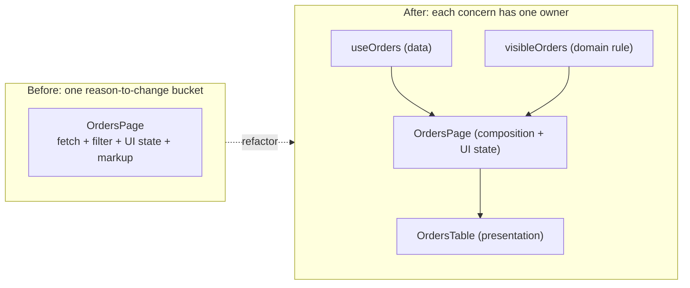
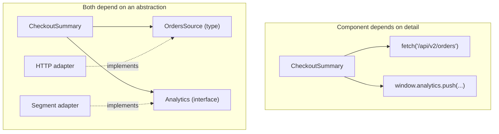

# 05 / 01 — SOLID in React: What Survives the Translation from Objects to Functions

## 1. Lesson metadata

| | |
|---|---|
| **Level** | Intermediate |
| **Study time** | 4–5 hours (reading 2 h, refactoring labs 1.5 h, exercises 1.5 h) |
| **Prerequisites** | [Phase 1 / 06 — Props and one-way data flow](../01-react-fundamentals/06-props-and-one-way-data-flow.md), [Phase 1 / 07 — Composition, `children`, slots](../01-react-fundamentals/07-composition-and-children.md), [Phase 3 / 15 — Custom hooks](../03-react-state-and-hooks/15-custom-hooks.md), [Phase 4 / 01 — Architecture fundamentals](../04-react-architecture/01-architecture-fundamentals.md) |
| **Next** | [02 — DRY, KISS, YAGNI](./02-dry-kiss-yagni.md) |
| **Related later** | [03 — Composition over inheritance](./03-composition-over-inheritance.md), [Phase 4 / 11 — Dependency inversion](../04-react-architecture/11-dependency-inversion.md), [Phase 5 / 24 — OOP patterns in functional React](./24-oop-patterns-in-functional-react.md) |

**Learning objectives.** After this lesson you can:
1. State each SOLID principle in its original object-oriented form and translate it into a statement about components, hooks, props, and modules.
2. Recognise a Single Responsibility violation in a component and split it along *reasons to change*, not along line counts.
3. Apply the Open/Closed principle with composition, configuration data, and injected render functions instead of ever-growing `if`/`switch` chains.
4. Apply Liskov substitution to wrapper components using `ComponentProps<"button">`-style prop forwarding, and explain what breaks when you do not.
5. Apply Interface Segregation to props and context so consumers depend only on what they use.
6. Apply Dependency Inversion in React without a DI container (props, context, hook parameters, module seams).
7. Identify when mechanically applying SOLID produces worse code (premature interfaces, one-function-per-file, abstract base components) and decline to apply it.

**Concepts covered:** SOLID, reasons to change, cohesion and coupling, open/closed extension points, substitutability of components, narrow props, context segregation, dependency direction, "function component as a unit of design", over-abstraction.

---

## 2. Deep conceptual explanation

### 2.1 What problem is this lesson solving?

SOLID is a set of five heuristics popularised for class-based object-oriented design (the acronym is attributed to Robert C. Martin's writing from the early 2000s; the individual principles are older). They were designed to answer a specific question: *how do I arrange classes so that a change in one requirement does not force edits across the whole codebase?*

React developers meet SOLID in two unhelpful ways:

1. **Cargo-culting.** A team that came from Java or C# creates `IUserRepository`-style interfaces for everything, an `AbstractBaseForm` component, and a factory for each button. The code is longer and no easier to change.
2. **Dismissal.** "SOLID is for classes, React is functional, so it does not apply." That throws away the *intent* of each principle, which is language-independent: localise change, depend on stable things, make parts replaceable.

The honest position is in between. Each principle has a **functional-React translation**, and the translation is usually simpler than the OO original because function components, props, and hooks already give you most of the mechanism for free. Your job is to recognise when the *problem* the principle addresses is present, and apply the smallest tool that addresses it.

### 2.2 The five principles, translated

| Principle | Original OO statement (informal) | React translation | Primary mechanism in React |
|---|---|---|---|
| **S**ingle Responsibility | A class should have one reason to change. | A component, hook, or module should change for one kind of requirement (data access, layout, behaviour, presentation rules). | Extract hooks, extract presentational components, extract pure functions. |
| **O**pen/Closed | Open for extension, closed for modification. | Add behaviour by supplying new props/children/config/handlers, not by editing the component's internals each time. | `children`, slot props, render props, data-driven config, strategy objects. |
| **L**iskov Substitution | Subtypes must be usable wherever the base type is expected. | A component that wraps or replaces another must honour the same prop contract (and ref, events, accessibility semantics). | `ComponentProps<"tag">` spread, forwarding `ref` (a regular prop in React 19), not swallowing props. |
| **I**nterface Segregation | Clients should not depend on methods they do not use. | A component should receive only the props it needs; a context should expose only the slice a consumer needs. | Narrow prop types, split contexts, pass primitives not whole objects. |
| **D**ependency Inversion | High-level modules should not depend on low-level modules; both depend on abstractions. | UI components should not hard-code *how* data is fetched, stored, or tracked; they receive capabilities. | Props, context, hook parameters, module seams (mockable boundaries). |

Two important remarks before the details.

**Remark 1: React's "unit of design" is smaller than a class.** A class bundles state, behaviour, and identity. In React those are separate: *state* lives in hooks, *behaviour* in functions and hooks, *structure* in components. So "single responsibility" is applied to three different kinds of unit, and the same function can be a perfectly cohesive hook and a badly mixed component.

**Remark 2: the principles are heuristics, not laws.** They are trade-offs that pay off when change is *actually* occurring along the axis you protected. If it never changes, you paid abstraction cost for nothing. [Lesson 02](./02-dry-kiss-yagni.md) formalises that counterweight.

### 2.3 Single Responsibility: "reason to change", not "does one thing"

The most misapplied principle. "A component should do one thing" is unfalsifiable: *"renders a user dashboard"* is one thing at a high enough level. The workable formulation is Martin's later wording: **a module should have one reason to change**, meaning one *actor* or *concern* whose requirements drive edits.

Concerns that commonly live inside a single React component and change for independent reasons:

| Concern | Changes when… | Natural home |
|---|---|---|
| Data acquisition (URL, headers, caching, retries) | The API changes, caching policy changes | Data hook / query hook / server component |
| Domain rules (filtering, validation, pricing) | Business rules change | Pure functions in a domain module |
| UI state (is the menu open? which tab?) | Interaction design changes | `useState`/`useReducer`, or a behaviour hook |
| Presentation (markup, classes) | Design changes | Presentational component |
| Side effects (analytics, document title) | Observability requirements change | Dedicated hook |

A component that mixes all five has five reasons to change. Each edit risks the other four, each concern is hard to test alone, and the file becomes the merge-conflict hotspot.

**What SRP does not say:** it does not say "one hook call per component", "files under 100 lines", or "no JSX in a component that has state". A 200-line form component with cohesive validation, layout and submit logic for one form may have a single reason to change (that form's requirements). Splitting it into 12 files can *raise* coupling, because a single requirement now touches 12 files.

⚠ *Teaching model.* The "five concerns" table above is a heuristic decomposition, not a rule from React. Your domain may group them differently.

### 2.4 Open/Closed: extension points chosen by evidence

In OO, OCP is usually achieved by polymorphism: add a new subclass instead of editing a switch. In React the analogues are:

1. **Children and slots** — the component owns structure; the caller owns content ([Phase 1 / 07](../01-react-fundamentals/07-composition-and-children.md)).
2. **Render props / function-as-child** — the component owns *when*, the caller owns *what*.
3. **Data-driven configuration** — a table takes `columns`; adding a column adds an object, not an `if`.
4. **Strategy objects** — a lookup of `type → handler/component` replaces a growing `switch`.
5. **Composition of hooks** — behaviour is added by composing, not by editing a god hook.

The risk is the opposite error: providing extension points nobody uses. An `<Button>` with `renderLeftIcon`, `renderRightIcon`, `renderLoadingState`, and `renderLabel` props is "open" but nearly impossible to reason about. Open/Closed is justified by **observed change patterns** (the third time someone edits the same `switch`), not by anticipation.

### 2.5 Liskov Substitution: the contract of a wrapper

Strict LSP is about inheritance. React discourages inheritance of components ([Lesson 03](./03-composition-over-inheritance.md)), but the *spirit* applies perfectly to **wrapping**: a `PrimaryButton` that wraps `<button>` is substitutable for `<button>` only if it accepts the same props, forwards the same events, preserves the same ref semantics, and does not change meaning (for example, does not silently ignore `disabled` or `type`).

Typical LSP violations in React code:

- A wrapper declares its own narrow props type and drops everything else: callers cannot pass `aria-label`, `onKeyDown`, `form`, `data-testid`.
- A wrapper overrides `type` to `"submit"` so a button placed inside a form unexpectedly submits it.
- A wrapper calls `onClick` only when `loading` is false but does not set `disabled`/`aria-disabled`, so assistive technology and keyboard users see an enabled control that does nothing.
- A "drop-in replacement" input swallows `ref`, breaking form libraries that rely on it.

LSP in React is therefore a statement about **prop contracts and DOM semantics**, and TypeScript can enforce much of it.

### 2.6 Interface Segregation: props and context as interfaces

A component's props *are* its interface. If `<Avatar user={user} />` takes a whole `User` (with 30 fields), the component *depends* on the whole shape: renaming `user.photoUrl` forces Avatar edits, Avatar tests need a complete `User` fixture, and Avatar cannot be reused for a `Team` or `Bot`. Taking `{ src, name }` is the segregated interface.

The same applies to context. One `AppContext` containing `{ user, theme, cart, notifications, dispatch }` forces every consumer to depend on all of it, **and** — specific to React — re-renders every consumer when any field changes ([Phase 3 / 13](../03-react-state-and-hooks/13-usecontext-and-propagation.md), [14](../03-react-state-and-hooks/14-context-performance.md)). Here ISP and performance advice coincide: split by who needs what, and by how often it changes.

### 2.7 Dependency Inversion: who decides how data arrives?

"High-level policy should not depend on low-level detail." A `<CheckoutSummary>` is policy (what the user sees about their order). `fetch("/api/v2/orders/" + id, { headers: { Authorization: ... } })` is detail. If the component contains the detail, then switching to GraphQL, adding auth refresh, or testing without a network each force edits inside the component.

Inversion in React uses mechanisms you already know:

| Mechanism | Use when |
|---|---|
| Props (inject data or callbacks) | The dependency is specific to one component instance. |
| Hook parameter (pass a client/function into a custom hook) | A hook should work against different data sources. |
| Context | The dependency is ambient and needed by many descendants (API client, analytics, feature flags). |
| Module seam (import from one module that tests/bundlers can replace) | The dependency is global and rarely varies at runtime. |

No container, decorator, or `@Injectable` is needed. Phase 4 treats this architecturally ([Phase 4 / 11](../04-react-architecture/11-dependency-inversion.md)); here we treat it as a component-level design move.

### 2.8 Common misconceptions

| Misconception | Reality |
|---|---|
| "SOLID doesn't apply to functional code." | The *goals* (localise change, stable dependencies) apply to any language. Only the mechanisms differ. |
| "SRP means tiny components." | SRP is about *reasons to change*. Over-splitting increases coupling and navigation cost. |
| "OCP means every component needs a `render*` prop for every part." | OCP applies where change repeatedly occurs. Speculative extension points are complexity (YAGNI). |
| "LSP is only about class inheritance." | Wrapper components and design-system substitutions have the same contractual requirement. |
| "ISP means you should never pass an object as a prop." | Passing an object is fine when the component's *concept* is that object (`<UserProfile user={user} />`). The smell is depending on a *large* shape for a *small* purpose. |
| "DIP means you need interfaces and a DI container." | In React, props and context are the injection mechanism; TypeScript types are the abstractions. |
| "If I follow SOLID, my code is good." | They are five heuristics. They say nothing about naming, correctness, accessibility, or performance. |

---

## 3. Internal mechanics

SOLID is a design discipline, not a React runtime feature, so "internal mechanics" here means *what React and TypeScript do that makes each translation work, and what costs they impose*.

### 3.1 Why function components make SRP cheap

*Public guarantee:* a function component is a function of props (and state/context read through hooks) returning elements ([Phase 1 / 03](../01-react-fundamentals/03-ui-as-a-function-of-state.md)). Extracting a **pure helper** from a component is behaviour-preserving by construction. Extracting a **custom hook** is also behaviour-preserving provided you keep call order unconditional: hooks called inside a custom hook belong to the *calling component's* state slots, as if you had written them inline ([Phase 3 / 16](../03-react-state-and-hooks/16-rules-of-hooks-and-composition.md)). That is the crucial property: extracting a hook does **not** create a new state container or a new re-render boundary.

*Consequence for SRP:* splitting logic into hooks is "free" at runtime (a few extra function calls). Splitting *components* is not entirely free: each extracted component is a new element in the tree, a new reconciliation unit, and a place where props must be threaded. That asymmetry is why "extract a hook" is usually the first SRP move and "extract a component" the second.

### 3.2 Why extending via props interacts with rendering

*Public guarantee:* when a parent re-renders, its children elements are re-created, and React re-renders those child components unless prevented (`memo`, or the same element reference passed through). Slot props and render props create **new function/element identities** every render. This is not a correctness problem but matters if the receiving component is memoised ([Phase 3 / 12](../03-react-state-and-hooks/12-react-memo.md), [Phase 7 / 05](../07-performance/05-referential-equality.md)).

*Version-sensitive:* with the React Compiler enabled (v1.0 released October 2025; still opt-in), many of these identity concerns are handled automatically, which makes OCP-by-render-prop less costly. Do not design around it until your toolchain actually uses it.

### 3.3 Why LSP is mostly a typing problem

*Teaching model:* a wrapper is substitutable if its props type is a **supertype-compatible** superset of the wrapped element's props. In TypeScript this is typically achieved with:

```ts
type ButtonProps = React.ComponentProps<"button"> & { variant?: "primary" | "ghost" };
```

`ComponentProps<"button">` includes DOM attributes, event handlers, and, in React 19's types, `ref` ([Phase 1 / 05](../01-react-fundamentals/05-jsx-explained.md) on how props flow). Because **`ref` is an ordinary prop for function components in React 19**, spreading `...rest` forwards it with no `forwardRef`. `forwardRef` is **legacy** for new code (still functional; react.dev/reference/react/forwardRef (checked 2026-10-22) says `forwardRef` "will be deprecated in a future release").

*Implementation detail:* the exact set of properties in `ComponentProps<"button">` comes from `@types/react`; its contents can shift between type-package versions.

### 3.4 Why context segregation also changes re-render behaviour

*Public guarantee:* every component that reads a context via `useContext` (or `use(Context)`) re-renders when the context's value changes by `Object.is` comparison. *Consequence:* a single context holding a frequently changing field forces re-renders for consumers who only needed a stable field. Segregation is both an ISP and a performance technique. Details: [Phase 3 / 14](../03-react-state-and-hooks/14-context-performance.md).

### 3.5 Where DIP meets module systems

*Teaching model:* ES modules are statically bound. If a component imports `api` from `"./api"`, replacing it in tests means module mocking (`vi.mock`, a test-runner feature, not a language one). Props/context injection avoids module mocking altogether. Both are legitimate seams; the choice affects test ergonomics and how obvious the dependency is to readers ([Foundations 10 — Modules](../00-web-and-javascript-foundations/10-modules-and-dependency-graphs.md)).

---

## 4. Step-by-step execution walkthrough: one requirement change, before and after

We trace what happens to the codebase when a single business requirement changes — "the orders API now paginates, and finished orders must be hidden by default" — in a component that violates SRP vs one that respects it.

**Before (one component owns everything).** `OrdersPage` fetches inside an effect, filters, sorts, holds UI state, and renders markup.

1. Developer opens `OrdersPage.tsx` (260 lines).
2. Changes the fetch to accept a `page` parameter. Adds `page` state. Now the effect's dependency array must include `page`.
3. Changes the filter logic to hide finished orders. The filter lives between the effect and JSX and reads `orders`; it now also needs `showFinished` state.
4. Touches the JSX to add pagination controls and a toggle.
5. Existing test renders the whole page with a mocked `fetch`; it fails because the response shape changed. The developer must understand fetch mocking, filtering, *and* markup to fix the test.
6. A teammate concurrently edits the header markup in the same file; merge conflict.
7. Result: one requirement, one file, four concerns edited, one broad test rewritten.

**After (separated by reason to change).**

1. `useOrders(page)` changes: fetch call and response typing. Test: hook test with a fake client.
2. `visibleOrders(orders, { showFinished })` — a pure function in `orders/domain.ts` — changes. Test: plain unit test, three lines each.
3. `OrdersTable` (presentational) is unchanged, because it receives `orders: OrderRow[]`.
4. `OrdersPage` composes: calls `useOrders`, calls `visibleOrders`, owns the `showFinished` and `page` state, renders `OrdersTable` and `Pagination`.
5. The teammate's header edit is in `OrdersHeader.tsx`: no conflict.

Observe the *shape of the improvement*: not "fewer lines" but "the change's blast radius matches the change's size". That is the actual quality SRP buys.

---

## 5. Code examples

### 5.1 Minimal example — SRP: pure function extraction

```tsx
// Before: rule and rendering tangled
function CartTotal({ items }: { items: { price: number; qty: number; taxable: boolean }[] }) {
  let total = 0;
  for (const i of items) {
    total += i.price * i.qty * (i.taxable ? 1.2 : 1);
  }
  return <p>Total: {total.toFixed(2)}</p>;
}
```

```tsx
// After: the pricing rule has its own home and test
type CartItem = { price: number; qty: number; taxable: boolean };

export const TAX_RATE = 0.2;

export function cartTotal(items: readonly CartItem[]): number {
  return items.reduce(
    (sum, i) => sum + i.price * i.qty * (i.taxable ? 1 + TAX_RATE : 1),
    0,
  );
}

function CartTotal({ items }: { items: readonly CartItem[] }) {
  return <p>Total: {cartTotal(items).toFixed(2)}</p>;
}
```

**Notes.** `cartTotal` is testable without React. The tax rate is a named constant: the rule's *reason to change* (tax law) now has one location. **Trade-off:** for a 5-line component used once, this is arguably over-structured. It earns its keep when the same rule appears in the cart, checkout, and an email template.

*(Real-world caution: floating-point money arithmetic needs integer minor units or a decimal library. This sample only demonstrates structure.)*

### 5.2 Practical example — SRP via hook + presentational split

**Incorrect (mixed concerns):**

```tsx
type User = { id: string; name: string; email: string; active: boolean };

export function UserList() {
  const [users, setUsers] = useState<User[]>([]);
  const [loading, setLoading] = useState(true);
  const [error, setError] = useState<string | null>(null);
  const [query, setQuery] = useState("");

  useEffect(() => {
    const ctrl = new AbortController();
    fetch("/api/users", { signal: ctrl.signal })
      .then((r) => r.json())
      .then(setUsers)
      .catch((e) => { if (e.name !== "AbortError") setError(String(e)); })
      .finally(() => setLoading(false));
    return () => ctrl.abort();
  }, []);

  const shown = users.filter(
    (u) => u.active && u.name.toLowerCase().includes(query.toLowerCase()),
  );

  if (loading) return <p>Loading…</p>;
  if (error) return <p role="alert">{error}</p>;
  return (
    <div>
      <input value={query} onChange={(e) => setQuery(e.target.value)} />
      <ul>
        {shown.map((u) => (
          <li key={u.id}>{u.name} ({u.email})</li>
        ))}
      </ul>
    </div>
  );
}
```

*Predict:* name the reasons this component would change. *(Answer: API URL/shape/error policy; "active only" business rule; search semantics; loading/error presentation; list markup. At least five.)*

**Corrected (split by concern):**

```tsx
// users/api.ts — data acquisition
export type User = { id: string; name: string; email: string; active: boolean };

export async function fetchUsers(signal?: AbortSignal): Promise<User[]> {
  const res = await fetch("/api/users", { signal });
  if (!res.ok) throw new Error(`Failed to load users (${res.status})`);
  return res.json();
}
```

```tsx
// users/useUsers.ts — async state; knows nothing about filtering or markup
import { useEffect, useState } from "react";
import { fetchUsers, type User } from "./api";

type State =
  | { status: "loading" }
  | { status: "error"; message: string }
  | { status: "ready"; users: User[] };

export function useUsers(load: typeof fetchUsers = fetchUsers): State {
  const [state, setState] = useState<State>({ status: "loading" });
  useEffect(() => {
    const ctrl = new AbortController();
    setState({ status: "loading" });
    load(ctrl.signal).then(
      (users) => setState({ status: "ready", users }),
      (e: unknown) => {
        if (e instanceof DOMException && e.name === "AbortError") return;
        setState({ status: "error", message: e instanceof Error ? e.message : "Unknown error" });
      },
    );
    return () => ctrl.abort();
  }, [load]);
  return state;
}
```

```tsx
// users/domain.ts — pure business rule
import type { User } from "./api";
export function visibleUsers(users: readonly User[], query: string): User[] {
  const q = query.trim().toLowerCase();
  return users.filter((u) => u.active && u.name.toLowerCase().includes(q));
}
```

```tsx
// users/UserListView.tsx — presentational
import type { User } from "./api";
export function UserListView({ users }: { users: readonly Pick<User, "id" | "name" | "email">[] }) {
  return (
    <ul>
      {users.map((u) => (
        <li key={u.id}>{u.name} ({u.email})</li>
      ))}
    </ul>
  );
}
```

```tsx
// users/UserList.tsx — composition + the one piece of UI state
export function UserList() {
  const state = useUsers();
  const [query, setQuery] = useState("");

  if (state.status === "loading") return <p>Loading…</p>;
  if (state.status === "error") return <p role="alert">{state.message}</p>;
  return (
    <div>
      <input value={query} onChange={(e) => setQuery(e.target.value)} aria-label="Search users" />
      <UserListView users={visibleUsers(state.users, query)} />
    </div>
  );
}
```

**Line-by-line notes.**
- `useUsers(load = fetchUsers)` — the default parameter is a small **DIP seam**: tests or alternate sources pass a different loader. The dependency array contains `load`; callers must pass a *stable* function (module-level or memoised), otherwise the effect re-runs every render. This is a real cost of parameter injection, which we state rather than hide.
- The discriminated union `State` makes impossible states unrepresentable (no `loading && error`).
- `visibleUsers` is pure; `UserListView` depends on `Pick<User, ...>` — an **ISP** move: it needs three fields, so it asks for three.
- `setState({ status: "loading" })` inside the effect before the load: acceptable here because the effect synchronises with an external system (network). With `load` changing rarely it is cheap. See [Phase 3 / 07](../03-react-state-and-hooks/07-you-might-not-need-an-effect.md) for when effects are the wrong tool, and Phase 6 for why production apps usually delegate this whole hook to a server-state library.
- In StrictMode development, effects run, clean up, and run again, so you will see two requests and one aborted; the final state is correct.

**Trade-off.** Five files for one list is heavy for a prototype. We pay it when (a) the rule or loader is reused, or (b) tests are slow/flaky because everything is coupled. If neither is true, keep it in one file (see §7).

### 5.3 Incorrect example — OCP violated by a growing switch

```tsx
type Notice = { kind: "info" | "warning" | "error" | "success"; text: string };

function NoticeBanner({ kind, text }: Notice) {
  let icon = "ℹ";
  let className = "banner";
  if (kind === "warning") { icon = "⚠"; className += " banner--warn"; }
  else if (kind === "error") { icon = "✖"; className += " banner--err"; }
  else if (kind === "success") { icon = "✔"; className += " banner--ok"; }
  return <div className={className} role={kind === "error" ? "alert" : "status"}>{icon} {text}</div>;
}
```

Adding `kind: "maintenance"` requires editing the union, the `if` chain, the role expression, and CSS. Every new kind modifies tested code.

### 5.4 Corrected implementation — data-driven extension

```tsx
type Kind = "info" | "warning" | "error" | "success";

const NOTICE_STYLES = {
  info:    { icon: "ℹ", className: "banner", role: "status" },
  warning: { icon: "⚠", className: "banner banner--warn", role: "status" },
  error:   { icon: "✖", className: "banner banner--err", role: "alert" },
  success: { icon: "✔", className: "banner banner--ok", role: "status" },
} as const satisfies Record<Kind, { icon: string; className: string; role: "status" | "alert" }>;

function NoticeBanner({ kind, text }: { kind: Kind; text: string }) {
  const s = NOTICE_STYLES[kind];
  return <div className={s.className} role={s.role}>{s.icon} {text}</div>;
}
```

`satisfies Record<Kind, …>` makes adding a member to `Kind` a *compile error* until the table is extended: the compiler enforces the extension protocol. The component body never changes: **closed for modification, open for extension via data**.

*Where is it still not "open"?* Someone who needs a bespoke notice with a link and a dismiss button cannot extend this component without editing it. That is the next step on the OCP ladder: accept `children`/`action` slots.

```tsx
function Notice({ kind, children, action }: { kind: Kind; children: React.ReactNode; action?: React.ReactNode }) {
  const s = NOTICE_STYLES[kind];
  return (
    <div className={s.className} role={s.role}>
      <span aria-hidden="true">{s.icon}</span>
      <div>{children}</div>
      {action}
    </div>
  );
}
```

**Trade-off.** `children` and `action` can be misused (put a modal in there); you gave callers power. Prefer the narrowest extension point that satisfies observed needs.

### 5.5 LSP — wrapper that is (and isn't) substitutable

**Incorrect** (narrow props; swallows contract):

```tsx
function PrimaryButton({ label, onClick }: { label: string; onClick: () => void }) {
  return <button className="btn btn--primary" onClick={onClick}>{label}</button>;
}
```

Callers cannot pass `disabled`, `type="submit"`, `aria-*`, `ref`, or `children`. Replacing `<button>` with `<PrimaryButton>` is a rewrite, not a substitution. Additionally the default `type` is `"submit"` inside forms (DOM behaviour), which may surprise.

**Corrected:**

```tsx
type ButtonProps = React.ComponentProps<"button"> & {
  variant?: "primary" | "ghost";
  loading?: boolean;
};

function Button({ variant = "primary", loading = false, className, children, disabled, type = "button", ...rest }: ButtonProps) {
  return (
    <button
      {...rest}
      type={type}
      className={`btn btn--${variant}${className ? " " + className : ""}`}
      disabled={disabled || loading}
      aria-busy={loading || undefined}
    >
      {children}
    </button>
  );
}
```

**Notes.**
- `...rest` carries `onClick`, `aria-*`, `form`, `ref` (React 19 ref-as-prop), `data-*`.
- We order `{...rest}` *before* our computed props so callers cannot accidentally override `disabled` logic; this is a design decision. Spreading `rest` *last* would let callers override anything, which sometimes is the desired substitutability. Decide deliberately and document it.
- `type = "button"` is a deliberate **deviation** from the DOM default (`submit`). That *violates* strict substitutability: a form submit button must now say `type="submit"`. Many design systems accept this because accidental submits are worse. The principle is a guide; know which deviations you chose.
- `loading` is mapped to `disabled`, preserving the invariant that an inactive-looking control is also inert for keyboard and AT users.

### 5.6 ISP — narrow props and split context

```tsx
// Before: Avatar depends on the whole User
function Avatar({ user }: { user: User }) {
  return ;
}
// After
function Avatar({ src, name }: { src: string; name: string }) {
  return ;
}
```

Context split:

```tsx
// Before: one context, every consumer re-renders on every change
const AppCtx = createContext<{ user: User; theme: Theme; cart: Cart; setTheme(t: Theme): void } | null>(null);

// After: segregated by consumer need and change rate
const UserCtx  = createContext<User | null>(null);
const ThemeCtx = createContext<Theme>("light");
const CartCtx  = createContext<Cart | null>(null);
```

For frequently changing state, additionally split *state* and *dispatch* contexts (dispatch is stable) — a standard pattern covered in [Phase 3 / 14](../03-react-state-and-hooks/14-context-performance.md) and [Lesson 08 — Provider pattern](./08-provider-pattern.md).

### 5.7 DIP — injecting a capability via context

```tsx
// analytics/AnalyticsContext.tsx
import { createContext, use } from "react";

export interface Analytics { track(event: string, props?: Record<string, unknown>): void }

const noop: Analytics = { track() {} };
const AnalyticsContext = createContext<Analytics>(noop);

export const AnalyticsProvider = AnalyticsContext; // React 19: <AnalyticsProvider value={...}>
export function useAnalytics(): Analytics { return use(AnalyticsContext); }
```

```tsx
function AddToCartButton({ sku }: { sku: string }) {
  const analytics = useAnalytics();
  return (
    <Button onClick={() => { analytics.track("add_to_cart", { sku }); /* … */ }}>
      Add
    </Button>
  );
}
```

```tsx
// App root (prod)
<AnalyticsProvider value={segmentAdapter}> <App /> </AnalyticsProvider>
// Test
render(<AnalyticsProvider value={{ track: spy }}><AddToCartButton sku="x" /></AnalyticsProvider>);
```

**Notes.** React 19 lets you render `<Context value={…}>` directly; before 19 you wrote `<Context.Provider value={…}>` (still supported). The default value `noop` makes the component work without a provider (a **null-object**); the alternative (throw when missing) catches wiring mistakes earlier. Choose per dependency: analytics tolerates a no-op; an auth client does not.

**Trade-off.** Context injection hides a dependency from the component's signature. Reading `AddToCartButton` no longer shows it needs analytics unless you look inside. For a dependency used in two places, a prop may be clearer.

### 5.8 Advanced example — OCP with a registry and TypeScript exhaustiveness

A form renderer where field types are extensible without modifying the renderer:

```tsx
type FieldBase<T extends string, V> = { type: T; name: string; label: string; initial: V };
type TextField   = FieldBase<"text", string>;
type NumberField = FieldBase<"number", number> & { min?: number; max?: number };
type CheckField  = FieldBase<"checkbox", boolean>;
type Field = TextField | NumberField | CheckField;

type Renderer<F extends Field> = (props: { field: F; id: string }) => React.ReactNode;
type Registry = { [K in Field["type"]]: Renderer<Extract<Field, { type: K }>> };

const registry: Registry = {
  text:     ({ field, id }) => <input id={id} name={field.name} defaultValue={field.initial} />,
  number:   ({ field, id }) => <input id={id} name={field.name} type="number" min={field.min} max={field.max} defaultValue={field.initial} />,
  checkbox: ({ field, id }) => <input id={id} name={field.name} type="checkbox" defaultChecked={field.initial} />,
};

function renderField(f: Field, id: string) {
  const render = registry[f.type] as Renderer<Field>;
  return render({ field: f, id });
}
```

The cast `as Renderer<Field>` is the honest cost of TypeScript's inability to correlate `f.type` with the registry entry (a correlated-union limitation); containing the cast to one line keeps the rest type-safe. Adding `DateField` requires adding to `Field` and `Registry`; the compiler flags the missing registry key. Adding a field type never modifies `renderField`.

**Trade-off.** This is a mini form framework. If you have three forms, hand-writing them is simpler (KISS). The registry pays when the field set is open (CMS-driven forms, plugin architectures).

---

## 6. Visual explanations

### From one tangled component to separated reasons to change



### Dependency direction before and after DIP



### Which principle answers which smell?

| Smell you notice | Principle | First move |
|---|---|---|
| "I edit this file for unrelated tickets" | SRP | Extract pure function / hook |
| "Every new variant adds an `else if`" | OCP | Lookup table, slot, or config |
| "Wrapper component can't take `aria-label`" | LSP | `ComponentProps<tag>` spread |
| "Test fixture needs a 40-field object" | ISP | Narrow props to what is used |
| "Can't test without mocking `fetch` globally" | DIP | Inject loader / client |

---

## 7. Alternative approaches and trade-offs

### 7.1 Applying SRP: inline vs hook vs component vs module

| Criterion | Keep inline | Extract pure function | Extract hook | Extract component |
|---|---|---|---|---|
| Runtime cost | none | negligible | negligible (same state slots) | extra reconciliation unit |
| Testability of the extracted logic | via the component | excellent (no React) | needs hook testing helper | via rendering |
| Prop threading overhead | none | none | none | can be significant |
| Right when… | used once, short, changes together | rule has no state | logic has state/effects and is reusable | markup is reusable or separately changing |
| Risk | god component | over-abstraction | hook doing too much | prop drilling, premature split |

### 7.2 OCP: switch vs table vs slot vs polymorphism

| Criterion | `switch`/`if` | Lookup table | Slot/children | Class hierarchy (OO) |
|---|---|---|---|---|
| Add a variant | edit the component | add an entry | caller supplies content | add a subclass |
| Type safety (TS) | exhaustive `never` check | `satisfies Record<…>` | weak (any node) | structural |
| Readability for 2–3 cases | **best** | good | fair | heavy |
| Third-party extension | impossible | possible if exported | natural | possible |

**Scenario where the recommended approach (data-driven table) is *not* best.** The variants differ by *structure and behaviour*, not by data: e.g., an `<Attachment>` that renders an image viewer, a PDF viewer with page controls, or a video player. A table of `{icon, className}` cannot express this; a `switch` that delegates to three distinct components, or a registry mapping type → *component*, is the right shape. And if there are exactly two variants that will never grow, a plain ternary beats any abstraction.

### 7.3 When *not* to apply SOLID at all

| Situation | Better approach |
|---|---|
| Prototype/spike, throwaway within weeks | Single file, hard-coded; refactor if it survives |
| A form used on one screen with one author | Cohesive single component; split only when pain appears |
| A tiny leaf component | No interface, no registry, no injection |
| A well-maintained UI library covers it | Use the library's contract instead of re-deriving your own |

---

## 8. Best practices and anti-patterns

### 8.1 Best practices

1. **Split by reason to change, discovered from history.** Look at `git log --follow` for the file: which unrelated tickets touched it? That is evidence for SRP boundaries.
2. **Prefer extracting pure functions first, then hooks, then components.** Cheapest, safest, most testable.
3. **Type wrapper components with `ComponentProps<"tag">`** and make intentional deviations explicit (e.g., `type="button"` default).
4. **Pass what the component needs.** Use `Pick<T, "a" | "b">` or primitive props.
5. **Let TypeScript enforce extension protocols** (`satisfies Record<Union, …>`, exhaustive `never` checks).
6. **Inject capabilities at the edges** (providers at the app root, loaders as hook parameters with defaults).

### 8.2 Beginner mistakes

| Mistake | Why it hurts |
|---|---|
| Splitting every `<div>` into a component "for SRP" | Increases prop threading; no reason to change independently |
| Giant `props.config` object that every child reads | ISP violation; invisible coupling |
| `if (variant === ...)` chains in every new feature | OCP violation; regressions in unrelated variants |
| Wrapper component without `...rest` | LSP violation; blocks accessibility attributes |

### 8.3 Experienced-developer mistakes

| Mistake | Why it hurts |
|---|---|
| Porting Java patterns: `IFoo`/`FooImpl`, factories for components | Each layer is code to read; props/functions already provide the seam |
| `AbstractBaseTable` with template methods | Inheritance in disguise; use composition ([Lesson 03](./03-composition-over-inheritance.md)) |
| "Dependency injection container" for React | Context + modules already do this; a container hides the tree |
| Hooks that take 12 parameters to satisfy every future caller | OCP applied speculatively → configuration explosion |
| Premature `Props extends BaseProps extends CommonProps` hierarchies | Couples unrelated components via shared base types (an ISP *violation*) |

### 8.4 Smells

- A component's test setup is longer than its body.
- A hook returns more than ~7 things and callers use 2 of them each.
- A "utility" file named `helpers.ts` that every feature imports.
- `props` passed through three layers unchanged only to be injected into a leaf (consider composition or context).

### 8.5 Justified exceptions

- A **long component** is fine when its parts change together (one complex wizard step, one chart configuration).
- An **un-segregated context** is fine when the value rarely changes and consumers genuinely need most of it (e.g., a `Session` object).
- A **narrow wrapper** (like `<PrimaryButton label>`) is fine inside a bounded feature where it is intentionally *not* a design-system primitive.

⚠ These are judgement calls. Treat the lists as defaults, not universal rules.

---

## 9. Real-world application

### 9.1 E-commerce: pricing rules (SRP, DIP)
Price, discounts, VAT and rounding change for legal and marketing reasons — at different times than UI redesigns. Keeping them in `pricing/domain.ts` (pure, unit-tested exhaustively) and having `CartSummary` consume results prevents a promotional change from touching markup. *Constraint:* the same rules often must also exist server-side; a shared package or the server as the source of truth avoids drift ([Phase 4 / 12 — Domain logic vs UI logic](../04-react-architecture/12-domain-logic-vs-ui-logic.md)).

### 9.2 Dashboards: widgets (OCP)
A dashboard that lets teams add widgets uses a registry `type → component`. The grid layout is closed to modification; teams register new widgets in their own package. *Constraint:* each widget needs error isolation (an error boundary per widget) and a loading contract so one slow widget does not block the grid.

### 9.3 Design systems: wrappers (LSP, ISP)
A design-system `Input` that wraps `<input>` must preserve `ref`, `inputMode`, `autoComplete`, `aria-describedby`; form libraries and password managers depend on them. *Constraint:* public components are contracts consumed by many teams; a prop removed is a breaking change ([Phase 5 / 22 — Patterns for reusable libraries](./22-patterns-for-reusable-libraries.md)).

### 9.4 Finance: audit-sensitive actions (DIP)
Components trigger `onApprove` but do not know whether approval hits REST, GraphQL, or a queue; an `AuditLog` capability is injected so tests can assert that every approval path logs. *Constraint:* the DIP seam must be non-bypassable; if developers can call the raw client directly, the guarantee evaporates.

### 9.5 Multi-team codebases (all five)
SRP and DIP define module boundaries a team can own; ISP keeps shared components from becoming a dependency hub; LSP and OCP make shared components safe to adopt. *Constraint:* enforce with lint/import rules, not just convention ([Phase 4 / 25](../04-react-architecture/25-architectural-fitness-and-enforcement.md)).

---

## 10. Debugging and troubleshooting

### 10.1 Symptom: "Changing one prop in the design-system Button broke unrelated pages"
- **Investigate:** search usages with the prop; check whether the wrapper changed default `type` or reordered `{...rest}`.
- **Root cause:** an LSP deviation (e.g., new default `type="button"` broke implicit form submit in pages that relied on it).
- **Validate:** write a contract test: render inside a `<form>`, press Enter in an input, assert submit behaviour as documented.

### 10.2 Symptom: "Hook re-fetches on every render after refactor"
- **Repro:** the extracted `useUsers(load)` is called with an inline arrow `useUsers((s) => fetchUsers(s))`.
- **Investigate:** React DevTools Profiler ("why did this render?") plus the Network tab showing repeated aborted requests.
- **Root cause:** the injected dependency has a new identity each render; the effect depends on it.
- **Fix:** hoist the function to module scope, wrap it in `useCallback`, or take the dependency via context. **Validate:** Network tab shows one request; add a test counting `load` calls.

### 10.3 Symptom: "Everything re-renders when the theme toggles"
- **Investigate:** Profiler flame chart; components highlighted that never read `theme`.
- **Root cause:** `theme` lives in a single context with user and cart data; value object recreated.
- **Fix:** segregate contexts (ISP) and keep each value stable. **Validate:** Profiler shows only theme consumers re-render.

### 10.4 Symptom: "Adding a new variant causes type errors in five places" (good error!)
- This is `satisfies Record<…>`/`never` exhaustiveness doing its job. Fill in the missing places; do not silence with `as any`.

### 10.5 Symptom: "I extracted a hook and now state resets / differs"
- **Root cause candidates:** hook called conditionally; hook now called in a *different component* (state moved with it); `key` changed on parent. See [Phase 1 / 16](../01-react-fundamentals/16-state-preservation-and-reset.md).

---

## 11. Exercises

### Level A — Knowledge
A1. State SRP in terms of "reasons to change". Why is "does one thing" a poor formulation?
A2. Name three React mechanisms that implement Open/Closed.
A3. In React 19, why can a wrapper forward `ref` with `...rest` and no `forwardRef`?
A4. Give one example where ISP and render performance give the same advice.
A5. What replaces a DI container in a typical React app?

### Level B — Code comprehension
B1. What is wrong, from an LSP standpoint, with this component? List two issues.
```tsx
function SearchBox({ value, onChange }: { value: string; onChange: (v: string) => void }) {
  return <input type="search" value={value} onChange={(e) => onChange(e.target.value)} />;
}
```
B2. Why does this refactor cause an infinite fetch loop?
```tsx
function Page() {
  const state = useUsers((signal) => fetchUsers(signal));
  // ...
}
```
(Using §5.2's `useUsers`; assume `setState` creates a new object each time.)
B3. What does `satisfies` give you here that a type annotation `: Record<Kind, Style>` would not? (Hint: literal types.)

### Level C — Implementation
C1. Refactor this component for SRP and ISP. Produce a pure `summarise` function, a presentational `StatsView`, and a composition component.
```tsx
function Stats({ orders }: { orders: { id: string; total: number; status: "open" | "closed"; customer: { name: string; email: string } }[] }) {
  const open = orders.filter(o => o.status === "open");
  const sum = open.reduce((a, o) => a + o.total, 0);
  return <div><h2>{open.length} open orders</h2><p>Value: {sum}</p><p>Biggest: {open.sort((a,b)=>b.total-a.total)[0]?.customer.name}</p></div>;
}
```
(There is also a bug; find it.)
C2. Write `Badge` as a substitutable wrapper over `<span>` with `tone` variants driven by a table that fails to compile if a tone is added without styles.
C3. Implement `useUsers`-style injection for a `useProducts(client)` hook where `client` comes from a context `ApiClientContext`, with a clear error when the provider is missing.

### Level D — Debugging
D1. A teammate converted `PrimaryButton` to default `type="button"`. QA reports the "Save" button in the settings form no longer saves. Explain, fix, and write the regression test.
D2. After you split `AppContext` into three contexts, a profiler shows `CartIcon` still re-renders on theme change. Give three possible causes.
D3. A registry-based renderer throws `registry[f.type] is not a function` in production for one CMS payload. Diagnose.

### Level E — Architecture and engineering decisions
E1. Your team has 6 forms of ~120 lines each, all with similar layout but different fields and rules. A proposal: build a generic `<SchemaForm schema>` renderer (OCP). Evaluate with criteria and decide.
E2. A principal engineer asks you to introduce `IUserRepository` interfaces and an `InversifyJS` container "for DIP". Respond with a reasoned alternative.
E3. Where would you *deliberately* violate each of S, O, L, I, D in a product with a six-month lifespan? Justify one violation per principle.

### Level F — Expert challenge
F1. Design the prop and typing contract for a design-system `Link` component that must (a) substitute for `<a>`, (b) integrate with three different routers via an injected `as`/adapter, and (c) remain type-safe. Describe the LSP and DIP trade-offs and where TypeScript's polymorphism limits bite. (Cross-ref [Lesson 19 — Polymorphic components](./19-polymorphic-components.md).)
F2. A monolithic 1,400-line `CheckoutPage.tsx` is touched by 4 teams. Propose a staged, low-risk refactoring plan using SRP/DIP only, with measurable success criteria and rollback points.

---

## 12. Detailed answers and explanations

> Attempt the exercises first.

**A1.** A module should have **one reason to change**: changes should be driven by one concern or stakeholder. "Does one thing" is unfalsifiable because any module does "one thing" at some abstraction level ("manage the dashboard"). Wrong answer: "one function per component". Reasons-to-change is checkable against real history.

**A2.** Any three of: `children`/slot props; render props/function-as-child; data-driven config (columns, schema); strategy/registry objects; hook composition; context-supplied behaviour.

**A3.** In React 19, `ref` is passed as a normal prop to function components, so it appears in `props`/`...rest` and flows to the DOM element. `forwardRef` existed because earlier versions stripped `ref` from props. `forwardRef` continues to work; react.dev/reference/react/forwardRef (checked 2026-10-22) says `forwardRef` "will be deprecated in a future release".

**A4.** Splitting a context into `ThemeCtx` and `CartCtx`: ISP says consumers should depend only on what they use; performance says a theme toggle should not re-render cart consumers. Same split, two motivations.

**A5.** Props, context, hook parameters, and module seams. A container (decorators, reflection metadata) is rarely needed because the component tree already is a dependency-resolution hierarchy: a provider near the root supplies, descendants consume.

**B1.** (1) The props type is a narrow custom interface: `placeholder`, `aria-label`, `name`, `disabled`, `onKeyDown`, `ref` etc. cannot be passed; it is not substitutable for `<input type="search">`. (2) It changes the *callback contract* (`onChange(value: string)` instead of the event), so existing handlers expecting events break; if intentional, name it differently (`onValueChange`) to avoid being mistaken for a drop-in. Also, no accessible name (no label support). Fix: `ComponentProps<"input">` minus `onChange`, plus `onValueChange`, or just forward the event.

**B2.** The inline arrow is a new function every render, so `[load]` in the effect dependencies changes each render, and the effect re-runs → `setState({status: "loading"})` → re-render → new arrow → effect again. It loops. Plausible wrong answer: "because `fetchUsers` is async". The loop is caused by unstable identity plus a state update inside the effect. Fix: pass `fetchUsers` directly, hoist the arrow, or remove `load` from deps via a ref (⚠ trading correctness for convenience, only when `load` truly never changes semantically).

**B3.** With `: Record<Kind, Style>` the object's properties are widened to `string`; consumers lose literal types like `role: "alert"`. `as const satisfies …` validates the shape *and* preserves literal types, so `s.role` is `"status" | "alert"`, assignable to the `role` attribute type without casts. It also still errors if a `Kind` key is missing.

**C1.** Reference:
```tsx
type OrderRow = { id: string; total: number; status: "open" | "closed"; customerName: string };

export function summarise(orders: readonly OrderRow[]) {
  const open = orders.filter((o) => o.status === "open");
  const value = open.reduce((a, o) => a + o.total, 0);
  const biggest = open.reduce<OrderRow | undefined>(
    (best, o) => (!best || o.total > best.total ? o : best),
    undefined,
  );
  return { openCount: open.length, value, biggestCustomer: biggest?.customerName };
}

function StatsView({ openCount, value, biggestCustomer }: ReturnType<typeof summarise>) {
  return (
    <div>
      <h2>{openCount} open orders</h2>
      <p>Value: {value}</p>
      {biggestCustomer && <p>Biggest: {biggestCustomer}</p>}
    </div>
  );
}

function Stats({ orders }: { orders: readonly OrderRow[] }) {
  return <StatsView {...summarise(orders)} />;
}
```
**The bug:** `open.sort(...)` **mutates** the filtered array in place. Here `open` is a fresh array from `filter`, so the original `orders` is unaffected — the mutation is local, but it is still a purity smell and it is an `O(n log n)` sort for what is an `O(n)` max. If one had sorted `orders` directly, it would mutate props, a genuine bug ([Phase 1 / 12 — Component purity](../01-react-fundamentals/12-component-purity.md)). Evaluation: accept either identification as long as the reasoning about mutating arrays during render is correct. ISP: `StatsView` depends on three derived fields, and the input is flattened to `customerName` rather than the whole `customer` (the email is never used). Edge case: empty list → `biggestCustomer` undefined → paragraph hidden.

**C2.**
```tsx
type Tone = "neutral" | "success" | "danger";
const TONE_CLASS = {
  neutral: "badge",
  success: "badge badge--ok",
  danger: "badge badge--err",
} as const satisfies Record<Tone, string>;

type BadgeProps = React.ComponentProps<"span"> & { tone?: Tone };

function Badge({ tone = "neutral", className, ...rest }: BadgeProps) {
  return <span {...rest} className={className ? `${TONE_CLASS[tone]} ${className}` : TONE_CLASS[tone]} />;
}
```
Adding `"warning"` to `Tone` fails compilation until `TONE_CLASS` is updated. Edge: `children` flows through `rest`. Wrong approach: accepting `label: string`, which prevents icons and rich content.

**C3.**
```tsx
import { createContext, use } from "react";

export interface ApiClient { get<T>(url: string, signal?: AbortSignal): Promise<T> }
const ApiClientContext = createContext<ApiClient | null>(null);
export const ApiClientProvider = ApiClientContext;

export function useApiClient(): ApiClient {
  const c = use(ApiClientContext);
  if (!c) throw new Error("useApiClient must be used within <ApiClientProvider>");
  return c;
}

export function useProducts() {
  const client = useApiClient();
  const [state, setState] = useState<
    { status: "loading" } | { status: "error"; message: string } | { status: "ready"; products: Product[] }
  >({ status: "loading" });
  useEffect(() => {
    const ctrl = new AbortController();
    client.get<Product[]>("/products", ctrl.signal).then(
      (products) => setState({ status: "ready", products }),
      (e: unknown) => { if (!ctrl.signal.aborted) setState({ status: "error", message: String(e) }); },
    );
    return () => ctrl.abort();
  }, [client]);
  return state;
}
```
Notes: the provider's `client` must be stable (created once at the root), or the effect re-runs. Throwing on a missing provider is deliberate: unlike analytics, a missing API client is a wiring bug.

**D1.** Inside a `<form>`, a `<button>` without a `type` defaults to `submit`. The old wrapper rendered `<button>` without `type`, so the Save button submitted the form. The new default `type="button"` makes it inert for submission. Fix: callers that need submit pass `type="submit"` (preferable: it is explicit), or provide a dedicated `SubmitButton`. Regression test: render a form with `onSubmit` spy and `<Button type="submit">Save</Button>`; click; assert called once. Add a second test asserting default `Button` does *not* submit. Lesson: a "harmless" default change is an LSP/contract change; announce and codemod it.

**D2.** (a) `CartIcon` is a child of a component that re-renders (the provider's parent) and is not memoised: parent re-render, not context. (b) It reads a context whose *value object* is rebuilt each render (e.g. `value={{ cart, theme }}`) so the cart context changes with theme state. (c) It still consumes the old combined context via a leftover import. Verify with Profiler "Why did this render?" (enable "Record why each component rendered" in DevTools), and check where `useContext` is called.

**D3.** The CMS sent a `type` not in the registry (`"date"`), so `registry["date"]` is `undefined`. TypeScript types describe compile-time data; runtime payloads are untrusted. Fix: validate at the boundary (schema validation), render a fallback `UnknownField` that reports the unknown type, and log it. Don't make the cast hide the problem: `registry[f.type] ?? UnknownField`.

**E1.** Evaluation criteria: rate of change of forms, how different they are, team size, cost of schema DSL, accessibility and validation needs, debuggability. Example answer: with 6 similar forms, extract **shared layout components and field components** (`FormSection`, `TextField`, `useFormState`) and keep each form's composition explicit (KISS/YAGNI, Rule of Three satisfied for *pieces*, not for the *whole*). A `SchemaForm` becomes appealing when forms are generated from backend metadata or when the count grows and forms are mostly declarative. Rule-heavy forms (dependent fields, async validation) quickly outgrow a schema DSL and force escape hatches. Decision: composition now; revisit schema renderer if form count exceeds ~15 or forms become server-driven.

**E2.** Respond with: TypeScript structural typing means `interface UserRepository` is optional; a function type `type LoadUsers = (signal?: AbortSignal) => Promise<User[]>` is the abstraction. The seam is a parameter or context value, wired at the root. A container adds reflection/decorators/build complexity, hides which implementation is active, and fights tree-shaking. Show the 10-line `ApiClientProvider`. Concede cases for a more formal approach: very large multi-platform code sharing (React Native + web + node) where explicit ports/adapters in a non-React domain layer pay off ([Phase 4 / 10, 13](../04-react-architecture/10-clean-and-hexagonal-architecture.md)).

**E3.** Open-ended; criteria: concrete code, a stated cost of the violation, a trigger to revisit. Example: *S* — one 300-line onboarding wizard component, since all steps change together and are owned by one team; *O* — a `switch` for 3 notification kinds, no registry; *L* — Button defaulting `type="button"`, documented; *I* — passing the whole `Order` to `OrderCard` because the card *is* the order concept; *D* — import `fetch` directly in a one-off internal admin page.

**F1.** Evaluation criteria: (1) props typed as `ComponentProps<"a">` merged with `{ href: string; to?: never }` or a discriminated union to avoid ambiguity; (2) router integration through a context-provided `LinkComponent` (DIP) rather than `as` per call site to keep call sites router-agnostic; (3) explicit statement of the substitutability exceptions (e.g., client-side navigation intercepts click, so `onClick` ordering and `defaultPrevented` semantics must be documented); (4) acknowledgement that fully polymorphic `as` typing (`<Link as={RouterLink} to="/">`) requires generic components whose inference degrades with complex `ref` types; (5) a test matrix (modified-clicks open new tab, `target="_blank"` adds `rel`). A strong answer chooses one injection point and justifies it.

**F2.** Evaluation criteria: sequencing and safety. Example plan: (1) add characterisation tests / Playwright happy-path before any edit; (2) extract pure functions (pricing, validation) – no behaviour change; (3) extract data hooks behind one `useCheckout` facade without changing JSX; (4) introduce DIP seams (client, analytics) as parameters with defaults identical to current behaviour; (5) split markup into section components along team ownership lines; (6) enforce boundaries with lint rules. Measures: file size per team area, merge-conflict rate, test duration, bundle diff = 0 in steps 1–4. Rollback: each step is one PR, behind no flags (pure refactor) and revertible alone.

---

## 13. Senior engineer interview questions

**Q1. "Does SOLID apply to React? Defend a position."**
*Strong answer:* The principles are about managing change and dependencies; the OO mechanisms don't map, but the goals do. SRP maps to separating concerns into hooks/pure functions/presentation; OCP to slots, config, registries; LSP to wrapper contracts; ISP to narrow props and segregated contexts; DIP to props/context/parameters. I apply them only where change is observed, because each adds indirection. The causal point: the value of a principle depends on whether the axis it protects actually varies.

**Q2. "How do you decide a component is doing too much?"**
*Strong answer:* Not line count: history. If unrelated tickets keep touching it, tests need heavy setup for small behaviours, or logic cannot be reused without dragging markup along, split. I extract pure functions first, then hooks, then components, because that order has the lowest runtime and prop-threading cost. Extracting hooks keeps state in the same component instance, so it doesn't alter render boundaries.

**Q3. "Your design-system Button now defaults to `type="button"`. Is that a breaking change?"**
*Strong answer:* Yes by LSP: it differs from the DOM default and can change form behaviour. It may still be the right default (accidental submits are costly), but needs a changelog entry, a codemod or lint rule, and contract tests.

**Q4. "Context vs props for dependency injection?"**
*Strong answer:* Props make dependencies visible and local; context removes threading for ambient dependencies but hides coupling and couples tests to providers. Use props for one-off collaboration, context for app-wide capabilities (API client, flags, analytics), and keep context values stable to avoid unnecessary re-renders.

**Q5. "What's the cost of splitting a context?"**
*Strong answer:* More providers (nesting), more boilerplate, risk of missing providers. The benefit is smaller consumer dependency sets and fewer re-renders. Split by change frequency and consumer groups, not mechanically per field. If an external store (`useSyncExternalStore`-based, Phase 3/20) with selectors fits, it can replace many contexts.

**Q6. "When have you seen OCP go wrong?"**
*Strong answer:* A `Table` with 30 optional props and 6 render props, because every team asked for a hook. Each extension point multiplied the test matrix and made behaviour hard to predict. Fix: reduce to a few composable parts (header, row, cell slots) or a headless table ([Lesson 07](./07-headless-components.md)), and delete unused extension points.

**Q7. "How do you test a component that calls `fetch`?"** *(DIP)*
*Strong answer:* Depends on where the boundary is: for logic-heavy components inject the loader; for integration confidence prefer network-level mocking (MSW, Phase 8) so the component stays unaware. Both avoid mocking implementation details inside the component.

---

## 14. Further learning resources

| Resource | URL | Covers / why | Level | Study |
|---|---|---|---|---|
| React — Thinking in React | <https://react.dev/learn/thinking-in-react> | Decomposing UI by responsibility | Beginner | Whole page |
| React — Passing props to a component | <https://react.dev/learn/passing-props-to-a-component> | Props as component interface | Beginner | Whole page |
| React — Reusing logic with custom hooks | <https://react.dev/learn/reusing-logic-with-custom-hooks> | SRP via hook extraction | Intermediate | Whole page |
| React — Passing data deeply with context | <https://react.dev/learn/passing-data-deeply-with-context> | Context as an injection mechanism | Intermediate | "Before you use context" |
| React — `createContext` reference | <https://react.dev/reference/react/createContext> | Provider syntax in React 19 | Intermediate | Usage |
| TypeScript Handbook — Everyday types / generics | <https://www.typescriptlang.org/docs/handbook/2/generics.html> | Typing registries, `ComponentProps` patterns | Intermediate | Generic constraints |
| TypeScript 4.9 release notes — `satisfies` operator | <https://www.typescriptlang.org/docs/handbook/release-notes/typescript-4-9.html> | `satisfies` was introduced in 4.9 | Intermediate | "The satisfies operator" |
| Robert C. Martin — "Clean Architecture" (book) | *(book; no URL)* | Original SOLID framing and dependency rule | Advanced | Part III (design principles) |
| Sandi Metz — "The Wrong Abstraction" | <https://sandimetz.com/blog/2016/1/20/the-wrong-abstraction> | Counterweight to over-applying OCP/DRY | Intermediate | Whole post |

URLs in this table were checked for HTTP 200 on 2026-10-22; any still marked *(unverified)* could not be checked automatically (blocked or unreachable). A 200 response does not guarantee the page content still matches the description; if a link has moved, search the site for the quoted title.

---

## 15. Knowledge checkpoint

**You should now understand**
- That SOLID's *goals* survive in React while its OO *mechanisms* are replaced by props, hooks, context, and composition.
- That SRP is about reasons to change, and that extracting hooks is cheaper (no new render boundary) than extracting components.
- That wrapper components carry a contract (props, `ref`, events, default `type`) that LSP asks you to preserve or consciously break.
- That narrow props and split contexts are both ISP and performance tools.
- That DIP in React needs no container: props, hook parameters, context, module seams.
- That every principle has a cost and a "don't apply here" scenario.

**You should be able to explain without notes**
- The five translations in the table of §2.2.
- Why `useUsers((s) => fetchUsers(s))` can loop and how to prevent it.
- Why `satisfies Record<Union, …>` implements an extension protocol.

**You should be able to implement**
- An SRP split of a mixed fetch/filter/render component into pure function + hook + view + composition.
- A substitutable `Button`/`Badge` wrapper with typed variants.
- A context-injected capability with a clear missing-provider error.

**You should be able to debug**
- Re-render loops caused by unstable injected dependencies.
- Behaviour changes caused by wrapper default changes.
- Over-broad context re-renders.

**Before moving on:** read [02 — DRY, KISS, YAGNI](./02-dry-kiss-yagni.md), which tells you when *not* to apply what you just learned.
