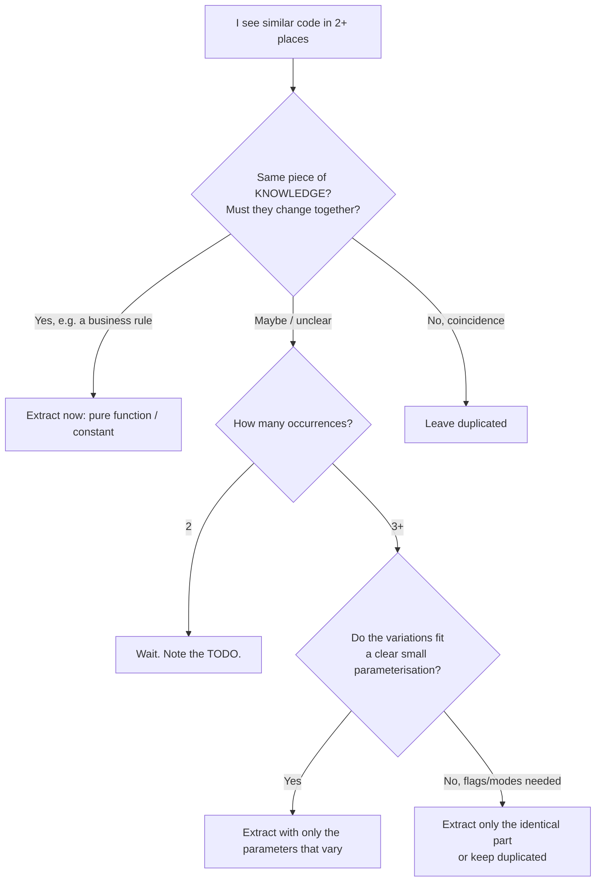
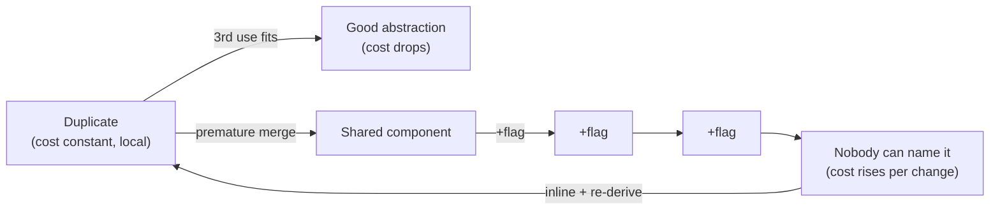

# 05 / 02 — DRY, KISS, YAGNI: The Counterweights to Abstraction

## 1. Lesson metadata

| | |
|---|---|
| **Level** | Intermediate |
| **Study time** | 3–4 hours (reading 1.5 h, refactoring labs 1 h, exercises 1.5 h) |
| **Prerequisites** | [05 / 01 — SOLID in React](./01-solid-in-react.md), [Phase 3 / 15 — Custom hooks](../03-react-state-and-hooks/15-custom-hooks.md), [Phase 1 / 07 — Composition and children](../01-react-fundamentals/07-composition-and-children.md) |
| **Next** | [03 — Composition over inheritance](./03-composition-over-inheritance.md) |
| **Related later** | [Phase 5 / 23 — Patterns made less necessary](./23-patterns-made-less-necessary.md), [Phase 11 / 04 — Choosing abstraction level](../11-senior-and-architect-mastery/04-choosing-abstraction-level.md) |

**Learning objectives.** After this lesson you can:
1. Distinguish duplicated *code* from duplicated *knowledge*, and explain why DRY is about the second.
2. Apply the Rule of Three (and know where it fails) when deciding whether to extract a component, hook, or utility.
3. Recognise the "wrong abstraction" in React: boolean-prop-riddled components, hooks with option explosions, and shared components that every team forks.
4. Apply KISS to React state and effects (prefer derivation, `useState`, and plain functions before reducers, stores, and custom frameworks).
5. Apply YAGNI to props, context, generics, and extension points, and identify the narrow cases where speculation is justified (public APIs, irreversible decisions).
6. Perform a before/after refactor in both directions: *consolidate* genuine duplication and *inline* a premature abstraction.

**Concepts covered:** DRY, WET, AHA ("avoid hasty abstractions"), Rule of Three, duplication of knowledge, accidental vs essential duplication, wrong abstraction, flag/boolean props, option-object explosion, KISS, essential vs accidental complexity, YAGNI, cost of delay, reversibility, deleting code.

---

## 2. Deep conceptual explanation

### 2.1 What problem is this lesson solving?

[Lesson 01](./01-solid-in-react.md) gave you tools that *add structure*: hooks, slots, registries, injection. Used without a brake, they produce a codebase where simple things are expensive to understand and every change fights an abstraction nobody remembers the reason for. DRY, KISS, and YAGNI are that brake.

The three principles overlap, but each targets a different failure:

| Principle | Slogan | Failure it prevents | The opposite failure it can cause if misapplied |
|---|---|---|---|
| **DRY** — Don't Repeat Yourself | Every piece of *knowledge* should have a single authoritative representation. | The same rule (tax rate, validation, URL shape) lives in six places and drifts. | Merging code that merely *looks* alike into one abstraction with many modes. |
| **KISS** — Keep It Simple | Prefer the simplest design that works. | Over-engineering; "clever" code. | Naïve code that cannot survive known requirements (e.g., ignoring accessibility). |
| **YAGNI** — You Aren't Gonna Need It | Don't build for requirements you don't have. | Speculative generality; unused props and options. | Under-designing irreversible decisions (public API shape, data model, URLs). |

### 2.2 DRY is about knowledge, not characters

DRY originates in *The Pragmatic Programmer* (Hunt and Thomas), where it is stated about **knowledge and intent**, not about lines of code: "every piece of knowledge must have a single, unambiguous, authoritative representation within a system". Mechanical deduplication of similar-looking code is not what the principle asks for.

Two blocks of code can be identical for different reasons:

- **Duplicated knowledge (essential):** the rule "an order is 'late' if it is unshipped 3 days after payment" appears in the dashboard badge, the email job, and the CSV export. If the rule changes, all must change *together*. → Extract.
- **Coincidental duplication (accidental):** the product card and the user card both render an image, a title and a button today. They change for different reasons (merchandising vs account management) and will diverge. → Leave alone.

A useful test: **"If the requirement changes in one place, must it necessarily change in the other?"** If yes, it's one piece of knowledge. If "maybe" or "no", it's coincidence.

### 2.3 The cost asymmetry that motivates the Rule of Three

Sandi Metz's formulation is often paraphrased: *duplication is far cheaper than the wrong abstraction*. The reasoning is mechanical:

1. You see two similar blocks and extract `<SharedThing>`. Now both callers depend on it.
2. A third caller arrives with a slightly different need. The cheapest local edit is a new prop, `mode="C"` or `showFooter`.
3. Each such edit adds a branch. Callers now depend on *parts* of the component that they don't use (an ISP violation).
4. A bug fix for caller A's branch risks callers B and C.
5. Eventually nobody can state what `SharedThing` *is*. Removing it requires understanding all branches. The sunk-cost instinct says keep adding props.

Undoing a wrong abstraction means **inlining it** back into each caller and re-deriving a better shape. Duplication, by contrast, can be removed at any time with full knowledge of the real variation. Waiting for three instances lets you see which parts actually vary.

**The Rule of Three is a heuristic, not a law.** It fails when:
- The duplicated thing is a *rule with a legal or financial consequence* (tax, permissions): two copies is already a hazard. Extract at two, or at one if the other copy lives in another service.
- Duplication is in *generated or declarative* material where the repetition itself is harmless (test fixtures, route tables).
- The cost of a bug in a drifted copy is high (security checks).

### 2.4 The "wrong abstraction" in React: recognisable shapes

| Shape | Example | Why it is a smell |
|---|---|---|
| **Boolean-prop component** | `<Card isUser isCompact showFooter hideImage withBorder />` | Boolean combinations (2ⁿ states) are mostly invalid or untested; props encode modes, not parts. |
| **Option-explosion hook** | `useFetch(url, { retry, cache, transform, dedupe, onSuccess, onError, polling, suspense, … })` | Re-implements a server-state library badly; each option interacts with the others. |
| **Generic everything** | `<DataTable<T, K extends keyof T, R extends Row<T>>>` for two tables | Types harder than the code they protect. |
| **Shared "utils"** | `utils.ts` with 60 functions across domains | Coupling hub: every feature imports it; no ownership. |
| **Wrapper-of-a-wrapper** | `MyButton` → `AppButton` → `BaseButton` → `<button>` | Each layer renames props; no layer adds a decision. |
| **Configuration over code** | A JSON schema whose escape hatches (`customRender`, `onBeforeX`) end up being the real code | A DSL in the making, with worse tooling than the language. |

### 2.5 KISS: essential vs accidental complexity

Fred Brooks's distinction: **essential complexity** is inherent to the problem (a tax engine has many rules); **accidental complexity** comes from our tools and choices. KISS targets the accidental kind.

React-specific accidental complexity, and its simple alternative:

| Complex | Simpler (usually) |
|---|---|
| `useEffect` + `useState` to compute a value from props | Compute during render ([Phase 3 / 07](../03-react-state-and-hooks/07-you-might-not-need-an-effect.md)) |
| Global store for state used by one subtree | State in the nearest common parent ([Phase 3 / 18](../03-react-state-and-hooks/18-state-colocation-and-lifting.md)) |
| `useReducer` with 3 trivial actions | `useState` setters |
| `useCallback`/`useMemo` everywhere "just in case" | Nothing, until measured ([Phase 7 / 04](../07-performance/04-memoization-trade-offs.md)) |
| Context for passing a prop through two levels | Pass the prop, or pass children (composition) |
| A bespoke form framework | Native form + `FormData` + Actions for simple forms |
| Custom hook returning an object with 15 keys | Return only what callers use |

KISS does **not** mean "don't think". A simple design is one where each element earns its place and the behaviour is easy to predict. Accessibility, error handling, and keyboard support are *essential* complexity; skipping them is not simplicity.

### 2.6 YAGNI: the cost of building ahead

Ron Jeffries (XP) is the usual source: *always implement things when you actually need them, never when you just foresee that you need them*. Martin Fowler's write-up on YAGNI gives the economic argument: speculative features have **cost of build** (time now), **cost of delay** (not building something else), **cost of carry** (complexity to maintain and understand), and **cost of repair** (you usually guess wrong). It does not claim that all anticipation is wrong. It claims that anticipation is *cheaper when made later*, with real requirements, *if the code is easy to change* (tests, types, small modules).

**Where YAGNI is deliberately suspended (the reversibility test).** Ask: *how expensive is it to change my mind later?*

| Decision | Reversibility | YAGNI applies? |
|---|---|---|
| Add an optional prop to an internal component | High — rename/remove with the compiler's help | **Yes**, don't pre-build |
| Public npm package prop names & semantic | Low — consumers depend on it | Think carefully; but still ship the smallest surface |
| URL structure of a public site | Low — SEO, bookmarks | Design deliberately now |
| Database/API shape | Low | Design deliberately now |
| Accessibility semantics (roles, labels) | Medium — retrofit is possible but invasive | Build in from the start; it's not speculative, it's a requirement |
| i18n readiness (string externalisation) | Medium-high retrofit cost in large apps | Often a real requirement; decide from business context |

⚠ These are judgement categories, not rules; context (team size, release cadence) shifts them.

### 2.7 Common misconceptions

| Misconception | Reality |
|---|---|
| "DRY means no two lines may look alike." | DRY is about knowledge. Coincidentally similar code should often stay separate. |
| "WET (write everything twice) is the opposite of good." | WET is a *tactic*: tolerate duplication until the shape of the abstraction is clear (AHA: Avoid Hasty Abstractions). |
| "Rule of Three: extract on the third copy, always." | A heuristic that trades risk for information; critical rules should be extracted earlier. |
| "KISS means fewer lines." | Dense code can be complex. KISS is about the reader's cognitive load. |
| "YAGNI means never plan." | It means don't *build* speculative features; architecture for known constraints is fine. |
| "Abstraction is always good engineering." | Abstraction is a trade: you give up locality for reuse. |

---

## 3. Internal mechanics

These principles are social/economic, not runtime mechanisms. What *is* mechanical is how React makes some abstractions cheaper and others more expensive.

### 3.1 Why extracting hooks is cheap (and why that tempts over-extraction)

*Public guarantee:* a custom hook's state belongs to the component that calls it ([Phase 3 / 15](../03-react-state-and-hooks/15-custom-hooks.md)). Extracting hooks adds no render boundary. Because it is cheap, teams extract hooks *too eagerly*: `useToggle`, `useBoolean`, `useCounter` that wrap one `useState` and add nothing. Every wrapper is a name to learn and a place where the behaviour is hidden. The rule: a hook should name a **concept**, not rename a built-in.

### 3.2 Why extracting *components* has a rendering price

*Public guarantee:* each component is a separate element in the tree, reconciled and re-rendered according to the rules in [Phase 2](../02-react-rendering-and-internals/01-what-triggers-a-render.md). Splitting a block into a component does not make it faster; it adds a function call, a fiber (conceptually), and prop comparison if memoised. At typical sizes, this is negligible. The real cost is **prop threading and loss of locality**: the reader must jump files to see how a thing renders.

### 3.3 Why boolean props multiply states

For `n` boolean props the component has `2ⁿ` input combinations. A typical `<Card>` with 6 booleans has 64; perhaps 8 are used, perhaps 3 are tested. TypeScript can encode valid combinations with discriminated unions, but then you are writing a mini state machine in types, a sign the component is multiple components.

### 3.4 Why duplication is *safer* in React than in many systems

*Teaching model:* components are functions with local state; two copies of a component do not share state or identity (React matches by type and position — see [Phase 1 / 16](../01-react-fundamentals/16-state-preservation-and-reset.md)). Copy-paste divergence therefore does not produce hidden shared-state coupling; the main cost is drift. This slightly lowers the cost of duplication relative to, say, mutable-singleton code, and strengthens the Rule-of-Three argument.

### 3.5 Version-sensitive: tooling that reduces duplication costs

The React Compiler (v1.0, October 2025; opt-in) removes the need for many manual `useMemo`/`useCallback` calls; that is a KISS win, but only after you adopt it and verify its output for your codebase. Likewise codemods and TypeScript's refactoring tools make *inlining* abstractions cheap, which supports YAGNI: you can extract later.

---

## 4. Step-by-step walkthrough: the life of a wrong abstraction

A realistic timeline from a product team. The numbers are illustrative.

1. **Week 1.** `UserCard` (avatar, name, email, "Message" button) is built for the Contacts page.
2. **Week 3.** `ProductCard` (image, title, price, "Add to cart") is built for the shop. A developer notices the similar layout and creates `Card` with `image`, `title`, `subtitle`, `actionLabel`, `onAction`. Both pages migrate. *(Two uses. Not yet a problem, but also earlier than the Rule of Three.)*
3. **Week 6.** Products need a "Sale" ribbon: `badge?: string`. Fine.
4. **Week 8.** Users need an online-presence dot: `showPresence?: boolean`, `online?: boolean`. Products must not show it; default `false`.
5. **Week 10.** Search results page needs a compact horizontal card: `layout?: "vertical" | "horizontal"`. The CSS now has `.card--horizontal .card__image { … }`.
6. **Week 12.** Products need a quantity stepper instead of a button: `actionType?: "button" | "stepper"`, `qty`, `onQtyChange`.
7. **Week 14.** Users need *two* actions (Message, Block): `secondaryAction?: …`.
8. **Week 16.** A bug: stepper rendering inside horizontal layout overlaps price. The fix touches CSS and a prop branch; the user card's snapshot test fails for unrelated reasons.
9. **Week 18.** A new developer asks "What is `Card` for?" Nobody can answer in one sentence.

At step 8 the cost of change per feature exceeded the cost of two separate components. The remedy is to **inline** `Card` into `UserCard` and `ProductCard`, then extract the genuinely shared *part* (perhaps `CardFrame` for border/padding or a `Thumbnail` component). Watching which parts *remain identical after divergence* is the information the Rule of Three buys.

---

## 5. Code examples

### 5.1 Minimal example — duplicated knowledge vs coincidental duplication

```tsx
// Duplicated KNOWLEDGE: three places hard-code the same business rule
const isLateDashboard = (o: Order) => !o.shippedAt && Date.now() - o.paidAt > 3 * 86_400_000;
const isLateEmail     = (o: Order) => !o.shippedAt && Date.now() - o.paidAt > 3 * 86_400_000;
const isLateCsv       = (o: Order) => !o.shippedAt && Date.now() - o.paidAt > 3 * 86_400_000;
```

```ts
// DRY: one authoritative representation
// orders/rules.ts
export const LATE_AFTER_DAYS = 3;
const DAY_MS = 86_400_000;

export function isLate(o: Pick<Order, "shippedAt" | "paidAt">, now: number = Date.now()): boolean {
  return o.shippedAt == null && now - o.paidAt > LATE_AFTER_DAYS * DAY_MS;
}
```

Notes: `now` is a parameter to make the function deterministic in tests (no fake timers). `Pick` keeps the dependency narrow (ISP, [Lesson 01](./01-solid-in-react.md)). This is an *obviously correct* extraction even at the second copy: it is a business rule.

*Counter-example, leave duplicated:*

```tsx
function UserRow({ u }: { u: User })    { return <li className="row"><b>{u.name}</b> <span>{u.email}</span></li>; }
function ProductRow({ p }: { p: Product }) { return <li className="row"><b>{p.title}</b> <span>{p.sku}</span></li>; }
```

Both are `<li><b/><span/></li>`; the structural similarity says nothing about shared reasons to change. A `<Row primary secondary />` would be a small, probably harmless abstraction, but also saves almost nothing. The test: if product rows later gain a stock badge and user rows an avatar, the abstraction would need to absorb both.

### 5.2 Practical example — before/after: boolean-prop `Card` → composition

**Before (the wrong abstraction at step 8 of §4):**

```tsx
type CardProps = {
  variant: "user" | "product";
  layout?: "vertical" | "horizontal";
  image: string;
  title: string;
  subtitle?: string;
  price?: number;
  badge?: string;
  showPresence?: boolean;
  online?: boolean;
  actionLabel?: string;
  onAction?: () => void;
  secondaryActionLabel?: string;
  onSecondaryAction?: () => void;
  actionType?: "button" | "stepper";
  qty?: number;
  onQtyChange?: (q: number) => void;
};

function Card(p: CardProps) {
  return (
    <article className={`card card--${p.layout ?? "vertical"}`}>
      <div className="card__media">
        
        {p.badge && <span className="card__ribbon">{p.badge}</span>}
        {p.variant === "user" && p.showPresence && <span className={p.online ? "dot dot--on" : "dot"} />}
      </div>
      <div className="card__body">
        <h3>{p.title}</h3>
        {p.subtitle && <p>{p.subtitle}</p>}
        {p.variant === "product" && p.price != null && <p>${p.price.toFixed(2)}</p>}
        {p.actionType === "stepper" ? (
          <Stepper value={p.qty ?? 1} onChange={p.onQtyChange!} />
        ) : (
          p.actionLabel && <button onClick={p.onAction}>{p.actionLabel}</button>
        )}
        {p.secondaryActionLabel && <button onClick={p.onSecondaryAction}>{p.secondaryActionLabel}</button>}
      </div>
    </article>
  );
}
```

Smells to name (try before reading on): `variant` discriminates *two different components*; `onQtyChange!` non-null assertion paper over invalid combos; `showPresence` is meaningless when `variant="product"`; 16 props, ~40+ reachable combos, most invalid.

**After (inline, then extract only what truly repeats):**

```tsx
// ui/CardFrame.tsx — the part that was genuinely common: layout shell
type CardFrameProps = React.ComponentProps<"article"> & {
  media: React.ReactNode;
  layout?: "vertical" | "horizontal";
};
export function CardFrame({ media, layout = "vertical", className, children, ...rest }: CardFrameProps) {
  return (
    <article {...rest} className={`card card--${layout}${className ? " " + className : ""}`}>
      <div className="card__media">{media}</div>
      <div className="card__body">{children}</div>
    </article>
  );
}
```

```tsx
// contacts/UserCard.tsx
export function UserCard({ user, onMessage, onBlock }: {
  user: { name: string; email: string; avatarUrl: string; online: boolean };
  onMessage(): void;
  onBlock(): void;
}) {
  return (
    <CardFrame media={<><span className={user.online ? "dot dot--on" : "dot"} role="img" aria-label={user.online ? "Online" : "Offline"} /></>}>
      <h3>{user.name}</h3>
      <p>{user.email}</p>
      <button onClick={onMessage}>Message</button>
      <button onClick={onBlock}>Block</button>
    </CardFrame>
  );
}
```

```tsx
// shop/ProductCard.tsx
export function ProductCard({ product, qty, onQtyChange, onAdd }: {
  product: { title: string; price: number; imageUrl: string; onSale: boolean };
  qty: number;
  onQtyChange(q: number): void;
  onAdd(): void;
}) {
  return (
    <CardFrame media={<>{product.onSale && <span className="card__ribbon">Sale</span>}</>}>
      <h3>{product.title}</h3>
      <p>${product.price.toFixed(2)}</p>
      <Stepper value={qty} onChange={onQtyChange} />
      <button onClick={onAdd}>Add to cart</button>
    </CardFrame>
  );
}
```

**What changed, and why it is better.**
- No impossible combinations: `UserCard` has no `price`; `ProductCard` has no presence.
- Each card's prop type states *domain data* (`user`, `product`) rather than layout modes.
- The only shared piece (`CardFrame`) accepts slots (`media`, `children`) and passes through `article` props (LSP).
- Net lines may go *up*. **That is acceptable**: the metric is change cost, not line count.

**Trade-off.** If design later requires a global change to card padding, `CardFrame` still centralises it. If a third card type arrives that needs the same frame, we reuse it with no new props. That is how the abstraction *should* have been discovered: bottom-up from what stayed identical.

### 5.3 Incorrect example — premature, over-configured hook

```ts
type UseFetchOptions<T, R> = {
  retries?: number; retryDelayMs?: number; cacheKey?: string; ttlMs?: number;
  transform?: (raw: T) => R; onSuccess?: (r: R) => void; onError?: (e: Error) => void;
  pollMs?: number; enabled?: boolean; dedupe?: boolean; suspense?: boolean;
};
function useFetch<T, R = T>(url: string, opts: UseFetchOptions<T, R> = {}): {
  data?: R; error?: Error; loading: boolean; refetch(): void; mutate(r: R): void; cancel(): void;
} { /* 200 lines */ }
```

Problems: every option was added for a hypothetical caller (YAGNI); options interact (what does `retries` do with `suspense`? with `pollMs`?); correctness issues around races, cache invalidation, dedupe, and unmount safety are what dedicated libraries spent years on ([Phase 6 / 02, 06, 08](../06-data-fetching-and-state-ecosystems/08-tanstack-query.md)). It is also a *DRY-motivated* mistake: "we fetch in many places, so let's centralise", yielding a mini-framework.

### 5.4 Corrected implementation — extract only what is repeated, adopt a library when the scope grows

Stage 1 (one or two call sites, simple needs): don't extract; use the local `useEffect` with an `AbortController` as in [Lesson 01 §5.2](./01-solid-in-react.md).

Stage 2 (the *same* loading/error/abort handling in ≥3 places, no caching needs yet): extract the minimal hook, with only the options in use:

```ts
import { useEffect, useState } from "react";

type AsyncState<T> =
  | { status: "loading" }
  | { status: "error"; error: Error }
  | { status: "ready"; data: T };

export function useAsync<T>(load: (signal: AbortSignal) => Promise<T>, deps: readonly unknown[]): AsyncState<T> {
  const [state, setState] = useState<AsyncState<T>>({ status: "loading" });
  useEffect(() => {
    const ctrl = new AbortController();
    setState({ status: "loading" });
    load(ctrl.signal).then(
      (data) => setState({ status: "ready", data }),
      (e: unknown) => {
        if (ctrl.signal.aborted) return;
        setState({ status: "error", error: e instanceof Error ? e : new Error(String(e)) });
      },
    );
    return () => ctrl.abort();
    // eslint-disable-next-line react-hooks/exhaustive-deps -- deps are supplied by the caller
  }, deps);
  return state;
}
```

⚠ Notice the lint suppression: accepting a `deps` array breaks the exhaustive-deps rule's ability to verify correctness. That is a real cost of this "simple" abstraction; many teams prefer `useAsync` taking a stable `load` function instead. *This is an example where DRY has a price*: you traded lint safety for reuse.

Stage 3 (caching, dedupe, retries, invalidation needed): stop growing `useAsync`; adopt a server-state library (Phase 6). The decision rule: **when your hook's option list starts to match a library's feature list, you are rebuilding it.**

### 5.5 KISS example — derived state vs effect-synced state

**Incorrect (accidental complexity):**

```tsx
function Cart({ items }: { items: { price: number; qty: number }[] }) {
  const [total, setTotal] = useState(0);
  useEffect(() => {
    setTotal(items.reduce((s, i) => s + i.price * i.qty, 0));
  }, [items]);
  return <p>{total}</p>;
}
```

Predict the render sequence on mount: render 1 with `total = 0` (committed: user can see 0 briefly), effect runs after paint → `setTotal` → render 2 with correct total. Two renders and a flash of wrong content.

**Corrected:**

```tsx
function Cart({ items }: { items: readonly { price: number; qty: number }[] }) {
  const total = items.reduce((s, i) => s + i.price * i.qty, 0);
  return <p>{total}</p>;
}
```

One render, no sync bug possible. Only memoise if profiling shows the sum is expensive ([Phase 3 / 11](../03-react-state-and-hooks/11-usememo-and-usecallback.md)).

### 5.6 KISS example — `useReducer` when it's not needed

```tsx
// Over-engineered for a toggle
type Action = { type: "open" } | { type: "close" } | { type: "toggle" };
function reducer(open: boolean, a: Action): boolean {
  switch (a.type) { case "open": return true; case "close": return false; case "toggle": return !open; }
}
const [open, dispatch] = useReducer(reducer, false);
```

```tsx
// Simple
const [open, setOpen] = useState(false);
// setOpen(true) / setOpen(false) / setOpen(o => !o)
```

The reducer is justified when (a) state transitions have multiple fields that must change together, (b) transitions need names for logging/testing, or (c) next state depends on complex rules ([Phase 3 / 03](../03-react-state-and-hooks/03-usereducer-and-reducer-architecture.md), [Lesson 12](./12-reducer-pattern.md)). A single boolean meets none of them.

### 5.7 YAGNI example — speculative props and generics

```tsx
// Speculative
type ButtonProps<T extends React.ElementType = "button"> = {
  as?: T;
  size?: "xs" | "sm" | "md" | "lg" | "xl" | "2xl";
  radius?: "none" | "sm" | "md" | "lg" | "full";
  shadow?: "none" | "sm" | "md" | "lg";
  iconLeft?: React.ReactNode;
  iconRight?: React.ReactNode;
  loadingText?: string;
  tooltip?: string;
} & Omit<React.ComponentPropsWithoutRef<T>, "as">;
```

The product uses `md`, `sm`, and an icon; nothing uses `as`, `radius`, `shadow`, `tooltip`. Each unused prop is untested surface, API to document, and a style variant to maintain.

```tsx
// What is used
type ButtonProps = React.ComponentProps<"button"> & {
  size?: "sm" | "md";
  icon?: React.ReactNode;
};
```

When a real need arises for a larger size, adding `"lg"` is a one-line change that the compiler helps verify. **YAGNI is cheap to honour exactly when change is cheap.** Strong types, tests, and small modules are what make it so.

### 5.8 Advanced example — "inline the abstraction" refactor, step by step

The reverse refactor deserves a recipe, since it is the underused skill.

Given `<Card variant="user" …>` and `<Card variant="product" …>` (§5.2):

1. **Characterise.** Add snapshot or testing-library tests for each usage as it behaves today (no behaviour change allowed during the refactor).
2. **Copy** `Card` to `UserCard` and `ProductCard` (keep original).
3. **Specialise** each copy: delete branches unreachable for its `variant`; replace flag props with fixed markup.
4. **Re-point** each caller to its specialised component and adapt props (`user={…}` not `title=…`). Tests stay green.
5. **Delete** the original `Card` when no references remain (TypeScript/“find usages”).
6. **Look for survivors.** Diff the two components; extract only the markup that is textually identical *and* conceptually the same thing (here, the frame).

*Predict:* will the total lines of code go up or down after step 3? *(Typically up for a moment, then down after step 5 when branches vanish; net change varies. Don't use it as the success criterion.)*

---

## 6. Visual explanations

### The abstraction decision flow



### Cost of a wrong abstraction over time



### YAGNI/KISS quick matrix

| Question | If "no" → |
|---|---|
| Is there a *current* requirement or caller for it? | Don't build it (YAGNI) |
| Could a simpler construct do the same job? | Use it (KISS) |
| Does the same rule live in more than one place? | Consolidate (DRY) |
| Would reversing this decision be expensive? | Spend design effort here, not elsewhere |

---

## 7. Alternative approaches and trade-offs

### 7.1 Handling similar UI: four options

| Criterion | Duplicate (WET) | Parameterised component (flags/props) | Composition (frame + slots) | Headless/behaviour hook ([Lesson 07](./07-headless-components.md)) |
|---|---|---|---|---|
| Cost of first change | Low | Low | Medium | Higher |
| Cost of 10th change | Low (local) | **High** (branches) | Low–medium | Low |
| Impossible states | None | **Many** | Few | Few |
| Consistency across uses | Drifts | Enforced | Frame enforced, content free | Behaviour enforced, look free |
| Right when | Unclear shared reason to change | 2 near-identical uses that will stay identical | Same skeleton, different content | Same behaviour, different looks |

**Scenario where the recommended approach (composition) is not best.** When all uses must remain *visually and behaviourally identical* by policy (e.g., a legally required consent banner in every product), a rigid parameterised component *is* the right tool: variation is a bug, and you want the single authoritative representation (DRY at its strictest). Likewise for a tiny leaf like a currency formatter.

### 7.2 Sharing logic: copy, util, hook, library

| Criterion | Copy | Pure util | Custom hook | Third-party library |
|---|---|---|---|---|
| Stateless logic | OK | **Best** | Unneeded | Overkill |
| Stateful, React-bound | OK if tiny | n/a | **Best** if repeated | If problem is solved (data fetching, forms) |
| Maintenance burden | Per copy | Owned | Owned | Dependency cost (bundle, upgrades, security) |
| Failure modes | Drift | Narrow | Hook rules, deps | Version churn |

**When the recommended approach isn't best:** for solved hard problems (accessible combobox, date picker, server cache), a *library* beats your own util/hook even though "we could write it", because the hidden requirements (a11y, i18n, edge cases) dominate. Build vs buy at scale is Phase 11 / 14.

### 7.3 When speculation is right

| Situation | Reason |
|---|---|
| Public package API | Removing/renaming a prop is a breaking change; design the *shape* thoughtfully, ship minimal surface |
| Data/URL/serialisation formats | Hard to migrate later |
| Accessibility roles/labels | Mandatory requirement; retrofit costs more |
| Known roadmap commitment (signed contract, dated) | It's not speculation; it's a requirement with a date |

---

## 8. Best practices and anti-patterns

### 8.1 Best practices

1. **Extract rules first, markup last.** Pure functions encoding business knowledge are the highest-value, lowest-risk DRY.
2. **Prefer duplication over the wrong abstraction.** Leave a short comment (`// similar to X; not shared because …`) when it will otherwise be "fixed" by a well-meaning reviewer.
3. **Name the concept in one sentence.** If you cannot say what the abstraction *is* without "and" or "or", it's two things.
4. **Replace boolean props with variants, slots, or separate components.** One discriminated union beats five booleans.
5. **Keep escape hatches honest.** A `className` and `...rest` pass-through lets callers deviate without new props.
6. **Delete unused props, branches, and exports regularly** (knip/ts-prune-style tooling; verify choice of tool).
7. **Review "extraction" PRs by asking for the second-use diff.** What exactly is shared, and what differs?

### 8.2 Beginner mistakes

| Mistake | Why it hurts |
|---|---|
| Extracting a component at the first repetition of markup | You don't yet know the axis of variation |
| `useState` wrapper hooks (`useBoolean`) | Rename without adding meaning |
| Copy-pasting a business rule | Silent drift in a critical place |
| Global state for local UI | Accidental complexity; hidden coupling |

### 8.3 Experienced-developer mistakes

| Mistake | Why it hurts |
|---|---|
| "We'll need it later" generic types and configs | Cost of carry; wrong guess likely |
| Building an internal framework because three screens look similar | You now own a framework |
| Reusing a component across teams for DRY, ignoring ownership | Change coordination cost exceeds duplication cost |
| Refusing to duplicate *anything* in review culture | Encourages hasty abstraction |
| Equating KISS with ignoring a11y/error states | Pushes cost to users and to later rework |

### 8.4 Smells

- A prop that is only meaningful when another prop has a certain value.
- A component whose tests mostly set up props.
- An `utils/` function with a `// TODO: generalise` and one caller.
- A component with `// legacy` branches that nobody dares delete.
- Props named `variant2`, `newStyle`, `isNew`.

### 8.5 Justified exceptions

- **Duplicate across package boundaries** (e.g., two micro-frontends each carrying a tiny `formatDate`) to avoid a shared-dependency coupling; accept the drift risk.
- **Extract at two** for rules with legal/financial/security impact.
- **Build speculative extension points in published libraries** only where the extension (not the implementation) is part of the product's promise.
- **Complex solution** where the simple one is *known* to fail (e.g., you have measured a real performance problem; you do have cross-tab state).

⚠ Opinions here are heuristics from experience; teams with different cost structures (very large, very small) legitimately differ.

---

## 9. Real-world application

### 9.1 E-commerce: price display
Many places format money (cart, PLP, emails). The *knowledge* (currency, rounding, locale, tax-inclusive display) is single: `formatMoney(minor: number, currency: string, locale: string)` using `Intl.NumberFormat`. *Constraint:* locale-specific rules mean "DRY" must include the locale input, not a hard-coded `$`.

### 9.2 Dashboards: widget wrappers
Ten widgets share loading/error chrome. The shared part is a `WidgetFrame` (title, status area, error boundary) — composition with slots — not a `Widget` that knows about all ten data shapes. *Constraint:* teams own widgets independently; the frame's API is a contract.

### 9.3 Forms: validation rules
The rule "IBAN valid" lives in a function shared by client and server (if the stack allows). The *form field markup* for each form differs enough to leave per-form. *Constraint:* client validation is UX; the server remains authoritative.

### 9.4 Auth: permission checks
`can(user, "refund", order)` is one knowledge location. Copy-pasted `user.role === "admin"` checks are the classic DRY failure with security consequences. *Constraint:* UI hiding is not authorisation; the server must enforce.

### 9.5 Realtime: connection logic
One WebSocket manager (connection, reconnection, auth refresh) is true shared knowledge ([Phase 6 / 17](../06-data-fetching-and-state-ecosystems/17-real-time-websockets-subscriptions.md)). Per-feature message handling is not — keep it local until three features show a pattern.

### 9.6 Multi-team: shared component package
A shared `@acme/ui` makes DRY an organisational question: each shared component is a published API with consumers. *Constraint:* extract into the shared package only when ≥2 teams *need* it and a team owns it; otherwise the coordination cost outweighs the saved lines.

---

## 10. Debugging and troubleshooting

### 10.1 Symptom: "Fixing a bug in `Card` broke the user page"
- **Investigate:** list all usages (`Find All References`); check which props each passes; read the branches touched by the fix.
- **Root cause:** shared code with mode flags: a fix for one mode altered a path used by another.
- **Fix:** add a test per usage first (characterisation), fix, then consider splitting. **Validate:** all usage tests pass; inline the abstraction if the pattern recurs.

### 10.2 Symptom: "Duplicate business rule drifted: dashboard says late, email says not"
- **Investigate:** grep for the constant (`3 * 86_400_000`, `"late"`) and for each rule's tests.
- **Root cause:** duplicated knowledge with no single source of truth.
- **Fix:** extract `isLate`, add unit tests from the support tickets; replace all copies; add a lint rule or import boundary to discourage re-implementation.

### 10.3 Symptom: "UI flickers wrong value for one frame, then corrects"
- **Investigate:** React DevTools → check a `useEffect` + `setState` pair deriving state from props.
- **Root cause:** effect-synchronised derived state (KISS violation): initial render shows stale state.
- **Fix:** compute during render. **Validate:** Profiler shows one commit instead of two for the update.

### 10.4 Symptom: "Nobody dares remove this prop"
- **Investigate:** TypeScript "find references" for the prop name; coverage of its branch; git blame.
- **Root cause:** speculative prop with unknown callers.
- **Fix:** mark deprecated with a JSDoc `@deprecated`, run a codemod/usage search, delete in the next major or release.

### 10.5 Symptom: "useFetch hook has a race: old response overwrites new"
- **Investigate:** Network tab with throttling, and log request order; check for abort handling.
- **Root cause:** the hand-rolled abstraction omitted cancellation (see [Phase 6 / 02](../06-data-fetching-and-state-ecosystems/02-cancellation-and-race-conditions.md)).
- **Fix:** abort in cleanup (as in §5.4) or adopt a library; **validate** by throttling and rapidly changing inputs.

---

## 11. Exercises

### Level A — Knowledge
A1. Explain the difference between duplicated code and duplicated knowledge with one React example of each.
A2. State the Rule of Three. Give two situations where it should be overridden.
A3. List four costs YAGNI attributes to speculative features.
A4. Why do `n` boolean props create `2ⁿ` states, and what are two ways to avoid it?
A5. Give two examples of essential complexity in a React form that KISS must not remove.

### Level B — Code comprehension
B1. What is the render and commit sequence for §5.5's incorrect `Cart` on mount? How many renders, and what does the user see?
B2. In §5.4's `useAsync`, what happens if the caller passes `deps` that include an object created inline? Why?
B3. Which props of this component are only meaningful for some other prop values?
```tsx
type P = { kind: "text" | "image"; text?: string; src?: string; alt?: string; onZoom?: () => void; lines?: number };
```
Rewrite the type to remove the impossible states.

### Level C — Implementation
C1. Refactor these into one authoritative function with tests:
```ts
const canEditA = (u: User, d: Doc) => u.role === "admin" || d.ownerId === u.id;
const canEditB = (u: User, d: Doc) => u.role === "admin" || u.id === d.ownerId;
const canEditC = (u: User, d: Doc) => d.ownerId === u.id || u.role === "admin" || u.role === "support"; // intentional?
```
Decide how to treat C's difference.
C2. Convert the boolean-prop `Banner` below into a composition-based API.
```tsx
<Banner isError isDismissible withIcon showLink linkText="Retry" onLink={retry} title="Failed" />
```
C3. Take the over-configured `useFetch` signature from §5.3 and produce the *minimal* version your app actually needs from this usage list: three call sites, all need loading/error/data, one needs `enabled`.

### Level D — Debugging
D1. A "shared" `<Modal>` has `closeOnOverlayClick` default `true`. A payment page passes `closeOnOverlayClick={false}` but users still lose input. Where would you look, and what design change prevents this class of bug?
D2. `useFetch` is used in two components with the same URL, and you see two requests. A teammate says "add a `dedupe` option". Evaluate.
D3. A dev "DRYed" two `useEffect`s into a custom hook `useSync(a, b)` with `eslint-disable`. Production shows a stale value. Diagnose the likely cause.

### Level E — Architecture and engineering decisions
E1. Your team has 14 near-identical CRUD list pages. Options: (1) keep as is, (2) `<CrudPage config>`, (3) shared primitives + per-page composition. Evaluate with criteria and recommend.
E2. A staff engineer proposes extracting `@acme/utils` used by 4 teams "to be DRY". What do you ask before agreeing?
E3. Define a team policy on *when to extract* that is evidence-based and reviewable (not "use judgement").

### Level F — Expert challenge
F1. Given a 900-line codebase with the wrong `Card` abstraction (§4), plan an incremental migration that doesn't freeze feature work: steps, tests, ownership, metrics for "done", and a rollback plan.
F2. Argue for and against YAGNI in designing the props of a design-system component consumed by 20 teams. Where does your policy land, and what evidence would change your mind?

---

## 12. Detailed answers and explanations

> Attempt the exercises first.

**A1.** Duplicated *code*: two lists with the same `<li><b/><span/></li>` markup for unrelated entities; changing one needn't change the other. Duplicated *knowledge*: the "late order" threshold hard-coded in the dashboard and in an email job; they must change together. Common wrong answer: "any two similar lines are duplication to be removed".

**A2.** Extract on the third occurrence, because by then you have seen what truly varies. Override (extract earlier) for rules with legal/financial/security consequences, or when copies live in separate deployables (drift undetectable). Override (don't extract even at three) when the instances change for different reasons.

**A3.** Cost of build, cost of delay (opportunity cost), cost of carry (maintenance/cognitive), cost of repair (likely wrong guess). (Fowler's framing.)

**A4.** Each boolean has two values; `n` independent booleans give `2ⁿ` combinations. Avoid with (a) a discriminated union / enum variant prop, (b) splitting into separate components or composition (slots). Also (c) deriving flags from data rather than passing them.

**A5.** Examples: label association and error announcement (`aria-describedby`, `role="alert"`); validation feedback timing; disabled/pending submit handling; keyboard submit (Enter); server error mapping. These are the problem's complexity; removing them is under-engineering, not simplicity.

**B1.** Render 1: `total = 0`, commit, DOM shows `0`; browser may paint it. Effect runs (passive effect, typically after paint) → `setTotal(sum)` → render 2 → commit, DOM updates. Two renders, and the user may see `0` for a frame (whether paint occurs between depends on the browser and on React's effect-flushing; in discrete-event updates React flushes effects earlier, but on initial mount a paint is typical). In StrictMode dev, the effect additionally runs twice, which is harmless here but shows extra work. See [Phase 2 / 02](../02-react-rendering-and-internals/02-render-reconcile-commit-paint.md).

**B2.** The effect depends on `deps`, which is spread as the dependency array. An inline object has a new identity every render, so `Object.is` comparison fails and the effect re-runs every render → `setState({status:"loading"})` → re-render → loop. The hook gives no lint safety (the suppression). Fix: pass primitives (`[id]`) or switch the API to a stable `load` function created with `useCallback`.

**B3.** `text`/`lines` only for `kind: "text"`; `src`/`alt`/`onZoom` only for `"image"`. Rewrite:
```ts
type P =
  | { kind: "text"; text: string; lines?: number }
  | { kind: "image"; src: string; alt: string; onZoom?: () => void };
```
Edge: `alt` becomes required (an accessibility win). Alternatively two components `TextBlock`/`ImageBlock`; the union is a stepping stone.

**C1.** A and B are identical in meaning (commutative `||` and `===`): collapse. C adds `"support"`. Never silently pick: ask product/security whether support should edit; if unknown, **preserve current behaviour per call site**, and make the difference explicit:
```ts
type Role = "admin" | "support" | "member";
export function canEdit(u: Pick<User, "id" | "role">, d: Pick<Doc, "ownerId">): boolean {
  return u.role === "admin" || u.id === d.ownerId;
}
export function canEditAsSupport(u: Pick<User, "id" | "role">, d: Pick<Doc, "ownerId">): boolean {
  return canEdit(u, d) || u.role === "support";
}
```
and add tests including the C-specific case. Lesson: "DRY" must not change behaviour silently; the diff between copies is information to be examined. Also the real fix is server-side enforcement.

**C2.**
```tsx
function Banner({ tone, children, actions, onDismiss }: {
  tone: "info" | "error"; children: React.ReactNode; actions?: React.ReactNode; onDismiss?: () => void;
}) {
  return (
    <div role={tone === "error" ? "alert" : "status"} className={`banner banner--${tone}`}>
      <Icon tone={tone} />
      <div>{children}</div>
      {actions}
      {onDismiss && <button aria-label="Dismiss" onClick={onDismiss}>×</button>}
    </div>
  );
}
// <Banner tone="error" actions={<button onClick={retry}>Retry</button>} onDismiss={close}><b>Failed</b></Banner>
```
Presence of `onDismiss` replaces `isDismissible`; `actions` replaces `showLink/linkText/onLink`; `withIcon` is removed (always present; if sometimes absent, that's a real requirement to confirm).

**C3.**
```ts
function useAsync<T>(load: (s: AbortSignal) => Promise<T>, opts: { enabled?: boolean } = {}) { … }
```
Only `enabled` retained; implement as `if (enabled === false) return;` inside the effect with state reset policy documented. No retries, cache, transform, polling: add them when a call site needs them (or adopt a library).

**D1.** Look at `<Modal>`'s internals: probably Escape key and a separate "close" path or focus-loss handler also closes it, or the prop is read once into state. The class of bug is "mode flags with multiple independent closing paths". Prevent with a single `onRequestClose(reason)` callback where the *caller* decides, rather than several flags (`closeOnOverlayClick`, `closeOnEsc`, ...). This is OCP via inversion of control: the modal reports intent; the caller decides.

**D2.** Dedupe in a hand-rolled hook means building a shared in-flight request map, with keys, lifecycle, invalidation, and error semantics: i.e., a cache. At this point adopt a server-state library (Phase 6). Evaluate the actual need first: two requests may be acceptable, or the fetch should be lifted to a common parent (state ownership).

**D3.** Likely the combined effect's dependencies were mis-stated (suppression hides a missing dependency), so the effect closed over stale `a`/`b`. Check the dependency list the linter would demand; replace the hook with the two original effects or restructure. A suppression is a debt marker, not a fix.

**E1.** Criteria: how much the pages differ in behaviour (not just fields), rate of new pages, team size, cost of config DSL escape hatches, testability, discoverability for new devs. Likely recommendation: **(3)**. Extract `DataTable`, `PageHeader`, `useListQuery`, `useCrudMutations` primitives (the proven-identical bits); each page remains a short explicit composition. If 12 of 14 pages truly differ only in column/field config *and* new pages arrive monthly, (2) is justified, but plan escape hatches (`renderRow`, `extraActions`) as slots, and watch for config creep. Rejected: (1) once the rule-based parts (permissions, error handling) drift across 14 copies.

**E2.** Questions: who owns it; what's the release/versioning process; do the four teams share *knowledge* or just similar helpers; what's the dependency graph (cycles); can each util justify itself with ≥2 real consumers; what happens on a breaking change. Counter-proposal: shared package only for a small set of proven, domain-neutral utils (date/money formatting), owned by a platform team; keep domain rules in domain packages ([Phase 4 / 22–23](../04-react-architecture/22-monorepos-and-shared-packages.md)).

**E3.** Evaluation criteria: concrete triggers, reviewable. Example: "Extract when (a) a business rule appears twice, or (b) markup/behaviour appears three times *and* the diff between copies can be expressed with ≤2 props or slots; (c) never add a boolean prop to a shared component without discussing whether it should be a new component; (d) every shared component has a named owner and a one-sentence purpose in its docblock." Also include a deletion trigger: unused props removed after one release.

**F1.** Evaluation criteria: safety and incrementality. Example: (1) freeze *new* props on `Card` (lint rule/CODEOWNERS); (2) add characterisation tests per usage; (3) create `CardFrame` and migrate one caller at a time, each PR small, with Chromatic/visual snapshots; (4) track number of `Card` usages and props used (a script) as the metric; (5) delete `Card` at zero usages; (6) rollback = revert one PR since both versions co-exist. Ownership: assign each caller's migration to the owning team to avoid central bottleneck.

**F2.** For YAGNI: every prop is a public contract × 20 teams; speculative props can't be removed cheaply; consumers' needs are *known* to diverge, so wait for evidence. Against: breaking changes are costly, so shape the API for extension (slots, `...rest`, polymorphism) even if first release is minimal, and decide accessibility semantics up front. Policy: minimal surface now, **extensible-by-composition** (children/slots/`ComponentProps` pass-through) so that new needs don't require new props; add props only with two independent consumer requests. Evidence that would change my mind: repeated forks of the component (suggesting too-narrow API) or consumers reaching into DOM structure.

---

## 13. Senior engineer interview questions

**Q1. "Two components look the same. Do you merge them?"**
*Strong answer:* I ask whether they change for the same reason. I look at ownership, domain, and roadmap. If I can't tell, I wait: duplication is cheap to remove later and the wrong abstraction is expensive. If I merge, I merge the *identical part* (frame, rule) not the whole, and I avoid mode flags.

**Q2. "What's wrong with `<Button primary large rounded outline loading />`?"**
*Strong answer:* Booleans mix concerns (`primary` vs `outline` conflict), create `2ⁿ` states, and are hard to type. Use a `variant` union and `size` union; keep `loading` as an orthogonal state with defined accessibility behaviour (`aria-busy`, disabled). If styling is the real axis, consider design tokens/CSS variables instead of props.

**Q3. "How do you decide between building a `useX` hook and using a library?"**
*Strong answer:* If it's a solved, hard problem with many hidden requirements (server cache, forms, a11y widgets), use the library; my version will re-learn the same bugs. If it's thin glue (event listener subscription, media query), a 10-line hook is right. The signal is my hook's options list growing toward a library's feature list.

**Q4. "When is complexity justified?"**
*Strong answer:* When it addresses *measured* or *known* requirements: a profiled hotspot, a documented concurrency need, or an irreversible interface. I keep the complex part isolated behind a simple interface, with a comment recording the reason and the measurement, so it can be removed if the reason disappears.

**Q5. "A reviewer says 'this is duplicated, please DRY it'. How do you respond?"**
*Strong answer:* Ask what knowledge is duplicated. If it's a rule, agree and extract. If it's structure that coincidentally matches, explain the expected divergence, offer a comment, and propose revisiting at the third use. Provide evidence (git history showing independent changes).

**Q6. "What's the downside of a very DRY codebase?"**
*Strong answer:* High coupling (shared code is a dependency of many things), indirection (jumping through layers), and abstractions shaped by past needs. Change then requires understanding all callers. The aim is locality of change, not minimal text.

**Q7. "How does YAGNI interact with TypeScript and tests?"**
*Strong answer:* They lower the cost of late change: renaming a prop, tightening a union, or inlining an abstraction is compiler-assisted and regression-tested. Where types/tests are weak, speculative design is more tempting but also more dangerous (you can't refactor safely), so invest in them first.

---

## 14. Further learning resources

| Resource | URL | Covers / why | Level | Study |
|---|---|---|---|---|
| Martin Fowler — "Yagni" | <https://martinfowler.com/bliki/Yagni.html> | The four-cost argument for YAGNI and its limits | Intermediate | Whole article |
| Sandi Metz — "The Wrong Abstraction" | <https://sandimetz.com/blog/2016/1/20/the-wrong-abstraction> | Why duplication is cheaper than the wrong abstraction; the inline-then-re-derive recipe | Intermediate | Whole post |
| Kent C. Dodds — "AHA Programming" | <https://kentcdodds.com/blog/aha-programming> | "Avoid Hasty Abstractions" applied to front-end code | Intermediate | Whole post |
| React — You Might Not Need an Effect | <https://react.dev/learn/you-might-not-need-an-effect> | KISS for state/effects: derive during render | Intermediate | "Updating state based on props or state" |
| React — Choosing the State Structure | <https://react.dev/learn/choosing-the-state-structure> | Avoid redundant/contradictory state (impossible states) | Intermediate | Principles list |
| React — Thinking in React | <https://react.dev/learn/thinking-in-react> | Minimal state representation | Beginner | Step 3 |
| Hunt & Thomas — *The Pragmatic Programmer* | *(book)* | Original statement of DRY as knowledge | All | Topic "The Evils of Duplication" |
| Fred Brooks — "No Silver Bullet" (essay) | *(paper; locate via library/ACM)* | Essential vs accidental complexity | Advanced | Whole essay |

URLs in this table were checked for HTTP 200 on 2026-10-22; any still marked *(unverified)* could not be checked automatically (blocked or unreachable). A 200 response does not guarantee the page content still matches the description; if a link has moved, search the site for the quoted title.

---

## 15. Knowledge checkpoint

**You should now understand**
- DRY is about *knowledge*; coincidental similarity is not a reason to merge.
- The Rule of Three, why it exists (information about variation), and when to override it.
- The recognisable shapes of the wrong abstraction in React and how to inline it safely.
- KISS means cutting accidental complexity (effect-derived state, premature stores, reducers for booleans) while keeping essential complexity (a11y, error states).
- YAGNI's economic argument and the reversibility exceptions.

**You should be able to explain without notes**
- Why a boolean-prop `Card` degrades over 18 weeks (§4).
- How you'd decide between duplicate, parameterise, compose, or adopt a library (§7.1, §7.2).

**You should be able to implement**
- Extraction of a business rule into a pure function with tests.
- The inline-then-extract refactor recipe for a wrong abstraction (§5.8).
- Replacement of boolean props with unions/slots.

**You should be able to debug**
- Behaviour drift among duplicated rules; flicker from effect-derived state; fix-one-break-another in flag-laden shared components.

**Before moving on:** read [03 — Composition over inheritance](./03-composition-over-inheritance.md); composition is the mechanism that lets you share structure without modes.
