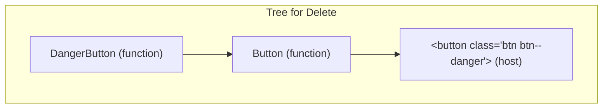
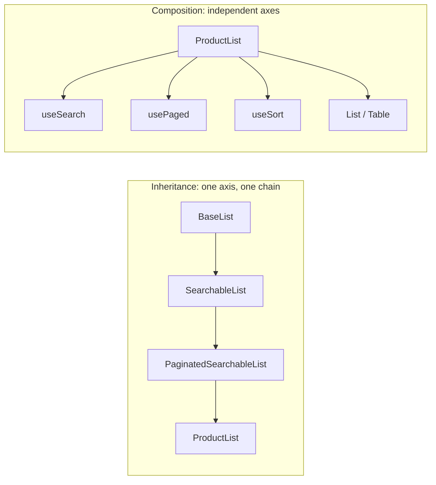
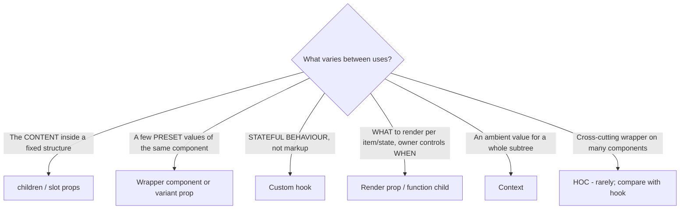

# 05 / 03 — Composition over Inheritance: Why React Components Don't Extend Each Other

## 1. Lesson metadata

| | |
|---|---|
| **Level** | Intermediate |
| **Study time** | 3–4 hours (reading 1.5 h, refactoring labs 1 h, exercises 1.5 h) |
| **Prerequisites** | [Phase 1 / 04 — Elements, components, instances](../01-react-fundamentals/04-elements-components-instances.md), [Phase 1 / 07 — Composition and children](../01-react-fundamentals/07-composition-and-children.md), [Phase 0 / 09 — Prototypes and object model](../00-web-and-javascript-foundations/09-prototypes-and-object-model.md), [05 / 01 — SOLID in React](./01-solid-in-react.md), [05 / 02 — DRY, KISS, YAGNI](./02-dry-kiss-yagni.md) |
| **Next** | [04 — Container / presentational](./04-container-presentational.md) |
| **Related later** | [Lesson 09 — Higher-order components](./09-higher-order-components.md), [Lesson 20 — Slot patterns](./20-slot-patterns.md), [Lesson 24 — OOP patterns in functional React](./24-oop-patterns-in-functional-react.md) |

**Learning objectives.** After this lesson you can:
1. Explain, from the mechanics of elements and reconciliation, why inheritance between React components is almost never the right tool.
2. Identify the four problems inheritance was used to solve in UI code (shared appearance, shared behaviour, specialisation, template-method customisation) and give the compositional equivalent of each.
3. Convert a class hierarchy (`BaseList → FilterableList → UserList`) into composed function components and hooks, and compare the before/after.
4. Use containment (`children`), specialisation (a component rendering a more generic one), slot props, hooks, and context as composition mechanisms and choose among them.
5. Explain why mixins were removed from React's own API and how hooks avoid their problems.
6. Identify the places where inheritance is still legitimate in a React codebase (error classes, error boundaries as class components, framework internals, non-UI domain code) and the places where "composition" is cargo-culted.

**Concepts covered:** is-a vs has-a, containment, specialisation, template method, mixins (historical), fragile base class, `React.Component` as the only legitimate base class, element-based composition, hook-based behaviour composition, slot props, wrapper components, prop forwarding, class components (legacy).

---

## 2. Deep conceptual explanation

### 2.1 What problem is this lesson solving?

You arrive from a class-based language (or a pre-hooks React codebase) with a toolbox in which **reuse = inheritance**: put shared code in a base class, extend it, override what differs. In UI code this feels natural: "a `PrimaryButton` is a `Button`", "an `AdminTable` is a `Table` with extra columns". The problem is that inheritance couples a child to the *entire implementation* of its parent, and UI code changes frequently along multiple independent axes (look, behaviour, data, layout). Inheritance can follow only one axis of variation at a time.

React's official guidance, since early on, has been unambiguous. The documentation's old "Composition vs Inheritance" page stated that, at Facebook, they use React in thousands of components and have found **no use cases where recommending inheritance hierarchies for component reuse** was warranted. The current documentation teaches containment and specialisation via props and `children` in [Passing props to a component](https://react.dev/learn/passing-props-to-a-component), and the class-component API it now documents as legacy.

This lesson explains *why* that guidance holds mechanically, what to do instead for each pattern you would have used inheritance for, and where reality is subtler than the slogan.

### 2.2 The two relationships: is-a and has-a

| Relationship | Mechanism | Typical OO code | React equivalent |
|---|---|---|---|
| **is-a** | Inheritance (`class B extends A`) | `class PrimaryButton extends Button` | A component that **renders** the more general one with specific props: `<Button variant="primary">` |
| **has-a** | Composition (fields, collaborators) | `this.formatter = new Formatter()` | A component that **renders** or **uses** others (children, hooks, context) |

In React, "is-a" is almost always expressed as "**renders-a**-with-preset-props". Specialisation is done by *wrapping*:

```tsx
function DangerButton(props: React.ComponentProps<typeof Button>) {
  return <Button {...props} variant="danger" />;
}
```

`DangerButton` is not a subclass of `Button`; it *renders* a `Button`. There is no shared prototype chain, no `super`, no override surface.

### 2.3 Why inheritance of components is unnatural in React's model

Four properties of React's design make inheritance unattractive:

1. **Components are described by elements, not instances.** You never `new` a component; React does, internally, for classes — and for function components there is no instance at all ([Phase 1 / 04](../01-react-fundamentals/04-elements-components-instances.md)). Inheritance is a relationship between *class instances*; function components (the modern default) have nothing to inherit from.
2. **Parents control children through props, in one direction.** A subclass overriding `renderHeader()` is a *hidden, bidirectional* coupling: the base calls the subclass's override, and the subclass reads base-class state. Props make that coupling explicit and one-directional ([Phase 1 / 06](../01-react-fundamentals/06-props-and-one-way-data-flow.md)).
3. **Element identity and state preservation are tied to component *type*.** React preserves state when the same component type appears at the same position ([Phase 1 / 16](../01-react-fundamentals/16-state-preservation-and-reset.md)). A hierarchy of types makes "is it the same component?" harder to reason about: swapping `UserList` for `AdminUserList` resets state although they share a base class.
4. **Hooks removed the last reason to use classes for reuse.** Shared stateful behaviour no longer needs a base class or a mixin; it needs a function ([Phase 3 / 15](../03-react-state-and-hooks/15-custom-hooks.md)).

### 2.4 What inheritance was used for, and the compositional replacements

| Intent | Inheritance version | Composition version |
|---|---|---|
| **Shared look / structure** | `class Card extends Box` | A `Card` that renders `Box` (or a `Frame` with slots) |
| **Specialisation** | `class DangerButton extends Button` | A wrapper component passing preset props |
| **Shared behaviour** (data loading, subscription, focus) | Base class with `componentDidMount` or a **mixin** | A custom hook; occasionally a HOC or render prop |
| **Template method** (base defines algorithm; subclass fills hooks `renderRow`, `getColumns`) | Abstract method override | Props: render functions, `columns` config, children |
| **Polymorphism** (a list of different things behaving through one interface) | Virtual dispatch | A registry mapping `type → component`, or a discriminated union with `switch` |
| **Default + override** | Override a method | Defaults in destructuring, overriding by spread order |

### 2.5 The mechanisms of composition in React

| Mechanism | What the parent decides | What the caller decides | Typical use |
|---|---|---|---|
| **Containment (`children`)** | Structure, behaviour, framing | The content inside | `Card`, `Dialog`, `Layout` |
| **Slot props (`header`, `footer`, `icon`)** | Where each region goes | What fills each region | `Page`, `Toolbar` |
| **Specialisation (wrapper)** | Nothing; just presets | Everything else via spread | `DangerButton`, `SearchInput` |
| **Render props** | When/how often to call | What to render per call | Virtualised list rows, `Downshift` |
| **Hooks** | Nothing (caller owns the component) | Which behaviours to combine | `useDisclosure`, `useDebounce` |
| **Context** | Which subtree sees the value | What descendants do with it | Theme, i18n, API client |
| **HOC** (legacy-flavoured; sometimes still useful) | Wraps and injects props | Which component gets wrapped | Auth guard, `memo`, instrumentation ([Lesson 09](./09-higher-order-components.md)) |

The first and last-but-one are the most important for beginners: *pass components or elements as props/children* and *share behaviour with hooks*.

### 2.6 A short history: mixins, createClass, and why hooks won

Before ES classes were supported in React (React 0.13, 2015), components were created with `React.createClass`, which supported **mixins**: objects of methods merged into a component. Mixins solved reuse but had well-documented problems, which the React team described in a 2016 blog post ("Mixins Considered Harmful"):

- **Implicit dependencies:** a mixin might read `this.state.x` that the component must define; nothing declares that.
- **Name clashes:** two mixins defining the same method or state key silently conflict.
- **Snowballing complexity:** mixins depend on other mixins; behaviour becomes untraceable.

ES2015 classes dropped mixins. Reuse moved to **higher-order components** and **render props** (see Lessons 09 and 10), and then to **hooks** (React 16.8, 2019), which solved the same problem with explicit, local, composable functions: each hook call is visible in the component, its state is private to the call, and return values are named by the caller, so there are no clashes.

*Historical context, not guarantee:* `createClass` was removed from the React core package long ago; class components still work in React 19 but are labelled legacy for new code. You may meet all of these in existing codebases ([Phase 1 / 17](../01-react-fundamentals/17-lifecycle-concepts.md) covers class history).

### 2.7 Where inheritance is still legitimate

It would be dishonest to teach "inheritance is forbidden". Valid, common uses in a React codebase:

| Use | Why it is fine |
|---|---|
| `class AppError extends Error` (custom error types) | Error hierarchies are a language-level protocol (`instanceof`); this is not UI reuse |
| **Error boundaries** | As of React 19 (react.dev, 2026-10-22: "no way to write an Error Boundary as a function component") they must be *class components* extending `React.Component` (implementing `getDerivedStateFromError`/`componentDidCatch`). Typically you use a library wrapper (`react-error-boundary`) rather than writing the class |
| `class extends React.Component` for legacy classes | The one base class of the framework |
| Domain/utility classes outside UI (e.g., an `EventEmitter`-derived service, a `Map` subclass) | Ordinary OO design; not React-specific |
| Framework-internal/DOM classes (`class MyElement extends HTMLElement`) for **Web Components** | The platform *requires* inheritance for custom elements |

Notice that none of these is "reuse UI between components by extending". That is the thing React discourages.

### 2.8 Common misconceptions

| Misconception | Reality |
|---|---|
| "Composition means never subclass anything." | It means don't use inheritance to reuse UI. Error classes, Web Components, and domain classes are separate matters. |
| "Wrapping a component is always better than prop-driven variants." | Wrappers multiply names. A single component with a `variant` union is often simpler than `PrimaryButton`, `DangerButton`, `GhostButton` ([Lesson 02](./02-dry-kiss-yagni.md)). |
| "HOCs are inheritance." | HOCs are composition (functions that take a component and return a component), though they can obscure data flow ([Lesson 09](./09-higher-order-components.md)). |
| "Composition has no coupling." | It has *explicit* coupling (props); that is the point. Bad composition still produces prop drilling and tangled contexts. |
| "Hooks are mixins with nicer syntax." | The mixin problems (implicit dependency, clashes, shared state) don't occur: each hook call has isolated state and explicit inputs/outputs. |
| "Class components are removed from React 19." | They still work. Only some legacy APIs (string refs, legacy context, `propTypes` checking, `defaultProps` on function components) have been removed in React 19 — verify the exact list in the upgrade guide. |

---

## 3. Internal mechanics

### 3.1 Why a subclass cannot "extend" function components

*Public guarantee:* a function component is a function `(props) => ReactNode`. It has no instance; React calls it during render. There is therefore no `this`, no prototype chain to extend, no `super.render()`. "Inheriting" would mean *copying* behaviour, which is what **calling another component or hook** does.

### 3.2 What class components actually are

*Public guarantee:* React treats a class component as a class whose prototype has `render` and is a subclass of `React.Component` (or `PureComponent`). React constructs an instance and calls its lifecycle methods. *Implementation detail:* React identifies class components via a marker on the prototype (conceptually, `isReactComponent`); verify in the source rather than relying on it.

A class hierarchy such as `class B extends A extends React.Component` works, because the instance's prototype chain includes `React.Component`. But **React's own algorithms ignore the chain**: reconciliation compares the element's `type` (the constructor reference). `<A/>` and `<B/>` are different types, so swapping one for the other **unmounts and remounts**, discarding state — even though B "is-a" A.

### 3.3 Specialisation by wrapping, in the element tree

A wrapper adds exactly one extra component to the tree:



*Teaching model:* the extra layer costs one function call per render and one entry in DevTools. Its benefit is that the "is-a" relationship exists in plain sight (the code) rather than in prototype linkage.

### 3.4 Hook composition: what is shared and what is isolated

*Public guarantee:* hook calls inside a custom hook are, from React's perspective, hook calls made by the component that called the custom hook, in order ([Phase 3 / 16](../03-react-state-and-hooks/16-rules-of-hooks-and-composition.md)). Consequences that make hook composition safe where mixins weren't:

- **Isolation:** each call to `useDisclosure()` yields independent state.
- **Explicit data flow:** inputs are arguments, outputs are return values; the consumer chooses names, so there are no clashes.
- **Composability:** a hook can call other hooks; the call graph is visible in code.

*Cost:* hooks must obey call-order rules; they cannot be called conditionally or in loops.

### 3.5 `children` as composition in the element tree

*Public guarantee:* `children` is an ordinary prop. A parent that renders `{children}` places elements that the **caller** created. Those elements' owner (the component that created them) is the caller, which matters for **re-rendering**: if the parent re-renders because of its own state change but the `children` element reference is unchanged (the caller did not re-render), React can bail out of re-rendering that subtree. This is the classic "lift content up / pass as children" optimisation ([Phase 7 / 03](../07-performance/03-why-components-rerender.md)). Composition via children is therefore also a performance tool — something inheritance cannot offer.

---

## 4. Step-by-step execution walkthrough: swapping a base class for composition

We trace a requirement: "Add search to the user list, then add the same search to the product list."

**Inheritance path (class hierarchy).**
1. `BaseList<T>` renders `<ul>` of items using an abstract `renderItem(item: T)`.
2. `UserList extends BaseList<User>` implements `renderItem`.
3. Requirement: add search. The developer adds `query` state and filtering to `BaseList`, with abstract `matches(item, q)`.
4. `ProductList extends BaseList<Product>` implements `matches`. Works.
5. New requirement: product list needs *sorting* but user list doesn't, and the user list needs *pagination*. Options: add `sortable`/`paginated` flags to `BaseList` (modes), or create `SortableBaseList`, `PaginatedBaseList`. A `PaginatedSortableProductList` needs both: multiple inheritance, which JS does not have; the usual workaround is **mixins** or a deep chain.
6. A bug fix in `BaseList.componentDidUpdate` for pagination changes behaviour of search in `UserList`. *Fragile base class problem.*

**Composition path.**
1. `List` renders `<ul>` of `items` using `renderItem`.
2. `useSearch(items, matches)` returns `{query, setQuery, results}`.
3. `UserList` is a function that calls `useSearch`, passes `results` to `List`.
4. `ProductList` additionally calls `useSort` and `usePagination`.
5. Each combination is expressed by *which hooks the author calls*. No class for `PaginatedSortableProductList` exists; no flags exist.
6. A bug fix in `usePagination` affects only its callers.

The structural difference: inheritance forces a **single axis** (one chain); composition allows a **set** of independent axes.

---

## 5. Code examples

### 5.1 Minimal example — containment and specialisation

```tsx
function Panel({ title, children }: { title: string; children: React.ReactNode }) {
  return (
    <section className="panel">
      <h2>{title}</h2>
      {children}
    </section>
  );
}

function SettingsPanel() {
  return (
    <Panel title="Settings">
      <label>Theme <select><option>Light</option><option>Dark</option></select></label>
    </Panel>
  );
}
```

`Panel` doesn't know what is inside (**containment**). `SettingsPanel` is a *special case* of Panel, expressed by rendering it with specific props (**specialisation**). No base class, no override.

### 5.2 Practical example — before/after: class hierarchy to composition

**Before (legacy-style hierarchy; shown for recognition, not for imitation):**

```tsx
import { Component, type ReactNode } from "react";

abstract class BaseList<T, P = {}> extends Component<{ items: T[] } & P, { query: string }> {
  state = { query: "" };

  abstract renderItem(item: T): ReactNode;
  abstract matches(item: T, query: string): boolean;
  getKey(item: T, index: number): string | number { return index; }

  render() {
    const shown = this.props.items.filter((i) => this.matches(i, this.state.query));
    return (
      <div>
        <input
          value={this.state.query}
          onChange={(e) => this.setState({ query: e.target.value })}
        />
        <ul>
          {shown.map((item, i) => (
            <li key={this.getKey(item, i)}>{this.renderItem(item)}</li>
          ))}
        </ul>
      </div>
    );
  }
}

type User = { id: string; name: string };
class UserList extends BaseList<User> {
  renderItem(u: User) { return <b>{u.name}</b>; }
  matches(u: User, q: string) { return u.name.toLowerCase().includes(q.toLowerCase()); }
  getKey(u: User) { return u.id; }
}
```

*Predict:* what problems appear when `ProductList` also needs sorting and pagination, but only some subclasses? *(See §4 steps 5–6: flags, deeper chains, fragile base class.)* Other issues visible here: `this` binding concerns, `abstract` classes erased at runtime, `getKey` defaulting to index (a keys bug waiting to happen), and the filter being re-run on every render with no seam to change it.

**After (function components + hook + render prop):**

```tsx
import { useState, type ReactNode } from "react";

// 1. Behaviour as a hook: stateful search over any list
function useSearch<T>(items: readonly T[], matches: (item: T, q: string) => boolean) {
  const [query, setQuery] = useState("");
  const results = items.filter((i) => matches(i, query));
  return { query, setQuery, results } as const;
}

// 2. Structure as a component: a presentational list that renders what it is told
function List<T>({ items, getKey, renderItem }: {
  items: readonly T[];
  getKey: (item: T) => string | number;
  renderItem: (item: T) => ReactNode;
}) {
  return (
    <ul>
      {items.map((item) => (
        <li key={getKey(item)}>{renderItem(item)}</li>
      ))}
    </ul>
  );
}

// 3. Specialisation by composition
type User = { id: string; name: string };
const userMatches = (u: User, q: string) => u.name.toLowerCase().includes(q.toLowerCase());

function UserList({ users }: { users: readonly User[] }) {
  const { query, setQuery, results } = useSearch(users, userMatches);
  return (
    <div>
      <input value={query} onChange={(e) => setQuery(e.target.value)} aria-label="Search users" />
      <List items={results} getKey={(u) => u.id} renderItem={(u) => <b>{u.name}</b>} />
    </div>
  );
}
```

**Notes on important lines.**
- `useSearch` is generic and has no JSX: pure behaviour. `matches` is a module-level function (stable identity) — if it were an inline lambda it would still work (we don't depend on identity in an effect), but would be recreated each render, harmless here.
- `as const` makes the return a readonly object with literal-typed properties; for hook returns a plain object is usually fine. Returning an object (not tuple) lets callers pick what they use.
- `List<T>` demands `getKey`, eliminating the index-key default that the base class silently offered ([Phase 1 / 09](../01-react-fundamentals/09-lists-keys-and-identity.md)). *Required* parameters can express rules that *default* methods can't.
- `UserList` composes the pieces. Adding sorting to `ProductList` means calling `useSort` there. `UserList` doesn't change.
- **Trade-off.** The class version had less repetition when *every* list is identical. The composed version repeats three lines (`useSearch`, input, `List`) per list. If that repetition is annoying across ten lists, extract a `SearchableList` **component** composed of the same primitives (see 5.5), not a base class.

### 5.3 Incorrect example — inheriting a function component's behaviour by copying props shape

```tsx
// "Subclass" attempt using spread and a type extension
type ButtonProps = { label: string; onClick: () => void };
function Button({ label, onClick }: ButtonProps) { return <button onClick={onClick}>{label}</button>; }

type IconButtonProps = ButtonProps & { icon: string };
function IconButton({ label, onClick, icon }: IconButtonProps) {
  // Reimplements Button instead of reusing it
  return <button onClick={onClick}> {label}</button>;
}
```

`IconButton` copies `Button`'s markup. When `Button` gains `disabled`, `aria-*`, a loading state, or a design update, `IconButton` silently doesn't. This is "inheritance by duplication": the type relationship (`ButtonProps &`) suggests is-a but the implementation doesn't share code.

### 5.4 Corrected implementation — specialisation by rendering the general component

```tsx
type ButtonProps = React.ComponentProps<"button">;

function Button({ className, ...rest }: ButtonProps) {
  return <button {...rest} className={className ? `btn ${className}` : "btn"} />;
}

function IconButton({ icon, children, ...rest }: ButtonProps & { icon: string }) {
  return (
    <Button {...rest}>
      
      {children}
    </Button>
  );
}
```

Now every improvement to `Button` flows to `IconButton`. We reuse via **rendering**, not by extending. Further, `IconButton` accepts all button props (Liskov-style substitutability from [Lesson 01](./01-solid-in-react.md)). Note `alt=""` marks the icon decorative; if the icon is the only content, the accessible name must come from `aria-label` instead — a place where "composition" doesn't absolve you from semantics.

### 5.5 Practical example — template method becomes slots and config

A page layout that, in OO, would be a template-method base class (`renderHeader`, `renderBody`, `renderFooter` overridden by subclasses):

```tsx
type PageProps = {
  header: React.ReactNode;
  children: React.ReactNode;
  footer?: React.ReactNode;
  aside?: React.ReactNode;
};

function Page({ header, children, footer, aside }: PageProps) {
  return (
    <div className="page">
      <header>{header}</header>
      <div className="page__main">
        <main>{children}</main>
        {aside && <aside>{aside}</aside>}
      </div>
      {footer && <footer>{footer}</footer>}
    </div>
  );
}

function OrdersPage() {
  return (
    <Page header={<h1>Orders</h1>} aside={<OrderFilters />}>
      <OrdersTable />
    </Page>
  );
}
```

`Page` owns structure (the invariant "algorithm"); callers fill in slots (the "hooks of the template method"). The inversion: the *caller* passes content in; the *base* never calls up into a subclass. Slots are covered in depth in [Lesson 20](./20-slot-patterns.md).

### 5.6 Mixins to hooks (legacy comparison)

Legacy mixin (illustrative, pre-ES6 `createClass`; do not use):

```js
var WindowSizeMixin = {
  getInitialState: function () { return { width: window.innerWidth }; },
  componentDidMount: function () { window.addEventListener("resize", this.onResize); },
  componentWillUnmount: function () { window.removeEventListener("resize", this.onResize); },
  onResize: function () { this.setState({ width: window.innerWidth }); },
};
// A component using it gets `this.state.width` implicitly; if it also defines
// state.width or onResize, it clashes with the mixin.
```

Modern equivalent:

```tsx
import { useSyncExternalStore } from "react";

function subscribe(cb: () => void) {
  window.addEventListener("resize", cb);
  return () => window.removeEventListener("resize", cb);
}
export function useWindowWidth(): number {
  return useSyncExternalStore(subscribe, () => window.innerWidth, () => 1024 /* server snapshot */);
}

function Header() {
  const width = useWindowWidth();
  return <p>{width > 768 ? "Desktop" : "Mobile"}</p>;
}
```

Differences: no implicit dependency (inputs and outputs explicit), no name clash (caller chooses `width`), correct cleanup co-located, and `useSyncExternalStore` handles concurrent-rendering tearing concerns ([Phase 3 / 20](../03-react-state-and-hooks/20-usesyncexternalstore-and-external-stores.md)). The `1024` server snapshot is an arbitrary SSR default; choose deliberately for your layout to avoid hydration mismatches.

### 5.7 Advanced example — composition at scale: a `DataView` assembled from parts

```tsx
type Column<T> = { key: string; header: string; cell: (row: T) => React.ReactNode };

function Table<T>({ rows, columns, getKey }: {
  rows: readonly T[]; columns: readonly Column<T>[]; getKey: (r: T) => string;
}) {
  return (
    <table>
      <thead><tr>{columns.map((c) => <th key={c.key} scope="col">{c.header}</th>)}</tr></thead>
      <tbody>
        {rows.map((r) => (
          <tr key={getKey(r)}>{columns.map((c) => <td key={c.key}>{c.cell(r)}</td>)}</tr>
        ))}
      </tbody>
    </table>
  );
}

function usePaged<T>(rows: readonly T[], pageSize: number) {
  const [page, setPage] = useState(0);
  const pageCount = Math.max(1, Math.ceil(rows.length / pageSize));
  const safePage = Math.min(page, pageCount - 1);
  const slice = rows.slice(safePage * pageSize, (safePage + 1) * pageSize);
  return { slice, page: safePage, pageCount, setPage };
}

function Pager({ page, pageCount, onPage }: { page: number; pageCount: number; onPage(p: number): void }) {
  return (
    <nav aria-label="Pagination">
      <button disabled={page === 0} onClick={() => onPage(page - 1)}>Previous</button>
      <span>{page + 1} / {pageCount}</span>
      <button disabled={page >= pageCount - 1} onClick={() => onPage(page + 1)}>Next</button>
    </nav>
  );
}

function ProductsView({ products }: { products: readonly Product[] }) {
  const { query, setQuery, results } = useSearch(products, (p, q) => p.title.toLowerCase().includes(q.toLowerCase()));
  const paged = usePaged(results, 20);
  return (
    <>
      <input value={query} onChange={(e) => setQuery(e.target.value)} aria-label="Search products" />
      <Table
        rows={paged.slice}
        getKey={(p) => p.id}
        columns={[
          { key: "title", header: "Title", cell: (p) => p.title },
          { key: "price", header: "Price", cell: (p) => `$${p.price.toFixed(2)}` },
        ]}
      />
      <Pager page={paged.page} pageCount={paged.pageCount} onPage={paged.setPage} />
    </>
  );
}
```

Details: `Math.min(page, pageCount - 1)` clamps when a search shrinks results below the current page (a bug class that appears in naive paging); the *state* `page` isn't reset when `results` changes — a design choice: alternatively derive reset by keying the component on `query` ([Phase 1 / 16](../01-react-fundamentals/16-state-preservation-and-reset.md)). Each part (`useSearch`, `usePaged`, `Table`, `Pager`) is independently testable and recombinable — five-way inheritance (searchable, pageable, sortable...) would be impossible in a single chain.

---

## 6. Visual explanations

### Inheritance chain vs composed behaviours



### Which composition mechanism?



### State reset when "subclass" types differ

```mermaid
sequenceDiagram
  participant P as Parent
  participant R as React
  P->>R: render <UserList/>
  R-->>R: mount UserList (state: query="ab")
  P->>R: render <AdminUserList/> (extends UserList)
  R-->>R: element type differs -> unmount UserList, mount AdminUserList
  Note over R: state discarded; class relationship ignored
```

---

## 7. Alternative approaches and trade-offs

### 7.1 Sharing UI variation: wrappers vs variant prop vs inheritance

| Criterion | Inheritance | Wrapper components | Variant prop on one component | Slot-based frame |
|---|---|---|---|---|
| Works with function components | No | Yes | Yes | Yes |
| Number of names to learn | Many (class tree) | Many (`DangerButton`, …) | One | One + slot names |
| Sees all variants in one place | No | No | Yes | Partially |
| Type-safe invalid combos | Weak | Good | Good (unions) | Good |
| Bundle impact | Per class | Per wrapper (tiny) | None | None |
| Best for | Platform-required hierarchies | Domain-named presets (`DeleteAccountButton`) | Design-system axes (size, tone) | Layout skeletons |

**Scenario where composition (wrappers) is *not* the best answer.** Three presets of a button that differ only by colour: 3 wrapper components add names and files for what a `tone` union expresses in one line. Conversely, for **domain-meaningful** presets (`DeleteAccountButton` that also confirms, logs, and navigates) a wrapper is justified — it carries behaviour, not just props.

### 7.2 Sharing behaviour: hook vs HOC vs render prop vs inheritance

| Criterion | Class inheritance / mixin | HOC | Render prop | Custom hook |
|---|---|---|---|---|
| Needs a class | Yes | No | No | No |
| Visible at the call site | No | Partially (wrapping) | Yes (nesting) | Yes |
| Naming clashes | Likely | Prop collisions | None | None |
| TypeScript ergonomics | Poor | Hard (prop injection) | OK | **Best** |
| Wrapper nodes in tree | No | Yes | Yes | No |
| Works for non-React-render contexts (class lifecycle) | Yes | Yes | Yes | **No** (function components only) |

**When the recommended approach (hooks) is not best:** the behaviour must apply to *class components you cannot rewrite* (third-party legacy) or must wrap *rendering* (error boundaries, `Suspense`-like components that decide whether children render). Then a wrapper component or HOC is the tool, since a hook can't intercept a child's render or errors.

### 7.3 Is subclassing ever better than composition?

| Situation | Better approach |
|---|---|
| Custom error taxonomy with `instanceof` checks | `class NotFoundError extends AppError` |
| A Web Component | Required: `class X extends HTMLElement` |
| A domain object hierarchy that is truly is-a, with stable behaviour | Subclassing is acceptable (outside React rendering) |
| Large legacy class codebase mid-migration | Keep hierarchy; compose new code; migrate incrementally ([Phase 4 / 24](../04-react-architecture/24-refactoring-legacy-react.md)) |

---

## 8. Best practices and anti-patterns

### 8.1 Best practices

1. **Specialise by rendering.** `Dangerous = (props) => <Base {...props} preset />`.
2. **Forward the contract.** Use `ComponentProps<...>` and `...rest` so wrappers stay substitutable ([Lesson 01](./01-solid-in-react.md)).
3. **Put variation in props, children, or slots**, not in subclass overrides.
4. **Put behaviour in hooks.** Return only what callers use.
5. **Keep the number of layers meaningful.** Every wrapper should decide something (presets, behaviour, a11y), or be removed.
6. **Use `children` to avoid prop drilling for layout.** Pass the *rendered* element down instead of data plus a renderer.
7. **Let TypeScript unions model closed variation, registries model open variation.**

### 8.2 Beginner mistakes

| Mistake | Fix |
|---|---|
| `class Foo extends MyBaseComponent` to share render code | Extract a component or hook |
| Re-implementing a component's markup for a variant (§5.3) | Render the general component |
| Spread order that lets callers override critical props unintentionally | Decide: `{...rest}` first for "enforced", last for "overridable" |
| Passing `data` + `renderer` when passing the element would do | Pass JSX as `children` or a slot |

### 8.3 Experienced-developer mistakes

| Mistake | Fix |
|---|---|
| Rebuilding inheritance with "extends via HOC stacks" (`withA(withB(withC(X)))`) | Prefer hooks; if HOCs are needed, keep them few and typed |
| A "base" hook with a mode parameter that behaves like a base class | Split into separate hooks |
| Context as inheritance ("everything inherits from `<AppContext>`") | Scope contexts narrowly |
| Over-abstracting slots: `<Page slotA slotB … slotN>` | Use `children` and 2–3 named slots; split pages |
| Refusing to use a class for an error boundary on dogmatic grounds | Use the class (or the `react-error-boundary` library) |

### 8.4 Smells

- `extends` between two components in your own code.
- A component named `Base*`, `Abstract*`, or `*Mixin`.
- A prop called `render*` that is used by exactly one caller (could be `children`).
- HOC chains longer than two.
- A hook that takes a component as an argument (usually a sign of a mis-factored HOC).

### 8.5 Justified exceptions

- **Class components** in an existing codebase you aren't rewriting: *keep*, don't extend them further than necessary.
- **Error boundaries** (classes).
- **Web Components** wrappers.
- **Large OO domain model** (in a shared TypeScript package consumed by React and non-React clients) with a legitimate hierarchy.

⚠ These are defaults supported by React's documentation and community practice, but not language-enforced rules. Some teams run successful hierarchical UI frameworks on top of web components or other stacks; the argument here is specific to React's element/props model.

---

## 9. Real-world application

### 9.1 Design system: a button family
A `Button` with `variant` and `size` axes, plus domain wrappers (`SubmitButton` that reads `useFormStatus` to disable during submission). *Constraint:* wrappers must forward `ref`, `aria-*`, `type`; the design-system team owns the core; product teams own domain wrappers ([Phase 5 / 22](./22-patterns-for-reusable-libraries.md)).

### 9.2 E-commerce: product tiles in different contexts
Grid tile, carousel tile, cart line. Common elements (price, badge) become small components; each context composes them. Avoid `ProductTile` with `context="cart"` flags. *Constraint:* A/B-tested variants require an easily swapped composition at one site, which composition supports (swap a child), whereas inheritance pushes the experiment into the class tree.

### 9.3 Dashboards: widget frames
`WidgetFrame` provides title, loading, error boundary, and settings menu; each widget composes content through `children`. *Constraint:* error isolation requires a class-based boundary inside the frame — the one place the codebase uses `extends`.

### 9.4 Forms: field composition
`<Field label error><Input/></Field>` composes via children plus context for ids (`useId`), instead of `TextFieldBase → EmailField`. *Constraint:* accessibility wiring (`htmlFor`, `aria-describedby`) must be centralised in `Field`.

### 9.5 Migration: legacy class hierarchy
A 2017 codebase with `BaseTable → SortableTable → AdminTable`. Migrate by extracting behaviours into hooks while keeping the classes as thin shells, then replacing each class with a function ([Phase 4 / 24](../04-react-architecture/24-refactoring-legacy-react.md)). *Constraint:* keep tests green at each step; behaviour on mount/update order must be preserved (class lifecycles ≠ effects; see [Phase 1 / 17](../01-react-fundamentals/17-lifecycle-concepts.md)).

---

## 10. Debugging and troubleshooting

### 10.1 Symptom: "State resets when switching between `UserList` and `AdminUserList`"
- **Repro:** conditionally render one or the other at the same position.
- **Investigate:** React DevTools Components panel — look at the node's type name changing; the Profiler shows a mount instead of an update.
- **Root cause:** different component types at the same position → unmount/remount, regardless of inheritance.
- **Fix:** render one component with a prop (`admin`), or lift state above both. **Validate:** type name stable, no remount.

### 10.2 Symptom: "My wrapper ignores `aria-label`/`ref`/`onKeyDown`"
- **Investigate:** the wrapper's props type; whether `...rest` reaches the DOM element.
- **Root cause:** wrapper reimplements props instead of forwarding.
- **Fix:** `ComponentProps<"button">` and spread. **Validate:** a test that passes `data-testid` and `aria-label` and finds the DOM node by role/name.

### 10.3 Symptom: "Two behaviours conflict inside a base class after adding a feature"
- **Investigate:** list overridden methods and lifecycle calls in the chain; look for `super.componentDidUpdate` omissions.
- **Root cause:** fragile base class.
- **Fix:** extract each behaviour into a hook; ensure each owns its state. **Validate:** unit-test each hook separately.

### 10.4 Symptom: "Too many wrapper layers in DevTools"
- **Investigate:** the Components tree depth; HOC names like `WithAuth(WithTheme(Connect(X)))`.
- **Root cause:** cross-cutting concerns implemented as HOC stacks.
- **Fix:** replace with hooks inside the component; keep a HOC only where it must wrap rendering. **Validate:** tree is shallower, props are explicit.

### 10.5 Symptom: "TypeScript error: Class 'X' incorrectly extends base class" after upgrading types
- **Root cause:** class component typing depends on `@types/react`; props/state generics changed shape. Typically fixed by aligning generics, but consider migrating off the class rather than patching ([Phase 4 / 24](../04-react-architecture/24-refactoring-legacy-react.md)).

---

## 11. Exercises

### Level A — Knowledge
A1. Name the four problems inheritance tried to solve in UI code and give the compositional replacement for each.
A2. Why does swapping `<A/>` for `<B/>` (where B extends A) reset state?
A3. List three problems of mixins that hooks avoid.
A4. Name two legitimate uses of `extends` in a modern React codebase.
A5. What does it mean to "specialise by rendering"?

### Level B — Code comprehension
B1. Does `IconButton` below inherit from `Button`? What is the relationship, and what happens to `aria-label`?
```tsx
const IconButton = ({ icon, ...rest }: React.ComponentProps<"button"> & { icon: string }) => (
  <Button {...rest}></Button>
);
```
B2. In §5.7, a user is on page 5 of the product list and types a search that yields 12 results (pageSize 20). What does the user see and why? What if `Math.min` were removed?
B3. What's wrong with this "composition" attempt?
```tsx
function withLogging<P extends React.JSX.IntrinsicAttributes>(C: React.ComponentType<P>) {
  return function Wrapped(props: P) {
    console.log("render", C.name);
    return <C {...props} />;
  };
}
const Logged = withLogging(Button);
function App() { const L = withLogging(Button); return <L>hi</L>; }
```

### Level C — Implementation
C1. Convert this class hierarchy to composition with at least one hook and one presentational component.
```tsx
class BaseModal extends Component<{ open: boolean; onClose(): void }> {
  renderBody(): ReactNode { return null; }
  renderFooter(): ReactNode { return <button onClick={this.props.onClose}>Close</button>; }
  render() {
    if (!this.props.open) return null;
    return <div role="dialog"><div>{this.renderBody()}</div><div>{this.renderFooter()}</div></div>;
  }
}
class ConfirmModal extends BaseModal {
  renderBody() { return <p>Are you sure?</p>; }
  renderFooter() { return <><button>Yes</button><button onClick={this.props.onClose}>No</button></>; }
}
```
C2. Write `useSort<T>(rows, compare)` and combine with `useSearch` and `usePaged` in one `UsersTable`. State the order of composition and why it matters.
C3. Write a function component `ErrorBoundaryFallback` strategy using the `react-error-boundary`-style API: describe (don't implement) which part must remain a class and which parts become function components.

### Level D — Debugging
D1. A teammate converted `BaseTable` to a function component and the subclass `AdminTable` (still a class) now throws "Class extends value … is not a constructor". Explain and propose the migration order.
D2. `SubmitButton` wraps `Button` and sets `type="submit"` after `{...rest}`. A caller passes `type="button"` for a cancel action in a form, yet it still submits. Diagnose and fix.
D3. After replacing a class mixin with `useWindowWidth`, the SSR build logs hydration mismatch warnings. Why?

### Level E — Architecture and engineering decisions
E1. A 60-component design system has `BaseInput → TextInput → EmailInput/PasswordInput` classes. Propose a migration plan and target API; address backward compatibility for consumers who `extends TextInput`.
E2. Compare `variant` prop vs wrapper components vs inheritance for `Alert` (info/warn/error/success) in a design system consumed by 15 teams.
E3. When would you recommend a HOC over a hook for a new feature in 2026-era React?

### Level F — Expert challenge
F1. Design an extensible `DataGrid` for a multi-team product that must support sorting, filtering, pagination, selection, and virtualisation. Choose between a monolithic component with flags, inheritance, composition of hooks, or headless (see [Lesson 07](./07-headless-components.md)). Specify the public API, the extension points, and what you refuse to support.
F2. Argue that composition "has its own fragile base class problem" (hint: contexts, implicit coupling between hooks and providers, slot misuse). Provide a concrete example and mitigation.

---

## 12. Detailed answers and explanations

> Attempt the exercises first.

**A1.**
- Shared look/structure → a frame component with slots/children.
- Specialisation → wrapper rendering the general component with presets (or a variant prop).
- Shared behaviour → custom hooks (HOC/render prop where wrapping rendering is needed).
- Template method → render-function props/slots/config instead of overridden methods.
(Optionally: polymorphism → registry/discriminated union.) Wrong answer: "context" for everything; context is for ambient values, not generic reuse.

**A2.** Reconciliation compares element `type` identity (the constructor/function reference). B !== A, so React unmounts A (discarding its state) and mounts B, ignoring the prototype chain. Wrong answer: "because state is stored on the base class".

**A3.** Implicit dependencies on host component's fields; name collisions; snowballing mixin-to-mixin dependencies. Hooks: explicit arguments/returns, caller-chosen names, isolated state per call.

**A4.** Custom `Error` subclasses; class-based error boundaries; Web Component classes; non-UI domain classes.

**A5.** Express "B is a special case of A" by writing B as a component that renders A with preset props and forwards the rest, not by prototype linkage.

**B1.** `IconButton` doesn't inherit; it *renders* `Button` (has-a). `aria-label` flows through `...rest` to `Button` and, if `Button` spreads `rest` onto `<button>`, to the DOM node. If `Button` has a narrow props type that drops `aria-label`, it's lost at that layer, so the wrapper's substitutability is limited by the base's contract.

**B2.** The user sees the first page of 12 results with `page=1/1`. `page` state is still `4` but clamped: `safePage = Math.min(4, 0) = 0`. Without `Math.min`, `slice` would be `rows.slice(80, 100)` → empty array: an empty table with "5 / 1" label — a classic pagination bug. Also note that when the user clears the search, the state `4` pops back (page 5 again) — might be surprising; resetting `page` on query change (via key or in the handler) is a product decision.

**B3.** Two issues: (1) `withLogging(Button)` inside `App` creates a *new component type on every render*, so React sees a different type each time → unmounts/remounts `L` and its subtree on every render, losing state and DOM. HOCs must be applied outside render (module scope). (2) `withLogging` logs during render, a side effect in render (acceptable for debugging, but it fires twice in StrictMode dev and on re-renders that React may discard — [Phase 2 / 12](../02-react-rendering-and-internals/12-why-rendering-must-be-pure.md)). Also `C.name` may be empty for anonymous components.

**C1.** Reference:
```tsx
type ModalProps = {
  open: boolean;
  onClose(): void;
  children: React.ReactNode;
  footer?: React.ReactNode;
};

function Modal({ open, onClose, children, footer }: ModalProps) {
  if (!open) return null;
  return (
    <div role="dialog" aria-modal="true">
      <div>{children}</div>
      <div>{footer ?? <button onClick={onClose}>Close</button>}</div>
    </div>
  );
}

function ConfirmModal({ open, onClose, onConfirm }: { open: boolean; onClose(): void; onConfirm(): void }) {
  return (
    <Modal open={open} onClose={onClose} footer={<><button onClick={onConfirm}>Yes</button><button onClick={onClose}>No</button></>}>
      <p>Are you sure?</p>
    </Modal>
  );
}
```
`renderBody` → `children`; `renderFooter` → `footer` slot with a default; the subclass → specialisation. Real accessible dialogs need focus management, Escape handling, inert background, labelling: use the `<dialog>` element or a library (Radix Dialog / React Aria); see [Lesson 07](./07-headless-components.md). A "hook" version: `useDialogBehaviour` handling Escape and focus can be extracted if behaviour is reused. Evaluation: accept either as long as the template-method→slots mapping is explicit.

**C2.**
```tsx
function useSort<T>(rows: readonly T[], compare: ((a: T, b: T) => number) | null) {
  return compare ? [...rows].sort(compare) : rows;
}

function UsersTable({ users }: { users: readonly User[] }) {
  const { query, setQuery, results } = useSearch(users, userMatches);
  const [dir, setDir] = useState<"asc" | "desc" | null>(null);
  const sorted = useSort(results, dir && ((a, b) => (dir === "asc" ? 1 : -1) * a.name.localeCompare(b.name)));
  const paged = usePaged(sorted, 20);
  /* render input, sort toggle, <Table rows={paged.slice} …/>, <Pager …/> */
}
```
Order: **filter → sort → paginate**. Paginating before filtering would filter only the current page; sorting after pagination sorts only a page. Copy before sort (`[...rows]`) to avoid mutating state/props. Edge: unstable comparator identity creates a new array each render; fine at small sizes, memoise only if measured.

**C3.** The part that **must** remain a class: the boundary itself (implements `getDerivedStateFromError` / `componentDidCatch`) — typically provided by a library. Everything else — fallback UI, reset button, logging callbacks — are function components/props passed to it (`fallback`, `onError`, `onReset`). The app uses `<ErrorBoundary fallbackRender={…}>`; a hook-style helper (e.g., one that lets you imperatively "throw" async errors into the nearest boundary) can wrap it. react.dev currently documents no hook-based boundary API (2026-10-22).

**D1.** A function component isn't a constructor with a prototype suitable for `extends`; `class X extends fn` throws at class definition (or `Class extends value … is not a constructor`/"is not a constructor or null" depending on engine and whether the function is an arrow). Migration order: leaf-first. Convert the **subclass** (`AdminTable`) first to a function that *renders* `BaseTable`-as-composition, or keep both classes until shared behaviour has been extracted into hooks the class can't use. Practical sequence: (1) extract pure logic from `BaseTable` into functions; (2) create function `Table` that uses the same logic; (3) re-implement `AdminTable` as `<Table {...adminPresets} />`; (4) delete `BaseTable`. Because hooks don't work in classes, behaviour shared with classes must be pure functions or temporarily duplicated.

**D2.** Spread order: `<Button {...rest} type="submit" />` places `type="submit"` after the spread, overriding the caller's `type="button"`. Fix: `function SubmitButton({ type = "submit", ...rest })` so the caller's value wins, or *omit* `type` from the wrapper's props type if it should never be overridden (and give cancel actions the base `Button`). Test: render within a form, click both buttons and assert `onSubmit` count.

**D3.** The server snapshot (the value used for SSR and the first hydration render) differs from the client's first value (`window.innerWidth`), or `getServerSnapshot` wasn't provided (React errors if missing during SSR). Provide a stable server snapshot and accept a post-hydration update, or render a layout that doesn't depend on width at first paint (CSS media queries instead of JS). Validate by checking for hydration warnings in the console.

**E1.** Criteria: consumer impact, deprecation policy, test coverage, timelines. Example answer: (1) Freeze base classes (no new features). (2) Extract behaviour into hooks and pure functions (`useFieldId`, `useMask`). (3) Introduce `Input` (function, `ComponentProps<"input">`) and make `TextInput`, `EmailInput`, `PasswordInput` thin wrappers with presets (`type`, `autoComplete`, validation hints). (4) Re-implement old class exports as adapters over the new components for one major version (cannot truly keep `extends`; document that subclassing is unsupported and provide codemods/migration notes for known consumers; measure consumers via search across org repos). (5) Remove in the next major. Compatibility caveat: consumers who override protected methods can't be preserved; offer equivalent props/slots instead.

**E2.** Variant prop wins for design-system *axes* (tone): one component, exhaustively typed, one docs page; wrappers (`ErrorAlert`) only if they carry domain behaviour (e.g., auto-log). Inheritance adds nothing for four near-identical presentations and blocks function-component implementation. Evaluate on: API surface, a11y (`role="alert"` for error vs `status`), theming, future variants, tree-shaking. Counter-scenario where the answer flips: error alerts that need retry logic and telemetry — a domain wrapper.

**E3.** When the capability must **wrap rendering** or intercept the component boundary: instrumentation/profiling wrappers, `memo`, error boundary providers, access gates that decide *whether to render* (though a component `<RequireAuth>{children}</RequireAuth>` often does the same more simply), or retrofitting behaviour on class components/third-party components you can't edit. For behaviour inside your own function components, prefer hooks.

**F1.** Evaluation criteria: API clarity, escape hatches, perf, a11y, refusal list. Example: a headless core (`useDataGrid` returning state, derived rows, prop-getters) with composable pieces (`Grid`, `Header`, `Row`, `Pager`) and separate hooks for features (`useSorting`, `useFiltering`, `usePagination`, `useSelection`); virtualisation as an optional composition (`useVirtualRows`) with a documented contract on row heights; controlled/uncontrolled state props per feature; slots for cell rendering. Refusals: no inheritance hooks; no flags matrix; no DOM-structure overrides beyond documented slots. Mention existing libraries (TanStack Table is headless) as the build-vs-buy baseline.

**F2.** Composition's analogue: **implicit coupling through context and ordering**. Example: `useSort` reads `SortContext` set by a distant provider; moving a component outside the provider silently uses defaults. Or hooks that must be composed in a certain order (filter before paginate), documented only by convention. Another: slot props expecting specific element types (`<Tabs.List>` children). Mitigations: throw when a required provider is missing; keep context scopes narrow and named; encode order requirements in a single composed hook (`useDataView`) that is the supported entry point; type slots through props not children inspection.

---

## 13. Senior engineer interview questions

**Q1. "Why does React favour composition over inheritance?"**
*Strong answer:* Because components are described by elements and props, reuse via explicit inputs is simpler and safer than via implicit overrides. Inheritance couples the subclass to base implementation details and supports only one axis; UI varies on several. Reconciliation compares component type, so inheritance gives no state or identity benefits. And hooks gave behaviour reuse without classes.

**Q2. "Is a HOC inheritance?"**
*Strong answer:* No, it's composition: a function from component to component. Its drawbacks (wrapper hell, prop collisions, static typing complexity) are why hooks replaced most uses. It remains useful where behaviour must wrap rendering of a component you do not control.

**Q3. "Give a case where you'd still write a class in React."**
*Strong answer:* An error boundary (as of React 19 it requires lifecycle methods only classes have; I'd typically use a library implementation) or maintaining existing class code during gradual migration. For anything new, function components and hooks.

**Q4. "What went wrong with mixins and why don't hooks have the same problems?"**
*Strong answer:* Mixins merged members into a single namespace with implicit dependencies — clashes and untraceable interaction. Hooks are function calls; inputs/outputs are explicit and each call has private state, so there are no clashes or hidden dependencies, and they can be inspected by reading the component.

**Q5. "How would you refactor a 3-level class hierarchy in a large app?"**
*Strong answer:* Characterise with tests; extract pure logic then behaviours to hooks; introduce function components that reproduce each class's behaviour via composition; swap consumers leaf-first or by feature; keep old classes as adapters during a deprecation window; delete when usage reaches zero. I track usage counts as the progress metric.

**Q6. "Doesn't a 'Button → IconButton → LoadingIconButton' wrapper chain recreate inheritance?"**
*Strong answer:* It can: if each layer merely renames props, it's the same fragility. The remedy is that wrappers should *decide something*, or be collapsed into one component with orthogonal props (`icon`, `loading`). Composition is a tool, not a guarantee.

**Q7. "Why might `children` improve performance?"**
*Strong answer:* Elements passed as children are created by the caller; when the wrapper re-renders on its own state change but the caller doesn't, the children's element references are stable and React can skip re-rendering them. It's a structural optimisation without `memo`.

---

## 14. Further learning resources

| Resource | URL | Covers / why | Level | Study |
|---|---|---|---|---|
| React — Passing props to a component | <https://react.dev/learn/passing-props-to-a-component> | `children` as a prop; containment and specialisation in practice | Beginner | "Passing JSX as children" |
| React — Reusing logic with custom hooks | <https://react.dev/learn/reusing-logic-with-custom-hooks> | Behaviour reuse without classes or mixins | Intermediate | Whole page |
| React — Thinking in React | <https://react.dev/learn/thinking-in-react> | Component decomposition | Beginner | Steps 1–2 |
| React — `Component` reference (legacy) | <https://react.dev/reference/react/Component> | Class component API, error boundary requirements, legacy status | Intermediate | "Alternatives" and error boundary sections |
| React Legacy docs — Composition vs Inheritance | <https://legacy.reactjs.org/docs/composition-vs-inheritance.html> | The original statement of the guidance | Beginner | Whole page |
| React blog — "Mixins Considered Harmful" (2016) | <https://legacy.reactjs.org/blog/2016/07/13/mixins-considered-harmful.html> | The original rationale against mixins | Intermediate | Whole post |
| React — `react-error-boundary` (library) | <https://github.com/bvaughn/react-error-boundary> | A maintained class-based boundary with function-component API | Intermediate | README |
| MDN — Inheritance and the prototype chain | <https://developer.mozilla.org/en-US/docs/Web/JavaScript/Inheritance_and_the_prototype_chain> | What `extends` actually does in JS | Intermediate | Whole page |
| Gamma et al., *Design Patterns* | *(book)* | Origin of "favour object composition over class inheritance" | Advanced | Chapter 1 |

URLs in this table were checked for HTTP 200 on 2026-10-22; any still marked *(unverified)* could not be checked automatically (blocked or unreachable). A 200 response does not guarantee the page content still matches the description; if a link has moved, search the site for the quoted title.

---

## 15. Knowledge checkpoint

**You should now understand**
- The is-a / has-a distinction, and that React expresses is-a as "renders with presets".
- Why reconciliation, one-directional props, and hooks make component inheritance unattractive.
- The compositional replacement for each inheritance use: structure, specialisation, behaviour, template method, polymorphism.
- Why mixins failed and what hooks changed.
- The legitimate remaining uses of `extends`.

**You should be able to explain without notes**
- Why swapping `<A/>` for `<B/>` resets state even when B extends A.
- When a wrapper is justified vs a variant prop.
- Why `withX(Component)` inside a render function is a bug.

**You should be able to implement**
- A class hierarchy → hooks + presentational components conversion.
- A `Page`/`Modal` with slots replacing template methods.
- A composition of `useSearch`, `useSort`, `usePaged` in the right order.

**You should be able to debug**
- State resets from type changes; wrappers swallowing props; spread-order overrides; hydration mismatches in extracted hooks.

**Before moving on:** read [04 — Container / presentational](./04-container-presentational.md), which applies composition to the separation of data and UI.
