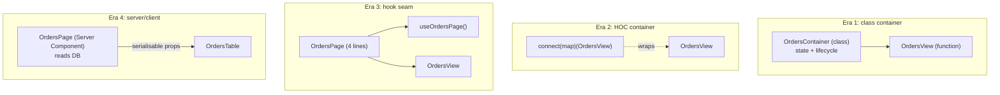
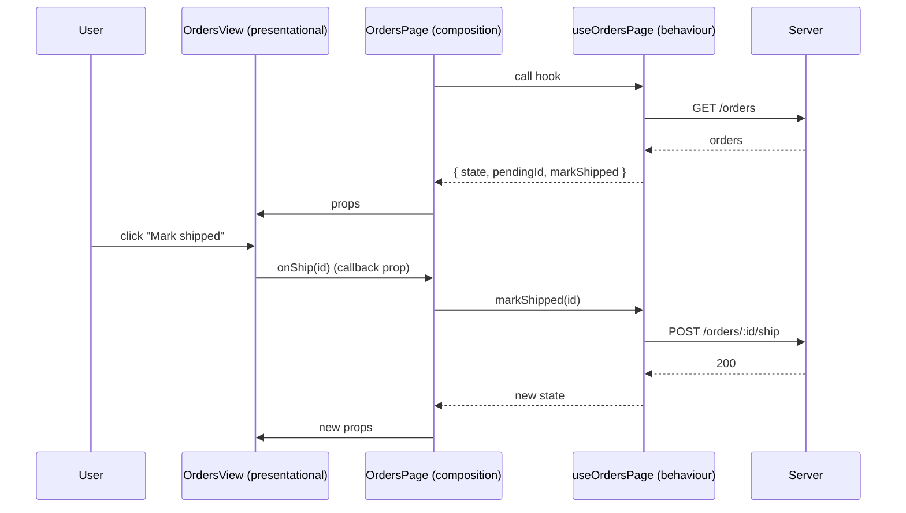

# 05 / 04 — Container / Presentational: A Pattern That Changed Shape Three Times

## 1. Lesson metadata

| | |
|---|---|
| **Level** | Intermediate |
| **Study time** | 3–4 hours (reading 1.5 h, refactoring labs 1 h, exercises 1.5 h) |
| **Prerequisites** | [05 / 01 — SOLID in React](./01-solid-in-react.md), [05 / 03 — Composition over inheritance](./03-composition-over-inheritance.md), [Phase 1 / 06 — Props and one-way data flow](../01-react-fundamentals/06-props-and-one-way-data-flow.md), [Phase 3 / 15 — Custom hooks](../03-react-state-and-hooks/15-custom-hooks.md) |
| **Next** | [05 — Compound components](./05-compound-components.md) |
| **Related** | [Phase 4 / 04 — Presentational vs container (architectural treatment)](../04-react-architecture/04-presentational-vs-container.md), [Lesson 18 — Behaviour vs presentation](./18-behavior-vs-presentation.md), [Phase 9 / 03 — Server Components in depth](../09-advanced-rendering-and-ecosystem/03-server-components-in-depth.md) |

**Learning objectives.** After this lesson you can:
1. Define presentational and container components precisely and state the separation of concerns they enforce.
2. Trace the pattern's evolution: class containers → `connect()` HOC containers → hook-based "containers" → Server Component / Client Component split.
3. Refactor a mixed component into presentational + data/behaviour parts using a hook, and judge whether to also keep a thin container component.
4. Explain what testing, Storybook/visual review, and reuse benefits the separation really delivers, and what it costs.
5. Recognise when the split is ceremonial (forced container for every component, "dumb" components that take 25 props) and choose a different decomposition.
6. Describe how Server Components create a *new, enforced* version of the same separation, with different constraints.

**Concepts covered:** presentational component, container component, smart/dumb terminology, `connect`-style containers (legacy), hook extraction as the modern container, view models, props as contract, Storybook-friendly components, server data boundary, prop drilling cost, over-separation.

---

## 2. Deep conceptual explanation

### 2.1 What problem is this lesson solving?

A UI component that fetches data, owns state, handles side effects *and* renders markup is hard to:

- **Test.** You must mock the network to check whether a button renders.
- **Review visually.** Rendering a "loading", "error", or "empty with 3 filters" state means orchestrating the data layer, not passing props.
- **Reuse.** The markup is welded to one data source.
- **Change.** Design edits and data-contract edits touch the same file and collide in review.

The container/presentational pattern attacks this by splitting responsibilities along one specific seam: **where does the data come from (and what happens to it) versus how does it look**.

### 2.2 Definitions

| | Presentational component | Container component |
|---|---|---|
| **Concerned with** | How things look (markup, styles, layout) | How things work (data fetching, state, wiring) |
| **Data source** | Props only | Server, store, URL, context |
| **Changes data** | Calls callbacks passed via props | Implements those callbacks (dispatch, mutate) |
| **Own state** | Only UI state (open/closed, focus), if any | State relating to data and orchestration |
| **Renders** | DOM elements and other presentational components | Presentational components, rarely own markup |
| **Typical naming** | `UserList`, `OrderRow` | `UserListContainer`, `OrdersPage` |
| **Test style** | Render with props, assert DOM | Render with a fake data source, assert wiring |

The pattern became popular through Dan Abramov's 2015 article "Presentational and Container Components" (Medium), which also used the "smart/dumb" vocabulary. He later added a note to the article stating that he no longer suggests splitting components this way and that hooks let you achieve the same separation without an artificial component boundary. That correction is *part of the pattern's history* and the basis of this lesson's central claim:

> **The separation of concerns is durable. The *component boundary* that implemented it in 2015 is optional in 2026.**

### 2.3 The three eras

| Era | How the seam was drawn | Mechanism | Costs |
|---|---|---|---|
| **1. Class containers (≈2015–2018)** | A class component with state/lifecycle renders a function component | `componentDidMount` fetch, `setState`, pass props down | Boilerplate; two components per feature |
| **2. HOC containers (≈2016–2019)** | `connect(mapState, mapDispatch)(View)` (Redux), `graphql(...)` wrappers | Higher-order components ([Lesson 09](./09-higher-order-components.md)) | Wrapper hell; typing difficulty; indirection |
| **3. Hook seam (≈2019–present)** | The "container" is a custom hook (`useOrders`) *called by* the component, or a thin parent | Hooks ([Phase 3 / 15](../03-react-state-and-hooks/15-custom-hooks.md)) | None structural; the split is a function boundary, not a component boundary |
| **4. Server/Client split (React 19 + frameworks)** | A Server Component fetches and passes serialisable props to Client Components | Server Components; ⚠ framework-dependent | Serialisation constraints; boundary rules |

Eras overlap in real codebases. Recognising each lets you read legacy code and choose today's seam deliberately.

### 2.4 What the separation buys

1. **Testability of view logic without I/O.** `render(<UserListView users={fixtures} />)` needs no providers or mocks.
2. **A "state catalogue".** Because views take props for every state (loading, error, empty, populated, 10,000 rows), you can render each directly in Storybook or a test, and a designer can review them without a backend.
3. **Replaceable data layer.** Moving from REST to GraphQL changes the container/hook, not the view.
4. **Parallel work.** One person builds the view against a typed props contract while another builds the data layer.
5. **Smaller blast radius** for design-system updates.

### 2.5 What the separation costs

1. **More files and indirection.** For tiny components the container/presentational pair is pure overhead.
2. **Prop plumbing.** The view needs every datum as a prop. If the container sits far above the leaf, you must thread props or restructure with composition ([Lesson 03](./03-composition-over-inheritance.md)).
3. **Container that does nothing.** A container that merely forwards `useQuery` results to a view adds a layer with no decisions.
4. **False sense of purity.** A "presentational" component with local state, effects and `useContext` calls isn't presentational. Naming doesn't enforce anything.
5. **Violations of colocation.** Splitting by *type* (all containers in `containers/`, all views in `components/`) instead of by *feature* spreads one change over two directories ([Phase 4 / 06 — Feature vs layer structure](../04-react-architecture/06-feature-vs-layer-structure.md)).

### 2.6 The modern default: hook as the seam

The most common modern shape:

```tsx
function OrdersPage() {
  const vm = useOrdersPage();          // data, derived data, handlers (the "container logic")
  return <OrdersView {...vm} />;       // markup (the "presentational" part)
}
```

`useOrdersPage` is testable alone with `renderHook` ([Phase 8 / 05](../08-testing-and-quality/05-testing-custom-hooks.md)); `OrdersView` is testable alone with props. `OrdersPage` is a ≤5-line adapter, which some teams inline into the route component. The "container" has dissolved into a hook plus a call site.

The term for the object returned by `useOrdersPage` is a **view model**: data shaped for the view, with derived values computed and handlers bound. Keeping the view model *flat and view-oriented* (strings already formatted, booleans already derived) pushes logic out of JSX.

### 2.7 Server Components: the separation becomes a platform feature

In frameworks that support React Server Components (RSC), an `async` Server Component can read data directly (database, filesystem, internal API) and render presentational Client or Server Components with serialisable props. The "container" is now a server-side component that never ships to the client. The constraints differ: props crossing the boundary must be serialisable, functions can't be passed as props unless they are Server Actions, and hooks like `useState` are not available in Server Components ([Phase 9 / 03, 04](../09-advanced-rendering-and-ecosystem/04-client-server-boundaries-and-serialization.md)).

⚠ *Volatile:* exact RSC capabilities and file conventions (`"use client"`, `"use server"`, data-fetching conventions) depend on your framework and version. Verify against the current React docs and your framework's docs.

### 2.8 Common misconceptions

| Misconception | Reality |
|---|---|
| "Presentational components must be stateless." | They can have UI state (open/closed, hover). The distinction is data/side-effect knowledge, not statefulness. |
| "Every component needs a container." | Only where the separation pays. Many components are already one or the other. |
| "Dan Abramov recommends this pattern." | He wrote it up, and later said he no longer suggests splitting this way, particularly with hooks. The *separation of concerns* remains valuable. |
| "Hooks made the pattern obsolete." | Hooks changed the *implementation* of the seam. The need to separate data/behaviour from presentation persists. |
| "Containers are always class components / use `connect`." | That's the legacy implementation. A container is a role, not a syntax. |
| "Presentational components can't call hooks." | They can call UI hooks (`useId`, `useState` for disclosure). They shouldn't fetch or know about stores. |
| "Server Components make presentational components unnecessary." | They add a second axis (server vs client). Presentation still benefits from props-only components. |

---

## 3. Internal mechanics

The pattern has no runtime mechanism of its own; it's a convention built from React's props model. The relevant mechanics are *what each seam costs at runtime and what it changes for rendering*.

### 3.1 Component seam vs hook seam, runtime view

*Public guarantee:* a component boundary creates a separate element and render unit; a parent re-render re-renders the child unless the child's element is the same reference or it is memoised ([Phase 1 / 13](../01-react-fundamentals/13-rendering-mental-model.md), [Phase 3 / 12](../03-react-state-and-hooks/12-react-memo.md)). A **hook seam** adds no element: the hook's state lives in the calling component.

Consequence (important and often misunderstood): **a container component that holds state and renders a presentational child re-renders its child whenever that state changes**, whether or not the child's props changed, unless the child is wrapped in `memo`. The split does not by itself reduce re-renders. It *can* if the view is memoised and the view model is referentially stable, which requires discipline ([Phase 7 / 05](../07-performance/05-referential-equality.md)).

### 3.2 Prop identity and the view model

A hook returning `{ orders, onRetry: () => refetch() }` creates a new `onRetry` each render. Passing it to a `memo`-wrapped view defeats the memo, a case where the pattern's perf argument turns against you. Options: `useCallback` for handlers, or return stable functions from the underlying library (many data libraries return stable `refetch`), or avoid memo when the view is cheap. ⚠ With the React Compiler enabled (opt-in, verify docs for your version), this class of manual stabilisation is largely automated; do not assume it is on.

### 3.3 Where state belongs

Container-owned state: server data, filters that affect the query, selection that other components need. View-owned state: purely local interaction (is the tooltip open?). Mixing the two inside the view destroys its "render from props" property; lifting UI-only state into the container bloats the view model. A rule of thumb: *if the state only affects how this one component looks right now, keep it in the view*. See [Phase 3 / 18](../03-react-state-and-hooks/18-state-colocation-and-lifting.md) and [Phase 4 / 15 — State ownership](../04-react-architecture/15-state-ownership.md).

### 3.4 Suspense and the data seam

*Public guarantee (React 19):* the `use` API can read a Promise or context during render; combined with `<Suspense>` the "container" can express loading by *suspending* rather than by passing `isLoading` props. The presentational component then receives only resolved data, shrinking its props. ⚠ Patterns for creating stable promises (and caches) are framework/library-specific; passing a *newly created* promise on each render from a Client Component is a mistake the docs warn about. Verify against `use` documentation before adopting ([Phase 6 / 13](../06-data-fetching-and-state-ecosystems/13-suspense-data-loading.md)).

---

## 4. Step-by-step walkthrough: refactoring a mixed component

Scenario: `OrdersPage` fetches orders, filters by status, supports "Mark shipped", and renders a table with loading and error states. We trace the refactor and what each step changes.

1. **Baseline tests.** Write 3 integration tests against the mixed component with a mocked network: loads and shows rows; shows error; clicking "Mark shipped" calls the API once. These protect behaviour while we move code.
2. **Identify data/behaviour code.** The `useEffect` fetch, `useState` for orders/loading/error, the `status` filter state, and the `markShipped` function.
3. **Extract to `useOrdersPage()`.** Move those lines verbatim into a hook that returns `{ rows, status, setStatus, loading, error, markShipped }`. The component calls the hook and renders as before. *Tests stay green*: no behaviour changed, only location.
4. **Identify the view.** The JSX plus UI-only state (which row's menu is open) remains in the component.
5. **Define the props contract.** Define `OrdersViewProps` — a typed interface listing exactly what the view needs. Prefer view-oriented fields (`rows: { id; customer; totalLabel; canShip }[]`) over raw API objects.
6. **Extract `OrdersView`.** Move the JSX into `OrdersView(props)`. `OrdersPage` becomes `return <OrdersView {...useOrdersPage()} />`.
7. **Add view tests.** Render `OrdersView` with fixtures for loading, error, empty, populated, and long-list cases. No network mocks needed.
8. **Add hook tests.** `renderHook(() => useOrdersPage(), { wrapper })` with a fake client.
9. **Decide whether the thin `OrdersPage` should remain.** If the route component can simply be `OrdersPage`, keep it as the composition root; if it is called from exactly one place, merge. Don't create `OrdersPageContainer` just to match the pattern.
10. **Review the diff size.** If the extracted pieces are each < ~30 lines, ask whether the split earned its keep (§7.3).

---

## 5. Code examples

### 5.1 Minimal example — the pattern in 20 lines

```tsx
// Presentational: props in, markup out
type Todo = { id: string; title: string; done: boolean };

function TodoListView({ todos, onToggle }: { todos: readonly Todo[]; onToggle(id: string): void }) {
  return (
    <ul>
      {todos.map((t) => (
        <li key={t.id}>
          <label>
            <input type="checkbox" checked={t.done} onChange={() => onToggle(t.id)} />
            {t.title}
          </label>
        </li>
      ))}
    </ul>
  );
}

// Container-role: owns the state
function TodoList() {
  const [todos, setTodos] = useState<Todo[]>([{ id: "1", title: "Write lesson", done: false }]);
  const toggle = (id: string) =>
    setTodos((ts) => ts.map((t) => (t.id === id ? { ...t, done: !t.done } : t)));
  return <TodoListView todos={todos} onToggle={toggle} />;
}
```

*Predict:* clicking a checkbox — which components re-render? *(Both: `TodoList` state changed so it re-renders; `TodoListView` receives new props and re-renders; the unchanged `li`s still re-render since there is no memo, though the DOM updates only for the toggled input.)* Re-render ≠ DOM update ([Phase 2 / 02](../02-react-rendering-and-internals/02-render-reconcile-commit-paint.md)).

### 5.2 Practical example — legacy class container to hook seam (before/after)

**Before — class container + function view (typical 2017 code):**

```tsx
import { Component } from "react";

type Order = { id: string; customer: string; total: number; shipped: boolean };
type State = { orders: Order[]; loading: boolean; error: string | null };

class OrdersContainer extends Component<{}, State> {
  state: State = { orders: [], loading: true, error: null };
  private aborter = new AbortController();

  componentDidMount() {
    fetch("/api/orders", { signal: this.aborter.signal })
      .then((r) => r.json())
      .then((orders: Order[]) => this.setState({ orders, loading: false }))
      .catch((e) => {
        if (e.name !== "AbortError") this.setState({ error: String(e), loading: false });
      });
  }
  componentWillUnmount() { this.aborter.abort(); }

  markShipped = (id: string) => {
    this.setState((s) => ({ orders: s.orders.map((o) => (o.id === id ? { ...o, shipped: true } : o)) }));
    fetch(`/api/orders/${id}/ship`, { method: "POST" });
  };

  render() {
    return (
      <OrdersView
        orders={this.state.orders}
        loading={this.state.loading}
        error={this.state.error}
        onShip={this.markShipped}
      />
    );
  }
}
```

Issues worth noticing (try to name them before reading): (1) optimistic update with no rollback if the POST fails; (2) `fetch` result for POST is unchecked; (3) the lifecycle methods split one concern (the subscription/abort) across two methods; (4) one fixed endpoint can't be reused with a different filter without props-driven refetch logic in `componentDidUpdate`; (5) class component is legacy for new code.

**After — hook seam with view model:**

```tsx
import { useCallback, useEffect, useState } from "react";

type Order = { id: string; customer: string; total: number; shipped: boolean };

type OrdersState =
  | { status: "loading" }
  | { status: "error"; message: string }
  | { status: "ready"; orders: Order[] };

export function useOrdersPage() {
  const [state, setState] = useState<OrdersState>({ status: "loading" });
  const [pendingId, setPendingId] = useState<string | null>(null);

  useEffect(() => {
    const ctrl = new AbortController();
    fetch("/api/orders", { signal: ctrl.signal })
      .then((r) => { if (!r.ok) throw new Error(`HTTP ${r.status}`); return r.json() as Promise<Order[]>; })
      .then((orders) => setState({ status: "ready", orders }))
      .catch((e: unknown) => {
        if (ctrl.signal.aborted) return;
        setState({ status: "error", message: e instanceof Error ? e.message : "Unknown error" });
      });
    return () => ctrl.abort();
  }, []);

  const markShipped = useCallback(async (id: string) => {
    setPendingId(id);
    try {
      const r = await fetch(`/api/orders/${id}/ship`, { method: "POST" });
      if (!r.ok) throw new Error(`HTTP ${r.status}`);
      setState((s) =>
        s.status === "ready"
          ? { status: "ready", orders: s.orders.map((o) => (o.id === id ? { ...o, shipped: true } : o)) }
          : s,
      );
    } finally {
      setPendingId(null);
    }
  }, []);

  return { state, pendingId, markShipped } as const;
}
```

```tsx
// Presentational view: a typed contract, every state is a prop value
type OrdersViewProps = {
  state: OrdersState;
  pendingId: string | null;
  onShip(id: string): void;
};

export function OrdersView({ state, pendingId, onShip }: OrdersViewProps) {
  if (state.status === "loading") return <p aria-busy="true">Loading orders…</p>;
  if (state.status === "error") return <p role="alert">Could not load orders: {state.message}</p>;
  if (state.orders.length === 0) return <p>No orders yet.</p>;
  return (
    <table>
      <thead><tr><th scope="col">Customer</th><th scope="col">Total</th><th scope="col"><span className="sr-only">Actions</span></th></tr></thead>
      <tbody>
        {state.orders.map((o) => (
          <tr key={o.id}>
            <td>{o.customer}</td>
            <td>{o.total.toFixed(2)}</td>
            <td>
              {o.shipped ? "Shipped" : (
                <button disabled={pendingId === o.id} onClick={() => onShip(o.id)}>
                  {pendingId === o.id ? "Shipping…" : "Mark shipped"}
                </button>
              )}
            </td>
          </tr>
        ))}
      </tbody>
    </table>
  );
}

export function OrdersPage() {
  const { state, pendingId, markShipped } = useOrdersPage();
  return <OrdersView state={state} pendingId={pendingId} onShip={markShipped} />;
}
```

**Line-by-line notes.**
- `OrdersState` as a discriminated union: the view's `if` chain is exhaustive; impossible combos (loading *and* error) can't exist.
- The `markShipped` update is now **pessimistic** (state updates after the server confirms), fixing issue (1). An optimistic variant belongs in [Phase 6 / 05](../06-data-fetching-and-state-ecosystems/05-optimistic-updates.md) with `useOptimistic`.
- `useCallback(…, [])` is safe: the callback uses only the functional `setState` and stable setters. This keeps `onShip` referentially stable for memoised views.
- ⚠ In `markShipped`, if the component unmounts mid-request the `setState` after `await` is a harmless no-op in React 18+ (the old "update on unmounted component" warning was removed), but you may still want an abort/guard for correctness in complex flows.
- The `finally` clears `pendingId` even on failure, but the *error is rethrown* to the caller, so `onClick` returns a rejected promise (unhandled). A production version surfaces failures in state (e.g., `actionError`). We state this rather than hide it: examples with partial error handling are the common source of production bugs.
- `OrdersPage` is a four-line adapter. It exists as the route-level entry point, not as ceremony.
- StrictMode (dev): the fetch effect runs twice; the first is aborted by the cleanup. The `ctrl.signal.aborted` guard prevents an error flash.

**Testing payoff.**

```tsx
// View test — no network, no providers
import { render, screen } from "@testing-library/react";
test("empty state", () => {
  render(<OrdersView state={{ status: "ready", orders: [] }} pendingId={null} onShip={() => {}} />);
  expect(screen.getByText("No orders yet.")).toBeInTheDocument();
});
```

### 5.3 Incorrect example — "presentational" component that isn't

```tsx
function UserBadge({ userId }: { userId: string }) {
  const [user, setUser] = useState<User | null>(null);
  useEffect(() => { fetch(`/api/users/${userId}`).then((r) => r.json()).then(setUser); }, [userId]);
  const theme = useContext(ThemeContext);
  analytics.track("badge_view");   // side effect during render
  return <span style={{ color: theme.fg }}>{user?.name ?? "…"}</span>;
}
```

Named like a view, but it fetches, reads global singletons, and tracks events during render (a purity violation: tracked twice under StrictMode, tracked on discarded renders; see [Phase 2 / 12](../02-react-rendering-and-internals/12-why-rendering-must-be-pure.md)). It cannot be rendered in Storybook without a network and an analytics stub. There are also no handling for race conditions between `userId` changes (earlier response overwriting later).

### 5.4 Corrected implementation

```tsx
// View: data in, markup out
export function UserBadgeView({ name }: { name: string | null }) {
  return <span className="badge">{name ?? "…"}</span>;
}

// Behaviour: data + analytics as effects, not render side effects
function useUserName(userId: string): string | null {
  const [name, setName] = useState<string | null>(null);
  useEffect(() => {
    const ctrl = new AbortController();
    setName(null);
    fetch(`/api/users/${userId}`, { signal: ctrl.signal })
      .then((r) => r.json() as Promise<{ name: string }>)
      .then((u) => setName(u.name))
      .catch(() => { /* aborted or failed: leave placeholder; surface errors as your app requires */ });
    return () => ctrl.abort();
  }, [userId]);
  return name;
}

export function UserBadge({ userId }: { userId: string }) {
  const name = useUserName(userId);
  const analytics = useAnalytics(); // injection seam from Lesson 01
  useEffect(() => { analytics.track("badge_view"); }, [analytics]);
  return <UserBadgeView name={name} />;
}
```

`UserBadgeView` can be rendered for any `name`; styling now uses CSS classes/tokens instead of a theme read inside the view (theming through CSS custom properties needs no React context at all). Whether this split is *worth it* for a 1-line view is debatable: see §7.3. For a component this tiny, many teams would keep `UserBadge` as a single component with the hook inside and accept testing it via integration.

### 5.5 Server Component version (framework-dependent sketch)

```tsx
// app/orders/page.tsx — a Server Component (⚠ file conventions depend on your framework)
import { db } from "@/server/db";            // hypothetical server-only module
import { OrdersTable } from "./OrdersTable";   // Client or Server Component, presentational

export default async function OrdersPage() {
  const orders = await db.orders.findMany({ orderBy: { createdAt: "desc" }, take: 50 });
  const rows = orders.map((o) => ({
    id: o.id,
    customer: o.customerName,
    totalLabel: new Intl.NumberFormat("en-GB", { style: "currency", currency: o.currency }).format(o.totalMinor / 100),
    shipped: o.shippedAt != null,
  }));
  return <OrdersTable rows={rows} />;
}
```

Observations: the "container" runs on the server, accesses the database directly, and produces a **serialisable view model** (strings and booleans, not `Date` methods or class instances). `OrdersTable` stays props-only. If `OrdersTable` needs interactivity (sorting, row actions) it becomes a Client Component (`"use client"`), and action callbacks must be Server Actions or client-defined handlers; you cannot pass an arbitrary function from server to client. Verify serialisation rules for your React/framework version.

**Trade-off.** The server container eliminates loading spinners for initial data and client-side fetch code, but couples route code to a server runtime, constrains testing approaches, and changes caching behaviour (framework-specific). It is a different set of costs, not a free win.

### 5.6 Advanced example — view model with derived UI data and a stable contract

```tsx
type RowVM = {
  id: string;
  title: string;
  statusLabel: string;
  statusTone: "ok" | "warn" | "bad";
  canCancel: boolean;
};

function toRowVM(o: Order, now: number): RowVM {
  const late = isLate(o, now);             // domain rule from Lesson 02
  return {
    id: o.id,
    title: `#${o.number} · ${o.customer}`,
    statusLabel: o.cancelledAt ? "Cancelled" : late ? "Late" : o.shippedAt ? "Shipped" : "Processing",
    statusTone: o.cancelledAt ? "bad" : late ? "warn" : "ok",
    canCancel: !o.cancelledAt && !o.shippedAt,
  };
}

export function useOrderRows(orders: readonly Order[]): RowVM[] {
  // Evaluate "now" once per orders change, not per row; purity: Date.now() in render is
  // non-deterministic, so it's captured by a lazy state initialiser or passed from outside
  // in production code (see note).
  const [now] = useState(() => Date.now());
  return orders.map((o) => toRowVM(o, now));
}
```

*Note and honest caveat.* `useState(() => Date.now())` freezes "now" for the component's lifetime, so a "late" label wouldn't update if the user keeps the page open for hours. Options: tick with a timer (an effect), pass `now` from a shared clock hook, or compute lateness server-side. Treating time as an *input* to pure functions (`toRowVM(o, now)`) is what makes the logic testable; where the input comes from is a separate decision.

The view receives `RowVM[]`: it knows nothing about `Order`. **Trade-off:** the view model is another type to maintain; its value rises with the number of views consuming it (list, CSV, mobile) and falls if only one trivial view exists.

---

## 6. Visual explanations

### Pattern evolution: where the seam sits



### Data and event flow



### How to judge a candidate "presentational" component

| Question | Presentational if... |
|---|---|
| Can I render it in a test with only props? | Yes |
| Does it know any URLs, stores, or global singletons? | No |
| Does it perform side effects (fetch, analytics, storage)? | No |
| Does its local state concern only its own appearance? | Yes |
| Are all states (loading/error/empty) expressible through props? | Yes |

---

## 7. Alternative approaches and trade-offs

### 7.1 Four ways to separate data from presentation

| Criterion | Container component | HOC (`connect`-style) | Hook seam | Server Component |
|---|---|---|---|---|
| Extra component nodes | +1 | +1 (wrapper) | 0 (or thin adapter) | 0 client nodes (server only) |
| Typing complexity | Low | **High** | Low | Low |
| Works with function-only code | Yes | Yes | Yes | Yes |
| Where the logic is tested | Container | Mapper functions | `renderHook` | Server test/integration |
| Naming/discoverability | Good | Poor (wrapper names) | Good | Framework-dependent |
| Reuse of data logic across views | Weak | Medium | **Strong** | Strong via server functions |
| Requires a framework | No | No | No | **Yes** |
| Best for | Legacy, simple screens | Legacy Redux codebases | Default for client apps | Data-heavy SSR apps |

### 7.2 Where this pattern is not the best answer

| Scenario | Why split fails | Better approach |
|---|---|---|
| A 20-line component rendered in one place | The split doubles files for no gain | Keep it together; extract a hook only if logic grows |
| Highly interactive widget (drag-and-drop, canvas) | Behaviour *is* the component; view props would mirror internals | Co-locate; extract a behaviour hook ([Lesson 18](./18-behavior-vs-presentation.md)) |
| Form fields with local validation UX | "View" and "behaviour" are inseparable at the field level | Controlled field components with composition ([Lesson 11](./11-controlled-component-pattern.md)) |
| A library like TanStack Query already gives you a clean hook | A container just re-wraps it | Call `useQuery` in the page; render a view |
| A page with deeply nested pieces that each need data | One container → prop drilling hell | Let each subtree own its data (colocated queries), pass identifiers not data |

### 7.3 Decision table: should I split?

| Signal | Split | Keep together |
|---|---|---|
| Need to render the view in Storybook/visual tests without data | ✓ | |
| View has ≥ 3 meaningful states beyond "populated" | ✓ | |
| Multiple views consume the same data logic | ✓ | |
| Data logic is > ~40 lines or has tricky async behaviour | ✓ (hook) | |
| Component < ~30 lines total, one use | | ✓ |
| Container would only forward `useQuery` result | | ✓ |
| Splitting would require > 10 props for the view | Reconsider decomposition | |

⚠ The thresholds are judgement-based heuristics, not measured constants.

---

## 8. Best practices and anti-patterns

### 8.1 Best practices

1. **Split by role, not by folder.** Keep `OrdersView`, `useOrdersPage`, and `OrdersPage` in the same feature directory.
2. **Make the view's props the contract.** Typed, view-oriented (formatted labels, booleans), no API types leaking in.
3. **Represent states in props as a discriminated union** instead of three independent booleans.
4. **Keep the adapter thin.** If `OrdersPage` has logic, it belongs in the hook.
5. **UI-only state stays in the view** (open menu, hover); data-affecting state goes to the hook.
6. **Test each seam separately**: view with fixtures, hook with fake clients, page with one smoke test.
7. **Prefer composition over drilling.** Pass elements/slots rather than 20 scalar props where the view has regions ([Lesson 03](./03-composition-over-inheritance.md)).

### 8.2 Beginner mistakes

| Mistake | Fix |
|---|---|
| Creating `XContainer` for every `X` | Only split where it earns its keep |
| Passing the raw API response object to the view | Map to a view model |
| Containers that render their own markup | Containers delegate rendering |
| "Dumb" components with `useEffect` calls | Move effect to the hook/container |

### 8.3 Experienced-developer mistakes

| Mistake | Fix |
|---|---|
| Treating the pattern as an architectural law and creating `containers/` and `components/` top-level folders | Feature-based structure |
| Container hierarchy mirroring component hierarchy (container → container → container) | Collapse; use composition and colocated data |
| A view model type that mirrors the API type 1:1 | Then the VM adds no value; pass the domain type |
| Memoising everything to "protect" views from container re-renders | Measure first; stabilise only where profiling shows waste |
| Server Components that pass non-serialisable props | Pass IDs/strings; use Server Actions for mutations |

### 8.4 Smells

- A view with a `useQuery`/`fetch` call.
- A container with JSX beyond the single view element and loading/error branches.
- A view props list longer than ~12 items (decomposition problem).
- Test files that mock `fetch` to test markup.
- `isLoading`, `isFetching`, `isError`, `isEmpty` as four separate booleans.

### 8.5 Justified exceptions

- **Local fetch inside a leaf** (e.g., `<Avatar userId>` loads image metadata) when the data is truly private to the leaf and the leaf is rarely reused elsewhere.
- **Component-level state in views** (accordion open state, tooltip visibility).
- **No view model** when the domain type is already the right shape.

---

## 9. Real-world application

### 9.1 E-commerce product listing
`ProductGridView` takes `products`, `filters`, `onFilterChange`, `state`; `useProductGrid` reads URL search params for filters ([Phase 3 / 19](../03-react-state-and-hooks/19-ui-server-url-and-shared-state.md)) and fetches. Storybook documents "no results", "out of stock", "500 items". *Constraint:* filter state in the URL means the "container" depends on router APIs; keep that dependency inside the hook, not the view.

### 9.2 Dashboards
Each widget has `useXWidget` and `XWidgetView`. The shared `WidgetFrame` handles error/loading chrome. *Constraint:* if a dashboard has 30 widgets, each with its own polling hook, centralise scheduling (one timer / one query client) rather than 30 independent intervals.

### 9.3 Finance: audit-sensitive tables
Views are pure so numbers are formatted in exactly one place (`toRowVM`), with locale/currency rules unit-tested. *Constraint:* never format with floating-point arithmetic on money; use integer minor units or a decimal library.

### 9.4 Forms
Field components are mostly presentational (label, input, error), with form state in a hook or form library; the "container" is the form-level hook. *Constraint:* accessibility wiring (`aria-describedby` for errors) lives in the field view and must be tested there.

### 9.5 Realtime
`useLiveOrders()` subscribes via `useSyncExternalStore` or a library; `OrdersView` renders. *Constraint:* the view must tolerate rapid prop changes (virtualisation, `memo`), and the hook must unsubscribe on unmount ([Phase 6 / 17](../06-data-fetching-and-state-ecosystems/17-real-time-websockets-subscriptions.md)).

### 9.6 Multi-team
A design-system team owns presentational components (props contracts, a11y, visuals); product teams own hooks and pages. Contract tests and Storybook are the interface between teams. *Constraint:* design-system views must not import product-domain types.

---

## 10. Debugging and troubleshooting

### 10.1 Symptom: "The view re-renders constantly although nothing visible changes"
- **Investigate:** React DevTools Profiler with "Record why each component rendered"; check for props with changing identity (`onShip`, `rows`).
- **Root cause:** the hook returns new arrays/functions each render; view is `memo`ed or expensive.
- **Fix:** stabilise handlers (`useCallback`), derive arrays only when inputs change (`useMemo` if measured), or accept the re-render if the view is cheap. **Validate:** Profiler shows the view bailing out.

### 10.2 Symptom: "Storybook story crashes: cannot read property of undefined / fetch not defined"
- **Root cause:** a "presentational" component calls a hook that depends on context/network.
- **Fix:** move the dependency out; if it must stay (e.g., router `<Link>`), provide a decorator and document it.

### 10.3 Symptom: "Loading spinner flashes, then data, then spinner again"
- **Investigate:** logs from the hook; whether `status` goes `ready → loading` on param change.
- **Root cause:** the hook resets to `loading` when inputs change, discarding previous data.
- **Fix:** keep previous data while loading new (`status: "ready", stale: true`) or use transitions/`useDeferredValue` ([Phase 7 / 12–13](../07-performance/12-usetransition-in-practice.md)).

### 10.4 Symptom: "State resets when the parent route changes the container's key"
- **Root cause:** hook state is tied to the component instance; a changed `key` or position remounts it ([Phase 1 / 16](../01-react-fundamentals/16-state-preservation-and-reset.md)).
- **Fix:** intentional reset? Keep it. Otherwise lift state or cache data externally.

### 10.5 Symptom (RSC): "Functions cannot be passed directly to Client Components"
- **Root cause:** a Server Component passed a plain function as a prop to a Client Component; props must be serialisable.
- **Fix:** pass data and let the client define handlers, or use a Server Action for mutations. ⚠ Exact error text varies by framework version.

---

## 11. Exercises

### Level A — Knowledge
A1. Define presentational and container components in terms of data source, side effects, and testability.
A2. List the four eras of the pattern and the mechanism of each.
A3. What did the pattern's author later say about it, and what part of the pattern does that leave valid?
A4. Why does splitting into container + view not by itself reduce re-renders?
A5. What constraints does the Server/Client boundary add to the "presentational" props?

### Level B — Code comprehension
B1. In §5.2, why is `useCallback(…, [])` valid for `markShipped`? What would make it invalid?
B2. Identify two reasons `UserBadge` in §5.3 is not presentational, and one reason the side effect in render is a bug.
B3. What is the observable difference between these two, in a Profiler, when `Parent` state changes?
```tsx
function Parent() { const [n, setN] = useState(0); return <><button onClick={() => setN(n+1)}>{n}</button><Heavy /></>; }
function Parent2({ children }: { children: React.ReactNode }) { const [n, setN] = useState(0); return <><button onClick={() => setN(n+1)}>{n}</button>{children}</>; }
// usage: <Parent2><Heavy /></Parent2>
```

### Level C — Implementation
C1. Split this component into `useProfile`, `ProfileView`, and `ProfilePage`. Include loading/error as a discriminated union and add two view tests.
```tsx
function Profile({ id }: { id: string }) {
  const [p, setP] = useState<any>(null);
  const [err, setErr] = useState(false);
  useEffect(() => { fetch("/api/p/" + id).then(r => r.json()).then(setP).catch(() => setErr(true)); }, [id]);
  if (err) return <p>Error</p>;
  if (!p) return <p>Loading</p>;
  return <div><h1>{p.first} {p.last}</h1><button onClick={() => fetch("/api/p/" + id + "/follow", { method: "POST" })}>Follow</button></div>;
}
```
(Find and fix at least three defects while you do.)
C2. Write `toRowVM` tests for three statuses (cancelled, late, shipped) with a fixed `now`.
C3. Convert a `connect(mapState, mapDispatch)(View)` into hook form using a hypothetical `useStore(selector)` and `useDispatch()`.

### Level D — Debugging
D1. A Storybook story for `OrdersView` shows an infinite spinner. The view takes `state` but the story passes `{ status: "ready", orders }` as `orders` prop. Explain how TypeScript could have prevented it and how the props contract could be hardened.
D2. A view is wrapped in `memo`, yet re-renders on every parent update. The hook returns `onShip: (id) => markShipped(id)`. Diagnose and fix.
D3. A Server Component passes `onSelect={(id) => …}` to a Client Component. The app errors at runtime. Explain and propose two fixes.

### Level E — Architecture and engineering decisions
E1. Your team debates a rule "every component under `components/` must be presentational, every container under `containers/`". Evaluate and propose an alternative convention.
E2. Decide between (a) one page-level hook feeding many views via props vs (b) each section owning its data hook. Provide criteria, a recommendation, and a hybrid.
E3. A mature codebase has 80 `connect()` containers. Propose a migration plan to hooks that retains test coverage and avoids a big-bang rewrite.

### Level F — Expert challenge
F1. Design the testing strategy (unit, component, integration, visual) for a feature built with the hook-seam pattern, specifying what each level asserts, what it mocks, and the failure modes each level cannot catch.
F2. A feature must work as a Server Component page in the web app and as a client-rendered screen in an Electron shell sharing the same views. Describe how to structure the data/behaviour layer and views to share maximum code, and what you give up.

---

## 12. Detailed answers and explanations

> Attempt the exercises first.

**A1.** Presentational: props only; no knowledge of where data comes from; no data side effects; renderable/testable with fixtures. Container: obtains and manipulates data (fetch, store, URL), implements callbacks, passes props to presentational children; tested with fake data sources. Note: statefulness isn't the criterion.

**A2.** (1) Class containers: `setState` + lifecycle methods. (2) HOC containers: `connect`-style wrappers mapping store to props. (3) Hook seam: custom hook returns a view model; the component calls it. (4) Server/Client split: Server Component loads data and renders client/presentational components with serialisable props.

**A3.** Abramov noted (in an update to the article) that he no longer suggests splitting components this way, because hooks let you separate concerns without enforcing a component boundary. What remains valid: separating data/behaviour from presentation for testability, reuse and clarity; only the *mandatory component split* is relaxed. (Wrong answer: "the pattern is wrong".)

**A4.** When a container holds state and re-renders, it creates new child elements and React re-renders the child (unless memoised or elements are unchanged). The separation affects code organisation, not render scheduling. Memoisation plus stable props is a separate step.

**A5.** Props must be serialisable by the RSC protocol (plain objects, arrays, strings, numbers, booleans, Dates etc., depending on version; not arbitrary functions or class instances), and callbacks must be Server Actions or defined on the client. Also no hooks in Server Components. ⚠ Verify the exact serialisable set.

**B1.** `markShipped` uses only `setPendingId`, `setState` (both stable identities from React) and the module-level `fetch`; it reads no props/state from closure (it uses the functional updater `s => …`). So an empty dependency array is correct. It would become invalid if it read a render-scoped value, e.g., `const url = props.baseUrl` or read `state.orders` directly instead of using the updater; then you must list that value (the `react-hooks/exhaustive-deps` lint rule flags it).

**B2.** (1) It fetches data (network knowledge). (2) It reads a theme context and a global `analytics` singleton. The bug: `analytics.track` in the render body is a side effect during render: it runs on every render, twice under StrictMode dev, and on renders React may discard or restart (concurrent features), producing wrong counts. Move to an effect or event handler.

**B3.** In `Parent`, `<Heavy />` is created by `Parent`, so when `n` changes `Parent` re-renders and creates a new `<Heavy />` element: Heavy re-renders (without memo). In `Parent2`, `children` is created by Parent2's own parent and the element reference is unchanged when only Parent2's state changes; React bails out of re-rendering `Heavy`. Profiler: `Heavy` shows no render in the second case. This is why "pass as children" is a structural optimisation.

**C1.** Reference:
```tsx
type Profile = { avatar: string; first: string; last: string };
type ProfileState =
  | { status: "loading" }
  | { status: "error" }
  | { status: "ready"; profile: Profile };

function useProfile(id: string) {
  const [state, setState] = useState<ProfileState>({ status: "loading" });
  const [followError, setFollowError] = useState(false);

  useEffect(() => {
    const ctrl = new AbortController();
    setState({ status: "loading" });
    fetch(`/api/p/${encodeURIComponent(id)}`, { signal: ctrl.signal })
      .then((r) => { if (!r.ok) throw new Error(String(r.status)); return r.json() as Promise<Profile>; })
      .then((profile) => setState({ status: "ready", profile }))
      .catch(() => { if (!ctrl.signal.aborted) setState({ status: "error" }); });
    return () => ctrl.abort();
  }, [id]);

  const follow = useCallback(async () => {
    setFollowError(false);
    try {
      const r = await fetch(`/api/p/${encodeURIComponent(id)}/follow`, { method: "POST" });
      if (!r.ok) throw new Error(String(r.status));
    } catch { setFollowError(true); }
  }, [id]);

  return { state, follow, followError } as const;
}

function ProfileView({ state, onFollow, followError }: { state: ProfileState; onFollow(): void; followError: boolean }) {
  if (state.status === "loading") return <p aria-busy="true">Loading…</p>;
  if (state.status === "error") return <p role="alert">Could not load profile.</p>;
  const { avatar, first, last } = state.profile;
  return (
    <div>
      
      <h1>{first} {last}</h1>
      <button onClick={onFollow}>Follow</button>
      {followError && <p role="alert">Could not follow. Try again.</p>}
    </div>
  );
}

export function ProfilePage({ id }: { id: string }) {
  const { state, follow, followError } = useProfile(id);
  return <ProfileView state={state} onFollow={follow} followError={followError} />;
}
```
Defects found in the original: (1) `any`; (2) no `r.ok` check (HTTP errors parse as JSON or throw uncaught); (3) no abort/race handling when `id` changes (a stale response overwrites); (4) `err` never reset when `id` changes; (5) follow errors unhandled; (6) `img` missing `alt`/dimensions; (7) string concatenation of `id` without `encodeURIComponent`. View tests: (a) loading → `getByText("Loading…")`; (b) ready → heading text and button click calls `onFollow` once. Edge: in the "ready" view test, pass `followError` true and expect the alert.

**C2.**
```ts
const NOW = Date.parse("2026-01-10T00:00:00Z");
const base = { id: "1", number: 7, customer: "Ada", paidAt: NOW - 5 * 86_400_000 };
test("cancelled wins", () => expect(toRowVM({ ...base, cancelledAt: NOW - 1000, shippedAt: null }, NOW)).toMatchObject({ statusLabel: "Cancelled", statusTone: "bad", canCancel: false }));
test("late",      () => expect(toRowVM({ ...base, cancelledAt: null, shippedAt: null }, NOW)).toMatchObject({ statusLabel: "Late", statusTone: "warn", canCancel: true }));
test("shipped",   () => expect(toRowVM({ ...base, cancelledAt: null, shippedAt: NOW - 1000 }, NOW)).toMatchObject({ statusLabel: "Shipped", canCancel: false }));
```
(assuming the `Order` type has those fields; the `isLate` rule from Lesson 02 is used.) Note the precedence rule (cancelled > late > shipped) is a business decision made explicit by the tests; also test boundaries (exactly 3 days).

**C3.**
```tsx
function OrdersPage() {
  const orders = useStore((s) => s.orders.items);
  const loading = useStore((s) => s.orders.loading);
  const dispatch = useDispatch();
  const onShip = useCallback((id: string) => dispatch(shipOrder(id)), [dispatch]);
  return <OrdersView orders={orders} loading={loading} onShip={onShip} />;
}
```
Notes: selectors replace `mapState`; `mapDispatch` becomes `useCallback` + `dispatch`. Ensure selectors return stable references (select primitives or memoised slices), or the component re-renders each store update. With Redux Toolkit, `useSelector`/`useDispatch` from `react-redux` fill these roles (Phase 6 / 09).

**D1.** `OrdersViewProps` expects `state: OrdersState`. Passing `orders` instead fails type-checking unless the story's args are typed loosely (`Meta<any>`) or props are optional. Hardening: make props required, use the discriminated union (a missing `state` is a compile error), type story args with `StoryObj<typeof OrdersView>`, and avoid optional "loading?: boolean" style props that default silently. The infinite spinner results from `state` being `undefined` falling into the loading branch: reject unknown states with an exhaustive `never` check.

**D2.** The arrow `(id) => markShipped(id)` is a new function each render, so `memo`'s shallow prop comparison sees a changed `onShip` every time. Fix: return `markShipped` directly (already `useCallback`-stable), or `useCallback` the wrapper. Validate in the Profiler: "Why did this render? Props changed: onShip" disappears.

**D3.** Functions aren't serialisable across the server→client boundary (except Server Actions, marked with `"use server"`). Fix 1: make the Client Component own the handler (it receives IDs/data and defines `onSelect` locally). Fix 2: convert the callback into a Server Action if it performs a server mutation, and pass the action as a prop (supported). Verify in your framework's docs.

**E1.** Criteria: cohesion, discoverability, enforcement, team size. A folder-by-role rule scatters a feature across two trees and conflates "is it presentational" with "where it lives" (many components in `components/` aren't pure). Alternative: feature folders, `*View` naming convention and a lint rule (e.g., import-boundary) forbidding `fetch`/store imports in files matching `*View.tsx`, plus design-system components in a dedicated package. This enforces the actual property rather than the folder.

**E2.** Page-level hook: simple, one fetch, easy to test; but prop drilling and all sections re-render together; data coupling across sections. Section-owned hooks: independent loading/error per section, parallel fetch, easier ownership; but request duplication unless a query cache dedupes, more complex loading UX. Recommendation: for data shared by multiple sections or needing consistent snapshots (order + line items), page-level; for independent widgets, section-owned hooks over a shared cache (Phase 6). Hybrid: page-level hook for the **shared identity data** (the order) and section hooks for secondary data (related products), using composition so that sections receive IDs, not drilled data.

**E3.** Plan: (1) add tests around the highest-risk containers; (2) provide hook equivalents of `mapState`/`mapDispatch` (`useStore`, `useDispatch`) and codemod simple cases; (3) migrate leaf containers first, feature by feature, with `connect` and hooks co-existing; (4) lint rule forbids new `connect` usage; (5) track remaining `connect` count weekly; (6) rollback = revert one feature PR. Pitfall: selector stability; hooks make subscriptions visible, so previously hidden over-rendering becomes obvious: profile before and after.

**F1.** Evaluation criteria: layered coverage, explicit blind spots. Example: *Unit* — pure functions (`toRowVM`, `isLate`) with table tests; mock nothing. *Hook* — `renderHook` with fake client; assert state transitions (loading → ready; error; abort on unmount; race). Cannot catch rendering/a11y. *View* — RTL with fixtures; assert roles/names; user-event for callbacks; cannot catch integration wiring. *Integration* — page with MSW; assert flows end to end within React; cannot catch browser quirks/CSS. *Visual* — Storybook snapshots per state; catches CSS regressions, not behaviour. *E2E (few)* — Playwright on critical flows; catches deployment/config/network issues; slow and flaky if overused. Failure modes by level and what it can't see: stated.

**F2.** Share the views and view-model mappers (pure TS), and the domain functions. Define a **data port**: `OrdersSource = { list(): Promise<OrderDto[]>; ship(id): Promise<void> }`. Web/RSC: Server Component calls the source directly (server implementation) and passes serialisable VMs to views. Electron: a client hook calls an IPC/HTTP implementation of the same port and builds the same VMs. What you give up: RSC streaming/Suspense integration differences; you cannot share the *page* component (server vs client), only views, mappers, and port contracts; behaviour that depends on server-only caching won't exist in Electron. Acknowledge the cost: two thin adapters to maintain.

---

## 13. Senior engineer interview questions

**Q1. "Explain container/presentational and whether you'd use it today."**
*Strong answer:* It separates data/behaviour from rendering. Today I keep the separation but usually implement the seam with a custom hook (and a thin page component) instead of a mandatory container component, since hooks give testability and reuse without extra nodes. I apply it when views have multiple states, are reused, or need visual testing; I don't force it on tiny components.

**Q2. "Does separating a container from a view improve performance?"**
*Strong answer:* Not by itself. A stateful container re-renders its child on state change; the child only bails out via `memo` with stable props. The separation can enable that optimisation, but it requires stable references and measurement. The primary benefits are testability and clarity.

**Q3. "What belongs in a view model?"**
*Strong answer:* View-oriented, already-derived data: formatted labels, flags like `canCancel`, tones. Not raw API shapes, and not UI-only state. It gets its value when more than one view or test consumes it, or when mapping isolates the view from API changes.

**Q4. "How do Server Components change this pattern?"**
*Strong answer:* They give a platform-level container: server code fetches and passes serialisable props to client views; fewer client-side loading states, no client bundle for data code. Constraints: serialisation rules, no hooks on the server, mutation through Server Actions, framework-specific caching. Views remain props-only, which still helps testing.

**Q5. "A teammate puts all fetching in one top-level container and drills props 6 levels. Thoughts?"**
*Strong answer:* That recreates god-container and prop drilling. Use composition (pass elements/slots), colocate data hooks where data is consumed (with a shared cache for deduplication), or context for ambient values. Keep the top level responsible for shared identity data only.

**Q6. "How do you keep a 'presentational' component from decaying?"**
*Strong answer:* Enforce by lint (no network/store imports in `*View` files), tests that render it with props only, Storybook stories for each state, and review checklists. Convention without enforcement erodes.

**Q7. "When would you reject the pattern in a code review?"**
*Strong answer:* When the split produces a container that forwards a hook's output to a 20-line view used once; or when the "view" requires 25 props mirroring internals. I'd suggest keeping them together, or restructuring with composition.

---

## 14. Further learning resources

| Resource | URL | Covers / why | Level | Study |
|---|---|---|---|---|
| Dan Abramov — "Presentational and Container Components" | <https://medium.com/@dan_abramov/smart-and-dumb-components-7ca2f9a7c7d0> *(unverified)* | The original article and the author's later note | Intermediate | Whole article + update note |
| React — Reusing logic with custom hooks | <https://react.dev/learn/reusing-logic-with-custom-hooks> | The modern seam: hooks | Intermediate | Whole page |
| React — Server Components reference | <https://react.dev/reference/rsc/server-components> | Server/client component model | Intermediate | "Server Components without a server" / "with a server" |
| React — `use` reference | <https://react.dev/reference/react/use> | Reading promises/context in render; Suspense integration | Intermediate | Usage and caveats |
| React — Keeping components pure | <https://react.dev/learn/keeping-components-pure> | Why side effects don't belong in render | Beginner | Whole page |
| Storybook docs | <https://storybook.js.org/docs> | Rendering views per state in isolation | Beginner | Writing stories |
| Testing Library — React | <https://testing-library.com/docs/react-testing-library/intro/> | Testing views by role/text | Beginner | Intro; `render` |
| Redux Toolkit docs | <https://redux-toolkit.js.org/> | Context for `connect` vs hooks migrations | Intermediate | Usage with React-Redux |

URLs in this table were checked for HTTP 200 on 2026-10-22; any still marked *(unverified)* could not be checked automatically (blocked or unreachable). A 200 response does not guarantee the page content still matches the description; if a link has moved, search the site for the quoted title.

---

## 15. Knowledge checkpoint

**You should now understand**
- The container/presentational separation of concerns and why it persists.
- The four eras and how the seam moved from components to hooks to the server boundary.
- That the split improves testability and reviewability but not render performance by itself.
- When the split is ceremonial.

**You should be able to explain without notes**
- What makes a component "presentational" operationally.
- Why a `Parent2({children})` bails out of re-rendering while `Parent` does not.
- What a view model is and when it pays off.

**You should be able to implement**
- A hook + view + thin page decomposition with a discriminated-union state.
- View tests with fixtures and hook tests with a fake client.
- A server-fetch + props-only view in a Server Component framework (conceptually).

**You should be able to debug**
- Spurious view re-renders from unstable props.
- Non-serialisable props across the server/client boundary.
- Side effects hiding in "presentational" components.

**Before moving on:** read [05 — Compound components](./05-compound-components.md), where multiple components share implicit state through context instead of explicit props.
