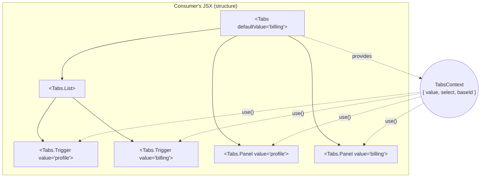
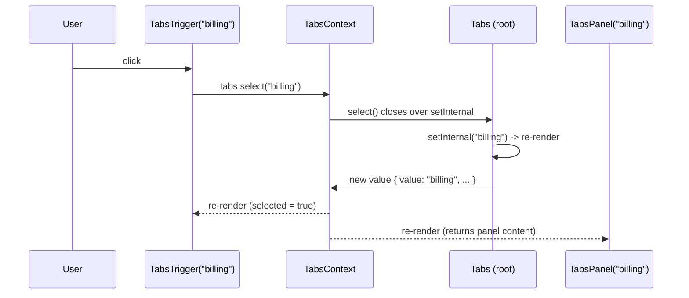
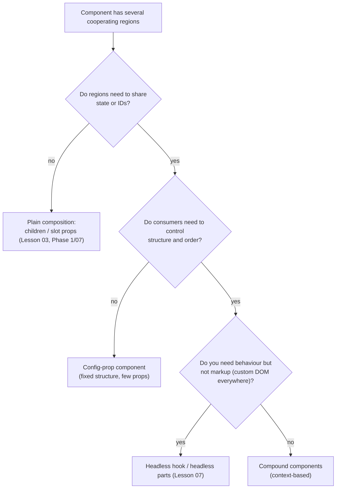

# 05 / 05 — Compound Components

## 1. Lesson metadata

| | |
|---|---|
| **Level** | Intermediate to Advanced |
| **Study time** | 5–6 hours (reading 2 h, refactoring labs 1.5 h, exercises 2 h) |
| **Prerequisites** | [Phase 1 / 07 — Composition, `children`, slots](../01-react-fundamentals/07-composition-and-children.md), [Phase 1 / 11 — Controlled and uncontrolled inputs](../01-react-fundamentals/11-controlled-and-uncontrolled-inputs.md), [Phase 1 / 16 — State preservation and reset](../01-react-fundamentals/16-state-preservation-and-reset.md), [Phase 3 / 13 — `useContext` and propagation](../03-react-state-and-hooks/13-usecontext-and-propagation.md), [Phase 3 / 14 — Context performance](../03-react-state-and-hooks/14-context-performance.md), [Phase 3 / 15 — Custom hooks](../03-react-state-and-hooks/15-custom-hooks.md), [Phase 5 / 03 — Composition over inheritance](./03-composition-over-inheritance.md), [Phase 5 / 08 — Provider pattern](./08-provider-pattern.md) |
| **Next** | [06 — Custom hook patterns](./06-custom-hook-patterns.md) |
| **Related** | [09 — Higher-order components](./09-higher-order-components.md), [11 — Controlled component pattern](./11-controlled-component-pattern.md), [07 — Headless components](./07-headless-components.md), [Phase 5 / 20 — Slot patterns](./20-slot-patterns.md), [Phase 5 / 22 — Patterns for reusable libraries](./22-patterns-for-reusable-libraries.md) |

> **Status label: CURRENT and widely used, with one LEGACY implementation technique.** The *pattern* (a family of components sharing implicit state through context) is how most modern UI libraries are built. The *`Children.map` + `cloneElement` implementation* of the pattern is the legacy technique: it still works, the React docs list both APIs under "legacy" with alternatives, and it fails in situations that the context-based implementation handles. This lesson teaches the pattern with the context implementation and uses the `cloneElement` version as the "before" in a refactor.

**Learning objectives.** After this lesson you can:
1. Define a compound component set, name the problem it solves (configuration-prop explosion and rigid structure), and map it to the classic Composite and Mediator patterns, stating where each mapping breaks.
2. Implement a compound component in TypeScript with a typed context, a guard hook, `useId` for accessibility wiring, and optional controlled/uncontrolled state.
3. Explain why `Children.map`/`cloneElement` implicit state sharing breaks (wrappers, fragments, conditional children, memoisation) and migrate such code to context.
4. Choose between dot-notation statics, named exports, and a flat `Parts` object, and know the React Server Components caveat for dot notation.
5. Decide whether a compound API is justified, or whether a props-driven API, a slot API, or a headless hook is the better fit.
6. Diagnose "must be used within" errors, stale context, and re-render fan-out in a compound component tree using DevTools.

**Concepts covered:** compound components, implicit state sharing, Composite pattern, Mediator pattern, context-based parts, `useId` ARIA wiring, dot-notation statics, controlled/uncontrolled root, part registration, `Children.map` and `cloneElement` (legacy), context splitting, `"use client"` boundary considerations.

---

## 2. Deep conceptual explanation

### 2.1 What is a compound component?

A **compound component** is a *set* of components designed to be used together. One of them (the **root**) owns the state or coordination; the others (the **parts**) read from and write to that shared state **implicitly**, without the consumer wiring props between them. The consumer controls *structure and content* by composing the parts as JSX:

```tsx
<Tabs defaultValue="billing">
  <Tabs.List>
    <Tabs.Trigger value="profile">Profile</Tabs.Trigger>
    <Tabs.Trigger value="billing">Billing</Tabs.Trigger>
  </Tabs.List>
  <Tabs.Panel value="profile">…</Tabs.Panel>
  <Tabs.Panel value="billing">…</Tabs.Panel>
</Tabs>
```

The HTML platform has the same idea: `<select>` with `<option>`, `<details>` with `<summary>`, `<table>` with `<thead>/<tbody>/<tr>/<td>`. Neither `<option>` nor `<td>` is meaningful alone; each relies on an ancestor to give it meaning. Compound components bring that model to custom UI.

### 2.2 The problem it solves

Consider the alternative: a single component configured entirely through props.

```tsx
<Tabs
  items={[
    { id: "profile", label: "Profile", icon: <UserIcon />, content: <ProfileForm />, disabled: false },
    { id: "billing", label: "Billing", badge: 2, content: <BillingForm /> },
  ]}
  renderLabel={(item) => …}
  renderPanel={(item) => …}
  labelClassName="…"
  panelClassName="…"
  showBadges
/>
```

This is the **configuration-object / mega-component** design. It looks compact until requirements arrive:

- "Put a tooltip on one tab." → add `tooltip` to the item type.
- "One panel needs a different padding." → add `panelClassName` per item.
- "Render a divider between two tabs." → invent a fake item with `type: "separator"`.
- "Show a Help link at the right end of the tab list." → add `tabListEnd` prop.

Every new structural need becomes a new prop. The component's API becomes a miniature, poorly specified templating language. This is the **prop explosion** smell from [Lesson 02 (DRY/KISS/YAGNI)](./02-dry-kiss-yagni.md) and the open/closed problem from [Lesson 01](./01-solid-in-react.md): the component must be modified for every new layout. Compound components invert the relationship: the library owns **behaviour** (state, keyboard handling, ARIA), the consumer owns **structure**.

### 2.3 Mapping to classic patterns

| Classic pattern | Idea | Compound-component mapping | Where the mapping breaks |
|---|---|---|---|
| **Composite** (GoF) | Treat individual objects and compositions of objects uniformly in a tree. | The parts form a tree under the root; each part is a component that can contain other components, and the JSX tree *is* the composite structure. | In Composite, all nodes share one interface. Compound parts do **not**: `Trigger` and `Panel` have different props and roles. It is a *structural* resemblance (part–whole tree), not a uniform-interface one. |
| **Mediator** | Objects communicate through a mediator instead of referencing each other. | The root plus its context is the mediator. `Trigger` never references `Panel`; both talk to the context. | A GoF mediator is usually one object with logic that coordinates colleagues. Here the "mediator" is a context value (state plus callbacks); coordination logic is partly in the root, partly in each part. |
| **Template Method** | Fix the skeleton of an algorithm; let subclasses fill steps. | The library fixes the behavioural skeleton (selection, keyboard, ARIA); the consumer fills in the content slots. | No inheritance is involved; the "hooks" are child elements, not overridden methods. |
| **Facade** | One simple entry point hiding a subsystem. | `Tabs` is a namespace presenting one coherent entry point. | A facade *hides* the subsystem; compound components deliberately *expose* the parts. |
| **Observer** | Subscribers react to state changes in a subject. | Parts re-render when the context value changes. | React's context change propagation is not a general-purpose subscribe/notify API; there are no subscriptions to manage or selectors (see [Phase 3 / 14](../03-react-state-and-hooks/14-context-performance.md)). |

**Honest summary:** a compound component is *Composite structure + Mediator coordination*, implemented with React's context. None of the GoF patterns describes it fully, and the common internet claim "compound components are the Composite pattern" is only partly true. Use the mapping to reason about responsibilities, not as a definition.

### 2.4 What React exposes

React gives you three ingredients and no "compound component" API:

1. **Composition via `children`** ([Phase 1 / 07](../01-react-fundamentals/07-composition-and-children.md)): the consumer passes elements; the root renders them where it wants.
2. **Context** (`createContext`, `useContext`, `use`): a value made available to *all descendants at any depth*, regardless of intermediate wrappers.
3. **Child introspection APIs** (`Children.map`, `Children.toArray`, `cloneElement`, `isValidElement`): they inspect and clone the *elements passed as children*. The React documentation labels these as legacy/uncommon for good reason (see §2.6).

The modern implementation uses (1) and (2) only.

### 2.5 Two implementations

| | **Context-based** (recommended) | **`Children.map` + `cloneElement`** (legacy technique) |
|---|---|---|
| How parts get state | `use(TabsContext)` in each part. | Root clones each *direct* child element and injects props (`selected`, `onSelect`). |
| Works through wrapper components | **Yes.** Any depth. | **No.** Only direct children are cloned; `<Tab>` inside `<MyTab>` or a `<div>` is invisible to the root. |
| Works with fragments and conditionals | Yes. | Fragments are treated as one child (⚠ `Children` APIs do not traverse into `<>…</>`); `false`/`null` entries need handling. |
| Typed props | Parts declare their own props; shared state is typed once in the context. | Injected props must be declared as optional on parts or cast; the type system cannot see the injection. |
| Order/index available | Needs registration or DOM query (§5.5). | Index comes free from `Children.map`'s index (a real advantage, but only for direct children). |
| Server/RSC friendliness | Needs a client boundary for stateful parts. | Same, plus cloning client elements from a server component is awkward. |

### 2.6 Common misconceptions

1. **"Compound components require dot notation (`Tabs.List`)."** No. Dot notation is a namespacing convenience. Named exports (`Tabs`, `TabsList`, `TabsTrigger`) are equivalent, tree-shake better in some toolchains, and avoid a Server Components limitation (§5.6).
2. **"Compound components are `cloneElement`."** That was one early implementation. It is brittle and is the legacy technique here.
3. **"The parts share state through props, just hidden."** With context they share it through context; nothing is injected into elements.
4. **"Use compound components everywhere."** They add API surface (several exports to document, version, and test), a context dependency, and a runtime error mode ("part used outside root"). For a two-prop component they are over-engineering (YAGNI, [Lesson 02](./02-dry-kiss-yagni.md)).
5. **"Context makes every part re-render for every change."** Only context *consumers* re-render when the value's identity changes. Whether that matters depends on the number of parts and how often the value changes; splitting contexts (§5.4) is the measured fix, not a default.
6. **"A compound component is stateful by definition."** The root coordinates *something*; that may be state (Tabs), IDs (Form field label/description/error), or DOM references (a popover's trigger/content anchor).

---

## 3. Internal mechanics

### 3.1 Public guarantees you rely on

- **Context reaches all descendants.** A component rendered anywhere in the subtree of `<Ctx value={v}>` that calls `use(Ctx)` / `useContext(Ctx)` reads the nearest provider's value ([Phase 3 / 13](../03-react-state-and-hooks/13-usecontext-and-propagation.md)). It does not matter how many components or DOM elements sit in between.
- **A context value change re-renders its consumers**, compared with `Object.is`. If the provider re-renders with a *new object identity* every time, all consumers re-render even when the contents are equal ([Phase 3 / 14](../03-react-state-and-hooks/14-context-performance.md)).
- **Default value.** `createContext(null)` gives `null` outside any provider; a guard hook turns that into an actionable error.
- **`useId` returns a stable string** for a component instance, consistent between server and client render, suitable for associating labels, tab panels, and descriptions. The exact format of the string differs between React versions (React 19.3.1 produced `_R_0_` on the server and `_r_0_` on the client in tests; earlier versions used `:r0:` and `«r0»`); never parse it or use it in a CSS selector without escaping.
- **React 19 context syntax:** `<TabsContext value={ctx}>` renders a provider; `<TabsContext.Provider value={ctx}>` still works. In React 18 and earlier only `.Provider` exists. `use(Context)` (React 19) can be called conditionally; `useContext` cannot.

### 3.2 Teaching model



Two separate trees exist and should be kept distinct in your head: the **JSX/element tree** (what the consumer wrote, defining layout) and the **context channel** (what the library defined, carrying behaviour). Parts never talk to each other; they talk to the channel.

### 3.3 Implementation detail (conceptual)

React stores a context value on the provider's fiber and, when a provider's value changes, walks the subtree to find fibers that read that context and schedules them to re-render. This is described conceptually; the actual propagation algorithm and data structures are internal and have changed across versions. For the render/commit consequences see [Phase 2 / 29](../02-react-rendering-and-internals/29-reasoning-about-unnecessary-renders.md). For a verified understanding, read the context-related code in the React repository (`github.com/facebook/react`) after [Phase 2 / 31](../02-react-rendering-and-internals/31-reading-react-source.md).

### 3.4 Why `cloneElement` implicit sharing breaks

`Children.map(children, child => cloneElement(child, extraProps))` operates on the **element objects** the root receives. An element is just `{ type, props, key }` ([Phase 1 / 04](../01-react-fundamentals/04-elements-components-instances.md)). The root can:

- see only the top-level array of elements it received (not what `type` will render);
- not see through a wrapper component, because `<MyTab />`'s element does not reveal that it will render a `<Tab>`;
- not recurse into fragments (React's `Children` utilities treat a fragment as a single child ⚠ verify against the current reference);
- clone `null`/strings/numbers only if handled explicitly.

Because the injection happens by prop on a specific element, anything between the root and the part breaks the link. Context solves this because the link is established at *render time of the part*, by tree position, not at *element creation time* by element inspection.

---

## 4. Step-by-step execution walkthrough

Scenario: the `Tabs` implementation from §5.1, uncontrolled, `defaultValue="profile"`. The user clicks the "Billing" trigger.

1. **Initial render.** `Tabs` renders; `useState("profile")` initialises; `useId` assigns `baseId`; `useMemo` creates the context value `ctx1 = { value: "profile", select, baseId }`. `TabsList`, two `TabsTrigger`s, and two `TabsPanel`s render; each reads `ctx1`. Trigger "profile" renders `aria-selected="true"`, `tabIndex=0`; Panel "profile" renders content; Panel "billing" renders `null` (or `hidden`).
2. **Commit.** DOM nodes created; ARIA attributes appear: trigger `aria-controls="<baseId>-panel-profile"` matches the panel's `id`.
3. **Click.** The browser dispatches `click` on the "billing" `<button>`. React's delegated listener invokes `onClick` → `tabs.select("billing")`.
4. **`select` runs.** Not controlled, so `setUncontrolled("billing")`; then `onValueChange?.("billing")` if provided. React schedules a re-render of `Tabs` (batched; [Phase 2 / 22](../02-react-rendering-and-internals/22-automatic-batching.md)).
5. **Render of `Tabs`.** `value = "billing"`; the `useMemo` deps changed, so `ctx2 = { value: "billing", … }` (a new object). The `children` prop is *the same element objects* as before (they were created by the consumer's parent, which did not re-render).
6. **Propagation.** Because `children` element identity is unchanged, React skips re-rendering those elements' *own* components by bailout, **except** components that consume the changed context: both triggers and both panels re-render because `ctx` changed. `TabsList` does not consume the context (in this implementation) and is skipped.
7. **Reconcile + commit.** Trigger "profile" → `aria-selected="false"`, `tabIndex=-1`; trigger "billing" → `true`, `0`. Panel "profile" returns `null` (unmounts its content, state lost), panel "billing" mounts its content.
8. **Effects.** None involved. The DOM update is a handful of attribute changes plus one subtree mount/unmount.

> **Predict:** If the consumer's parent component re-renders (for example because a data fetch resolved) and passes the same JSX, how many of the compound parts re-render? *(Answer: all of them. The parent creates new `children` elements, `Tabs` re-renders, and every part receives new props. The context optimisation only prevents re-render when the **parent did not** re-render. See [Phase 2 / 32](../02-react-rendering-and-internals/32-scenario-a-parent-rerender.md).)*

---

## 5. Code examples

### 5.1 Minimal: a complete, accessible, context-based `Tabs`

```tsx
// tabs.tsx
import {
  createContext, use, useCallback, useId, useMemo, useState,
  type ComponentProps, type KeyboardEvent, type ReactNode,
} from "react";

type TabsContextValue = {
  value: string;
  select: (next: string) => void;
  baseId: string;
};

const TabsContext = createContext<TabsContextValue | null>(null);

function useTabs(part: string): TabsContextValue {
  const ctx = use(TabsContext);
  if (ctx === null) {
    throw new Error(`<${part}> must be rendered inside <Tabs>.`);
  }
  return ctx;
}

type TabsProps = {
  /** Controlled value. When provided, the component never keeps its own. */
  value?: string;
  defaultValue?: string;
  onValueChange?: (next: string) => void;
  children: ReactNode;
};

export function Tabs({ value: controlled, defaultValue = "", onValueChange, children }: TabsProps) {
  const [internal, setInternal] = useState(defaultValue);
  const isControlled = controlled !== undefined;
  const value = isControlled ? controlled : internal;
  const baseId = useId();

  const select = useCallback(
    (next: string) => {
      if (!isControlled) setInternal(next);
      onValueChange?.(next);
    },
    [isControlled, onValueChange],
  );

  const ctx = useMemo(() => ({ value, select, baseId }), [value, select, baseId]);

  return (
    <TabsContext value={ctx}>
      <div>{children}</div>
    </TabsContext>
  );
}

export function TabsList({ onKeyDown: userOnKeyDown, ...rest }: ComponentProps<"div">) {
  function onKeyDown(e: KeyboardEvent<HTMLDivElement>) {
    userOnKeyDown?.(e);                       // consumer first; they may call preventDefault()
    if (e.defaultPrevented) return;
    if (e.key !== "ArrowRight" && e.key !== "ArrowLeft") return;
    const tabs = Array.from(e.currentTarget.querySelectorAll<HTMLButtonElement>('[role="tab"]'));
    const current = tabs.indexOf(document.activeElement as HTMLButtonElement);
    if (current === -1) return;
    const step = e.key === "ArrowRight" ? 1 : tabs.length - 1;
    const next = tabs[(current + step) % tabs.length];
    e.preventDefault();
    next.focus();
    next.click(); // "automatic activation": focus selects
  }
  return <div role="tablist" {...rest} onKeyDown={onKeyDown} />;   // ours last, so `rest` cannot silently replace the keyboard handling
}

export function TabsTrigger({ value, children }: { value: string; children: ReactNode }) {
  const tabs = useTabs("Tabs.Trigger");
  const selected = tabs.value === value;
  return (
    <button
      type="button"
      role="tab"
      id={`${tabs.baseId}-tab-${value}`}
      aria-selected={selected}
      aria-controls={`${tabs.baseId}-panel-${value}`}
      tabIndex={selected ? 0 : -1}
      onClick={() => tabs.select(value)}
    >
      {children}
    </button>
  );
}

export function TabsPanel({ value, children }: { value: string; children: ReactNode }) {
  const tabs = useTabs("Tabs.Panel");
  if (tabs.value !== value) return null;
  return (
    <div
      role="tabpanel"
      id={`${tabs.baseId}-panel-${value}`}
      aria-labelledby={`${tabs.baseId}-tab-${value}`}
      tabIndex={0}
    >
      {children}
    </div>
  );
}

// Optional: dot-notation namespace.
Tabs.List = TabsList;
Tabs.Trigger = TabsTrigger;
Tabs.Panel = TabsPanel;
```

**Line-by-line notes**

- `createContext<TabsContextValue | null>(null)` plus the `useTabs` guard converts "forgot the root" from a confusing `undefined is not an object` into a message naming the offending part. The `part` argument is a cheap debugging aid.
- `isControlled = controlled !== undefined` is the standard *controlled vs uncontrolled* rule ([Lesson 11](./11-controlled-component-pattern.md) covers it in depth, including the warning React gives for switching modes on native inputs). Here `""` is a legal value and `undefined` means "not controlled", so `value=""` is controlled.
- `useCallback` + `useMemo` give the context value a stable identity unless `value`, `isControlled`, `onValueChange`, or `baseId` changes. ⚠ `onValueChange` is usually an inline arrow from the consumer, so `select` changes identity whenever the consumer re-renders; this is harmless here because the consumer re-render already re-renders every part. With the React Compiler enabled, manual memoisation may be redundant; treat that as *verify against current docs*, and do not remove memoisation based on a belief.
- `useId` ties each trigger to its panel (`aria-controls` / `aria-labelledby`). Two `Tabs` on one page never collide because each root has its own `baseId`.
- `TabsPanel` returns `null` for inactive panels, which **unmounts** their content and discards its state ([Phase 1 / 16](../01-react-fundamentals/16-state-preservation-and-reset.md)). That is a behavioural decision; §7 and §8 discuss `hidden` as the alternative.
- `Object.assign`-style static assignment (`Tabs.List = TabsList`) is allowed by TypeScript for function declarations (it infers "expando" properties). It is purely a namespace.
- `querySelectorAll` in `TabsList` is a pragmatic way to find sibling triggers without registration. It reads the DOM during an event handler (not during render), so it is legal, but it couples keyboard behaviour to `role="tab"` markup. §5.5 shows a registration alternative and its cost.

**Usage**

```tsx
function Settings() {
  return (
    <Tabs defaultValue="billing">
      <Tabs.List aria-label="Settings sections">
        <Tabs.Trigger value="profile">Profile</Tabs.Trigger>
        <Tabs.Trigger value="billing">Billing</Tabs.Trigger>
      </Tabs.List>
      <Tabs.Panel value="profile"><ProfileForm /></Tabs.Panel>
      <Tabs.Panel value="billing"><BillingForm /></Tabs.Panel>
    </Tabs>
  );
}
```

> **Predict:** The user types into `BillingForm`'s input, switches to Profile, then back to Billing. What is in the input? *(Answer: empty or the initial value. Switching unmounts `BillingForm` because `TabsPanel` returned `null`; its local state was discarded. If the product needs state kept, the panel must stay mounted and be hidden, §7.)*

### 5.2 Real-world: a `FormField` compound (the coordination is IDs, not selection)

This is a compound component with no "selected" state. The root generates IDs and the parts wire accessibility relationships. It is the most common compound component in real design systems, and the one with the clearest payoff.

```tsx
// form-field.tsx
import { createContext, use, useId, useState, useEffect, type ComponentProps, type ReactNode } from "react";

type FieldContextValue = {
  controlId: string;
  descriptionId: string;
  errorId: string;
  invalid: boolean;
  hasDescription: boolean;
  setHasDescription: (v: boolean) => void;
};

const FieldContext = createContext<FieldContextValue | null>(null);

function useField(part: string) {
  const ctx = use(FieldContext);
  if (!ctx) throw new Error(`<${part}> must be rendered inside <FormField>.`);
  return ctx;
}

export function FormField({ invalid = false, children }: { invalid?: boolean; children: ReactNode }) {
  const id = useId();
  const [hasDescription, setHasDescription] = useState(false);
  const value: FieldContextValue = {
    controlId: `${id}-control`,
    descriptionId: `${id}-description`,
    errorId: `${id}-error`,
    invalid,
    hasDescription,
    setHasDescription,
  };
  return (
    <FieldContext value={value}>
      <div data-invalid={invalid || undefined}>{children}</div>
    </FieldContext>
  );
}

export function FieldLabel(props: ComponentProps<"label">) {
  const f = useField("FormField.Label");
  return <label htmlFor={f.controlId} {...props} />;
}

export function FieldControl(props: ComponentProps<"input">) {
  const f = useField("FormField.Control");
  const describedBy = [f.hasDescription ? f.descriptionId : null, f.invalid ? f.errorId : null]
    .filter(Boolean)
    .join(" ");
  return (
    <input
      id={f.controlId}
      aria-invalid={f.invalid || undefined}
      aria-describedby={describedBy || undefined}
      {...props}
    />
  );
}

export function FieldDescription(props: ComponentProps<"p">) {
  const f = useField("FormField.Description");
  const { setHasDescription } = f;
  useEffect(() => {
    setHasDescription(true);
    return () => setHasDescription(false);
  }, [setHasDescription]);
  return <p id={f.descriptionId} {...props} />;
}

export function FieldError(props: ComponentProps<"p">) {
  const f = useField("FormField.Error");
  if (!f.invalid) return null;
  return <p id={f.errorId} role="alert" {...props} />;
}
```

Usage:

```tsx
<FormField invalid={Boolean(errors.email)}>
  <FieldLabel>Email</FieldLabel>
  <FieldControl type="email" name="email" autoComplete="email" />
  <FieldDescription>We send receipts here.</FieldDescription>
  <FieldError>{errors.email}</FieldError>
</FormField>
```

**Notes**

- In this example `FormField` re-creates `value` every render without `useMemo`. That is a deliberate *simple first version*: the context has four cheap consumers and `FormField` re-renders rarely (only when `invalid` or `hasDescription` changes or the parent re-renders). Add `useMemo` if the profile shows a problem ([Phase 3 / 14](../03-react-state-and-hooks/14-context-performance.md)).
- `FieldDescription` **registers** its presence with the root in an effect, so the control only references `descriptionId` when the element exists. This is a *part registration* pattern and its cost is a second render after mount (state set in an effect). The alternative is to always reference the ID and accept a dangling `aria-describedby` reference, which assistive tech ignores, or to compute presence from `children` props at the root, which reintroduces child introspection. ⚠ State set in an effect to adapt the DOM of a sibling is a recognised smell ([Phase 3 / 07 — You might not need an effect](../03-react-state-and-hooks/07-you-might-not-need-an-effect.md)); it is justified here because the information (does a sibling exist?) is only available after the sibling renders.
- `role="alert"` on the error makes screen readers announce it when it appears. Whether that is right for *every* error display is a product decision (over-announcing is a real accessibility cost).

### 5.3 Incorrect: `Children.map` + `cloneElement`, and why it breaks

```tsx
// BEFORE — legacy implicit sharing
import { Children, cloneElement, isValidElement, useState, type ReactElement, type ReactNode } from "react";

type TabProps = { id: string; label: string; selected?: boolean; onSelect?: (id: string) => void };

function Tab({ id, label, selected, onSelect }: TabProps) {
  return (
    <button role="tab" aria-selected={selected} onClick={() => onSelect?.(id)}>
      {label}
    </button>
  );
}

function BrokenTabs({ children }: { children: ReactNode }) {
  const [selected, setSelected] = useState<string>("");
  return (
    <div role="tablist">
      {Children.map(children, (child) =>
        isValidElement<TabProps>(child)
          ? cloneElement(child as ReactElement<TabProps>, {
              selected: child.props.id === selected,
              onSelect: setSelected,
            })
          : child,
      )}
    </div>
  );
}
```

Consumer code that works:

```tsx
<BrokenTabs>
  <Tab id="a" label="A" />
  <Tab id="b" label="B" />
</BrokenTabs>
```

Consumer code that silently breaks:

```tsx
function BillingTab() { return <Tab id="b" label="Billing" />; }   // a wrapper

<BrokenTabs>
  <Tab id="a" label="A" />
  <BillingTab />                          {/* receives selected/onSelect as props, ignores them */}
  {isAdmin && <Tab id="c" label="Admin" />}  {/* `false` is skipped fine; but... */}
  <>
    <Tab id="d" label="D" />               {/* inside a fragment: not cloned */}
  </>
</BrokenTabs>
```

**Why it fails.** `BrokenTabs` clones the element `<BillingTab />`, injecting `selected` and `onSelect` as props of `BillingTab`, which never forwards them to `<Tab>`. No error, no warning: the tab simply does nothing. The fragment child is cloned as one unit (the injected props land on the fragment, which React warns about in development: "Invalid prop `data-x` supplied to `React.Fragment`. React.Fragment can only have `key`, `ref`, and `children` props.", observed on 19.3.1), and `Tab d` never receives them.

> **Predict:** Click "Billing". What happens? *(Nothing. `onSelect` was passed to `BillingTab`, which ignores it. The consumer must now know the root's cloning contract; the abstraction leaks.)*

### 5.4 Corrected, advanced: context-based with split contexts and an item-scoped context

When a compound root has frequently changing state and many parts, one context value forces all parts to re-render on every change. Splitting the **stable** pieces (dispatch/actions, IDs) from the **volatile** piece (selected value) lets parts that only need the stable pieces skip. Parts that scope themselves to one item can use a second **item context** so inner components do not need an `itemValue` prop.

```tsx
// accordion.tsx — excerpt
import { createContext, use, useMemo, useReducer, type ReactNode } from "react";

type State = { open: ReadonlySet<string> };
type Action = { type: "toggle"; id: string } | { type: "set"; id: string; open: boolean };

function reducer(state: State, action: Action): State {
  const open = new Set(state.open);
  if (action.type === "toggle") {
    open.has(action.id) ? open.delete(action.id) : open.add(action.id);
  } else {
    action.open ? open.add(action.id) : open.delete(action.id);
  }
  return { open };
}

const StateContext = createContext<State | null>(null);
const DispatchContext = createContext<React.Dispatch<Action> | null>(null);
const ItemContext = createContext<string | null>(null);

export function Accordion({ children }: { children: ReactNode }) {
  const [state, dispatch] = useReducer(reducer, { open: new Set<string>() });
  return (
    <DispatchContext value={dispatch}>
      <StateContext value={state}>{children}</StateContext>
    </DispatchContext>
  );
}

export function AccordionItem({ id, children }: { id: string; children: ReactNode }) {
  return <ItemContext value={id}>{children}</ItemContext>;
}

function useItem() {
  const id = use(ItemContext);
  if (id === null) throw new Error("Accordion parts must be inside <AccordionItem>.");
  return id;
}

export function AccordionTrigger({ children }: { children: ReactNode }) {
  const id = useItem();
  const state = use(StateContext)!;
  const dispatch = use(DispatchContext)!;
  const open = state.open.has(id);
  return (
    <button type="button" aria-expanded={open} onClick={() => dispatch({ type: "toggle", id })}>
      {children}
    </button>
  );
}
```

- The reducer returns a **new** state object each time (immutability; [Lesson 12](./12-reducer-pattern.md)).
- `DispatchContext` has a stable value (`dispatch` identity is stable for the component's lifetime, a documented guarantee of `useReducer`), so a part that only dispatches (for example a "Collapse all" button) can read only `DispatchContext` and never re-render because of open/close changes.
- `AccordionTrigger` reads both contexts, so it re-renders whenever *any* item toggles. For an accordion with five items that is irrelevant. For a 2,000-row tree it is not, and the fix there is a different architecture (external store with selectors, [Phase 3 / 20](../03-react-state-and-hooks/20-usesyncexternalstore-and-external-stores.md)), not more contexts.
- The non-null assertions (`!`) are shorthand in this excerpt; production code uses a guard hook per context, as in §5.1.

### 5.5 Advanced: knowing about siblings (registration, index, count)

Parts often need information about their siblings: "which trigger is first?", "how many tabs exist?", "what is the index of this item (for roving focus)?" React deliberately does not provide child introspection of *rendered* output. Options, from simplest to most elaborate:

| Technique | Mechanism | Cost / caveat |
|---|---|---|
| **DOM query in an event handler** (§5.1) | `querySelectorAll('[role="tab"]')` from the list. | Couples to markup; reads the real DOM order (which is correct for focus); works for any depth. |
| **Explicit `value`/`id` props** | Consumer supplies identity. | No magic; verbose but robust. Most libraries require it. |
| **Register in an effect** | Part calls `register(id)` on mount, `unregister` on cleanup; root keeps a list. | Extra renders; registration *order* follows mount order, not necessarily DOM order after conditional mounts; must be StrictMode-safe (effects run, clean up, run again in dev; [Phase 2 / 28](../02-react-rendering-and-internals/28-strict-mode-behavior.md)). |
| **Collection via DOM order after commit** | Register DOM nodes via ref callbacks; sort by `compareDocumentPosition`. | Correct order; more code. Libraries that need it ship a "collection" utility. |
| **`Children.toArray` at the root** | Counts/indexes direct children only. | Same limitation as `cloneElement`: invisible to wrappers. Avoid for anything but a closed set of direct children. |

> Rule of thumb: ask for identity from the consumer (`value`), keep everything else on context, and use the DOM for *navigation order* because the DOM is the ground truth of order.

### 5.6 Namespace shapes and the Server Components caveat

```tsx
// (a) Dot notation (static properties)
<Tabs.Trigger />                     // import { Tabs } from "./tabs"

// (b) Named exports
import { Tabs, TabsTrigger } from "./tabs";   // <TabsTrigger />

// (c) Namespace import (retains the dot at the call site, no statics needed)
import * as Tabs from "./tabs";                 // <Tabs.Trigger /> where the file exports Root, Trigger, ...
```

Pattern (c) is what several headless libraries expose (for example `Dialog.Root`, `Dialog.Trigger`) and it has an advantage: it requires no static property assignment, so a **"use client" module** can export the parts and the namespace import works from a Server Component. ⚠ **Version/bundler-sensitive:** with React Server Components, accessing a *static property* of a client component imported into a server component (`Tabs.Trigger` where `Tabs` is a client reference) is documented by frameworks as unsupported; named exports and namespace imports are the safe forms. Verify against your framework's current documentation before relying on this; see [Phase 2 / 27](../02-react-rendering-and-internals/27-react-server-components-intro.md).

### 5.7 Refactoring lab 1 (before/after): the 12-prop `Dialog`

**Before.** A mega-component, as found in many codebases:

```tsx
type DialogProps = {
  open: boolean;
  onClose: () => void;
  title: string;
  description?: string;
  showCloseButton?: boolean;
  footerPrimaryLabel?: string;
  onFooterPrimary?: () => void;
  footerSecondaryLabel?: string;
  onFooterSecondary?: () => void;
  footerPrimaryDisabled?: boolean;
  headerIcon?: ReactNode;
  children: ReactNode;
};
```

Pressure points seen in review: a product asks for a destructive primary (needs `footerPrimaryVariant`), a footer with a checkbox ("Don't ask again"), and a header with a back button. Each is another prop or an `ReactNode` escape hatch such as `renderFooter`.

**After.** A compound `Dialog` that owns open state, focus management, and ARIA, and hands structure to the consumer:

```tsx
<Dialog open={open} onOpenChange={setOpen}>
  <Dialog.Header>
    <BackButton />
    <Dialog.Title>Delete project</Dialog.Title>
  </Dialog.Header>
  <Dialog.Body>This will permanently remove 14 deployments.</Dialog.Body>
  <Dialog.Footer>
    <label><input type="checkbox" /> Don't ask again</label>
    <Dialog.Close>Cancel</Dialog.Close>
    <Button variant="danger" onClick={onDelete}>Delete</Button>
  </Dialog.Footer>
</Dialog>
```

| Dimension | Before | After |
|---|---|---|
| Props on root | 12 and growing | 2 (`open`, `onOpenChange`) |
| New layout need | Modify component, add prop, release | Compose different children |
| Where behaviour lives | In the component | In the root and its context (focus trap, `aria-labelledby` to `Dialog.Title`, Escape to close) |
| Misuse modes | Invalid prop combos (`footerSecondaryLabel` without `onFooterSecondary`) | Missing part (no `Title` → no accessible name) or wrong nesting |
| Testing | Matrix of prop combinations | A few behaviour tests plus compositional tests |
| API surface to document | One component, many props | Five components, few props each |

**What you lose.** Consistency by construction: a team that wants *every* dialog to have the same footer layout now relies on convention or a thin wrapper. The remedy is a **preset** built on the parts: `ConfirmDialog` wraps the compound dialog with the 6-prop convenience API. Compound parts are the *foundation* layer; presets are the *product* layer. See [Phase 4 / 20 — Design systems](../04-react-architecture/20-design-systems.md).

### 5.8 Refactoring lab 2 (before/after): `cloneElement` → context

Migrate §5.3. After:

```tsx
const TabsCtx = createContext<{ selected: string; select: (id: string) => void } | null>(null);

function SimpleTabs({ children }: { children: ReactNode }) {
  const [selected, setSelected] = useState("");
  const value = useMemo(() => ({ selected, select: setSelected }), [selected]);
  return <TabsCtx value={value}><div role="tablist">{children}</div></TabsCtx>;
}

function Tab({ id, label }: { id: string; label: string }) {
  const ctx = use(TabsCtx);
  if (!ctx) throw new Error("<Tab> must be inside <SimpleTabs>");
  return (
    <button role="tab" aria-selected={ctx.selected === id} onClick={() => ctx.select(id)}>
      {label}
    </button>
  );
}

function BillingTab() { return <Tab id="b" label="Billing" />; }   // now works
```

| Dimension | Before (`cloneElement`) | After (context) |
|---|---|---|
| Wrapper `BillingTab` | Silently broken | Works |
| Fragment children | Broken | Works |
| Types for injected props | Optional on `Tab`, cast in root | Not injected; `Tab`'s props are only `id`, `label` |
| Root renders `children` | Cloned (new element objects each render) | Passed through unchanged (identity preserved; bailouts can apply) |
| Failure when misused | Silent | Explicit error outside root |

---

## 6. Visual explanations

### 6.1 Sequence: a click flows through the context channel



### 6.2 Decision flow: which composition API?



### 6.3 Text diagram: where each piece is defined

```
Library author defines          Consumer defines
-------------------------       -------------------------
state, ARIA, keyboard           structure, order, content
Tabs (root + context)    <-->   <Tabs> ... </Tabs>
Tabs.List/Trigger/Panel  <-->   which parts, where, how many
useTabs() guard                 styling via className / tokens
```

---

## 7. Alternative approaches and trade-offs

### 7.1 Comparison

| Criterion | Config props (`items=[…]`) | Compound (context) | Compound (`cloneElement`) | Headless hook (`useTabs`) | Slot props (`header`, `footer`) |
|---|---|---|---|---|---|
| Structural flexibility | Low | **High** | Medium (direct children only) | **Highest** (you own all markup) | Medium (fixed regions) |
| Consumer code volume | **Lowest** | Medium | Medium | Highest | Low |
| Accessibility by default | Built in | Built in | Built in | Consumer must apply prop getters | Built in |
| Misuse detection | Types catch most | Runtime error (outside root); partial types | Silent failures | Types on returned props | Types catch most |
| Re-render behaviour | Whole component | Consumers of context | Root and cloned children | Whatever the consumer decides | Whole component |
| SSR / RSC friendliness | Server-renderable if stateless | Needs client boundary for stateful parts | Poor | Hook is client-only | Server-renderable |
| Learning curve | Low | Medium | Medium + hidden contract | Higher | Low |
| API surface to maintain | One component | N components + context | N components + cloning contract | One hook + prop getters | One component |

### 7.2 State-lifetime variants

| Panel strategy | Behaviour | Use when |
|---|---|---|
| **Unmount inactive** (`return null`) | State lost, cheap DOM, content effects stop | Panels are cheap to re-create or should refetch on show |
| **Keep mounted, `hidden`** | State kept; DOM and effects persist; hidden content stays in the DOM | Forms, scroll positions, video, expensive initial render |
| **Mount on first visit, then keep** | Lazy first mount, then retained | Heavy panels that should not cost anything until opened |
| **Activity/offscreen APIs** | Framework/React feature for hiding UI while keeping state | `<Activity>` shipped in React 19.2 (react.dev/blog/2025/10/01/react-19-2); check its reference page for current modes and caveats |

### 7.3 When the recommended approach is NOT best

Compound components are **not** best for:

- **A fixed, tiny component.** `<Badge tone="warning">New</Badge>` with `Badge.Root`, `Badge.Label` is ceremony with no benefit (YAGNI).
- **Data-driven UIs where the data is the source of truth.** A settings page whose tabs come from a server-supplied config array: the consumer would `map` the array into `Trigger`/`Panel` anyway; a config-prop component that does the mapping once is simpler and often easier to test. A compound component can still sit *under* it as the rendering layer.
- **When you control one call site.** Introducing a compound API for a single use is premature generalisation.
- **Heavy sibling awareness** (virtualised lists, drag-and-drop ordering). Parts that must know order/index/count across thousands of items are better served by an explicit collection model or a headless hook with its own state, not context-fed parts.
- **When the audience is non-React or needs static HTML.** A config API serialises; a JSX composition does not.

---

## 8. Best practices and anti-patterns

### 8.1 Best practices

1. **Throw a named error** when a part is rendered outside its root. Silent `undefined` handling turns a wiring mistake into a mystery.
2. **Keep parts dumb about each other.** Parts read context; they do not import each other. This allows replacing or wrapping any part.
3. **Spread remaining props onto the underlying DOM element** (`{...rest}`) and merge `className`/event handlers deliberately, so consumers can add `data-*`, `aria-*`, and test IDs. In React 19, accept `ref` as a normal prop on function components (`ComponentProps<"button">` includes it). In React 18 and earlier you need `forwardRef` (legacy in 19).
4. **Support controlled and uncontrolled root state** from the start if the component will be a library primitive ([Lesson 11](./11-controlled-component-pattern.md)).
5. **Make identity explicit (`value`/`id`)** rather than deriving it from child position.
6. **Document the parts as a set**: required nesting, required parts (for accessibility: "a `Dialog` must contain a `Dialog.Title`"), and what each part renders.
7. **Offer presets** for the 80% case (`ConfirmDialog`, `SimpleTabs`) built from the parts.
8. **Use `data-state`/`data-*` attributes** for styling hooks (`data-state="active"`) instead of requiring consumers to pass render props to learn state. Whether this is better than a `className` function is a library-design choice.

### 8.2 Beginner mistakes

- Putting every piece of state in the root and passing it through context even when only one part uses it. If one part owns it, keep it in that part.
- Forgetting the guard hook; `use(Ctx)` returns `null` and the error appears two lines later as "cannot read properties of null".
- Creating the context value inline (`value={{ a, b }}`) in a root that re-renders often.
- Using array index as part identity so removing one item changes the identity of the rest ([Phase 1 / 09](../01-react-fundamentals/09-lists-keys-and-identity.md)).

### 8.3 Experienced-developer mistakes

- **Over-generalising**: a compound API with eight parts and four contexts for a feature used twice.
- **Hidden required parts.** If `Dialog` is inaccessible without a `Title`, either warn in development (check registration after mount) or provide a prop fallback (`aria-label`).
- **Over-reliance on child counting** (`Children.count`) in the root.
- **Mixing both techniques** (context plus `cloneElement`), which gives you the downsides of each.
- **Breaking the contract with memoisation**: wrapping parts in `memo` while passing unstable props; the context still re-renders them, which is correct, but the author believes the memo is protecting them.

### 8.4 Smells

- The root has more than ~6 props: maybe parts are missing.
- Parts take `selected`/`active` props that consumers must pass manually: the context is not doing its job.
- Consumers write a wrapper around every part just to set the same props: build presets.
- Deep prop drilling *between* parts despite context: parts are being used outside the intended nesting.

### 8.5 Justified exceptions

- `cloneElement` is acceptable when you must **augment an element you receive as a prop** (for example merging a `ref` or event handler into a single trigger element, as the `asChild` technique does; see [Lesson 07](./07-headless-components.md)) and the element identity is under the consumer's control. This is single-child augmentation, not implicit sharing.
- Dot notation is fine in an application codebase where RSC is not in play; named exports are the safer default for libraries.

---

## 9. Real-world application

| Domain | Compound component | Engineering constraints |
|---|---|---|
| **E-commerce** | `ProductGallery` (`Gallery.Main`, `Gallery.Thumbnails`, `Gallery.Zoom`) sharing selected image index | Must server-render the first image for LCP; parts that need interaction go behind a client boundary; thumbnails must be keyboard navigable; image preloading must not be coupled to the compound state. |
| **Dashboards** | `Card` with `Card.Header/Actions/Body`; `Filters` with `Filters.Group/Chip/Reset` coordinating a shared filter state | Many instances on one page: context splitting and keeping state local to each instance matter; the "reset" part needs `dispatch` only. |
| **Finance** | `DataGrid` row selection with `Grid.Row`, `Grid.SelectCell`, `Grid.BulkActions` | Selection sets can be large: a context with a `Set` that changes identity each toggle re-renders every cell; use an external store with selectors or per-row subscription. |
| **Forms** | `FormField` (§5.2), `RadioGroup`/`Radio`, `Select`/`Option` | Accessibility is the main value: IDs, `aria-describedby`, group labelling; must integrate with form libraries (controlled mode) and with native form submission (hidden input). |
| **Auth** | `Wizard` (`Wizard.Step`, `Wizard.Next`) for sign-up | Step order from the consumer's JSX; progress state in the root; back-button/URL sync is a separate concern that the root should expose as controlled state. |
| **Multi-team** | Platform team ships `Dialog`, `Menu`, `Tabs` parts; product teams compose | Versioning: adding a required part is a breaking change; export the context only if you commit to supporting it ([Phase 5 / 22](./22-patterns-for-reusable-libraries.md)). |

Constraint to remember: **compound parts are public API.** Renaming a part, changing which part is required, or changing context shape for a *custom part written by consumers who import your context* is a breaking change. Keep the context private unless extensibility is a goal.

---

## 10. Debugging and troubleshooting

| Symptom | Likely cause | Investigation | Fix |
|---|---|---|---|
| `Error: <Tabs.Trigger> must be rendered inside <Tabs>` | Part rendered outside the root (portal content in another React root; a part moved into a different file's subtree; test renders the part alone) | Read the component stack in the error. In DevTools, select the part and walk up the *Components* tree looking for the provider. | Render within the root. Portals **preserve** React context (the portal's React parent counts), but a **separate `createRoot`** does not. |
| Clicking a part does nothing, no error | Using the legacy `cloneElement` design with a wrapper/fragment | DevTools: inspect the wrapped component's props; the injected `onSelect` appears on the wrapper, not on the real part. | Move to context (§5.8). |
| Every part re-renders on any change | Context value recreated every render; or parent re-renders | Profiler with "Record why each component rendered" (see [Phase 2 / 30](../02-react-rendering-and-internals/30-react-devtools-profiler.md)). Reasons will say "Context changed" or "Parent component rendered". | Memoise value; split contexts; or accept it if parts are few. |
| State lost when switching panels | Inactive panels unmount | Profiler shows mount/unmount of panel content; DevTools shows the panel subtree disappear. | Keep mounted + `hidden` or lift the state ([Phase 1 / 16](../01-react-fundamentals/16-state-preservation-and-reset.md)). |
| Hydration mismatch warning on ID attributes | IDs generated with `Math.random()` or a module counter | Compare server HTML and client DOM ids ([Phase 2 / 37](../02-react-rendering-and-internals/37-scenario-f-hydration-mismatch.md)). | Use `useId`. |
| `aria-controls` points to nothing | Panel unmounted (`return null`) while trigger references its id | Accessibility panel in browser DevTools. | Either render a placeholder panel element, or accept it (many libraries omit `aria-controls` for unmounted panels; check the ARIA Authoring Practices for the pattern). |
| Duplicate registration after dev reload | Registration effect without cleanup | StrictMode runs effect, cleanup, effect; count after mount. | Return an unregister function from the effect. |

**Reproduction habit.** To prove a context problem is real, render the part in isolation in a test with no provider and confirm the error message; to prove a re-render problem, wrap the root with `<Profiler>` and log `actualDuration` per commit before and after the change.

---

## 11. Exercises

### Level A — Knowledge
A1. Define a compound component in one sentence and name one native HTML analogue.
A2. Name two problems of a config-prop `Tabs` that the compound design addresses.
A3. Why does `Children.map` + `cloneElement` fail for `<MyTab />` wrapper components?
A4. Which GoF patterns resemble compound components, and what is one place each analogy breaks?
A5. What does `useId` provide here, and why is `Math.random()` not an acceptable substitute?

### Level B — Code comprehension
B1. In §5.1, a consumer renders `<Tabs value="a" onValueChange={() => {}}>` and never updates `value`. The user clicks tab "b". What is displayed, and why?
B2. In §5.4, `AccordionTrigger` for item 1 and `AccordionTrigger` for item 2 are both on screen. The user toggles item 1. How many triggers re-render? Would splitting `StateContext` per item change that?
B3. Given `<Tabs.Panel value="x">` returns `null` when inactive, what happens to a `useEffect` inside `<PanelContent />` when the user switches away and back?
B4. In §5.2, `FieldDescription` calls `setHasDescription(true)` in an effect. How many renders of `FormField` occur on mount, and why? (Count the initial render and subsequent re-renders in dev with StrictMode off.)

### Level C — Implementation
C1. Implement a `Disclosure` compound (`Disclosure`, `Disclosure.Button`, `Disclosure.Content`) with controlled/uncontrolled state, `aria-expanded`, `aria-controls`, and `useId`. Include a "must be used inside" guard.
C2. **Refactor:** convert this config component to a compound API, keeping a `SimpleMenu` preset that preserves the old API.
```tsx
<Menu items={[{ label: "Edit", onSelect: edit }, { label: "Delete", onSelect: del, danger: true }]} />
```
C3. **Refactor:** the snippet below uses `cloneElement` to inject `index` into children. Migrate to context plus explicit `value` props, and explain what you lose.
```tsx
{Children.map(children, (child, index) => cloneElement(child as ReactElement<{ index: number }>, { index }))}
```
C4. Add a keep-mounted mode to §5.1 (`<Tabs.Panel keepMounted>`) using `hidden`, and write the test that proves state survives a tab switch.

### Level D — Debugging
D1. A teammate wraps one trigger in `<Tooltip>` and arrow-key navigation now skips it. Diagnose using §5.1's implementation and propose two fixes.
D2. Two `Tabs` on a page both highlight the same panel when one is clicked. The panels use `id="panel-billing"`. Diagnose and fix.
D3. After upgrading to React 19, a library's compound component throws "Cannot read properties of null" for `use(Ctx)` in a portal rendered through a *second* `createRoot` for a tooltip layer. Diagnose and fix.

### Level E — Architecture decisions
E1. Your design system has `Tabs` as a config-prop component used in 90 places. Product wants per-tab tooltips, badges, and a "More" overflow menu. Decide: extend config, rewrite as compound, or build headless. Present a migration path that does not break the 90 call sites.
E2. A feature needs a table with row selection, expansion, and column-level actions, rendered 5,000 rows. Argue whether to model it as compound components with context.
E3. You maintain a public library. Should the `TabsContext` be exported so consumers can build custom parts? Argue both sides and choose.

### Level F — Expert challenge
F1. Implement an ordered registration utility `useCollection()` that gives each part a stable index based on DOM order, correct under conditional rendering and StrictMode. Explain its re-render cost and when it is worth it.
F2. Design the types so `Tabs.Trigger value` and `Tabs.Panel value` are checked against a union of allowed tab names supplied once at the root (`Tabs<"profile" | "billing">`). Discuss what TypeScript can and cannot enforce with context-based parts.

---

## 12. Detailed answers and explanations

> Attempt the exercises first.

### Level A

**A1.** A set of components that share implicit state through a common ancestor so they form one UI unit, with the consumer controlling structure. Native analogue: `<select>`/`<option>` (also `<details>/<summary>`, `<table>` parts).

**A2.** (1) Prop explosion: each structural need becomes a prop/item field. (2) Rigid structure: the consumer cannot reorder, interleave, or insert arbitrary elements without escape hatches (`renderX`). Also acceptable: open/closed violation, difficulty adding tooltips or dividers per item.

**A3.** The root clones the elements it receives; `<MyTab />`'s element has `type: MyTab`, so the injected props land on `MyTab`, which does not forward them. The root cannot see that `MyTab` will render a `Tab`, since rendering happens later. Plausible wrong answer: "React forbids cloning custom components"; it does not, cloning succeeds silently, which is what makes the bug hard to find.

**A4.** Composite (part–whole tree; breaks: parts do not share a uniform interface). Mediator (context as the coordinator; breaks: the mediator is a context value, not an object holding colleague references). Template Method (fixed behaviour skeleton; breaks: no inheritance). Any two with breaking points is a full answer.

**A5.** `useId` returns an ID stable across server and client rendering for that component instance and unique per instance, so ARIA relationships (`aria-controls`, `htmlFor`) are valid and hydration is clean. `Math.random()` differs between server and client renders, causing hydration mismatches, and changes on each render unless stored, and it is impure during render ([Phase 2 / 12](../02-react-rendering-and-internals/12-why-rendering-must-be-pure.md)).

### Level B

**B1.** Tab "a" stays displayed. `isControlled` is true because `value` is defined, so `setInternal` is not called; `onValueChange` fires with "b" but the empty handler ignores it, and `value` remains "a". This is *correct controlled behaviour*: the parent owns the state. A common wrong answer is "tab b shows because the click happened"; that would be uncontrolled behaviour. Edge case: switching `value` from `"a"` to `undefined` mid-life flips to uncontrolled and uses stale `internal` state; native inputs warn about that, and a library primitive should too (Lesson 11).

**B2.** Both triggers re-render. They consume `StateContext`, whose value (`state`) changes identity on every reducer action, and the Profiler shows "Context changed" for each. Per-item state would not change it unless the per-item contexts are separate providers with separate values (for example one provider per `AccordionItem` carrying its own `open` boolean). Then only the toggled item's trigger re-renders. The cost: the root must create a value per item, which needs either registration or an external store with selectors.

**B3.** Switching away unmounts `PanelContent`, running its effect cleanup. Switching back mounts a new instance: effects run again, state resets. (In development with StrictMode on, the first mount also runs effect → cleanup → effect.) This is why "fetch on mount" inside panels refetches every visit.

**B4.** Without StrictMode: render 1 (initial; `hasDescription` false, no description id referenced). Commit; effect of `FieldDescription` runs, calling `setHasDescription(true)`. Render 2 of `FormField` and its consumers (`hasDescription` true, control gets `aria-describedby`). Total: 2 renders of `FormField`. With StrictMode in dev, React additionally double-invokes render and runs an effect/cleanup/effect cycle; the cleanup sets `false` and the second effect sets `true` again, which batch to the final value of `true`; the exact render count in dev is not a contract and should not be asserted on.

### Level C

**C1.** Sample implementation:

```tsx
import { createContext, use, useId, useState, type ComponentProps, type ReactNode } from "react";

type Ctx = { open: boolean; toggle: () => void; contentId: string };
const DisclosureCtx = createContext<Ctx | null>(null);
function useDisclosure(part: string) {
  const c = use(DisclosureCtx);
  if (!c) throw new Error(`<${part}> must be inside <Disclosure>`);
  return c;
}

type Props = { open?: boolean; defaultOpen?: boolean; onOpenChange?: (o: boolean) => void; children: ReactNode };
export function Disclosure({ open: controlled, defaultOpen = false, onOpenChange, children }: Props) {
  const [internal, setInternal] = useState(defaultOpen);
  const isControlled = controlled !== undefined;
  const open = isControlled ? controlled : internal;
  const contentId = useId();
  const toggle = () => {
    const next = !open;
    if (!isControlled) setInternal(next);
    onOpenChange?.(next);
  };
  return <DisclosureCtx value={{ open, toggle, contentId }}>{children}</DisclosureCtx>;
}

export function DisclosureButton(props: ComponentProps<"button">) {
  const d = useDisclosure("Disclosure.Button");
  return <button type="button" aria-expanded={d.open} aria-controls={d.contentId} onClick={d.toggle} {...props} />;
}

export function DisclosureContent(props: ComponentProps<"div">) {
  const d = useDisclosure("Disclosure.Content");
  return <div id={d.contentId} hidden={!d.open} {...props} />;
}
```

Evaluation criteria: controlled/uncontrolled correct; ARIA attributes present; guard error; `hidden` used so `aria-controls` is always valid; no `Children.map`. Note `toggle` computes from the render-time `open`; for rapid double-clicks in a controlled parent this uses the latest committed value, which is acceptable here; for the uncontrolled branch `setInternal((o) => !o)` is more robust, but `onOpenChange` needs the computed value, a real tension in controlled-or-not designs.

**C2.** After (sketch):

```tsx
const MenuCtx = createContext<{ close: () => void } | null>(null);

export function Menu({ children }: { children: ReactNode }) {
  const [open, setOpen] = useState(false);
  const close = () => setOpen(false);
  return (
    <MenuCtx value={{ close }}>
      <button aria-haspopup="menu" aria-expanded={open} onClick={() => setOpen((o) => !o)}>Actions</button>
      {open && <div role="menu">{children}</div>}
    </MenuCtx>
  );
}
export function MenuItem({ onSelect, danger, children }: { onSelect: () => void; danger?: boolean; children: ReactNode }) {
  const m = use(MenuCtx)!;
  return (
    <button role="menuitem" data-danger={danger || undefined} onClick={() => { onSelect(); m.close(); }}>
      {children}
    </button>
  );
}

// Preset preserving the old API:
type Item = { label: string; onSelect: () => void; danger?: boolean };
export function SimpleMenu({ items }: { items: Item[] }) {
  return (
    <Menu>
      {items.map((i) => <MenuItem key={i.label} onSelect={i.onSelect} danger={i.danger}>{i.label}</MenuItem>)}
    </Menu>
  );
}
```

Criteria: old call sites change only the import name (or none, if `SimpleMenu` is exported under the old name); parts compose arbitrary children; `close` through context. Missing: focus management and keyboard navigation (a real menu needs them; this is a shape-of-API exercise). Using label as key is only valid if labels are unique.

**C3.** After:

```tsx
const IndexCtx = createContext<number | null>(null);
// consumer supplies identity:
<Step value="a">…</Step>
```

If you need *ordering*, use DOM-order registration (§5.5) or require the consumer to pass `index`. What you lose: free automatic indices and an API with zero identity props. What you gain: wrappers and fragments work, no cloning, no hidden prop injection. A candidate who says "nothing lost" has missed the automatic-index feature; a candidate who suggests `Children.toArray` + context has reintroduced the direct-children-only limitation.

**C4.** Implementation: in `TabsPanel`, `if (tabs.value !== value && !keepMounted) return null; return <div hidden={tabs.value !== value} …>`. Test (Testing Library style): render, type "draft" into a panel input, click another tab, click back, assert `input.value === "draft"`. Assert also that without `keepMounted` the value is lost, to document the contract. Edge: hidden panels still execute effects and subscriptions, which can matter (timers, polling).

### Level D

**D1.** `TabsList`'s key handler uses `querySelectorAll('[role="tab"]')` on the list and `document.activeElement` — if the tooltip wrapper renders the trigger inside a portal or the tooltip wrapper moves the `role="tab"` element out of the list's DOM subtree, or if the wrapper element (for example a `<span>` with its own focusable behaviour) takes focus instead of the button, `indexOf(activeElement)` returns -1 and the handler returns. Check in DevTools (Elements) where the `role="tab"` button lives and which element has focus. Fixes: (1) render tooltips with a trigger that forwards props/ref onto the same button (the `asChild`/prop-merging approach) so the DOM structure is unchanged; (2) make navigation resilient by finding the current tab with `activeElement.closest('[role="tab"]')`. Plausible wrong fix: adding `tabIndex` to the wrapper.

**D2.** Hard-coded IDs collide: both roots produce `panel-billing`, so `aria-controls` and `getElementById`-style lookups resolve to the first match. Fix: derive IDs from `useId` per root (`baseId`) as in §5.1. Verify by inspecting the DOM for duplicate `id`s (browser accessibility tree or an HTML validator), and a test that renders two roots and asserts unique IDs.

**D3.** A second `createRoot` is a separate React tree; context from the first root does not cross it. `createPortal` into a DOM node keeps the same React tree and does preserve context; a separate root does not. Fix: render the tooltip layer with `createPortal` from inside the tree, or provide the necessary context again at the second root's top, or avoid needing the context there. Validate with the DevTools component tree: with a separate root, the component appears as a separate tree/root.

### Level E

**E1.** Evaluation criteria: preserves 90 call sites; introduces the new API additively; defines deprecation; considers cost. Example answer: build the new compound parts as the primary implementation; reimplement the existing config `Tabs` as a *preset* on top of them (map `items` into parts), so old call sites keep working and automatically get the same accessibility fixes. Add new capabilities (tooltips, badges, overflow) only to the compound API; mark the config API as maintenance-only, with a lint rule or codemod for new usages. Headless is justified only if multiple teams need entirely different markup (not true here, product wants more *content*, not different *DOM*). Risk: preset divergence; mitigate with tests running against both entry points.

**E2.** Criteria: awareness of context fan-out, virtualisation, and selector subscriptions. A strong answer: compound parts for *structure* (`Grid.Row`, `Grid.Cell`), but state in an external store accessed through selectors (or `useSyncExternalStore` with a derived per-row snapshot) rather than a single context holding a `Set`; virtualise rows; selection state subscribed per row so toggling one row re-renders one row. Context may carry only the *store reference* (stable) and configuration. A weak answer says "context for everything" or "never use compound".

**E3.** Criteria: both sides articulated. For exporting: extensibility, custom parts, testing utilities. Against: contract expansion (context shape becomes public API, every internal refactor is breaking), harder to evolve. A defensible choice: keep it private; expose a narrow `useTabsState()` hook for the documented read-only fields (selected value), version it, and provide documented extension points (render-prop-free slots or `asChild`). The choice is context-dependent; for an internal design system with one maintainer team, exporting is cheaper.

### Level F

**F1.** Evaluation criteria: correct DOM-order index; handles unmount/mount; StrictMode-safe; limited rerenders. Example approach: root holds `Map<id, HTMLElement>` in a ref plus a `version` state. Parts register their node via a ref callback (`ref={(node) => { register(id, node); return () => unregister(id); }}`; React 19 supports cleanup functions from ref callbacks verify against current docs for your version) and bump `version`. Consumers call `getIndex(id)` computed by sorting nodes with `compareDocumentPosition` at read time. Cost: one extra render per mount/unmount batch; StrictMode's double ref calls are idempotent because registration is a map keyed by `id`. Worth it only for roving-focus or typeahead across dynamic items; for static lists, explicit `value`s and DOM queries in handlers are cheaper. Edge cases: portalled items (DOM order is not React order), reordering without remount (the DOM changed but no effect/ref fired; use `version` bump on parent updates or compute order lazily in handlers).

**F2.** Example direction: generic root `function Tabs<T extends string>(props: TabsProps<T>)` plus a *factory* `createTabs<T extends string>()` returning typed parts bound to the same `T`, since context-based parts cannot infer `T` from an ancestor at the JSX call site. TypeScript cannot flow a type parameter from a parent element to descendants (JSX children are not type-linked), so either use the factory (one extra call, per-set typing) or accept `string`. Criteria: recognises the limitation; offers factory; notes cost (parts no longer `Tabs.Trigger` statics unless the factory returns an object). Plausible wrong answer: making `Tabs.Trigger` generic over a type parameter declared on `Tabs`. That is impossible; statics do not see instantiation arguments.

---

## 13. Senior engineer interview questions

**Q1. "Why use context instead of `cloneElement` for compound components?"**
*Strong answer:* `cloneElement` injects props into the element objects the root receives, so it only reaches direct children and cannot see through wrappers or fragments; failures are silent. Context links parts to the root by tree position at render time, working at any depth, keeping parts' prop types clean, and enabling an explicit error outside the root.

**Q2. "A compound component re-renders too often. What do you check?"**
*Strong answer:* Whether the context value is recreated each render, whether the parent re-renders (context memoisation cannot help there), and how many consumers read the changing slice. Measure with the Profiler "why did this render". Fixes by increasing cost: memoise the value, split stable (dispatch) from volatile (state), move to an external store with selectors. Do not split reflexively.

**Q3. "How do parts know their order or index?"**
*Strong answer:* React gives no rendered-child introspection by design. Prefer explicit identity props; for order use DOM order (query or ref registration with `compareDocumentPosition`). `Children.toArray` only works for direct children. Registration must be idempotent for StrictMode.

**Q4. "Dot notation or named exports?"**
*Strong answer:* Dot notation is ergonomics; named exports and namespace imports avoid static-property issues with Server Components and are friendlier to some bundlers. Choose by environment; verify RSC constraints in the framework docs.

**Q5. "When would you not build a compound component?"**
*Strong answer:* A small fixed structure, a single call site, or data-driven rendering where a config component is simpler; or when the primary need is custom DOM, where a headless hook is better. Compound components cost API surface and runtime-only misuse errors.

**Q6. "How does the pattern relate to Composite and Mediator?"**
*Strong answer:* Composite for the part-whole tree, Mediator for coordination through the shared context; neither fits fully (non-uniform part interfaces; context value is state plus callbacks rather than an object that knows its colleagues). Using the mapping to reason about responsibilities, not as a definition.

**Q7. "Inactive tab panels: unmount, hide, or lazy-mount?"**
*Strong answer:* A product decision about state lifetime and cost. Unmount discards state and effects; hidden keeps both and costs DOM and background work; lazy-then-keep balances. Choose per panel type, expose it as an option, and state it in the docs.

---

## 14. Further learning resources

| Resource | URL | Covers / why | Level | Study |
|---|---|---|---|---|
| React — Passing data deeply with context | <https://react.dev/learn/passing-data-deeply-with-context> | The mechanism underlying context-based compounds | Intermediate | Whole page |
| React — `createContext` reference | <https://react.dev/reference/react/createContext> | Provider syntax in React 19, defaults | Intermediate | Reference, Usage |
| React — `use` reference | <https://react.dev/reference/react/use> | Reading context with `use` | Intermediate | Reading context |
| React — `useId` reference | <https://react.dev/reference/react/useId> | Accessibility IDs, SSR consistency, caveats | Intermediate | Usage, Caveats |
| React — `Children` reference | <https://react.dev/reference/react/Children> | Legacy child introspection and its listed limitations | Intermediate | Caveats; "Alternatives" |
| React — `cloneElement` reference | <https://react.dev/reference/react/cloneElement> | Legacy API and recommended alternatives | Intermediate | Caveats; Alternatives |
| React — Preserving and resetting state | <https://react.dev/learn/preserving-and-resetting-state> | Panel mount/unmount state consequences | Intermediate | Whole page |
| WAI-ARIA Authoring Practices — Tabs pattern | <https://www.w3.org/WAI/ARIA/apg/patterns/tabs/> | Keyboard and ARIA contract the example approximates | Intermediate | Keyboard interaction, roles |
| Radix Primitives | <https://www.radix-ui.com/primitives> | Production compound components (`Root/Trigger/Content` naming) to study API design | Intermediate | Tabs, Dialog docs |
| React Aria | <https://react-spectrum.adobe.com/react-aria/> | Hook-based approach to the same behaviours; contrast with compound | Advanced | Tabs, Collections concepts |

URLs in this table were checked for HTTP 200 on 2026-10-22; any still marked *(unverified)* could not be checked automatically (blocked or unreachable). A 200 response does not guarantee the page content still matches the description; if a link has moved, search the site for the quoted title.

---

## 15. Knowledge checkpoint

**You should now understand**
- A compound component set shares behaviour through a context channel while the consumer controls structure; it resembles Composite and Mediator without being either.
- Why the context implementation supersedes `Children.map` + `cloneElement` (wrappers, fragments, silent failures, typing).
- The trade-offs: API surface, misuse errors, re-render fan-out, panel state lifetime, RSC and dot-notation caveats.

**You should be able to explain without notes**
- Why context reaches through wrappers but `cloneElement` does not.
- How a click propagates and exactly which parts re-render when the parent does or does not re-render.
- When a config-prop, slot, headless, or compound design is the right one.

**You should be able to implement**
- A typed, accessible compound component with a guard hook, `useId` wiring, and controlled/uncontrolled root.
- A preset built on compound parts that preserves a legacy config API.
- A migration from `cloneElement` to context.

**You should be able to debug**
- "Must be inside root" errors (portal vs separate root), duplicate IDs, silent non-working parts, and excess re-rendering, using DevTools and the Profiler.

**Next:** [06 — Custom hook patterns](./06-custom-hook-patterns.md), where the shared behaviour leaves the component tree altogether and becomes a function.
