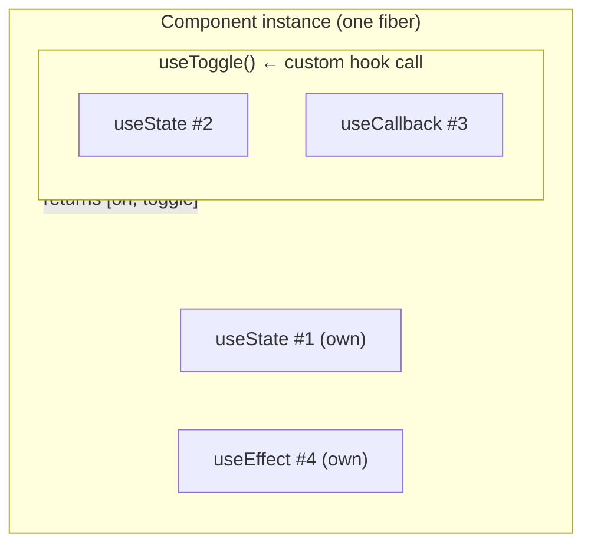
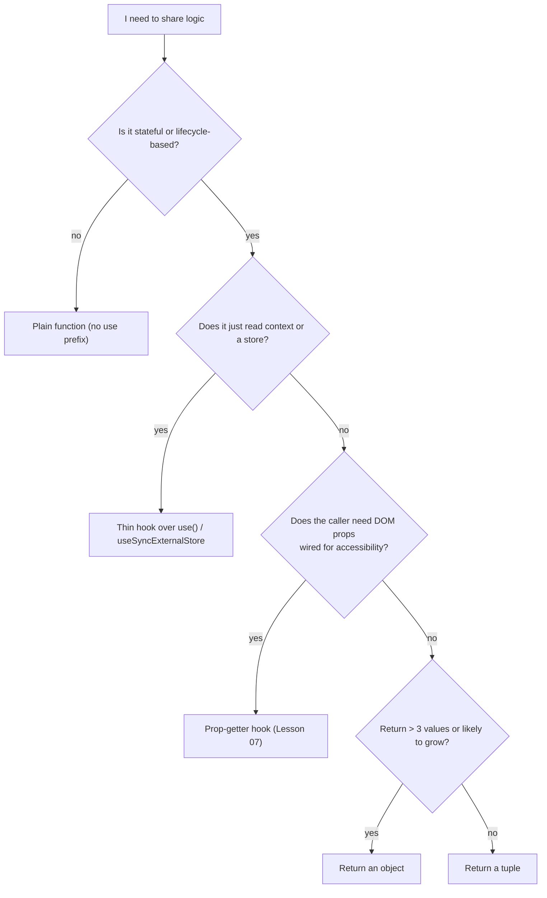
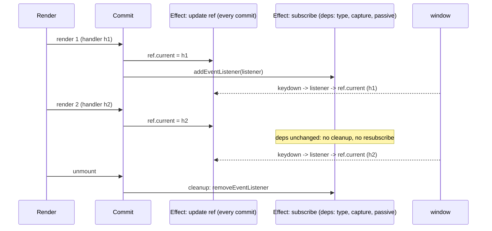

# 05 / 06 — Custom Hook Patterns

## 1. Lesson metadata

| | |
|---|---|
| **Level** | Intermediate to Advanced |
| **Study time** | 5–6 hours (reading 2 h, refactoring labs 1.5 h, exercises 2 h) |
| **Prerequisites** | [Phase 2 / 17 — How hooks attach to Fiber](../02-react-rendering-and-internals/17-hooks-and-fiber-state.md), [Phase 2 / 18 — Effects and their timing](../02-react-rendering-and-internals/18-effects-and-their-timing.md), [Phase 3 / 05 — Effect dependencies and stale closures](../03-react-state-and-hooks/05-effect-dependencies-and-stale-closures.md), [Phase 3 / 06 — Effect cleanup](../03-react-state-and-hooks/06-effect-cleanup.md), [Phase 3 / 10 — `useRef`](../03-react-state-and-hooks/10-useref-and-mutable-references.md), [Phase 3 / 15 — Custom hooks](../03-react-state-and-hooks/15-custom-hooks.md), [Phase 3 / 16 — Rules of hooks and composition](../03-react-state-and-hooks/16-rules-of-hooks-and-composition.md), [Phase 3 / 20 — `useSyncExternalStore`](../03-react-state-and-hooks/20-usesyncexternalstore-and-external-stores.md), [Phase 3 / 23 — Hooks anti-patterns](../03-react-state-and-hooks/23-hooks-anti-patterns.md), [Phase 5 / 02 — DRY, KISS, YAGNI](./02-dry-kiss-yagni.md) |
| **Next** | [07 — Headless components](./07-headless-components.md) |
| **Related** | [05 — Compound components](./05-compound-components.md), [09 — Higher-order components](./09-higher-order-components.md), [10 — Render props](./10-render-props.md), [11 — Controlled component pattern](./11-controlled-component-pattern.md), [12 — Reducer pattern](./12-reducer-pattern.md), [Phase 5 / 24 — OOP patterns in functional React](./24-oop-patterns-in-functional-react.md) |

> **Status label: CURRENT, and the primary logic-reuse mechanism in React.** Custom hooks replaced mixins, most HOCs, and most render props for sharing *stateful logic*. This lesson does not re-teach what a custom hook is ([Phase 3 / 15](../03-react-state-and-hooks/15-custom-hooks.md)); it teaches the **design patterns** for writing hooks that other people will depend on, and the limits of the abstraction.

**Learning objectives.** After this lesson you can:
1. Map classic patterns (Mixin, Strategy, Template Method, Facade, Observer) to custom hook designs and state where each analogy breaks.
2. Choose between tuple and object return shapes, and design hook signatures that remain stable as requirements grow.
3. Implement the core hook patterns: state-holder with actions, latest-callback, event subscription, external-store subscription, async resource, controllable state, prop getters.
4. Treat identity stability (of returned functions and objects) as part of a hook's contract and test it.
5. Compose hooks without hidden coupling, and recognise when extraction is premature (a hook is not automatically better than inline code).
6. Refactor duplicated component logic, effect-based synchronisation, and "god hooks" with before/after comparisons, and explain what each step gains and loses.

**Concepts covered:** hook as Mixin replacement, hook composition, return shapes, hook options object, latest-ref pattern, `useEffectEvent`, subscription hooks, `useSyncExternalStore`, async-resource hooks and cancellation, controllable state hook, prop-getter pattern, identity stability contract, hook factories, `renderHook` testing, extraction heuristics.

---

## 2. Deep conceptual explanation

### 2.1 What a "hook pattern" is

A custom hook is a function whose name starts with `use` and which calls other hooks. The *language feature* is trivial; the *design space* is large because a hook sits at an unusual boundary: it is a **function that participates in the component's lifecycle**. It can hold state, subscribe to the outside world, schedule effects, and read context, and all of that is attached to *the component that calls it*, not to the hook itself.

A **hook pattern** is a recurring solution to a design question that arises when you write such a function:

- How should it return data and actions? (tuple vs object vs prop getters)
- Who owns the state: the hook or the caller? (internal vs controlled)
- How does a callback passed in stay current without re-subscribing? (latest-ref)
- How does it interact with the outside world? (effect vs `useSyncExternalStore`)
- What does the caller get to rely on about identity? (stable functions, stable objects)
- How is it composed from other hooks, and how is it tested?

### 2.2 The problem hooks solved: reuse of stateful logic

Before hooks, stateful behaviour was shared between class components through mixins (removed from React), higher-order components ([Lesson 09](./09-higher-order-components.md)), and render props ([Lesson 10](./10-render-props.md)). All three share one structural limitation: the reuse is expressed **in the component tree**. The shared logic must be a wrapper or a child, so it adds a layer, forces data through props or function children, and makes name collisions or nesting visible in JSX.

Hooks move reuse **out of the tree and into function calls**. The shared logic runs in the calling component, contributes state to that component's fibers, and returns plain values. There is no extra layer, no prop collision (you choose local names), and ordinary JavaScript composition (function calls, closures, generics) applies.

### 2.3 Mapping to classic patterns

| Classic pattern | Idea | Custom hook mapping | Where the mapping breaks |
|---|---|---|---|
| **Mixin** | Inject reusable behaviour into a class. | A custom hook *is* the functional replacement: behaviour added to a component by calling a function. | Mixins merged into one namespace (state keys, methods) and clashed implicitly. Hooks return values you name yourself, so there are no implicit clashes. A hook's hidden dependency is its **call order** inside the component, enforced by the rules of hooks. |
| **Strategy** | Interchangeable algorithms behind one interface. | Pass a function (or config) into a hook: `useSort(items, compareFn)`, `useDebouncedCallback(fn, delay)`. | In Strategy the context object holds the strategy as a field; in a hook the "strategy" is an argument re-supplied every render, so its **identity** matters (§5.3). |
| **Template Method** | Fixed algorithm skeleton, variable steps. | A hook with callbacks in its options: `useAsync({ load, onSuccess, onError })`. | No inheritance. The skeleton is the hook's internal hook calls; the "steps" are callbacks, which can be stale unless handled (§5.3). |
| **Facade** | Simple interface over a complex subsystem. | `useAuth()` hiding token storage, refresh, and session context behind `{ user, signIn, signOut }`. | A facade is stateless in GoF; a hook facade may own state and effects. |
| **Observer** | Subscribers notified on change. | Subscription hooks: `useOnlineStatus`, `useMediaQuery`, store selectors via `useSyncExternalStore`. | The observer registry lives outside React; the hook is the *adapter* bridging notifications into React's render model (§5.4). |
| **Memento / Command** | Capture state snapshots / reify actions. | `useUndo` returning `{ state, undo, redo }`; actions returned as named functions or dispatchable objects. | Snapshots here are ordinary immutable values; there is no separate originator/caretaker object structure. |
| **Module (JS)** | Encapsulate private state in a closure. | A hook's local variables and `useRef`s are private; only the returned object is public. | Private state is per *call site*, not per module: two components calling the hook get separate state (unlike a singleton module). |

**Honest summary:** the hook is best understood as *the Mixin done right*: reusable behaviour attached to a component, but with explicit data flow (arguments in, return values out) instead of implicit merging. Strategy/Template Method describe how you *parameterise* a hook; Observer describes how a hook *talks to the outside world*. A hook is **not** a Singleton or a service: its state is per call.

### 2.4 What React exposes

React has exactly one rule-bound primitive set for hooks: `useState`, `useReducer`, `useRef`, `useEffect`, `useLayoutEffect`, `useInsertionEffect`, `useContext`/`use`, `useMemo`, `useCallback`, `useSyncExternalStore`, `useId`, `useTransition`, `useDeferredValue`, `useImperativeHandle`, `useDebugValue`, `useActionState`, `useOptimistic`, and so on. "Custom hook" is a convention enforced by the linter (names beginning with `use`) and by the **rules of hooks** ([Phase 3 / 16](../03-react-state-and-hooks/16-rules-of-hooks-and-composition.md)): call hooks unconditionally, in the same order, only from components or other hooks. React itself has no concept of a custom hook at runtime; it sees a sequence of primitive hook calls per component render.

### 2.5 Common misconceptions

1. **"A custom hook shares state between components."** It shares *logic*. Each call creates independent state. Sharing state requires context, a store, or lifting state ([Phase 3 / 18](../03-react-state-and-hooks/18-state-colocation-and-lifting.md), [Lesson 08](./08-provider-pattern.md)).
2. **"Extracting a hook makes the component faster."** It does not change what renders. A hook adds no layer, but it also adds no memoisation. Re-renders are determined by state and props of the calling component.
3. **"Hooks run only when the component mounts."** The hook *function body* runs on every render of the calling component; only effects have dependency-gated execution.
4. **"A hook should wrap every `useEffect`."** Extract when there is a name, a reuse, or a complexity reason. Otherwise inline effects are easier to read ([Phase 3 / 07](../03-react-state-and-hooks/07-you-might-not-need-an-effect.md)).
5. **"Hooks replace HOCs and render props completely."** For logic reuse, mostly. For wrapping a component's rendering (error boundaries, gates) and for inverting control over rendered output (virtualised row renderers), the older shapes persist ([Lesson 09 §7.3](./09-higher-order-components.md), [Lesson 10](./10-render-props.md)).
6. **"A hook can return JSX."** Technically yes; then it is a component with extra steps and breaks the tree/DevTools model (no element boundary, no memo boundary). Return data and handlers; render in components.

---

## 3. Internal mechanics

### 3.1 Public guarantees

- **A custom hook is an ordinary function.** Calling `useThing()` twice in a component produces two independent sets of state, effects, and refs.
- **Call order is the identity of hook state.** React associates each primitive hook call with state by its position in the call sequence for that component instance ([Phase 2 / 17](../02-react-rendering-and-internals/17-hooks-and-fiber-state.md)). Conditional or looped calls break this association, which is why the rules exist.
- **`useState`'s setter and `useReducer`'s `dispatch` have stable identity** for the lifetime of the component instance (documented). A `useRef` object is stable. Functions created in the hook body are **new each render** unless memoised.
- **Render must be pure** ([Phase 2 / 12](../02-react-rendering-and-internals/12-why-rendering-must-be-pure.md)). A hook body runs during render, so it must not mutate external state or write to `ref.current` for anything that affects output (React docs: do not read or write `ref.current` during rendering except for initialisation).
- **StrictMode (development)** double-invokes component bodies (and thus hook bodies) and runs an extra mount → unmount → mount effect cycle ([Phase 2 / 28](../02-react-rendering-and-internals/28-strict-mode-behavior.md)). A correct hook is correct under both.
- **`useSyncExternalStore(subscribe, getSnapshot, getServerSnapshot?)`** requires `getSnapshot` to return a cached/stable value when the store has not changed; a snapshot that returns a fresh object every call causes an infinite loop warning/render loop. `subscribe` should be stable (otherwise React resubscribes on each render).

### 3.2 Teaching model



The hook call is **inlined** into the component's hook list. Its state is slots 2 and 3 of the *component's* list. That is the entire reason there is no extra DevTools layer and also why two components calling `useToggle` have independent state.

### 3.3 Implementation detail (conceptual)

React maintains, per component instance, an ordered list of hook records (conceptually a linked list on the fiber). Each primitive hook call reads/creates "the next record". Custom hooks are invisible to this mechanism, except that React DevTools can display a custom hook's name and values by parsing the call stack and `useDebugValue` output. These are descriptions of current behaviour; for the actual structures read the hooks implementation in the React repository (`github.com/facebook/react`) after [Phase 2 / 31](../02-react-rendering-and-internals/31-reading-react-source.md).

### 3.4 Version-sensitive points ⚠

- `useEffectEvent`: introduced to read the latest props/state inside an effect without making them dependencies. It is a stable hook since React 19.2 (verified against react.dev/reference/react/useEffectEvent, 2026-10-22); older React versions do not have it, and its function has deliberately *unstable* identity and may only be called from Effects/other Effect Events in the same component (not passed to children or hooks, not in dependency arrays), so it is not a general `useStableCallback`. §5.3 teaches the underlying *latest-ref* pattern, which works in every version.
- The **React Compiler** can automatically memoise components and hooks. React Compiler 1.0 was released in October 2025 and remains opt-in. If it is enabled, hand-written `useMemo`/`useCallback` become less necessary for performance, **but** identity guarantees that your hook documents as part of its API (for example "`reset` is stable") should still be tested rather than assumed.
- `ref` as a prop and ref callbacks with cleanup (React 19) change how hooks that return ref callbacks are written; §5.7 uses a ref callback with cleanup. In React 18 and earlier, ref callbacks cleanup via `null` call.

---

## 4. Step-by-step execution walkthrough

A hook, `useEventListener` (full code in §5.3), attached to `window`. The component passes a handler that closes over `count`.

```tsx
function Counter() {
  const [count, setCount] = useState(0);
  useEventListener("keydown", (e) => {
    if (e.key === "ArrowUp") setCount(count + 1);   // closes over `count`
  });
  return <p>{count}</p>;
}
```

1. **Render 1.** `count = 0`. A fresh handler function `h1` (closing over `0`) is passed to the hook. Inside the hook, `useRef(h1)` stores `h1`; an effect schedules `addEventListener("keydown", stableListener)`. The listener, `stableListener`, calls `handlerRef.current(e)`.
2. **Commit 1; effects run.** An effect updates `handlerRef.current = h1`; another adds `stableListener` to `window` (dependencies `["keydown"]`).
3. **User presses ArrowUp.** The browser invokes `stableListener` → `handlerRef.current` (`h1`) → `setCount(0 + 1)`.
4. **Render 2.** `count = 1`; new handler `h2` (closing over `1`). The hook's "update ref" effect has no dependency array (runs every commit), so `handlerRef.current = h2` after commit 2. The *subscription effect* has deps `["keydown"]`, unchanged, so it is **not** torn down.
5. **User presses ArrowUp again.** `stableListener` → `h2` → `setCount(1 + 1)`. Correct, and no listener churn.
6. **Unmount.** The subscription effect's cleanup runs: `removeEventListener`.

**What if the hook had put `handler` in the subscription effect's dependency array instead?** Every render passes a new `handler`, so each commit would remove and re-add the listener. It would still be *correct* (the listener always calls the newest handler) but it is churn: needless DOM listener work on every render, with no benefit over the ref. The latest-ref pattern avoids it.

**What if the hook captured `handler` once (empty deps) without a ref?** The listener would keep `h1` forever: `count` stuck at `0 + 1 = 1` every time — the stale-closure bug ([Phase 3 / 05](../03-react-state-and-hooks/05-effect-dependencies-and-stale-closures.md)).

> **Predict:** In development with StrictMode, how many `addEventListener("keydown", …)` calls happen on mount, and how many remain registered after mount settles? *(Answer: two adds and one remove (mount, simulated unmount, mount again); one listener remains registered. If the cleanup were missing, two listeners would remain and each keypress would increment twice.)*

---

## 5. Code examples

### 5.1 Minimal: state holder with actions, and the return-shape decision

```ts
// use-toggle.ts
import { useCallback, useState } from "react";

export function useToggle(initial = false) {
  const [on, setOn] = useState(initial);
  const toggle = useCallback(() => setOn((v) => !v), []);
  const setTrue = useCallback(() => setOn(true), []);
  const setFalse = useCallback(() => setOn(false), []);
  return [on, { toggle, setTrue, setFalse, set: setOn }] as const;
}
```

```tsx
const [open, { toggle, setFalse: close }] = useToggle();
```

**Return-shape decision**

| Shape | Looks like | Pros | Cons | Use when |
|---|---|---|---|---|
| **Tuple** `[value, setter]` | `useState` | Caller renames freely; terse; familiar | Positional: adding a 4th item gets awkward; `as const` is required in TS to keep the tuple type | ≤ 3 items, one obvious "primary" value |
| **Object** `{ value, toggle }` | `useQuery` | Self-documenting; add fields without breaking; destructure only what you need | Renaming requires `{ data: users }` syntax; name collisions if you call the hook twice | More than 3 items, or a hook that will grow |
| **Tuple + actions object** (above) | Mixed | Primary value positional, actions grouped | Slightly unusual; two shapes to learn | A state value with several operations |
| **Prop getters** (§5.6) | `getButtonProps()` | Bundle correct DOM props/handlers | More API; caller must spread | Accessibility-critical widgets |

**Evolution rule.** *A hook's return shape is part of its public API.* Adding a field to an object is non-breaking; adding an element to a tuple is non-breaking if appended; reordering or removing is breaking. If you suspect growth, prefer an object from the start.

### 5.2 Real-world: a typed async-resource hook (and why you usually should not write it)

```ts
// use-json-resource.ts
import { useEffect, useState } from "react";

export type Resource<T> =
  | { status: "idle" }
  | { status: "pending" }
  | { status: "success"; data: T }
  | { status: "error"; error: Error };

export function useJsonResource<T>(url: string | null): Resource<T> {
  const [state, setState] = useState<Resource<T>>({ status: "idle" });

  useEffect(() => {
    if (url === null) {
      setState({ status: "idle" });
      return;
    }
    const controller = new AbortController();
    setState({ status: "pending" });

    fetch(url, { signal: controller.signal })
      .then((res) => {
        if (!res.ok) throw new Error(`HTTP ${res.status}`);
        return res.json() as Promise<T>;
      })
      .then((data) => setState({ status: "success", data }))
      .catch((err: unknown) => {
        if (controller.signal.aborted) return;       // ignore our own cancellation
        setState({ status: "error", error: err instanceof Error ? err : new Error(String(err)) });
      });

    return () => controller.abort();                // url changed or unmounted
  }, [url]);

  return state;
}
```

**Notes**

- A **discriminated union** return type prevents the "loading and has data and has error" state combinations that three independent booleans permit ([Phase 0 / 19](../00-web-and-javascript-foundations/19-typescript-generics-and-utility-types.md)).
- `AbortController` plus the `aborted` guard prevents setting state after `url` changed (a race: response for URL A arriving after the request for URL B started).
- The generic `T` is **asserted**, not validated: `res.json() as Promise<T>` is a promise to the compiler, not a check. Validate at the boundary with a schema in real code ([Phase 4 / 14](../04-react-architecture/14-api-boundaries-and-data-access.md)).
- In StrictMode development the effect runs twice; the first request is aborted by the cleanup and the second completes, so one *visible* result, two network requests started.

**Honest assessment.** This hook handles one narrow scenario. It has **no cache, no deduplication across components, no retry, no revalidation, no request waterfall control, and no SSR story**. Writing `useFetch` hooks is a classic first-hook exercise and a common source of subtle bugs in production. For real applications prefer a data-fetching library or framework loaders, or React's `use` with a cached promise ([Phase 3 / 22](../03-react-state-and-hooks/22-modern-hooks-and-apis.md), [Phase 6](../06-data-fetching-and-state-ecosystems/)). Keep this as a teaching example and for tiny internal tools.

### 5.3 The latest-callback pattern (callbacks inside effects without resubscribing)

```ts
// use-latest.ts
import { useEffect, useRef, type RefObject } from "react";

export function useLatest<T>(value: T): RefObject<T> {
  const ref = useRef(value);
  useEffect(() => {
    ref.current = value;       // update after commit; never during render
  });
  return ref;
}
```

```ts
// use-event-listener.ts
import { useEffect } from "react";
import { useLatest } from "./use-latest";

export function useEventListener<K extends keyof WindowEventMap>(
  type: K,
  handler: (event: WindowEventMap[K]) => void,
  options?: { capture?: boolean; passive?: boolean },
): void {
  const handlerRef = useLatest(handler);
  const capture = options?.capture;
  const passive = options?.passive;

  useEffect(() => {
    const listener = (event: WindowEventMap[K]) => handlerRef.current(event);
    window.addEventListener(type, listener, { capture, passive });
    return () => window.removeEventListener(type, listener, { capture });
  }, [type, capture, passive, handlerRef]);
}
```

**Notes**

- **Why the ref is updated in an effect:** writing `ref.current` during render is a render side effect that concurrent rendering can run for a render that never commits ([Phase 2 / 15](../02-react-rendering-and-internals/15-interruptible-restartable-abandoned-rendering.md)). Updating after commit means the ref only ever holds a committed handler. Trade-off: there is a tiny window between commit and the effect running where an event could see the previous handler; with `useLayoutEffect` that window is closed before paint but it forces synchronous effect timing ([Phase 2 / 19](../02-react-rendering-and-internals/19-layout-vs-passive-effects.md)). For most listeners passive-effect timing is fine.
- **Why options are destructured:** an `options` object literal is a new object each render. Putting it in the dependency array would resubscribe each render. Destructuring primitives into the dependency array is the idiomatic fix.
- `handlerRef` is in the dependency array to satisfy the linter; it is stable, so it never triggers.
- `useEffectEvent` (stable since React 19.2) is React's built-in answer to this problem for effects (`useEffectEvent(handler)` returns a function that always sees the latest committed props/state but must only be called from effects or other Effect Events in the same component; its identity changes every render and it must not be passed to other components/hooks or listed in dependencies). The latest-ref pattern above is the version-independent form and is what many libraries ship.

> **Refactor note (Strategy mapping).** `handler` is the Strategy and `type` is configuration. The hook is the Template Method skeleton: subscribe, delegate, unsubscribe.

### 5.4 External subscriptions: `useSyncExternalStore` instead of effect-plus-state

```ts
// use-media-query.ts
import { useCallback, useSyncExternalStore } from "react";

export function useMediaQuery(query: string, serverFallback = false): boolean {
  const subscribe = useCallback(
    (onChange: () => void) => {
      const mql = window.matchMedia(query);
      mql.addEventListener("change", onChange);
      return () => mql.removeEventListener("change", onChange);
    },
    [query],
  );
  const getSnapshot = () => window.matchMedia(query).matches;
  const getServerSnapshot = () => serverFallback;
  return useSyncExternalStore(subscribe, getSnapshot, getServerSnapshot);
}
```

- `getSnapshot` returns a **boolean**: primitives compare by value so repeated calls are stable. Returning a new object each call would be a bug (§3.1).
- `subscribe` is memoised on `query`; a new `subscribe` identity makes React resubscribe.
- `getServerSnapshot` supplies the value used during server rendering and hydration; mismatching it with the first client value produces a hydration warning. A fallback `false` means "mobile-first or desktop-first" is a product choice, and a layout flash is possible. Prefer CSS media queries for visual layout and reserve the hook for behaviour (for example choosing which component tree to mount).

### 5.5 Controllable state hook (controlled or uncontrolled, one source of truth)

```ts
// use-controllable-state.ts
import { useCallback, useState } from "react";

type Options<T> = {
  value: T | undefined;          // controlled value, if provided
  defaultValue: T;               // initial value when uncontrolled
  onChange?: (next: T) => void;
};

export function useControllableState<T>({ value, defaultValue, onChange }: Options<T>) {
  const [internal, setInternal] = useState(defaultValue);
  const isControlled = value !== undefined;
  const current = isControlled ? value : internal;

  const setValue = useCallback(
    (next: T) => {
      if (!isControlled) setInternal(next);
      onChange?.(next);
    },
    [isControlled, onChange],
  );
  return [current, setValue] as const;
}
```

This is the hook form of the controlled/uncontrolled contract that [Lesson 05's `Tabs`](./05-compound-components.md) inlined and that [Lesson 11](./11-controlled-component-pattern.md) examines in depth (dev warnings for mode switching, functional updates, `Object.is` change detection). Notes: `setValue` is not stable if `onChange` is an inline arrow; a library hook typically stores `onChange` in a latest-ref to make `setValue` stable. Whether *you* need a stable setter is determined by whether callers put it in dependency arrays or pass it to memoised children; if you document stability, test it (§10).

### 5.6 Prop getters: a hook that returns the props, not the markup

```tsx
// use-disclosure.ts
import { useId, useState, type ComponentProps } from "react";

export function useDisclosure(defaultOpen = false) {
  const [open, setOpen] = useState(defaultOpen);
  const contentId = useId();

  const getButtonProps = (props: ComponentProps<"button"> = {}): ComponentProps<"button"> => ({
    type: "button",
    "aria-expanded": open,
    "aria-controls": contentId,
    ...props,
    onClick: (e) => {
      props.onClick?.(e);
      if (!e.defaultPrevented) setOpen((o) => !o);
    },
  });

  const getContentProps = (props: ComponentProps<"div"> = {}): ComponentProps<"div"> => ({
    id: contentId,
    hidden: !open,
    ...props,
  });

  return { open, getButtonProps, getContentProps };
}
```

```tsx
function FaqItem({ question, answer }: { question: string; answer: string }) {
  const { open, getButtonProps, getContentProps } = useDisclosure();
  return (
    <section>
      <h3><button {...getButtonProps()}>{question} {open ? "−" : "+"}</button></h3>
      <div {...getContentProps({ className: "answer" })}>{answer}</div>
    </section>
  );
}
```

The **prop-getter pattern** lets the hook own *behaviour and accessibility wiring* while the caller owns *every DOM element*. It composes the caller's handlers with the hook's (the `onClick` merge above) rather than overwriting them. This is the seed of headless design, developed in [Lesson 07](./07-headless-components.md). Trade-off: callers can forget to spread the props; the compound approach in [Lesson 05](./05-compound-components.md) removes that failure mode at the cost of markup control.

### 5.7 Returning a ref callback (React 19 cleanup form)

```ts
// use-resize-observer.ts
import { useCallback, useState } from "react";

export function useElementSize<T extends HTMLElement>() {
  const [size, setSize] = useState({ width: 0, height: 0 });

  const ref = useCallback((node: T | null) => {
    if (node === null) return;
    const observer = new ResizeObserver(([entry]) => {
      const { width, height } = entry.contentRect;
      setSize({ width, height });
    });
    observer.observe(node);
    return () => observer.disconnect();     // ⚠ React 19 ref-callback cleanup
  }, []);

  return [ref, size] as const;
}
```

**Version-sensitive.** Returning a cleanup function from a ref callback is supported in React 19 (executed on 19.3.1: the cleanup ran on unmount and the callback was not called with `null`); in earlier versions React calls the callback with `null` on detach and ignores a returned function, so the observer would leak unless you handle `null` explicitly. If you support React 18, store the observer in a `useRef` and disconnect when `node === null`. Using a ref *callback* (instead of `useRef` + effect) means the observation starts when the DOM node is actually attached, including nodes that mount conditionally later.

### 5.8 Incorrect designs worth recognising

**(a) Hidden global state**

```ts
let cached: User | null = null;               // module-level
export function useCurrentUser() {
  const [user, setUser] = useState(cached);
  useEffect(() => { if (!cached) loadUser().then((u) => { cached = u; setUser(u); }); }, []);
  return user;
}
```

Two components calling this hook have *separate state* that happens to share a module variable: one updates, the other does not re-render. It also leaks across tests and across requests on the server (cross-request state sharing is a serious SSR bug). Use a context/store/query cache that React knows about.

**(b) Unstable options causing resubscribe loops**

```ts
useInterval(() => tick(), 1000, { immediate: true });   // new options object each render
// inside the hook: useEffect(..., [callback, delay, options])  -> resets timer every render
```

Fix: destructure primitive options, and use a latest-ref for the callback.

**(c) A hook that violates the rules internally**

```ts
export function useMaybeUser(enabled: boolean) {
  if (!enabled) return null;                 // early return BEFORE hooks
  const [user] = useState(...);               // hook order changes between renders
  return user;
}
```

Hooks must run on every render in the same order. Put the condition inside the hook (`useEffect(() => { if (!enabled) return; … })`), or take a nullable argument.

### 5.9 Before/after refactoring lab 1: duplicated component logic → hook (and the limits)

**Before.** Three components each implement "debounced search input":

```tsx
function ProductSearch() {
  const [text, setText] = useState("");
  const [debounced, setDebounced] = useState("");
  useEffect(() => {
    const id = setTimeout(() => setDebounced(text), 300);
    return () => clearTimeout(id);
  }, [text]);
  const results = useProductQuery(debounced);
  return <input value={text} onChange={(e) => setText(e.target.value)} />;
}
// UserSearch and OrderSearch repeat the same 7 lines
```

**After (step 1).**

```ts
export function useDebouncedValue<T>(value: T, delayMs: number): T {
  const [debounced, setDebounced] = useState(value);
  useEffect(() => {
    const id = setTimeout(() => setDebounced(value), delayMs);
    return () => clearTimeout(id);
  }, [value, delayMs]);
  return debounced;
}

function ProductSearch() {
  const [text, setText] = useState("");
  const debounced = useDebouncedValue(text, 300);
  const results = useProductQuery(debounced);
  …
}
```

**After (step 2, a second look).** Is the debounce even needed? `useDeferredValue(text)` ([Phase 2 / 23](../02-react-rendering-and-internals/23-transitions-and-deferred-rendering.md)) defers *rendering* work without a timer, but it does not reduce *network requests*: a debounce reduces requests, a deferred value reduces render pressure. Choose by what you are protecting.

| Dimension | Before | After step 1 |
|---|---|---|
| Duplication | 3 × 7 lines | 1 hook |
| Names | Local `debounced` in each | Same, via call |
| Change cost (e.g. add `leading` option) | Edit 3 files | Edit 1 hook (and every consumer's behaviour changes: needs release care) |
| Testability | Component tests with fake timers | Hook test with `renderHook` and fake timers |
| Risk | None shared | Shared bug surface: one bug affects all |

**Where extraction was premature.** If only `ProductSearch` debounces and the others do not, there is no duplication and the hook is speculative (rule of three: [Lesson 02](./02-dry-kiss-yagni.md)). A hook with a good name can still be worth it for *readability*, but then it should live next to its only consumer.

### 5.10 Before/after refactoring lab 2: effect-plus-state → `useSyncExternalStore`

**Before.**

```ts
export function useOnlineStatus() {
  const [online, setOnline] = useState(true);              // guess; wrong on the first paint if offline
  useEffect(() => {
    const update = () => setOnline(navigator.onLine);
    update();
    window.addEventListener("online", update);
    window.addEventListener("offline", update);
    return () => {
      window.removeEventListener("online", update);
      window.removeEventListener("offline", update);
    };
  }, []);
  return online;
}
```

**After.**

```ts
function subscribe(onChange: () => void) {
  window.addEventListener("online", onChange);
  window.addEventListener("offline", onChange);
  return () => {
    window.removeEventListener("online", onChange);
    window.removeEventListener("offline", onChange);
  };
}
export function useOnlineStatus() {
  return useSyncExternalStore(subscribe, () => navigator.onLine, () => true);
}
```

| Dimension | Before | After |
|---|---|---|
| First client render | Shows `true`, then corrects after the effect (extra render, possible flash) | Reads the real value on the first render |
| Tearing in concurrent rendering | A component could render with one value while another renders with an updated value | `useSyncExternalStore` guarantees consistent reads within a render pass ([Phase 3 / 20](../03-react-state-and-hooks/20-usesyncexternalstore-and-external-stores.md)) |
| Lines / concepts | State + effect + two listeners | One subscribe + snapshot |
| SSR | Hydration shows `true` (guess) | Explicit `getServerSnapshot` |
| Cost | Cheap | Slight conceptual overhead; the snapshot must be stable |

### 5.11 Before/after refactoring lab 3: the "god hook" → composed hooks

**Before.** One hook for an entire page:

```ts
function useCheckoutPage() {
  // cart state, coupon state, address form state, shipping quote fetching,
  // payment intent creation, analytics events, URL sync... ~300 lines
  return { /* 34 fields */ };
}
```

Symptoms: every change re-renders every consumer; tests need the whole page's mocks; fields collide (`loading`, `error` used for three things).

**After.** Split by responsibility and compose at the page:

```ts
function useCheckout() {
  const cart = useCart();
  const coupon = useCoupon(cart.subtotal);
  const shipping = useShippingQuotes(cart.items, address);
  const payment = usePaymentIntent(cart.total, shipping.selected);
  return { cart, coupon, shipping, payment } as const;      // namespaced results, no collisions
}
```

Better still: let each section call its own hook and share via props or context where genuinely shared, so only the section re-renders ([Phase 3 / 18](../03-react-state-and-hooks/18-state-colocation-and-lifting.md)). Returning *namespaced sub-objects* avoids field collisions. A page-level composition hook is acceptable as a **facade** when sections truly depend on each other; it is a smell when it merely bundles unrelated things.

---

## 6. Visual explanations

### 6.1 Which hook shape for which need?



### 6.2 Lifecycle of `useEventListener` across renders



### 6.3 The identity contract

```
Hook returns:            Stable across renders?        Guarantee comes from
-----------------------  ----------------------------  ------------------------------
setState / dispatch      Yes (documented)              React
useRef object            Yes (documented)              React
useCallback(fn, [])      Yes while deps unchanged      React (a performance hint*)
function in hook body    No                            Nobody: new each render
object literal returned  No                            Nobody: wrap in useMemo if promised
```

\* React treats `useMemo`/`useCallback` as performance optimisations, not semantic guarantees: the documentation says React may discard cached values in some situations ⚠ verify the current wording. If correctness (not performance) depends on identity, use a ref, not `useCallback`.

---

## 7. Alternative approaches and trade-offs

### 7.1 Comparison

| Criterion | Custom hook | Component (wrapper / children) | HOC | Render prop | Plain function / util | Store / context |
|---|---|---|---|---|---|---|
| Shares stateful logic | **Yes**, per call | Yes, in the tree | Yes, via props | Yes, via function child | No (stateless only) | Shares *state* across callers |
| Extra tree layer | **None** | One | One per HOC | One per use | None | Provider layer |
| Name collisions | **None** (caller names results) | None | Possible (prop collisions) | None | None | Selector naming |
| Can control rendering of a child | No | **Yes** | **Yes** | **Yes** | No | No |
| Typing effort | **Low** | Low | High (generics, `Omit`) | Medium | Low | Medium |
| Works in classes | No | Yes | Yes | Yes | Yes | Via consumers |
| Testing | `renderHook` or via a test component | Render tests | Render tests | Render tests | Unit tests | Provider-wrapped tests |
| Reusable in non-React | No (React-bound) | No | No | No | **Yes** | Store core yes |

### 7.2 State ownership alternatives for hooks

| Where does state live? | Mechanism | Choose when |
|---|---|---|
| Inside the hook (per call) | `useState` / `useReducer` | State is local to one component's use |
| Passed in by caller (controlled) | `value` + `onChange` option | Caller must coordinate (forms, URL) |
| Context | `use(Ctx)` inside the hook | Subtree shares one instance |
| External store | `useSyncExternalStore` | State outlives components or is shared widely |
| Server/query cache | Data-fetching library | State is server-derived ([Phase 3 / 19](../03-react-state-and-hooks/19-ui-server-url-and-shared-state.md)) |

### 7.3 When the recommended approach (extract a hook) is NOT best

- **Single-use logic.** A 10-line effect used once reads best inline. Extraction adds a file hop and a name to maintain.
- **Logic that needs to wrap rendering**, such as an error boundary or an access gate for a component you do not own: a hook cannot do this ([Lesson 09 §7.3](./09-higher-order-components.md)).
- **Logic with no React dependency** (formatting, validation, reducers as pure functions): keep it a plain function or reducer, test it without React, and call it from the component or a thin hook. Not every shared function should be a hook; keep the `use` prefix for things that call hooks.
- **Cross-component shared state**: a hook called in two components creates two states. If you wanted one, you need context or a store; wrapping `useState` in a hook does not change that.
- **Class components in a legacy area**: a hook cannot be called there; a HOC or render prop adapter is the pragmatic bridge until migration.

---

## 8. Best practices and anti-patterns

### 8.1 Best practices

1. **Name the hook for what it provides, not how.** `useOnlineStatus`, not `useWindowEventsAndState`.
2. **Parameterise with primitives or stable values** where possible; accept callbacks through a latest-ref; accept options as an object but depend on its primitive fields.
3. **Return the minimum**: expose only what callers need. Everything returned is public API.
4. **Document identity guarantees** ("`toggle` is stable") and test them (§10).
5. **Make cleanup symmetric.** Everything an effect starts, its cleanup stops, so StrictMode's double mount is harmless.
6. **Prefer `useSyncExternalStore`** for subscriptions to non-React data; use effects for *synchronising React with something*, not for deriving state.
7. **Validate inputs at the boundary** of a hook that fetches or parses external data.
8. **Write TypeScript overloads or generics sparingly**: a hook with five overloads is a design smell; consider two hooks.
9. **Add `useDebugValue`** for library hooks so DevTools shows a meaningful value (optional, cheap).
10. **Keep hooks free of JSX**; if it needs to render, make a component.

### 8.2 Beginner mistakes

- Extracting a hook that merely renames `useState` (`useName`) and adds nothing.
- Believing two calls share state.
- Calling a hook inside a condition/loop/callback; early return before hooks (§5.8c).
- Omitting dependencies or suppressing the lint rule instead of using a ref/pattern (§5.3).
- `useEffect` that sets state derived from props ([Phase 3 / 17](../03-react-state-and-hooks/17-derived-state.md)).

### 8.3 Experienced-developer mistakes

- **Premature abstraction**: a configurable `useAsync` with 14 options before the second use case exists.
- **Leaking implementation**: returning internal setters that let callers put the hook in an inconsistent state (`setLoading(true)` while `data` is stale).
- **Global singletons disguised as hooks** (§5.8a).
- **Overuse of `useCallback`/`useMemo` inside hooks** "just in case", adding noise and dependency risks without a measured benefit ([Phase 3 / 11](../03-react-state-and-hooks/11-usememo-and-usecallback.md)).
- **Hooks that read props implicitly via closures captured at definition**, forcing callers to recreate hook instances.
- **Mixing data fetching, caching, and presentation logic** in one hook so none can be tested alone.

### 8.4 Smells

- A hook returning more than ~7 values or both data and render concerns.
- A hook whose tests need mocks for unrelated modules.
- A hook that accepts a `deps` array from the caller (re-implementing `useEffect`); sometimes legitimate (`useAsyncEffect`), usually a sign the hook is too generic.
- Booleans `isLoading`, `isError`, `isSuccess` that can contradict: use a discriminated union.
- Hook names without `use` that call hooks, or `use`-named functions that call no hook (lint noise; misleading).

### 8.5 Justified exceptions

- A hook accepting a **dependency list** is legitimate when it *is* a thin variation on an effect primitive (`useUpdateEffect`, `useDeepCompareEffect`); say so in the name and document the cost.
- Writing `ref.current = value` during render is discouraged but sometimes seen in older libraries as a "latest value" hack; with concurrent rendering and the compiler it is riskier than the effect-based update (§5.3). Avoid it in new code.

---

## 9. Real-world application

| Domain | Hook patterns in use | Engineering constraints |
|---|---|---|
| **E-commerce** | `useCart()` over a store (`useSyncExternalStore` or a library selector); `useMediaQuery` for gallery layout; `useIntersectionObserver` for lazy sections | Cart state must survive navigation and tabs (store, not per-call state); SSR snapshot for the cart badge; analytics events must not fire twice in StrictMode (use effects with idempotent keys). |
| **Dashboards** | `useInterval` with latest-ref for polling; `useElementSize` for charts; `useUrlState` for filters | Polling must pause when the tab is hidden; resize observers must disconnect; URL state hook must handle back/forward ([Phase 3 / 19](../03-react-state-and-hooks/19-ui-server-url-and-shared-state.md)). |
| **Finance** | `useRealtimeQuote(symbol)` over a WebSocket store; `useLatest` for handlers; `useThrottledValue` | Subscriptions per symbol must be reference-counted outside React (a store), otherwise every component opens a socket; render throttling to avoid long tasks. |
| **Forms** | `useControllableState`; field-level hooks (`useField`) over a form engine | Controlled/uncontrolled correctness, validation timing, accessibility IDs ([Phase 3 / 21](../03-react-state-and-hooks/21-forms-and-complex-state.md)). |
| **Auth** | `useAuth()` facade over context; `useRequireAuth` redirect | The hook is UX; real enforcement is on the server; context value stability matters because every component reads it. |
| **Realtime** | `useChannel(name)` bridging a subscription | Cleanup on unmount; reconnect logic belongs in the transport, not in every consumer; handle StrictMode double subscribe with reference counting. |
| **Multi-team** | Shared `@org/hooks` package | Semantic versioning of return shapes, SSR safety (no `window` in render), peer-dependency on React versions, no hidden globals ([Phase 5 / 22](./22-patterns-for-reusable-libraries.md)). |

Engineering constraint to remember: **a hook in a shared package must be safe to call in render on the server.** Any access to `window`, `document`, `localStorage`, or `matchMedia` during render breaks SSR. Put browser access inside effects or `getSnapshot`/`subscribe` callbacks, and supply a server snapshot.

---

## 10. Debugging and troubleshooting

### 10.1 Symptom table

| Symptom | Likely cause | Investigation | Fix |
|---|---|---|---|
| Handler "stuck" on old values | Stale closure: callback captured in an effect with missing/empty deps | DevTools → Components → hooks list shows the hook's refs/state; add a `console.log` of the value inside the listener and inside render; see which render it came from | Latest-ref pattern (§5.3), or correct dependencies |
| Listener/timer resets every render | Unstable argument in the dependency array (inline object/function) | Profiler shows an effect re-running; log in effect setup and cleanup | Destructure primitives; ref for callbacks |
| "Rendered more hooks than during the previous render" | Conditional hook call or early return before hooks | Error stack points to the hook; check preceding `if`/`return` | Move the condition into the hook body/effect |
| Infinite render loop with `useSyncExternalStore` | `getSnapshot` returns a new object each call | React logs "The result of getSnapshot should be cached"; compare successive snapshots with `Object.is` | Cache the snapshot (memoise per store version) |
| State leaks between tests | Module-level caches in hooks | Run tests in different order; shared singleton appears | Remove globals or reset in `beforeEach` |
| Hydration mismatch from a hook | Hook reads `window` in render | Compare server HTML and client DOM ([Phase 2 / 37](../02-react-rendering-and-internals/37-scenario-f-hydration-mismatch.md)) | `getServerSnapshot`; defer browser-only reading to effects |
| Duplicate requests in dev only | StrictMode extra effect cycle | Network panel shows pairs, first aborted | Expected; ensure abort/cleanup is correct. Do not "fix" with a `didRun` ref hack |
| Memory growth after navigation | Missing cleanup (observer, interval, socket) | Memory profiler / listener count in DevTools ([Phase 0 / 16](../00-web-and-javascript-foundations/16-memory-management-and-gc.md)) | Symmetric cleanup |

### 10.2 Testing hook identity and behaviour

```tsx
import { renderHook, act } from "@testing-library/react";
import { useToggle } from "./use-toggle";

test("toggle is referentially stable and flips the value", () => {
  const { result, rerender } = renderHook(() => useToggle(false));
  const toggleBefore = result.current[1].toggle;

  act(() => result.current[1].toggle());
  expect(result.current[0]).toBe(true);

  rerender();
  expect(result.current[1].toggle).toBe(toggleBefore);   // identity contract
});
```

`renderHook` is provided by React Testing Library (`@testing-library/react`); ⚠ verify the import path for your installed major version. For hooks that need a provider, pass a `wrapper`. Test the **contract** (return values, identity, cleanup calls), not the internal hooks used.

### 10.3 Worked investigation: "polling never sees the new filter"

1. **Symptom:** A dashboard polls every 5 s; after the user changes a filter the polling continues with the old filter.
2. **Repro:** Log the filter inside the interval callback.
3. **DevTools:** In Components, select the dashboard; the hooks list shows the filter state has the new value. The callback is from an earlier render.
4. **Root cause:** `useInterval(callback, 5000)` stored the callback in an effect with `[]` deps.
5. **Fix:** latest-ref (`useLatest(callback)`) and call `ref.current()` from the interval.
6. **Validate:** a test with fake timers: change the filter, advance 5 s, assert the callback saw the new filter; assert that only one interval was created (spy on `setInterval`).

---

## 11. Exercises

### Level A — Knowledge
A1. State two differences between a custom hook and a HOC in terms of tree structure and naming collisions.
A2. Which classic pattern is a custom hook the closest functional replacement for, and what is the major difference in how the behaviour is attached?
A3. When is a tuple the better return shape, and when an object?
A4. Which identities does React document as stable for `useState` and `useReducer`?
A5. Why can't a hook replace a HOC that adds an error boundary around a component?

### Level B — Code comprehension
B1. What is wrong with this hook?
```ts
export function useWindowWidth() {
  const [w, setW] = useState(window.innerWidth);
  useEffect(() => {
    window.addEventListener("resize", () => setW(window.innerWidth));
  }, []);
  return w;
}
```
B2. In §5.3, why is `handlerRef` updated with an effect that has *no* dependency array, rather than `[handler]`?
B3. Predict the behaviour:
```ts
function useCounter() {
  const [n, setN] = useState(0);
  return { n, inc: () => setN(n + 1) };
}
function A() { const c = useCounter(); … }
function B() { const c = useCounter(); … }
```
If `A` calls `inc`, what does `B` show?
B4. Explain why `getSnapshot` returning `{ width: window.innerWidth }` is a bug in `useSyncExternalStore`.

### Level C — Implementation
C1. Implement `useInterval(callback, delayMs | null)` with the latest-ref pattern, pausing when `delayMs` is `null`.
C2. **Refactor:** convert the three components below to use one hook, then decide whether the hook is justified (state your criteria).
```tsx
function A() { const [open, setOpen] = useState(false); useEffect(() => { if (!open) return; const h = (e: KeyboardEvent) => e.key === "Escape" && setOpen(false); window.addEventListener("keydown", h); return () => window.removeEventListener("keydown", h); }, [open]); … }
// B and C repeat the same Escape-to-close logic with different state names
```
C3. **Refactor:** replace `useLocalStorage` written with `useState` + effect with a `useSyncExternalStore` version that stays in sync across tabs (`storage` event). State the SSR snapshot you choose.
C4. Implement `useUndoableState<T>(initial)` returning `{ state, set, undo, redo, canUndo, canRedo }` with a reducer, and map it to the Memento/Command patterns.

### Level D — Debugging
D1. A hook `useKeyPress(key, onPress)` fires `onPress` twice per key in development only. List the possible causes and how to tell them apart.
D2. A team's `useUser()` hook (module-level cache plus `useState`) shows the user in the header after login but the sidebar still shows "Guest". Diagnose and fix.
D3. After refactoring a page into one big `usePage()` hook, typing in a text input lags. Diagnose using the Profiler and propose a split.

### Level E — Architecture decisions
E1. A shared hooks package contains `useFetch`, `useLocalStorage`, `useDebounce`, `useMediaQuery`, `useAuth`. The organisation is adopting a query library. Decide what to keep, deprecate, and rewrite.
E2. Choose between exposing a `useDatePicker()` hook (prop getters), a `<DatePicker>` compound component, or a configurable `<DatePicker>` for a design system used by six teams. Justify with the criteria in §7.
E3. A hook returns `{ data, isLoading, isError, error, refetch, setData, setLoading }`. Review its API.

### Level F — Expert challenge
F1. Design and implement `useStableCallback(fn)` (like a "useEvent") that returns a function with fixed identity that always calls the latest `fn`; discuss concurrent rendering hazards and compare with `useEffectEvent`.
F2. Write a hook factory `createStoreHook<T>(initial: T)` that returns `{ useStore(selector), set }` backed by `useSyncExternalStore`, with selector support that avoids re-renders when the selected slice is unchanged. State the snapshot-caching rule you must obey.

---

## 12. Detailed answers and explanations

> Attempt the exercises first.

### Level A

**A1.** Hooks add **no tree layer** (logic runs inside the calling component), while a HOC adds a wrapper component per application. Hooks return values the caller names, so there are **no prop collisions**; HOCs inject props that can collide with each other or the wrapped component's own props. (Bonus: hooks need no static/ref hoisting.)

**A2.** The **Mixin**. A mixin merged behaviour into a class instance implicitly; a hook is invoked explicitly in the component and returns values the caller names, so data flow is explicit. The remaining hidden coupling is call order.

**A3.** Tuple: ≤ ~3 values with an obvious primary (`[value, setValue]`), callers should rename freely. Object: more values, or the hook will grow; fields are self-documenting and additions are non-breaking.

**A4.** The `useState` setter and `useReducer` dispatch have stable identity across re-renders of the same component instance, which is why they can be omitted from dependency arrays (the lint rule knows this for direct use). Functions you create are not stable unless memoised.

**A5.** An error boundary must be a *parent* of the component that throws. A hook runs *inside* the component being rendered; if the component's own body throws, the hook itself has been unwound. Only an enclosing component (the HOC's wrapper) can catch it. (Error boundaries are still class-based or library-provided as of the React docs; see [Lesson 21](./21-error-handling-patterns.md).)

### Level B

**B1.** Three problems: (1) The listener is never removed (no cleanup), so unmounted components keep updating state and leak. (2) `useState(window.innerWidth)` reads `window` during render, which throws on the server and causes hydration mismatches. (3) A new anonymous listener is added, so even an attempted cleanup couldn't remove it. Fix: `useSyncExternalStore` with `subscribe`/`getSnapshot`/`getServerSnapshot`, or a named listener with cleanup inside an effect and an initial state independent of `window`.

**B2.** The ref must hold the handler from the **latest committed render**. Updating it in an effect with no dependency array runs after every commit, so it can never lag behind the handler the user last saw rendered; the assignment is trivially cheap, so there is nothing to optimise by gating it. A `[handler]` array would behave the same here (a new inline handler changes identity every render anyway) but adds nothing and invites someone to "optimise" it wrongly. The real mistake to avoid is the *other* effect: putting `handler` in the **subscription** effect's dependency array, which tears down and re-adds the listener each render. The exercise tests whether you distinguish the two effects' roles: one tracks the latest value (every commit), the other owns the subscription (only when `type`/options change).

**B3.** `B` shows `0`. Each call to `useCounter` has independent state. Plausible wrong answer "1": believing the hook shares state. To share, lift state, use context, or a store. Edge: `inc` closes over `n` (it is not a functional update), so two quick calls in one event handler both set `n + 1` from the same snapshot; use `setN((x) => x + 1)`.

**B4.** `useSyncExternalStore` calls `getSnapshot` repeatedly (during render and after, to detect changes) and compares results with `Object.is`. A new object each call is never equal, so React concludes the store changed on every check and re-renders in a loop, logging a warning about caching. Fix: return a primitive (`window.innerWidth`) or a cached object that only changes when the underlying value changes.

### Level C

**C1.**

```ts
import { useEffect } from "react";
import { useLatest } from "./use-latest";

export function useInterval(callback: () => void, delayMs: number | null) {
  const cbRef = useLatest(callback);
  useEffect(() => {
    if (delayMs === null) return;
    const id = setInterval(() => cbRef.current(), delayMs);
    return () => clearInterval(id);
  }, [delayMs, cbRef]);
}
```

Criteria: single interval across renders; `null` pauses; cleanup clears; callback latest. Test with fake timers: render with a callback closing over changing state; advance time; assert latest state seen; assert `setInterval` called once. Edge: changing `delayMs` resets the interval (acceptable, document it).

**C2.**

```ts
function useEscape(active: boolean, onEscape: () => void) {
  const ref = useLatest(onEscape);
  useEffect(() => {
    if (!active) return;
    const h = (e: KeyboardEvent) => { if (e.key === "Escape") ref.current(); };
    window.addEventListener("keydown", h);
    return () => window.removeEventListener("keydown", h);
  }, [active, ref]);
}
// A: useEscape(open, () => setOpen(false));
```

Criteria for "justified": ≥ 3 duplications (rule of three), a clear name, identical semantics. Verdict: justified, since there are three copies and one clear behaviour; it also fixes a latent issue (stale `setOpen` is fine here, but callbacks that read state would not be). If only A used it, keep inline. Overlap with `useEventListener` is a design choice: this hook could be `useEventListener("keydown", …)` guarded by `active`; a reviewer should ask whether two hooks are one.

**C3.** Sketch:

```ts
function subscribe(cb: () => void) {
  window.addEventListener("storage", cb);
  return () => window.removeEventListener("storage", cb);
}
export function useLocalStorageString(key: string, fallback: string) {
  const value = useSyncExternalStore(
    subscribe,
    () => localStorage.getItem(key) ?? fallback,
    () => fallback,                              // SSR snapshot
  );
  const set = useCallback((next: string) => {
    localStorage.setItem(key, next);
    window.dispatchEvent(new StorageEvent("storage", { key }));   // same-tab notification
  }, [key]);
  return [value, set] as const;
}
```

Criteria: strings (primitive snapshot) avoid the snapshot-caching trap; the `storage` event fires only in *other* tabs, so same-tab writes must notify manually; SSR snapshot is the fallback; hydration shows the fallback, then the real value on the first client render after hydration (React may warn if they differ; verify `getServerSnapshot` rules). For objects, cache the parsed value keyed by the raw string. Also handle `localStorage` throwing (privacy mode) with try/catch.

**C4.**

```ts
type History<T> = { past: T[]; present: T; future: T[] };
type Action<T> = { type: "set"; value: T } | { type: "undo" } | { type: "redo" };

function reducer<T>(h: History<T>, a: Action<T>): History<T> {
  switch (a.type) {
    case "set": return { past: [...h.past, h.present], present: a.value, future: [] };
    case "undo": return h.past.length === 0 ? h : { past: h.past.slice(0, -1), present: h.past[h.past.length - 1], future: [h.present, ...h.future] };
    case "redo": return h.future.length === 0 ? h : { past: [...h.past, h.present], present: h.future[0], future: h.future.slice(1) };
  }
}

export function useUndoableState<T>(initial: T) {
  const [h, dispatch] = useReducer(reducer<T>, { past: [], present: initial, future: [] });
  return {
    state: h.present,
    set: (value: T) => dispatch({ type: "set", value }),
    undo: () => dispatch({ type: "undo" }),
    redo: () => dispatch({ type: "redo" }),
    canUndo: h.past.length > 0,
    canRedo: h.future.length > 0,
  };
}
```

Mapping: each `History` snapshot is a **Memento** (immutable value, no caretaker object needed); `Action` objects are **Commands** (reified requests dispatched to a handler). Breaks: no originator/caretaker class split. Note: `reducer<T>` as an instantiation expression requires TypeScript 4.7+. Memory growth: cap `past` length for large states. Returned functions are not stable (identity differs each render); memoise if promised.

### Level D

**D1.** Causes: (1) StrictMode double effect (mount, cleanup, mount) with a **missing cleanup** → two listeners remain. (2) The component is mounted twice (two instances) due to a parent bug. (3) The hook is called twice in one component. (4) The handler is attached on both `keydown` and `keyup`. Distinguish: production build (StrictMode off) shows once → cause 1; add `console.log` in setup/cleanup and count; check the Components tree for duplicate instances; check the Elements/Event Listeners panel for duplicate registrations. Fix: add the cleanup.

**D2.** The module-level cache is shared but each `useUser` call has its own `useState`; only the component that performed the login called `setUser`. Sidebar's state was initialised earlier from the cache (`null`) and never subscribed to updates. Fix: store the user in context or an external store read with `useSyncExternalStore`; the hook becomes a thin reader. Validate by logging in and observing that both components re-render (Profiler: "hook changed").

**D3.** Profiler shows every commit re-rendering the entire page (the single hook's state changes on each keystroke, and the state lives in the page). Split: keep the input's text in the component that renders the input (colocate; [Phase 3 / 18](../03-react-state-and-hooks/18-state-colocation-and-lifting.md)), debounce what feeds expensive consumers, and have the page hold only coarse state. Validate with the Profiler: per-keystroke commits include only the input component.

### Level E

**E1.** Criteria: distinguishes server state from client state and utilities from stateful hooks. Example: **Deprecate** `useFetch` (replaced by the query library: cache, dedupe, retry); **keep** `useMediaQuery`, `useDebounce`, `useLocalStorage` (client concerns) but rewrite `useLocalStorage` on `useSyncExternalStore`; **rewrite** `useAuth` as a thin facade over the identity provider's SDK or a query-backed session; publish a migration note with a codemod for `useFetch` → query hooks; keep the old export for two minor versions with a console deprecation in development. Evaluate: no big-bang rewrite; consumers migrate at their pace; versioning discipline.

**E2.** A defensible answer picks by audience and requirements. Six teams with divergent markup needs and an accessibility mandate → a compound component set (consistent behaviour, shared markup defaults, structure flexibility) on top of a headless hook for the date logic (calendar math and keyboard navigation), with a configurable preset for the 80% case. A hook-only API makes every team own accessibility wiring (risk of inconsistency). A config-only component will accrue props (§2.2 of lesson 05). Weak answer: picks one without trade-offs or ignores accessibility and testing cost.

**E3.** Issues: (1) `isLoading`, `isError` can contradict; use a discriminated union. (2) `setData`/`setLoading` expose internal transitions, allowing inconsistent states; remove or restrict to a `mutate` that is validated. (3) `error` should be present only when status is error. (4) Identity of `refetch` should be documented stable. (5) Consider `status` plus `data`/`error` fields. (6) A fetch hook of this shape probably duplicates a query library. A good review also asks about cancellation, race handling, and SSR.

### Level F

**F1.**

```ts
import { useCallback, useRef, useEffect } from "react";

export function useStableCallback<A extends unknown[], R>(fn: (...args: A) => R) {
  const ref = useRef(fn);
  useEffect(() => { ref.current = fn; });
  return useCallback((...args: A) => ref.current(...args), []);
}
```

Hazards: (1) Updating in a passive effect means a call between commit and effect sees the previous `fn` (use `useLayoutEffect` to narrow the window, at the cost of synchronous effect timing). (2) Do not call the stable function **during render**; during render the ref may hold a value from an abandoned or earlier render, which is why `useEffectEvent` restricts calls to effects. (3) Passing it to children defeats `memo` invalidation on purpose; if the callback *should* trigger a child update when its logic changes, you have hidden a dependency. Compared to `useEffectEvent`: similar goal; the built-in is lint-integrated and constrained in where it may be called; verify its current status before relying on it. Evaluation criteria: ref updated post-commit, not during render; identity stable; render-time call hazard named.

**F2.**

```ts
import { useSyncExternalStore } from "react";

export function createStoreHook<T>(initial: T) {
  let state = initial;
  const listeners = new Set<() => void>();
  const subscribe = (l: () => void) => { listeners.add(l); return () => { listeners.delete(l); }; };
  const getState = () => state;

  function set(next: T | ((prev: T) => T)) {
    const value = typeof next === "function" ? (next as (p: T) => T)(state) : next;
    if (Object.is(value, state)) return;
    state = value;
    listeners.forEach((l) => l());
  }

  function useStore<S>(selector: (s: T) => S): S {
    return useSyncExternalStore(subscribe, () => selector(state), () => selector(initial));
  }
  return { useStore, set };
}
```

Snapshot rule: `getSnapshot` must return the same value for the same store state. `selector(state)` returns the same reference when the selected slice is unchanged **only if the selector returns an existing reference** (`s => s.count`, `s => s.user`). A selector like `s => ({ a: s.a })` allocates each call and loops. Libraries solve this with equality functions or memoised selectors (`useSyncExternalStoreWithSelector`, available in a React shim package ⚠ verify). Also note: module-level `state` is shared across server requests, so SSR needs a per-request store instance; this is the hidden-global trap from §5.8a, justified here only on the client. Criteria: selector slice stability, bailout on `Object.is`, server snapshot, per-request store caveat.

---

## 13. Senior engineer interview questions

**Q1. "Why did hooks replace HOCs and render props for logic reuse?"**
*Strong answer:* Both require the shared logic to be a node in the tree, which adds layers, collides names (HOC props) or nests JSX (render props), and complicates typing. A hook runs inline in the calling component, contributes state to its fibers, and returns plain values. HOCs and render props persist where *rendering control* is needed.

**Q2. "Do two components calling the same custom hook share state?"**
*Strong answer:* No. Each call creates independent state attached to its component instance. Sharing requires context, a store, or lifting. Module-level variables hidden in a hook create the illusion of sharing without React knowing about updates.

**Q3. "How do you pass a callback into a hook that subscribes, without resubscribing every render?"**
*Strong answer:* Store the latest callback in a ref updated after commit; subscribe once with a stable listener that calls `ref.current`. `useEffectEvent` is the built-in variant, but I verify its current status. I avoid writing refs during render for concurrency reasons.

**Q4. "When would you reach for `useSyncExternalStore` over `useEffect` + `useState`?"**
*Strong answer:* For subscribing to any store outside React (browser APIs, custom stores): it provides tearing-free reads under concurrent rendering, correct first render, and an explicit server snapshot. Effect-plus-state renders a wrong value first and can tear.

**Q5. "How do you design a hook's return value?"**
*Strong answer:* Treat it as public API: tuple for ≤3 obvious values, object when it will grow; discriminated unions for status; stable identities for functions if documented; prop getters when the hook must wire DOM accessibility. Add fields, don't reorder.

**Q6. "Should we write our own `useFetch`?"**
*Strong answer:* Only for tiny cases. A correct one needs cancellation, race protection, caching, dedupe, retry, SSR, and error normalisation. That is a library's job; use a query library or framework data loading.

**Q7. "Your colleague extracted a hook used once. Comment?"**
*Strong answer:* It can help readability if it has a good name and isolates a coherent concern, but it is not reuse; keep it near the consumer and don't generalise its API. Extract for reuse at the third occurrence or for testing in isolation.

**Q8. "How do you make a hook SSR-safe?"**
*Strong answer:* No browser APIs during render; browser access in effects or in `subscribe`/`getSnapshot`; supply `getServerSnapshot`; avoid per-module mutable state that crosses requests; make the first client render match the server output.

---

## 14. Further learning resources

| Resource | URL | Covers / why | Level | Study |
|---|---|---|---|---|
| React — Reusing logic with custom hooks | <https://react.dev/learn/reusing-logic-with-custom-hooks> | Official guidance on naming, sharing logic (not state), when to extract | Beginner–Intermediate | Whole page |
| React — Rules of Hooks | <https://react.dev/reference/rules/rules-of-hooks> | Call-order constraints that every hook design obeys | Intermediate | Whole page |
| React — `useSyncExternalStore` | <https://react.dev/reference/react/useSyncExternalStore> | Subscription hooks, snapshot caching, server snapshot | Advanced | Usage, Caveats |
| React — Removing effect dependencies | <https://react.dev/learn/removing-effect-dependencies> | Stale closure strategies; background for latest-ref and effect events | Advanced | Whole page |
| React — Separating events from effects | <https://react.dev/learn/separating-events-from-effects> | The `useEffectEvent` concept verify current status | Advanced | Whole page |
| React — `useEffect` reference | <https://react.dev/reference/react/useEffect> | Cleanup, StrictMode double-run, subscription examples | Intermediate | Usage; Caveats |
| React — You Might Not Need an Effect | <https://react.dev/learn/you-might-not-need-an-effect> | When *not* to encode logic in effect-based hooks | Intermediate | Whole page |
| React — `useDebugValue` | <https://react.dev/reference/react/useDebugValue> | Surfacing hook values in DevTools | Intermediate | Usage |
| React — React Compiler docs | <https://react.dev/learn/react-compiler> | Effect on memoisation and hook design ⚠ volatile | Advanced | Overview |
| Testing Library — React `renderHook` | <https://testing-library.com/docs/react-testing-library/api/#renderhook> | Testing hooks in isolation | Intermediate | `renderHook` |
| TanStack Query | <https://tanstack.com/query> | What a production async-resource hook set looks like (compare with §5.2) | Intermediate | Overview, Queries |

URLs in this table were checked for HTTP 200 on 2026-10-22; any still marked *(unverified)* could not be checked automatically (blocked or unreachable). A 200 response does not guarantee the page content still matches the description; if a link has moved, search the site for the quoted title.

---

## 15. Knowledge checkpoint

**You should now understand**
- A custom hook is the Mixin replacement with explicit data flow: logic runs inline in the caller, state is per call, and the only hidden coupling is call order.
- The hook design questions (return shape, state ownership, identity, subscription, composition) and the standard patterns for each.
- That extraction is a trade-off: it reduces duplication but adds indirection, shared bug surface, and API commitments.

**You should be able to explain without notes**
- Why the latest-ref pattern avoids both stale closures and resubscription churn, and why the ref is updated after commit.
- Why `useSyncExternalStore` beats effect-plus-state for external subscriptions.
- Why `useFetch`-style hooks are a poor default for production.

**You should be able to implement**
- Toggle/disclosure/controllable-state/event-listener/interval hooks with correct cleanup and identity.
- A prop-getter hook that composes caller handlers.
- A hook test that verifies behaviour and identity.

**You should be able to debug**
- Stale callbacks, resubscribe loops, conditional-hook errors, snapshot loops, hydration mismatches, and StrictMode-only duplicates.

**Next:** [07 — Headless components](./07-headless-components.md), where prop-getter hooks and compound parts combine into a design: behaviour and accessibility without opinions about markup or styling.
