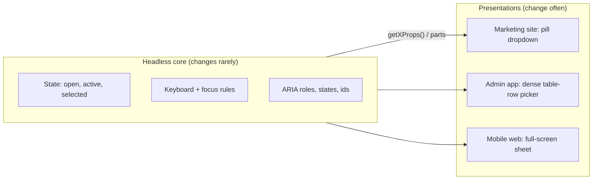
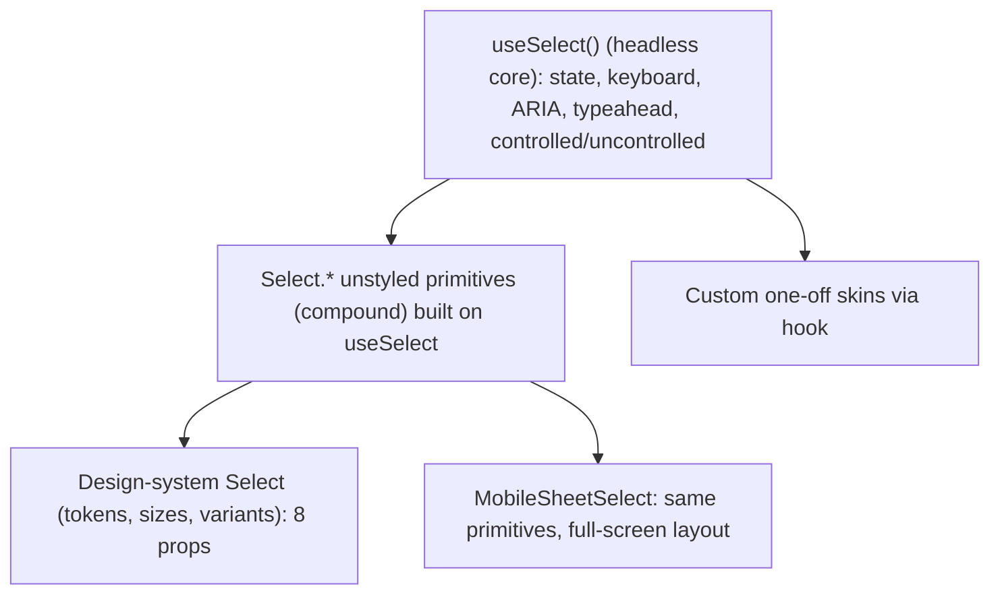
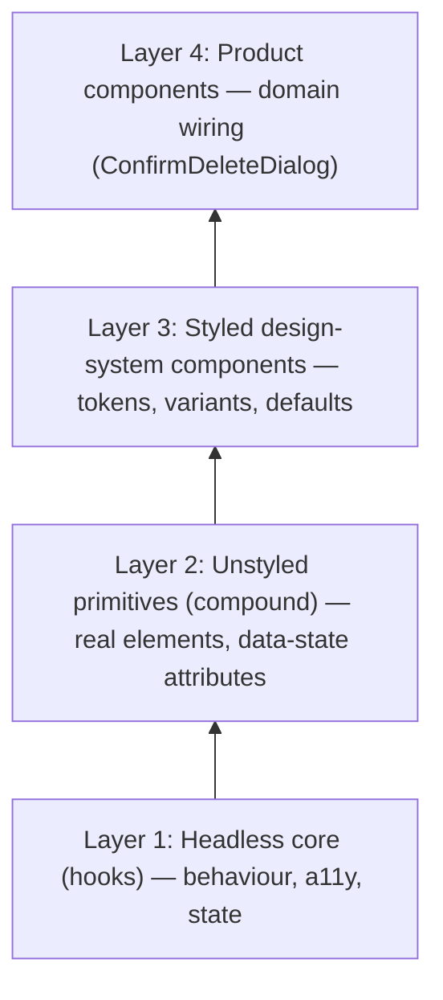
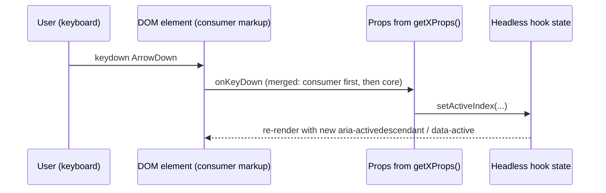

# 05 / 07 — Headless Components

## 1. Lesson metadata

| | |
|---|---|
| **Level** | Advanced |
| **Study time** | 5–6 hours (reading 2 h, refactoring labs 1.5 h, exercises 2 h) |
| **Prerequisites** | [Phase 1 / 07 — Composition, `children`, slots](../01-react-fundamentals/07-composition-and-children.md), [Phase 1 / 10 — Event handling](../01-react-fundamentals/10-event-handling.md), [Phase 3 / 15 — Custom hooks](../03-react-state-and-hooks/15-custom-hooks.md), [Phase 5 / 03 — Composition over inheritance](./03-composition-over-inheritance.md), [Phase 5 / 04 — Container and presentational](./04-container-presentational.md), [Phase 5 / 05 — Compound components](./05-compound-components.md), [Phase 5 / 06 — Custom hook patterns](./06-custom-hook-patterns.md) |
| **Next** | [08 — Provider pattern](./08-provider-pattern.md) |
| **Related** | [10 — Render props](./10-render-props.md), [11 — Controlled component pattern](./11-controlled-component-pattern.md), [Phase 5 / 18 — Behavior vs presentation](./18-behavior-vs-presentation.md), [Phase 5 / 19 — Polymorphic components](./19-polymorphic-components.md), [Phase 5 / 22 — Patterns for reusable libraries](./22-patterns-for-reusable-libraries.md), [Phase 4 / 20 — Design systems](../04-react-architecture/20-design-systems.md) |

> **Status label: CURRENT.** "Headless" is a design approach, not a React API. It is used by widely adopted libraries and is the dominant architecture for new design-system primitives. Two of its *historical implementation forms* (render-prop components, `Children`-based cloning) are legacy; the hook and unstyled-compound forms are current.

**Learning objectives.** After this lesson you can:
1. Define a headless component precisely (behaviour, state, and accessibility without markup or styling decisions) and distinguish its three implementation forms.
2. Map the approach to Bridge, Strategy, and MVVM/presentation-model, stating honestly that "headless" is not a Gang-of-Four pattern.
3. Implement a headless hook with prop getters that **merges** consumer props and handlers, and a minimal `Slot`/`asChild` utility.
4. Build two visually unrelated skins on one headless core, and explain what the core still guarantees.
5. Decide whether headless is the right investment, or whether native HTML, a styled component, or a compound component is better.
6. Evaluate a headless library or design for accessibility responsibilities, SSR/RSC boundaries, bundle cost, and API stability.

**Concepts covered:** headless component, behaviour/presentation separation, prop getters, state reducer/inversion of control, unstyled compound primitives, `asChild`/slot composition, prop merging, `aria-activedescendant` listbox, accessibility contract, controlled/uncontrolled core, three-layer design-system architecture, native-first principle.

---

## 2. Deep conceptual explanation

### 2.1 What "headless" means

A **headless component** (or headless UI) provides *what a widget does* but not *what it looks like*:

| Provided by the headless layer | Left to the consumer |
|---|---|
| State machine (open/closed, selected, active index) | Markup (which elements, nesting, order) |
| Keyboard interaction (arrows, Home/End, Escape, typeahead) | Styling (CSS, tokens, animation) |
| ARIA roles, states, and relationships (`aria-expanded`, `aria-controls`, IDs) | Content and copy |
| Focus management (trap, restore, roving tabindex) | Layout and responsive behaviour |
| Controlled/uncontrolled state contract | Theming and branding |
| Dismissal logic (outside click, Escape) and positioning *inputs* | Visual affordances such as focus rings |

"Head" here is the visual output. The component is "headless" because the *head* (rendered UI) has been removed.

### 2.2 The problem it solves

Behaviour and appearance change at different rates and for different reasons ([Lesson 01 — SRP](./01-solid-in-react.md)). A combobox's keyboard model and ARIA contract are specified by a standard and change rarely; its look changes with every rebrand. Coupling them gives you:

1. **Fork-and-diverge.** Team B needs a slightly different dropdown, copies the component, and now two implementations of the accessibility behaviour exist, drifting apart.
2. **Prop explosion** ([Lesson 05 §2.2](./05-compound-components.md)). Styled components accrete `variant`, `size`, `renderOption`, `renderValue`, `classNames={{…}}`, `slotProps={{…}}`.
3. **Style-system lock-in.** A component library that ships its own CSS forces a styling approach (CSS-in-JS runtime, a specific token system, utility classes) onto every consumer.
4. **Accessibility as a side effect.** Correct widget behaviour is hard (the authoring-practice patterns run to dozens of keyboard and focus rules). It is rarely reimplemented correctly in each product.

A headless layer concentrates the hard, rarely changing, high-risk part in one tested place, and lets many presentations sit on top.

### 2.3 Three implementation forms

| Form | Shape | Examples of the form | Status |
|---|---|---|---|
| **Headless hook with prop getters** | `const { getTriggerProps, getItemProps, … } = useCombobox(options)`; consumer renders all markup and spreads props. | Hook-based libraries such as Downshift's hooks, React Aria's hooks, TanStack Table's `useReactTable` (data/state logic with no markup). | Current |
| **Unstyled compound primitives** | `<Dialog.Root><Dialog.Trigger/><Dialog.Content/></Dialog.Root>` render real elements with ARIA and `data-state` attributes but no styles. | Radix Primitives, Headless UI, Ariakit (compound/unstyled components). | Current; most common for UI primitives |
| **Render-prop headless components** | `<Downshift>{({ getInputProps, isOpen }) => …}</Downshift>`; function-as-children. | Earlier Downshift and many pre-hooks libraries. | Legacy form; mostly superseded by hooks ([Lesson 10](./10-render-props.md)) |

Plus a **polymorphism helper** used by the unstyled-primitive form: `asChild` (also called the slot pattern), which merges the primitive's props onto a consumer-supplied element instead of rendering its own (§5.4).

### 2.4 Mapping to classic patterns

| Classic pattern | Idea | Headless mapping | Where the mapping breaks |
|---|---|---|---|
| **Bridge** | Decouple an abstraction from its implementation so both vary independently. | *Behaviour* (abstraction) and *presentation* (implementation) vary independently: one `useListbox` core, many skins. | Bridge is usually an object-reference relationship with an interface; here the "interface" is the *prop-getter/DOM contract* and it is leaky (the consumer must render elements compatible with the ARIA pattern). |
| **Strategy** | Interchangeable algorithms. | The consumer supplies the presentation strategy; or the core accepts strategies (`getKey`, `filter`, `isItemDisabled`). | Presentation is not a function with one signature; it is a tree of elements. |
| **Template Method** | Fixed skeleton, variable steps. | The core fixes the interaction skeleton (keyboard → state → ARIA), and the consumer fills in rendering. | No inheritance; the "steps" are DOM elements you render. |
| **MVVM / Presentation Model** | A view-model exposes state and commands; the view binds to it. | The hook *is* the view-model: it returns state and handlers; the JSX *is* the view. | React has no declarative data-binding; the view "binds" by spreading props. |
| **Container/Presentational** ([Lesson 04](./04-container-presentational.md)) | Split logic and rendering components. | Headless is the same split, but the logic part is a *hook or unstyled primitive* rather than a container component. | Container components own data fetching and wiring; headless cores own interaction semantics. |
| **State reducer / Inversion of control** | The user can override transitions. | Many headless hooks accept a `stateReducer` or `onStateChange` to let consumers alter transitions. | Powerful but a large API surface to keep stable ([Lesson 12](./12-reducer-pattern.md)). |

**Honest summary:** "headless" is a *product-level architectural stance* ("ship behaviour, not looks"), best explained by Bridge (two independent axes of variation) and MVVM (view-model as hook). It is not a pattern with a single canonical structure. Different libraries implement it differently, and arguments over what qualifies as "headless" are mostly terminology. Judge a design by what it separates, not by the label.

### 2.5 What React exposes

React provides every ingredient: hooks (to hold logic), context and composition (for unstyled compounds), `ref` as a prop (React 19; for focus management), `useId` (for ARIA relationships), `cloneElement` (for slot-style prop merging), and `createPortal` (for overlays rendered outside the parent DOM node while keeping React context). It provides no widget semantics: roles, states and keyboard handling come from the **WAI-ARIA Authoring Practices** and the HTML specification, which headless libraries implement.

### 2.6 Common misconceptions

1. **"Headless means no markup."** Unstyled compound primitives *do* render elements (a `button`, a `div role="dialog"`), just without styling. Hook-based forms render nothing, and the consumer must render correctly. "Headless" refers to presentation, not DOM.
2. **"Headless means accessible."** It means accessibility is **implemented once** in the core. The consumer can still break it (wrong element, removed focus indicator, low contrast, ignoring `aria-label` requirements). The headless layer cannot guarantee visual accessibility.
3. **"Headless is the same as unstyled."** Unstyled components can still bundle layout assumptions; headless components make *no* structural assumptions at all (hook form) or minimal ones (primitives).
4. **"Always build headless."** It costs API surface, indirection, and consumer effort. For one product with one look, a styled component is cheaper (§7.3).
5. **"Headless libraries remove the need for design-system work."** They remove the *behavioural* work; tokens, theming, density, and documentation remain.
6. **"A headless hook is a custom hook."** Every headless hook is one; not every custom hook is headless. A headless hook specifically owns *interaction semantics* for a UI widget and exposes DOM-ready props.

---

## 3. Internal mechanics

### 3.1 Public guarantees you rely on

- **Props returned from a hook are ordinary props.** `<button {...getButtonProps()} />` is plain JSX spread; there is no hidden channel. Anything the DOM element needs (handlers, `aria-*`, `id`, `tabIndex`, `role`) must be in that object.
- **Event handlers compose only if you compose them.** In `{...a, onClick: x}`, the later key wins; there is no automatic chaining. Prop getters that accept consumer props must **merge** handlers explicitly (§5.1).
- **`aria-*` and `role` are DOM attributes** and are only meaningful to assistive technology when they match actual semantics and keyboard behaviour. Roles are promises: `role="listbox"` promises arrow-key navigation and `aria-selected` management.
- **`useId`** gives IDs that are consistent between server and client render, for `aria-controls`, `aria-labelledby`, `aria-activedescendant`.
- **Portals preserve React context and event bubbling through the React tree** (not the DOM tree). A popover content rendered into `document.body` still reads context from its React parent, and synthetic events bubble to React ancestors.
- **`ref` is a prop (React 19)** on function components, so a headless primitive can accept and merge a consumer's `ref`. In React 18 and earlier, `forwardRef` is required (legacy in 19).

### 3.2 Teaching model: two axes of variation



The core defines a **contract**: if you render the elements the contract asks for and spread the props, the widget behaves correctly. Each skin fulfils the contract differently.

### 3.3 Implementation detail (conceptual)

- **Hook form:** closures create prop objects every render. Because they contain freshly created handlers, they are not referentially stable; this is rarely a problem because they are spread on DOM elements (cheap). Passing them to memoised children defeats memoisation.
- **Primitive form:** the root provides context; parts consume it and render DOM elements with `data-state`/`aria-*`. `asChild` implementations typically render *no* element of their own, and instead `cloneElement` the single child with merged props (a **justified exception** to the "avoid `cloneElement`" guidance from [Lesson 05](./05-compound-components.md): it augments *one element the consumer explicitly handed over*, not implicit child scanning).
- **Focus management** (trap, restore) is performed imperatively with `element.focus()` inside effects/handlers, because focus is browser state outside React's model ([Phase 0 / 04](../00-web-and-javascript-foundations/04-dom-structure-and-mutation.md)).

These are conceptual descriptions; library internals differ and change between versions. To learn the real details, read the source of the libraries listed in §14 and the WAI-ARIA Authoring Practices patterns they implement.

### 3.4 What a widget contract has to specify

Using a listbox as the example, a headless core must decide, and document:

1. Which element is focusable (the list, or each option), and the focus strategy: **roving tabindex** (focus moves between options) vs **`aria-activedescendant`** (focus stays on the container; an attribute points to the "active" option).
2. Keyboard map: ArrowUp/Down, Home/End, Enter/Space selects, typeahead optional.
3. Selection model: single/multiple, controlled/uncontrolled ([Lesson 11](./11-controlled-component-pattern.md)).
4. Required ARIA: roles (`listbox`, `option`), `aria-selected`, `aria-activedescendant`, labelling requirement.
5. What the consumer must do: provide an accessible name (`aria-label`/`aria-labelledby`), render options with the given props, provide visible focus styling for the active option.

---

## 4. Step-by-step execution walkthrough

The `useListbox` hook from §5.1, rendered by a consumer. The user focuses the list and presses ArrowDown twice, then Enter.

1. **Initial render.** `useListbox` initialises: `selected` via the controllable-state hook (`null`), `activeIndex = 0`, `baseId` from `useId`. The consumer renders `<ul {...getListboxProps({ "aria-label": "Country" })}>` and `<li {...getOptionProps(i)}>` per item. DOM result: `ul[role=listbox][tabindex=0][aria-activedescendant="<id>-option-0"]`, `li[role=option][aria-selected=false]`.
2. **User tabs into the list.** The `ul` receives focus (it has `tabindex="0"`). Nothing in React runs; the browser moves focus. The consumer's CSS styles `[aria-activedescendant]`'s target to show the active option, or uses `data-active` set by `getOptionProps` (the example sets `data-active`).
3. **ArrowDown #1.** The browser dispatches `keydown` on the `ul`. React's `onKeyDown` handler (from `getListboxProps`) runs: the consumer's `onKeyDown` (if any) is called first, then, if it did not `preventDefault`, the hook's `handleKeyDown` calls `setActiveIndex(i => min(i + 1, last))` and `preventDefault()` to stop page scrolling.
4. **Render.** `activeIndex = 1`. `aria-activedescendant` now points at option 1; `data-active` moves. DOM mutations: two attribute updates on the `ul`/`li`s. No focus movement is needed: that is the point of `aria-activedescendant`.
5. **ArrowDown #2.** Same path; `activeIndex = 2`.
6. **Enter.** `handleKeyDown` calls `select(items[2])`: `setSelected` (if uncontrolled) and `onValueChange?.(key)`. Render: `aria-selected` flips to true on option 2.
7. **Assistive technology.** A screen reader announces the active descendant changes and selected state, *provided* the ARIA contract is complete and the elements are real.

> **Predict:** The consumer passes `onKeyDown={(e) => e.preventDefault()}` into `getListboxProps`. What happens to keyboard navigation? *(Answer: it stops working. The merge logic sees `defaultPrevented` after the consumer's handler and skips the hook's handler. This is the intended "escape hatch" convention for prop getters; a hook that overwrote or ignored consumer handlers would be worse; one that always ran regardless would deny the consumer any override. Document whichever you choose.)*

---

## 5. Code examples

### 5.1 Minimal: a headless `useListbox` with prop getters (merging handlers)

```tsx
// use-listbox.ts
import { useId, useState, type HTMLAttributes, type KeyboardEvent, type MouseEvent } from "react";
import { useControllableState } from "./use-controllable-state"; // Lesson 06 §5.5

type Options<T> = {
  items: readonly T[];
  getKey: (item: T) => string;
  /** Controlled selection. `undefined` means uncontrolled. */
  value?: string | null;
  defaultValue?: string | null;
  onValueChange?: (key: string | null) => void;
};

export function useListbox<T>({ items, getKey, value, defaultValue = null, onValueChange }: Options<T>) {
  const [selectedKey, setSelectedKey] = useControllableState<string | null>({
    value,
    defaultValue,
    onChange: onValueChange,
  });
  const [rawActive, setActive] = useState(0);
  const baseId = useId();

  // Derived, not stored: the list may shrink between renders.
  const lastIndex = items.length - 1;
  const activeIndex = Math.max(0, Math.min(rawActive, lastIndex));
  const optionId = (index: number) => `${baseId}-option-${index}`;

  function handleKeyDown(e: KeyboardEvent<HTMLElement>) {
    if (items.length === 0) return;
    switch (e.key) {
      case "ArrowDown": e.preventDefault(); setActive(Math.min(activeIndex + 1, lastIndex)); break;
      case "ArrowUp":   e.preventDefault(); setActive(Math.max(activeIndex - 1, 0)); break;
      case "Home":      e.preventDefault(); setActive(0); break;
      case "End":       e.preventDefault(); setActive(lastIndex); break;
      case "Enter":
      case " ":         e.preventDefault(); setSelectedKey(getKey(items[activeIndex])); break;
    }
  }

  function getListboxProps(props: HTMLAttributes<HTMLElement> = {}): HTMLAttributes<HTMLElement> {
    return {
      role: "listbox",
      tabIndex: 0,
      "aria-activedescendant": items.length > 0 ? optionId(activeIndex) : undefined,
      ...props,
      onKeyDown: (e: KeyboardEvent<HTMLElement>) => {
        props.onKeyDown?.(e);
        if (!e.defaultPrevented) handleKeyDown(e);
      },
    };
  }

  function getOptionProps(
    index: number,
    props: HTMLAttributes<HTMLElement> = {},
  ): HTMLAttributes<HTMLElement> & { "data-active"?: true } {
    return {
      role: "option",
      id: optionId(index),
      "aria-selected": getKey(items[index]) === selectedKey,
      "data-active": index === activeIndex || undefined,
      ...props,
      onClick: (e: MouseEvent<HTMLElement>) => {
        props.onClick?.(e);
        if (e.defaultPrevented) return;
        setActive(index);
        setSelectedKey(getKey(items[index]));
      },
    };
  }

  return { selectedKey, activeIndex, getListboxProps, getOptionProps };
}
```

**Line-by-line notes**

- **`aria-activedescendant` strategy:** DOM focus stays on the `ul`; the attribute names the active option. It avoids moving focus on every arrow press, which is simpler for long lists but requires the consumer's CSS to show the active state (the hook provides `data-active`). The roving-tabindex alternative moves real focus and requires option refs. Both are valid patterns in the WAI-ARIA Authoring Practices; the choice is a documented part of the contract.
- **`activeIndex` is derived** with clamping rather than stored as authoritative state, so shrinking `items` (a filter) cannot leave an out-of-range index ([Phase 3 / 17 — derived state](../03-react-state-and-hooks/17-derived-state.md)). `rawActive` is the stored intent.
- **Handler merging:** `...props` spreads *before* the composed `onKeyDown`, so the hook's merged handler wins over a consumer-supplied `onKeyDown` key while still *calling* the consumer's. Any prop not specially merged (`className`, `aria-label`) passes through; `role`/`tabIndex` can be overridden by consumers (their position after the defaults), which may be a feature or a footgun. Decide and document. Some libraries put required ARIA props *after* the spread to prevent accidental overrides.
- **Return type of `getOptionProps`:** the intersection with `{ "data-active"?: true }` lets the object literal carry a `data-*` key that `HTMLAttributes` does not declare. JSX allows hyphenated `data-*` attributes without declaration, so spreading the result onto an element type-checks.
- **Single-select only, no typeahead, no disabled items:** deliberately narrow. Each extra feature adds an entry to the contract.

### 5.2 Two skins on one core

```tsx
type Country = { code: string; name: string; flag: string };

// Skin 1: dense list for an admin form
function CountryListbox({ countries, value, onChange }: {
  countries: Country[]; value: string | null; onChange: (c: string | null) => void;
}) {
  const { getListboxProps, getOptionProps } = useListbox({
    items: countries, getKey: (c) => c.code, value, onValueChange: onChange,
  });
  return (
    <ul {...getListboxProps({ "aria-label": "Country", className: "admin-list" })}>
      {countries.map((c, i) => (
        <li key={c.code} {...getOptionProps(i, { className: "admin-row" })}>
          {c.name}
        </li>
      ))}
    </ul>
  );
}

// Skin 2: card grid for a marketing page. Same behaviour, different DOM.
function CountryCards({ countries }: { countries: Country[] }) {
  const { getListboxProps, getOptionProps, selectedKey } = useListbox({
    items: countries, getKey: (c) => c.code,
  });
  return (
    <div {...getListboxProps({ "aria-label": "Choose your country", className: "card-grid" })}>
      {countries.map((c, i) => (
        <div key={c.code} {...getOptionProps(i, { className: "card" })}>
          <span aria-hidden>{c.flag}</span>
          <strong>{c.name}</strong>
          {selectedKey === c.code && <span className="badge">Selected</span>}
        </div>
      ))}
    </div>
  );
}
```

Both skins inherit keyboard behaviour, ARIA, and controlled/uncontrolled semantics. Their markup differs (`ul/li` vs `div/div`). What the hook does *not* do: guarantee a visible focus indicator for `[data-active]`. A consumer who forgets the CSS ships an inaccessible widget.

> **Predict:** In the card grid (2-D layout), does ArrowDown move to the card visually below? *(No. The hook implements one-dimensional navigation by index. A grid layout that visually wraps is a different keyboard contract (2-D arrow navigation) and needs a different core, or a `columns` option. A headless core encodes **interaction semantics**, so changing the semantic model is not a "skin" change.)*

### 5.3 Merging props: the correctness rule

```ts
// merge-props.ts
type AnyProps = Record<string, unknown>;

export function mergeProps(slot: AnyProps, child: AnyProps): AnyProps {
  const merged: AnyProps = { ...slot, ...child };           // child wins by default
  for (const key of Object.keys(slot)) {
    const s = slot[key];
    const c = child[key];
    if (/^on[A-Z]/.test(key) && typeof s === "function" && typeof c === "function") {
      merged[key] = (...args: unknown[]) => { c(...args); s(...args); };  // child first, then slot
    } else if (key === "className") {
      merged[key] = [s, c].filter(Boolean).join(" ");
    } else if (key === "style") {
      merged[key] = { ...(s as object), ...(c as object) };
    }
  }
  return merged;
}
```

Rules encoded here, which every headless library must decide on explicitly:

| Prop kind | Merge rule | Why |
|---|---|---|
| Event handlers (`onClick`) | **Chain** both (consumer first, then core), unless prevented | Neither side may silently disable the other |
| `className` | Concatenate | Both want styling |
| `style` | Shallow merge, consumer wins | Consumer can override |
| `ref` | Compose (call both / assign both) | Core needs the node for focus; consumer needs it too |
| `id`, `aria-*`, `role` | Decide: core wins (protects the contract) or consumer wins (flexibility) | Overriding `aria-controls` can break relationships |
| `data-*` | Consumer wins or merge by key | Test IDs must pass through |

In this simplified `mergeProps` the `ref` case is not handled: in React 19 `ref` is a normal prop, so `{...slot, ...child}` would let the child's ref silently replace the slot's. Real implementations compose refs (call both). In React 18, refs are not in `props` at all and the element's `ref` property must be read separately.

### 5.4 The `asChild` / Slot technique (polymorphism without wrapper elements)

```tsx
// slot.tsx
import { Children, cloneElement, isValidElement, type HTMLAttributes, type ReactElement, type ReactNode } from "react";
import { mergeProps } from "./merge-props";

export function Slot({ children, ...slotProps }: HTMLAttributes<HTMLElement> & { children?: ReactNode }) {
  const child = Children.only(children);                   // exactly one element, or throws
  if (!isValidElement(child)) return null;
  const element = child as ReactElement<Record<string, unknown>>;
  return cloneElement(element, mergeProps(slotProps as Record<string, unknown>, element.props));
}
```

```tsx
// primitives.tsx
import type { ComponentProps } from "react";
import { Slot } from "./slot";

type TriggerProps = ComponentProps<"button"> & { asChild?: boolean };

export function DisclosureTrigger({ asChild, ...rest }: TriggerProps) {
  // useDisclosureContext: guard hook over the root's context, as in Lesson 05 §5.1 (not shown)
  const d = useDisclosureContext("Disclosure.Trigger");
  const Comp = asChild ? Slot : "button";
  return (
    <Comp
      {...(asChild ? {} : { type: "button" as const })}
      aria-expanded={d.open}
      aria-controls={d.contentId}
      onClick={d.toggle}
      {...rest}
    />
  );
}
```

```tsx
// Consumer: the trigger is a router link, still toggling the disclosure
<DisclosureTrigger asChild>
  <a href="/faq#shipping">Shipping details</a>
</DisclosureTrigger>
```

**Notes**

- `Children.only` is a legitimate use of a legacy-listed API: it asserts the single-child contract of the slot. `cloneElement` is used to augment *the one element the consumer handed over*; it does not scan siblings.
- With `asChild`, no `<button>` is rendered; the consumer's `<a>` receives `aria-expanded`, `aria-controls`, and a chained `onClick`. This avoids invalid nesting (`<button><a>` is invalid HTML) and avoids a wrapper element.
- **Trade-offs:** typing is awkward (the primitive can't know the child's props); semantics depend on the consumer's element (an `<a>` with `aria-expanded` and no `role="button"` has questionable semantics; libraries document this); the child must be able to accept the props (`ref`, handlers), and a custom component child must forward them to a DOM node (in React 19, by spreading props including `ref`). If the child is a function component that ignores props, the behaviour silently fails (the same failure family as Lesson 05 §5.3, now confined to one explicit element).
- ⚠ Libraries differ in exact Slot semantics (ref composition, prop precedence). If you depend on `asChild` from a library, read its documentation for merge rules rather than assuming this sketch.

### 5.5 Incorrect designs worth recognising

**(a) Overwriting consumer handlers**

```tsx
function getButtonProps(props: ComponentProps<"button"> = {}) {
  return { onClick: toggle, "aria-expanded": open, ...props };    // consumer's onClick REPLACES toggle
}
```

If the consumer passes `onClick`, the widget stops toggling. The reverse (`{...props, onClick: toggle}`) disables the consumer's handler. Neither is acceptable; chain them (§5.1).

**(b) "Headless" with baked-in style decisions**

```tsx
export function useDropdown() {
  return { getMenuProps: () => ({ className: "dropdown-menu shadow-lg rounded-md bg-white" }) };
}
```

Class names tie the core to one CSS system and one look. Return state and data attributes (`data-state="open"`), and let the consumer style them.

**(c) Core coupled to DOM structure**

```ts
const items = menuEl.querySelectorAll(".menu-item");   // class-name-based DOM query
```

If a consumer restyles or renames classes, keyboard navigation breaks. Use data attributes or roles the core itself assigns, or register items through the props it hands out.

**(d) A role without its behaviour**

```tsx
<div role="listbox">…</div>          // no keyboard handling, no aria-selected
```

Assistive technology announces "list box", users expect arrow keys, nothing works. The first rule of ARIA, from the specification's authoring guidance, is to prefer native elements where they exist; the second is that a role is a promise.

### 5.6 Before/after refactoring lab 1: styled `Select` mega-component → headless core + skins

**Before.** One component used by three apps:

```tsx
<Select
  options={options}
  value={value}
  onChange={setValue}
  variant="outline" size="sm" searchable multiple clearable
  placeholder="Pick one"
  renderOption={(o) => <Flag code={o.code} />}
  renderValue={(v) => …}
  classNames={{ trigger: "…", list: "…", option: "…", search: "…" }}
  menuPlacement="bottom-start" maxMenuHeight={320} virtualised
  isOptionDisabled={(o) => o.archived}
  onOpen={…} onClose={…} onSearchChange={…}
/>
```

Observed problems: 32 props, `classNames` as a second styling system, two forks (`AdminSelect`, `MobileSelect`) created because the single component could not express a full-screen sheet, accessibility bugs fixed in one fork and not the others.

**After.** Layered design:



| Dimension | Before | After |
|---|---|---|
| Behaviour implementations | 3 (one per fork) | 1 core |
| Props on the commonly used component | 32 | ~8 (design-system layer) |
| New layout need (sheet on mobile) | New fork | New skin on the same core |
| Accessibility bugfix cost | Fix in 3 places | Fix once; skins inherit |
| Consumer effort for a standard select | Low (one tag) | Low *if* the design-system layer exists; otherwise high |
| Initial build cost | Low | **Higher** (core + primitives + layer) |
| Testing | Matrix of props | Core behaviour tests once; skin tests are visual/contract tests |
| Risk | Drift | Core API stability becomes a commitment |

**What you lose and when this is not worth it:** if one team ships one app with one look, the refactor buys little and costs a layer of indirection. The justification here was *three consumers with divergent presentation and a recurring accessibility defect*.

### 5.7 Before/after refactoring lab 2: logic buried in a styled component → extracted hook, then primitives

**Before.** `PricingToggle` mixes billing-period state, keyboard behaviour, ARIA, and Tailwind classes.

```tsx
function PricingToggle({ onChange }: { onChange: (p: "monthly" | "yearly") => void }) {
  const [period, setPeriod] = useState<"monthly" | "yearly">("monthly");
  return (
    <div className="inline-flex rounded-full bg-gray-100 p-1">
      <button className={period === "monthly" ? "bg-white shadow rounded-full px-4" : "px-4"}
              onClick={() => { setPeriod("monthly"); onChange("monthly"); }}>Monthly</button>
      <button className={period === "yearly" ? "bg-white shadow rounded-full px-4" : "px-4"}
              onClick={() => { setPeriod("yearly"); onChange("yearly"); }}>Yearly</button>
    </div>
  );
}
```

No `role`, no `aria-pressed`/radio semantics, no arrow keys, and a second page wants a vertical variant with icons.

**After (step 1: behaviour into a hook).** Model the control as a radio group (single choice among few): the core provides `getGroupProps`, `getRadioProps(value)` with `role="radiogroup"/"radio"`, `aria-checked`, roving tabindex and arrow keys.

**After (step 2: question the premise).** For a two-option, mutually exclusive choice, **native radio inputs** (`<input type="radio">` in a `<fieldset>`) already provide the semantics, keyboard model, and form participation. Restyle with CSS (`:checked + label`). The best "headless" is often the platform.

| Dimension | Before | Step 1 (hook) | Step 2 (native radios) |
|---|---|---|---|
| Accessibility | Missing semantics/keyboard | Implemented in core | Native, free |
| Lines you own | ~15 | ~60 (core) + ~15 (skin) | ~15 + CSS |
| Reuse by second page | Fork | Skin on core | Style the same markup |
| Dependencies | none | none | none |
| Suitable when | Prototype | Custom behaviour not in HTML | Behaviour exists in HTML |

The lab's lesson: **headless is for behaviour HTML does not provide** (combobox, menu, tabs with roving focus, dialogs with specific focus rules). Check the platform first (§7).

---

## 6. Visual explanations

### 6.1 Layered design-system architecture



Each layer can be adopted independently: a product team with an unusual widget uses layer 1; most teams use layer 3. Costs rise with each layer you own. Libraries typically provide layer 1 or 2; your organisation provides layer 3 ([Phase 4 / 20](../04-react-architecture/20-design-systems.md), [Lesson 22](./22-patterns-for-reusable-libraries.md)).

### 6.2 Prop-getter data flow



### 6.3 Who owns what (ownership map)

```
                     Headless core        Consumer
State machine              ●
Keyboard rules             ●
ARIA wiring                ●               (must apply props correctly)
Accessible name            (requires)       ●  (aria-label / labelledby)
Markup                                      ●
Visual focus indicator                      ●  (core supplies data attribute)
Colour contrast                             ●
Animation / reduced motion                  ●  (core may expose data-state)
Positioning (popover)      (inputs only)    ●  or a positioning library
```

---

## 7. Alternative approaches and trade-offs

### 7.1 Comparison

| Criterion | Native HTML element | Styled component (library) | Config-prop component | Compound components | Headless hook | Unstyled primitives |
|---|---|---|---|---|---|---|
| Accessibility by default | **Best** (platform) | Good if library is good | Depends | Good if built carefully | Core yes; consumer can break it | Good |
| Styling freedom | CSS only (limits for some elements) | Low–medium (theme API) | Low | High | **Highest** | High |
| Markup freedom | None | None | None | Medium (parts) | **Highest** | Medium |
| Consumer code volume | **Lowest** | Low | Low | Medium | Highest | Medium |
| API surface to maintain | None | Large props | Large props | Medium | Medium (return contract) | Medium (parts) |
| Bundle cost | None | Whole component + styles | Whole component | Moderate | Small | Moderate |
| RSC/SSR | Server-friendly | Mostly client | Mixed | Stateful parts need `"use client"` | Hook = client-only | Client boundary |
| Inconsistency risk across teams | Low | Low | Low | Medium | **Highest** (each skin can diverge) | Medium |
| Time to first usable widget | **Fastest** | Fast | Fast | Slower | Slowest | Medium |

### 7.2 Choosing the headless form

| Need | Choose |
|---|---|
| Ship consistent widgets to many teams with a shared look | Styled layer built on unstyled primitives |
| Different DOM per use (grid vs list, custom triggers) | Headless hook |
| Existing component library with strong styling system you want to keep | Unstyled primitives + your styles |
| Data-structure logic (tables, virtualisation, forms) | Headless hook (the "view" is large and domain-specific) |
| Single trigger element you need to reuse (link/button) | `asChild`/slot on primitives |

### 7.3 When the recommended approach is NOT best

- **The platform already provides it.** `<dialog>`, `<details>/<summary>`, `<select>`, the Popover API, `<input type=radio|checkbox>`, `<progress>`. Native elements are faster, smaller, and accessible by default. Check current browser support and the quality of native styling for your requirements; `<select>` popups remain only partly stylable, which is the usual reason teams build custom selects.
- **One product, one look, small team.** A styled component library (or a few components in your app) gets you there faster. Headless is an investment justified by multiple presentations, multiple teams, or strict accessibility requirements.
- **You cannot staff accessibility testing.** A headless core in-house is a liability if no one can validate it with real assistive technology. Adopting a well-maintained library moves that burden to maintainers.
- **Content-driven static pages.** Little interaction means little need for widget semantics.
- **Prototyping.** A quick styled component beats designing a contract.
- **Time-critical domain widgets** (charts, maps, editors) whose behaviour is a large product on its own: choose the specialised library.

---

## 8. Best practices and anti-patterns

### 8.1 Best practices

1. **Start from a specification.** Implement the WAI-ARIA Authoring Practices pattern (or the HTML semantics) and list deviations. Behaviour should be traceable to a spec, not invented.
2. **Merge, never overwrite.** Compose handlers, refs, class names, styles (§5.3).
3. **Expose state through data attributes** (`data-state`, `data-active`, `data-disabled`) so skins can style without needing the hook's state.
4. **Support controlled and uncontrolled** from day one ([Lesson 11](./11-controlled-component-pattern.md)).
5. **Make required wiring hard to forget**: warn in development when an accessible name is missing; throw when a part is outside its root.
6. **Keep the core free of styling and DOM-structure assumptions.** No class names; query by roles or by what you registered.
7. **Document the contract**: required elements, required props to spread, keyboard map, what the consumer must style.
8. **Test behaviour with the user's tools:** keyboard events and accessible queries (`getByRole`) rather than internal state ([Phase 8](../08-testing-and-quality/)); add automated accessibility checks, and manual screen-reader testing before release.
9. **Version the contract.** Changing the keyboard map or the returned props is a breaking change for every skin.
10. **Prefer a maintained library** for complex widgets (combobox, date picker, menu, dialog). The edge cases (IME composition, mobile screen readers, focus restoration, scroll locking, nested layers) take years of fixes.

### 8.2 Beginner mistakes

- Thinking "unstyled" means "done"; forgetting focus styles, contrast, hit-target sizes.
- Spreading props on the wrong element (the label gets the trigger's props).
- Replacing a native element with a `div` plus ARIA when the native one would do.
- Missing accessible names (`aria-label`) on listboxes, dialogs, and icon-only buttons.

### 8.3 Experienced-developer mistakes

- **Building a headless layer before there are two consumers**, producing a speculative contract that the third consumer then breaks.
- **State-reducer APIs everywhere**, exposing transition internals that become frozen public API ([Lesson 12](./12-reducer-pattern.md)).
- **Treating `asChild` as free**, then discovering that custom components don't forward props/refs, or semantics change (`<a>` with `aria-expanded`).
- **Mixing both layers' concerns**: the "headless" hook fetches data and formats currency.
- **Ignoring SSR/RSC**: a hook that reads `window` in render, or primitives that are one giant client boundary pulling a large tree into the client bundle ([Phase 2 / 27](../02-react-rendering-and-internals/27-react-server-components-intro.md)).

### 8.4 Smells

- A headless library whose "skins" copy-paste large amounts of ARIA wiring: the contract is too low-level; provide primitives.
- Getter functions that return different shapes depending on state, making spreading unpredictable.
- Hooks returning more than ~6 getters: the widget is probably two widgets.
- Skins that need to import internal files of the core: the public surface is incomplete.

### 8.5 Justified exceptions

- A **single-purpose widget** with a fixed look may still be built on a headless core internally to share behaviour across variants; the headless layer need not be public.
- Using `cloneElement` for slot merging (§5.4) is the sanctioned exception to avoid implicit child scanning.
- Shipping styled defaults *alongside* a headless core (as optional) is reasonable; just keep the core importable on its own.

---

## 9. Real-world application

| Domain | Headless usage | Engineering constraints |
|---|---|---|
| **E-commerce** | Facet filters (checkbox group + disclosure), product-variant swatch picker (radio group semantics), mini-cart popover | Skins differ per storefront brand; SSR for crawlable facets; swatches need non-colour cues (accessibility); analytics events attached via merged handlers, not by wrapping. |
| **Dashboards** | Data tables via a headless table engine (sorting, filtering, pagination, column visibility as state) rendered with your own markup; command palette (combobox) | Virtualisation integration; keyboard navigation in dense grids is a distinct contract; state persisted to the URL ([Phase 3 / 19](../03-react-state-and-hooks/19-ui-server-url-and-shared-state.md)). |
| **Finance** | Accessible numeric inputs, account pickers (combobox), confirmation dialogs with strict focus handling | Regulated accessibility requirements; locale-aware formatting kept outside the core; audit of keyboard-only flows; no accidental double-submit from merged handlers. |
| **Forms** | Field wrappers (label/description/error wiring), radio groups, comboboxes, date pickers | Integration with form libraries (controlled mode, `register` refs); error announcements; autofill/IME/mobile keyboards. |
| **Auth** | One-time-code inputs, password reveal toggles, modal flows | Paste handling, autofill hints, focus return after dialog close; the core should not own security logic. |
| **Realtime** | Chat message lists with scroll anchoring, live-region announcements | `aria-live` politeness and rate limiting; virtualised lists complicate `aria-activedescendant` (the active element may be unmounted). |
| **Multi-team design system** | Layers 1–3 (§6.1), with adoption guides | Versioning of getters and part names; codemods for breaking changes; contribution model; visual regression testing for skins ([Phase 4 / 20](../04-react-architecture/20-design-systems.md)). |

Constraint to remember: **a headless layer shifts risk from the library to every consumer's markup.** Review templates, lint rules, and tests should verify that required props are spread and required elements exist.

---

## 10. Debugging and troubleshooting

| Symptom | Likely cause | Investigation | Fix |
|---|---|---|---|
| Keyboard navigation does nothing | Props not spread on the focused element; consumer's `onKeyDown` calls `preventDefault`; wrong element focused | DevTools Elements: is `onKeyDown` effective? (React attaches listeners at the root; check by logging in the handler.) Check which element has `:focus` (`document.activeElement` in console). | Spread on the correct element; remove accidental `preventDefault` |
| Screen reader says "list" but not "listbox/option" | Role overridden or missing on elements | Browser accessibility tree (Chrome/Firefox DevTools → Accessibility pane) | Ensure `getOptionProps` is spread on each option |
| `aria-activedescendant` points to nothing | Option `id` mismatch; list virtualised so the element is unmounted | Accessibility pane shows broken reference; compare `id`s | Render the active option always, or manage focus on options (roving) |
| Custom component child ignores `asChild` props | Child doesn't spread `...props` or forward `ref` | DevTools: inspect child props: they arrive; check the rendered DOM node | Make the component spread props onto a DOM element (React 19: includes `ref`) |
| Clicking inside a portal closes the popover unexpectedly | Outside-click logic uses DOM containment but content is portalled; or React bubbling through portal triggers parent handlers | Log `event.target`, check `ref.contains`; portals bubble synthetic events to React ancestors | Treat portalled content as inside (track via refs); stop propagation deliberately |
| Focus lost after closing a dialog | Focus not restored to the trigger | Watch `document.activeElement` after close | Save trigger ref on open; `trigger.focus()` on close, unless the trigger was removed |
| Hydration mismatch in a primitive | IDs generated outside `useId`; open state read from `window` in render | Compare server HTML vs client DOM | Use `useId`; initialise from props, sync from browser in effects |
| Duplicate handler invocations (analytics fires twice) | Handler passed both directly and via the getter that also chains it | Count calls; inspect merged props | Pass handlers through exactly one route (the getter's argument) |

**Accessibility debugging routine.** (1) Keyboard-only walkthrough with no mouse; (2) accessibility tree inspection; (3) automated checks (e.g. axe-based tooling) for static violations; (4) at least one screen reader pass per release for complex widgets. Automated tools catch only a subset of problems, so absence of violations does not prove accessibility.

---

## 11. Exercises

### Level A — Knowledge
A1. Define "headless component" and list three things the headless layer provides and three it leaves to the consumer.
A2. Name the three implementation forms and say which one is legacy.
A3. Why is `{ onClick: toggle, ...props }` a bug in a prop getter? What about `{ ...props, onClick: toggle }`?
A4. Explain `aria-activedescendant` versus roving tabindex in two sentences.
A5. Which classic patterns best describe headless design, and why isn't "headless" itself one?

### Level B — Code comprehension
B1. In §5.1, the consumer passes a new `items` array with 3 elements while `activeIndex` was 7. What is `activeIndex` on that render, and what does `aria-activedescendant` point to?
B2. In §5.4, what DOM does this render? What is wrong with the semantics?
```tsx
<DisclosureTrigger asChild><div>Details</div></DisclosureTrigger>
```
B3. A skin renders `getOptionProps(i)` on a wrapper `<div>` that contains a checkbox and a label; clicking the label toggles the checkbox *and* selects the option. Explain why, and one way to avoid it.
B4. Why is the return type of `getOptionProps` an intersection with `{ "data-active"?: true }`, and what breaks if it is annotated as plain `HTMLAttributes<HTMLElement>`?

### Level C — Implementation
C1. Implement `useToggleButton({ pressed, defaultPressed, onPressedChange })` as a prop-getter hook with `aria-pressed`, `type="button"`, handler merging, and controlled/uncontrolled state.
C2. **Refactor:** the component below mixes behaviour and style. Extract a headless hook and write two skins (a button-style trigger, and an icon-only one).
```tsx
function Accordion({ items }: { items: { title: string; body: ReactNode }[] }) {
  const [open, setOpen] = useState<number | null>(null);
  return (
    <div className="border rounded divide-y">
      {items.map((it, i) => (
        <div key={i}>
          <div className="p-3 cursor-pointer font-semibold" onClick={() => setOpen(open === i ? null : i)}>{it.title}</div>
          {open === i && <div className="p-3">{it.body}</div>}
        </div>
      ))}
    </div>
  );
}
```
C3. Extend `useListbox` with `isItemDisabled(item)`: skip disabled items in arrow navigation and expose `aria-disabled`. Update the keyboard map and specify how Home/End behave.
C4. **Refactor decision lab:** for the `PricingToggle` in §5.7, produce the native-radio version (CSS-styled) and compare it with the hook version on three criteria of your choice.

### Level D — Debugging
D1. A team's custom `Select` built on a headless hook "works with the mouse" but screen reader users cannot choose options. List five things to inspect, in order.
D2. A tooltip built with `asChild` around a `<Button>` never appears on hover. `Button` is a custom function component. Diagnose.
D3. Pressing Escape in a nested popover closes both the popover and the parent dialog. Diagnose and propose a design for layered dismissal.

### Level E — Architecture decisions
E1. A platform team must deliver 12 widgets to 8 product teams, with Tailwind in some apps and CSS modules in others. Choose a layering and a build/buy approach.
E2. A product manager wants a bespoke date range picker with unusual interactions. Decide between adopting a headless library hook, building on unstyled primitives, or a native `<input type="date">` pair. State criteria and risks.
E3. Your headless `useMenu` needs a breaking change to its keyboard map. Describe the versioning, communication, and testing plan.

### Level F — Expert challenge
F1. Implement `composeRefs` and use it to extend `mergeProps`/`Slot` so both the slot and the child receive the DOM node, handling callback refs, object refs, and (React 19) ref-callback cleanup. Discuss pitfalls.
F2. Design a headless `useCombobox` contract (state, events, ARIA, focus strategy, async options). List what you will *not* support and why, and how you will test it with real assistive technology constraints.

---

## 12. Detailed answers and explanations

> Attempt the exercises first.

### Level A

**A1.** A headless component supplies behaviour, state and accessibility without prescribing markup or style. Provides: (state machine, keyboard handling, ARIA wiring; also focus management, controlled/uncontrolled contract). Leaves: markup, styling, content, layout, theming, visual focus indicators. Any three of each, with the "head = visual output" explanation, is correct.

**A2.** (1) Headless hooks with prop getters; (2) unstyled compound primitives (often with `asChild`); (3) render-prop headless components. The third is the legacy form, superseded by hooks since 16.8; still present in older libraries.

**A3.** `{ onClick: toggle, ...props }`: a consumer-supplied `onClick` replaces the widget's toggle, so the widget stops working. `{ ...props, onClick: toggle }`: the widget's handler replaces the consumer's, silently dropping their analytics/side effects. Correct: call both (consumer first, then core, unless `defaultPrevented`).

**A4.** With `aria-activedescendant`, DOM focus stays on a container and the attribute names the descendant that is "active"; with roving tabindex, real focus moves to each item (only the current one has `tabindex=0`). The first is simpler for long lists but requires custom visual styling for the active item; the second gives native focus rings and scrolling-into-view behaviour but requires refs/management.

**A5.** Bridge (behaviour and presentation vary independently) and MVVM/presentation model (hook as view-model); Template Method and Strategy describe parts. "Headless" is a product stance and not a canonical structure; multiple structures (hooks, primitives, render props) all qualify, so it names a goal rather than a design pattern with a fixed solution form.

### Level B

**B1.** `activeIndex` is derived and clamped: `max(0, min(7, 2)) = 2`. `aria-activedescendant` points to option 2's id. Because the stored `rawActive` remains 7, if `items` grows back to 10 elements, the active index jumps back to 7. That is arguably surprising; a variant resets `rawActive` when the list identity changes (a "state reset" decision). The key point: never let a derived index point outside the list.

**B2.** It renders `<div aria-expanded=… aria-controls=… onClick=…>Details</div>`. Semantics: a `div` has no button role, is not focusable by default, and does not respond to Enter/Space, so keyboard and screen-reader users cannot operate it. The `aria-expanded` attribute on a `div` without `role="button"` is not meaningful. Fix: require a focusable interactive element as child (`button`, `a`), or have the slot add `role="button"`, `tabIndex=0`, and key handling (at which point you've reimplemented a button; use the native element).

**B3.** The click on the label bubbles to the wrapper's `onClick` (from `getOptionProps`), which selects the option; the label's default action also toggles the checkbox (a synthetic click is dispatched on the control). Both happen. Avoid by not nesting interactive controls inside an option (an `option` role should not contain interactive descendants), or stop propagation in the inner control's handler, or choose a different widget role (a list with checkboxes is a `group`/`checkbox` pattern, not a listbox).

**B4.** (Revised exercise: the §5.1 return type.) `getOptionProps` is annotated `HTMLAttributes<HTMLElement> & { "data-active"?: true }`. Without the intersection, returning an object literal containing `"data-active"` against plain `HTMLAttributes<HTMLElement>` triggers an excess-property error, because `data-*` keys are only implicitly allowed in JSX attribute position, not in object literals. Alternatives: cast (loses checking) or `Record<`data-${string}`, unknown>` in the intersection (accepts any `data-*`). The point is typing extra data attributes without widening to `any`.

### Level C

**C1.**

```tsx
import { type ComponentProps, type MouseEvent } from "react";
import { useControllableState } from "./use-controllable-state";

export function useToggleButton({ pressed, defaultPressed = false, onPressedChange }: {
  pressed?: boolean; defaultPressed?: boolean; onPressedChange?: (p: boolean) => void;
}) {
  const [isPressed, setPressed] = useControllableState<boolean>({
    value: pressed, defaultValue: defaultPressed, onChange: onPressedChange,
  });
  function getButtonProps(props: ComponentProps<"button"> = {}): ComponentProps<"button"> {
    return {
      type: "button",
      "aria-pressed": isPressed,
      ...props,
      onClick: (e: MouseEvent<HTMLButtonElement>) => {
        props.onClick?.(e);
        if (!e.defaultPrevented) setPressed(!isPressed);
      },
    };
  }
  return { pressed: isPressed, getButtonProps };
}
```

Criteria: `aria-pressed` boolean (not string); `type="button"` prevents accidental form submit; consumer handler first; `defaultPrevented` respected; controlled via `useControllableState`. Edge: `...props` after `type` lets consumers set `type="submit"` deliberately.

**C2.** Core:

```tsx
export function useAccordion(options: { allowMultiple?: boolean } = {}) {
  const baseId = useId();
  const [open, setOpen] = useState<ReadonlySet<number>>(new Set());
  const toggle = (i: number) =>
    setOpen((prev) => {
      const next = new Set(options.allowMultiple ? prev : []);
      if (prev.has(i)) next.delete(i); else next.add(i);
      return next;
    });
  return {
    getTriggerProps: (i: number, props: ComponentProps<"button"> = {}): ComponentProps<"button"> => ({
      type: "button",
      id: `${baseId}-trigger-${i}`,
      "aria-expanded": open.has(i),
      "aria-controls": `${baseId}-panel-${i}`,
      ...props,
      onClick: (e) => { props.onClick?.(e); if (!e.defaultPrevented) toggle(i); },
    }),
    getPanelProps: (i: number, props: ComponentProps<"div"> = {}): ComponentProps<"div"> => ({
      id: `${baseId}-panel-${i}`,
      role: "region",
      "aria-labelledby": `${baseId}-trigger-${i}`,
      hidden: !open.has(i),
      ...props,
    }),
  };
}
```

Skins: bordered list with title text vs a compact icon-only trigger (`aria-label` required, chevron icon). Criteria: trigger is a real `<button>` (the "before" used a clickable `div`: not focusable, no keyboard activation, no `aria-expanded`); panels stay mounted but `hidden` (state preserved) or conditionally rendered (a documented choice); IDs from `useId`; two skins share the core. The core's `toggle` uses a functional update, immutably creating a new `Set`.

**C3.** Keyboard map: ArrowDown/Up move to the next/previous **enabled** item, skipping disabled ones; Home/End go to first/last enabled; Enter/Space on an active item selects only if enabled (the active index should never rest on a disabled item, but can after items change; guard anyway). `getOptionProps` adds `"aria-disabled": true` and does not select on click. Sketch: helper `nextEnabled(from, dir)` loops through indices; if none enabled, return `from`. Edge cases: all items disabled (no active descendant: set to `undefined`); disabled items remain focusable-in-AT? In the listbox pattern, disabled options are still exposed with `aria-disabled` and are typically skipped by navigation; document the choice.

**C4.**

```tsx
<fieldset className="period">
  <legend>Billing period</legend>
  <label><input type="radio" name="period" value="monthly" defaultChecked /> <span>Monthly</span></label>
  <label><input type="radio" name="period" value="yearly" /> <span>Yearly</span></label>
</fieldset>
```

with CSS using `input:checked + span` and `:focus-visible` (inputs visually hidden but not `display:none`, so they remain focusable). Criteria: accessibility (native: arrow keys, group semantics, form participation), lines of code, reuse, styling constraints (the exact pill animation may need `:has()` or JS), browser support for the CSS features used (verify). A strong answer concludes native radios win for this widget and notes where the hook version would still be justified (behaviour HTML does not cover).

### Level D

**D1.** Inspect in order: (1) Is the **role/state structure** present in the accessibility tree (trigger `aria-haspopup`/`aria-expanded`, list `role=listbox`, options `role=option`)? (2) Does the trigger or list receive **focus** via keyboard (tabindex) and when open, does focus or `aria-activedescendant` move into the popup? (3) Are `aria-selected`/`aria-activedescendant` IDs valid (no mismatch)? (4) Do options respond to **Enter/Space** (key handlers) and not only `onClick` (mouse-only handler is the typical bug: "works with the mouse")? (5) Is there an accessible **name** and are state changes announced (live region or native semantics)? Root cause pattern: logic bound to `onClick` instead of keyboard-capable semantics.

**D2.** `asChild` merges props into the `Button` *element*; `Button` receives `onPointerEnter`, `ref`, etc. as props. If `Button` doesn't spread unknown props onto its DOM node or (in React 18) doesn't use `forwardRef`, the handlers and ref never reach the DOM. In DevTools, `Button` shows the props; the DOM element has no listeners/attributes. Fix: make `Button` spread `...props` (including `ref` in React 19) onto the underlying `<button>`.

**D3.** Both layers register a document-level `keydown` listener for Escape and both handle the same event. Design: a dismissal **stack** (a layer registry) so only the topmost layer handles Escape: each layer registers on open, unregisters on close; the handler ignores the event unless its layer is topmost; or call `event.stopPropagation()` in the top layer if listeners are ordered correctly (fragile). Validate with a test: open dialog → open popover → press Escape → only the popover closes; press again → dialog closes.

### Level E

**E1.** Criteria: styling-agnostic core; accessibility ownership; migration; costs. Strong answer: adopt a maintained unstyled-primitive library for the complex widgets (menu, dialog, combobox, tabs) rather than writing 12 cores; ship an in-house layer 3 per styling system (a Tailwind skin package and a CSS-modules skin package) sharing tokens; expose `data-state` attributes as the styling contract; build custom headless hooks only for domain-specific widgets with no library equivalent. Include testing (shared behaviour tests for primitives, visual regression for skins), versioning, and a contribution model. Weak: "write everything from scratch" or "pick the biggest library without evaluating RSC, bundle size, accessibility history".

**E2.** Criteria: requirement uniqueness, accessibility, cost of ownership. A reasoned answer: if interactions are unusual (drag to extend a range, multi-month keyboard navigation), use a headless calendar/date hook library or primitives and build the skin (behavioural risk moves to maintainers); use native date inputs only if the UX allows (limited styling, platform differences). Risks: locale/calendar systems, time zones, screen-reader announcements for range selection, mobile; plan an accessibility test with assistive technologies and a fallback input path for typed dates.

**E3.** Plan: treat the keyboard map as public API; semver major (or documented minor behind a flag if the policy allows); changelog with before/after tables; provide an opt-in `legacyKeyboard` option for one release; codemod if prop names change; update the contract tests (keyboard tests are the spec), announce to skin owners; run visual and behavioural regression on top consumers; collect telemetry on versions in use. Evaluate for versioning discipline and testing of behaviour, not only types.

### Level F

**F1.** Sketch:

```ts
type PossibleRef<T> = React.Ref<T> | undefined;

export function composeRefs<T>(...refs: PossibleRef<T>[]): React.RefCallback<T> {
  return (node) => {
    const cleanups: Array<() => void> = [];
    for (const ref of refs) {
      if (typeof ref === "function") {
        const result = ref(node);
        if (typeof result === "function") cleanups.push(result);       // React 19 cleanup form
        else cleanups.push(() => ref(null));                           // pre-19 convention: call with null on detach
      } else if (ref) {
        (ref as React.MutableRefObject<T | null>).current = node;
        cleanups.push(() => { (ref as React.MutableRefObject<T | null>).current = null; });
      }
    }
    return () => cleanups.forEach((c) => c());
  };
}
```

Pitfalls: (1) creating the composed callback inline each render changes ref identity, causing React to detach and reattach on every render (call cleanup, then callback again); memoise with `useCallback` or a `useComposedRefs` hook keyed on the input refs. (2) Version differences: in React 18, the return value of a ref callback is ignored (and TypeScript types may reject non-void returns); React 19 treats a returned function as cleanup and, when present, does not call the ref with `null`. (Executed on React 19.3.1: the returned function ran on detach.) (3) Mixed handling of "call with `null`" where the callback also returns cleanup would double-run; the sketch above conservatively treats cleanup return as authoritative. (4) Ordering expectations (slot ref before child ref) should be documented. Evaluation criteria: handles object and callback refs; memoisation; version awareness.

**F2.** Evaluation criteria and example answer. Contract elements: **state** (`inputValue`, `isOpen`, `activeIndex`, `selectedKey(s)`, `status` for async: idle/loading/empty/error), **events** (input change, key events, option click, blur, outside click), **ARIA** (input `role="combobox"`, `aria-expanded`, `aria-controls`, `aria-activedescendant`, `aria-autocomplete`; listbox/option roles per the APG combobox pattern), **focus strategy** (focus stays in the input; `aria-activedescendant` for the active option), **async** (accepts `items` from the consumer plus `status`; core does not fetch; stale responses are the consumer's concern, with a documented `onInputChange` debounce hook point), **live announcements** (result count via a polite live region element provided by the consumer or the core). Non-goals worth naming: virtualised option lists (active element unmounted), multi-select chips (separate contract), custom filtering (consumer supplies items). Testing: keyboard scripts for each APG key; `getByRole("combobox")` queries; IME composition (don't treat Enter during composition as select), mobile screen-reader manual passes, and automated axe checks as a lower bound. Strong answers acknowledge that the combobox is notoriously hard and that adopting a maintained implementation is usually correct.

---

## 13. Senior engineer interview questions

**Q1. "What is a headless component, and what problem does it solve?"**
*Strong answer:* Behaviour, state and accessibility without markup or styling. It separates two axes that change at different rates: interaction semantics (spec-driven, rarely changes, risky to get wrong) and visual design (changes often). It prevents forks, prop explosions and style-system lock-in.

**Q2. "Is a headless component automatically accessible?"**
*Strong answer:* No. The core implements roles, states, keyboard and focus rules once; the consumer can still break accessibility with wrong elements, missing names, no focus indicator, poor contrast. Accessibility needs checks at both layers and real assistive-technology testing.

**Q3. "How do you design prop getters so consumers can still add handlers?"**
*Strong answer:* Accept consumer props, merge deliberately: chain handlers (consumer first, core second, honour `defaultPrevented`), concatenate classes, merge styles, compose refs, and decide whether ARIA/role props are overridable. Overwriting either side is a bug.

**Q4. "`asChild` — what does it do and what are the risks?"**
*Strong answer:* Renders no element of its own and merges the primitive's props into the consumer's single child (via `cloneElement`), avoiding wrapper elements and invalid nesting. Risks: child must forward props/ref, semantics depend on the child's element, typing is weak, and ref/handler merge rules must be explicit.

**Q5. "When do you not go headless?"**
*Strong answer:* When native HTML covers the behaviour; when one app has one look; when the team cannot test accessibility; in prototypes. Headless is justified by multiple presentations, multiple teams, or strict accessibility needs.

**Q6. "Hook-based vs primitive-based headless: how do you choose?"**
*Strong answer:* Hooks give maximum structural freedom and are best for data-heavy or unusual layouts, at the cost of more consumer code and more ways to misuse it. Primitives give safe-by-default markup and a smaller API for standard widgets. Often build primitives on hooks and expose both.

**Q7. "How does headless interact with RSC?"**
*Strong answer:* Hooks and stateful primitives are client code; the boundary should be as small as possible. Prefer named exports/namespace imports over static dot properties for parts; keep markup that doesn't need interactivity on the server. Verify framework docs for current constraints.

**Q8. "How would you roll out a breaking keyboard change in a headless core?"**
*Strong answer:* Treat the keyboard map as API; semver major or opt-in flag; behaviour tests as the spec; communicate with before/after; run consumer regression; deprecate for a release; provide codemods when prop names change.

---

## 14. Further learning resources

| Resource | URL | Covers / why | Level | Study |
|---|---|---|---|---|
| WAI-ARIA Authoring Practices Guide | <https://www.w3.org/WAI/ARIA/apg/> | The patterns (keyboard maps, roles, states) that headless cores implement | Intermediate–Advanced | Patterns index; Listbox, Combobox, Dialog, Tabs |
| WAI-ARIA Authoring Practices — Read Me First / ARIA use | <https://www.w3.org/WAI/ARIA/apg/practices/read-me-first/> | "No ARIA is better than bad ARIA"; when to use native elements | Intermediate | Whole page |
| MDN — ARIA | <https://developer.mozilla.org/en-US/docs/Web/Accessibility/ARIA> | Roles, states and properties reference | Intermediate | Roles; `aria-activedescendant` |
| MDN — `<dialog>` element | <https://developer.mozilla.org/en-US/docs/Web/HTML/Element/dialog> | Native modal behaviour; compare against custom dialogs | Intermediate | Usage notes, accessibility |
| MDN — Popover API | <https://developer.mozilla.org/en-US/docs/Web/API/Popover_API> | Native popover/overlay primitives ⚠ check browser support | Advanced | Concepts and usage |
| Radix Primitives | <https://www.radix-ui.com/primitives> | Unstyled compound primitives, `asChild`, `data-state` conventions | Intermediate | Overview, Composition guide |
| React Aria | <https://react-spectrum.adobe.com/react-aria/> | Hook-based headless behaviour and accessibility | Advanced | Hooks overview, Collections |
| Headless UI | <https://headlessui.com> | Unstyled components designed to pair with a utility-class CSS approach | Intermediate | Component docs |
| Downshift | <https://github.com/downshift-js/downshift> | Hook (`useCombobox`, `useSelect`) and prop-getter design, state-reducer inversion | Advanced | README; hooks section |
| TanStack Table | <https://tanstack.com/table> | Headless logic for tables with your own markup | Intermediate–Advanced | Introduction; Guides |
| React — `createPortal` | <https://react.dev/reference/react-dom/createPortal> | Context preservation and event bubbling through portals | Intermediate | Caveats |
| React — `useId` | <https://react.dev/reference/react/useId> | ARIA relationships and SSR | Intermediate | Usage |

URLs in this table were checked for HTTP 200 on 2026-10-22; any still marked *(unverified)* could not be checked automatically (blocked or unreachable). A 200 response does not guarantee the page content still matches the description; if a link has moved, search the site for the quoted title.

---

## 15. Knowledge checkpoint

**You should now understand**
- Headless = behaviour + accessibility + state without markup/style; it implements Bridge-like separation and MVVM-like view-models, and appears as hooks with prop getters, unstyled primitives, or (legacy) render-prop components.
- Why merge rules for props, handlers and refs are the core correctness concern, and how `asChild` works and fails.
- That headless shifts risk onto consumers' markup and that native HTML often removes the need.

**You should be able to explain without notes**
- Why a `role` is a behavioural promise.
- The ownership split between core and skin, and which accessibility concerns remain with the consumer.
- When headless is over-engineering.

**You should be able to implement**
- A prop-getter hook with controlled/uncontrolled state and handler merging.
- Two skins on one core.
- A minimal `Slot` with `mergeProps` and know its limits.

**You should be able to debug**
- Keyboard handlers missing on the right element, broken ARIA references, `asChild` children that drop props, portal/dismissal conflicts, and focus-restoration bugs.

**Next:** [08 — Provider pattern](./08-provider-pattern.md), which covers how context-based coordination, used throughout this lesson and the last two, is designed, scoped, and made efficient.
