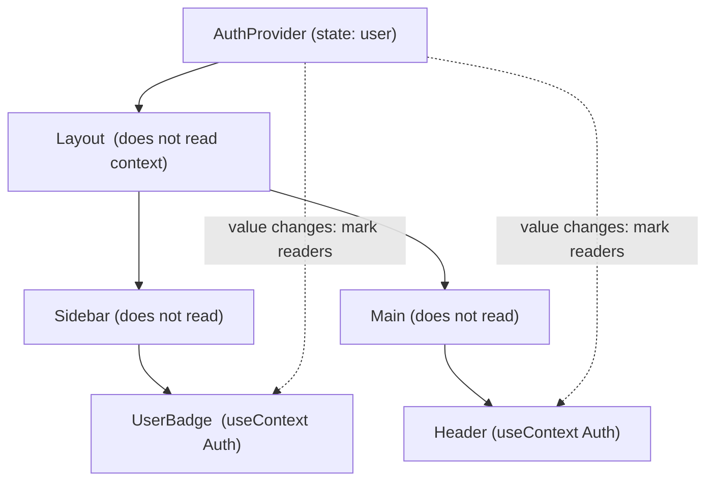
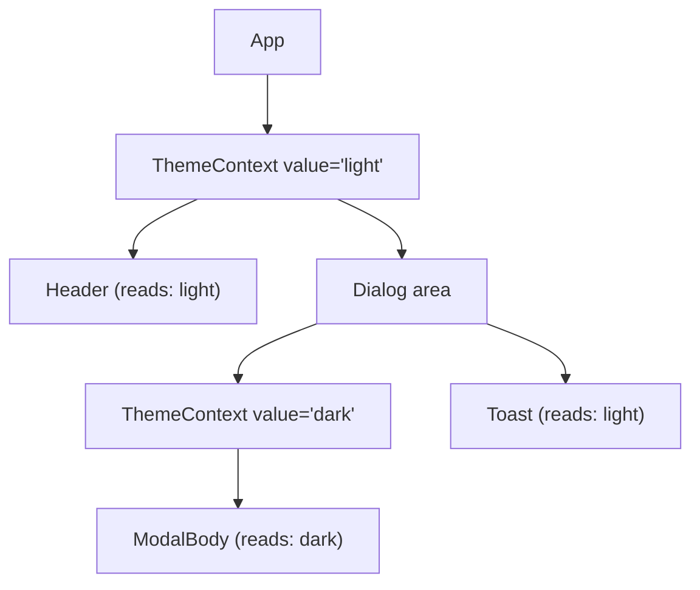
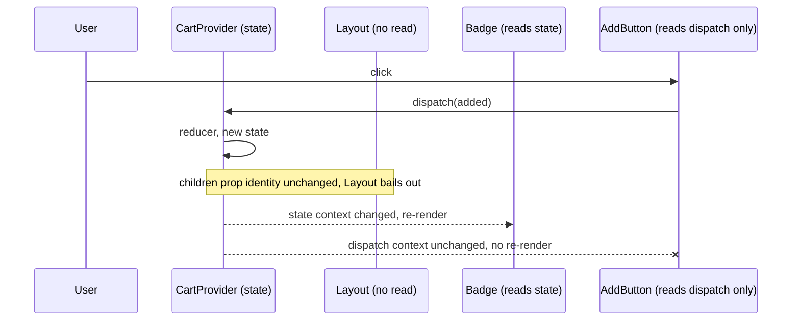
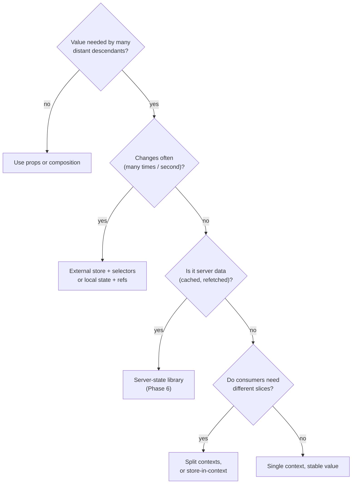

# 05 / 08 — The Provider Pattern: Scoped, Replaceable Ambient Dependencies

## 1. Lesson metadata

| | |
|---|---|
| **Level** | Intermediate to Advanced |
| **Study time** | 5–6 hours (reading 2 h, labs 2 h, exercises 1.5–2 h) |
| **Prerequisites** | [Phase 3 / 13 — `useContext` and propagation](../03-react-state-and-hooks/13-usecontext-and-propagation.md), [Phase 3 / 14 — Context performance](../03-react-state-and-hooks/14-context-performance.md), [Phase 3 / 15 — Custom hooks](../03-react-state-and-hooks/15-custom-hooks.md), [Phase 5 / 01 — SOLID in React](./01-solid-in-react.md) (especially the Interface Segregation and Dependency Inversion sections), [Phase 5 / 06 — Custom hook patterns](./06-custom-hook-patterns.md) |
| **Next** | [09 — Higher-order components](./09-higher-order-components.md) |
| **Related later** | [Phase 5 / 16 — Dependency injection](./16-dependency-injection.md), [Phase 6 / 11 — Context vs external stores](../06-data-fetching-and-state-ecosystems/11-context-vs-external-stores.md), [Phase 5 / 14 — Observer and subscription](./14-observer-and-subscription.md) |

**Learning objectives.** After this lesson you can:
1. Describe the Provider pattern as "a scoped value that any descendant can read without prop threading, and that a subtree can override", and distinguish it from a global variable, a singleton, and a state manager.
2. Map the classic *Service Locator / Ambient Context / Dependency Injection* patterns onto React context and say honestly where the mapping breaks.
3. Write a provider module with a typed context, a strict consumer hook that fails loudly outside a provider, and a stable value.
4. Split a provider by **change frequency** and by **reader vs writer** (state context and actions context) and justify the split.
5. Predict exactly which components re-render when a provider's value changes, and fix over-rendering without reaching for `memo` first.
6. Decide when a provider is the wrong tool (frequently changing, selector-shaped state; a single consumer; data that is really server state).
7. Place providers correctly in the tree (root, feature, route, or per-widget) and explain the consequences for testing and SSR/Server Components.

**Concepts covered:** Provider component, context value identity, strict consumer hook, provider composition, state/dispatch split, provider scope and override, default value vs missing provider, `use(Context)`, "context as dependency channel not state manager", providers and Server Components boundary.

---

## 2. Deep conceptual explanation

### 2.1 What problem does the Provider pattern solve?

A component deep in the tree needs something that is neither its own state nor naturally owned by its parent: the current user, the active theme, a feature-flag client, an `ApiClient`, the router, a locale. Without a channel, you thread that value through every intermediate component as a prop. Intermediates that do not use it still have to accept and forward it. This is **prop drilling**; it couples every layer to a value it does not care about (an Interface Segregation violation in the language of [Lesson 01](./01-solid-in-react.md)).

The Provider pattern solves this with two cooperating parts:

1. A **provider** placed at some ancestor, which *supplies* a value to its subtree.
2. **Consumers** anywhere below, which *read* the nearest supplied value by asking for the context.

Intermediates never see it. Crucially, a *different* provider deeper in the tree **overrides** the value for its own subtree. That override property is what makes the pattern more than a global.

### 2.2 The classic patterns it corresponds to

Context is often described as "dependency injection for React". That is partly true. A more precise mapping:

| Classic pattern | Idea | React analogue | Where the analogy breaks |
|---|---|---|---|
| **Dependency Injection** | A component receives its collaborators instead of constructing them. | A provider supplies an `ApiClient`; consumers read it; tests swap in a fake. | There is no container resolving a dependency graph; you assemble providers by hand. The "injection point" is a hook call, not a constructor. |
| **Service Locator** | Code asks a registry for a service by key. | `useContext(ApiClientContext)` asks the tree for the service. | Service Locator is usually global and hides dependencies. Context is *scoped* and, with a strict hook, fails loudly. It is still implicit coupling: a component's props do not reveal that it needs an `ApiClient`. |
| **Ambient Context / Thread-local** | Implicit per-call-chain data (current user, transaction). | Context is per *subtree* rather than per call chain. | Reads happen during render; the value is a snapshot for that render. |
| **Observer** | Subscribers are notified of changes. | When the provider value changes, React re-renders consumers. | React, not your code, performs the notification, and it is all-or-nothing per context (no selectors). See [Lesson 14](./14-observer-and-subscription.md) for the real Observer mapping. |
| **Singleton** | One instance per process. | A provider at the root with a stable instance. | A singleton cannot be overridden per subtree; a provider can. That is a feature (test isolation, multi-tenant widgets, SSR per-request state). |
| **Mediator / Event bus** | Components communicate via a hub. | Provider holds state and dispatch; consumers talk through it. | Context carries *values*, not events. It is easy to turn it into an accidental global bus; resist. |

The honest summary: **Provider is Dependency Injection and Ambient Context with React's scoping rules.** It is not a state-management library, even though people use it as one.

### 2.3 Three distinct jobs a provider can do

Teams conflate these, then wonder why their providers are slow or confusing.

1. **Capability injection.** The value is a *stable* object: `apiClient`, `analytics`, `router`, `i18n`. It almost never changes after mount. Cheap, safe, the best use of context.
2. **Configuration/environment.** Theme, locale, density, feature flags. Changes rarely (user toggles). A re-render of all consumers on change is acceptable and often desired.
3. **Shared mutable state.** Auth session, cart, selected tenant, form wizard state. Changes at human interaction speed. This is where design decisions (splitting, memoising, or moving to a store) matter.

A fourth, **high-frequency state** (mouse position, scroll, drag, per-keystroke text, animation values), should **not** live in context. Every consumer re-renders on every change, and consumers cannot select a slice. Use local state, a ref plus subscription, or an external store ([Phase 3 / 20](../03-react-state-and-hooks/20-usesyncexternalstore-and-external-stores.md)).

### 2.4 What React exposes

*Public guarantee (React 19 docs):*

- `createContext(defaultValue)` returns a context object.
- You render `<MyContext value={...}>children</MyContext>` to provide it. In React 19 the context object itself is a valid provider element; the older `<MyContext.Provider value={...}>` form still works. The React 19 post says `<Context.Provider>` will be deprecated in a future version and the `createContext` reference calls it legacy (react.dev, 2026-10-22); do not mass-convert a codebase just for this.
- A component reads it with `useContext(MyContext)` or `use(MyContext)`. `use` may be called conditionally and after early returns, which `useContext` cannot (it is a hook, so [rules of hooks](../03-react-state-and-hooks/16-rules-of-hooks-and-composition.md) apply).
- The **default value** is used *only* when there is no matching provider above the component. It is not used when a provider supplies `undefined`.
- When the provided value changes (compared with `Object.is`), React re-renders every component that reads that context below the provider, **even if intermediate components are memoised**.

### 2.5 Relation to JavaScript

A provider value is just a JavaScript value; what matters is **referential identity** ([Phase 0 / 07](../00-web-and-javascript-foundations/07-functions-and-referential-identity.md)). `value={{ user, login }}` creates a new object on every render of the provider component, so `Object.is` says "changed" every time, and every consumer re-renders whenever the provider re-renders, regardless of whether `user` or `login` changed. Nearly every provider performance bug in practice reduces to that sentence.

### 2.6 Common misconceptions

1. **"Context is a state management solution."** Context is a *transport*. State lives in `useState`/`useReducer` (or a store); context moves it down. The performance and ergonomics limits of the transport are exactly why external stores exist.
2. **"Context updates re-render the whole app."** Only components that *read the context* re-render (plus whatever they render). Components that merely sit between provider and consumer do not re-render *because of the context change*. They may re-render for other reasons, e.g. the provider's parent re-rendered and passed fresh `children` elements.
3. **"`memo` on a consumer prevents context-driven re-renders."** It does not. Context bypasses `memo` for components that read it.
4. **"A provider must wrap the entire app."** Narrow providers (per route, feature, widget) are often better: smaller blast radius, easier tests, correct semantics for per-instance state.
5. **"Multiple providers is a smell."** Nesting is the cost of splitting by change frequency and concern. A deep pyramid is ugly; it is not wrong. Compose them in one component (§5.6).
6. **"Default value means I don't need a provider."** A default value is a fallback that hides a wiring bug. For anything required, make the default `undefined`/`null` and throw in the consumer hook.

---

## 3. Internal mechanics

### 3.1 Public guarantee

- A context read returns the value of the **nearest** enclosing provider for that context, or the default if none.
- If a provider's `value` differs by `Object.is` from the previous render, all readers of that context in the subtree are scheduled to re-render.
- Reading a context subscribes the *reading component* to that context for the lifetime of that render's output; reading is only meaningful during render.
- Providers nest and override; inner wins.

### 3.2 Teaching model

Think of context as a **dynamically scoped variable attached to the tree**. A provider `pushes` a binding for its subtree; a consumer looks up the nearest binding. When the binding's value changes, React finds all consumers beneath and marks them for re-render. Because the lookup goes through the tree rather than props, intermediate components are *skipped* in the propagation: React does not need to re-render them for the consumer to see new data.



### 3.3 Implementation detail (conceptual only)

In the reconciler, a provider is a distinct kind of node. When it re-renders with a changed value, React walks its subtree looking for nodes that depend on that context, and schedules updates on those. Components that depend on the context record that dependency while rendering. This is why a context change can reach a deep consumer through a `memo` boundary that would otherwise bail out. The details (names, data structures, how dependencies are tracked) are not part of the public API and have changed between versions; read [Phase 2 / 31 — Reading React source](../02-react-rendering-and-internals/31-reading-react-source.md) if you want to verify it in the repository rather than trust a summary.

### 3.4 The two re-render triggers on a provider

A provider component re-renders for two independent reasons, and conflating them causes confusion.

1. **Its own state changed** (e.g. `useState` inside `AuthProvider`). Its `children` prop is the same element reference as last time *if the parent did not re-render*. React can then bail out on the children subtree and only update consumers via the context path.
2. **Its parent re-rendered**, passing a new `children` element tree and (if you build the value inline) a new `value` object.

This is the foundation of the single most valuable provider optimisation: **accept `children` as a prop**, so state changes inside the provider do not recreate the children elements ([Lesson 03](./03-composition-over-inheritance.md) and [Phase 7 / 07](../07-performance/07-state-colocation-for-perf.md) generalise this).

### 3.5 Version-sensitive behaviour

- `<Context value>` as provider and `use(Context)`: React 19.
- React Compiler (opt-in; verify against current docs): can auto-memoise the provider's `value` object and the functions inside it, which removes much of the manual `useMemo`/`useCallback` ceremony in §5. It does **not** change the semantic fact that a changed value re-renders all readers.
- StrictMode (dev): provider component bodies render twice; if your value creation has side effects (creating a client with a connection), you will see two instances. Create expensive instances outside render or inside `useState(() => ...)` / `useRef` lazily and treat construction as pure.

---

## 4. Step-by-step execution walkthrough

Scenario: `ThemeProvider` holds `theme` in state; `ThemeToggle` and `Card` read it; `Layout` sits in between and does not read it.

```tsx
function App() {
  return (
    <ThemeProvider>
      <Layout>
        <ThemeToggle />
        <Card />
      </Layout>
    </ThemeProvider>
  );
}
```

1. **Mount.** `App` renders and produces the element tree. React renders `ThemeProvider`, which calls `useState("light")` and renders `<ThemeContext value={...}>{children}</ThemeContext>`. `Layout`, `ThemeToggle`, `Card` render below. `ThemeToggle` and `Card` call `useContext(ThemeContext)` and receive `"light"`-derived value; React records them as dependents.
2. **User clicks the toggle.** The handler calls `setTheme("dark")` obtained from context. This schedules an update on `ThemeProvider` (where the state lives).
3. **Render phase.** React re-renders `ThemeProvider`. Its `children` prop is the *same element object* created by `App` (App did not re-render). So when React reaches `Layout` and its subtree, it sees identical element references and props, and bails out of re-rendering `Layout`.
4. **Context propagation.** Because the provider's `value` is a new identity, React marks the dependents (`ThemeToggle`, `Card`) for re-render even though `Layout` bailed out.
5. **Render of dependents.** `ThemeToggle` and `Card` re-render with the new value. `Layout` did not.
6. **Commit.** DOM updates for the changed output only. Effects of re-rendered components with changed deps run.

**Predict:** if `ThemeProvider` were instead written so `Layout` is created *inside* it (`<ThemeContext value={v}><Layout>...</Layout></ThemeContext>`), would `Layout` re-render in step 3? *(Answer: yes. Elements created in the provider's render are new each time, so `Layout` gets new props identity and re-renders unless memoised. This is why `children`-as-prop matters.)*

---

## 5. Code examples

### 5.1 Minimal: a typed context with a strict consumer hook

```tsx
import { createContext, useContext, useState, type ReactNode } from "react";

type Theme = "light" | "dark";

type ThemeContextValue = {
  theme: Theme;
  toggle: () => void;
};

// undefined = "no provider". We do NOT invent a default theme.
const ThemeContext = createContext<ThemeContextValue | undefined>(undefined);

export function ThemeProvider({ children }: { children: ReactNode }) {
  const [theme, setTheme] = useState<Theme>("light");
  const value: ThemeContextValue = {
    theme,
    toggle: () => setTheme((t) => (t === "light" ? "dark" : "light")),
  };
  return <ThemeContext value={value}>{children}</ThemeContext>;
}

export function useTheme(): ThemeContextValue {
  const ctx = useContext(ThemeContext);
  if (ctx === undefined) {
    throw new Error("useTheme must be used within a <ThemeProvider>");
  }
  return ctx;
}
```

**Line notes.**
- `createContext<ThemeContextValue | undefined>(undefined)` makes the missing-provider case representable in the type, so the consumer hook can narrow it. The alternative `createContext({} as ThemeContextValue)` is a lie that defers the crash to a confusing `undefined is not a function` somewhere else.
- The provider takes `children` as a prop (not constructing the subtree itself). This is the optimisation from §3.4.
- `<ThemeContext value={value}>` is React 19 syntax. In older code you will see `<ThemeContext.Provider value={value}>`.
- The consumer hook is the **only** public way to read the context. Export the hook and provider, not the context object. That keeps the missing-provider check and the context shape private ([Lesson 06](./06-custom-hook-patterns.md)).

**Predict:** in this minimal version, `value` is a new object each time `ThemeProvider` renders. When does `ThemeProvider` render? *(Answer: on its own state change and when its parent re-renders. Each time, every `useTheme` consumer re-renders, even if `theme` did not change. For a theme at the root, whose parent rarely re-renders, this is fine; §5.3 shows the fix when it is not.)*

### 5.2 Practical: capability injection for testability (the best use of context)

```tsx
// api-client.tsx
import { createContext, useContext, type ReactNode } from "react";

export interface ApiClient {
  getOrders(signal?: AbortSignal): Promise<Order[]>;
  cancelOrder(id: string): Promise<void>;
}

export type Order = { id: string; total: number; status: "open" | "cancelled" };

const ApiClientContext = createContext<ApiClient | null>(null);

export function ApiClientProvider({
  client,
  children,
}: {
  client: ApiClient;
  children: ReactNode;
}) {
  return <ApiClientContext value={client}>{children}</ApiClientContext>;
}

export function useApiClient(): ApiClient {
  const client = useContext(ApiClientContext);
  if (!client) throw new Error("useApiClient requires <ApiClientProvider>");
  return client;
}
```

Production wiring:

```tsx
const httpClient: ApiClient = createHttpClient({ baseUrl: import.meta.env.VITE_API_URL });

createRoot(document.getElementById("root")!).render(
  <ApiClientProvider client={httpClient}>
    <App />
  </ApiClientProvider>,
);
```

Test wiring (no module mocking):

```tsx
const fake: ApiClient = {
  getOrders: async () => [{ id: "1", total: 10, status: "open" }],
  cancelOrder: async () => {},
};

render(
  <ApiClientProvider client={fake}>
    <OrdersPage />
  </ApiClientProvider>,
);
```

**Why this is the sweet spot.** `client` is created once at module scope (stable identity), so the provider never causes consumer re-renders; it is pure *wiring*. Tests substitute a fake with no `vi.mock`. A storybook story can supply a deterministic client. A multi-tenant widget can supply a different client for its subtree. This is Dependency Inversion ([Lesson 01 §2.7](./01-solid-in-react.md)) with essentially zero runtime cost.

**Trade-off.** `OrdersPage`'s props no longer reveal that it needs an API client. In a large codebase, hidden dependencies make a component harder to reuse outside the app. Mitigation: keep the number of ambient capabilities small (client, router, i18n, flags, analytics) and document them.

### 5.3 Practical: shared mutable state, split into state and actions

```tsx
import {
  createContext, useContext, useMemo, useReducer, type Dispatch, type ReactNode,
} from "react";

type CartItem = { sku: string; qty: number; price: number };
type CartState = { items: CartItem[] };
type CartAction =
  | { type: "added"; item: CartItem }
  | { type: "removed"; sku: string }
  | { type: "cleared" };

function cartReducer(state: CartState, action: CartAction): CartState {
  switch (action.type) {
    case "added": {
      const existing = state.items.find((i) => i.sku === action.item.sku);
      return existing
        ? { items: state.items.map((i) => i.sku === existing.sku ? { ...i, qty: i.qty + action.item.qty } : i) }
        : { items: [...state.items, action.item] };
    }
    case "removed":
      return { items: state.items.filter((i) => i.sku !== action.sku) };
    case "cleared":
      return { items: [] };
  }
}

const CartStateContext = createContext<CartState | null>(null);
const CartDispatchContext = createContext<Dispatch<CartAction> | null>(null);

export function CartProvider({ children }: { children: ReactNode }) {
  const [state, dispatch] = useReducer(cartReducer, { items: [] });
  return (
    <CartDispatchContext value={dispatch}>
      <CartStateContext value={state}>{children}</CartStateContext>
    </CartDispatchContext>
  );
}

export function useCartState(): CartState {
  const s = useContext(CartStateContext);
  if (!s) throw new Error("useCartState requires <CartProvider>");
  return s;
}

export function useCartDispatch(): Dispatch<CartAction> {
  const d = useContext(CartDispatchContext);
  if (!d) throw new Error("useCartDispatch requires <CartProvider>");
  return d;
}

export function useCartActions() {
  const dispatch = useCartDispatch();
  // dispatch is stable (React guarantee), so this memo never recomputes
  return useMemo(
    () => ({
      add: (item: CartItem) => dispatch({ type: "added", item }),
      remove: (sku: string) => dispatch({ type: "removed", sku }),
      clear: () => dispatch({ type: "cleared" }),
    }),
    [dispatch],
  );
}
```

**Why split.** *Public guarantee:* the `dispatch` function returned by `useReducer` has a stable identity across renders. Therefore `CartDispatchContext`'s value **never changes**, and components that only *write* (an "Add to cart" button on every product card, potentially hundreds) never re-render when the cart changes. Only components reading `CartStateContext` (the mini-cart badge, the cart page) do. That is Interface Segregation applied to context: readers and writers are different clients.

**Why a reducer rather than `useState`.** All transitions are named and centralised; see [Lesson 12](./12-reducer-pattern.md). It also makes the "actions" object trivially derivable from `dispatch`.

**Predict:** product page has 200 `<AddToCartButton>` components that call `useCartActions()`. A user clicks one. How many of the 200 re-render? *(Answer: none from the context change, because they only subscribe to the dispatch context whose value is unchanged. The clicked button may re-render if it has its own local state. The cart badge, which reads state, does re-render.)*

### 5.4 Incorrect: one fat context with inline value, placed too high

```tsx
// ❌ Everything in one context; value rebuilt on every render
function AppProvider({ children }: { children: ReactNode }) {
  const [user, setUser] = useState<User | null>(null);
  const [cart, setCart] = useState<CartItem[]>([]);
  const [theme, setTheme] = useState<Theme>("light");
  const [notifications, setNotifications] = useState<Note[]>([]);

  return (
    <AppContext value={{ user, setUser, cart, setCart, theme, setTheme, notifications, setNotifications }}>
      {children}
    </AppContext>
  );
}
```

**What goes wrong.**
1. A new notification arrives (say, every few seconds from a websocket) → `AppProvider` re-renders → new `value` object → **every** component that reads *any* part of `AppContext` re-renders: the theme toggle, the cart badge, the profile menu.
2. The consumers cannot select; `useContext` returns the whole value, and React compares the whole value.
3. If `AppProvider`'s parent ever re-renders, the same cascade occurs, even though no state changed.
4. Testing a component that only needs `theme` requires a provider with an entire fake app state.

**Diagnosis (see §10):** the React DevTools Profiler's "why did this render?" shows *Context changed* for the consumers.

### 5.5 Corrected: split by change frequency, stable values, narrow scope

```tsx
function ThemeProvider({ children }: { children: ReactNode }) {
  const [theme, setTheme] = useState<Theme>("light");
  const value = useMemo(() => ({ theme, setTheme }), [theme]);
  return <ThemeContext value={value}>{children}</ThemeContext>;
}

// Notifications are high-frequency and only needed by the notification tray:
// provide them from the feature's own subtree, not the app root.
function NotificationsFeature() {
  return (
    <NotificationsProvider>
      <NotificationTray />
      <NotificationToasts />
    </NotificationsProvider>
  );
}
```

**What changed and why.**
- One context per *concern* with similar change frequency (theme: rare; session: rare; cart: moderate; notifications: frequent).
- `useMemo` keeps the value stable across unrelated provider re-renders. ⚠ With the React Compiler this memoisation may be automatic; do not remove manual memoisation until the compiler is actually enabled and verified in your build.
- `setTheme` from `useState` is stable, so it is safe to omit from the deps array (the lint rule recognises state setters).
- The high-frequency provider moves *down* to the feature that uses it. A provider's scope should be as small as the set of its consumers; this limits both the re-render blast radius and the lifetime of its state.

**Trade-off.** More providers, more files, a place for `undefined` wiring bugs. If you find yourself with many contexts that all need `selector`-style reads, that is the signal that an external store is the better tool (§7).

### 5.6 Advanced A: a context factory that removes boilerplate

```tsx
import { createContext, useContext, type Context, type ReactNode } from "react";

export function createStrictContext<T>(name: string) {
  const Ctx: Context<T | undefined> = createContext<T | undefined>(undefined);
  Ctx.displayName = name;

  function useStrict(): T {
    const value = useContext(Ctx);
    if (value === undefined) {
      throw new Error(`use${name} must be used inside <${name}Provider>`);
    }
    return value;
  }

  function Provider({ value, children }: { value: T; children: ReactNode }) {
    return <Ctx value={value}>{children}</Ctx>;
  }
  Provider.displayName = `${name}Provider`;

  return [Provider, useStrict] as const;
}

// usage
export const [FlagsProvider, useFlags] = createStrictContext<FlagClient>("Flags");
```

`displayName` makes DevTools show `Flags` instead of `Context`. The factory gives uniform missing-provider errors. **Limitation:** `T` must not legitimately include `undefined`; if it can, wrap it (`{ value: T | undefined }`) or use a sentinel. Do not build the factory until you have at least three contexts; before that it is indirection ([Lesson 02](./02-dry-kiss-yagni.md)).

### 5.7 Advanced B: composing many providers without a pyramid

```tsx
import type { ComponentType, ReactNode } from "react";

type ProviderEntry = readonly [ComponentType<{ children: ReactNode }>, Record<string, unknown>?];

export function ComposeProviders({
  providers,
  children,
}: {
  providers: ProviderEntry[];
  children: ReactNode;
}) {
  return providers.reduceRight<ReactNode>(
    (acc, [Provider, props]) => <Provider {...props}>{acc}</Provider>,
    children,
  );
}
```

This is optional sugar; it flattens source code but not the tree: DevTools still shows every provider. It also loses type-checking of each provider's props (`Record<string, unknown>`). Many teams prefer an explicit `AppProviders` component with the pyramid spelled out, because the **order is meaningful** (an `ApiClientProvider` must be above `AuthProvider` if auth calls the API) and explicit nesting documents it.

### 5.8 Advanced C: context holding a *store*, not a *value* (selector subscriptions)

When state is frequently changing and many consumers each need a slice, put a **stable store object** in context and let consumers subscribe to slices with `useSyncExternalStore`. The context value never changes, so propagation never fires; subscriptions do the notifying.

```tsx
import { createContext, useContext, useRef, useSyncExternalStore, type ReactNode } from "react";

type Listener = () => void;

function createStore<S>(initial: S) {
  let state = initial;
  const listeners = new Set<Listener>();
  return {
    getState: () => state,
    setState(next: (s: S) => S) {
      const n = next(state);
      if (Object.is(n, state)) return;
      state = n;
      listeners.forEach((l) => l());
    },
    subscribe(l: Listener) {
      listeners.add(l);
      return () => listeners.delete(l);
    },
  };
}
type Store<S> = ReturnType<typeof createStore<S>>;

type EditorState = { text: string; cursor: number; dirty: boolean };
const EditorStoreContext = createContext<Store<EditorState> | null>(null);

export function EditorProvider({ children }: { children: ReactNode }) {
  const ref = useRef<Store<EditorState> | null>(null);
  if (ref.current === null) {
    ref.current = createStore<EditorState>({ text: "", cursor: 0, dirty: false });
  }
  return <EditorStoreContext value={ref.current}>{children}</EditorStoreContext>;
}

export function useEditorStore() {
  const s = useContext(EditorStoreContext);
  if (!s) throw new Error("useEditorStore requires <EditorProvider>");
  return s;
}

export function useEditorSelector<T>(select: (s: EditorState) => T): T {
  const store = useEditorStore();
  return useSyncExternalStore(store.subscribe, () => select(store.getState()));
}
```

Usage: `const dirty = useEditorSelector((s) => s.dirty);` re-renders only when `dirty` changes. ⚠ **Pitfall:** the selector must return a *stable* value for unchanged state (primitives or existing sub-objects). A selector that builds a new object/array each call (`(s) => ({ a: s.a })`) makes `getSnapshot` return a different value every time and React will warn about an infinite loop or re-render continuously. This is exactly the problem libraries like Zustand and Redux solve with equality functions and memoised selectors ([Phase 6 / 10](../06-data-fetching-and-state-ecosystems/10-zustand.md)). The lesson: this is **Provider (scoping) + Observer (subscription)** combined; you get per-instance stores with fine-grained updates. In most apps, use a library rather than hand-rolling it.

The `useRef` lazy-init pattern avoids creating a new store every render and is StrictMode-safe: StrictMode may render twice but the ref (or `useState` initialiser) ensures one store per mounted instance.

### 5.9 Provider override: per-subtree configuration

```tsx
<DensityContext value="comfortable">
  <Page>
    <DataGrid />                       {/* comfortable */}
    <DensityContext value="compact">
      <SidePanelGrid />                {/* compact */}
    </DensityContext>
  </Page>
</DensityContext>
```

The nearest provider wins. This is the clearest feature a singleton or module-level variable cannot give you, and the reason design systems expose density/theme/direction via context.

### 5.10 Server Components note

⚠ **Verify against current framework docs.** In an RSC environment, `createContext` and context providers are **Client Component** concerns: a file that creates or uses context needs the `"use client"` directive, and Server Components cannot read client context. Providers are typically thin Client Components that accept `children` and render the context provider; Server Components pass their output through `children`. Because `children` is passed as a prop (§3.4), server-rendered subtrees nested inside a client provider remain server-rendered. Details: [Phase 9 / 04](../09-advanced-rendering-and-ecosystem/04-client-server-boundaries-and-serialization.md). For per-request data on the server, frameworks provide their own request-scoped mechanisms; do not use module-level mutable state as a "provider" on a server.

---

## 6. Visual explanations

### 6.1 Provider scoping and override



### 6.2 What re-renders when state in the provider changes



### 6.3 Decision tree: is context the right transport?



### 6.4 Text diagram: three layers of a well-formed provider module

```
 provider module (feature/cart/cart-context.tsx)
 ┌──────────────────────────────────────────────┐
 │ private: createContext objects, reducer      │
 │ public : <CartProvider>, useCartState,       │
 │          useCartActions                      │
 │ guard  : throws if used outside provider     │
 └──────────────────────────────────────────────┘
```

---

## 7. Alternative approaches and trade-offs

| Criterion | Props (drilling / composition) | Context provider | Context + store/selector | External store (Zustand/Redux) | URL / server state |
|---|---|---|---|---|---|
| Visibility of dependency | Explicit in signature | Implicit | Implicit | Implicit (import) | Implicit |
| Per-subtree override | Natural | Natural | Natural (one store per provider) | Awkward (global unless per-instance store) | N/A |
| Fine-grained updates | Via component structure | No (all readers re-render) | Yes | Yes | Library-specific |
| Test setup | Pass props | Wrap in provider | Wrap in provider | Reset store/mocks | Mock network |
| Works across `memo` boundaries | n/a | Yes (bypasses `memo`) | Yes | Yes | Yes |
| Fits high-frequency updates | n/a | No | Yes | Yes | n/a |
| Boilerplate | Medium (threading) | Low-medium | High (hand-rolled) | Low (library) | Low |
| SSR/RSC friendliness | Excellent | Client-only boundary | Client-only | Needs per-request instance | Excellent |

**When the recommended approach (a provider) is NOT best:**

- **A single consumer, or two siblings.** Lift state to the nearest common parent and pass props. A provider adds indirection for nothing.
- **Server data.** Putting fetched, cacheable, refetchable data into a provider that you manually keep fresh reinvents a server-state cache, badly. Use TanStack Query or framework loaders ([Phase 6 / 07](../06-data-fetching-and-state-ecosystems/07-server-state-management.md)); expose the *query client* through a provider, which is capability injection.
- **A "page-level" slot.** If the thing you are threading is *UI* (a header action area), composition ([Lesson 03](./03-composition-over-inheritance.md), [Lesson 20](./20-slot-patterns.md)) usually beats context.
- **High-frequency state** such as drag position or live market ticks consumed by many components: a store with selectors, or `useSyncExternalStore`.
- **Library authors** exposing behaviour: sometimes a hook with explicit parameters is clearer than a required provider (providers force every user to wrap the app).

**Alternative to pyramid wiring:** pass dependencies explicitly in a composition root (a single `createApp({ api, analytics })` that builds the tree), keeping providers to a minimum. This is common in large codebases that otherwise drown in contexts.

---

## 8. Best practices and anti-patterns

### 8.1 Best practices

1. **Export the hook and provider, not the raw context object** (keeps the strict check and the shape private).
2. **Make "no provider" an error** for anything required. Reserve default values for genuinely optional ambient config (e.g. default locale) and document it.
3. **Keep values stable.** Memoise objects and callbacks (or rely on the compiler once verified). Prefer providing `dispatch` and plain state over bags of freshly created closures.
4. **Split by change frequency and by reader/writer.** Merge only when consumers always use everything together.
5. **Accept `children` as a prop** so provider state changes don't re-create the subtree.
6. **Scope providers narrowly.** Mount feature state at the feature, not the root.
7. **Give contexts a `displayName`** so DevTools is legible.
8. **Treat provider values as read-only snapshots.** Changing them is done through the owner's setter/dispatch.
9. **Keep providers boring.** Wiring and state ownership only. Business logic belongs in reducers/pure functions the provider calls.

### 8.2 Beginner mistakes

- Providing `{}` as default and casting, then crashing far from the cause.
- Putting `useContext` calls in a component that is rendered *above* the provider (the provider is a sibling or child of the reader, not an ancestor).
- Creating the context *inside* a component (`const Ctx = createContext(...)` in the render body): a new context type every render, so consumers lose their provider and state resets. Always create at module scope.
- Mutating the provided object (`value.items.push(x)`) and expecting consumers to update (identity unchanged, so React sees no change).

### 8.3 Experienced-developer mistakes

- **God context** (§5.4).
- **Context as event bus:** providing a `subscribe`/`emit` pair "because context is convenient". If you need an event bus, make it explicit and test it; the lifecycle (unsubscribe in effect cleanup) is easy to get wrong.
- **Re-implementing Redux in context** with selectors-by-`useMemo` workarounds ("`useContextSelector` polyfill" hacks). Use a real store.
- **Providers with side effects in render** (starting a websocket at construction). Start connections in effects with cleanup ([Phase 3 / 04](../03-react-state-and-hooks/04-useeffect-synchronization.md)).
- **Over-wrapping:** a provider per tiny widget where props would do.

### 8.4 Code smells

- A context with more than ~6 fields of unrelated concerns.
- Consumers that destructure one field from a large context value.
- Providers whose `value` is an object literal with arrow functions and no memoisation, near the root.
- Tests that need a 10-provider wrapper to render one small component (the component depends on too much ambient state; consider props).

### 8.5 Justified exceptions

- Inline `value={{ a, b }}` is fine when the provider is rarely re-rendered and has few consumers. Measure before optimising ([Phase 7 / 01](../07-performance/01-measure-before-optimizing.md)).
- A single fat context is fine in a small app or prototype where all fields change together anyway.
- A default value is correct for ambient config with a sensible fallback (e.g. `LocaleContext` defaulting to `"en"`), provided you want components to work without wiring.

---

## 9. Real-world application

**E-commerce.** `CartProvider` (state/dispatch split), `CurrencyProvider` (rare changes), and `ApiClientProvider` (capability). Product grids consume only dispatch, so a 200-card grid does not re-render when the badge count changes. Constraint: cart must also survive reloads; the provider persists via an effect or the reducer's initialiser reading storage, and must handle hydration mismatch if SSR renders a different initial cart ([Phase 2 / 37](../02-react-rendering-and-internals/37-scenario-f-hydration-mismatch.md)).

**Auth.** `AuthProvider` holds the session and exposes `useSession()` plus `useAuthActions()`. Constraints: token refresh timers and cross-tab logout (a `storage` event subscription) belong in effects with cleanup; unauthenticated rendering must be deliberate (a `status: "loading" | "authenticated" | "anonymous"` discriminated union, not `user: User | null`, which conflates "loading" with "logged out").

**Dashboards with live data.** Do not put the live ticker in a context value. Provide a **store** (§5.8) or use a subscription hook per widget. A shared `DateRangeProvider` (rarely changing, read by many widgets) is a good context use.

**Multi-team / micro-frontends.** Shared providers are a coupling surface. A shell app providing `AuthContext` to remote modules requires agreed contracts and *a single copy of React and of the context object* (duplicate module instances create duplicate contexts and "missing provider" errors). See Phase 11 on microfrontends.

**Feature flags.** `FlagsProvider` with a client built once; flag reads via `useFlag("checkout-v2")`. Flag changes mid-session should be deliberate (re-render on change vs evaluate once per page load) to avoid UI flicker; this is a product decision that shapes the provider's implementation (store-in-context vs value).

**Design system.** Theme, density, direction, and "portal container" providers. Compound components often use a *private* context for parts to coordinate ([Lesson 05](./05-compound-components.md)); this is the Provider pattern at component scale. Tooltip/Popover groups ("delay group") use the same idea.

**Engineering constraints to keep in mind:** test isolation (each test mounts its own provider; avoid module singletons), SSR (per-request providers, never module-level mutable state on a server), code splitting (a provider imported in the root defeats lazy loading of everything it imports), and ownership (one team owns each provider module and its public hook API).

---

## 10. Debugging and troubleshooting

### 10.1 Symptom: "useX must be used within provider" at runtime

**Repro.** A test renders `<Header />` without a wrapper; or a portal/dialog is rendered by a library into a root that is not under your provider (some libraries mount into a detached root).
**Investigation.** DevTools Components tab: select the failing component and look at its ancestors for the provider. For portals created with `createPortal`, React context *does* flow through the React tree even though the DOM nodes are elsewhere; for separate roots (`createRoot` called by a library) it does not.
**Root cause / fix.** Wrong placement, missing wrapper, or a separate React root. Move the provider up, wrap the test, or re-provide inside the secondary root.

### 10.2 Symptom: everything re-renders when one field changes

**Repro.** Profiler → record → trigger an update → components list shows many consumers re-rendered.
**Investigation.** Profiler settings → enable "Record why each component rendered". Look for "Context changed" on consumers. Inspect the provider: does it build its value inline? Is it one context holding unrelated state?
**Root cause.** Value identity changing per provider render, or a fat context.
**Fix.** Stabilise the value (`useMemo`), split contexts, move frequent state down or to a store. **Validate** by re-recording: only the readers of the changed context should show a render.

### 10.3 Symptom: consumers show stale/default value

**Repro.** A component shows the default theme although a provider is present.
**Root cause candidates.** (a) `createContext` called in two modules (two different context objects; e.g. duplicate package copies in a monorepo); (b) component rendered outside the provider's subtree; (c) the provider supplied `undefined` and code treats that as "unset".
**Investigation.** In DevTools, select the consumer; the "hooks" panel shows the context value it read. Compare `ThemeContext === OtherImportedContext` in a temporary console log. In monorepos check lockfile for duplicate package versions.

### 10.4 Symptom: state resets when provider is moved or re-wrapped

**Root cause.** Provider position/type in the tree changed (conditional wrapper added), so React treats it as a different element and remounts the subtree, losing state ([Phase 1 / 16 — State preservation and reset](../01-react-fundamentals/16-state-preservation-and-reset.md)).
**Fix.** Keep the provider's position and type stable across renders; avoid `cond ? <Provider>{x}</Provider> : x`.

### 10.5 Symptom: infinite re-render with `useSyncExternalStore`-based selector

**Root cause.** Selector returns a new object each call (§5.8). **Fix.** Select primitives, select existing references, or memoise the derived value outside the selector. Validate: React's dev warning about `getSnapshot` should stop.

---

## 11. Exercises

### Level A — Knowledge
A1. When is the default value passed to `createContext` actually used?
A2. Why does `memo` not stop a consumer from re-rendering when the context value changes?
A3. Name the two reasons a provider component may re-render and say which one the `children`-as-prop technique addresses.
A4. Which classic design pattern is a provider most similar to, and what is one way it differs?
A5. Why is `createContext` inside a component body a bug?

### Level B — Code comprehension
B1. Given the code below, how many times does `Inner` render after one click? Assume StrictMode is off.
```tsx
const Ctx = createContext(0);
function Provider() {
  const [n, setN] = useState(0);
  return (
    <Ctx value={n}>
      <button onClick={() => setN((x) => x + 1)}>+</button>
      <Outer />
    </Ctx>
  );
}
const Outer = memo(function Outer() { return <Inner />; });
function Inner() { useContext(Ctx); return null; }
```
B2. What is wrong with this hook, and how does it fail?
```tsx
const Ctx = createContext<Api>({} as Api);
export const useApi = () => useContext(Ctx);
```
B3. Explain why `useCartActions` in §5.3 returns an object created in `useMemo` with `[dispatch]`.
B4. Predict whether `Sidebar` re-renders when `setTheme` is called:
```tsx
function App() {
  return (
    <ThemeProvider>
      <Sidebar />
    </ThemeProvider>
  );
}
```
where `Sidebar` does not read the theme and `ThemeProvider` follows §5.1 (children prop).

### Level C — Implementation
C1. Implement a `LocaleProvider` with `locale` state, a `setLocale` function, and a `useLocale` strict hook. Make its value stable.
C2. Split a given `SessionContext` (`{ user, status, login, logout }`) into a state context and an actions context so that a `LogoutButton` does not re-render on `user` changes.
C3. Implement `createStrictContext` that also accepts an optional `defaultValue` and, when given, does not throw.
C4. Write a test helper `renderWithProviders(ui, { api })` that wraps UI in the right providers and lets a test override only the API client.

### Level D — Debugging
D1. A dashboard with a websocket feed re-renders 40 components 10×/sec. All use `useAppContext()`. Describe the investigation steps and the target architecture.
D2. After a refactor, a `<Provider>` wrapper was made conditional (`isAdmin ? <AdminProvider>{tree}</AdminProvider> : tree`). Users report that form input is lost when their role loads. Why?
D3. In a monorepo, `useTheme` throws "must be used within ThemeProvider" in one package but works in the app. List three plausible causes.

### Level E — Architecture decisions
E1. Your app has an `AuthContext`, `FlagsContext`, `ApiClientContext`, `ThemeContext`, `CartContext`, `NotificationsContext`, and `LiveQuotesContext`. Decide for each: root provider, feature provider, store, or not a context at all. Defend.
E2. A team wants "one `AppStateProvider` to replace prop drilling everywhere". Write the review comment you would leave, including what you would accept instead.
E3. You are building a reusable `<Wizard>` component for other teams. Should it use a provider internally? Should it require the consumer to render one?

### Level F — Expert challenge
F1. Implement a per-instance store provider (§5.8) with: a typed `createStoreContext<S>()` factory, selectors with an optional equality function, and a `useStoreActions` hook that returns stable setters. Prove with a render-count test that updating `a` does not re-render a component selecting `b`.
F2. Design how you would render the same `Provider`-based component tree on the server per request without leaking state between requests. Which parts of your provider module must not have module-level state, and why?

---

## 12. Detailed answers and explanations

> Attempt the exercises first.

**A1.** Only when no matching provider exists above the reading component. If a provider supplies `undefined` explicitly, the consumer receives `undefined`, not the default. Wrong answer: "when the provider's value is falsy". That is incorrect; presence of a provider is what matters.

**A2.** `memo` skips re-rendering when props are equal. Context propagation does not go through props: React schedules an update directly on components that read the context. The consumer is re-rendered regardless of its own `memo` wrapper. `memo` still prevents *prop-driven* re-renders.

**A3.** (1) Its own state/reducer/context-read changed; (2) its parent re-rendered. `children`-as-prop addresses (1): the `children` elements were created by an ancestor that did not re-render, so React sees identical element references and bails out on non-consumers. It does *not* help when reason (2) applies and the parent passes fresh children.

**A4.** Dependency Injection / Service Locator (also Ambient Context). Differences (any one is valid): it is scoped and overridable per subtree; there is no container graph; the dependency is implicit (not in the props signature); consumers are notified on value change by React with no selectors.

**A5.** Each render would create a new context object. Provider and consumer would then refer to different context identities across renders, so consumers read the default value or lose the provider, and since the provider element type changes, React remounts its subtree (state lost). Contexts must be created once, at module scope.

**B1.** `Inner` renders **once more** (so initial render + one re-render after click). Walkthrough: `Provider` state changes → `Provider` re-renders. `Outer` is `memo` and receives no props; its element is recreated but props are shallow-equal (none), so it bails out. The context value changed from 0 to 1, and `Inner` reads it, so React schedules `Inner` directly. `Inner` re-renders once. Trap answer: "zero, because `Outer` is memoised". `memo` on an ancestor does not block context propagation to a descendant reader. Another trap: "twice". There is no reason for a second render; batching and a single value change give one update.

**B2.** `{} as Api` is a type lie. If someone forgets the provider, `useApi().getOrders` is `undefined` and the failure appears later as "x is not a function" at the call site, far from the root cause. Fix: `createContext<Api | null>(null)` and throw in the hook with a clear message.

**B3.** So the returned `actions` object has a stable identity. Without `useMemo`, each render creates a new object with new closures; consumers that put `actions` in effect/memo dependency arrays would re-run effects each render, and memoised children receiving `actions` as a prop would lose their memoisation. `dispatch` is documented stable, so `[dispatch]` never invalidates.

**B4.** No. `ThemeProvider`'s `children` prop is the element created by `App`; since `App` did not re-render, that element is the same reference, so `Sidebar` bails out. `Sidebar` does not read the context, so propagation does not reach it either. If `Sidebar` *did* call `useTheme()` it would re-render. Edge case: if `App` itself re-renders for another reason, `Sidebar` re-renders (new element, no `memo`).

**C1.** Sample:
```tsx
type LocaleValue = { locale: string; setLocale: (l: string) => void };
const LocaleContext = createContext<LocaleValue | undefined>(undefined);

export function LocaleProvider({ initial = "en", children }: { initial?: string; children: ReactNode }) {
  const [locale, setLocale] = useState(initial);
  const value = useMemo(() => ({ locale, setLocale }), [locale]);
  return <LocaleContext value={value}>{children}</LocaleContext>;
}
export function useLocale() {
  const v = useContext(LocaleContext);
  if (!v) throw new Error("useLocale requires <LocaleProvider>");
  return v;
}
```
Evaluation: strict hook, `useMemo` with `[locale]` (setter stable), `children` prop, `Context | undefined` typing. Edge: validate locale strings; persist to storage in an effect, not render.

**C2.** Two contexts. State context holds `{ user, status }` in a memoised value. Actions context holds `{ login, logout }` created once (`useMemo` with `[]` if they use refs or stable dispatch, or `useCallback`s with stable deps). `LogoutButton` calls only `useSessionActions()`. Check: Profiler shows `LogoutButton` not rendering when `user` changes. Edge: `login` closing over mutable state must read through a ref or functional updates to remain stable and not stale ([Phase 3 / 05](../03-react-state-and-hooks/05-effect-dependencies-and-stale-closures.md)).

**C3.** Evaluation criteria: do not use `??` to fall back (it would also swallow `null`); decide by whether an options object was passed. Example: accept `options?: { defaultValue: T }`, create context with `options ? options.defaultValue : undefined`, and in the hook only throw when `value === undefined && !options`. Edge: `T` including `undefined` remains unsupported; document it.

**C4.**
```tsx
export function renderWithProviders(ui: ReactElement, { api = fakeApi() }: { api?: ApiClient } = {}) {
  return render(
    <ApiClientProvider client={api}>
      <ThemeProvider>{ui}</ThemeProvider>
    </ApiClientProvider>,
  );
}
```
Criteria: only wraps providers that components actually need, overrides are typed partials, a fresh instance per test to avoid shared mutable state, no global module mocks.

**D1.** Steps: (1) Profiler with "why did this render" → "Context changed" on 40 components. (2) Inspect `AppContext` value: contains live feed data alongside stable data; inline value. (3) Classify consumers: most need only stable slices. Target: remove feed from the app context; provide a feed **store** with selector subscriptions (§5.8, or a library) at the dashboard scope; keep stable stuff in small memoised contexts; throttle/batch feed updates if visual precision allows ([Phase 7 / 14](../07-performance/14-debounce-and-throttle.md)). Validate by re-recording: only widgets bound to changed feed fields render. Wrong approach: wrapping 40 components in `memo` (does not stop context re-renders).

**D2.** Toggling the conditional wrapper changes the element type at that position: first render `tree` is the child at position X; later it is a `AdminProvider` containing the tree, so React unmounts the old subtree and mounts a new one, resetting all state including form inputs. Fix: always render the provider and pass the flag as a prop, or render the provider unconditionally with a no-op value.

**D3.** (1) Duplicate installation of the shared package, giving two distinct context objects; (2) the failing component is rendered in a different React root (e.g. a library's own `createRoot`) or in a test without wrapper; (3) the provider and hook are exported from a module imported via two different paths/bundles (ESM/CJS dual package hazard), again yielding two context instances. Verify by checking the resolved paths and the package manager's duplicate report.

**E1.** Example well-reasoned answer: `ApiClientContext`, `FlagsContext`, `ThemeContext`, `AuthContext` at the root (capabilities/config, rare changes; Auth split state/actions). `CartContext` at the shop feature root (moderate changes; persisted); acceptable at root if the header badge needs it, and the badge is the only consumer outside the feature. `NotificationsContext`: feature provider at the tray subtree, or a store if many places raise notifications (then expose a stable `notify` through context). `LiveQuotesContext`: not a context value; an external store/subscription with selectors, scoped to the dashboard. Evaluation: reasons mention change frequency, consumer count, lifetime, SSR, and testability; penalise "everything at root".

**E2.** Strong comment: acknowledge the drilling pain; point out that one provider couples unrelated updates and makes every consumer re-render on any change, hides dependencies, and complicates tests. Ask for evidence (which props are drilled, how deep). Accept: composition (lifting components up and passing elements as props), contexts split by concern, and a store for shared frequently-changing state. Include a measurable acceptance criterion (Profiler render counts).

**E3.** Evaluation: internal private context so parts can coordinate (compound components) is fine and invisible to consumers; requiring a public provider forces every adopter to wire it and is more intrusive. Prefer: component renders its own provider internally; expose an optional controlled API (value/onChange) for outside control; expose the hook for building custom parts, with a clear error if used outside the component. Trade-off: hidden internal context limits how much consumers can restructure parts.

**F1.** Sample key pieces: a factory returning `[Provider, useStore, useSelector, useActions]`. `useSelector(selector, equalityFn?)` uses `useSyncExternalStore` with a memoising wrapper that caches the last selected value and returns it when `equalityFn(prev, next)` holds. Test: two components select `a` and `b`; render counters; call `store.setState` changing `a`; assert the `b` consumer's counter is unchanged. Evaluation: stable snapshot caching, no new object per `getSnapshot`, per-instance store via lazy ref init, cleanup of listeners.

**F2.** Never create the store or client at module level on the server: concurrent requests share the module. Construct per-request inside the request handler and pass in via provider props (or a factory called per request). Client side, instantiate once (lazy ref). Module-level constants are fine only for immutable values. Leaking symptoms: one user seeing another's cart. Evaluation: mentions per-request construction, hydration of initial state into the client store, and avoiding non-serialisable values crossing the boundary.

---

## 13. Senior engineer interview questions

**Q1. "Context vs Redux/Zustand: when do you reach for which?"**
*Strong answer:* Context is a scoped transport with all-or-nothing propagation; it is ideal for stable capabilities and rarely changing config. A store with selectors is for state that changes often and is read in slices by many components, because it lets components subscribe to exactly what they use. The causal difference is the update mechanism: context re-renders all readers on identity change; stores notify subscribers and compare selected slices. Often you combine them: context to scope a store instance to a subtree.

**Q2. "A context change re-renders my `memo` component. Is that a bug?"**
*Strong answer:* No, by design. `memo` compares props; context reads are an independent input to the component's render. To limit re-renders: split the context, reduce what the component reads (read in a smaller child), or use a selector-based store.

**Q3. "Why return an error when there's no provider rather than a default?"**
*Strong answer:* A silent default converts a wiring bug into wrong behaviour (e.g. unauthenticated state, English strings) that shows up far from the cause. A thrown error fails fast with a message naming the missing provider. Defaults are right only for optional ambient config.

**Q4. "How do you test components that consume context?"**
*Strong answer:* Wrap in the real provider with injected fakes (capability providers), or a test helper that composes only the necessary providers. Avoid mocking `useContext`; that couples tests to implementation. Because providers take their dependencies as props, tests are deterministic and need no module mocking.

**Q5. "Explain what happens with providers and Server Components."**
*Strong answer:* Context is a client concept: files creating/consuming context are Client Components. A provider can be a client wrapper that renders `children`; server-rendered children passed through remain server components because they were created on the server and passed as props. Server components can't read client context, so server-side dependencies come from request-scoped framework APIs or props. (Verify exact rules for your framework version.)

**Q6. "Your provider's value is an object. What are the failure modes?"**
*Strong answer:* New identity per render forces consumer re-renders; stale closures if functions capture old state and are memoised with wrong deps; mutation without identity change means no update. Mitigations: `useMemo`/`useCallback` or compiler, functional updates, `dispatch`-based actions, immutable updates.

**Q7. "What breaks if two copies of a package create the same context?"**
*Strong answer:* Two different context objects; providers from one are invisible to consumers from the other; symptoms are "missing provider" errors that disappear with dedupe. Seen with duplicated dependencies in monorepos and dual CJS/ESM packages. Fix by dedupe/peerDependencies and a single resolved entry.

---

## 14. Further learning resources

| Resource | URL | Covers / why | Level | Study |
|---|---|---|---|---|
| React — Passing data deeply with context | <https://react.dev/learn/passing-data-deeply-with-context> | Official walkthrough, "before you use context" guidance | Beginner | Whole page |
| React — Scaling up with reducer and context | <https://react.dev/learn/scaling-up-with-reducer-and-context> | State/dispatch split with `useReducer` | Intermediate | Whole page |
| React — `createContext` reference | <https://react.dev/reference/react/createContext> | Provider syntax, default value semantics, caveats | Intermediate | Usage, Caveats |
| React — `useContext` reference | <https://react.dev/reference/react/useContext> | Optimising re-renders when passing objects | Intermediate | "Optimizing re-renders when passing objects and functions" |
| React — `use` reference | <https://react.dev/reference/react/use> | Reading context conditionally | Intermediate | Reading context with `use` |
| React — `useSyncExternalStore` | <https://react.dev/reference/react/useSyncExternalStore> | Subscription primitive for §5.8 | Advanced | Usage, Caveats |
| React — `"use client"` directive | <https://react.dev/reference/rsc/use-client> | Provider placement across the server/client boundary | Advanced | Whole page; if the link has moved, search the docs for "use client" |
| Kent C. Dodds — "How to use React Context effectively" | <https://kentcdodds.com/blog/how-to-use-react-context-effectively> | The strict hook and provider-module pattern | Intermediate | Whole post |
| Dan Abramov — "Before you memo()" | <https://overreacted.io/before-you-memo/> | Why `children`-as-prop avoids re-renders | Intermediate | Whole post |

URLs in this table were checked for HTTP 200 on 2026-10-22; any still marked *(unverified)* could not be checked automatically (blocked or unreachable). A 200 response does not guarantee the page content still matches the description; if a link has moved, search the site for the quoted title.

---

## 15. Knowledge checkpoint

**You should now understand**
- That a provider is scoped, overridable ambient dependency injection, and that it is a transport, not a state manager.
- That a changed provider value (by `Object.is`) re-renders every reader below it, bypassing `memo`.
- That `children`-as-prop, stable values, and splitting by change frequency and reader/writer are the three levers for provider performance.
- That "missing provider" should usually be an error, not a default.

**You should be able to explain without notes**
- Why a `{ user, login }` inline value causes avoidable re-renders and how `useMemo`/splitting fix it.
- How the Provider pattern maps to DI, Service Locator, and Observer, and where each mapping fails.
- When to prefer props, a store, or a server-state library over a provider.

**You should be able to implement**
- A typed provider module with a strict hook; a state/dispatch split; a provider override; a test wrapper with injected fakes.
- A store-in-context with selector subscriptions (and know why you would normally use a library).

**You should be able to debug**
- Context-driven over-rendering with the Profiler's "why did this render".
- Missing-provider errors caused by placement, separate roots, or duplicate packages.
- State resets caused by conditionally wrapping a provider.

**Next:** [09 — Higher-order components](./09-higher-order-components.md), the pattern that injected ambient values and behaviour *before* hooks existed.
