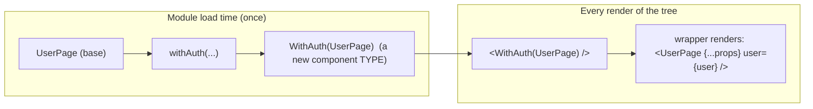
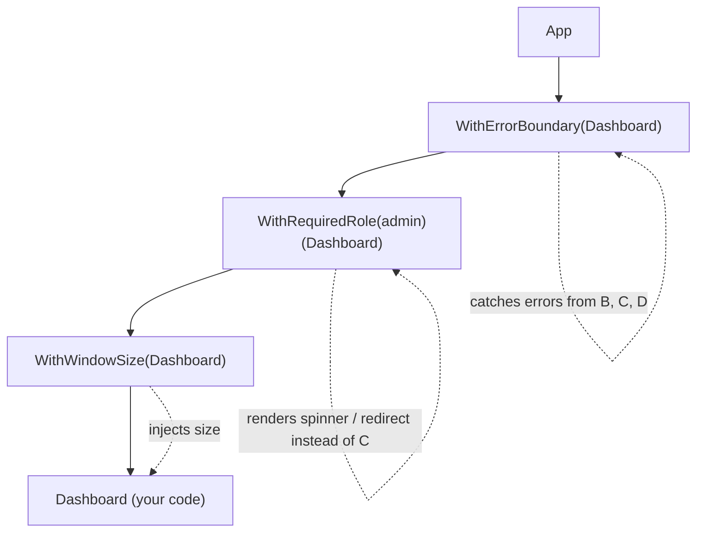
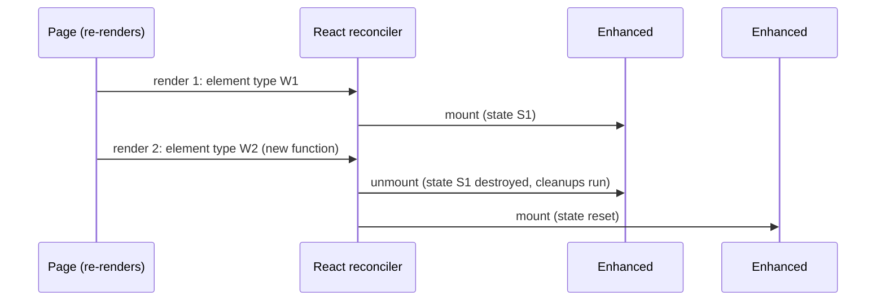
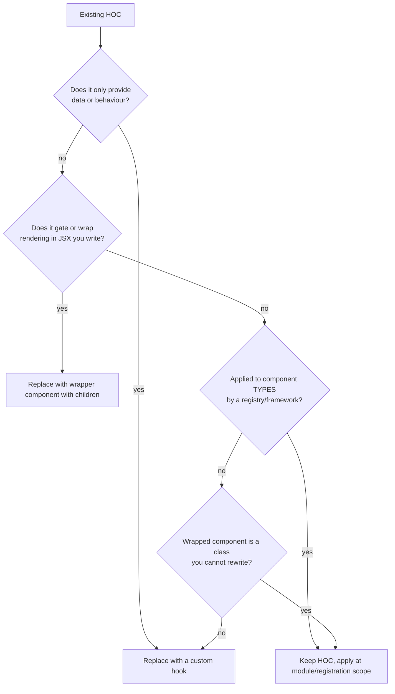

# 05 / 09 — Higher-Order Components (Legacy Pattern, With Narrow Modern Uses)

## 1. Lesson metadata

| | |
|---|---|
| **Level** | Intermediate to Advanced |
| **Study time** | 4–5 hours (reading 1.5 h, refactoring labs 1.5 h, exercises 1.5 h) |
| **Prerequisites** | [Phase 0 / 06 — Lexical scope and closures](../00-web-and-javascript-foundations/06-lexical-scope-and-closures.md), [Phase 0 / 07 — Functions and referential identity](../00-web-and-javascript-foundations/07-functions-and-referential-identity.md), [Phase 1 / 04 — Elements, components, instances](../01-react-fundamentals/04-elements-components-instances.md), [Phase 1 / 16 — State preservation and reset](../01-react-fundamentals/16-state-preservation-and-reset.md), [Phase 3 / 15 — Custom hooks](../03-react-state-and-hooks/15-custom-hooks.md), [Phase 5 / 03 — Composition over inheritance](./03-composition-over-inheritance.md), [Phase 5 / 08 — Provider pattern](./08-provider-pattern.md) |
| **Next** | [10 — Render props](./10-render-props.md) |
| **Related later** | [Phase 5 / 23 — Patterns made less necessary](./23-patterns-made-less-necessary.md), [Phase 5 / 24 — OOP patterns in functional React](./24-oop-patterns-in-functional-react.md), [Phase 5 / 25 — Comparative refactoring labs](./25-comparative-refactoring-labs.md), [Phase 5 / 21 — Error handling patterns](./21-error-handling-patterns.md) |

> **Status label: LEGACY for new application code.** Since hooks (React 16.8, 2019), custom hooks replace the large majority of HOC use cases with less indirection. HOCs remain in existing codebases, in library APIs (`memo`, `forwardRef`, error-boundary and profiling wrappers), and in a few situations listed in §7.3. This lesson teaches the pattern so you can *read, maintain, and migrate* it, and so you can recognise the narrow cases where it is still the right tool.

**Learning objectives.** After this lesson you can:
1. Define a higher-order component precisely and map it to the Decorator pattern (and, in its injecting form, to Dependency Injection).
2. Read and write a correctly typed HOC in TypeScript (props injection, props subtraction, `displayName`, ref and static handling).
3. Explain the four classic HOC failure modes: creating the HOC inside render, props collision, lost statics/refs, and wrapper hell, with the underlying reconciliation reason for each.
4. Migrate a HOC to a custom hook, a wrapper component, or a compound/provider design, and state what is gained and lost.
5. Identify the situations where a HOC is still justified and justify it in a code review.
6. Debug an app whose component tree has many HOC wrappers using DevTools.

**Concepts covered:** higher-order component, Decorator pattern, props proxy, inheritance inversion (historical), `displayName`, static hoisting, `ref` as a prop, wrapper hell, HOC identity and remounting, `Omit<P, K>` injection typing, `memo` and `forwardRef` as built-in HOCs.

---

## 2. Deep conceptual explanation

### 2.1 What is a HOC?

A **higher-order component** is a **function that takes a component and returns a new component**:

```ts
type HOC<Injected> = <P extends Injected>(
  Component: React.ComponentType<P>
) => React.ComponentType<Omit<P, keyof Injected>>;
```

It is the component-level analogue of a higher-order function. The React documentation's historical description is "a pattern that emerges from React's compositional nature": the HOC is *not part of the React API*; it is a convention built from ordinary functions and components. A HOC does not modify the input component (it does not mutate or inherit from it); it **wraps** it in a container component that adds behaviour, data, or structure.

### 2.2 The problem HOCs solved

Before hooks, function components had no state, no lifecycle, and no way to read context except through render-prop `Consumer` elements. Class components had state and lifecycle, but a class could only reuse behaviour by **inheritance** (discouraged: [Lesson 03](./03-composition-over-inheritance.md)) or by **mixins** (`React.createClass`'s `mixins`, which React dropped because of name clashes, implicit dependencies, and snowballing complexity).

The cross-cutting concern problem: "this component needs the current window width", "this component needs the logged-in user and should redirect if absent", "this component needs data from a Redux store", "log a view event when this component mounts". The same logic is needed by dozens of components that otherwise have nothing in common. A HOC packages the logic **once** and applies it to any component by wrapping, so the component stays focused on its own markup:

```tsx
const UserPageWithAuth = withAuth(UserPage);
const ProfileWithAuth  = withAuth(Profile);
```

### 2.3 Mapping to classic patterns

| Classic pattern | Idea | HOC mapping | Where the mapping breaks |
|---|---|---|---|
| **Decorator** (GoF) | Wrap an object to add behaviour while keeping its interface. | `withX(Component)` returns a component with the same (or extended) props interface and extra behaviour. | Decorator keeps the *same* interface; many HOCs *change* it (inject props, remove props). The interface change is where typing and substitutability problems come from (LSP, [Lesson 01](./01-solid-in-react.md)). |
| **Proxy** | A stand-in controlling access to the real object. | A "props proxy" HOC renders `<Wrapped {...props} />` and can intercept, add, or filter props, or decide not to render it at all (auth gate). | A React proxy cannot intercept *internal* state of the wrapped component, only its inputs. |
| **Dependency Injection** | Collaborators are supplied, not constructed. | An injecting HOC (`connect`, `withRouter`, `withTranslation`) supplies data and functions as props. | The wrapped component's props hide where values come from; there is no static check that the HOC is applied. |
| **Template Method / Mixin** | Reuse behaviour through inheritance. | HOCs replace mixins: behaviour is composed from outside instead of mixed in. | Composition of many HOCs needs ordering discipline; each wrapper is a real component layer. |
| **Aspect-oriented programming** | Cross-cutting concerns applied declaratively. | `withErrorBoundary`, `withProfiler`, `withLogging`: wrap without changing the component. | No pointcuts: you apply per component, by hand. |

**Honest summary:** a HOC is a *Decorator applied at the component type level*, most often used as a vehicle for *Dependency Injection of props*. The "decorator" framing is the one to keep: it reminds you that a wrapper changes the tree (adds a layer) and the component's identity (a new type).

### 2.4 The two historical flavours

1. **Props proxy.** The HOC renders the wrapped component as a child and passes it props. This is the flavour that is practical in modern React and the one you will meet.
2. **Inheritance inversion.** The HOC returns a class that **extends** the wrapped component, to hijack its `render()` output. It only works with class components, tightly couples to internals, and is historical. Do not write it. You may meet it in very old code.

### 2.5 What React exposes

React has no HOC feature. It exposes the ingredients: components are values (functions or classes), elements reference a *component type*, and the **type** of an element (the function reference) participates in reconciliation identity ([Phase 2 / 06](../02-react-rendering-and-internals/06-reconciliation-fundamentals.md), [Phase 2 / 07](../02-react-rendering-and-internals/07-identity-keys-and-reconciliation.md)). That last fact explains the most dangerous HOC bug (§4.3).

React itself ships HOC-shaped APIs, which is why the pattern is not dead: `memo(Component)` returns a component that skips re-renders for equal props; `forwardRef(render)` returns a component that accepts a ref (legacy in React 19, where `ref` is an ordinary prop for function components); `lazy(loader)` returns a lazily loaded component. Treat these as *the platform's own HOCs*.

### 2.6 Common misconceptions

1. **"HOCs were replaced because they are bad."** They were largely replaced because hooks reuse *stateful logic* without adding a component layer. A HOC remains a legitimate way to wrap *component identity or structure* (§7.3).
2. **"A HOC modifies the component I pass in."** It must not. It returns a new component. A HOC that mutates the input (`Component.prototype.render = ...`) is a bug magnet: the caller no longer knows which component they hold.
3. **"HOCs and hooks are interchangeable."** For *logic reuse* yes. For *rendering control* (conditionally not rendering the child, adding an error boundary around it, tagging every component in a library for tracing) a hook cannot do it, because a hook runs *inside* the component and cannot wrap it.
4. **"`connect()` is a HOC so Redux is legacy."** The `connect` HOC is the legacy API; `useSelector`/`useDispatch` (and Redux Toolkit) are the recommended style. Redux itself is not legacy ([Phase 6 / 09](../06-data-fetching-and-state-ecosystems/09-redux-toolkit.md)).
5. **"Composition of HOCs is free."** Every HOC adds a component to the tree, with its own render, DevTools entry, and potential re-render cost.

---

## 3. Internal mechanics

### 3.1 Public guarantees you rely on

- A function that returns a function component is an ordinary function. Calling it *once at module level* yields a stable component type.
- Elements are re-created on every render, but reconciliation compares **type** and **position/key** ([Phase 2 / 06](../02-react-rendering-and-internals/06-reconciliation-fundamentals.md)). If the type at a position changes between renders (a *different function reference*), React unmounts the old subtree and mounts a new one, destroying state and DOM.
- Props, including `children`, flow from wrapper to wrapped. In React 19, `ref` is a normal prop on **function components**, so a props-spreading wrapper forwards it naturally. This is version-sensitive: in React 18 and earlier, `ref` was *not* a prop and was not forwarded by `{...props}` unless `forwardRef` was used. On class components, `ref` still attaches to the class instance and is not in props.

### 3.2 Teaching model

A HOC is a **template for a wrapper component**. Applying it generates one concrete wrapper type per application site:



The wrapper type is created at **application time of the HOC**, not at render time, *if* you apply it at module scope. Everything wrong with HOCs that people tell horror stories about happens when this is violated (§4.3, §5.4).

### 3.3 Implementation detail (conceptual)

When React renders `<WithAuth(UserPage) />`, it calls the wrapper function (or instantiates the wrapper class) like any component, then reconciles the element the wrapper returns. In DevTools, each wrapper appears as its own tree node named by its `displayName` (or function name). Hook state used inside the wrapper lives in the wrapper's fibers, not in the wrapped component. These are conceptual descriptions; for the actual fiber structure see [Phase 2 / 09](../02-react-rendering-and-internals/09-fiber-nodes-and-units-of-work.md).

### 3.4 Static members and why they matter

A component may carry **statics**: `Component.getLayout`, `Component.propTypes`, `Component.displayName`, framework conventions like `Page.getInitialProps`, or compound sub-components (`Select.Option`). A HOC returns a *new* function, which does not have the original's statics. Historically libraries (`hoist-non-react-statics`) copied them. Today the problem shows up with framework conventions and compound components: `withTracking(Select).Option` is `undefined`. ⚠ The exact statics a given framework reads change between versions; verify in your framework's docs.

### 3.5 Where memoisation meets HOCs

`memo(withAuth(Page))` and `withAuth(memo(Page))` behave differently. The first memoises the **wrapper** (the wrapper only re-renders on prop changes, but hook state inside it still triggers its own renders). The second memoises the **wrapped** component (it skips re-rendering when the wrapper re-renders with equal props, which matters if the wrapper re-renders often because of its own state). Order is a design decision, not a style choice.

---

## 4. Step-by-step execution walkthrough

### 4.1 `withAuth` with an injected user, good version

```tsx
const AdminPage = withAuth(AdminPageBase);   // module scope, runs once at import
```

1. **Import time.** `withAuth(AdminPageBase)` executes once and returns `WithAuth(AdminPageBase)` (call it `W`). `W` is a stable function reference.
2. **First render of the app.** A parent renders `<W reportId="7" />`. React creates a wrapper fiber for type `W`.
3. **Wrapper render.** `W` calls its hooks (reads `useSession()`), gets `status: "loading"`, and returns a spinner (it chose not to render the wrapped component at all).
4. **Session resolves.** The session store updates; `W` re-renders (its own subscription). It now returns `<AdminPageBase reportId="7" user={user} />`.
5. **Reconciliation.** At the position of the spinner element there is now an element of a different type. React unmounts the spinner and mounts `AdminPageBase` fresh. `AdminPageBase`'s state is initialised once.
6. **Later renders.** The parent re-renders with a new `reportId`. `W` re-renders, passes new props down; `AdminPageBase` (same type, same position) **updates** and keeps its state.

### 4.2 What the DevTools tree looks like

```
App
 └ WithAuth(AdminPageBase)         ← wrapper layer (hooks live here)
    └ AdminPageBase                ← your component
```

With three stacked HOCs the tree becomes `WithRouter(WithAuth(WithTheme(AdminPageBase)))`: three extra layers and three nested `displayName`s in DevTools. This is "wrapper hell". Each layer renders every time its props or hook state change.

### 4.3 The catastrophic version: HOC applied inside render

```tsx
function Dashboard({ id }: { id: string }) {
  const Enhanced = withAuth(AdminPageBase);   // ❌ new component type each render
  return <Enhanced reportId={id} />;
}
```

1. First render: `withAuth(...)` creates type `W1`. React mounts `W1`.
2. `Dashboard` re-renders for any reason (parent update, its own state). `withAuth(...)` runs again, creating type `W2`, a **different function reference** than `W1`.
3. Reconciliation compares `W1` with `W2` at the same position: types differ → React **unmounts** the whole `W1` subtree (running effect cleanups, discarding all state, destroying DOM) and **mounts** `W2` from scratch.
4. Observable effects: inputs lose focus on every parent render, scroll positions reset, fetches repeat, animations restart, state "randomly" resets. The Profiler shows mount rather than update.

**Predict:** a text input inside `AdminPageBase` loses focus as the user types, whenever `Dashboard` re-renders. Which line is responsible? *(Answer: the HOC application inside the render body. Hoist it to module scope, or if the choice is dynamic, select between pre-created components.)*

---

## 5. Code examples

### 5.1 Minimal: the shape of a HOC

```tsx
import type { ComponentType } from "react";

export function withLogging<P extends object>(Component: ComponentType<P>) {
  function WithLogging(props: P) {
    console.log(`render ${Component.displayName ?? Component.name}`, props);
    return <Component {...props} />;
  }
  WithLogging.displayName = `WithLogging(${Component.displayName ?? Component.name ?? "Component"})`;
  return WithLogging;
}

const LoggedButton = withLogging(Button);
```

**Line notes.**
- The generic `P` is the wrapped component's props; the wrapper accepts the same props (a pure Decorator, interface unchanged).
- `{...props}` forwards everything, including `children`. In React 19 it also forwards `ref` for function-component targets.
- `displayName` is set for DevTools and error stack readability. Without it you see `Anonymous` or `WithLogging` for every wrapped component.
- `console.log` in render is a side effect: acceptable for a demo, but in real code use an effect and note StrictMode double-render in dev ([Phase 2 / 12](../02-react-rendering-and-internals/12-why-rendering-must-be-pure.md)).

### 5.2 Practical: injecting props with correct TypeScript

A HOC that injects `size: { width: number; height: number }` and removes it from the outward props:

```tsx
import { useEffect, useState, type ComponentType } from "react";

type WindowSize = { width: number; height: number };
type InjectedProps = { size: WindowSize };

export function withWindowSize<P extends InjectedProps>(
  Component: ComponentType<P>,
): ComponentType<Omit<P, keyof InjectedProps>> {
  function WithWindowSize(props: Omit<P, keyof InjectedProps>) {
    const [size, setSize] = useState<WindowSize>(() => ({
      width: window.innerWidth,
      height: window.innerHeight,
    }));

    useEffect(() => {
      const onResize = () => setSize({ width: window.innerWidth, height: window.innerHeight });
      window.addEventListener("resize", onResize);
      return () => window.removeEventListener("resize", onResize);
    }, []);

    // TS cannot prove Omit<P,K> & {size} is assignable to P for generic P, so we assert once, here.
    return <Component {...(props as P)} size={size} />;
  }
  WithWindowSize.displayName = `WithWindowSize(${Component.displayName ?? Component.name})`;
  return WithWindowSize;
}

// Usage
function Chart({ data, size }: { data: number[]; size: WindowSize }) {
  return <svg width={size.width / 2} height={size.height / 3}>{/* ... */}</svg>;
}
export const ResponsiveChart = withWindowSize(Chart);
// <ResponsiveChart data={[1,2,3]} />   // 'size' is no longer a required prop
```

**Typing explanation.** `P extends InjectedProps` constrains the target to *require* `size` of the right type. `Omit<P, keyof InjectedProps>` makes the outward component not require it. The cast `props as P` is the known unavoidable one in generic HOC typing: TypeScript cannot reduce `Omit<P, K> & Injected` to `P` for an open generic `P`. Keep the assertion in one place, covered by the usage-site type check. A frequent bug: consumers can still *pass* `size` explicitly if `P` makes it optional; decide what happens (injected value wins in the code above, because `size={size}` comes last).

**Prop precedence matters.** `{...props} size={size}` lets the HOC override a caller's `size`. `size={size} {...props}` lets the caller override. Both are legitimate; document which.

**Trade-offs.** The consumer cannot see in `Chart`'s file how `size` gets there. The test for `Chart` is trivial (pass `size`), which is a real benefit of the injecting style. Compare with the hook in §5.7.

### 5.3 Practical: a gating HOC (rendering control)

```tsx
export function withRequiredRole<P extends object>(role: "admin" | "editor") {
  return function decorate(Component: ComponentType<P>) {
    function WithRequiredRole(props: P) {
      const session = useSession(); // custom hook: { status, user }
      if (session.status === "loading") return <FullPageSpinner />;
      if (session.status === "anonymous") return <Navigate to="/login" replace />;
      if (!session.user.roles.includes(role)) return <Forbidden />;
      return <Component {...props} />;
    }
    WithRequiredRole.displayName = `WithRequiredRole(${role})(${Component.displayName ?? Component.name})`;
    return WithRequiredRole;
  };
}

export const AdminReports = withRequiredRole("admin")(ReportsPage);
```

This is the **auth-gate** pattern. Note it *chooses not to render* the wrapped component, which a hook inside `ReportsPage` could not do without making `ReportsPage` itself contain gating logic. A wrapper **component** achieves the same without the HOC ceremony (§5.7). Also note: this is a **UX gate, not security**: any client-side check can be bypassed; the server must enforce authorisation ([Phase 9 / 12 — Auth boundaries](../09-advanced-rendering-and-ecosystem/12-auth-boundaries.md)).

### 5.4 Incorrect: four classic HOC bugs

```tsx
// ❌ 1. HOC applied inside render (remount on every parent render; §4.3)
function Page() {
  const Enhanced = withWindowSize(Chart);
  return <Enhanced data={[1, 2]} />;
}

// ❌ 2. HOC mutates its input
function withBadge<P extends object>(Component: ComponentType<P>) {
  const original = Component.prototype?.render;           // legacy class mutation
  Component.prototype.render = function () { /* ... */ return original.call(this); };
  return Component;                                        // caller can't tell it changed
}

// ❌ 3. Statics lost (compound component)
const TrackedSelect = withTracking(Select);
<TrackedSelect.Option value="a" />   // TypeError / undefined: statics did not carry over

// ❌ 4. Props collision, silently overridden
const Enhanced = withUser(Profile);   // injects `data`
<Enhanced data={myProfileData} />     // caller's `data` overwritten by HOC's `data`
```

**Why each fails.**
1. Type identity changes each render → remount ([§4.3](#43-the-catastrophic-version-hoc-applied-inside-render)).
2. The input component is silently altered globally; each application stacks another patch.
3. The wrapper is a new function without the original's properties.
4. HOCs inject props into a shared flat namespace; two HOCs (or a HOC and a caller) can both want `data`, `user`, `t`, `theme`. Last write wins silently, and TypeScript only catches it if the types conflict.

### 5.5 Corrected versions

```tsx
// ✅ 1. Apply at module scope
const ResponsiveChart = withWindowSize(Chart);
function Page() { return <ResponsiveChart data={[1, 2]} />; }

// ✅ 2. Never mutate; wrap
function withBadge<P extends object>(Component: ComponentType<P>) {
  return function WithBadge(props: P) {
    return (<span className="badge-wrap"><Component {...props} /><Badge /></span>);
  };
}

// ✅ 3. Hoist statics deliberately, or design so statics are unnecessary
const TrackedSelect = Object.assign(withTracking(Select), { Option: Select.Option });
// Better: avoid wrapping compound roots; put tracking inside Select via a prop or context.

// ✅ 4. Namespace injected props; make collisions impossible
type Injected = { auth: { user: User; logout: () => void } };   // one key per HOC
```

If the HOC must be chosen dynamically (feature flag), create both enhanced components at module scope and **select** at render: `const Page = flag ? NewEnhanced : OldEnhanced;` where both are module-level constants, or branch on a prop *inside* a single wrapper.

### 5.6 Advanced: composing HOCs, and the cost of order

```tsx
// utility; reads right-to-left like function composition
const compose = <T,>(...fns: Array<(x: T) => T>) => (x: T) => fns.reduceRight((acc, f) => f(acc), x);

const enhance = compose(
  withErrorBoundary,     // outermost
  withRequiredRole("admin"),
  withWindowSize,        // innermost: closest to the component
);
export const AdminDashboard = enhance(DashboardBase);
```

**Ordering consequences.** The outermost HOC sees props first and its output wraps everything. `withErrorBoundary` outermost catches errors thrown while rendering the role gate and everything under it. If you put it innermost, errors thrown by the gate itself escape. Typing a variadic `compose` of HOCs that change prop types is hard in TypeScript; most teams apply HOCs one at a time (`withA(withB(Base))`) so each step is checked. That difficulty is itself a data point: HOC stacks resist static analysis, while hooks are just function calls.

### 5.7 Corrected by migration: the same three concerns as hooks and a wrapper component

```tsx
function useWindowSize(): WindowSize {
  const [size, setSize] = useState<WindowSize>(() => ({ width: window.innerWidth, height: window.innerHeight }));
  useEffect(() => {
    const onResize = () => setSize({ width: window.innerWidth, height: window.innerHeight });
    window.addEventListener("resize", onResize);
    return () => window.removeEventListener("resize", onResize);
  }, []);
  return size;
}

function RequireRole({ role, children }: { role: Role; children: ReactNode }) {
  const session = useSession();
  if (session.status === "loading") return <FullPageSpinner />;
  if (session.status === "anonymous") return <Navigate to="/login" replace />;
  if (!session.user.roles.includes(role)) return <Forbidden />;
  return <>{children}</>;
}

function DashboardBase({ reportId }: { reportId: string }) {
  const size = useWindowSize();          // behaviour: where it is used, visible in the file
  return <Chart reportId={reportId} width={size.width / 2} />;
}

// Composition at the call site (e.g. in a route definition)
<ErrorBoundary fallback={<CrashPage />}>
  <RequireRole role="admin">
    <DashboardBase reportId="7" />
  </RequireRole>
</ErrorBoundary>
```

**What changed.** Logic reuse moved into a hook (no extra layer). The gate became an ordinary component that takes `children` (explicit nesting in JSX, no ordering puzzle). The wrapped component now **declares** what it needs (`useWindowSize()` is visible), and tests call the hook or render the component with a mocked `window`. **What was lost:** the wrapped component is no longer ignorant of window size; it depends on a hook (fine in most cases). Nothing about the route's composition is hidden any more.

### 5.8 Where a HOC is still the practical tool

```tsx
// 1) Error boundary wrapping: a class-based boundary (or a library's boundary) exposed as a HOC.
export function withErrorBoundary<P extends object>(
  Component: ComponentType<P>,
  boundaryProps: Omit<ErrorBoundaryProps, "children">,
) {
  function WithErrorBoundary(props: P) {
    return (
      <ErrorBoundary {...boundaryProps}>
        <Component {...props} />
      </ErrorBoundary>
    );
  }
  WithErrorBoundary.displayName = `WithErrorBoundary(${Component.displayName ?? Component.name})`;
  return WithErrorBoundary;
}

// 2) Instrumenting every component of a given kind without touching their source.
// 3) Applying cross-cutting wrappers in a plugin/registry that receives component *types*:
registry.register("orders-widget", withErrorBoundary(withTelemetry(OrdersWidget), { fallback: <WidgetCrash /> }));
```

The third case is the strongest: when a *host app or framework receives component types* (a plugin system, a CMS block registry, a route table), a HOC applied once at registration gives uniform behaviour (error isolation, telemetry, permission gate) without trusting every plugin author to remember a wrapper in JSX. Hooks cannot do this, because hooks run inside the component and cannot wrap it. Wrapper **components** can, but only where *you* write the JSX; with a registry you only hold the type. ⚠ Many libraries expose both a wrapper component and a HOC (e.g. error-boundary and profiling utilities); verify the exact API in the library you use rather than copying names from memory.

---

## 6. Visual explanations

### 6.1 HOC as wrapper layers



### 6.2 Remount caused by HOC-in-render



### 6.3 Reuse mechanisms compared by what they can control

```
                   change what the     add state/effects    wrap or prevent    add a node
                   component RECEIVES  inside component     rendering          in the tree
 HOC               yes (props)         yes (in wrapper)     yes                yes (wrapper)
 custom hook       no*                 yes                  no                 no
 render prop       yes (args)          yes (in host)        yes                yes
 wrapper component yes (children)      yes (in wrapper)     yes                yes
 (*a hook returns values the component then uses itself)
```

### 6.4 Migration decision flow



---

## 7. Alternative approaches and trade-offs

### 7.1 Comparison table

| Criterion | HOC | Custom hook | Wrapper component (`children`) | Render prop ([Lesson 10](./10-render-props.md)) | Provider + hook ([Lesson 08](./08-provider-pattern.md)) |
|---|---|---|---|---|---|
| Reuse stateful logic | Yes | **Best** | Yes | Yes | Yes (shared) |
| Extra component layers | 1 per HOC | **0** | 1 | 1 | 1 per provider |
| Where dependency is visible | Hidden at export site | **Visible in component body** | Visible in JSX | Visible in JSX | Visible via hook call |
| Control rendering of the wrapped component | **Yes** | No | **Yes** | **Yes** | Partly |
| Applies to component *types* (registries) | **Yes** | No | No | No | No |
| Works with class components | Yes | No (needs adapter) | Yes | Yes | Via `static contextType` / consumer |
| Naming collisions | Props namespace | Local variables (explicit) | None | Param names (explicit) | None |
| TypeScript ergonomics | Poor (generics, `Omit`, casts) | **Good** | Good | Fair | Good |
| Ref/statics handling | Manual | n/a | n/a | n/a | n/a |
| DevTools readability | Wrapper hell risk | **Clean** | Good | Nesting risk | Provider stack |
| Testing | Test base component with props; test HOC separately | Test hook alone (renderHook) | Test with children | Test with function | Wrap in provider |

### 7.2 Scenario where the "recommended" modern approach (hooks) is NOT best

You maintain a **plugin host** where third parties register widgets as component types. Requirements: every widget must be isolated by an error boundary, wrapped in a permission gate, and traced. If you give plugin authors a hook (`useIsolation()`) you rely on them calling it correctly, and a hook can never *catch* errors thrown by the component that calls it. A HOC (or wrapper) applied by *the host* at registration guarantees uniform behaviour. Here the HOC is the right answer and the hook is the wrong abstraction.

Another: a large legacy **class-component** codebase where you cannot rewrite 300 classes this quarter, but need to give them access to a new `useFeatureFlags()`-based API. A single `withFlags` HOC bridges hooks into classes cheaply (the wrapper is a function component that calls the hook and injects props). This is a *migration bridge*, not a destination.

### 7.3 Legitimate HOC uses, ranked by how defensible they are

1. **Bridging hooks into class components** you cannot yet convert. Strong; label as transitional.
2. **Registration-time wrapping** of component types by a host (plugins, CMS blocks, route tables). Strong.
3. **Platform HOCs:** `memo`, `lazy`, `forwardRef` (legacy in 19), library-provided `withErrorBoundary`/profiler wrappers. Use as designed.
4. **Library APIs that must hand back a component type** (observer wrappers in MobX-style libraries, some styling libraries' `styled(Component)`). Use the library's API; do not re-implement.
5. **Existing codebases:** do not rewrite working, stable HOCs for ideology. Rewrite when you touch the component and the HOC is the obstacle (typing, perf, testability).

Not defensible for new code: HOCs that only supply data or subscribe to something (use a hook), and HOCs that inject many props (collisions, typing pain).

---

## 8. Best practices and anti-patterns

### 8.1 If you must write a HOC

1. **Apply at module scope**, never inside render.
2. **Do not mutate** the input component; return a new one.
3. **Set `displayName`** to `WithX(Wrapped)`.
4. **Forward props** (and `children`). In React 19, a function-component target receives `ref` via the spread; for class targets use the pattern the target needs. ⚠ Verify ref behaviour in your React version.
5. **Inject namespaced props** (`auth`, `theme`) rather than generic names (`data`, `user`).
6. **Pass through unrelated props** untouched (don't swallow `className`, `aria-*`, event handlers).
7. **Type the contract**: `P extends Injected`, `Omit<P, keyof Injected>`; assert once.
8. **Hoist or avoid statics**. Document if the HOC breaks them.
9. **Keep it thin.** A HOC should be a wrapper, not a feature module. Put logic in hooks/pure functions; let the HOC call them.

### 8.2 Beginner mistakes
- Applying a HOC in a component body or in a `.map` callback (remount).
- Forgetting to pass `{...props}`.
- Writing a HOC where a custom hook would do, because "HOCs are the pattern".
- Wrapping and exporting under the same name so the base component can't be tested alone. Export both: `export { DashboardBase }; export default withAuth(DashboardBase);`.

### 8.3 Experienced-developer mistakes
- Deep HOC stacks (`connect(withRouter(withTheme(withI18n(Base))))`) with unclear ordering and collision-prone props.
- A HOC that reads global state and thus makes the wrapped component untestable without a mock.
- Writing a generic "enhance everything" HOC factory with option bags (`withData({ url, transform, cache, retry })`): a framework in disguise; use a data library ([Phase 6](../06-data-fetching-and-state-ecosystems/08-tanstack-query.md)).
- Using HOCs to implement authorisation as security.

### 8.4 Code smells
- DevTools tree with more than two wrapper layers above one real component.
- Components whose docs say "must be wrapped in `withX` to work".
- A HOC whose type signature needs `any` or double assertions.
- Props that appear in the component's signature but are never passed by any caller (injected invisibly).

### 8.5 Justified exceptions
- A tiny `withX` that exists solely to adapt a hook for a class component, marked `@deprecated` with a removal plan.
- A host-level HOC at a registry (§5.8).
- Deliberately leaving a stable, tested HOC in place during unrelated work.

---

## 9. Real-world application

**Legacy enterprise app (Redux `connect`).** A finance back-office app has 400 components written with `connect(mapState, mapDispatch)(Component)`. Constraints: no big-bang rewrite; two teams; audit-critical flows. Strategy: freeze new `connect` usage via a lint rule; migrate per file to `useSelector`/`useDispatch` when the file is otherwise touched; keep the two styles interoperable (both read the same store). Quantify: Profiler shows wrapper layers disappear; selectors unchanged.

**Plugin/widget host (dashboard product).** Third-party widgets register component types. The host applies `withIsolation` (error boundary + suspense + telemetry) at registration so one failing widget does not take down the dashboard. Constraint: widgets can be written by teams with different skill levels; the guarantee must not depend on author discipline.

**Design system.** Public components are plain components with `ComponentProps` forwarding. The system may ship a HOC for *consumers* that need to adapt their own components to the system's `as`/polymorphic API ([Lesson 19](./19-polymorphic-components.md)); this is a convenience, not the primary API. Avoid exporting components only as HOC-wrapped values; it breaks static analysis and Storybook docgen.

**Forms and tables.** Older libraries expose `withFormik`/`reduxForm`-style HOCs. Modern equivalents expose hooks (`useForm`). If your form library offers both, prefer the hook for new screens.

**Analytics.** A `withPageView("checkout")` HOC that fires a page-view event on mount is easy to write and hides when events fire. A `usePageView("checkout")` hook inside the page makes the event visible next to the component's other effects (and visible to StrictMode double-effect behaviour in dev: [Phase 3 / 04](../03-react-state-and-hooks/04-useeffect-synchronization.md)).

---

## 10. Debugging and troubleshooting

### 10.1 Symptom: state resets or input loses focus whenever a parent re-renders

**Repro.** Type in an input inside a HOC-wrapped component; parent state changes.
**Investigation.** React DevTools Profiler: the wrapped component shows as *mounted* in each commit rather than updated; "Why did this render?" is empty because it is new. Search the parent for HOC calls in render bodies, in `useMemo` with changing deps, or in `.map`.
**Root cause.** New component type per render (§4.3).
**Fix.** Hoist the HOC application to module scope. **Validate.** Re-profile: the subtree now shows "updated"; the input keeps focus.

### 10.2 Symptom: prop is undefined or has the wrong value inside the wrapped component

**Investigation.** In DevTools, inspect each wrapper layer's props (select the node, view props). Compare props at each layer. Find where the prop is overwritten or dropped (a wrapper that does not spread, or two HOCs injecting the same name).
**Fix.** Namespace injected props; make wrapper pass-through explicit.

### 10.3 Symptom: `Foo.Bar is not defined` / framework "getLayout is not a function" after adding a HOC

**Root cause.** Statics not hoisted (§3.4).
**Fix.** Copy needed statics onto the enhanced component, or avoid wrapping that export; apply the behaviour inside the component or via context.

### 10.4 Symptom: ref points to the wrong thing, or is `null`

**Investigation.** Check the React version. React 19: for function components `ref` is a prop; if the HOC destructures `props` and drops it, the ref is lost. In older versions, `ref` on the HOC result attaches to the wrapper's own instance (class) or warns (function) rather than reaching the inner element.
**Fix.** React 19: ensure `ref` is spread through. Older: `forwardRef` in the wrapper. Verify against your React version's docs.

### 10.5 Symptom: performance regressions after adding another HOC

**Investigation.** Count wrapper layers; check whether each wrapper re-renders on every parent render and whether the wrapped component is memoised. Use "Highlight updates" and Profiler flame graph.
**Fix.** Convert data-only HOCs to hooks; put `memo` on the wrapped component or between layers where stable props allow; flatten.

---

## 11. Exercises

### Level A — Knowledge
A1. Define a HOC in one sentence and name the GoF pattern it most resembles.
A2. List the four classic problems with HOCs.
A3. Why must a HOC not be applied inside a component's render body? Give the reconciliation reason.
A4. Name two built-in React APIs that are HOC-shaped.
A5. Give two things a HOC can do that a custom hook cannot.

### Level B — Code comprehension
B1. What does this code print/do, and what is the bug?
```tsx
function List({ items }: { items: string[] }) {
  return (
    <ul>
      {items.map((i) => {
        const Row = withHover(RowBase);
        return <Row key={i} label={i} />;
      })}
    </ul>
  );
}
```
B2. In React 19, does `withLogging` from §5.1 forward a `ref` given to `LoggedButton` to the underlying `<button>` if `Button` is a function component that passes `ref` to its DOM node? What if `Button` is a class?
B3. Explain the difference in behaviour between `memo(withTheme(Card))` and `withTheme(memo(Card))` when the theme changes.
B4. Why is the cast `props as P` needed in §5.2, and what would be a way to avoid it in your own codebase?

### Level C — Implementation
C1. Write `withDocumentTitle(title: string)` as a HOC factory that sets `document.title` on mount and restores the previous title on unmount. Then write the equivalent `useDocumentTitle` hook and compare.
C2. Write a typed `withTheme` HOC injecting `theme: Theme` read from a context, removing `theme` from the outward props.
C3. Migrate `const Enhanced = withRouter(withAuth(withTheme(Page)))` to hooks and a wrapper component. Show the resulting component and its route usage.
C4. Write `withErrorBoundary(Component, fallback)` and a test that proves a throw in `Component` renders the fallback and does not unmount siblings.

### Level D — Debugging
D1. A page's search box loses focus on every keystroke after a refactor that "added `withTracking` to the page". Diagnose and fix.
D2. Users report that `Layout.getLayout` is ignored for pages wrapped by `withAuth`. Explain and fix with two alternatives.
D3. Two HOCs, `withUser` and `withOrg`, both inject a `data` prop. `Profile` shows organisation data where user data is expected. Explain and prevent recurrence by design.

### Level E — Architecture decisions
E1. Your team's 150 `connect()` components work fine. A new developer proposes migrating all of them to hooks "for consistency". Make the decision and the plan.
E2. You are designing a widget host for third-party code. Choose between requiring widgets to call `useWidgetContext()` and wrapping their types in a host-applied HOC. Defend a choice, including failure modes.
E3. A library maintainer asks whether to ship `withFoo` and `useFoo`. What should the policy be?

### Level F — Expert challenge
F1. Implement a `hoistStatics(target, source)` that copies non-React statics (excluding `displayName`, `defaultProps`, `propTypes`, `$$typeof`, `render`), and discuss why a generic version is risky for framework conventions.
F2. Build a benchmark (React Profiler or `performance.now` within `<Profiler>`) comparing a 1,000-row list where each row is wrapped in three HOCs against the same row using one hook per concern. Predict and then measure; describe what your measurements can and cannot show.

---

## 12. Detailed answers and explanations

> Attempt the exercises first.

**A1.** A HOC is a function that takes a component and returns a new component that wraps it. It resembles the **Decorator** pattern (and, when it injects props, Dependency Injection).

**A2.** (1) Wrapper hell / indirection; (2) props collision and hidden injection; (3) lost statics and refs; (4) remounting when applied inside render (also: typing difficulty and opacity of data flow). Any four.

**A3.** The HOC call returns a *new function*, which is a new component *type*. Reconciliation compares types; a different type at the same position means unmount old subtree and mount new, losing state and DOM. A wrong answer: "it is slow because it creates a function"; the cost is not creation but the remount and its consequences.

**A4.** `memo`, `lazy`, `forwardRef` (legacy in React 19 for function components). `useMemo` etc. are not HOCs.

**A5.** (a) Decide not to render the wrapped component or wrap it in an error boundary/Suspense without editing it; (b) be applied to component types by a registry; (c) bridge to class components. A hook can do none of these.

**B1.** `withHover(RowBase)` is executed during each render of `List`, for each row, producing a new type each time. Every re-render of `List` unmounts and remounts all rows: lost hover/focus state, effects re-run, DOM destroyed and recreated. `key` does not save it, since keys are compared only among elements of the same type. Fix: `const HoverRow = withHover(RowBase);` at module scope.

**B2.** Function `Button` (React 19): yes. `ref` is an ordinary prop for function components, `{...props}` forwards it through `WithLogging` to `Button`, which attaches it to the DOM node. Note though: on `WithLogging(props: P)` with `P` typed without `ref`, TypeScript may not know `ref` is allowed; typing it requires including `ref` in `P` (e.g. `ComponentProps<typeof Button>`). Class `Button`: in React 19 the function wrapper still receives `ref` as a prop, and spreading it onto `<Component ... />` makes it a `ref` on that element; for a class target that attaches to the **class instance** (not a DOM node), which is what a consumer of a class component expects. The typing caveat is the same. In React 18 and earlier, neither case works without `forwardRef`, because `ref` never reaches the wrapper's props. Version-sensitive; verify in the React 19 reference for `ref` and in the upgrade guide.

**B3.** `memo(withTheme(Card))`: the wrapper `WithTheme(Card)` is memoised on its own props; it still re-renders when the theme (read inside the wrapper via context/hook) changes, then passes the new `theme` prop to `Card`, which re-renders. `withTheme(memo(Card))`: `Card` is memoised against the props the wrapper passes; the wrapper re-renders on theme change and passes a new `theme` value, so `Card` re-renders; but if the wrapper re-renders for another reason with the same `theme` and other props, `Card` is skipped. The second form protects the inner component from wrapper re-renders; the first protects the wrapper from parent re-renders. When theme changes, both re-render `Card`. Trap: believing `memo` on the outside blocks the context-driven update inside the wrapper.

**B4.** For an open generic `P`, TypeScript cannot prove `Omit<P, K> & {size}` is assignable to `P`. The cast is a deliberate, localised escape; correctness is verified at use sites by the signatures. Ways to avoid: don't use generics-heavy HOCs; use hooks and wrapper components; or make the HOC non-generic for a specific component family.

**C1.**
```tsx
export const withDocumentTitle = (title: string) =>
  <P extends object>(Component: ComponentType<P>) => {
    function WithDocumentTitle(props: P) {
      useDocumentTitle(title);
      return <Component {...props} />;
    }
    WithDocumentTitle.displayName = `WithDocumentTitle(${Component.displayName ?? Component.name})`;
    return WithDocumentTitle;
  };

export function useDocumentTitle(title: string) {
  useEffect(() => {
    const previous = document.title;
    document.title = title;
    return () => { document.title = previous; };
  }, [title]);
}
```
Comparison: the HOC is a one-liner wrapper around the hook; the hook is the real logic and is usable directly with dynamic titles (`useDocumentTitle(order.name)`), whereas the HOC only supports a static string unless it reads props. Conclusion: the hook is strictly more flexible; the HOC adds nothing. Edge: nested usage restores titles in reverse unmount order; multiple simultaneous components fighting over the title is a design problem beyond either approach (a stack or router-level title is better).

**C2.**
```tsx
type Injected = { theme: Theme };
export function withTheme<P extends Injected>(Component: ComponentType<P>): ComponentType<Omit<P, "theme">> {
  function WithTheme(props: Omit<P, "theme">) {
    const { theme } = useTheme();
    return <Component {...(props as P)} theme={theme} />;
  }
  WithTheme.displayName = `WithTheme(${Component.displayName ?? Component.name})`;
  return WithTheme;
}
```
Criteria: applied at module scope; `Omit` on outward props; displayName; one cast.

**C3.** Example: inside `Page`, call `const navigate = useNavigate(); const { user } = useSession(); const { theme } = useTheme();`. Gate with `<RequireAuth>` in the route: `<Route path="/x" element={<RequireAuth><Page /></RequireAuth>} />`. Expect the DevTools tree to lose three layers. Edge: if `Page` is a class, convert it first or write one thin function wrapper that calls the hooks and passes props (a bridging HOC) and keep that single wrapper.

**C4.** Implementation as §5.8 using a boundary component. Test with Testing Library: render `<><Wrapped broken /><p>sibling</p></>`, where `broken` throws during render; assert fallback is present and sibling `<p>` still present (the boundary encloses only the wrapped component). Suppress expected console error noise in the test deliberately. Edge: a boundary does not catch errors thrown in event handlers or async callbacks.

**D1.** The HOC was probably applied in render (`const Tracked = withTracking(Page)` inside a parent, or in `useMemo` with changing deps), or the wrapper component is defined inside another component; each keystroke re-renders the parent and creates a new type, remounting the page and its input. Find with Profiler (mount instead of update). Fix: hoist to module scope; or replace the HOC with a `usePageTracking()` hook. Another cause to rule out: a changing `key` on the page.

**D2.** The HOC returns a new function without the `getLayout` static. Fix A: copy statics (`Object.assign(withAuth(Page), { getLayout: Page.getLayout })` or a generic hoist). Fix B: move auth into a layout/wrapper component or middleware/route guard so pages are not wrapped. Prefer B because it removes the need for the HOC at all. ⚠ Layout conventions are framework-specific; verify.

**D3.** Both write `data`; the later/outer assignment wins silently, depending on application order. Prevent by namespacing: `withUser` injects `user`, `withOrg` injects `org`; type them as distinct keys and fail the compile if the target's props collide (`P extends Injected` where `Injected` is distinct). Better: replace with hooks (`const user = useUser(); const org = useOrg();`) where names are local and explicit.

**E1.** Evaluation criteria: avoid ideology; weigh risk and benefit. A good answer: do not migrate wholesale. Add a lint rule banning new `connect`; migrate opportunistically; measure that wrapper layers and bundle size justify any dedicated effort; keep a codemod option for mechanical cases; ensure the store API is shared so both styles interoperate; define "done" as no new HOCs and migration of hot spots. Counter-case: if typing or performance pain is concentrated in 20 components, migrate those first.

**E2.** Strong answer: a host-applied wrapper (HOC at registration, or the host renders plugins inside its own boundary component) because a guarantee must not rely on plugin discipline, and a hook cannot catch errors from its caller. Add a hook for *optional* conveniences (reading host context). Failure modes: wrapper layers hide plugin internals from DevTools (set displayName); plugins that rely on statics; version skew between host and plugin React copies. Alternative: render each plugin inside a host-owned `<WidgetFrame>` component element, which is equivalent and avoids HOC typing if the host controls the JSX.

**E3.** Prefer shipping hooks as the primary API. Ship a HOC only if a meaningful audience has class components or needs registry-time wrapping; generate it from the hook so there is one implementation; mark it as secondary in docs; avoid shipping a HOC with its own distinct behaviour.

**F1.** A minimal version loops `Object.keys`/`Reflect.ownKeys` of source, skipping React-reserved keys, defining them on the target. Risks: frameworks read statics with specific semantics (data-loading functions, layout functions); copying them to a wrapper that changes props shape may break contracts; copying a static that closes over the original component's identity; memo/forwardRef objects aren't functions and have different shapes. Evaluation: acknowledges the reserved key list, symbols, non-enumerables, and that generic hoisting cannot know semantics.

**F2.** Sample plan: build two list variants with identical visible output; render 1,000 rows; use `<Profiler onRender>` for mount and update (change one parent prop) over several runs, in a production build, discarding warm-up. Predict: HOC variant has about 3x component count, higher mount time and larger update cost where wrappers re-render. Measurement caveats: dev-mode overhead, noise, JIT warmup, wrappers memoised or not, the Profiler's own overhead; results show relative cost in your scenario, not a universal law ([Phase 7 / 01](../07-performance/01-measure-before-optimizing.md)). If wrappers are cheap and rows are few, differences may be negligible; report ranges, not a single number.

---

## 13. Senior engineer interview questions

**Q1. "What is a HOC and why did hooks mostly replace them?"**
*Strong answer:* A function from component to component, used to share logic by wrapping. Hooks let a component use shared stateful logic directly without adding a tree layer, collision-prone props, ref/statics workarounds, or generic typing complexity. HOCs remain for wrapping type identity or rendering, bridging to classes, and registry-applied behaviour.

**Q2. "A HOC causes inputs to lose focus. Where do you look first?"**
*Strong answer:* Whether the HOC is invoked during render (or in an unstable memo), giving a new type per render, causing remount. The Profiler shows mounts instead of updates. Hoist to module scope.

**Q3. "How do you type a HOC that injects props?"**
*Strong answer:* Constrain `P extends Injected`, return `ComponentType<Omit<P, keyof Injected>>`, and accept one localised cast inside. Explain that TS can't prove the reassembly for an open generic. Mention that this difficulty is a reason to prefer hooks.

**Q4. "Is `memo` a HOC? What about `forwardRef`?"**
*Strong answer:* Yes, they take a component (or render function) and return a component type with additional behaviour; they're the platform's own wrappers. `forwardRef` is legacy for function components in React 19 where `ref` is a prop. Verify the current deprecation status.

**Q5. "Would you rewrite a working HOC-heavy codebase?"**
*Strong answer:* No by default. Stop the bleeding (lint rule, no new HOCs), migrate where the HOC causes measurable pain (typing, perf, testability), and use codemods for mechanical cases. Cost-benefit and risk in critical flows decide.

**Q6. "How would you implement authorisation gating in a route tree today?"**
*Strong answer:* Wrapper component or router-level guard/loader, with the server enforcing real authorisation. HOC acceptable if routes are registered as types. Client gating is UX, not security.

**Q7. "Name something a HOC can do that hooks cannot."**
*Strong answer:* Wrap or suppress rendering of a component it did not write (error boundaries, gates) and operate on component types in a registry. Hooks run inside the component and cannot catch its render errors or prevent it from rendering.

---

## 14. Further learning resources

| Resource | URL | Covers / why | Level | Study |
|---|---|---|---|---|
| React docs (legacy) — Higher-Order Components | <https://legacy.reactjs.org/docs/higher-order-components.html> | The historical official write-up: conventions, caveats (don't use inside render, statics, refs) | Intermediate | Whole page; read as history |
| React — Reusing logic with custom hooks | <https://react.dev/learn/reusing-logic-with-custom-hooks> | The replacement for most HOC use cases | Beginner–Intermediate | Whole page |
| React — `memo` reference | <https://react.dev/reference/react/memo> | A built-in HOC-shaped API | Intermediate | Usage, Caveats |
| React — `forwardRef` reference | <https://react.dev/reference/react/forwardRef> | Legacy ref forwarding; check the note about `ref` as a prop in React 19 | Intermediate | Whole page |
| React — `lazy` reference | <https://react.dev/reference/react/lazy> | Built-in component-returning API | Intermediate | Usage |
| React — Preserving and resetting state | <https://react.dev/learn/preserving-and-resetting-state> | Why a changed component type remounts (core to HOC-in-render bug) | Intermediate | "Different components at the same position reset state" |
| React — Catching rendering errors with an error boundary | <https://react.dev/reference/react/Component#catching-rendering-errors-with-an-error-boundary> | Why error boundaries wrap components, the main modern HOC use | Intermediate | Section |
| TypeScript Handbook — Generics | <https://www.typescriptlang.org/docs/handbook/2/generics.html> | Typing HOC signatures | Intermediate | Generic constraints |
| TypeScript — Utility types (`Omit`) | <https://www.typescriptlang.org/docs/handbook/utility-types.html> | Props subtraction | Intermediate | `Omit` |
| `hoist-non-react-statics` | <https://github.com/mridgway/hoist-non-react-statics> | What a static-hoisting helper does and which keys it excludes | Advanced | README |

URLs in this table were checked for HTTP 200 on 2026-10-22; any still marked *(unverified)* could not be checked automatically (blocked or unreachable). A 200 response does not guarantee the page content still matches the description; if a link has moved, search the site for the quoted title.

---

## 15. Knowledge checkpoint

**You should now understand**
- A HOC is a function from component to component (Decorator at the type level), and it adds a wrapper layer and a new component identity.
- Why applying a HOC inside render remounts the subtree (type identity in reconciliation).
- The four classic costs: wrapper hell, props collision, lost statics/refs, remount risk; plus awkward TypeScript.
- That hooks replace HOCs for *logic reuse*, while HOCs retain value for wrapping rendering, registry-time application, and bridging to classes.

**You should be able to explain without notes**
- Why `memo(withX(C))` and `withX(memo(C))` differ.
- Why a hook cannot replace a HOC that adds an error boundary around a component it does not own.
- How React 19's `ref`-as-prop changes the HOC ref story, and what is still version-sensitive.

**You should be able to implement**
- A correctly typed, correctly named, module-scope HOC injecting a prop.
- The migration of a three-HOC stack to hooks plus a wrapper component.
- A registry-time `withIsolation` HOC.

**You should be able to debug**
- Remounts from HOC-in-render using the Profiler.
- Missing statics, dropped refs, and prop collisions by inspecting each wrapper layer in DevTools.

**Next:** [10 — Render props](./10-render-props.md), the other pre-hooks reuse pattern, and the one that is closer to modern slot/headless designs.
