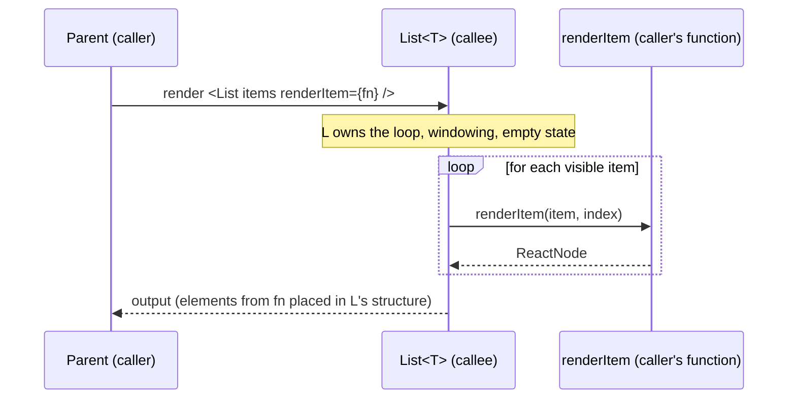
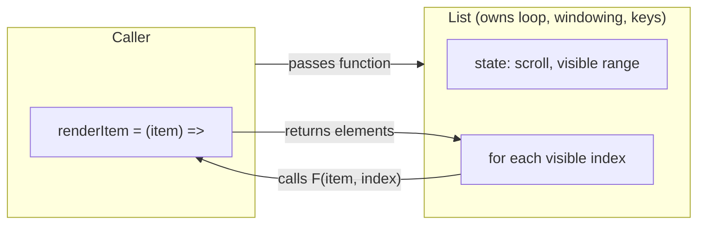
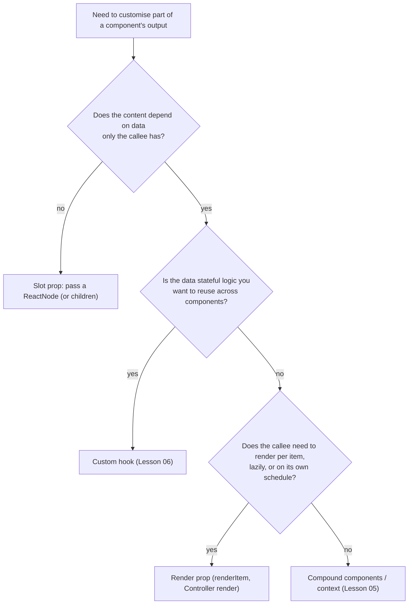

# 05 / 10 — Render Props

## 1. Lesson metadata

| | |
|---|---|
| **Level** | Intermediate to Advanced |
| **Study time** | 4–5 hours (reading 1.5 h, refactoring labs 1.5 h, exercises 1.5 h) |
| **Prerequisites** | [Phase 0 / 07 — Functions and referential identity](../00-web-and-javascript-foundations/07-functions-and-referential-identity.md), [Phase 1 / 07 — Composition, `children`, slots](../01-react-fundamentals/07-composition-and-children.md), [Phase 1 / 13 — The rendering mental model](../01-react-fundamentals/13-rendering-mental-model.md), [Phase 3 / 12 — `React.memo`](../03-react-state-and-hooks/12-react-memo.md), [Phase 3 / 15 — Custom hooks](../03-react-state-and-hooks/15-custom-hooks.md), [Phase 3 / 16 — Rules of hooks and composition](../03-react-state-and-hooks/16-rules-of-hooks-and-composition.md), [Phase 5 / 06 — Custom hook patterns](./06-custom-hook-patterns.md), [Phase 5 / 09 — Higher-order components](./09-higher-order-components.md) |
| **Next** | [11 — Controlled component pattern](./11-controlled-component-pattern.md) |
| **Related** | [05 — Compound components](./05-compound-components.md), [07 — Headless components](./07-headless-components.md), [08 — Provider pattern](./08-provider-pattern.md), [Phase 5 / 20 — Slot patterns](./20-slot-patterns.md), [Phase 5 / 23 — Patterns made less necessary](./23-patterns-made-less-necessary.md), [Phase 5 / 25 — Comparative refactoring labs](./25-comparative-refactoring-labs.md) |

> **Status label: LEGACY for sharing stateful logic; CURRENT for one specific job.** Before hooks (React 16.8, 2019), render props were the main way to share stateful behaviour between function-friendly boundaries. For that job, custom hooks replaced them. The *underlying technique*, passing a function that returns elements so the callee controls *when and how often* it renders and the caller controls *what*, remains the right tool whenever a component must **call back into the caller's rendering per item, per row, or per state** (virtualised lists, form-field controllers, tree and table renderers). This lesson teaches both halves honestly.

**Learning objectives.** After this lesson you can:
1. Define a render prop precisely (including the `children`-as-a-function variant) and map it to Strategy, Template Method, and inversion of control.
2. Read and migrate legacy render-prop code (mouse trackers, data fetchers, `Context.Consumer` pyramids) to hooks, and say what the migration gains and loses.
3. Identify the jobs where a render prop remains the correct design and implement them with correct generics, memoisation behaviour, and stable keys.
4. Explain, with reconciliation reasoning, why an inline render function defeats `memo` on the receiving component and why calling hooks inside a render function is dangerous.
5. Choose between render props, hooks, compound components, slots (`ReactNode` props), and HOCs for a given requirement, using explicit criteria.
6. Debug render-prop trees (hook-order errors, re-render storms, lost state) in the React DevTools.

**Concepts covered:** render prop, function as children, inversion of control, Hollywood principle, Strategy and Template Method mappings, `Context.Consumer` (legacy), pyramid of doom, inline function identity, hooks-in-render-function hazard, generic components in TSX, `renderItem`/`renderEmpty` APIs, `Controller render`, virtualisation callbacks.

---

## 2. Deep conceptual explanation

### 2.1 What is a render prop?

A **render prop** is a prop whose value is a **function that returns React elements** (or any renderable `ReactNode`), which the receiving component *calls during its own render* to produce part of its output.

```tsx
<Mouse render={(pos) => <Cursor x={pos.x} y={pos.y} />} />       // a prop named `render`
<Mouse>{(pos) => <Cursor x={pos.x} y={pos.y} />}</Mouse>        // `children` used as the function
<List items={rows} renderItem={(row) => <RowView row={row} />} /> // domain-specific names
```

Nothing in React treats these props specially; `render` is a convention, and `children` is just another prop that happens to be a function in this variant. The mechanism is only: **the callee decides when to call; the caller decides what to return.**

### 2.2 The problem it solved (historically) and the problem it still solves

*Historical problem.* Two components wanted the same stateful behaviour (track mouse position, fetch data, manage toggle state), and one of them was a class component or a function component without state. The behaviour was put in a **wrapper component** that held the state and called a function prop with the state:

```tsx
class Mouse extends React.Component<{ render: (p: { x: number; y: number }) => ReactNode }> {
  state = { x: 0, y: 0 };
  handleMove = (e: React.MouseEvent) => this.setState({ x: e.clientX, y: e.clientY });
  render() {
    return <div onMouseMove={this.handleMove}>{this.props.render(this.state)}</div>;
  }
}
```

(⚠ Legacy: the class form above is shown for recognition; see [Phase 1 / 17](../01-react-fundamentals/17-lifecycle-concepts.md) for class history.)

*The problem that persists.* A component sometimes **owns the loop or the schedule** for rendering something but cannot know *what* to render:

- A virtualised list knows which rows are visible and how tall they are, but not what a row looks like.
- A form controller knows value, blur, error state and `ref` wiring, but not what input widget the caller uses.
- A tree or table knows the structure and expansion state, but not how a node or cell looks.
- A modal host knows when to mount content (lazily, only when open), but not the content.

In each case a *value* cannot be passed instead of a function: the content depends on data the callee computes (the index, the visible window, the field state), or it must be created lazily (not at all when not needed). The function is the only way to express "render this, **given what you know**".

### 2.3 Mapping to classic patterns

| Classic pattern | Idea | Render-prop mapping | Where the mapping breaks |
|---|---|---|---|
| **Strategy** | Swap an algorithm behind a fixed interface. | The render function is a *presentation strategy* supplied by the caller: `(data) => ReactNode`. | The "interface" is a function type, and the callee decides how often to invoke it, as with any callback. |
| **Template Method** | Fixed algorithm skeleton, variable steps. | The component fixes the skeleton (state, events, layout) and calls the render prop at the variable step. | No inheritance or overriding; the variable step is passed as data. |
| **Inversion of control / Hollywood principle ("don't call us, we'll call you")** | The framework calls the user's code. | The callee calls your function at a time and with arguments it chooses. | This is *the* essential mapping; unlike the others it describes the control flow exactly. |
| **Callback / Visitor-like** | Pass behaviour to be applied to each element. | `renderItem` is invoked once per item, like a `map` callback applied by the component. | Visitor in GoF dispatches on element *types* via double-dispatch; render props do not. |
| **Decorator / Proxy** | Wrap to add behaviour. | A render-prop component wraps its output and adds behaviour (event handlers on a wrapper div). | The wrapper's output is mostly the caller's content; the layering is visible in the tree. |
| **Dependency Injection** | Supply collaborators from outside. | The caller injects *rendering* as a dependency. | Injection happens on every render, not once at construction. |

**Honest summary:** a render prop is **inversion of control for rendering**, expressed as a function-valued prop. Strategy and Template Method describe two *uses* of it; "Hollywood principle" describes its control flow. As a tool for *sharing stateful logic* it is superseded by hooks; as a tool for *sharing control over rendering* it has no replacement of equal clarity.

### 2.4 What React exposes

React has no render-prop API. It exposes: functions are values, props can be any value, JSX expressions can call functions (`{render(state)}`), and `children` is an ordinary prop that may be a function. `ReactNode` is the return type for anything renderable.

The platform's own legacy render-prop API is **`Context.Consumer`**: `<ThemeContext.Consumer>{(theme) => …}</ThemeContext.Consumer>`. It is retained for compatibility; `useContext` / `use` replaced it ([Phase 3 / 13](../03-react-state-and-hooks/13-usecontext-and-propagation.md)). ⚠ The React docs list it as legacy.

### 2.5 Common misconceptions

1. **"Render props are obsolete."** For *logic sharing*, mostly yes. For *per-item rendering control* they are everywhere in modern libraries.
2. **"The prop must be named `render`."** No. `renderItem`, `children`, `itemContent`, `cell`, `fallbackRender` are all fine. Name it for what it renders.
3. **"A render prop is a component."** It is a function called *as part of the callee's render*. It does not have its own fiber, its own state, or its own hook slots. Putting hooks inside it is the subject of §5.5.
4. **"Render props avoid the HOC problems."** They avoid prop collisions and static hoisting, but add nesting depth in JSX ("callback pyramid") and have their own performance trap with inline functions.
5. **"`children` as a function is a different pattern."** Same pattern, different prop name. The trade-off is that `children` as a function removes the ability to pass ordinary elements as children to that component unless it handles both.
6. **"Slots (`header: ReactNode`) and render props are the same."** A slot passes an *element already created by the caller*; a render prop passes a *function that creates elements from data the callee supplies*. If the content does not depend on callee data, a slot is simpler and cheaper.

---

## 3. Internal mechanics

### 3.1 Public guarantees you rely on

- **A function prop is an ordinary value.** It is created in the caller's render and passed down. A new function expression (`(p) => …`) yields a **new function identity each caller render**.
- **The callee runs the function during its own render.** React does not call it. The elements it returns become part of the callee's output and are reconciled as any other elements ([Phase 2 / 06](../02-react-rendering-and-internals/06-reconciliation-fundamentals.md)).
- **Render must be pure** ([Phase 2 / 12](../02-react-rendering-and-internals/12-why-rendering-must-be-pure.md)). The render function must not mutate external state, and in StrictMode development it may be called twice per render.
- **Hooks called inside the render function belong to the *component that calls it*, not to the component that defined the function.** This is a consequence of the rules of hooks: hook state is attached to the component instance whose render is executing. §5.5 expands the consequences.
- **`React.memo` compares props shallowly** (`Object.is` per prop). A render prop that is a fresh function on every parent render makes the memoised callee re-render every time ([Phase 3 / 12](../03-react-state-and-hooks/12-react-memo.md)).
- **Keys.** When a render prop produces a list, the callee (not the caller) decides the list structure. Who supplies `key` is part of the API contract (§5.2).

### 3.2 Teaching model



The call happens **inside `L`'s render**. The *closure* of `fn` is the caller's scope (it can read the caller's props and state at the time the function was created), but the *invocation* is by the callee. Both facts are important: closures give access to the caller's data; invocation timing belongs to the callee.

### 3.3 Implementation detail (conceptual)

- The elements returned by the function are children of whatever the callee renders. If the callee renders `<li>{renderItem(item)}</li>`, the DOM and fiber tree place them under that `li`.
- DevTools show no node for the render function itself, only for the components and elements it produces. The "wrapper" component (`Mouse`, `List`) appears as one node, and the content as its descendants.
- Because the function runs in the callee's render, **any hook call inside it appends to the callee's hook list** (conceptually, the callee's fiber). The runtime has no way to tell that the call syntactically came from the caller's code.

### 3.4 What changes with the React Compiler ⚠

The React Compiler can automatically memoise values, including inline functions, which may reduce the inline-render-prop identity problem in code it compiles. React Compiler 1.0 was released in October 2025 and remains opt-in; check react.dev/learn/react-compiler for its requirements and guarantees. Do not design APIs that *rely* on the compiler to avoid re-render storms; make the contract explicit (document that `renderItem` should be stable if the callee is memoised, or make the callee cheap).

---

## 4. Step-by-step execution walkthrough

A virtualised-style `List<T>` with `renderItem`. The parent re-renders because of unrelated state.

```tsx
function Inbox({ messages }: { messages: Message[] }) {
  const [filter, setFilter] = useState("");          // unrelated to the list's output
  return (
    <>
      <input value={filter} onChange={(e) => setFilter(e.target.value)} />
      <List items={messages} getKey={(m) => m.id} renderItem={(m) => <MessageRow message={m} />} />
    </>
  );
}
```

1. **Initial render.** `Inbox` creates two new function objects (`getKey`, `renderItem`) and passes them with `items` to `List`. `List` renders, calls `renderItem` for each item (say 20), and returns `<ul>` containing `<li key=…>` wrappers around the returned `MessageRow` elements.
2. **Commit.** 20 `li` and `MessageRow` instances are created in the DOM.
3. **User types in the filter input.** `setFilter` queues a re-render of `Inbox`.
4. **Re-render of `Inbox`.** It runs again, creating **new** `getKey`/`renderItem` function objects. `messages` is the same array reference. `List` receives props `{ items: same, getKey: new, renderItem: new }`.
5. **If `List` is not memoised:** it re-renders regardless (parent re-render ⇒ child re-render, [Phase 2 / 32](../02-react-rendering-and-internals/32-scenario-a-parent-rerender.md)); `renderItem` is called 20 times, producing 20 new `MessageRow` elements; each `MessageRow` re-renders unless it is memoised and its `message` prop is unchanged.
6. **If `List` is wrapped in `memo`:** shallow comparison finds `getKey !== prevGetKey` and `renderItem !== prevRenderItem`, so the memo **fails** and `List` re-renders anyway. The memo is useless until the functions are stable (`useCallback`) or hoisted out of the component.
7. **Reconcile.** The new element tree is compared to the old one: same types, same keys, same props (except for ones that changed) → updates, no DOM change except where output differs. If `MessageRow` is `memo`-wrapped and `message` is the same object, `MessageRow` is skipped.
8. **Net effect of one keystroke:** 20 calls of `renderItem`, 20 `MessageRow` renders (or 0 with memo on the row), 0 DOM mutations. The cost is in the render calls, not the DOM.

> **Predict:** The caller changes `renderItem` to `useCallback((m) => <MessageRow message={m} />, [])` and wraps `List` in `memo`. Now the user types in the filter input. How many `renderItem` calls happen? *(Answer: zero. `Inbox` re-renders, but `List`'s props are identical (same `items`, same stable functions), so the memo skips it. The `useCallback` is only justified because `List` is memoised and the list is large; otherwise it adds noise.)*

---

## 5. Code examples

### 5.1 Minimal: the classic (legacy) use and its hook replacement

**Render prop (legacy for logic sharing):**

```tsx
import { useState, type ReactNode, type MouseEvent } from "react";

type Position = { x: number; y: number };

export function Mouse({ children }: { children: (pos: Position) => ReactNode }) {
  const [pos, setPos] = useState<Position>({ x: 0, y: 0 });
  return (
    <div
      style={{ height: 200 }}
      onMouseMove={(e: MouseEvent<HTMLDivElement>) => setPos({ x: e.clientX, y: e.clientY })}
    >
      {children(pos)}
    </div>
  );
}

// usage
<Mouse>{(pos) => <p>{pos.x}, {pos.y}</p>}</Mouse>
```

**Hook replacement:**

```tsx
function useMousePosition() {
  const [pos, setPos] = useState<Position>({ x: 0, y: 0 });
  useEffect(() => {
    const onMove = (e: globalThis.MouseEvent) => setPos({ x: e.clientX, y: e.clientY });
    window.addEventListener("mousemove", onMove);
    return () => window.removeEventListener("mousemove", onMove);
  }, []);
  return pos;
}

function Coordinates() {
  const pos = useMousePosition();
  return <p>{pos.x}, {pos.y}</p>;
}
```

Notice the semantic difference: the render-prop version tracks movement over **its own `div`** and imposes a wrapper element. The hook version tracks the **window** and imposes no element. Neither is "the same thing"; a faithful hook translation would take a ref to an element. This is the typical migration trap: *a render-prop component bundles behaviour and a DOM wrapper*, and a hook gives you only the behaviour.

### 5.2 Real-world (still current): a generic `List<T>` with `renderItem` and `renderEmpty`

```tsx
// list.tsx
import type { Key, ReactNode } from "react";

type ListProps<T> = {
  items: readonly T[];
  /** Stable identity for each item. Required: the list owns the keys. */
  getKey: (item: T, index: number) => Key;
  renderItem: (item: T, index: number) => ReactNode;
  renderEmpty?: () => ReactNode;
  "aria-label"?: string;
};

export function List<T>({ items, getKey, renderItem, renderEmpty, ...rest }: ListProps<T>) {
  if (items.length === 0) return <>{renderEmpty?.() ?? null}</>;
  return (
    <ul {...rest}>
      {items.map((item, index) => (
        <li key={getKey(item, index)}>{renderItem(item, index)}</li>
      ))}
    </ul>
  );
}
```

```tsx
<List
  items={orders}
  getKey={(o) => o.id}
  renderItem={(o) => <OrderRow order={o} />}
  renderEmpty={() => <EmptyState title="No orders yet" />}
  aria-label="Recent orders"
/>
```

**Notes**

- **The callee owns the keys** (`getKey`) because it owns the list structure. If the caller returned `<li key=…>` from `renderItem`, the key would be on the wrong element (inside the callee's `li`), producing React's "each child should have a unique key" warning and incorrect identity. Make the contract explicit: either the callee wraps and keys (this design), or `renderItem` returns the keyed element and the callee does not wrap.
- **Generics in TSX.** `function List<T>(…)` works for function declarations. For arrow components, write `<T,>(props: …) => …` (the trailing comma disambiguates from JSX) or use `<T extends unknown>`. TypeScript infers `T` from `items`, so `renderItem`'s parameter is typed with no annotation.
- `renderEmpty` is **lazy**: it is called only when needed. This is a real advantage over passing `<EmptyState />` as a slot: nothing is created when the list is non-empty. In practice the cost of creating an element is small, so choose by ergonomics unless the empty state is expensive to *construct* (rarely).
- `readonly T[]` lets callers pass immutable arrays.
- The rest-props spread passes `aria-label` and other `<ul>` attributes; type it more completely with `ComponentProps<"ul">` if you need it.

### 5.3 Real-world: windowing, a case where the render prop is essential

```tsx
type VirtualListProps<T> = {
  items: readonly T[];
  rowHeight: number;
  height: number;
  renderRow: (item: T, index: number, style: React.CSSProperties) => ReactNode;
};

export function VirtualList<T>({ items, rowHeight, height, renderRow }: VirtualListProps<T>) {
  const [scrollTop, setScrollTop] = useState(0);
  const start = Math.max(0, Math.floor(scrollTop / rowHeight) - 2);
  const end = Math.min(items.length, Math.ceil((scrollTop + height) / rowHeight) + 2);

  const rows: ReactNode[] = [];
  for (let i = start; i < end; i++) {
    rows.push(
      <div key={i} style={{ position: "absolute", top: i * rowHeight, height: rowHeight, left: 0, right: 0 }}>
        {renderRow(items[i], i, { height: rowHeight })}
      </div>,
    );
  }

  return (
    <div style={{ height, overflow: "auto", position: "relative" }} onScroll={(e) => setScrollTop(e.currentTarget.scrollTop)}>
      <div style={{ height: items.length * rowHeight }}>{rows}</div>
    </div>
  );
}
```

**Why a render prop is the right shape.** The list decides *which* indices exist right now (a function of scroll state it owns) and calls `renderRow` only for those. The caller cannot pre-build 100,000 elements (that defeats the purpose), and cannot know the visible range. A slot or a `children` array would require constructing everything up front.

**Caveats of this sketch (it is a teaching model).** Keying by index (`key={i}`) makes row identity positional, so row-local state moves with the *position* instead of the item when `items` reorders; production virtualisers key by an item identity function. Real implementations handle variable heights, scroll anchoring, accessibility (`aria-rowcount`, focus preservation), and resize. Use a maintained virtualisation library for production ([Phase 7](../07-performance/)).

### 5.4 Real-world: a form-field controller (render prop as an integration boundary)

Form libraries use a render prop to connect *their* state (value, blur, errors, ref registration) to *your* input widget, whatever it is. For example, react-hook-form's `Controller` takes a `render` prop receiving `field` and `fieldState` objects. A hand-rolled, minimal version of the idea:

```tsx
type FieldRenderProps<V> = {
  field: { value: V; onChange: (next: V) => void; onBlur: () => void; name: string };
  error: string | undefined;
};

function Field<V>({ name, form, render }: {
  name: string;
  form: FormApi;                                   // some form store; details omitted
  render: (p: FieldRenderProps<V>) => ReactNode;
}) {
  const value = useFormValue<V>(form, name);
  const error = useFormError(form, name);
  return render({
    field: { name, value, onChange: (v) => form.set(name, v), onBlur: () => form.touch(name) },
    error,
  });
}

<Field<string> name="country" form={form}
  render={({ field, error }) => (
    <CountrySelect value={field.value} onChange={field.onChange} onBlur={field.onBlur} invalid={!!error} />
  )}
/>
```

The form engine cannot know about `CountrySelect`'s prop names (`onSelect`? `onValueChange`?), so it hands over a neutral object and lets the caller adapt. This is the **Adapter-at-the-boundary** use of a render prop ([Lesson 15](./15-adapter-strategy-factory.md)). A hook (`useController`) provides the same capability when the caller can call hooks at the top level of its own component; the render prop remains convenient when fields are generated in loops or conditionally inside JSX where hooks cannot be called.

> ⚠ Library APIs evolve; consult the current documentation of the form library you use rather than relying on this simplified shape.

### 5.5 Incorrect: hooks inside a render function

```tsx
function Dashboard({ widgets }: { widgets: Widget[] }) {
  return (
    <Grid
      items={widgets}
      renderItem={(w) => {
        const [expanded, setExpanded] = useState(false);       // ❌ hook inside render prop
        return <WidgetCard widget={w} expanded={expanded} onToggle={() => setExpanded((e) => !e)} />;
      }}
    />
  );
}
```

**What happens.** `useState` executes during `Grid`'s render (that is where `renderItem` is called), once per item. The state slots attach to **`Grid`'s** hook list, in call order. With 3 widgets, `Grid` has 3 hidden `useState` slots. Clicking toggles `Grid`'s own state, and *every* item's identity is its position in the call order. React may "work" until the list length changes between renders (a filtered list, a loading state, a `renderEmpty` branch): then the number of hook calls differs and React throws "Rendered more hooks than during the previous render", or silently associates state with the wrong item (if the count matches but the items reordered). The ESLint rules-of-hooks plugin flags it because `renderItem`'s arrow function is neither a component nor a hook by name.

**Predict:** With three items, the user expands item 2, then a filter removes item 1. What is expanded? *(Answer: the slot order is positional, so the new item 2 (formerly item 3) is shown expanded, or React throws if the number of calls changed. Either is wrong. State has been bound to call position, not item identity.)*

**Fix: render a component from the render prop**

```tsx
function WidgetCardWithState({ widget }: { widget: Widget }) {
  const [expanded, setExpanded] = useState(false);              // belongs to a real component instance
  return <WidgetCard widget={widget} expanded={expanded} onToggle={() => setExpanded((e) => !e)} />;
}

<Grid items={widgets} getKey={(w) => w.id} renderItem={(w) => <WidgetCardWithState widget={w} />} />
```

Now each item has its own component instance with identity tied to `key`. **Rule: a render prop may *create elements*, including components that use hooks; it must not *call hooks itself*.**

### 5.6 Incorrect: nested consumers ("pyramid") and the hook fix

**Before (legacy):**

```tsx
<ThemeContext.Consumer>
  {(theme) => (
    <AuthContext.Consumer>
      {(auth) => (
        <LocaleContext.Consumer>
          {(locale) => <Header theme={theme} user={auth.user} locale={locale} />}
        </LocaleContext.Consumer>
      )}
    </AuthContext.Consumer>
  )}
</ThemeContext.Consumer>
```

**After:**

```tsx
function HeaderContainer() {
  const theme = use(ThemeContext);
  const auth = use(AuthContext);
  const locale = use(LocaleContext);
  return <Header theme={theme} user={auth.user} locale={locale} />;
}
```

Gains: no nesting, no extra tree layers (each `Consumer` is a node), straightforward conditional reading (`use` can be called conditionally; `useContext` cannot). Loses: nothing functional, except that class components cannot call hooks ([Phase 1 / 17](../01-react-fundamentals/17-lifecycle-concepts.md)); there `static contextType` or a `Consumer` remains the legacy path.

### 5.7 Advanced: multiple render props and a "state + helpers" argument

```tsx
type DisclosureRenderProps = { open: boolean; toggle: () => void; close: () => void };

export function Disclosure({ defaultOpen = false, children }: {
  defaultOpen?: boolean;
  children: (p: DisclosureRenderProps) => ReactNode;
}) {
  const [open, setOpen] = useState(defaultOpen);
  const toggle = useCallback(() => setOpen((o) => !o), []);
  const close = useCallback(() => setOpen(false), []);
  return <>{children({ open, toggle, close })}</>;
}
```

```tsx
<Disclosure>
  {({ open, toggle }) => (
    <>
      <button aria-expanded={open} onClick={toggle}>Filters</button>
      {open && <FilterPanel />}
    </>
  )}
</Disclosure>
```

This is the textbook render-prop shape. Equivalent to `const [open, toggle] = useToggle()` ([Lesson 06](./06-custom-hook-patterns.md)): **prefer the hook**; this exists to show how the legacy shape reads and to recognise it in older code.

### 5.8 Before/after refactoring lab 1: render-prop data fetcher → hook (and a better answer)

**Before (legacy):**

```tsx
class FetchJson<T> extends React.Component<{ url: string; children: (s: State<T>) => ReactNode }, State<T>> {
  state: State<T> = { status: "pending" };
  componentDidMount() { this.load(); }
  componentDidUpdate(prev: { url: string }) { if (prev.url !== this.props.url) this.load(); }
  load() { /* fetch, setState, no cancellation */ }
  render() { return this.props.children(this.state); }
}

<FetchJson<User> url={`/api/users/${id}`}>
  {(s) => s.status === "pending" ? <Spinner /> : s.status === "error" ? <Error /> : <Profile user={s.data} />}
</FetchJson>
```

**After step 1 (hook):** `const user = useJsonResource<User>(url)` ([Lesson 06 §5.2](./06-custom-hook-patterns.md)); the component renders on `user.status`.

**After step 2 (the better answer):** use a data-fetching library or framework loading ([Phase 6](../06-data-fetching-and-state-ecosystems/)). The render-prop fetcher and the hand-written hook both lack caching and deduplication.

| Dimension | Before (render prop, class) | After step 1 (hook) |
|---|---|---|
| Tree layers | +1 component per use | 0 |
| Cancellation | None (race on `url` change) | `AbortController` |
| Types | Class generics + `State<T>` | Discriminated union |
| Conditional use | Wrap in JSX only | Call at top of component; for conditional fetching pass `null` |
| Reuse in non-JSX contexts (event handlers, other hooks) | Impossible | Compose in other hooks |
| Loses | Nothing meaningful | The implicit "wrapper boundary" (a place to attach an error boundary or a layout) |

### 5.9 Before/after refactoring lab 2: config props → render prop (a migration in the *other* direction)

**Before.** A card list that grew a prop per variation:

```tsx
<ProductList
  products={products}
  showRating
  showWishlistButton
  badgeText={(p) => (p.stock < 5 ? "Low stock" : undefined)}
  priceFormat="compact"
  imagePosition="left"
  onCardClick={navigate}
  secondaryActionLabel="Compare"
  onSecondaryAction={compare}
/>
```

**After.** The list owns layout, windowing, and keys; the caller owns row content.

```tsx
<ProductList
  products={products}
  getKey={(p) => p.id}
  renderProduct={(p) => (
    <ProductCard product={p}
      badge={p.stock < 5 ? "Low stock" : undefined}
      actions={<><WishlistButton id={p.id} /><CompareButton id={p.id} /></>}
      onOpen={() => navigate(p.id)} />
  )}
/>
```

| Dimension | Before | After |
|---|---|---|
| Props on the list | 9, growing | 3 |
| Variation needs (new badge, new action) | New prop + release | Caller edits its own `renderProduct` |
| Consistency across the app | Enforced by the component | Enforced by `ProductCard` (shared by convention) |
| Risk | Prop explosion | Callers diverge; mitigate with the shared card component |
| Performance | One component | A function call per item; memoise `ProductCard` |

**When this migration is wrong:** if all call sites should look identical, the config-prop (or fixed-markup) version is better: fewer ways to deviate. Render props invite divergence, which is a *feature* only when divergence is the requirement.

### 5.10 Before/after refactoring lab 3: choosing among render prop, slot, compound, and hook for one requirement

Requirement: "A `Card` with a header region whose content varies by page, and an action menu that depends on the card's loading state."

| Design | Code shape | Verdict |
|---|---|---|
| Slot | `<Card header={<Title />} />` | Correct for the header: content does not depend on card internals. |
| Render prop | `<Card actions={({ loading }) => <Menu disabled={loading} />} />` | Appropriate for the action menu **if** `loading` is private to the card. |
| Hook | `const { loading } = useCardState(); <Card><Menu disabled={loading} /></Card>` | Works if `loading` can be owned above the card (usually better: lift it). |
| Compound | `<Card><Card.Actions /></Card>` with `Card.Actions` reading context | Best when many parts need `loading`, and the consumer composes. |

Decision rule: **start with a slot; move to a render prop only when the callee must supply data or control timing; prefer lifting state or a compound when many parts share it.**

---

## 6. Visual explanations

### 6.1 Control flow: who calls whom



### 6.2 Decision tree: render prop or something else?



### 6.3 The identity trap

```
Parent render #1:   renderItem = fn#1  ──┐
Parent render #2:   renderItem = fn#2  ──┤  List = memo(...)
                                         │  shallow compare: fn#1 !== fn#2
                                         └─▶ memo bails out? NO → List re-renders

Fixes (choose by measurement):
  hoist the function out of the component (if it needs no closure),
  useCallback with correct deps,
  make the callee cheap, or
  pass data instead of a function where the callee needs no call-timing control.
```

---

## 7. Alternative approaches and trade-offs

### 7.1 Comparison

| Criterion | Render prop | Custom hook | Slot (`ReactNode` prop) | Compound components | HOC | Config props |
|---|---|---|---|---|---|---|
| Callee controls *when/how often* content renders | **Yes** | No | No | Partly | Partly | Yes (fixed) |
| Shares stateful logic | Yes (legacy) | **Best** | No | Yes (via context) | Yes (legacy) | n/a |
| Tree layers | +1 per use | 0 | 0 | +provider | +1 per HOC | 0 |
| Readability with several in one JSX | Poor (nesting) | **Good** | Good | Good | Poor (wrapper chain) | Good |
| TypeScript | Good (generics) | **Good** | Trivial | Medium | Hard | Easy |
| Memoisation friendliness | Poor with inline fns | Good | Poor with inline elements | Good | Medium | **Good** |
| Works in class components | Yes | No | Yes | Yes (class + contextType) | Yes | Yes |
| Lazy creation of content | **Yes** | n/a | No (element created eagerly) | n/a | n/a | n/a |
| Risk of misuse | Hooks inside; key placement | Stale closures | Over-prop-drilling | Part outside root | Remounts, collisions | Prop explosion |

### 7.2 Performance reality check

- Calling a render function and creating React elements is **cheap**; the dominant costs are *rendering the components those elements represent* and *DOM work*. Do not add `useCallback` to every render prop reflexively ([Phase 3 / 11](../03-react-state-and-hooks/11-usememo-and-usecallback.md)).
- Memoise when: the callee is expensive and `memo`-wrapped, **and** the function is the only changing prop, **and** a profile shows wasted renders ([Phase 2 / 30](../02-react-rendering-and-internals/30-react-devtools-profiler.md)).
- If an inline render prop *changes behaviour* between parent renders by closing over changing state, memoising it with stale deps is a **correctness** bug, not a performance fix.

### 7.3 When the recommended approach is NOT best

- **For reusing stateful logic**, a render prop is *not* best; use a hook. This is the case that made render props legacy.
- **For static content**, `children` or a slot beats a function: `header={<Title />}` is simpler, cheaper to read, and memo-friendly when hoisted.
- **For a handful of related regions with shared state**, compound components read better than three render props.
- **Where inversion of control is the problem**: a design that makes callers return JSX from a function inside deeply nested JSX harms readability. Extracting `renderRow` to a named component (`<OrderRow />`) and passing it as a *component type* (`as={OrderRow}`) or element-producing function often reads better.
- **A legitimate case where a render prop beats a hook:** an error-boundary-like or suspense-like boundary that must wrap or *replace* what its children render (`fallbackRender={({ error, reset }) => …}`). A hook cannot catch the child's render errors; a function prop receiving `error` and `reset` is the natural API (see [Lesson 21](./21-error-handling-patterns.md)).

---

## 8. Best practices and anti-patterns

### 8.1 Best practices

1. **Name it for what it renders** (`renderRow`, `renderEmpty`, `renderError`), not `render`/`children`, unless there is exactly one.
2. **Pass the callee's state as a single object argument** for extensibility (`{ open, toggle }`), except for tiny per-item callbacks where positional arguments (`item, index`) read better.
3. **Make key ownership explicit** in the type (`getKey`) and docs.
4. **Return components that own state**, never call hooks in the function ([§5.5](#55-incorrect-hooks-inside-a-render-function)).
5. **Keep the function pure**: no timers, no mutations, no subscriptions. It may be called more than once per render in development.
6. **Type generically** so item types flow into the function parameter.
7. **Provide lazy fallbacks as functions** (`renderEmpty`) only when construction is non-trivial; otherwise accept a `ReactNode`.
8. **Memoise at the right layer**: the row component (`memo(OrderRow)`) is usually the effective place, not the function.
9. **Document call timing**: "called once per visible row, during render; may be called more than once".

### 8.2 Beginner mistakes

- Putting `key` on the element returned by `renderItem` while the callee also wraps it (duplicate or misplaced keys).
- Using hooks inside the function.
- Using `index` as the key for items that reorder.
- Nesting five render props and not noticing a hook would be clearer.
- Forgetting that `children` as a function makes `<Comp>text</Comp>` a runtime error ("children is not a function").

### 8.3 Experienced-developer mistakes

- **Adding render props "for flexibility"** to a component with one call site (YAGNI, [Lesson 02](./02-dry-kiss-yagni.md)).
- **Wrapping every inline render prop in `useCallback`** without measuring, adding dependency arrays that go stale.
- **Letting render props leak the callee's internals** (passing raw setters and refs), freezing them as public API.
- **Using render props for what a HOC or hook already handles consistently** in the codebase, creating three styles for one concern.
- **Breaking SSR/RSC assumptions**: a function prop cannot be passed from a Server Component to a Client Component as props (functions are not serialisable across that boundary, apart from Server Actions). ⚠ Verify the exact rules in the current RSC documentation ([Phase 2 / 27](../02-react-rendering-and-internals/27-react-server-components-intro.md)).

### 8.4 Smells

- A `render` prop that is always passed the same function ("configuration disguised as a callback").
- A render-prop component whose only job is to hold `useState` and call `children(state)`: replace with a hook.
- `children` typed as `ReactNode | ((x) => ReactNode)` with branching inside, usually a sign of an API trying to be two things.
- Long inline render functions (more than ~10 lines) in JSX: extract a named component.

### 8.5 Justified exceptions

- Writing a **new** render-prop component is justified for virtualisation, tree/table row rendering, error/suspense-style boundaries, and integration boundaries where the callee must control timing and supply data. Offering **both** a hook and a render-prop component in a public library is common and reasonable (the hook for flexibility, the component for ergonomics in JSX contexts).
- In a **legacy class-based** area of the codebase, a render prop can be the only way to share logic until migration.

---

## 9. Real-world application

| Domain | Render-prop use | Engineering constraints |
|---|---|---|
| **E-commerce** | `renderProduct` in a product grid; `renderVariant` in a swatch picker | Stable keys by SKU; image lazy-loading inside rows; row memoisation to keep scroll smooth; analytics via the row component, not the grid. |
| **Dashboards** | Virtualised tables with `renderCell`/`renderRow`; chart tooltips `renderTooltip({ payload })` (a common chart-library convention ⚠ varies by library) | Row identity vs index; memoised cells; avoid per-cell closures that capture large objects; accessibility of virtualised tables. |
| **Finance** | Ledger rows with expandable details; `renderAmount` for locale-specific formatting | Thousands of rows; formatting objects (`Intl.NumberFormat`) created once, not per row; keyboard navigation across virtualised rows. |
| **Forms** | Field controller `render` for third-party inputs | Value/onChange/blur contract; controlled inputs ([Lesson 11](./11-controlled-component-pattern.md)); error/touched wiring; avoiding re-renders of the whole form per keystroke. |
| **Auth** | `<Authorised fallback={…}>{(user) => …}</Authorised>` gating; permission-aware menus | UX only; server enforces; avoid flashes by handling "loading" explicitly. |
| **Realtime** | `<Subscription topic>{(msgs) => …}</Subscription>` (legacy) vs `useSubscription` | Cleanup semantics; reconnection in the transport; StrictMode double subscription. |
| **Multi-team** | `renderEmpty`/`renderError` slots in shared list and table components | API stability: adding an argument to a render prop is non-breaking if passed as an object; changing positional arguments is breaking. Document call frequency. |

---

## 10. Debugging and troubleshooting

| Symptom | Likely cause | Investigation | Fix |
|---|---|---|---|
| "Rendered more/fewer hooks than during the previous render" | Hooks called inside a render function whose invocation count varies | Error stack shows the callee; search the caller for hooks inside `render*` functions; ESLint rules-of-hooks warning | Render a component from the function (§5.5) |
| Item state jumps to a different item after filtering | State attached positionally (hook-in-render-fn) or index keys | DevTools: select the row component; state stays while props change | Stable keys; component-with-state per item |
| List re-renders on every parent render despite `memo(List)` | Inline `renderItem`/`getKey` identities change | Profiler "Why did this render?" shows "Props changed: renderItem" | Hoist, `useCallback`, or remove the memo and optimise rows instead |
| "Each child in a list should have a unique key" with a render-prop list | Key placed on the wrong element or missing | Warning stack names the component; inspect where `key` is assigned | Callee owns key (`getKey`) |
| `children is not a function` | Using a function-as-children component with plain children (or vice versa) | Read the component's prop type; check JSX | Use the correct form, or support both explicitly |
| Stale data inside a render function | Memoised with wrong deps; closure captured old state | Add a log inside the function with the state read; check which render created it | Fix deps or remove memoisation |
| Render function runs twice in dev | StrictMode double render | Compare to production build | Expected; ensure purity |
| Context consumers re-render unexpectedly when nested in a render prop | The provider value identity changes upstream | Profiler "Context changed" | Memoise provider value ([Phase 3 / 14](../03-react-state-and-hooks/14-context-performance.md)) |

**Worked investigation: "ticking clock resets my accordion".** A `Clock` render-prop component re-renders every second (`<Clock>{(now) => <Dashboard now={now} />}</Clock>`). `Dashboard`'s inner accordion state resets every tick. Root cause: the render function defines a component inline (`const Row = () => …`) inside `Dashboard`, so each tick creates a new component *type* and remounts the subtree ([Lesson 09 §4.3](./09-higher-order-components.md)). Verify in the Profiler (mounts rather than updates for `Row`), hoist `Row` to module scope.

---

## 11. Exercises

### Level A — Knowledge
A1. Define a render prop and name the principle it expresses.
A2. State two differences between a slot prop (`header: ReactNode`) and a render prop.
A3. Why did custom hooks replace render props for sharing stateful logic? Give two structural reasons.
A4. Which legacy React API is a render-prop API, and what replaced it?
A5. Name three situations where render props are still the best design.

### Level B — Code comprehension
B1. In §5.2, what goes wrong if `renderItem` returns `<li key={o.id}>…</li>` while `List` also wraps in `<li>`?
B2. Predict the number of `renderItem` calls after one parent re-render, with and without `memo(List)`, when `renderItem` is an inline arrow.
```tsx
const MemoList = memo(List) as typeof List;
function Parent() {
  const [n, setN] = useState(0);
  return <><button onClick={() => setN(n + 1)}>{n}</button>
    <MemoList items={ITEMS} getKey={(i) => i.id} renderItem={(i) => <Row item={i} />} /></>;
}
```
B3. What does `<Disclosure>text</Disclosure>` do at runtime in §5.7, and how would you make the API safer?
B4. In §5.1, why isn't `useMousePosition` an exact replacement for `<Mouse>`?

### Level C — Implementation
C1. Implement `Tree<T>` with `renderNode(node, { depth, expanded, toggle })` and `getChildren(node)`; ensure each node's expansion state survives sibling reordering.
C2. **Refactor:** replace this nested-consumer pyramid with hooks, then write a `ThemedUserHeader` and explain how many component layers disappeared.
```tsx
<ThemeContext.Consumer>{(t) => <UserContext.Consumer>{(u) => <Header theme={t} user={u} />}</UserContext.Consumer>}</ThemeContext.Consumer>
```
C3. **Refactor:** convert `FetchJson` (§5.8) to a hook usage and write a small compatibility wrapper `<FetchJson>` built *on* the hook, for a gradual migration. Discuss why you might keep it.
C4. **Refactor:** the `ProductList` with 9 config props (§5.9) → `renderProduct`. Write the new component, the shared `ProductCard`, and the test that proves keys are stable when the list is reordered.

### Level D — Debugging
D1. A list's row expand state "jumps" to the wrong row after sorting. The code uses `renderItem={(item, i) => { const [open, setOpen] = useState(false); … }}`. Diagnose and fix.
D2. A `memo`-wrapped chart wrapper re-renders on each parent tick despite unchanged data. The parent passes `renderTooltip={(p) => <Tip {...p} />}`. Diagnose and give two fixes with trade-offs.
D3. A render prop returns a component defined inside the function body. Typing in an input inside it loses focus on every keystroke. Diagnose.

### Level E — Architecture decisions
E1. Your design system exposes `<Table columns={[{ header, accessor, renderCell }]} />`. Product teams request per-row actions, expandable detail rows, and column-specific cell editing. Decide whether to extend the config API, expose `renderRow`, or move to compound/headless; justify.
E2. A library maintainer is deciding whether to provide `<Toggle>{({on, toggle}) => …}</Toggle>` in addition to `useToggle`. Write a policy for when libraries should ship render-prop components.
E3. A team is migrating 200 render-prop usages to hooks. Propose the plan (codemod vs manual, ordering, risk controls, definition of done).

### Level F — Expert challenge
F1. Implement a virtualised grid sketch with `renderCell(row, col, style)` that preserves per-cell component state across scrolling for cells that remain in the overscan window, and explain what happens to state when a cell leaves the window.
F2. Design the types for a polymorphic render-prop component that accepts either `children: ReactNode` **or** `children: (state: S) => ReactNode` and narrows correctly in the implementation; discuss why this API is a smell.

---

## 12. Detailed answers and explanations

> Attempt the exercises first.

### Level A

**A1.** A prop whose value is a function returning renderable output, called by the receiving component during its render. It expresses **inversion of control** (Hollywood principle): the callee decides when to render; the caller decides what.

**A2.** (1) A slot is an element already created by the caller; a render prop creates elements on demand from data the callee supplies. (2) A slot is created eagerly each caller render regardless of whether it is used; a render prop is lazy (only invoked if the callee needs it, possibly many times). (Also: slots cannot depend on callee state.)

**A3.** (1) Render props require the shared logic to be a **component in the tree**, adding a layer and nesting in JSX; hooks run inline in the caller's component. (2) Combining several shared behaviours requires nested function children ("pyramid"); hooks compose as ordinary calls. (Also acceptable: typing and naming are simpler; behaviour reusable outside JSX; works with effects and event handlers.)

**A4.** `Context.Consumer`. Replaced by `useContext`, and in React 19 also `use(Context)`.

**A5.** Virtualised/windowed lists (callee owns which items exist), form-field controllers integrating third-party inputs, error/suspense-like boundaries (`fallbackRender` with `error` and `reset`), tree/table row rendering, lazily mounted content (modal body only when open). Any three with a reason.

### Level B

**B1.** `List` wraps the caller's output in `<li key={getKey(...)}>`; the caller's inner `<li key=…>` is nested in that `li`, producing invalid HTML (`li` inside `li` is invalid unless inside a nested list) and the inner key is useless (a single child in a non-array position doesn't need a key). Identity is carried by the outer key. The fix is to return only the item content from `renderItem`. This is a contract mistake: document who owns `<li>` and `key`.

**B2.** Without `memo`: `List` re-renders on every parent render, so `renderItem` is called once per item (N calls) per click. With `memo(List)`: the memo comparison fails (`getKey` and `renderItem` are new functions each parent render) so it behaves the same: N calls. The memo is ineffective. If both functions are hoisted to module scope (`const getKey = …; const renderItem = …`), then memoised `List` skips and the count is 0 on clicks. (`ITEMS` is a constant array so `items` is stable.)

**B3.** `children` is the string `"text"`; `Disclosure` calls `children({ … })`, throwing `TypeError: children is not a function`. Make the API safer: TypeScript already flags `<Disclosure>text</Disclosure>` as a type error under `children: (p) => ReactNode`; at runtime a library can `if (typeof children !== "function") throw new Error("<Disclosure> expects a function as children")` with a clearer message. Alternatively avoid function children and use a named prop (`render`).

**B4.** The render-prop component (a) attaches `onMouseMove` to its own wrapper `div`, tracking movement *within that element*, using React's synthetic event; (b) imposes a wrapper element (with height 200) that may affect layout. The hook listens on `window`, tracks the *whole page*, and renders no wrapper. A faithful replacement takes an element ref and attaches the listener there. Mechanical translation of render props to hooks changes behaviour unless the DOM boundary is handled.

### Level C

**C1.**

```tsx
type TreeProps<T> = {
  roots: readonly T[];
  getKey: (n: T) => string;
  getChildren: (n: T) => readonly T[];
  renderNode: (n: T, s: { depth: number; expanded: boolean; toggle: () => void; hasChildren: boolean }) => ReactNode;
};

export function Tree<T>(props: TreeProps<T>) {
  const [expanded, setExpanded] = useState<ReadonlySet<string>>(new Set());
  const toggle = (key: string) =>
    setExpanded((prev) => { const next = new Set(prev); next.has(key) ? next.delete(key) : next.add(key); return next; });

  function renderLevel(nodes: readonly T[], depth: number): ReactNode {
    return (
      <ul role={depth === 0 ? "tree" : "group"}>
        {nodes.map((n) => {
          const key = props.getKey(n);
          const children = props.getChildren(n);
          const isOpen = expanded.has(key);
          return (
            <li key={key} role="treeitem" aria-expanded={children.length ? isOpen : undefined}>
              {props.renderNode(n, { depth, expanded: isOpen, toggle: () => toggle(key), hasChildren: children.length > 0 })}
              {isOpen && children.length > 0 && renderLevel(children, depth + 1)}
            </li>
          );
        })}
      </ul>
    );
  }
  return <>{renderLevel(props.roots, 0)}</>;
}
```

Criteria: expansion state is **keyed by node identity** (`Set<string>` of keys), so reordering siblings preserves it; the callee owns keys; `renderNode` receives state and `toggle`; no hooks in `renderNode`. The sketch omits keyboard navigation (a real tree needs it; see [Lesson 07](./07-headless-components.md)) and is not virtualised.

**C2.**

```tsx
function ThemedUserHeader() {
  const theme = use(ThemeContext);
  const user = use(UserContext);
  return <Header theme={theme} user={user} />;
}
```

Layers removed: two `Consumer` components (their nodes disappear from the DevTools tree) and two function-child boundaries; `ThemedUserHeader` replaces them as one layer. Explain also that consumers re-render on context change either way; the number of re-rendering components shrinks from (2 consumers + Header) to (ThemedUserHeader + Header).

**C3.**

```tsx
function FetchJson<T>({ url, children }: { url: string; children: (s: Resource<T>) => ReactNode }) {
  const state = useJsonResource<T>(url);
  return <>{children(state)}</>;
}
```

Keep it temporarily for call sites that cannot yet be changed (e.g. inside class components) or to migrate file by file with a codemod from `<FetchJson>` to the hook where possible. Criteria: the wrapper adds no logic; it is marked deprecated with a lint/JSDoc `@deprecated`; removal date set. Edge: the wrapper does not add a DOM node (fragment), preserving layout.

**C4.** Sketch:

```tsx
function ProductList<T extends { id: string }>({ products, renderProduct }: {
  products: readonly T[]; renderProduct: (p: T) => ReactNode;
}) {
  return <ul className="grid">{products.map((p) => <li key={p.id}>{renderProduct(p)}</li>)}</ul>;
}
```

Test: render with `[A, B, C]`, type into a stateful field inside B's card, re-render with `[C, B, A]`, assert B's field still holds the typed value (state follows identity), and that no remount occurred (spy on a mount effect in the card or compare DOM nodes' identity). Criteria: key from item id, not index; callee owns `li`; `ProductCard` shared.

### Level D

**D1.** Hook inside the render function: state slots attach to the callee's hook list by **call order**, not item identity. After sorting, the n-th call now belongs to a different item, so expansion state follows position. Fix: render `<ExpandableRow item={item} />` (own `useState`) with a stable `key` supplied by the callee. Validate in DevTools: each row component has its own hooks and its props change; and sorting keeps state with the same item.

**D2.** The inline `renderTooltip` is a new function each parent tick, so `memo` fails. Fixes: (1) `useCallback(…, [])` if `Tip` needs only the payload (stable function; cost: dependency discipline, only useful when the chart is expensive); (2) hoist `const renderTooltip = (p) => <Tip {...p} />` to module scope (cleanest; works when no closure needed); (3) make the chart wrapper not depend on the tooltip identity (store the latest function in a ref inside the wrapper, so changes do not trigger re-render; trade-off: tooltip content changes won't re-render the chart; fine for tooltips that render on hover). Validate with the Profiler: "Props changed: renderTooltip" disappears.

**D3.** A component defined inside the render function body is a **new component type on every call**, so React unmounts and remounts the subtree, destroying DOM focus and state each render ([Phase 1 / 16](../01-react-fundamentals/16-state-preservation-and-reset.md), [Phase 2 / 07](../02-react-rendering-and-internals/07-identity-keys-and-reconciliation.md)). Fix: define the component at module scope and return `<Input … />` from the render prop.

### Level E

**E1.** Evaluation criteria: recognises that cell-level `renderCell` is already a render prop, and that per-row actions/detail rows/cell editing add *structural* variation. A strong answer: keep `renderCell` for content, add *slots* for row actions via a column definition (`actions`) only if consistent across the product; for detail rows, expose `renderDetail(row)` plus an `expanded` controlled prop; for cell editing, a compound or headless approach is needed since editing involves keyboard/focus contracts across cells ([Lesson 07](./07-headless-components.md)). If requests keep arriving, stop extending the config and expose a headless table core plus a preset. Risks: API surface growth, virtualisation compatibility, accessibility of grids.

**E2.** Example policy: libraries should ship the **hook first** (primary API), and ship a render-prop component only when (a) consumers in JSX-only contexts benefit (conditionally created, mapped lists where hooks can't be called); (b) the component supplies required structure (e.g. a `Controller` wrapper that registers a field), or (c) class-component consumers exist. Keep both implemented from one core so they cannot diverge; document the hook as preferred; avoid `children`-as-function in new component APIs (use named props) unless idiomatic in the library. Evaluate for consistency and maintenance cost.

**E3.** Plan elements: inventory (AST search for `children` function usage and `.Consumer`), classify by migration difficulty (mechanical vs behavioural, e.g. §5.1 DOM boundary differences), codemod the mechanical ones with human review, manual for others, ordering leaf-to-root or by team ownership, a compatibility wrapper (§C3) for gradual rollout, lint rule banning new usages, tests per migrated component (characterisation tests first), definition of done (zero uses of the deprecated API, wrapper deleted). Identify risk: behavioural differences (listeners attached to different nodes), performance (hook splitting changes memo boundaries), class components blocking.

### Level F

**F1.** Sketch: key rendered cells by `${row}:${col}` (item identity), render `<div key=… style=…>{renderCell(row, col, style)}</div>` for rows/cols within the visible window plus overscan. A cell component returned by `renderCell` (with local state) **retains state only while it stays mounted**. When it leaves the window, it unmounts and its state is discarded (the same issue as [Lesson 05 §7.2](./05-compound-components.md)'s unmounted panels). Options: lift the state to a store keyed by cell id; keep overscan generous; or cache state in the callee keyed by id and pass it into `renderCell`. Evaluation criteria: stable keys independent of scroll position; understanding that virtualisation implies unmounting; a plan for state that must survive. Use a library for production.

**F2.**

```tsx
type Props<S> = { children: ReactNode | ((state: S) => ReactNode); };

function Stateful<S>({ children, state }: Props<S> & { state: S }) {
  return <>{typeof children === "function" ? children(state) : children}</>;
}
```

Narrowing works because `ReactNode` does not include functions (React's types exclude them, though `Function` values aren't valid ReactNodes at runtime either). Smell: the component has two modes with different semantics; overloads or union props complicate documentation, tests, and `memo` behaviour; callers can't pass a function as a plain child intentionally. Prefer a named prop for the function variant (`render`) or make the function form the only form. Criteria: correct narrowing, awareness that `typeof === "function"` excludes legitimate function-valued content, and the API-design objection.

---

## 13. Senior engineer interview questions

**Q1. "What is a render prop and why did hooks make most of them unnecessary?"**
*Strong answer:* A function prop the callee calls during render to produce output, which inverts control over rendering. It was a way to share stateful logic across component boundaries; hooks do that without a tree layer or nesting. The role that remains is giving a callee control over when and for what data the caller's rendering happens.

**Q2. "Name a case where a hook cannot replace a render prop."**
*Strong answer:* A component that must render the caller's content per item on its own schedule (virtualisation) or must wrap/replace output when a child fails (error boundary fallback render). The caller can't produce per-item content ahead of time or catch child render errors from a hook.

**Q3. "Why can't you call hooks inside a render prop?"**
*Strong answer:* The function runs in the callee's render, so hooks attach to the callee's hook list by call order. The number and order of calls varies with the data; that breaks the rules of hooks and binds state to position instead of identity. Return a component that has its own hooks instead.

**Q4. "Your `memo`-wrapped list re-renders anyway. How do you investigate?"**
*Strong answer:* Use the Profiler's "why did this render", see changed props, find unstable function props, then hoist or `useCallback` only if the list is expensive and the profile shows waste; consider optimising row components instead. Note the compiler can change the picture but shouldn't be assumed.

**Q5. "Slots or render props?"**
*Strong answer:* Slot if content doesn't depend on callee data; render prop if it does or if the callee decides how often/when to render. Slots are simpler and avoid function-call timing concerns.

**Q6. "How do keys work with render-prop lists?"**
*Strong answer:* The callee owns the list structure, so it should own key assignment (via `getKey`), keyed by item identity, not index; otherwise identity and state attach to the wrong thing.

**Q7. "What changes in a Server Components world?"**
*Strong answer:* Functions can't be passed as props from server to client components (not serialisable, other than server actions), so render-prop APIs live on the client side, or you pass elements/slots from the server instead. Verify specifics against current framework docs.

---

## 14. Further learning resources

| Resource | URL | Covers / why | Level | Study |
|---|---|---|---|---|
| React docs (legacy) — Render Props | <https://legacy.reactjs.org/docs/render-props.html> | The historical official write-up, including the `PureComponent` inline-function caveat | Intermediate | Whole page; read as history |
| React — Passing props to a component | <https://react.dev/learn/passing-props-to-a-component> | Props as values, including functions and `children` | Beginner | Whole page |
| React — `memo` reference | <https://react.dev/reference/react/memo> | Why unstable function props defeat memoisation | Intermediate | Usage; Caveats |
| React — `useContext` / `Context.Consumer` (legacy) | <https://react.dev/reference/react/createContext> | The legacy `Consumer` and its replacement | Intermediate | "Consumer" section |
| React — Rules of Hooks | <https://react.dev/reference/rules/rules-of-hooks> | Why hooks can't live in callbacks/render functions | Intermediate | "Only call Hooks from React functions" |
| React — Preserving and resetting state | <https://react.dev/learn/preserving-and-resetting-state> | Component identity, state position, why inline component definitions remount | Intermediate | Whole page |
| React — Rendering lists | <https://react.dev/learn/rendering-lists> | Key rules relevant to render-prop lists | Beginner | "Keeping list items in order with key" |
| React Hook Form — `Controller` | <https://react-hook-form.com/docs/usecontroller/controller> | A current library API using a `render` prop | Intermediate | `render` prop section |
| TanStack Virtual | <https://tanstack.com/virtual> | Headless virtualisation; compare render/loop control | Advanced | Introduction |
| TypeScript Handbook — Generics | <https://www.typescriptlang.org/docs/handbook/2/generics.html> | Typing generic components | Intermediate | Generic functions and constraints |

URLs in this table were checked for HTTP 200 on 2026-10-22; any still marked *(unverified)* could not be checked automatically (blocked or unreachable). A 200 response does not guarantee the page content still matches the description; if a link has moved, search the site for the quoted title.

---

## 15. Knowledge checkpoint

**You should now understand**
- A render prop is inversion of control for rendering: the callee calls a caller-provided function during its render; it maps to Strategy/Template Method but is best described by the Hollywood principle.
- That hooks replaced render props for logic sharing, while render props remain right for per-item/lazy/boundary rendering.
- The two dominant failure modes: hooks inside the function, and unstable inline functions defeating `memo`.

**You should be able to explain without notes**
- Why hook state would attach to the callee if hooks were called inside a render function.
- Who should own keys in a render-prop list and why.
- When a slot beats a render prop.

**You should be able to implement**
- A generic `List<T>` with `renderItem`/`renderEmpty`/`getKey`.
- A migration from a `Consumer` pyramid or a render-prop fetcher to hooks, with a temporary compatibility wrapper.
- A tree/virtualised component whose per-item state follows identity.

**You should be able to debug**
- Hook-order errors from render functions, state jumping after sort, memo bailouts defeated by function props, and remounts from inline component definitions.

**Next:** [11 — Controlled component pattern](./11-controlled-component-pattern.md): who owns a component's state, and how a component supports both "I manage it" and "you manage it".
