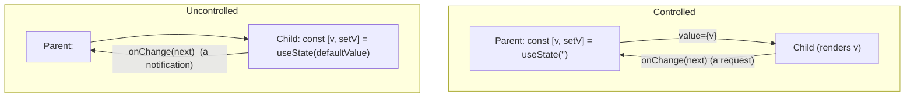
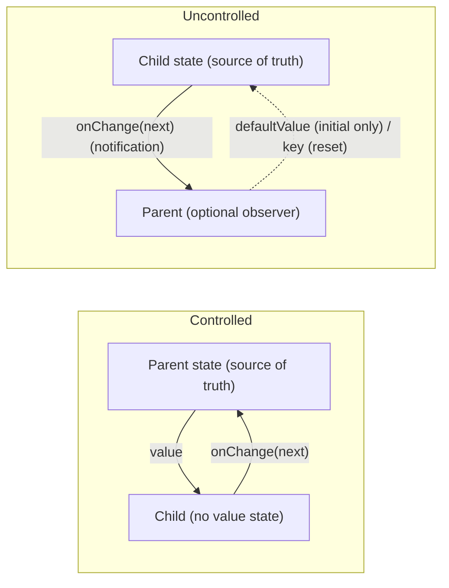
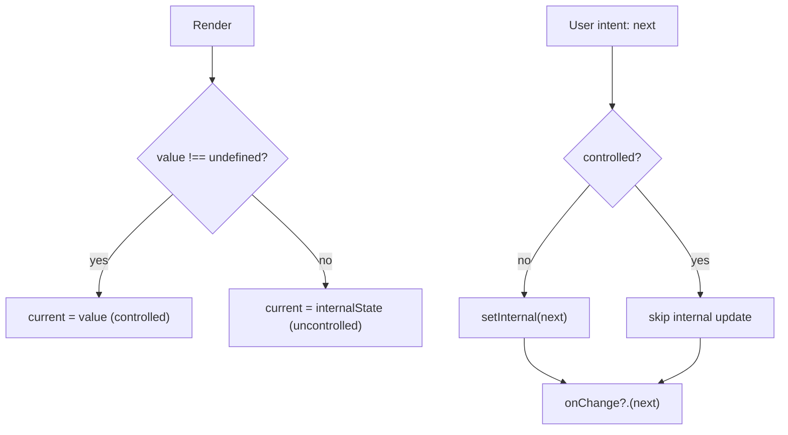
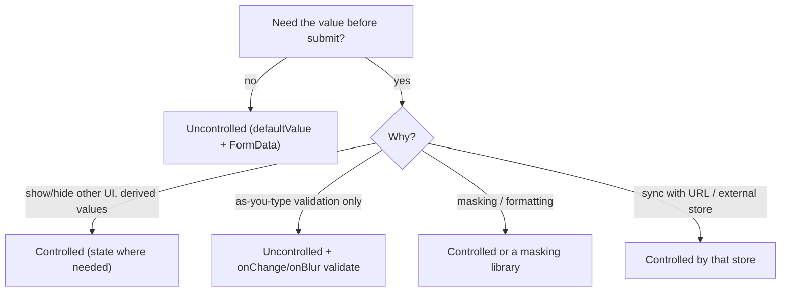

# 05 / 11 — The Controlled Component Pattern

## 1. Lesson metadata

| | |
|---|---|
| **Level** | Intermediate to Advanced |
| **Study time** | 4–5 hours (reading 1.5 h, refactoring labs 1.5 h, exercises 1.5 h) |
| **Prerequisites** | [Phase 1 / 06 — Props and one-way data flow](../01-react-fundamentals/06-props-and-one-way-data-flow.md), [Phase 1 / 11 — Controlled and uncontrolled inputs](../01-react-fundamentals/11-controlled-and-uncontrolled-inputs.md), [Phase 1 / 14 — State as a snapshot](../01-react-fundamentals/14-state-as-a-snapshot.md), [Phase 1 / 16 — State preservation and reset](../01-react-fundamentals/16-state-preservation-and-reset.md), [Phase 3 / 17 — Derived state](../03-react-state-and-hooks/17-derived-state.md), [Phase 3 / 18 — State colocation and lifting](../03-react-state-and-hooks/18-state-colocation-and-lifting.md), [Phase 3 / 21 — Forms and complex state](../03-react-state-and-hooks/21-forms-and-complex-state.md), [Phase 5 / 05 — Compound components](./05-compound-components.md), [Phase 5 / 06 — Custom hook patterns](./06-custom-hook-patterns.md) |
| **Next** | [12 — Reducer pattern](./12-reducer-pattern.md) |
| **Related** | [07 — Headless components](./07-headless-components.md), [10 — Render props](./10-render-props.md), [Phase 4 / 15 — State ownership](../04-react-architecture/15-state-ownership.md), [Phase 5 / 22 — Patterns for reusable libraries](./22-patterns-for-reusable-libraries.md), [Phase 5 / 24 — OOP patterns in functional React](./24-oop-patterns-in-functional-react.md) |

> **Status label: CURRENT and foundational.** Controlled vs uncontrolled is an enduring part of React's component contract design. The class-era techniques tied to it (`getDerivedStateFromProps`, `componentWillReceiveProps`) are historical and labelled so. React 19 form Actions add a third usage mode for forms that shifts some decisions (§5.9); verify details against the current docs.

**Learning objectives.** After this lesson you can:
1. State the controlled/uncontrolled contract for any component (native or custom) as a precise rule about **who owns the state** and who is notified of changes.
2. Map the pattern to State hoisting, Observer, and Dependency Injection of state, with honest limits to each analogy.
3. Implement a component that supports both modes with a single source of truth, development warnings for mode switching, and correct `onChange` semantics.
4. Recognise and repair the "copy props into state" anti-pattern with the three correct alternatives (fully controlled, uncontrolled + `key` reset, derived value).
5. Choose controlled, uncontrolled, or dual mode for inputs, form fields, and reusable components, and justify the cost in re-renders and API surface.
6. Diagnose React's controlled/uncontrolled warnings, cursor-jump bugs, and stale/lagging value bugs.

**Concepts covered:** controlled component, uncontrolled component, `value`/`defaultValue`, `checked`/`defaultChecked`, `onChange` contract, single source of truth, state hoisting, mode switching warning, `key` reset, derived state, IME composition, `useControllableState`, `ref`-based reads, `FormData`, form Actions reset behaviour ⚠.

---

## 2. Deep conceptual explanation

### 2.1 The contract in one sentence

A component is **controlled** when its parent supplies the current value as a prop **and** is responsible for updating that value in response to a change callback; it is **uncontrolled** when the component keeps the value itself and the parent only supplies an *initial* value and optionally *observes* changes.

| | Controlled | Uncontrolled |
|---|---|---|
| Where the live value lives | Parent (props) | Component (internal state or the DOM) |
| Props | `value` + `onChange` | `defaultValue` (+ optional `onChange`) |
| Parent can set the value at any time | **Yes** (change the prop) | No (only initial; or remount via `key`) |
| Parent can read the value at any time | Yes (it owns it) | Only via callbacks, refs, or form submission |
| Component without a callback | Read-only (React warns for native inputs) | Works |
| Typical native example | `<input value={v} onChange={…}>` | `<input defaultValue="x">`, `<input type="file">` |

The terms come from React's treatment of form elements, but the same contract applies to any component with a value-like state: a tab strip (`value`/`defaultValue`/`onValueChange`), a dialog (`open`/`defaultOpen`/`onOpenChange`), an accordion, a date picker, a pagination control.

### 2.2 The problem it solves

State has to live *somewhere*. Two forces pull in opposite directions:

1. **Encapsulation.** A reusable widget should work out of the box without every caller writing `useState` and a handler (information hiding; lower caller burden).
2. **Coordination.** A caller sometimes needs to *read*, *reset*, *validate*, *persist*, *synchronise*, or *override* the widget's state (a form submits all fields; the URL should reflect the selected tab; a "reset" button clears filters; two components must stay in sync).

An always-encapsulated component cannot coordinate; an always-controlled one burdens every caller. The pattern resolves the tension with **a single optional prop**: *if the parent passes `value`, the parent is the source of truth; if not, the component is.* The component must obey exactly one source of truth at a time ([Phase 4 / 15](../04-react-architecture/15-state-ownership.md)).

### 2.3 Mapping to classic patterns

| Classic pattern | Idea | Mapping | Where it breaks |
|---|---|---|---|
| **Information hiding / Encapsulation** | An object keeps its state private and exposes operations. | Uncontrolled mode. | Controlled mode deliberately breaks encapsulation of that state. |
| **Dependency Injection (of state)** | Supply collaborators from outside. | Controlled mode injects the *state itself* (value) and the *setter* (callback) rather than a service. | Injected every render, not once; the value is data not a service. |
| **Observer** | Subscribers are notified when a subject changes. | `onChange`/`onValueChange` notifies the parent of user intent. | The parent isn't a registered subscriber; it's the callback passed as a prop. Importantly, in *controlled* mode the notification is a **request**, not a fact: the parent can ignore it. |
| **Command** | Reify a request as an object/call. | The `onChange(next)` call is a request to change the state, which the owner may accept or reject. | There is no undo or queue by default. |
| **State hoisting / "lifting state up"** | Move state to the nearest common owner. | Controlled mode is the *interface* that makes lifting possible without rewriting the child. | A React idiom rather than a GoF pattern. |
| **Single source of truth** | Each datum has one authoritative location. | The "exactly one of value/defaultValue-driven internal state" rule. | The failure mode is *two* sources (copied state), covered in §5.5. |

**Honest summary:** the pattern is *state ownership made switchable by a prop*. "Observer" describes the change notification, but the *request, not fact* property in controlled mode is what makes it different from classic Observer, and it is the property that causes most bugs: a controlled component that updates its own display before the parent agrees is no longer controlled.

### 2.4 What React exposes

- **Native input semantics.** React defines controlled behaviour for `input`, `textarea`, and `select` by whether the `value` (or `checked`) prop is supplied. In development React warns about:
  - providing `value` without `onChange` (and without `readOnly`) ⚠ the exact message text may vary by version;
  - switching an input from uncontrolled to controlled or back during its life;
  - `value={null}` (null is not a valid controlled value for text inputs).
- **`defaultValue` / `defaultChecked`**: set the initial value for uncontrolled inputs; changes after mount have no effect on the DOM value.
- **File inputs** (`<input type="file">`) are always uncontrolled: their value is read-only for security reasons.
- **No component-level API.** For *your* components React provides nothing: the pattern is a convention you implement with `useState` and a prop check. Libraries bake it in (many ship a `useControllableState`/`useControlled`-style internal utility).

### 2.5 Common misconceptions

1. **"Controlled means using `useState`."** It means the *parent owns the value*. A value from a reducer, a URL parameter, a form library's store, or a global store is equally controlling.
2. **"Uncontrolled inputs are old-fashioned."** They are the native default, cheaper (no re-render per keystroke), and the right choice for many forms (§5.8, §7).
3. **"`value` without `onChange` makes the input read-only *by design*."** It makes it *stuck*: the DOM shows `value` always, ignoring typing. React warns because that's usually a bug.
4. **"`defaultValue` updates when I change it."** It is only read on mount. To reset an uncontrolled component to a new default, remount it with `key` ([Phase 1 / 16](../01-react-fundamentals/16-state-preservation-and-reset.md)).
5. **"I can sync a prop into state with an effect."** That produces two sources of truth, an extra render, and out-of-sync windows (§5.5).
6. **"`onChange` in React is the native `change` event."** React's `onChange` for text inputs fires on every `input` event (each edit), unlike native `change` which fires on commit/blur. For checkboxes/radios it fires on click toggling.
7. **"A controlled component updates immediately."** Only if the parent updates state synchronously in the handler. If the parent applies the change asynchronously (debounced, awaited), the input appears frozen or jumps (§10).

---

## 3. Internal mechanics

### 3.1 Public guarantees

- **The DOM value of a controlled `<input>` is forced to match `value` after each render/commit.** React sets the DOM `value` property to the prop value, so typing that the parent does not accept is reverted. (Mechanism described conceptually; exact DOM property handling is an implementation detail.)
- **A discrete event (such as `input`/`click`) update is processed before the browser paints the next frame.** React flushes state updates scheduled in discrete events synchronously with respect to the event (inside the event's task) so controlled inputs stay in sync with typing ([Phase 2 / 22](../02-react-rendering-and-internals/22-automatic-batching.md), [Phase 2 / 23](../02-react-rendering-and-internals/23-transitions-and-deferred-rendering.md)). ⚠ This is the reason updating a controlled input's state inside `startTransition` or after an `await` is a bug source: input state updates must be urgent.
- **State is a snapshot per render** ([Phase 1 / 14](../01-react-fundamentals/14-state-as-a-snapshot.md)): the `value` your handler sees is the value of the render that created the handler; calling `setValue(x)` doesn't change the variable in the current handler.
- **`useState(initial)` ignores `initial` after mount.** This is why "copy a prop into state" goes stale ([Phase 3 / 17](../03-react-state-and-hooks/17-derived-state.md)).
- **Changing `key` remounts**, discarding the component's internal state and DOM, and giving it fresh initial state.

### 3.2 Teaching model



The only structural difference is **where the arrow of authority points**. In controlled mode the child *asks*, the parent *decides*. In uncontrolled mode the child *decides* and tells.

### 3.3 The dual-mode decision procedure

For a component supporting both:

```
isControlled = props.value !== undefined          // undefined means "not provided"
current      = isControlled ? props.value : internalState
on user intent:
   if (!isControlled) setInternalState(next)      // only update own state when uncontrolled
   props.onChange?.(next)                         // ALWAYS notify
```

Three subtle rules: (1) *mode is decided by `!== undefined`*, so `null` is a legitimate controlled value for components that allow "no selection"; (2) **never update internal state in controlled mode**, or you create a second truth; (3) **always call `onChange`**, in both modes.

### 3.4 Implementation detail ⚠

The warnings about switching modes are implemented by React DOM for native inputs by remembering whether the first render had a `value`. For your own components, you implement the equivalent check (§5.3). React's warning text and the exact conditions (for example how `value={undefined}` is treated) have varied; rely on the docs and your installed version's behaviour rather than on specific message strings.

---

## 4. Step-by-step execution walkthrough

### 4.1 Controlled input, typing "a"

```tsx
function NameField() {
  const [name, setName] = useState("");
  return <input value={name} onChange={(e) => setName(e.target.value)} />;
}
```

1. **Render.** `name = ""`. React creates an `<input>` and sets DOM `value` to `""`.
2. **User presses "a".** The browser updates the DOM input's value to `"a"` and dispatches an `input` event.
3. **React's event system** (root listener, [Phase 1 / 10](../01-react-fundamentals/10-event-handling.md)) invokes `onChange` with a synthetic event whose `target.value` is `"a"`.
4. **Handler.** `setName("a")` queues an update with *discrete-event* priority.
5. **Before the event handler returns to the browser**, React processes the update: re-renders `NameField` with `name = "a"`.
6. **Commit.** The `<input>`'s `value` prop is `"a"`; the DOM already has `"a"`; React makes no visible change (it compares and keeps the cursor). Controlled inputs keep the caret because React doesn't rewrite an identical value.
7. **Paint.** The user sees "a". Between steps 2 and 5, no paint occurred, so there is no flicker.

### 4.2 The "parent rejects" case

```tsx
<input value={name} onChange={(e) => setName(e.target.value.toUpperCase().slice(0, 5))} />
```

User types the 6th character. Steps 1–4 are identical; in step 4 the parent computes `name = "ABCDE"` (unchanged). React re-renders with the same value; in commit the DOM `value` property (`"ABCDEf"` typed by the user) differs from the prop (`"ABCDE"`), so React resets the DOM value. The user sees nothing happen: the controlled value enforced a constraint. Transformations that change the *length before the caret* can move the cursor to the end (cursor-jump; §10).

### 4.3 Dual-mode `Stepper`, uncontrolled then controlled use

Uncontrolled: `<Stepper defaultValue={1} onChange={log} />`. Click "+": internal state 1→2; `onChange(2)` observed; re-render shows 2.
Controlled: `<Stepper value={page} onChange={setPage} />`. Click "+": `onChange(page + 1)` is called; the component does **not** touch its own state; the parent's `setPage` updates `page`; the component re-renders with the new `value`.

> **Predict:** A controlled `Stepper` is given `value={3}` and `onChange={() => {}}` (a no-op). The user clicks "+" five times. What is displayed? *(Answer: 3. Each click is a request; the owner ignored it. This is correct behaviour and the basis for constrained or asynchronous parents. It is also the signature of the common bug "my component never updates", usually a missing `setState` in `onChange`.)*

### 4.4 Mode switch mid-life

A parent first renders `<Stepper />` (uncontrolled, internal state 5), then `<Stepper value={2} onChange={…} />`. In the dual-mode implementation, `current` jumps from internal `5` to `2`, `internal` stays `5`; if the parent later removes `value`, the component shows `5` again, a "ghost" value. This is why libraries warn (and why you should not switch).

---

## 5. Code examples

### 5.1 Minimal: native inputs, three styles

```tsx
// 1) Controlled
function Controlled() {
  const [v, setV] = useState("");
  return <input value={v} onChange={(e) => setV(e.target.value)} />;
}

// 2) Uncontrolled with ref
function UncontrolledRef() {
  const ref = useRef<HTMLInputElement>(null);
  return (
    <form onSubmit={(e) => { e.preventDefault(); console.log(ref.current?.value); }}>
      <input ref={ref} defaultValue="" />
      <button>Save</button>
    </form>
  );
}

// 3) Uncontrolled with FormData (no refs)
function UncontrolledFormData() {
  return (
    <form onSubmit={(e) => {
      e.preventDefault();
      const data = new FormData(e.currentTarget);
      console.log(Object.fromEntries(data));        // { name: "…" }
    }}>
      <input name="name" defaultValue="" />
      <button>Save</button>
    </form>
  );
}
```

| | Controlled | Uncontrolled + ref | Uncontrolled + FormData |
|---|---|---|---|
| Re-renders per keystroke | Yes (owner re-renders) | No | No |
| Read value | Any time (it's state) | `ref.current.value` | On submit from the form |
| Validate while typing | Easy | Manual (`onChange` + ref) | Manual |
| Programmatic set/reset | Easy | `ref.current.value = …` (imperative) | `form.reset()` |
| Instant formatting/masking | Possible | Awkward | Awkward |

### 5.2 Real-world: a dual-mode `Rating` (using the hook from Lesson 06)

```tsx
// rating.tsx
import { useId } from "react";
import { useControllableState } from "./use-controllable-state";

type RatingProps = {
  value?: number | null;            // controlled; null = "no rating"
  defaultValue?: number | null;     // uncontrolled initial
  onValueChange?: (next: number | null) => void;
  max?: number;
  "aria-label"?: string;
};

export function Rating({ value, defaultValue = null, onValueChange, max = 5, ...rest }: RatingProps) {
  const [current, setCurrent] = useControllableState<number | null>({
    value, defaultValue, onChange: onValueChange,
  });
  const name = useId();

  return (
    <div role="radiogroup" {...rest}>
      {Array.from({ length: max }, (_, i) => i + 1).map((n) => (
        <label key={n}>
          <input
            type="radio"
            name={name}
            value={n}
            checked={current === n}
            onChange={() => setCurrent(n)}
          />
          <span aria-hidden>{n <= (current ?? 0) ? "★" : "☆"}</span>
          <span className="visually-hidden">{n} of {max}</span>
        </label>
      ))}
    </div>
  );
}
```

```tsx
<Rating defaultValue={3} onValueChange={track} />                  // uncontrolled
<Rating value={rating} onValueChange={setRating} />                // controlled
<Rating value={rating} onValueChange={(n) => n! >= 1 && setRating(n)} />  // controlled + veto
```

**Notes**

- It reuses native radio inputs for semantics and keyboard behaviour ([Lesson 07](./07-headless-components.md): check the platform first).
- `value?: number | null` with `undefined` = uncontrolled and `null` = controlled "no rating" is a deliberate three-state encoding. Document it; it is easy to get wrong in the caller (`value={ratingOrUndefined}` accidentally switches modes when data loads).
- The radio inputs themselves are **controlled** (`checked` + `onChange`) *by the component*; the component is controlled/uncontrolled *with respect to its parent*. Layers of control are independent.

### 5.3 The dual-mode hook with development warnings and correct semantics

```ts
// use-controllable-state.ts
import { useCallback, useEffect, useRef, useState } from "react";

type Options<T> = {
  value: T | undefined;
  defaultValue: T;
  onChange?: (next: T) => void;
  /** Used in warnings. */
  name?: string;
};

export function useControllableState<T>({ value, defaultValue, onChange, name = "Component" }: Options<T>) {
  const [internal, setInternal] = useState<T>(defaultValue);
  const isControlled = value !== undefined;
  const current = isControlled ? value : internal;

  // Development-only mode-switch warning. Runs after commit; reads/writes the ref outside render.
  const wasControlled = useRef(isControlled);
  useEffect(() => {
    if (process.env.NODE_ENV !== "production" && wasControlled.current !== isControlled) {
      console.warn(
        `${name} changed from ${wasControlled.current ? "controlled" : "uncontrolled"} to ` +
          `${isControlled ? "controlled" : "uncontrolled"}. Decide on one mode for the component's lifetime.`,
      );
    }
    wasControlled.current = isControlled;
  }, [isControlled, name]);

  const setValue = useCallback(
    (next: T) => {
      if (!isControlled) setInternal(next);   // never write internal state when controlled
      onChange?.(next);                        // always notify
    },
    [isControlled, onChange],
  );

  return [current, setValue] as const;
}
```

**Notes**

- The `process.env.NODE_ENV` check relies on the bundler replacing the expression at build time (Vite, webpack and others do; ⚠ in a library, document how you handle it, or use `import.meta.env.DEV` in Vite apps). It is a build-tooling convention, not a React API.
- `setValue` accepts a **value only**, not a functional updater. This is deliberate: in controlled mode the "previous value" is whatever the parent last rendered, and two functional updates in one event would both resolve against the *same* prop value (the parent hasn't re-rendered between them), producing surprising results compared with `useState`. If you offer functional updates, document that they resolve against the **last rendered** value in controlled mode.
- `onChange` is called even if `next === current`; whether to skip is an API decision (native `change` doesn't fire without a change, while some libraries fire on every user gesture). Document it.
- `setValue`'s identity changes when `onChange` changes. If you promise a stable setter, store `onChange` in a latest-ref ([Lesson 06 §5.3](./06-custom-hook-patterns.md)).

### 5.4 Incorrect: `value` without `onChange`, and `null`

```tsx
<input value={name} />            // stuck: typing reverts; React warns (add onChange or readOnly)
<input value={user.nickname} />   // nickname: string | null → null triggers a warning; coerce: value={user.nickname ?? ""}
```

**Predict:** A controlled input receives `value={data?.name}` where `data` loads asynchronously. What happens on the first render? *(`data` is undefined → `value` is `undefined` → the input renders **uncontrolled**; when `data` arrives it becomes **controlled**: React warns about the switch. Fix: `value={data?.name ?? ""}`, or render the field only when data is available.)*

### 5.5 Incorrect → corrected: "copy props into state"

**Incorrect:**

```tsx
function EditableTitle({ title, onSave }: { title: string; onSave: (t: string) => void }) {
  const [draft, setDraft] = useState(title);       // initial only
  useEffect(() => { setDraft(title); }, [title]);  // "keep in sync"
  return (
    <>
      <input value={draft} onChange={(e) => setDraft(e.target.value)} />
      <button onClick={() => onSave(draft)}>Save</button>
    </>
  );
}
```

**Problems.** (1) Two sources of truth (`title` and `draft`). (2) The effect runs *after* render: for one commit the input shows the stale `draft` (a visible flash and an extra render). (3) If `title` changes while the user is typing (a background refetch), the user's draft is **silently overwritten**. (4) The effect's intent ("reset when the record changes") is conflated with "sync on every change to the string".

**Correct option A: uncontrolled with `key` reset (preferred when "draft" is private editing state)**

```tsx
function TitleEditor({ title, onSave }: { title: string; onSave: (t: string) => void }) {
  const [draft, setDraft] = useState(title);
  return (/* same body */);
}

// the parent resets the editor when the *record* changes, not on every string change
<TitleEditor key={record.id} title={record.title} onSave={save} />
```

**Correct option B: fully controlled (parent owns the draft)**: when the parent needs to read or validate the draft (e.g. a "dirty" warning on navigation, a save button elsewhere).

**Correct option C: no state at all**: if the component only *displays* a value, compute during render ([Phase 3 / 17](../03-react-state-and-hooks/17-derived-state.md)).

| Option | Use when |
|---|---|
| A. `key` reset | The child owns a private draft; reset on identity change |
| B. Controlled | The parent must read, validate, or coordinate the draft |
| C. Derived | No editing; display or transform of props |

(The class-era equivalents, `componentWillReceiveProps` and `getDerivedStateFromProps`, were historically used to sync props to state; the React docs steer away from both for the reasons above ⚠ legacy.)

### 5.6 Advanced: constrained, asynchronous, and transformed controlled values

**Constraint (veto).** The owner may reject a change:

```tsx
<NumberField value={qty} onChange={(n) => setQty(Math.min(99, Math.max(1, n)))} />
```

**Async-confirmed change (optimistic).** Do **not** update the value only after an `await`:

```tsx
// ❌ the input freezes until the server answers, and typing is lost
<input value={name} onChange={async (e) => { await save(e.target.value); setName(e.target.value); }} />

// ✓ update synchronously; persist asynchronously
<input value={name} onChange={(e) => { setName(e.target.value); debouncedSave(e.target.value); }} />
```

The controlled value must follow the user's input in the same task as the event. Persistence and validation that need the network are *separate effects* of the change ([Phase 3 / 22](../03-react-state-and-hooks/22-modern-hooks-and-apis.md) covers `useOptimistic` for server-confirmed values).

**Transformation and caret position.** Formatting such as `"1234567890"` → `"(123) 456-7890"` in `onChange` changes the string length *before* the caret, and React's value write can move the caret to the end. A robust masked input records the caret position (`selectionStart`) before the update and restores it in a layout effect ([Phase 2 / 19](../02-react-rendering-and-internals/19-layout-vs-passive-effects.md)), or uses a purpose-built masking library. Avoid hand-rolling for production.

**IME composition.** For East Asian input methods, the browser fires `compositionstart`/`compositionupdate`/`compositionend`; React's `onChange` fires during composition with intermediate text. Transforming or rejecting the value mid-composition breaks input. Handle `onCompositionStart/End` (skip validation/transform while composing) when you transform text. ⚠ Behaviour varies by browser and IME; test with a real IME.

### 5.7 A controlled/uncontrolled compound root (link back to Lesson 05)

[Lesson 05's `Tabs`](./05-compound-components.md) uses the same decision: `value`/`defaultValue`/`onValueChange`. With the shared hook it becomes:

```tsx
function Tabs({ value, defaultValue = "", onValueChange, children }: TabsProps) {
  const [current, setCurrent] = useControllableState({ value, defaultValue, onChange: onValueChange, name: "Tabs" });
  const baseId = useId();
  const ctx = useMemo(() => ({ value: current, select: setCurrent, baseId }), [current, setCurrent, baseId]);
  return <TabsContext value={ctx}><div>{children}</div></TabsContext>;
}
```

**Naming convention:** for a primary value, `value`/`defaultValue`/`onChange` (mirrors native inputs; `onChange` may receive the value or an event; pick one and document); for other states, `open`/`defaultOpen`/`onOpenChange`, `page`/`defaultPage`/`onPageChange`. Prefer `on<Thing>Change(next: ThingType)` receiving the **value**, not an event, in custom components, since there is no DOM event at that level.

### 5.8 Before/after refactoring lab 1: 15 controlled inputs → mostly uncontrolled form

**Before.**

```tsx
function Checkout() {
  const [firstName, setFirstName] = useState("");
  const [lastName, setLastName] = useState("");
  const [email, setEmail] = useState("");
  /* … 12 more useState calls … */
  return (
    <form onSubmit={…}>
      <input value={firstName} onChange={(e) => setFirstName(e.target.value)} />
      {/* … */}
      <ExpensiveOrderSummary />        {/* re-renders on every keystroke in any field */}
    </form>
  );
}
```

Symptoms: each keystroke re-renders `Checkout` and all children ([Phase 2 / 32](../02-react-rendering-and-internals/32-scenario-a-parent-rerender.md)); the Profiler shows `ExpensiveOrderSummary` in every commit.

**After A (uncontrolled + FormData, with a controlled exception).**

```tsx
function Checkout() {
  const [country, setCountry] = useState("DE");      // controlled: drives other UI (tax, shipping options)
  function onSubmit(e: React.FormEvent<HTMLFormElement>) {
    e.preventDefault();
    const data = Object.fromEntries(new FormData(e.currentTarget));
    submit({ ...data, country });
  }
  return (
    <form onSubmit={onSubmit}>
      <input name="firstName" defaultValue="" autoComplete="given-name" required />
      <input name="lastName" defaultValue="" autoComplete="family-name" required />
      <input name="email" type="email" defaultValue="" autoComplete="email" required />
      <CountrySelect value={country} onChange={setCountry} />
      <ExpensiveOrderSummary country={country} />   {/* re-renders only when country changes */}
      <button>Place order</button>
    </form>
  );
}
```

**After B (a form library):** use a library whose fields are uncontrolled by default and subscribes selectively (many popular ones work this way ⚠ check your library's documented model); see [Phase 3 / 21](../03-react-state-and-hooks/21-forms-and-complex-state.md).

| Dimension | Before | After A |
|---|---|---|
| Re-renders per keystroke | Whole form + summary | None |
| State declarations | 15 `useState` | 1 (only where UI depends on the value) |
| Live validation (as-you-type) | Trivial | Needs `onChange`/`onBlur` handlers + ref/state for errors |
| Conditional fields depending on values | Trivial | Needs controlled value or `watch`-style subscription for those fields |
| Programmatic reset/prefill | `setX` | `form.reset()`/`key` remount; prefill via `defaultValue` |
| Browser features (autofill, password managers) | Works | Works (sometimes better: no per-keystroke interference) |
| Risk | Perf | Lost "single source of truth" for the form data; discipline needed for which fields are controlled |

**Decision rule.** Controlled **only** for values that other UI depends on *while typing* (conditional fields, live character counters, dependent calculations, input masking). Everything else can be read on submit.

### 5.9 Before/after refactoring lab 2: a single-mode widget → dual mode; and React 19 form Actions

**Before.** A `Pagination` that only works controlled forces every caller to hold `page` state even when nothing else needs it.

```tsx
function Pagination({ page, onPageChange, total }: { page: number; onPageChange: (p: number) => void; total: number }) { … }
// every call site: const [page, setPage] = useState(1); <Pagination page={page} onPageChange={setPage} total={…} />
```

**After.** Dual-mode with `useControllableState` (`page`, `defaultPage`, `onPageChange`). Simple call sites become `<Pagination total={…} />`; URL-synced call sites pass `page={searchParams.page}`.

| Dimension | Before | After |
|---|---|---|
| Caller boilerplate for the simple case | `useState` + handler | none |
| Single source of truth | Always the parent | Parent *or* component, never both |
| API surface | 2 props | 4 props + mode rules |
| Failure modes | Parent forgets `onPageChange` | Mode switching; both `page` and `defaultPage` passed (document precedence) |
| Testing | One mode | Both modes (contract tests, §10.2) |

**React 19 form Actions (executed on React 19.3.1: after a successful `<form action={fn}>` the uncontrolled input returned to its `defaultValue`).** With `<form action={fn}>`, React runs the Action on submit and, when it completes successfully, **resets uncontrolled form fields** to their default values (the docs describe an automatic form reset after the Action succeeds; `requestFormReset` exists for manual control). Controlled inputs are not reset by this mechanism: you reset their state yourself. Consequence: if you move a form to Actions, uncontrolled inputs fit naturally (the reset behaviour is part of the model), while controlled inputs need explicit state management. See [Phase 3 / 22](../03-react-state-and-hooks/22-modern-hooks-and-apis.md).

### 5.10 Before/after refactoring lab 3: `useEffect` mirroring → `key` + derived

**Before** (§5.5): `useEffect(() => setDraft(title), [title])`.
**After:** `key={record.id}` at the call site. *What changes:* the effect and its extra render vanish; the stale-flash disappears; a background refetch of `title` no longer overwrites the draft (a behavioural change that must be a product decision: if you *want* remote changes to win, show a "this record changed" prompt instead of silently overwriting).

---

## 6. Visual explanations

### 6.1 State ownership by mode



### 6.2 Dual-mode decision flow



### 6.3 Choosing controlled vs uncontrolled for a field



---

## 7. Alternative approaches and trade-offs

### 7.1 Comparison

| Criterion | Fully controlled | Uncontrolled (+ `onChange` observe) | Dual-mode | Uncontrolled + `key` reset | Form library (subscription-based) |
|---|---|---|---|---|---|
| Single source of truth | Parent | Component | One at a time | Component | Library store |
| Caller boilerplate | **High** | **Lowest** | Low (simple) / medium (controlled) | Low | Medium (setup) |
| Parent can set value any time | **Yes** | No | When controlled | Via remount only | Yes (`setValue`) |
| Re-render cost per change | Owner re-renders | Component only | Mode-dependent | Component only | Selective |
| Programmatic reset | Trivial | Imperative/`key` | Mode-dependent | `key` | API call |
| API complexity for library authors | Low | Low | **Highest** (mode rules, warnings, tests) | Low | n/a (consumer) |
| Risk | Verbose, over-rendering | Cannot coordinate | Mode switching, dual truth | Remount loses focus/state | Library coupling |
| Best for | Dependent UI, constrained values | Simple forms, standalone widgets | Reusable library primitives | Per-record editors | Large forms |

### 7.2 Where the state could live (beyond component/parent)

| Owner | Mechanism | Choose when |
|---|---|---|
| Nearest parent | `useState` + props | One consumer pair |
| Reducer | `useReducer` ([Lesson 12](./12-reducer-pattern.md)) | Several fields with transitions |
| URL | search params | Shareable, back/forward-navigable state ([Phase 3 / 19](../03-react-state-and-hooks/19-ui-server-url-and-shared-state.md)) |
| External store | `useSyncExternalStore` or library | State outlives the component tree |
| Server | Query cache/Actions | Server-authoritative data |
| The DOM itself | Uncontrolled input | Value only needed on submit |

### 7.3 When the recommended approach is NOT best

- **Dual-mode for a one-off component.** An app-internal `Sidebar` used in one place does not need `defaultCollapsed` *and* `collapsed`. Pick controlled or uncontrolled and move on (YAGNI, [Lesson 02](./02-dry-kiss-yagni.md)).
- **Controlled inputs for large forms with expensive siblings.** The per-keystroke re-render cost is real; use uncontrolled fields or a subscription-based form library, or isolate the field component so only it re-renders (colocate state: [Phase 3 / 18](../03-react-state-and-hooks/18-state-colocation-and-lifting.md)).
- **Controlling values that the browser must own.** File inputs; also IME-heavy inputs with aggressive transformation; also some browser features (`type="date"` pickers) behave best with minimal interference.
- **State machines.** If the "value" has complex transitions (idle→editing→saving→error), model it as a reducer or state machine and control *that*; a bare `value`/`onChange` loses the transition semantics ([Lesson 12](./12-reducer-pattern.md), [Phase 5 / 13](./13-state-machine-pattern.md)).
- **Server-first apps with Actions.** For simple forms the uncontrolled + Action model can eliminate client state for fields entirely.

---

## 8. Best practices and anti-patterns

### 8.1 Best practices

1. **Decide the owner per piece of state** and write it down in the component's API. "Who may change this, and who must be told?"
2. **Use `value !== undefined` to detect control**; treat `null` as a real value if the domain has "no selection".
3. **Never keep a second copy** of a controlled value in internal state. If you must cache for performance, derive from the prop.
4. **Always call `onChange`**, and in controlled mode do not update internal state.
5. **Warn in development on mode switches** (library code) and test both modes with the same suite.
6. **Name props consistently**: `value`/`defaultValue`/`onValueChange` (or the native-like `onChange`), `open`/`defaultOpen`/`onOpenChange`.
7. **For custom components, pass the next value (not the event)** to the change callback.
8. **Keep value updates synchronous with the event**; persist/validate asynchronously.
9. **Reset with `key`**, not with effects that copy props.
10. **Make controlled values total**: coerce `null/undefined` for native inputs (`?? ""`) to avoid mode flips.
11. **For uncontrolled inputs that need programmatic access**, prefer `form.reset()`/`FormData`/`ref` over reading values by `document.querySelector`.

### 8.2 Beginner mistakes

- `value` with no `onChange`.
- `value={undefined}` on first render, then a string later.
- Using `defaultValue` and expecting it to track the prop.
- Reading state right after `setState` in the same handler and expecting the new value ([Phase 1 / 14](../01-react-fundamentals/14-state-as-a-snapshot.md)).
- Using `onChange` on a `<form>` and expecting field-level semantics.

### 8.3 Experienced-developer mistakes

- **Dual-mode without tests**, causing silent divergence between the modes.
- **Mixing controlled and uncontrolled within one form** without a rule, so reset logic breaks.
- **Debouncing the controlled value itself**, which makes the input lag (debounce the *effect* of the change, not the displayed value).
- **Implementing masks by rewriting `value`** without caret management.
- **Controlling everything "for consistency"**, paying re-render cost for no benefit.
- **Swallowing `onChange` in a wrapper** (`<TextField {...props} />` that spreads props but overrides `onChange` to also do analytics, dropping the consumer's handler); see the merging rules in [Lesson 07 §5.3](./07-headless-components.md).

### 8.4 Smells

- `useEffect(() => setState(prop), [prop])`.
- `useState(props.value)` in a component that also accepts `onChange`.
- A component with `value`, `defaultValue`, `initialValue`, and `selected` (synonyms) in its API.
- Controlled input handlers that `await` before setting state.
- Parent code that calls a child's imperative `reset()` to fix state it should own.

### 8.5 Justified exceptions

- **Intentional two-way sync** of an editor draft with remote state (collaborative editing) is a different problem; use the sync protocol, not effect mirroring.
- **Partial control** (controlling `open` but not the internal active index) is normal; each piece of state has its own mode. Document it per piece.
- **Reset-on-prop-change via `key`** is fine even though it remounts; if remounting is too costly, use the "adjust state during render" technique ([Phase 3 / 17](../03-react-state-and-hooks/17-derived-state.md)) with care.

---

## 9. Real-world application

| Domain | Controlled / uncontrolled decisions | Engineering constraints |
|---|---|---|
| **E-commerce** | Quantity steppers controlled by the cart store; coupon field uncontrolled with submit; address forms uncontrolled with autofill | Cart state is global and must update totals instantly (controlled by store); address autofill must work (don't fight the browser). |
| **Dashboards** | Filters controlled by the URL (shareable); table sort/page controlled for server pagination | URL as source of truth; back/forward navigation; debounced fetch not debounced display; avoid per-keystroke URL history spam (replace instead of push). |
| **Finance** | Currency inputs with masking (controlled + caret management); confirmation fields (uncontrolled, compared on submit) | Locale-aware parsing; never store floats for money (integers in minor units); accessibility for numeric entry; mobile keyboards (`inputMode`). |
| **Forms** | Wizard steps with draft state per step; dependent fields (country → region) | Persisting drafts across steps (state ownership above the step), validation timing, reset behaviour, form library integration. |
| **Auth** | Password fields uncontrolled (managers, autofill); OTP inputs controlled across segments | Paste handling for OTP; autofill hints (`autocomplete="one-time-code"`); no logging of values. |
| **Realtime** | Collaborative text fields: remote edits vs local typing | Controlled values updated from the network can clobber typing; apply operational transforms or CRDT-based editors, not naive prop sync. |
| **Multi-team** | Design-system primitives are dual-mode | Contract tests for both modes; a codemod and lint for `defaultValue` + `value` conflicts; documentation of precedence. |

---

## 10. Debugging and troubleshooting

### 10.1 Symptom table

| Symptom | Likely cause | Investigation | Fix |
|---|---|---|---|
| "A component is changing an uncontrolled input to be controlled" | `value` was `undefined` on first render, later defined | Log `value` per render; check data-loading paths | `value={x ?? ""}` or defer rendering until data |
| "You provided a `value` prop to a form field without an `onChange` handler" | Missing `onChange` (or intentional read-only) | Component stack in the warning | Add `onChange`, or `readOnly`, or use `defaultValue` |
| Input ignores typing | Handler doesn't update state; parent rejects; value derived incorrectly | DevTools Components: inspect the owner's state while typing | Fix the handler/state wiring |
| Caret jumps to the end while typing mid-string | `onChange` transforms the string, or the value is set asynchronously | Reproduce by typing in the middle; log `selectionStart` before/after | Update synchronously; restore caret in a layout effect; or use a masking library |
| Input lags noticeably per keystroke | Expensive re-render per keystroke from owner state | Profiler: commits per keystroke and the heavy components | Colocate state into the field component; `memo` heavy siblings; uncontrolled field |
| `defaultValue` change has no effect | `defaultValue` is read at mount | Check props vs DOM | Remount via `key`, or make controlled |
| Edited draft vanishes when data refetches | Effect mirrors prop into state | Search for `useEffect` with `setX(prop)` | `key` reset or controlled draft |
| Dual-mode widget shows a "ghost" value after switching modes | Internal state persisted while controlled | Toggle mode in a test | Don't switch; warn; reset internal state on mode change if you must support switching |
| Form `reset()` doesn't clear controlled inputs | Controlled values live in React state | Observe `form.reset()` and state | Reset the state, not just the DOM |
| IME text duplicates/breaks | Value transformed during composition | Test with an IME; log composition events | Skip transforms while `isComposing` |

### 10.2 Contract tests for a dual-mode component

```tsx
import { render, screen } from "@testing-library/react";
import userEvent from "@testing-library/user-event";

describe("Rating", () => {
  it("uncontrolled: updates itself and notifies", async () => {
    const onValueChange = vi.fn();
    render(<Rating defaultValue={2} onValueChange={onValueChange} />);
    await userEvent.click(screen.getByLabelText("4 of 5"));
    expect(onValueChange).toHaveBeenCalledWith(4);
    expect(screen.getByLabelText("4 of 5")).toBeChecked();
  });

  it("controlled: does not update itself; follows props", async () => {
    const onValueChange = vi.fn();
    const { rerender } = render(<Rating value={2} onValueChange={onValueChange} />);
    await userEvent.click(screen.getByLabelText("4 of 5"));
    expect(onValueChange).toHaveBeenCalledWith(4);
    expect(screen.getByLabelText("2 of 5")).toBeChecked();      // unchanged: parent did not accept
    rerender(<Rating value={4} onValueChange={onValueChange} />);
    expect(screen.getByLabelText("4 of 5")).toBeChecked();
  });
});
```

(`vi` is Vitest; use `jest.fn()` under Jest. User-event and Testing Library APIs: ⚠ verify against your installed versions.) These two tests encode the contract: *uncontrolled self-updates; controlled obeys the owner*.

### 10.3 Worked investigation: "the input is slow only on the checkout page"

1. **Symptom:** typing in "Notes" lags ~150 ms per key on the checkout page; fine on the profile page.
2. **Profile:** React DevTools Profiler, record while typing. Each keystroke commits `Checkout` and `OrderSummary` (≈140 ms), though `OrderSummary` doesn't use the notes.
3. **Root cause:** `notes` state lives in `Checkout` (controlled) and `OrderSummary` is not memoised.
4. **Options:** (a) move `notes` into a `NotesField` component (colocation), (b) memoise `OrderSummary`, (c) make `notes` uncontrolled and read it on submit.
5. **Choose (a):** the smallest change that also keeps live validation; (c) if validation is not needed.
6. **Validate:** the Profiler now shows only `NotesField` committing per keystroke (<2 ms).

---

## 11. Exercises

### Level A — Knowledge
A1. State the controlled/uncontrolled contract in terms of ownership and callbacks.
A2. What is the difference between `value` and `defaultValue` for a native `<input>`?
A3. Why does React warn when `value` is provided without `onChange`?
A4. Why is `<input type="file">` always uncontrolled?
A5. In a dual-mode component, why must `onChange` be called in *both* modes and internal state updated only in *one*?

### Level B — Code comprehension
B1. Predict what the user sees and what warnings appear:
```tsx
function F({ initial }: { initial?: string }) {
  return <input value={initial} onChange={() => {}} />;
}
// <F />  then later  <F initial="hi" />
```
B2. A controlled `Stepper` gets `value={3}` and `onChange={(n) => console.log(n)}`. The user clicks "+" twice. Output and display?
B3. Explain the bug and the three fixes:
```tsx
function Editor({ doc }: { doc: Doc }) {
  const [text, setText] = useState(doc.text);
  return <textarea value={text} onChange={(e) => setText(e.target.value)} />;
}
// parent switches `doc` when the user clicks a different file in the sidebar
```
B4. `onChange={async (e) => { const v = e.target.value; await validate(v); setName(v); }}` — what happens when the user types quickly, and why?

### Level C — Implementation
C1. Implement `useControllableState` supporting functional updaters, with documented semantics in controlled mode, and write tests for both modes.
C2. **Refactor:** make this single-mode `Switch` dual-mode with `checked`/`defaultChecked`/`onCheckedChange`.
```tsx
function Switch({ checked, onChange }: { checked: boolean; onChange: (c: boolean) => void }) { … }
```
C3. **Refactor:** replace the effect-mirroring `EditableTitle` (§5.5) with option A (`key`) and option B (controlled), and write the parent for each. State when each is right.
C4. **Refactor:** convert a 10-field controlled checkout form to uncontrolled + `FormData`, keeping `country` and `promoCode` controlled because they affect other UI. Show the Profiler evidence you would collect before/after.

### Level D — Debugging
D1. A currency input loses its caret position when formatting `1234.5` to `1,234.5`. Diagnose and propose two fixes.
D2. A custom `Select` works in storybook but in the app shows the *previous* selection after the parent resets its form with `reset()`. The `Select` is dual-mode and the app passes `defaultValue`. Diagnose.
D3. A search box "feels laggy": `value` is `debouncedQuery` and `onChange` sets the debounced state. Diagnose and fix.

### Level E — Architecture decisions
E1. Design the control contract for a design-system `DatePicker` (value, open state, visible month). Which pieces are independently controllable? Specify defaults and precedence.
E2. A team wants a rule: "all form fields in our app must be controlled." Evaluate the rule, propose a better one, and say how you would enforce it.
E3. You maintain a component library. Decide whether to publish a public `useControllableState`. List the API commitments you would be making.

### Level F — Expert challenge
F1. Implement a masked phone input (controlled) that preserves the caret and supports paste and deletion mid-string, and describe what you test, including IME.
F2. Build `useDerivedState(propValue)` that behaves like an uncontrolled draft that **resets when `propValue` changes by identity of a provided `resetKey`**, without effects. Compare it to `key`-remounting.

---

## 12. Detailed answers and explanations

> Attempt the exercises first.

### Level A

**A1.** Controlled: the parent passes the current value and handles change requests by updating that value; the child renders what it is given. Uncontrolled: the child holds the value; the parent provides an initial value and (optionally) is notified. Authority over the live value is the distinction.

**A2.** `value` makes the input controlled: the DOM value is forced to match the prop each render, so you must update it in `onChange`. `defaultValue` sets only the initial DOM value; afterwards the DOM owns it, and changing `defaultValue` has no effect.

**A3.** A `value` with no way to update it produces an input that cannot change (typing is reverted), which is nearly always an accident. The warning points to `onChange`, `readOnly`, or using `defaultValue`.

**A4.** Browsers forbid scripts from setting a file input's value (security: it would allow reading/uploading arbitrary local files). React cannot control it; you read `input.files` via event/ref.

**A5.** `onChange` communicates user intent, which any observer (analytics, parent state) needs regardless of mode; if it weren't called in uncontrolled mode, observers couldn't track. Internal state is updated only when uncontrolled: if updated in controlled mode, the component has two sources of truth that can diverge when the parent ignores the change.

### Level B

**B1.** First render: `initial` is `undefined` → the input is **uncontrolled**; the user can type freely (DOM-owned). When `initial="hi"` arrives, the input becomes **controlled**: React warns about switching from uncontrolled to controlled, and the DOM value is forced to `"hi"` (what the user typed is overwritten). The no-op `onChange` also means that after the switch the input appears stuck at `"hi"`. Fix: `value={initial ?? ""}`.

**B2.** The console logs `4` twice (each click requests `value + 1 = 4` from the snapshot value 3); the display stays `3` because the owner never updates. If the component used functional updates against its own state it would differ, which is the point: controlled components are not allowed to "advance" on their own.

**B3.** `useState(doc.text)` runs only on mount; switching `doc` keeps the editor mounted with the old text (stale state; the user could save one document's text under another!). Fixes: (1) `key={doc.id}` on `<Editor>` to remount and reinitialise; (2) make the editor fully controlled (the parent holds text per document in a map); (3) derive: if the editor is only a view of `doc.text`, drop local state and call `onChange` for edits. Not a fix: `useEffect(() => setText(doc.text), [doc])`, which flashes stale text for one commit and overwrites unsaved edits when `doc` object identity changes for unrelated reasons.

**B4.** The typed character is lost. When the handler returns (an `async` handler returns a promise at its first `await`), no state update has been queued, so React treats the controlled `value` as unchanged and restores the DOM input to it (conceptually: React re-applies the controlled value after the event; exact timing is an implementation detail). The user sees the character vanish. Later, after the `await`, `setName(v)` applies a *stale* `v` captured from an earlier keystroke, and quick typing makes these late updates overwrite each other out of order. Fix: `setName(e.target.value)` synchronously in the handler, then validate asynchronously and store the validation result separately.

### Level C

**C1.**

```ts
export function useControllableState<T>({ value, defaultValue, onChange }: {
  value: T | undefined; defaultValue: T; onChange?: (next: T) => void;
}) {
  const [internal, setInternal] = useState<T>(defaultValue);
  const isControlled = value !== undefined;
  const current = isControlled ? value : internal;
  const currentRef = useRef(current);
  useEffect(() => { currentRef.current = current; });

  const setValue = useCallback((next: T | ((prev: T) => T)) => {
    const resolved = typeof next === "function" ? (next as (p: T) => T)(currentRef.current) : next;
    if (!isControlled) setInternal(resolved);
    onChange?.(resolved);
  }, [isControlled, onChange]);

  return [current, setValue] as const;
}
```

Semantics to document: updaters resolve against the **last committed** value; two updaters in one event both see the same previous value (in controlled mode necessarily, because the parent hasn't re-rendered). In uncontrolled mode this deviates from `useState` (which chains). If `T` can itself be a function, the `typeof next === "function"` check is ambiguous: restrict `T` or provide a separate `update` method. Tests: uncontrolled increments twice via two *separate* events; controlled never changes internal; `onChange` called with resolved values; mode switch warning (from §5.3). Evaluation: identifies the two-updater limitation, the function-valued `T` ambiguity, and ref update timing.

**C2.**

```tsx
function Switch({ checked, defaultChecked = false, onCheckedChange }: {
  checked?: boolean; defaultChecked?: boolean; onCheckedChange?: (c: boolean) => void;
}) {
  const [on, setOn] = useControllableState<boolean>({ value: checked, defaultValue: defaultChecked, onChange: onCheckedChange, name: "Switch" });
  return <button role="switch" aria-checked={on} onClick={() => setOn(!on)}>{on ? "On" : "Off"}</button>;
}
```

Criteria: `undefined` = uncontrolled (so `checked={false}` is controlled), both modes pass the same tests, naming consistent, `type="button"` if inside forms (add it). Edge: if the old call sites pass `checked`/`onChange`, keep an alias for one release or codemod to `onCheckedChange`.

**C3.** Option A: `<TitleEditor key={record.id} title={record.title} onSave={save} />`, internal `draft` state initialised once. Right when the draft is private and a record switch should discard it. Option B: parent holds `draft` (`const [draft, setDraft] = useState(record.title)` plus reset when `record.id` changes, via `key` on the *parent section* or state adjustment) and passes `value={draft} onChange={setDraft}`. Right when something outside the editor reads the draft (a "Save all" button, an unsaved-changes prompt). Neither uses an effect to mirror `title`. Edge case: when the server updates `title` for the same record while editing, decide: ignore, prompt, or merge.

**C4.** Uncontrolled fields with `name`/`defaultValue`, `onSubmit` building `Object.fromEntries(new FormData(form))`, controlled `country` and `promoCode` (they drive tax/discount display). Evidence: Profiler recordings typing in a text field before/after: count commits per keystroke, list components in each commit, and total commit duration; take 3 runs; compare with CPU throttling. Also verify browser autofill still works and form reset (`form.reset()`) returns controlled fields (state) and uncontrolled ones consistently (reset the controlled state too). Include accessibility checks for error messaging since live validation is now manual.

### Level D

**D1.** Reformatting changes the string length before the caret; setting a new `value` makes the caret jump to the end. Fix 1: record `selectionStart` and the count of "significant" characters (digits) before the caret in `onChange`; after render, in a `useLayoutEffect`, compute the new caret position and call `setSelectionRange`. Fix 2: use a masking/number-format library designed for this, or avoid formatting while focused (format on blur, show raw digits while typing). Validate with typing in the middle and with paste.

**D2.** `form.reset()` resets the **DOM** elements to their default values; it does not know about React state. A dual-mode `Select` holding internal state in React (even if driven by `defaultValue`) isn't reset because React state doesn't change; uncontrolled React components are not DOM-uncontrolled. Fixes: remount the select or form via `key` on reset; or make the select controlled (the app resets the state); or have the select listen to the form's `reset` event (rarely worth it). Validate: click reset and observe React state in DevTools.

**D3.** `value` is the debounced value, so the input shows the value from up to N ms ago; typing is reverted/lagged. Fix: keep `value={query}` bound to immediate state, and derive `debouncedQuery` via a debounced effect/hook for fetching. The displayed value must be immediate; only the side effect (fetch) is debounced.

### Level E

**E1.** Independent pieces: `value` (selected date/range), `open` (popover), `month` (visible month). Each follows the triple (`value/defaultValue/onValueChange`, `open/defaultOpen/onOpenChange`, `month/defaultMonth/onMonthChange`). Precedence rule: a controlled prop always wins; passing both `x` and `defaultX` is a development warning (or documented ignore of `defaultX`). Cross-state rules: when `value` changes externally to a date in another month and `month` is uncontrolled, the visible month should follow; when `month` is controlled, the parent decides. Validate through contract tests in each combination (2³ combos). Evaluate for independence, documented precedence, and testing.

**E2.** The rule trades performance and simplicity for a false uniformity: controlled-everywhere re-renders on every keystroke, fights browser autofill/password managers in some cases, and increases boilerplate; but it does give a single approach for validation and dependent fields. Better rule: "Default to uncontrolled fields read on submit (FormData/Actions or a subscription-based form library). Control a field only if other UI depends on its live value, with a comment saying which." Enforce via review checklist, a shared `Field` abstraction that supports both, and Profiler budgets for key forms (commits per keystroke). Evaluate for balance and enforceability.

**E3.** Commitments: the mode rule (`!== undefined`), precedence, callback timing (always call; called even if equal?), identity stability of the setter, functional-update semantics, dev warnings, SSR behaviour (no browser APIs), the generic type constraints, and semver treatment of behaviour changes. A public hook makes these behaviours part of your API. Decision: publish only if consumers build their own primitives; otherwise keep it internal and expose the behaviours through documented component props.

### Level F

**F1.** Outline: store only digits as state (`digits: string`), render `format(digits)` as `value`. On `onChange`: compute `selectionStart`, count digits before the caret in the *new* raw string, update `digits` (strip non-digits, cap length), and in `useLayoutEffect` after render compute the formatted caret index corresponding to "N digits before the caret" and call `setSelectionRange`. Handle deletion of a formatting character (Backspace over `-` should delete the preceding digit): detect via `inputType` (`deleteContentBackward`) on the native `InputEvent` (`e.nativeEvent`). Paste: strip non-digits, truncate. IME: skip transforms while `isComposing`. Tests: type, mid-string insertion, delete over separators, paste with formatting, select-all-replace, undo (browser undo history is lost when the value is rewritten; document it), and real-device IME checks. Honest conclusion: production code should use a maintained masking library.

**F2.** Technique ("adjusting state while rendering" from the React docs on derived state):

```ts
function useResettableDraft<T>(source: T, resetKey: unknown) {
  const [draft, setDraft] = useState<T>(source);
  const [prevKey, setPrevKey] = useState(resetKey);
  if (!Object.is(prevKey, resetKey)) {
    setPrevKey(resetKey);
    setDraft(source);                  // calling setState during render of the same component is allowed in this pattern
  }
  return [draft, setDraft] as const;
}
```

React re-runs the component immediately with the adjusted state before committing, so there is no stale commit and no effect. Compared with `key`: no remount (DOM, focus, and child state are preserved), but only this hook's state resets, and the pattern is easy to misuse (conditions must converge, or you get an infinite render loop; never set state of *other* components during render). `key` is simpler and resets everything beneath it; the render-time adjustment is a surgical option when remounting is costly. Evaluate: correctness of the guard condition, loop avoidance, explanation of the trade-off.

---

## 13. Senior engineer interview questions

**Q1. "Explain controlled vs uncontrolled in terms of state ownership."**
*Strong answer:* Controlled: the parent owns the value and receives change requests; the component renders props. Uncontrolled: the component (or DOM) owns it; the parent supplies an initial value and observes. It's a state-ownership contract, not a property of inputs, and applies to any component with value-like state.

**Q2. "How do you build a component that supports both modes safely?"**
*Strong answer:* Detect control with `value !== undefined`; derive `current` from props or internal state; update internal state only if uncontrolled; always call the change callback; warn on mode switches in development; test both modes with the same behaviour suite; document precedence between `value` and `defaultValue`.

**Q3. "Why is copying props into state a bug magnet?"**
*Strong answer:* It creates two sources of truth. `useState`'s initial argument is ignored after mount, so state goes stale; syncing with an effect causes a stale commit and overwrites user edits. Use `key` to reset, make it controlled, or derive during render.

**Q4. "A controlled input is slow in a big form. Options?"**
*Strong answer:* Measure first. Colocate the field's state, memoise expensive siblings, make fields uncontrolled and read on submit, or use a subscription-based form library. Keep control only where other UI depends on the live value.

**Q5. "Why should `onChange` for a controlled input update state synchronously?"**
*Strong answer:* The input's DOM value is reset to the controlled `value` on the next render, so the update must be in the same event task; an async update loses characters or causes cursor jumps. Persistence and validation that need the network run alongside, not before, updating the value.

**Q6. "What does React 19 change about forms?"**
*Strong answer:* Form Actions let a `<form>` run an Action on submit; on success React resets uncontrolled fields automatically, with `useFormStatus`/`useActionState`/`useOptimistic` for pending and optimistic state. It makes uncontrolled fields more natural; controlled fields still need explicit state resets. I'd confirm specifics in the current docs.

**Q7. "Does `form.reset()` reset controlled React inputs?"**
*Strong answer:* It resets DOM values to defaults, but React state is unaffected, so controlled inputs re-sync to state on the next render (or immediately appear unchanged). Reset the state too, or remount with `key`.

---

## 14. Further learning resources

| Resource | URL | Covers / why | Level | Study |
|---|---|---|---|---|
| React — `<input>` reference | <https://react.dev/reference/react-dom/components/input> | Official controlled/uncontrolled behaviour, warnings, `defaultValue` | Beginner–Intermediate | Usage: controlling an input with state; Troubleshooting |
| React — `<textarea>` / `<select>` reference | <https://react.dev/reference/react-dom/components/select> | `value` semantics for select/textarea, multiple | Beginner | Usage; Troubleshooting |
| React — Sharing state between components | <https://react.dev/learn/sharing-state-between-components> | Lifting state; "controlled and uncontrolled components" section | Intermediate | "Controlled and uncontrolled components" |
| React — Reacting to input with state | <https://react.dev/learn/reacting-to-input-with-state> | State modelling for forms | Beginner | Whole page |
| React — You Might Not Need an Effect | <https://react.dev/learn/you-might-not-need-an-effect> | Resetting/adjusting state without effects; `key` | Intermediate | "Resetting all state when a prop changes"; "Adjusting some state when a prop changes" |
| React — Preserving and resetting state | <https://react.dev/learn/preserving-and-resetting-state> | `key` as a reset mechanism | Intermediate | "Resetting state at the same position" |
| React — `<form>` reference | <https://react.dev/reference/react-dom/components/form> | Form Actions and reset behaviour ⚠ verify against the current version | Intermediate | Usage: handling form submission with Actions |
| MDN — `FormData` | <https://developer.mozilla.org/en-US/docs/Web/API/FormData> | Reading uncontrolled forms | Beginner | Constructor from a form element |
| MDN — Composition events | <https://developer.mozilla.org/en-US/docs/Web/API/CompositionEvent> | IME composition and why transforms must wait | Advanced | Events overview |
| React Hook Form | <https://react-hook-form.com> | A widely used library built around uncontrolled inputs and selective subscriptions ⚠ verify current model | Intermediate | "Get started"; `Controller` for controlled widgets |

URLs in this table were checked for HTTP 200 on 2026-10-22; any still marked *(unverified)* could not be checked automatically (blocked or unreachable). A 200 response does not guarantee the page content still matches the description; if a link has moved, search the site for the quoted title.

---

## 15. Knowledge checkpoint

**You should now understand**
- Controlled vs uncontrolled is a state-ownership contract; in controlled mode `onChange` is a *request*, in uncontrolled mode a *notification*.
- Exactly one source of truth must exist at a time; copying props into state creates two.
- Controlled values must follow the user's input synchronously; side effects of the change are asynchronous.
- Uncontrolled inputs are a legitimate, often cheaper default; control only when other UI needs the live value.

**You should be able to explain without notes**
- The dual-mode decision procedure and why internal state must not update in controlled mode.
- Why `defaultValue` changes are ignored and how `key` resets work.
- Why `form.reset()` does not reset React-controlled inputs.

**You should be able to implement**
- A dual-mode component with warnings and contract tests.
- Replacements for effect-mirroring (key, controlled, derived).
- A mostly uncontrolled form with targeted controlled fields.

**You should be able to debug**
- Mode-switch warnings, stuck inputs, caret jumps, async `onChange` freezes, stale drafts, and per-keystroke performance issues.

**Next:** [12 — Reducer pattern](./12-reducer-pattern.md): when "value + onChange" isn't enough because state has *transitions*, and how to centralise them in a pure function.
