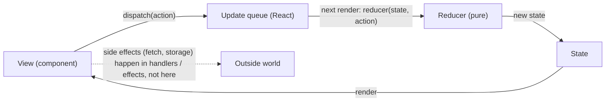
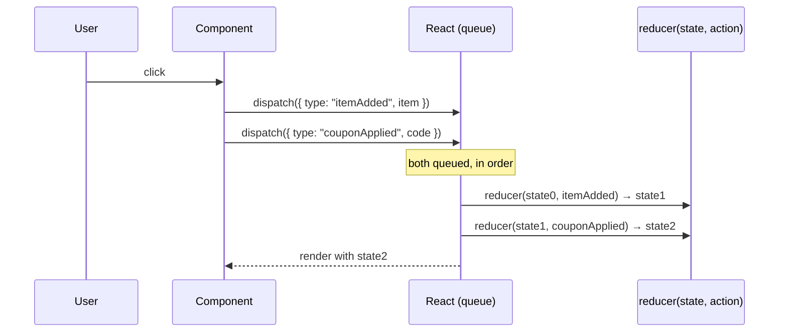
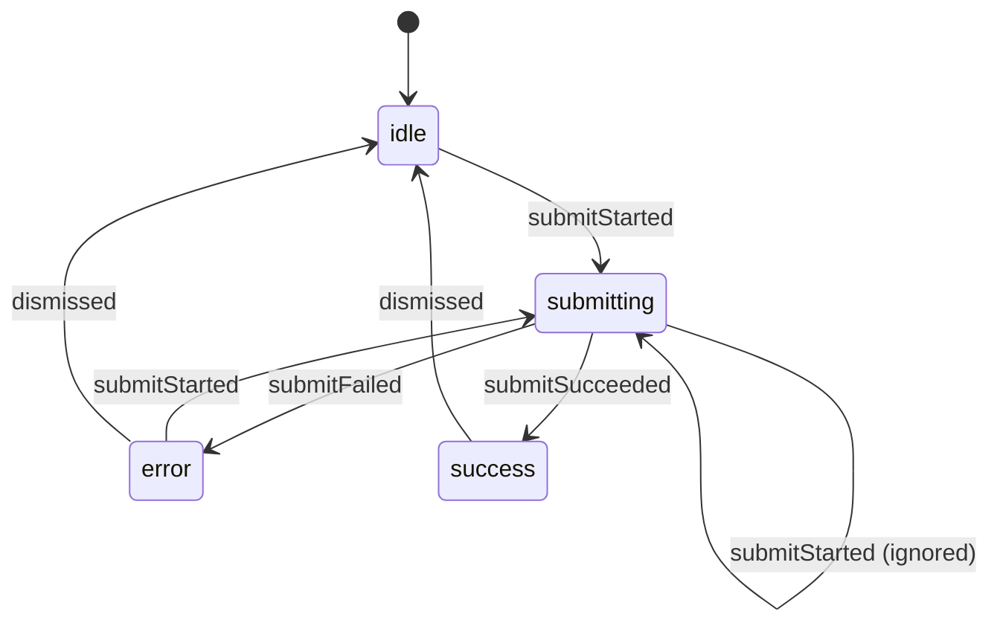
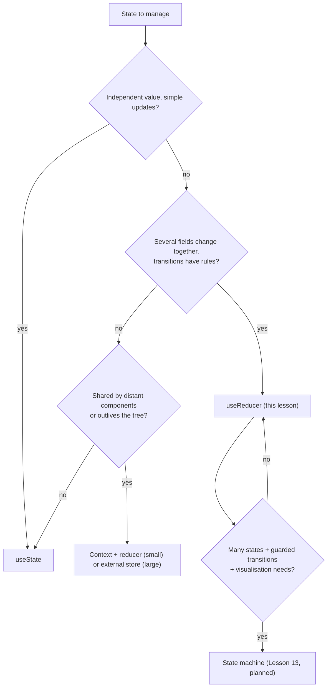

# 05 / 12 — The Reducer Pattern

## 1. Lesson metadata

| | |
|---|---|
| **Level** | Intermediate to Advanced |
| **Study time** | 5–6 hours (reading 2 h, refactoring labs 1.5 h, exercises 2 h) |
| **Prerequisites** | [Phase 0 / 08 — Objects, references, immutability](../00-web-and-javascript-foundations/08-objects-references-immutability.md), [Phase 0 / 19 — Generics and discriminated unions](../00-web-and-javascript-foundations/19-typescript-generics-and-utility-types.md), [Phase 1 / 14 — State as a snapshot](../01-react-fundamentals/14-state-as-a-snapshot.md), [Phase 1 / 15 — Update queues and batching](../01-react-fundamentals/15-update-queues-and-batching.md), [Phase 3 / 02 — Functional state updates](../03-react-state-and-hooks/02-functional-state-updates.md), [Phase 3 / 03 — `useReducer` and reducer architecture](../03-react-state-and-hooks/03-usereducer-and-reducer-architecture.md), [Phase 3 / 17 — Derived state](../03-react-state-and-hooks/17-derived-state.md), [Phase 5 / 06 — Custom hook patterns](./06-custom-hook-patterns.md), [Phase 5 / 08 — Provider pattern](./08-provider-pattern.md) |
| **Next** | [13 — State machine pattern](./13-state-machine-pattern.md) |
| **Related** | [11 — Controlled component pattern](./11-controlled-component-pattern.md), [05 — Compound components](./05-compound-components.md), [Phase 5 / 17 — Facade and command](./17-facade-and-command.md), [Phase 6 / 09 — Redux Toolkit](../06-data-fetching-and-state-ecosystems/09-redux-toolkit.md), [Phase 5 / 25 — Comparative refactoring labs](./25-comparative-refactoring-labs.md) |

> **Status label: CURRENT.** The reducer pattern is a first-class part of React (`useReducer`) and the architecture underneath Redux, Redux Toolkit, and Elm-style state management. [Phase 3 / 03](../03-react-state-and-hooks/03-usereducer-and-reducer-architecture.md) covers the hook's API and semantics. This lesson covers the **design pattern**: how to model actions, structure reducers, compose them, test them, and decide when *not* to use one.

**Learning objectives.** After this lesson you can:
1. Define the reducer pattern as *state transition as a pure function of (state, action)* and map it to Command, State, Memento, and Event Sourcing, stating each mapping's limits.
2. Model state as a discriminated union that makes illegal states unrepresentable, and actions as **events that describe what happened** rather than setters.
3. Write pure, immutable, exhaustively type-checked reducers; test them without React.
4. Compose reducers (slices, scoped actions) and wrap them (higher-order reducers for history and logging), and combine `useReducer` with context correctly.
5. Keep side effects out of reducers and decide where they belong (handlers, effects, Actions).
6. Decide between `useState`, `useReducer`, an external store, and a state machine, with explicit criteria and a scenario where `useReducer` is the wrong choice.

**Concepts covered:** reducer, action, dispatch, event-style vs setter-style actions, discriminated unions, exhaustiveness checking with `never`, transition guards, normalised state, selectors, reducer purity and StrictMode double invocation, scoped actions, higher-order reducers, `useActionState` as a reducer-shaped API, Immer (third-party), reducer + context split.

---

## 2. Deep conceptual explanation

### 2.1 What is the reducer pattern?

A **reducer** is a pure function with the shape

```ts
type Reducer<State, Action> = (state: State, action: Action) => State;
```

It takes the current state and a description of *something that happened* (the **action**), and returns the **next state**. The pattern is the discipline built around that signature:

1. **All transitions of one piece of state are defined in one place** (the reducer).
2. **Components do not mutate or "set" state directly**; they **dispatch actions**: plain data that describes what happened.
3. **The reducer is pure**: same inputs → same output; no mutation of inputs; no side effects; no randomness or time reads.
4. **State is immutable by convention**: the reducer returns new objects for changed parts and reuses unchanged references.

The name comes from `Array.prototype.reduce`: `actions.reduce(reducer, initialState)` computes the current state from the history of actions. That equivalence is more than trivia; it is why reducers are trivially testable and why undo/redo, replay, and time-travel debugging are natural extensions.

### 2.2 The problem it solves

`useState` is excellent for independent values. It degrades when state is **interrelated**:

```tsx
const [items, setItems] = useState<Item[]>([]);
const [status, setStatus] = useState<"idle" | "loading" | "error">("idle");
const [error, setError] = useState<string | null>(null);
const [page, setPage] = useState(1);
const [hasMore, setHasMore] = useState(true);
```

- **Transitions are scattered.** "Load more succeeded" must call `setItems`, `setStatus`, `setPage`, `setHasMore`, and `setError`. Forgetting one produces an inconsistent combination (`status: "idle"` with a stale `error`).
- **Impossible states are representable.** `status: "loading"` and `error: "…"` can both be set at once.
- **Logic lives in handlers**, duplicated across components, and hard to test without rendering.
- **Updates depend on previous state in non-trivial ways**, requiring functional updaters nested in several setters.

The reducer pattern concentrates transitions: one `dispatch({ type: "pageLoaded", items, hasMore })` calls one function that produces a *consistent* next state.

### 2.3 Mapping to classic patterns

| Classic pattern | Idea | Reducer mapping | Where it breaks |
|---|---|---|---|
| **Command** | Reify a request as an object that can be queued, logged, or undone. | An **action** is a command/event object dispatched to a handler (the reducer). Because actions are data, they can be logged, serialised, replayed. | A GoF Command *encapsulates its own execution* (`execute()`); an action is passive data and the reducer interprets it. |
| **State** (GoF) | An object changes behaviour when its internal state changes. | A reducer that switches on `state.status` and the action type implements state-dependent behaviour (transition guards, §5.2). | GoF State uses polymorphic state objects; a reducer centralises the transition table in a function. A formal state machine ([Lesson 13](./13-state-machine-pattern.md)) is the stricter version. |
| **Memento** | Capture and restore state snapshots. | Immutable state values are natural mementos; history is an array of states (`withHistory`, §5.6). | No originator/caretaker class structure. |
| **Event sourcing** | Persist the log of events; derive state by folding them. | `actions.reduce(reducer, initial)`; the dispatched action log is the event log. | In React the log is usually *not* persisted; "event sourcing" at the architecture level also involves storage, schema evolution, and projections, none of which the pattern gives you. |
| **Mediator** | Centralise communication. | One reducer is a single place coordinating several fields. | A mediator coordinates *objects*; a reducer coordinates *values*. |
| **Elm Architecture / Flux / Redux** | Unidirectional data flow: view → action → update → state → view. | `useReducer` is a local instance of this architecture; Redux is the global one. | Redux adds middleware, a store, devtools; `useReducer` is just the update function plus a queue. |
| **Strategy** | Swap algorithms. | A *different reducer function* can be supplied (e.g. test vs production) or wrapped (§5.6). | Typically fixed per component. |

**Honest summary:** the reducer pattern is **Command-as-data plus a pure transition function**. Its most useful claims are *testability*, *single place for transitions*, and *state-as-fold-of-actions*, not the GoF resemblance.

### 2.4 What React exposes

- `useReducer(reducer, initialArg, init?)` returns `[state, dispatch]`. `dispatch` has **stable identity** for the component's lifetime. `init` (lazy initialiser) computes the initial state once.
- React **queues** dispatched actions and applies the reducer when it next renders that component ([Phase 1 / 15](../01-react-fundamentals/15-update-queues-and-batching.md)). Multiple dispatches in the same event are applied **in order, each seeing the result of the previous one**. This differs from `setCount(count + 1)` twice (snapshot problem) and is why reducers don't need the functional-updater idiom.
- If the reducer returns the **same state reference** (`Object.is`), React bails out of re-rendering children (it may still call the component function once more before bailing out; do not rely on the component not running).
- In **StrictMode development**, React calls your reducer (and the initialiser) **twice** with the same inputs to help find impurity ([Phase 2 / 28](../02-react-rendering-and-internals/28-strict-mode-behavior.md)). A pure reducer is unaffected.
- React 19's `useActionState(action, initialState)` is *reducer-shaped*: the action receives `(previousState, formData)` and returns the next state (possibly asynchronously) (§5.9).

### 2.5 Common misconceptions

1. **"Reducers are Redux."** Reducers are a pattern; Redux is one library built on it. `useReducer` needs no library.
2. **"Use `useReducer` for anything with more than one `useState`."** The decision is about *coupled transitions*, not counts (§7).
3. **"Reducers can fetch data."** They cannot, by purity. Effects belong in handlers, effects, or Actions (§5.5, §5.8).
4. **"Action names should be commands (`SET_X`)."** Event-style names (`orderSubmitted`) usually keep logic in the reducer; setter-style names (`SET_LOADING`) move logic back into components (§5.3).
5. **"Mutating in a reducer is fine because the next state is returned."** Mutating `state` breaks bailout comparisons, StrictMode double-invocation (the second call sees already-mutated input), and memoisation, and is a classic source of "UI doesn't update".
6. **"`useReducer` is faster than `useState`."** Not inherently. Both schedule renders. The reducer can make *dispatch* stable (useful to pass to memoised children), but that is usually irrelevant.
7. **"Everything in one giant reducer."** Reducers should be composed from smaller reducers (§5.6) and state should be scoped to the component or feature that needs it ([Phase 3 / 18](../03-react-state-and-hooks/18-state-colocation-and-lifting.md)).

---

## 3. Internal mechanics

### 3.1 Public guarantees

- `dispatch` identity is stable across renders (documented).
- Actions dispatched in the same batch are processed in order; each reducer call receives the state produced by the previous action.
- `useReducer` bails out when the new state is identical (`Object.is`) to the current.
- The reducer and initialiser may be invoked twice in development StrictMode.
- The reducer function used is the one from the **render in which it is applied** (you may define it inside the component and close over props; but do so deliberately, since the result depends on props at *render time*, not at dispatch time).
- Rendering must be pure ([Phase 2 / 12](../02-react-rendering-and-internals/12-why-rendering-must-be-pure.md)): the reducer runs as part of rendering (or an eager computation), so it must not perform side effects.

### 3.2 Teaching model



Think of `state` as `actionsSoFar.reduce(reducer, initial)`. React maintains the "reduced so far" value and a queue of pending actions.

### 3.3 Implementation detail ⚠

Conceptually React stores the reducer queue on the component's hook record ([Phase 2 / 17](../02-react-rendering-and-internals/17-hooks-and-fiber-state.md)) and applies pending actions during render. React may also compute the next state **eagerly** at dispatch time when the queue is empty, to bail out cheaply, and then recompute during render if the reducer function changed. This is an optimisation detail: the *public contract* is purity, ordering, and `Object.is` bailout. Do not write reducers whose correctness depends on *when* they run or *how many times*; verify behaviour in the React source if you need the details ([Phase 2 / 31](../02-react-rendering-and-internals/31-reading-react-source.md)).

### 3.4 Types as part of the mechanics

TypeScript's discriminated unions give a reducer **compile-time exhaustiveness**:

```ts
function assertNever(x: never): never {
  throw new Error(`Unhandled action: ${JSON.stringify(x)}`);
}
```

In the `default` branch of a `switch (action.type)`, `action` has type `never` if every variant is handled. Adding a new action variant without handling it becomes a compile error at `assertNever(action)`. This is the main safety net of the pattern in TypeScript ([Phase 0 / 19](../00-web-and-javascript-foundations/19-typescript-generics-and-utility-types.md)).

---

## 4. Step-by-step execution walkthrough

A cart with `useReducer(cartReducer, initialCart)`. The user double-clicks "Add" on the same product (two click events), and separately a handler dispatches two actions in one event.

**Part A: two dispatches in one handler**

```tsx
function onBulkAdd() {
  dispatch({ type: "itemAdded", item: shoe });
  dispatch({ type: "itemAdded", item: shoe });
}
```

1. **Click event.** React runs `onBulkAdd`; both `dispatch` calls enqueue actions. No reducer has run yet (conceptually).
2. **Handler ends; React processes the batch.** It schedules a render for the cart's component.
3. **Render.** React applies the queue in order: `state1 = reducer(state0, a1)` (quantity 1), `state2 = reducer(state1, a2)` (quantity 2). Final `state = state2`.
4. **Commit.** The UI shows quantity 2.

Contrast with `useState`: `setQty(qty + 1)` twice yields +1 (both read the same snapshot); `setQty(q => q + 1)` twice yields +2. Reducers get the "+2" semantics by construction, since each action sees the result of the previous.

> **Predict:** In dev with StrictMode, how many times is `cartReducer` called for one dispatched action, and what must be true for the app to behave identically? *(Answer: twice, with the same arguments, to expose impurity; the second result is discarded or the first is, but they must be equal. This holds when the reducer is pure and does not mutate `state`. A reducer that does `state.items.push(...)` would add the item twice in development and produce visible duplicates, which is exactly the bug the double invocation is designed to surface.)*

**Part B: a no-op action and bailout**

5. The user clicks "Clear coupon" when `coupon` is already `null`. The reducer's `couponCleared` branch returns `state` unchanged (not a copy).
6. React compares `Object.is(next, current)`: identical, so no re-render of descendants (React may call the component function once but skips committing changes).

**Part C: a transition guard**

7. In the checkout status reducer (§5.2), `submitStarted` arrives while `status` is already `"submitting"`. The reducer returns the *same* state; the double-submit is ignored without any extra `if` in components.

---

## 5. Code examples

### 5.1 Minimal: a counter reducer, typed and exhaustive

```ts
// counter.ts
export type CounterState = { count: number };
export type CounterAction =
  | { type: "incremented" }
  | { type: "decremented" }
  | { type: "reset" };

function assertNever(x: never): never {
  throw new Error(`Unhandled action: ${JSON.stringify(x)}`);
}

export function counterReducer(state: CounterState, action: CounterAction): CounterState {
  switch (action.type) {
    case "incremented": return { count: state.count + 1 };
    case "decremented": return { count: state.count - 1 };
    case "reset":       return { count: 0 };
    default:            return assertNever(action);
  }
}
```

```tsx
function Counter() {
  const [state, dispatch] = useReducer(counterReducer, { count: 0 });
  return (
    <>
      <p>{state.count}</p>
      <button onClick={() => dispatch({ type: "incremented" })}>+</button>
      <button onClick={() => dispatch({ type: "reset" })}>Reset</button>
    </>
  );
}
```

**Notes.** A counter is the *wrong* thing to use a reducer for in production (a `useState` would do); it is shown for shape. `assertNever` makes the compiler enforce exhaustiveness. Action names are **past-tense events** (`incremented`) describing what happened, not imperative setters.

### 5.2 Real-world: a request-status reducer with transition guards (impossible states made unrepresentable)

```ts
// submit.ts
export type SubmitState =
  | { status: "idle" }
  | { status: "submitting" }
  | { status: "success"; orderId: string }
  | { status: "error"; message: string };

export type SubmitAction =
  | { type: "submitStarted" }
  | { type: "submitSucceeded"; orderId: string }
  | { type: "submitFailed"; message: string }
  | { type: "dismissed" };

export function submitReducer(state: SubmitState, action: SubmitAction): SubmitState {
  switch (action.type) {
    case "submitStarted":
      // Guard: ignore a second start while one is in flight, and don't restart after success.
      return state.status === "idle" || state.status === "error" ? { status: "submitting" } : state;
    case "submitSucceeded":
      return state.status === "submitting" ? { status: "success", orderId: action.orderId } : state;
    case "submitFailed":
      return state.status === "submitting" ? { status: "error", message: action.message } : state;
    case "dismissed":
      return state.status === "success" || state.status === "error" ? { status: "idle" } : state;
    default:
      return assertNever(action);
  }
}
```

```tsx
function CheckoutButton({ cart }: { cart: Cart }) {
  const [state, dispatch] = useReducer(submitReducer, { status: "idle" });

  async function onClick() {
    dispatch({ type: "submitStarted" });
    try {
      const { orderId } = await placeOrder(cart);      // side effect lives in the handler
      dispatch({ type: "submitSucceeded", orderId });
    } catch (e) {
      dispatch({ type: "submitFailed", message: e instanceof Error ? e.message : "Unknown error" });
    }
  }

  return (
    <>
      <button onClick={onClick} disabled={state.status === "submitting"}>Place order</button>
      {state.status === "error" && <p role="alert">{state.message}</p>}
      {state.status === "success" && <p>Order {state.orderId} placed</p>}
    </>
  );
}
```

**Why this design.** `error` only exists on the `"error"` variant; `orderId` only on `"success"`. The type system prevents reading `state.message` unless `status === "error"`, and `status: "submitting"` cannot coexist with an old error. The reducer's guards make *double-click* a no-op (a stale `submitSucceeded` after a dismissed request is ignored too). The `await` and `placeOrder` stay **outside** the reducer. This is the practical boundary between the pattern and the real world.

**Edge case worth naming.** If the user unmounts the component during the request, a later `dispatch` is a harmless no-op in current React (earlier versions warned about updates on unmounted components; ⚠ warning behaviour changed across versions). If the component can be re-mounted and the *response of a stale request* must not apply, tag requests with an id in the actions and ignore mismatches in the reducer.

### 5.3 Event-style vs setter-style actions

**Setter style (logic leaks out of the reducer):**

```ts
type Action =
  | { type: "SET_ITEMS"; items: Item[] }
  | { type: "SET_LOADING"; loading: boolean }
  | { type: "SET_ERROR"; error: string | null }
  | { type: "SET_PAGE"; page: number };

// components must dispatch four actions in the right order to express "page loaded"
dispatch({ type: "SET_LOADING", loading: false });
dispatch({ type: "SET_ITEMS", items: [...state.items, ...page.items] });  // reads state in the component: stale-prone
dispatch({ type: "SET_PAGE", page: state.page + 1 });
```

This is `useState` with extra ceremony: the reducer does nothing but assign; the transition logic (append, increment, clear error, set loading false) lives in the component, can be forgotten or reordered, and reads `state` from a snapshot.

**Event style:**

```ts
type Action =
  | { type: "loadStarted" }
  | { type: "pageLoaded"; items: readonly Item[]; hasMore: boolean }
  | { type: "loadFailed"; message: string };

function reducer(state: ListState, action: Action): ListState {
  switch (action.type) {
    case "loadStarted":
      return state.status === "loading" ? state : { ...state, status: "loading", error: null };
    case "pageLoaded":
      return { ...state, status: "idle", items: [...state.items, ...action.items], page: state.page + 1, hasMore: action.hasMore };
    case "loadFailed":
      return { ...state, status: "error", error: action.message };
    default:
      return assertNever(action);
  }
}
```

The component says *what happened*; the reducer decides *what that means for state*. The Redux style guide recommends this "model actions as events, not setters" framing ⚠ consult the current Redux docs for the exact wording and rationale. The rule is a heuristic: if your actions are named `SET_<field>` for every field, you probably want `useState`.

### 5.4 Incorrect: mutation, impurity, and impossible states

**(a) Mutation**

```ts
case "itemAdded": {
  state.items.push({ ...action.item, quantity: 1 });   // ❌ mutates the previous state
  return state;                                        // ❌ same reference: React bails out → UI doesn't update
}
```

Effects: same reference ⇒ `Object.is` bailout ⇒ no re-render; memoised children comparing `items` see no change; in StrictMode the push happens twice (duplicates in development only, which makes it look like a "dev-only bug"). Fix: return `{ ...state, items: [...state.items, newItem] }`.

**(b) Side effects and non-determinism**

```ts
case "orderPlaced": {
  localStorage.setItem("lastOrder", JSON.stringify(action.order));  // ❌ side effect
  return { ...state, id: crypto.randomUUID(), placedAt: Date.now(), order: action.order };   // ❌ non-deterministic
}
```

StrictMode double invocation writes storage twice and generates two different ids (the one React keeps is arbitrary). Fix: generate `id` and `placedAt` **in the handler** and pass them in the action (`{ type: "orderPlaced", id, placedAt, order }`), and persist in an effect or handler.

**(c) Parallel booleans**

```ts
type State = { isLoading: boolean; isError: boolean; data?: Data; error?: string };
```

`isLoading && isError` is representable; the UI must define what that means. Use the discriminated union of §5.2.

### 5.5 Where side effects belong

| Need | Wrong place | Right place |
|---|---|---|
| Fetch after a user action | In the reducer | In the event handler: `dispatch(started)`, `await`, `dispatch(succeeded/failed)` |
| Persist state to storage when it changes | In the reducer | `useEffect(() => save(state), [state])` (and debounce), or a storage-sync store |
| Generate id/timestamp/random | In the reducer | In the handler, passed in the action |
| Analytics | In the reducer | In the handler, or an effect keyed on a *transition* |
| Navigate after success | In the reducer | Effect that watches `state.status === "success"`, or in the handler after the awaited call |
| Trigger a second action in response to the first | `dispatch` inside the reducer | Compute everything in one transition; if truly sequential, an effect |

An effect that *only* dispatches in reaction to state is a smell ("effect chain"; [Phase 3 / 07](../03-react-state-and-hooks/07-you-might-not-need-an-effect.md)): fold the second transition into the first reducer branch.

### 5.6 Advanced: composing and wrapping reducers

**Scoped actions (Elm-style composition):**

```ts
type AppState = { cart: CartState; ui: UiState };
type AppAction =
  | { scope: "cart"; action: CartAction }
  | { scope: "ui"; action: UiAction };

export function appReducer(state: AppState, a: AppAction): AppState {
  switch (a.scope) {
    case "cart": {
      const cart = cartReducer(state.cart, a.action);
      return cart === state.cart ? state : { ...state, cart };   // preserve identity when nothing changed
    }
    case "ui": {
      const ui = uiReducer(state.ui, a.action);
      return ui === state.ui ? state : { ...state, ui };
    }
    default:
      return assertNever(a);
  }
}
```

Scoped actions keep each slice's reducer exhaustive over its *own* action type and make routing explicit and type-safe. The alternative (each slice reducer accepts the whole union and ignores unknown actions, as Redux's `combineReducers` does) loses per-slice exhaustiveness.

**Higher-order reducer: `withHistory` (Memento via composition):**

```ts
export type History<S> = { past: readonly S[]; present: S; future: readonly S[] };
type HistoryControl = { type: "history/undone" } | { type: "history/redone" };

export function withHistory<S, A extends { type: string }>(reducer: (s: S, a: A) => S) {
  return (h: History<S>, a: A | HistoryControl): History<S> => {
    if (a.type === "history/undone") {
      if (h.past.length === 0) return h;
      return { past: h.past.slice(0, -1), present: h.past[h.past.length - 1], future: [h.present, ...h.future] };
    }
    if (a.type === "history/redone") {
      if (h.future.length === 0) return h;
      return { past: [...h.past, h.present], present: h.future[0], future: h.future.slice(1) };
    }
    const next = reducer(h.present, a as A);          // narrowing across a generic union needs a cast
    if (Object.is(next, h.present)) return h;          // no-op actions don't create history entries
    return { past: [...h.past, h.present], present: next, future: [] };
  };
}

// usage
const editorReducerWithHistory = withHistory(editorReducer);
const [h, dispatch] = useReducer(editorReducerWithHistory, { past: [], present: initialDoc, future: [] });
```

This is the **Decorator** pattern applied to functions: the wrapped reducer is unchanged, and undo/redo is added around it. Caveats: unbounded `past` grows memory (cap it); coalescing keystrokes into one history entry needs a policy (time-based or action-based); the `a as A` cast is the price of generic wrapping.

**Higher-order reducer: logging (development only):**

```ts
export function withLogging<S, A>(reducer: (s: S, a: A) => S, label: string) {
  return (s: S, a: A): S => {
    const next = reducer(s, a);
    if (import.meta.env.DEV) console.log(`[${label}]`, a, s, "→", next);   // Vite-style flag; ⚠ differs per bundler
    return next;
  };
}
```

A `console.log` is an *impure* act: in StrictMode development it logs twice per action. That is acceptable for a development aid you understand, and **not** acceptable for anything with observable effects (analytics, persistence). Prefer React DevTools or a dedicated devtools integration if your store library offers one.

**`useReducer` + context, split for stability** ([Lesson 08](./08-provider-pattern.md)):

```tsx
const CartStateContext = createContext<CartState | null>(null);
const CartDispatchContext = createContext<React.Dispatch<CartAction> | null>(null);

export function CartProvider({ children }: { children: ReactNode }) {
  const [state, dispatch] = useReducer(cartReducer, initialCart);
  return (
    <CartDispatchContext value={dispatch}>
      <CartStateContext value={state}>{children}</CartStateContext>
    </CartDispatchContext>
  );
}
export function useCart() { const s = use(CartStateContext); if (!s) throw new Error("Missing <CartProvider>"); return s; }
export function useCartDispatch() { const d = use(CartDispatchContext); if (!d) throw new Error("Missing <CartProvider>"); return d; }
```

`dispatch` is stable, so components that only dispatch ("Add to cart" buttons) read `CartDispatchContext` and **do not re-render when the cart changes**. Components that read `state` re-render on every state change; for large apps with many readers, an external store with selectors ([Phase 3 / 20](../03-react-state-and-hooks/20-usesyncexternalstore-and-external-stores.md)) scales better.

**Selectors keep derived values out of state:**

```ts
export const selectSubtotalCents = (s: CartState) =>
  s.items.reduce((sum, i) => sum + i.unitPriceCents * i.quantity, 0);
```

Derived data (`subtotal`, `itemCount`) is computed from state, never stored in it ([Phase 3 / 17](../03-react-state-and-hooks/17-derived-state.md)).

### 5.7 A fuller real-world reducer: cart with normalised updates

```ts
export type CartItem = { sku: string; name: string; unitPriceCents: number; quantity: number };
export type CartState = { items: readonly CartItem[]; coupon: string | null };
export type CartAction =
  | { type: "itemAdded"; item: Omit<CartItem, "quantity"> }
  | { type: "quantityChanged"; sku: string; quantity: number }
  | { type: "itemRemoved"; sku: string }
  | { type: "couponApplied"; code: string }
  | { type: "couponCleared" }
  | { type: "cartCleared" };

export const initialCart: CartState = { items: [], coupon: null };

export function cartReducer(state: CartState, action: CartAction): CartState {
  switch (action.type) {
    case "itemAdded": {
      const existing = state.items.find((i) => i.sku === action.item.sku);
      return existing
        ? { ...state, items: state.items.map((i) => (i.sku === existing.sku ? { ...i, quantity: i.quantity + 1 } : i)) }
        : { ...state, items: [...state.items, { ...action.item, quantity: 1 }] };
    }
    case "quantityChanged": {
      const quantity = Math.floor(action.quantity);
      if (!Number.isFinite(quantity)) return state;                              // reject NaN/Infinity
      if (quantity <= 0) return { ...state, items: state.items.filter((i) => i.sku !== action.sku) };
      if (!state.items.some((i) => i.sku === action.sku)) return state;          // unknown sku: no-op
      return { ...state, items: state.items.map((i) => (i.sku === action.sku ? { ...i, quantity } : i)) };
    }
    case "itemRemoved":
      return state.items.some((i) => i.sku === action.sku)
        ? { ...state, items: state.items.filter((i) => i.sku !== action.sku) }
        : state;
    case "couponApplied":
      return state.coupon === action.code ? state : { ...state, coupon: action.code };
    case "couponCleared":
      return state.coupon === null ? state : { ...state, coupon: null };
    case "cartCleared":
      return state.items.length === 0 && state.coupon === null ? state : initialCart;
    default:
      return assertNever(action);
  }
}
```

**Notes.** Business rules (`quantity <= 0` removes the item; unknown SKU ignored; non-finite rejected) live in one place and are unit-testable. No-op branches return the *same* state reference to enable bailout. Money is integer cents. The coupon is stored as a **code**; the discount amount is derived (and validated on the server, [Phase 4 / 12](../04-react-architecture/12-domain-logic-vs-ui-logic.md)).

**Testing without React:**

```ts
import { cartReducer, initialCart } from "./cart";

test("adding the same sku twice increments quantity", () => {
  const shoe = { sku: "S1", name: "Shoe", unitPriceCents: 5000 };
  const a = cartReducer(initialCart, { type: "itemAdded", item: shoe });
  const b = cartReducer(a, { type: "itemAdded", item: shoe });
  expect(b.items).toEqual([{ ...shoe, quantity: 2 }]);
});

test("does not mutate its input", () => {
  const frozen = Object.freeze({ ...initialCart, items: Object.freeze([]) });
  expect(() => cartReducer(frozen, { type: "couponApplied", code: "X" })).not.toThrow();
});

test("no-op returns the same reference", () => {
  expect(cartReducer(initialCart, { type: "couponCleared" })).toBe(initialCart);
});
```

Freezing the input (in strict-mode ES modules, mutation of a frozen object throws) is a cheap mutation detector. The tests need no renderer, no providers, no mocks.

### 5.8 Lazy initialisation and persistence

```tsx
function init(userId: string): CartState {
  const raw = localStorage.getItem(`cart:${userId}`);       // runs once on mount
  return raw ? (JSON.parse(raw) as CartState) : initialCart;  // ⚠ validate parsed data in real code
}
const [state, dispatch] = useReducer(cartReducer, userId, init);

useEffect(() => {
  localStorage.setItem(`cart:${userId}`, JSON.stringify(state));   // persistence is an effect
}, [userId, state]);
```

The third argument (`init`) runs only on the first render (twice in StrictMode development, so it must be pure *except for reads*; reading storage is fine, writing is not). The persisted JSON should be validated and versioned; the type assertion above is a promise to the compiler, not a check. In SSR, `localStorage` is not available during server rendering; read it in an effect or via a client-only provider ([Phase 2 / 26](../02-react-rendering-and-internals/26-ssr-and-client-rendering.md)).

### 5.9 Reducer-shaped React 19 API: `useActionState`

```tsx
type FormState = { status: "idle" } | { status: "error"; message: string } | { status: "success" };

async function subscribeAction(prev: FormState, formData: FormData): Promise<FormState> {
  const email = String(formData.get("email") ?? "");
  if (!email.includes("@")) return { status: "error", message: "Enter a valid email" };
  await api.subscribe(email);                              // side effects ARE allowed in an Action
  return { status: "success" };
}

function SubscribeForm() {
  const [state, formAction, isPending] = useActionState(subscribeAction, { status: "idle" });
  return (
    <form action={formAction}>
      <input name="email" type="email" required />
      <button disabled={isPending}>Subscribe</button>
      {state.status === "error" && <p role="alert">{state.message}</p>}
      {state.status === "success" && <p>Subscribed!</p>}
    </form>
  );
}
```

| | `useReducer` reducer | `useActionState` action |
|---|---|---|
| Signature | `(state, action) => state` | `(prevState, payload) => state \| Promise<state>` |
| Pure? | **Must be** | **No**; Actions are designed for side effects (network) |
| Async | No | Yes |
| Triggered by | `dispatch(action)` | Form submission or calling `formAction(...)` (transition) |
| Concurrency | Applied in order during render | Actions are queued/sequenced by React ⚠ verify current semantics in the docs |

The *shape* (previous state in, next state out) is the same, but the contract is different: an Action is a place for effects; a reducer is not. Verify the current `useActionState` semantics (queuing, error handling, transition behaviour) against the React docs; see [Phase 3 / 22](../03-react-state-and-hooks/22-modern-hooks-and-apis.md).

### 5.10 Immer (third-party) for deeply nested updates

```ts
import { produce } from "immer";    // third-party library: verify current API in its docs

const next = produce(state, (draft) => {
  const item = draft.items.find((i) => i.sku === action.sku);
  if (item) item.quantity = action.quantity;     // "mutation" of a draft; Immer produces an immutable result
});
```

Immer lets you write mutating-looking code that yields immutable results with structural sharing, valuable when state is deeply nested. Redux Toolkit's `createSlice` uses it internally ⚠ verify in the current RTK docs. Costs: an additional dependency, a conceptual layer (drafts; don't mix returning a new value with mutating the draft), and it hides the immutability discipline you'd still need elsewhere. For shallow reducers, spreads are clearer. A `useImmerReducer` helper exists in the `use-immer` package ⚠ *(unverified)*.

### 5.11 Before/after refactoring lab 1: five `useState`s with coupled transitions → reducer

**Before.**

```tsx
function Feed() {
  const [items, setItems] = useState<Post[]>([]);
  const [page, setPage] = useState(1);
  const [loading, setLoading] = useState(false);
  const [error, setError] = useState<string | null>(null);
  const [hasMore, setHasMore] = useState(true);

  async function loadMore() {
    if (loading || !hasMore) return;
    setLoading(true);
    setError(null);
    try {
      const res = await fetchPosts(page);
      setItems((prev) => [...prev, ...res.posts]);
      setPage((p) => p + 1);
      setHasMore(res.hasMore);
    } catch (e) {
      setError(String(e));
    } finally {
      setLoading(false);
    }
  }
  …
}
```

Issues: (1) `loading` is read from a closure; two quick clicks in the same render both pass the guard (the state hasn't re-rendered yet); (2) transitions are spread across setters, any one of which can be forgotten; (3) `error` and `loading` can both be truthy in intermediate renders; (4) untestable without rendering.

**After.**

```tsx
type State = { items: readonly Post[]; page: number; status: "idle" | "loading" | "error"; error: string | null; hasMore: boolean };
type Action =
  | { type: "loadStarted" }
  | { type: "pageLoaded"; posts: readonly Post[]; hasMore: boolean }
  | { type: "loadFailed"; message: string };

function feedReducer(s: State, a: Action): State {
  switch (a.type) {
    case "loadStarted": return s.status === "loading" || !s.hasMore ? s : { ...s, status: "loading", error: null };
    case "pageLoaded":  return s.status !== "loading" ? s : { ...s, status: "idle", items: [...s.items, ...a.posts], page: s.page + 1, hasMore: a.hasMore };
    case "loadFailed":  return s.status !== "loading" ? s : { ...s, status: "error", error: a.message };
    default: return assertNever(a);
  }
}
```

The handler still performs the fetch but must read `state.page` for the request; the reducer's `loadStarted` guard is now the **authoritative** double-start protection (the second of two quick dispatches sees `status: "loading"` and is a no-op), though the handler may still issue two `fetchPosts` calls if it doesn't check the result. A neat fix is to let the handler `await` only if the dispatch changed state; but since `dispatch` doesn't return a value, the stricter approach is to make the guard in the handler *and* the reducer, or to use a ref for in-flight requests. This is a real limitation: **reducers guard state, not side effects.**

| Dimension | Before | After |
|---|---|---|
| Transition logic location | Spread across handler/setters | One reducer |
| Illegal combos (`loading` + `error`) | Representable transiently | Unrepresentable (`error` cleared on start) |
| Unit testing | Requires rendering | Pure function tests |
| Boilerplate | Lower | Higher (types, actions) |
| Side-effect double-fire guard | Closure flag (stale-prone) | Reducer guard for state; handler still needs a guard for the fetch |
| When it is worth it | n/a | State has ≥3 coupled fields and non-trivial transitions |

### 5.12 Before/after refactoring lab 2: setter-style Redux-flavoured actions → event style

**Before:** `SET_ITEMS`, `SET_LOADING`, `SET_ERROR`, `SET_PAGE` (§5.3), with components computing next values. **After:** three event actions with all logic in the reducer.

| Dimension | Setter style | Event style |
|---|---|---|
| Who knows the transition rules | Every dispatching component | The reducer |
| Risk of partial updates | High | Low (one action = one consistent transition) |
| Action count | Grows with fields | Grows with *business events* |
| Logging/debugging readability | `SET_LOADING false` | `pageLoaded (20 posts, hasMore=false)` |
| When setter style is fine | Truly independent fields (use `useState`) | n/a |

### 5.13 Before/after refactoring lab 3: impure reducer → pure reducer + handler/effect

**Before** (§5.4b). **After:** the handler creates the id and timestamp (`const id = crypto.randomUUID()`), dispatches `{ type: "orderPlaced", id, placedAt, order }`; persistence moves to `useEffect(() => save(state.lastOrder), [state.lastOrder])`.

Gains: deterministic reducer, StrictMode-safe, test with literal inputs. Costs: the handler grows a few lines; persistence timing is now "after commit", not "during update" (a crash between dispatch and effect loses the write; if durability matters, write in the handler before dispatching).

### 5.14 When `useReducer` is the wrong choice (a before/after in the other direction)

**Before (over-engineered):**

```tsx
type Action = { type: "toggled" };
const [{ open }, dispatch] = useReducer((s: { open: boolean }, a: Action) => ({ open: !s.open }), { open: false });
```

**After:** `const [open, setOpen] = useState(false);`

A reducer with one field and one trivial transition adds a type, an action, a switch, and no benefit. Use the table in §7.1 to decide.

---

## 6. Visual explanations

### 6.1 The loop



### 6.2 State-status machine for §5.2 (the transitions the reducer allows)



Anything not drawn is a no-op that returns the same state. For larger machines, [Lesson 13](./13-state-machine-pattern.md) formalises this.

### 6.3 Choosing the state tool



---

## 7. Alternative approaches and trade-offs

### 7.1 Comparison

| Criterion | `useState` | `useReducer` | Reducer + Immer | External store (Redux Toolkit, Zustand, etc.) | State machine library | `useActionState` |
|---|---|---|---|---|---|---|
| Best for | Independent values | Coupled transitions | Deeply nested updates | Shared/global state, devtools, middleware | Complex workflows with explicit states | Form submissions with server round-trips |
| Transition logic location | Handlers | **One pure function** | One pure function | Slices/reducers/actions | Machine definition | The Action function |
| Unit-testable without React | Hard | **Yes** | Yes | Yes | Yes | Partly (async, FormData) |
| Boilerplate | **Lowest** | Medium | Medium + dependency | Higher | Higher | Low–medium |
| Impossible-state prevention | Manual | **With discriminated unions** | Same | Same | **Strongest** (explicit) | Manual |
| Cross-component sharing | Lift/context | Context | Context | **Built for it** | Context/store | Local to the form |
| Undo/redo, replay | Manual | Natural (§5.6) | Natural | Natural (+ devtools) | Possible | Not designed for it |
| Side effects | Handlers/effects | Handlers/effects | Same | Middleware/thunks/listeners | Invoked services/actions | **Inside the Action** |
| Learning curve | Low | Medium | Medium–high | High | High | Medium |

### 7.2 Decision heuristics for `useState` vs `useReducer`

| Signal | Leans to |
|---|---|
| One value, set directly | `useState` |
| Next state depends on prev in one simple way | `useState` with functional updater |
| ≥3 fields updated together by one event | `useReducer` |
| Rules like "ignore if already loading", "removing resets selection" | `useReducer` |
| Need to test transitions in isolation | `useReducer` |
| Many handlers across components dispatch the same kinds of updates | `useReducer` (+ context) |
| State used by far-flung components, performance-sensitive | External store with selectors |
| The sequence of events matters and illegal sequences must be impossible | State machine |

### 7.3 When the recommended approach is NOT best

- **Simple, independent state.** `useReducer` for a boolean is noise.
- **Server state.** Lists fetched from an API with caching, retries, invalidation: a data-fetching library, not a hand-written fetch reducer ([Phase 3 / 19](../03-react-state-and-hooks/19-ui-server-url-and-shared-state.md)). The `Feed` example in §5.11 is for teaching; in production, a query library's infinite-query support does this with caching and deduplication.
- **Form state.** Large forms are better served by a form library or uncontrolled fields ([Lesson 11](./11-controlled-component-pattern.md)); a reducer for every keystroke is an expensive re-render design.
- **High-frequency state** (pointer position, scroll): reducers re-render on each dispatch; consider refs, `useSyncExternalStore`, or non-React state with throttled commits.
- **Performance-critical shared state with many subscribers:** context + reducer re-renders all readers; use a store with selectors.
- **Workflow with many conditional states.** A reducer with ten boolean guards is a state machine in disguise; make it explicit ([Lesson 13](./13-state-machine-pattern.md)).

---

## 8. Best practices and anti-patterns

### 8.1 Best practices

1. **Model state as a discriminated union** when it has modes; keep fields that only make sense in a mode inside that mode's variant.
2. **Name actions as past-tense events** describing what happened (`quantityChanged`), not setters.
3. **Keep reducers pure**: no mutation, no I/O, no `Date.now()`/random; pass non-deterministic values in the action.
4. **Return the same reference for no-ops.** It enables bailout and communicates intent.
5. **Use exhaustive `switch` with `assertNever`.**
6. **Put derived data in selectors**, not in state.
7. **Keep payloads minimal and serialisable** (no functions, class instances, DOM nodes), which keeps actions loggable and replayable.
8. **Keep state normalised** when entities are referenced from several places (store by id; reference by id), so updates touch one location ([Phase 6](../06-data-fetching-and-state-ecosystems/)).
9. **Test the reducer as a plain function**, including no-op identity and immutability.
10. **Colocate**: define the reducer and its types next to the feature that uses it; export the dispatching API (action creators or a hook) rather than the raw reducer where the module boundary matters.
11. **Guard transitions in the reducer** (state-dependent legality) rather than in every handler.
12. **Version and validate persisted state** loaded in `init`.

### 8.2 Beginner mistakes

- Mutating `state` or its nested arrays/objects.
- Forgetting `default`/exhaustiveness and returning `undefined` (React then renders with `undefined` state).
- Dispatching inside the reducer or calling the reducer manually in render.
- Putting the whole app in one reducer and one context.
- Reading `state` in a handler right after `dispatch` and expecting the new value.

### 8.3 Experienced-developer mistakes

- **Setter-style actions everywhere** (`SET_X`), producing `useState` with extra steps.
- **Adding middleware-like behaviour into the reducer** (analytics, persistence).
- **Over-normalisation or over-generalisation**: generic `entitiesReducer<T>` for two entity types.
- **Storing derived or UI-ephemeral data** (hover state, input draft) in the shared reducer, causing global re-renders.
- **Using actions as RPC** (`{ type: "FETCH_USER" }` expecting the reducer to fetch).
- **Large payloads in actions** that duplicate server cache.
- **Using a reducer for a state machine without making the states explicit**, leaving boolean soup.

### 8.4 Smells

- A reducer whose branches mostly say `return { ...state, field: action.field }`.
- Action types named after UI widgets (`BUTTON_CLICKED`) instead of domain events.
- Comments such as "make sure to dispatch X before Y".
- Components that read `state` and compute the *next* state to dispatch (logic should be in the reducer).
- Non-serialisable values in actions (functions, `Date` objects if you need persistence/replay: prefer ISO strings or numbers).
- A `reset` action that returns a hard-coded literal duplicating `initialState`.

### 8.5 Justified exceptions

- A reducer may perform a **development-only log** (impure) with the understanding that StrictMode duplicates it.
- Storing a **function** in state (for example a callback registry) can be reasonable in local, non-persisted state; document that actions are then not serialisable.
- **Event-style vs setter-style is a spectrum.** A generic `fieldChanged(name, value)` action for a flat form is a legitimate, compact design when there are no cross-field rules.

---

## 9. Real-world application

| Domain | Reducer usage | Engineering constraints |
|---|---|---|
| **E-commerce** | Cart reducer (§5.7); checkout wizard step state; filter state in a product listing | Money in integer minor units; server is authoritative for price/stock (the client cart is a *proposal*); persistence per user; merge carts on login; analytics via handlers. |
| **Dashboards** | Widget layout reducer (move/resize/add/remove) with undo (`withHistory`); filter state | Serialisable layout for saving; coalescing drag events into one history entry; performance of frequent drag actions (throttle dispatches or keep drag state in a ref until drop). |
| **Finance** | Order-ticket reducer (draft → validated → submitting → confirmed/rejected); reconciliation tables | Transition guards matter legally (cannot confirm twice); audit trail may need the **action log** persisted server-side (event-style actions help); idempotency keys passed in actions. |
| **Forms** | Multi-step form state; field array operations (add/remove/reorder rows) | Cross-field validation rules in the reducer; draft persistence; avoid re-rendering the whole form on each keystroke (keep text fields local/uncontrolled). |
| **Auth** | Session state reducer (unauthenticated → authenticating → authenticated → refreshing → expired) | Race conditions between refreshes; token storage is not reducer business; server enforces. |
| **Realtime** | Chat/ticker message reducers (`messageReceived`, `messageAcked`, `connectionLost`) | Ordering and deduplication by id; reconnect backfill; high-frequency actions batched; the transport (not the reducer) owns the connection. |
| **Multi-team** | Feature-owned reducers composed into an app reducer with scoped actions; shared `withHistory`/`withLogging` utilities | Action naming conventions; ownership boundaries; avoid cross-slice reads; contract tests for exported action types. |

---

## 10. Debugging and troubleshooting

| Symptom | Likely cause | Investigation | Fix |
|---|---|---|---|
| UI doesn't update after dispatch | Reducer mutated and returned the same reference; or returned `state` on the path | Log `Object.is(prev, next)` in a wrapper; read the reducer branch | Return a new object for changes (§5.4a) |
| Duplicates appear only in development | Mutation (`push`) double-applied by StrictMode's second call | Remove StrictMode temporarily; the "dev-only" bug disappears | Make the reducer pure |
| Different random ids per render in dev | Non-determinism in the reducer | Search for `Date.now`, `Math.random`, `crypto.randomUUID` in reducers | Generate in handler, pass via action |
| `state` is `undefined` after a dispatch | Missing `return` or no `default` branch | TypeScript `noImplicitReturns`; `assertNever` | Add the return; enable exhaustiveness |
| Handler sees old state after `dispatch` | State is a render snapshot | Log after dispatch vs in the next render | Compute from the action/response, or use an effect keyed on the state |
| Infinite loop | Effect dispatches on a dependency it changes; or dispatch during render | DevTools Profiler shows continuous commits; React warns of too many re-renders | Restructure: fold into one transition; dispatch from events |
| Whole app re-renders on every dispatch | One context carries all state | Profiler: "Context changed" in many components | Split contexts, scope state, or external store with selectors |
| Stale response overwrites newer data | No request identity | Network panel: out-of-order responses | Include `requestId` in actions; reducer ignores mismatches |
| Persisted state crashes the app after a release | Schema changed; no validation/versioning | Inspect storage value | Version and validate in `init`; migrate |
| Undo creates an entry for no-ops | `withHistory` doesn't check identity | Log history length | `Object.is(next, present)` guard (§5.6) |

**Technique: record and replay.** Because state is a fold over actions, log actions during a failing session (a wrapper that pushes actions to an array), then replay them in a test: `actions.reduce(reducer, initial)`. This reproduces state bugs without a browser.

**Technique: a mutation detector in development.** Wrap the reducer so it deep-freezes the previous state in development (`Object.freeze` recursively). Any mutation then throws, pointing at the offending line. (Cost: development only; guard with the bundler's dev flag.)

---

## 11. Exercises

### Level A — Knowledge
A1. Write the reducer type signature and list the four properties the pattern demands.
A2. Why is `dispatch` safe to omit from dependency arrays and to pass to memoised children?
A3. What does React do when a reducer returns the same state reference?
A4. Explain "actions as events, not setters" with one example of each.
A5. Why can't a reducer perform a fetch? Where does the fetch live?

### Level B — Code comprehension
B1. Predict the final `count` and the number of renders (production, no StrictMode):
```tsx
function C() {
  const [s, dispatch] = useReducer((s: { n: number }, a: "inc") => ({ n: s.n + 1 }), { n: 0 });
  return <button onClick={() => { dispatch("inc"); dispatch("inc"); dispatch("inc"); }}>{s.n}</button>;
}
```
(after one click.)
B2. Why does this reducer show doubled items only in development?
```ts
case "added": state.items.push(action.item); return { ...state };
```
B3. In `submitReducer` (§5.2), what happens if `submitSucceeded` arrives when `status` is `"idle"` (for example a late response after `dismissed`)?
B4. Find all the impurities:
```ts
function reducer(s: S, a: A): S {
  if (a.type === "saved") { analytics.track("saved"); return { ...s, savedAt: new Date(), id: nanoid() }; }
  return s;
}
```

### Level C — Implementation
C1. Implement a `todosReducer` with actions `todoAdded`, `todoToggled`, `todoRemoved`, `todosFiltered(filter)`, `completedCleared`, exhaustive, with no-op identity preservation. Write five tests.
C2. **Refactor:** convert the following to a reducer and show the new component; list which bugs disappear.
```tsx
const [step, setStep] = useState(1);
const [data, setData] = useState<Data>({});
const [errors, setErrors] = useState<Record<string, string>>({});
const [submitting, setSubmitting] = useState(false);
function next() { /* validates step, setErrors, maybe setStep(step + 1) */ }
```
C3. **Refactor:** convert setter-style actions (`SET_NAME`, `SET_EMAIL`, `SET_LOADING`, `SET_ERROR`) to event style for a sign-up form. Decide which parts should stay as a generic `fieldChanged` and justify.
C4. **Refactor:** extract the side effects from this reducer, leaving it pure, and show the handler and effect.
```ts
case "checkoutCompleted": {
  window.location.href = "/thanks";
  analytics.track("purchase", { total: totalOf(state) });
  return { ...state, items: [], completedAt: Date.now() };
}
```
C5. Implement `withHistory` with a maximum history length and coalescing of consecutive `textTyped` actions within the same second (time passed in via the action), and test it.

### Level D — Debugging
D1. A reducer-based list "randomly" duplicates entries in development but not in production builds. Diagnose and give two ways to find the line.
D2. After adding `CartProvider` with `useReducer`, the header (which only displays a "Add to cart" button) re-renders on every cart change. Diagnose and fix without changing the reducer.
D3. A request-status reducer shows a success banner after the user navigated away and came back to a *new* request. Diagnose and fix with request identity.
D4. `dispatch` inside `useEffect` with `[state]` in the deps causes an endless loop. Explain and restructure.

### Level E — Architecture decisions
E1. Your team's app has 40 `useState`s in a settings page with interdependent rules. Propose a plan: reducer, state machine, form library, or external store? Justify with the criteria in §7.
E2. Design the action naming and module structure for a feature-sliced app with 12 features each owning state, plus 2 cross-feature interactions. How do you avoid a global god-reducer?
E3. A colleague proposes Redux Toolkit "for consistency" in a small app that uses `useReducer` in three places. Evaluate.

### Level F — Expert challenge
F1. Implement `createReducer(handlers)` that builds an exhaustive reducer from a map of `{ [K in Action["type"]]: (state, action: Extract<Action, {type: K}>) => State }` with correct types, and discuss what it gains and loses vs a `switch`.
F2. Write a property-based or randomised test strategy (describe it, with sample code using plain loops if you do not use a library) that checks reducer invariants: immutability, purity (same input twice ⇒ equal output), and domain invariants (cart quantities are positive integers).

---

## 12. Detailed answers and explanations

> Attempt the exercises first.

### Level A

**A1.** `type Reducer<S, A> = (state: S, action: A) => S`. Properties: (1) all transitions live in the reducer; (2) components dispatch actions describing events instead of setting state; (3) reducers are pure (deterministic, no side effects, no mutation of inputs); (4) state is treated as immutable (new objects for changes, reuse for unchanged parts).

**A2.** React guarantees `dispatch` has stable identity for the lifetime of the component, so it never changes between renders; the lint rule knows this and does not require it. Passing it to `memo`-wrapped children never breaks memoisation because it's always the same function.

**A3.** It bails out: it will not re-render children or run effects as a result of that update (it may call the component function once more before bailing out; don't depend on it not running). Same reference is therefore the way to signal "nothing changed".

**A4.** Setter: `{ type: "SET_LOADING", loading: false }`, `{ type: "SET_ITEMS", items }`, components decide the combination. Event: `{ type: "pageLoaded", items, hasMore }`; the reducer decides which fields change. The event form centralises rules and prevents partial updates.

**A5.** Purity: reducers run during render (and may run twice in StrictMode, or be recomputed). A fetch would be duplicated, could run for abandoned renders, and can't return state synchronously. The fetch lives in an event handler (dispatch started/succeeded/failed), an effect, or an Action.

### Level B

**B1.** The three dispatches are queued and applied in order: 0 → 1 → 2 → 3, so the button shows **3**. One render (batched, [Phase 2 / 22](../02-react-rendering-and-internals/22-automatic-batching.md)). Contrast: three `setN(n + 1)` calls would give 1. The reducer's actions chain.

**B2.** `state.items.push` mutates the array shared by the previous state; StrictMode calls the reducer twice with the *same* `state` object, so the second invocation pushes the item again into the already-mutated array: two entries. Production calls once. The returned `{ ...state }` is a new object holding the same (mutated) array, which hides the bug in the UI's re-rendering but not in the data. Fix: `{ ...state, items: [...state.items, action.item] }`.

**B3.** The guard `state.status === "submitting"` fails, so the reducer returns `state` unchanged: the stale response is ignored. This is correct *as long as* stale responses from *older requests* can't arrive while a *new* request is in flight (then the guard would wrongly accept an old success); that requires a `requestId`, as in D3.

**B4.** (1) `analytics.track` is a side effect; (2) `new Date()` is time-dependent; (3) `nanoid()` is random; also, `savedAt` as a `Date` object isn't serialisable as JSON without conversion. Fix: handler calls analytics and generates `id` and `savedAtMs`, dispatching `{ type: "saved", id, savedAtMs }`.

### Level C

**C1.**

```ts
export type Filter = "all" | "active" | "done";
export type Todo = { id: string; text: string; done: boolean };
export type TodosState = { todos: readonly Todo[]; filter: Filter };
export type TodosAction =
  | { type: "todoAdded"; id: string; text: string }
  | { type: "todoToggled"; id: string }
  | { type: "todoRemoved"; id: string }
  | { type: "todosFiltered"; filter: Filter }
  | { type: "completedCleared" };

export function todosReducer(s: TodosState, a: TodosAction): TodosState {
  switch (a.type) {
    case "todoAdded": {
      const text = a.text.trim();
      return text === "" ? s : { ...s, todos: [...s.todos, { id: a.id, text, done: false }] };
    }
    case "todoToggled":
      return s.todos.some((t) => t.id === a.id)
        ? { ...s, todos: s.todos.map((t) => (t.id === a.id ? { ...t, done: !t.done } : t)) }
        : s;
    case "todoRemoved":
      return s.todos.some((t) => t.id === a.id) ? { ...s, todos: s.todos.filter((t) => t.id !== a.id) } : s;
    case "todosFiltered":
      return s.filter === a.filter ? s : { ...s, filter: a.filter };
    case "completedCleared":
      return s.todos.some((t) => t.done) ? { ...s, todos: s.todos.filter((t) => !t.done) } : s;
    default:
      return assertNever(a);
  }
}
```

Tests: (1) add trims and ignores empty (same reference); (2) toggle flips only the target; (3) unknown id toggle returns the same reference; (4) clearing completed with none completed returns the same reference; (5) input state not mutated (freeze). The `id` comes from the action (generated in the handler), keeping the reducer deterministic. Visible todos by filter are a **selector**, not state.

**C2.** Sketch:

```ts
type State = { step: 1 | 2 | 3; data: Data; errors: Readonly<Record<string, string>>; status: "editing" | "submitting" | "done" };
type Action =
  | { type: "fieldChanged"; name: keyof Data; value: string }
  | { type: "nextRequested" }
  | { type: "backRequested" }
  | { type: "submitStarted" }
  | { type: "submitSucceeded" }
  | { type: "submitFailed"; errors: Record<string, string> };

function wizardReducer(s: State, a: Action): State {
  switch (a.type) {
    case "fieldChanged": {
      const { [a.name as string]: _removed, ...rest } = s.errors;      // clear this field's error
      return { ...s, data: { ...s.data, [a.name]: a.value }, errors: rest };
    }
    case "nextRequested": {
      const errors = validateStep(s.step, s.data);                    // pure function
      return Object.keys(errors).length > 0 ? { ...s, errors } : { ...s, errors: {}, step: Math.min(3, s.step + 1) as State["step"] };
    }
    case "backRequested": return s.step > 1 ? { ...s, step: (s.step - 1) as State["step"] } : s;
    case "submitStarted": return s.status === "editing" ? { ...s, status: "submitting" } : s;
    case "submitSucceeded": return s.status === "submitting" ? { ...s, status: "done" } : s;
    case "submitFailed": return s.status === "submitting" ? { ...s, status: "editing", errors: a.errors } : s;
    default: return assertNever(a);
  }
}
```

Bugs that disappear: stepping past validation in a race between `setErrors` and `setStep`; `submitting` left true after failure; stale `errors` surviving navigation; step validation untestable. Evaluation criteria: validation is a pure function used inside the reducer; `submitting` is part of a status union rather than a separate boolean; the `as` casts are noted as tech debt (a `clamp` helper returning the union type is cleaner).

**C3.** Event style: `emailEdited(value)`, `nameEdited(value)` only if they have distinct rules (e.g. trimming, lower-casing email); a generic `fieldChanged(name, value)` is acceptable for plain text with no per-field logic. `SET_LOADING`/`SET_ERROR` become `signUpStarted`, `signUpSucceeded`, `signUpFailed(message)` (loading/error are consequences, not inputs). Justification: the generic action reduces boilerplate where there are no rules; the status transitions deserve events because they have guards and coupled fields.

**C4.**

```ts
// reducer: pure
case "checkoutCompleted":
  return { ...state, items: [], completedAtMs: action.completedAtMs };

// handler
async function onCheckout() {
  const total = totalOf(state);
  await placeOrder(state);
  dispatch({ type: "checkoutCompleted", completedAtMs: Date.now() });
  analytics.track("purchase", { total });
}

// navigation: effect or router call after success
useEffect(() => { if (state.completedAtMs !== null) router.push("/thanks"); }, [state.completedAtMs, router]);
```

Criteria: time passed in; analytics outside; navigation outside; total computed from the pre-dispatch snapshot (state after dispatch is cleared!). Edge: the effect-based navigation fires again if the component re-mounts with `completedAtMs` persisted; prefer navigating from the handler after the awaited call when possible.

**C5.** Sketch: wrap `withHistory` so that actions carry `atMs` and a `coalesceKey` (`"text"` for `textTyped`); keep the `lastEntry: { key, atMs }` in the history state; when the incoming action has the same key as `lastEntry.key` and `atMs - lastEntry.atMs < 1000`, **replace** `present` without pushing to `past`. Cap `past` with `slice(-MAX)`. Tests: five rapid typed actions produce one undo step; a pause of 2 s produces a second; undo then new action clears `future`; `past.length <= MAX`; no-op actions don't alter history. Evaluation: time comes from actions, not the clock; history state includes metadata deterministically.

### Level D

**D1.** A mutation in the reducer (`push`, `splice`, `sort()` on state arrays, direct property assignment) being applied twice by StrictMode's second invocation. Find it: (1) temporarily remove StrictMode to confirm; (2) in development, freeze the previous state deeply (mutation throws with a stack trace); alternatively diff `JSON.stringify(state)` before/after in a wrapper to detect mutated inputs. Fix: non-mutating updates (`toSorted`, spread, `map`, `filter`; note `toSorted` requires a modern runtime check support).

**D2.** The header consumes a context that includes `state` (or both state and dispatch in a single context value), so it re-renders on every cart change. Fix: split into `StateContext` and `DispatchContext` (§5.6), with the header reading only the dispatch context; or move the add-to-cart button into a component that doesn't read state. Verify with the Profiler's "why did this render?".

**D3.** The reducer applies any `submitSucceeded` while `status === "submitting"`, but the late response belongs to an *old* request. Fix: include `requestId` in `submitStarted`, store it in state (`{ status: "submitting", requestId }`), and have `submitSucceeded/Failed` carry `requestId`, ignoring mismatches. Generate the id in the handler. Also cancel the request on unmount with `AbortController` when possible.

**D4.** The effect depends on `state`, dispatches, which changes `state`, which re-runs the effect: a loop (unless the reducer returns the same reference). Restructure: compute the follow-up transition in the original action's reducer branch; or condition the effect on a specific transition (`state.status === "needsRefresh"`), and make the dispatched action move out of that state so the condition becomes false. If the need is "derive X from state", use a selector instead of an effect.

### Level E

**E1.** Criteria: classify fields; do not blindly choose one tool. Example answer: audit the 40 states; group into clusters by shared transitions (e.g. "notification preferences", "billing address", "security"). Fields that are plain forms: a form library or uncontrolled fields with `FormData`. Clusters with rules ("enabling 2FA disables SMS fallback until confirmed") → one reducer per cluster, ideally with a status union; if a cluster has many modes and illegal sequences → state machine. External store only if settings are read by distant parts of the app. Deliver incrementally (one cluster per PR) with reducer unit tests first (characterisation tests of current behaviour). Risks: over-centralising into one 40-field reducer; re-render storms from one context.

**E2.** Structure: each feature owns `model/` with its state types, reducer, selectors, and an exported hook/API; the app composes feature reducers with **scoped actions** only where a single store is needed; otherwise each feature has its own provider. Cross-feature interactions handled by *events* (feature A dispatches its own event; a coordinator hook in the app layer reacts and dispatches into B) rather than B importing A's state. Naming: `<feature>/<eventPastTense>` conventions; lint rule banning imports across feature `model` internals ([Phase 4 / 09](../04-react-architecture/09-feature-sliced-design.md)). Avoid a god reducer by keeping slices independent and composing at the edge.

**E3.** Criteria: evidence of need. Redux Toolkit brings a store, devtools, middleware, and conventions that pay off with shared, complex, or heavily debugged state; for three local reducers it adds a dependency and a second paradigm. Recommend: stay with `useReducer` (and context where needed), define a threshold for adopting a store (shared state across feature boundaries, need for time-travel/devtools/middleware, performance with many subscribers), and keep reducers written in a library-agnostic style so a migration is mechanical if the threshold is crossed. ⚠ Check current Redux Toolkit docs for what it provides.

### Level F

**F1.**

```ts
type Handlers<S, A extends { type: string }> = {
  [K in A["type"]]: (state: S, action: Extract<A, { type: K }>) => S;
};

export function createReducer<S, A extends { type: string }>(handlers: Handlers<S, A>) {
  return (state: S, action: A): S => {
    const handler = handlers[action.type as A["type"]] as (s: S, a: A) => S;
    return handler(state, action);
  };
}

const reducer = createReducer<CounterState, CounterAction>({
  incremented: (s) => ({ count: s.count + 1 }),
  decremented: (s) => ({ count: s.count - 1 }),
  reset: () => ({ count: 0 }),
});
```

Gains: the mapped type **forces** a handler for every action type (missing key is a compile error), each handler's `action` is narrowed to its variant, and handlers are individually testable. Loses: one cast inside; more indirection when debugging; you can't `return state` early across branches with shared locals; switch statements allow fall-through and shared pre-processing; stack traces name the object key. Neither is universally better; the lookup-table form scales well for large reducers.

**F2.** Strategy: (1) generate random sequences of valid actions with a seeded PRNG so failures are reproducible; (2) for each step, **freeze** the input state (deep) and call the reducer twice, asserting `expect(r1).toEqual(r2)` (purity) and no throw (immutability under freeze); (3) assert invariants after each step: all quantities are integers ≥ 1; SKUs unique; `coupon` null or non-empty; `selectSubtotalCents(state) >= 0`; (4) assert no-op identity when the action is a documented no-op; (5) on failure, print the seed and the minimal action prefix. Sketch:

```ts
function rng(seed: number) { let s = seed; return () => (s = (s * 1664525 + 1013904223) % 2 ** 32) / 2 ** 32; }
for (let seed = 1; seed <= 500; seed++) {
  const r = rng(seed); let state = initialCart;
  for (let i = 0; i < 50; i++) {
    const action = randomAction(r);
    deepFreeze(state);
    const a = cartReducer(state, action), b = cartReducer(state, action);
    expect(a).toEqual(b);
    assertInvariants(a);
    state = a;
  }
}
```

Evaluation: reproducibility via seed, deep freezing, invariants beyond types, minimal reproduction output. A property-testing library offers shrinking; plain loops do not, so say so.

---

## 13. Senior engineer interview questions

**Q1. "What is the reducer pattern and when would you choose it over `useState`?"**
*Strong answer:* State transitions as a pure function of (state, action), with dispatching components describing events. I choose it when several fields change together under rules, when I want transitions unit-tested without React, or when many handlers perform similar updates. For independent values `useState` is simpler.

**Q2. "Why must reducers be pure, and what concretely breaks if they aren't?"**
*Strong answer:* They run during rendering and may be invoked more than once (StrictMode double invocation, eager computation, discarded renders). Mutation breaks bailout and memoisation; side effects duplicate; non-determinism desynchronises renders. Dev-only duplicate bugs are the typical signal.

**Q3. "How do you handle async work with a reducer?"**
*Strong answer:* The reducer models the *states* (started/succeeded/failed); the handler or effect performs the I/O and dispatches events. Include request ids to ignore stale responses. In React 19 forms, `useActionState` runs an async Action and takes its result as state; that function is allowed side effects, unlike a reducer.

**Q4. "Event-style or setter-style actions?"**
*Strong answer:* Event-style (`pageLoaded`), so rules live in the reducer, one action yields one consistent transition, and logs are readable. Setter-style is `useState` in disguise, fine only when fields are independent.

**Q5. "How would you add undo/redo?"**
*Strong answer:* A higher-order reducer that keeps `past/present/future`, ignores no-op results, caps history, and coalesces rapid actions; because state is immutable, snapshots are cheap through structural sharing.

**Q6. "`useReducer` + context vs a store library?"**
*Strong answer:* Context + reducer is fine for modest, feature-scoped state; every consumer of the state context re-renders on any change, so for many readers or frequent updates use selectors (an external store). Split state and dispatch contexts so dispatch-only components don't re-render.

**Q7. "How do you test a reducer?"**
*Strong answer:* Plain function tests: given state and action, assert next state; assert no-op identity; assert inputs aren't mutated (freeze); property/randomised tests for invariants; replay recorded action logs to reproduce bugs.

**Q8. "Is `useActionState` a reducer?"**
*Strong answer:* Same shape (previous state in, next state out), different contract: Actions can be async and perform side effects and are tied to transitions and forms; reducers must be pure and synchronous. I'd verify queuing and error semantics in the current docs.

---

## 14. Further learning resources

| Resource | URL | Covers / why | Level | Study |
|---|---|---|---|---|
| React — Extracting State Logic into a Reducer | <https://react.dev/learn/extracting-state-logic-into-a-reducer> | The official walkthrough: consolidating logic, writing reducers well | Intermediate | Whole page |
| React — Scaling Up with Reducer and Context | <https://react.dev/learn/scaling-up-with-reducer-and-context> | Reducer + context composition, split contexts | Intermediate | Whole page |
| React — `useReducer` reference | <https://react.dev/reference/react/useReducer> | Semantics, StrictMode double invocation, bailout, caveats | Intermediate | Reference; Caveats; Troubleshooting |
| React — `useActionState` reference | <https://react.dev/reference/react/useActionState> | Reducer-shaped API for Actions evolving | Intermediate | Usage; Caveats |
| React — Updating Objects/Arrays in State | <https://react.dev/learn/updating-objects-in-state> | Immutable update techniques | Beginner–Intermediate | Whole page |
| React — Choosing the State Structure | <https://react.dev/learn/choosing-the-state-structure> | Avoiding contradictions, redundancy, duplication | Intermediate | Whole page |
| Redux — Style Guide | <https://redux.js.org/style-guide/> | "Model actions as events", normalisation, reducer conventions ⚠ verify current wording | Intermediate | Priority A and B rules |
| Redux Toolkit | <https://redux-toolkit.js.org> | A production-grade reducer toolkit (Immer-based slices) | Intermediate | "Quick Start"; `createSlice` |
| Immer | <https://immerjs.github.io/immer/> | Immutable updates via drafts | Intermediate | Introduction; `produce` |
| TypeScript Handbook — Narrowing (discriminated unions, exhaustiveness) | <https://www.typescriptlang.org/docs/handbook/2/narrowing.html> | `never` exhaustiveness checks | Intermediate | "Discriminated unions"; "Exhaustiveness checking" |
| The Elm Architecture | <https://guide.elm-lang.org/architecture/> | The origin of the model–update–view loop | Intermediate | Overview |

URLs in this table were checked for HTTP 200 on 2026-10-22; any still marked *(unverified)* could not be checked automatically (blocked or unreachable). A 200 response does not guarantee the page content still matches the description; if a link has moved, search the site for the quoted title.

---

## 15. Knowledge checkpoint

**You should now understand**
- The reducer pattern is Command-as-data plus a pure transition function; state is a fold of actions; it centralises coupled transitions and makes them unit-testable.
- Event-style actions and discriminated-union state make illegal states unrepresentable and keep rules in one place.
- Reducers must be pure; side effects live in handlers, effects, or Actions; guards protect *state*, not *side effects*.
- `useState`, `useReducer`, context + reducer, external stores, and state machines are points on a spectrum, chosen by coupling, sharing, and rules.

**You should be able to explain without notes**
- Why two dispatches in one handler both apply, unlike two `setN(n + 1)` calls.
- Why mutation in a reducer shows up as duplicates only in StrictMode development.
- Why a reducer can't fetch and where the fetch goes.

**You should be able to implement**
- An exhaustive, immutable, no-op-preserving reducer with tests that don't render.
- A reducer + split-context provider.
- A higher-order reducer for history, and scoped-action composition.

**You should be able to debug**
- No-update bugs from mutation, dev-only duplicates, stale responses, effect-dispatch loops, and re-render storms from monolithic contexts.

**Next:** [13 — State machine pattern](./13-state-machine-pattern.md): when the reducer's guards grow into a transition table, make the states and transitions explicit and checkable.
