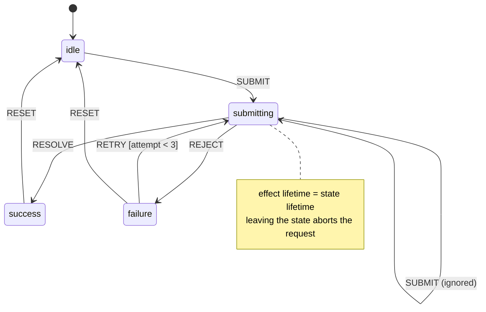
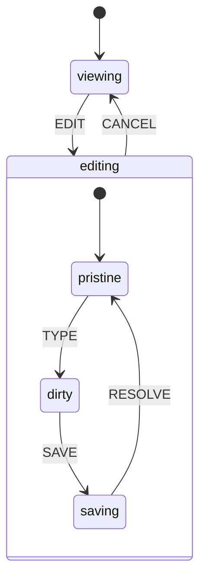
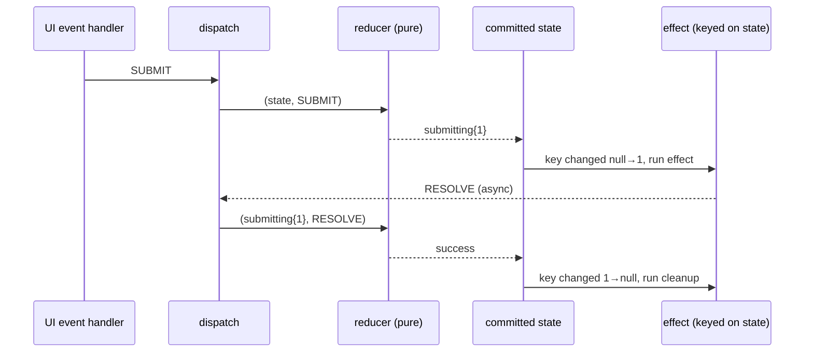

# 05 / 13 — The State Machine Pattern

## 1. Lesson metadata

| | |
|---|---|
| **Level** | Intermediate–Advanced |
| **Study time** | 4–5 hours (reading 2 h, refactoring lab 1.5 h, exercises 1.5 h) |
| **Prerequisites** | [03 / 03 — `useReducer` and reducer architecture](../03-react-state-and-hooks/03-usereducer-and-reducer-architecture.md), [03 / 04 — `useEffect` and synchronization](../03-react-state-and-hooks/04-useeffect-synchronization.md), [03 / 17 — Derived state](../03-react-state-and-hooks/17-derived-state.md), [Phase 0 / 18 — TypeScript fundamentals and narrowing](../00-web-and-javascript-foundations/18-typescript-fundamentals-and-narrowing.md), [05 / 12 — Reducer pattern](./12-reducer-pattern.md) |
| **Next** | [14 — Observer and subscription](./14-observer-and-subscription.md) |
| **Related** | [Phase 6 / 12 — State machines and XState](../06-data-fetching-and-state-ecosystems/12-state-machines-and-xstate.md), [Phase 6 / 03 — Loading and error states](../06-data-fetching-and-state-ecosystems/03-loading-and-error-states.md), [05 / 25 — Comparative refactoring labs](./25-comparative-refactoring-labs.md) |

**Learning objectives.** After this lesson you can:
1. Define a finite state machine (states, events, transitions, guards, actions, context) and map each term to a React construct.
2. Recognise a "boolean explosion" (`isLoading`, `isError`, `isSuccess`, `isRetrying`...) and compute how many of its combinations are impossible.
3. Model a flow as a TypeScript discriminated union plus a pure `transition(state, event)` function, with compile-time exhaustiveness.
4. Run side effects *from* a machine state (not from event handlers) with correct cancellation, including under StrictMode.
5. Choose between a hand-rolled reducer machine, a transition table, and a library (XState) using explicit criteria.
6. Refactor a flag-based component to a machine and verify the refactor with a transition-level test.

**Concepts covered:** finite state machine (FSM), statechart, state vs context (extended state), event, transition, guard, action, impossible state, discriminated union, exhaustiveness, transition table, `useReducer` as machine runtime, effect-as-state-consequence, request identity, hierarchical and parallel states, invoked actors, XState, `useActionState` (React 19).

---

## 2. Deep conceptual explanation

### 2.1 What problem is this lesson solving?

Open any mature React codebase and search for `useState(false)`. You will find clusters like this:

```tsx
const [isLoading, setIsLoading] = useState(false);
const [isError, setIsError] = useState(false);
const [isSuccess, setIsSuccess] = useState(false);
const [error, setError] = useState<string | null>(null);
const [isRetrying, setIsRetrying] = useState(false);
```

Five independent variables. Each `useState` call is cheap to write, so developers add one per new requirement. But the *component* does not have five independent degrees of freedom; it has a handful of meaningful situations: *idle*, *submitting*, *succeeded*, *failed*, *retrying after failure*. Five booleans can express 2⁴ = 16 combinations for the four flags alone (times the possible values of `error`), and only about four or five of them mean anything. The rest — `isLoading && isSuccess`, `isError && error === null`, `isSuccess && isError` — are **impossible states** that the type system happily lets you construct and that the UI will happily render (a spinner on top of a success banner on top of an error message).

The problem is not that the booleans are *wrong today*. The problem is that **correctness depends on every handler remembering to reset every other flag, in the right order**. Each new flag multiplies the number of states for which every handler must be correct. That is a combinatorial maintenance burden, and it is exactly the bug class that appears as "sometimes the spinner never goes away".

A **finite state machine** inverts the representation: instead of storing independent facts and *deriving* the situation, store **the situation** (one value from a closed set) and *derive the facts* (`isLoading = state.status === 'submitting'`). Illegal combinations become unrepresentable, and the set of legal *transitions* becomes explicit data that you can read, test, and draw.

### 2.2 First principles: the vocabulary

| Term | Meaning | React / TypeScript form |
|---|---|---|
| **State** | A named mode the system is in. Exactly one is active (for a flat machine). | A discriminated-union member: `{ status: 'submitting' }` |
| **Event** | A fact that *happened* (not a command). Past-tense or noun-like. | An action object: `{ type: 'REJECT', message }` |
| **Transition** | `(state, event) → state'`. The only way state changes. | A pure function (a reducer) or a lookup table |
| **Guard** | A predicate that must hold for a transition to be taken. | An `if` inside a transition (`attempt < 3`) |
| **Action** (side effect) | Work performed *because* a transition occurred: fetch, log, focus an input. | A `useEffect` keyed on state, or an event handler (see 2.6) |
| **Context / extended state** | Quantitative data carried alongside the qualitative state (a counter, a draft, an error message). | Extra fields on the union members |
| **Initial state** | Where the machine starts. | `useReducer(transition, { status: 'idle' })` |
| **Final state** | A state with no outgoing transitions (or only a reset). | `success` |

Two properties define the pattern:

1. **Closed set of states.** You can enumerate them. TypeScript's `never` check can verify you handled each.
2. **Transitions are the only mutation path.** Components do not "set" a status; they *send an event* and the machine decides what happens. An event that is not valid in the current state is **ignored** (or deliberately handled), which makes double-submit, double-click, and out-of-order responses harmless by construction.

A machine is a *design discipline*, not a library. `useReducer` already is a state machine runtime: `(state, action) => state`. What the pattern adds is the **modelling rule**: states are named modes, not bags of flags, and the reducer switches on `state` first, `event` second.

### 2.3 The transition-first reducer (the key move)

Most reducers you have written switch on the **action** first:

```ts
switch (action.type) {
  case 'SUBMIT': return { ...state, isLoading: true };   // valid in every state?
  ...
}
```

This silently permits `SUBMIT` in *every* state. A machine reducer switches on the **state** first:

```ts
switch (state.status) {
  case 'idle': /* only these events matter here */
  case 'submitting': /* and only these here */
}
```

The shift looks cosmetic and is the entire pattern. It forces you to answer, for every (state, event) pair, "what happens?" — and "nothing" is a valid, explicit answer.

### 2.4 Statecharts: when flat machines are not enough

Flat FSMs suffer *state explosion* when concerns interact (a media player that is *playing/paused* and *muted/unmuted* and *fullscreen/windowed* is 2×2×2 = 8 flat states). David Harel's **statecharts** (1987) add:

- **Hierarchical (nested) states:** `editing` contains `editing.pristine` and `editing.dirty`; a `CANCEL` event handled by the parent applies to both.
- **Parallel (orthogonal) regions:** independent sub-machines active at once (player: playback ∥ volume ∥ display), so the product is *not* enumerated.
- **History states:** return to the previously active child.
- **Delayed transitions and invoked services/actors:** "after 30 s in `waiting`, go to `timedOut`"; "while in `loading`, run this promise".

You can emulate these in a hand-written reducer (nested union members, several independent `useReducer`s for parallel regions), and for small cases you should. When you find yourself re-implementing timers, actor spawning, and visualisation, a library (XState; Section 5.6) is cheaper than your own half-version.

### 2.5 Relationship to JavaScript, React and the browser

- **Closures capture snapshots** ([Phase 1 / 14 — State as a snapshot](../01-react-fundamentals/14-state-as-a-snapshot.md)). A machine reduces the surface for stale-closure bugs because handlers send *events* ("the user clicked submit") and the reducer reads the *latest* state when it runs, instead of each handler closing over a possibly stale `isLoading`.
- **The reducer must be pure** ([Phase 2 / 12 — Why rendering must be pure](../02-react-rendering-and-internals/12-why-rendering-must-be-pure.md)). React may call a reducer more than once (StrictMode in development double-invokes reducers to surface impurity). The transition function therefore cannot start a `fetch`; effects live *outside* it.
- **Async work is the source of out-of-order events** ([Foundations 12 — Promises](../00-web-and-javascript-foundations/12-promises-and-async-await.md)). A response arriving after the user cancelled is an *event in the wrong state*; a machine makes "ignore it" the default.
- **The browser is itself a pile of state machines**: `XMLHttpRequest.readyState`, `<video>`'s `readyState`/`paused`, focus, `document.readyState`, the HTML parser. Learning to see UI as machines is learning to see the platform.

### 2.6 Where effects belong: "state as the cause"

Two legitimate placements for side effects:

| Placement | Reads like | Good for | Risk |
|---|---|---|---|
| **In the event handler** (`onClick` calls `fetch`, then `dispatch`) | "When the user clicks, do X." | One-shot, user-initiated work; mutations. | Handler must remember to dispatch every outcome; hard to cancel on unmount. |
| **In an effect keyed on the state** (`useEffect(..., [state.status])`) | "While in `submitting`, a request is in flight." | Work whose lifetime *is* a state: requests, timers, subscriptions. Cancellation falls out of effect cleanup. | Effect dependencies must be exact; StrictMode runs the effect twice in development. |

The machine's selling point is the second form: the effect's lifetime equals the state's lifetime, so leaving the state runs the cleanup (abort). The first form is fine and often simpler; pick deliberately (Section 7).

### 2.7 Common misconceptions

| Misconception | Reality |
|---|---|
| "State machines need XState." | A `useReducer` plus a discriminated union *is* a machine. Libraries add visualisation, timers, hierarchy and actor orchestration. |
| "A machine means more code." | Usually fewer *branches*, more *declarations*. The code is longer where the flag version hid its complexity. For a two-state toggle it *is* needless (use `useState`). |
| "`status` as a string union is a state machine." | Only if transitions are restricted. `setStatus('success')` callable from anywhere is a labelled flag, not a machine. |
| "Transitions are just `setState`." | The difference is *who decides*. In a machine the next state is a function of (current state, event); callers cannot choose the target. |
| "Every UI needs a machine." | Controlled inputs, simple toggles and derived values do not. Reach for a machine when there are ≥ 3 modes with different permitted events, or async work with cancellation/retry. |
| "Impossible states cannot happen with booleans if I'm careful." | Correct and irrelevant: the claim is that the *compiler cannot help you be careful*. Machines move the invariant from discipline into the type. |

---

## 3. Internal mechanics

### 3.1 What React guarantees about `useReducer`

*Public guarantee.* `useReducer(reducer, initialArg, init?)` returns `[state, dispatch]`. `dispatch(action)` schedules a re-render with the state produced by `reducer(currentState, action)`. If the new state is `Object.is`-equal to the current state, React skips re-rendering children and firing effects (documented as a bail-out; the docs note React may still call your component once more before bailing out, so do not rely on "zero renders"). Reducers must be pure; in StrictMode (development) React calls the reducer twice with the same inputs and discards one result.

*Teaching model.* Dispatches are queued; React runs the queued actions through the reducer *during the next render*, in order, starting from the last committed state. That is why multiple `dispatch` calls in one handler compose correctly with no stale-state hazard (see [03 / 01](../03-react-state-and-hooks/01-usestate-internals-and-update-semantics.md) and [Phase 1 / 15 — Update queues and batching](../01-react-fundamentals/15-update-queues-and-batching.md)).

*Implementation detail.* The "eager state" optimisation (computing the next state at dispatch time when the queue is empty) is an internal fast path; its existence is why a reducer may be called outside render in practice. Never depend on *when* the reducer runs, only that it is pure.

*Version-sensitive:* StrictMode behaviours and bail-out details have shifted between releases; verify in the current `useReducer` reference.

### 3.2 Why "return the same reference" matters

An ignored event should `return state` — the **same object**. Returning `{ ...state }` creates a new reference, defeats the bail-out, and re-renders every consumer for nothing. This is the machine-reducer analogue of "do not mutate, but do preserve identity when nothing changed".

### 3.3 Effect lifetimes and state identity

An effect keyed on `[state.status]` re-runs only when `status` changes. If a state can be **re-entered** (`failure → submitting → failure → submitting`), the `status` value goes `failure → submitting`, which *is* a change each time, so the effect re-runs. But `submitting → submitting` (an event that re-enters the same state, such as "refresh") does **not** change the key. If such self-transitions must restart work, include a counter in the state (`attempt`) and key the effect on it. This is the single most common effect/machine bug (Section 10.2).

### 3.4 Exhaustiveness: how TypeScript proves you handled every state

When `state` is a discriminated union and you `switch (state.status)`, TypeScript narrows `state` in each `case`. In the `default` branch, `state` has type `never` if all members were handled; assigning it to a `never` variable compiles only then. Adding a new state member makes every machine `switch` without a case a compile error — the compiler becomes your checklist. See [TypeScript handbook: narrowing](https://www.typescriptlang.org/docs/handbook/2/narrowing.html) (the "Exhaustiveness checking" subsection).

---

## 4. Step-by-step execution walkthrough: a submit–fail–retry–succeed session

Component: `CheckoutButton` (code in 5.2). Initial state `{ status: 'idle' }`.

| # | Trigger | Event dispatched | Reducer result | Render / commit | Effect activity |
|---|---|---|---|---|---|
| 1 | Mount | — | `idle` | Button "Pay" enabled | `useEffect` runs; status ≠ submitting → returns early (no cleanup) |
| 2 | User clicks Pay | `SUBMIT` | `idle → submitting{attempt:1}` | Button disabled, spinner | Effect keyed on `attempt` runs: creates `AbortController`, starts `fetch` |
| 3 | User double-clicks (second click before network) | `SUBMIT` | `state` unchanged (`submitting` ignores `SUBMIT`) — same reference | Bail-out; the button was disabled anyway | None |
| 4 | Network error arrives | `REJECT{message}` | `submitting → failure{attempt:1,message}` | Error banner + "Retry" | Cleanup of step-2 effect runs (abort is a no-op: request already settled) |
| 5 | Late duplicate response of attempt 1 (rare) | `RESOLVE` | `failure` ignores `RESOLVE` → unchanged | Nothing | None |
| 6 | User clicks Retry | `RETRY` | `failure → submitting{attempt:2}` | Spinner | Effect dependency (`attempt`) changed 1→2; effect starts a new request |
| 7 | Success arrives | `RESOLVE{receiptId}` | `submitting → success{receiptId}` | Confirmation | Effect cleanup aborts (settled; no-op) |
| 8 | User navigates away | unmount | — | Removed from DOM | Cleanup: nothing in flight |

**Predict:** at step 3, how many requests are in flight if the button was *not* disabled and the reducer was the flag-based version (`SUBMIT → isLoading: true`)? *Answer:* two — the flag version has no notion of "ignore `SUBMIT` while submitting"; the second click starts a second request unless the handler guards `if (isLoading) return`, which is exactly the discipline the machine removes.

**Predict:** in development with StrictMode, how many `fetch` calls happen at step 2? *Answer:* two. StrictMode mounts, unmounts and remounts components once, re-running effects; the first request is aborted by cleanup, the second proceeds. In production, one. (Mutations should carry an idempotency key anyway; see 9.)

---

## 5. Code examples

### 5.1 Minimal: the flag version and its impossible states

```tsx
// INCORRECT (illustrative): four independent facts
function SaveButton({ save }: { save: () => Promise<void> }) {
  const [isLoading, setIsLoading] = useState(false);
  const [isError, setIsError] = useState(false);
  const [isSuccess, setIsSuccess] = useState(false);

  async function handleClick() {
    setIsLoading(true);
    try {
      await save();
      setIsSuccess(true);          // forgot: setIsError(false) from a previous failure
    } catch {
      setIsError(true);            // forgot: setIsSuccess(false)
    } finally {
      setIsLoading(false);
    }
  }

  return (
    <>
      <button onClick={handleClick} disabled={isLoading}>Save</button>
      {isLoading && <Spinner />}
      {isSuccess && <p>Saved</p>}
      {isError && <p role="alert">Failed</p>}
    </>
  );
}
```

**Predict:** user clicks, the save fails, user clicks again, the save succeeds. What is on screen? *Answer:* "Saved" **and** "Failed" together: `isError` was never reset. This is an impossible state (`isSuccess && isError`) that the representation allows. The fix in flag style is to reset in `handleClick`; the fix in machine style is to make the state **one** value.

### 5.2 Minimal machine: discriminated union + pure transition

```ts
// checkout-machine.ts
export type CheckoutState =
  | { status: 'idle' }
  | { status: 'submitting'; attempt: number }
  | { status: 'failure'; attempt: number; message: string }
  | { status: 'success'; receiptId: string };

export type CheckoutEvent =
  | { type: 'SUBMIT' }
  | { type: 'RESOLVE'; receiptId: string }
  | { type: 'REJECT'; message: string }
  | { type: 'RETRY' }
  | { type: 'RESET' };

export const initialCheckoutState: CheckoutState = { status: 'idle' };

export const MAX_ATTEMPTS = 3;

export function checkoutReducer(state: CheckoutState, event: CheckoutEvent): CheckoutState {
  switch (state.status) {
    case 'idle':
      return event.type === 'SUBMIT' ? { status: 'submitting', attempt: 1 } : state;

    case 'submitting':
      switch (event.type) {
        case 'RESOLVE':
          return { status: 'success', receiptId: event.receiptId };
        case 'REJECT':
          return { status: 'failure', attempt: state.attempt, message: event.message };
        default:
          return state; // SUBMIT / RETRY / RESET while in flight: ignored
      }

    case 'failure':
      if (event.type === 'RETRY' && state.attempt < MAX_ATTEMPTS) {   // guard
        return { status: 'submitting', attempt: state.attempt + 1 };
      }
      return event.type === 'RESET' ? initialCheckoutState : state;

    case 'success':
      return event.type === 'RESET' ? initialCheckoutState : state;

    default: {
      const unreachable: never = state;   // compile error if a status is unhandled
      return unreachable;
    }
  }
}
```

Line notes:

- `status` is the discriminant. Each member carries only the data meaningful in that state: `receiptId` cannot exist in `failure`; `message` cannot exist in `success`. This is **context scoped to state**, impossible with a flat `error: string | null` that lives forever.
- The `RETRY` guard `state.attempt < MAX_ATTEMPTS` is a **guard**. When it fails, we fall through to `RESET` check and then `return state` — an exhausted failure state accepts only `RESET`. The UI derives "can retry" from the same predicate (export a helper `canRetry(state)`) so UI and machine cannot disagree.
- Every ignored event returns the **same** `state` reference (3.2).
- The reducer is pure: no `Date.now()`, no `fetch`, no `Math.random()`.

Because the reducer is a pure function, **testing needs no React** (see Exercise C1):

```ts
import { checkoutReducer, initialCheckoutState } from './checkout-machine';

test('double submit is ignored', () => {
  const s1 = checkoutReducer(initialCheckoutState, { type: 'SUBMIT' });
  const s2 = checkoutReducer(s1, { type: 'SUBMIT' });
  expect(s2).toBe(s1);
});
```

### 5.3 Wiring to React: `useReducer` + an effect keyed on state

```tsx
// CheckoutButton.tsx
import { useEffect, useReducer } from 'react';
import { checkoutReducer, initialCheckoutState, MAX_ATTEMPTS } from './checkout-machine';

type Order = { cartId: string; total: number };

export function CheckoutButton({ order }: { order: Order }) {
  const [state, dispatch] = useReducer(checkoutReducer, initialCheckoutState);

  // Derive the key that identifies "this particular in-flight request".
  const requestKey = state.status === 'submitting' ? state.attempt : null;

  useEffect(() => {
    if (requestKey === null) return;            // not in the submitting state
    const controller = new AbortController();

    submitOrder(order, controller.signal)
      .then((receipt) => dispatch({ type: 'RESOLVE', receiptId: receipt.id }))
      .catch((error: unknown) => {
        if (controller.signal.aborted) return;  // we left the state; swallow
        dispatch({ type: 'REJECT', message: error instanceof Error ? error.message : 'Unknown error' });
      });

    return () => controller.abort();            // leaving `submitting` cancels the request
  }, [requestKey, order]);

  switch (state.status) {
    case 'idle':
      return <button onClick={() => dispatch({ type: 'SUBMIT' })}>Pay {order.total}</button>;
    case 'submitting':
      return <button disabled aria-busy="true">Paying… (attempt {state.attempt})</button>;
    case 'failure':
      return (
        <div role="alert">
          <p>{state.message}</p>
          {state.attempt < MAX_ATTEMPTS
            ? <button onClick={() => dispatch({ type: 'RETRY' })}>Retry</button>
            : <button onClick={() => dispatch({ type: 'RESET' })}>Start over</button>}
        </div>
      );
    case 'success':
      return <p>Paid. Receipt {state.receiptId}</p>;
  }
}

async function submitOrder(order: Order, signal: AbortSignal): Promise<{ id: string }> {
  const res = await fetch('/api/orders', {
    method: 'POST',
    headers: { 'Content-Type': 'application/json' },
    body: JSON.stringify(order),
    signal,
  });
  if (!res.ok) throw new Error(`Payment failed (${res.status})`);
  return res.json() as Promise<{ id: string }>;
}
```

Line notes and traps:

- `requestKey` is the effect's identity for "which request". `idle → submitting{1}` changes it `null → 1`; `failure → submitting{2}` changes `null → 2`. Because the key passes through `null` in `failure`, even a retry that kept the same `attempt` would restart. Including `attempt` in the key is nonetheless the robust choice.
- The `switch` in the render has no `default`: with `strict` TypeScript and an exhaustive union, the function's return type is checked for "not all code paths return a value" (`noImplicitReturns`) — add a `never` default if your config does not catch it.
- `order` in the dependency array: if the parent creates a new `order` object every render, the effect restarts the request on each parent render. Pass primitives or memoise (Exercise D1).
- Cleanup `abort()` runs when `requestKey` changes (leaving `submitting`) and on unmount. After a *settled* request, `abort()` is a no-op.
- The `.catch` with `controller.signal.aborted` prevents dispatching `REJECT` for a request we cancelled. Even without it the reducer would ignore `REJECT` outside `submitting`; the guard avoids a pointless dispatch and, more importantly, protects `submitting{2}` from a stale `REJECT` of attempt 1 (Section 10.3).
- The `idle` branch is the only one that can start work; there is no `isLoading` guard anywhere.

Under StrictMode (development) the effect body runs, cleans up, and runs again: two POSTs, the first aborted by the browser. A server cannot know the first was "not really" intended; use an idempotency key header for real payment endpoints.

### 5.4 Incorrect machine: a "status" string that is just a flag

```ts
// INCORRECT: status is a string but transitions are unrestricted
type Status = 'idle' | 'loading' | 'success' | 'error';
const [status, setStatus] = useState<Status>('idle');

async function submit() {
  setStatus('loading');
  try { await save(); setStatus('success'); }
  catch { setStatus('error'); }
}
// Elsewhere, any code may call setStatus('success') — including while 'idle'.
```

This removes impossible *combinations* (good) but does not restrict *transitions*, so double-submit is still possible, "error → success without a request" is still possible, and context (`error` message) is still separate. It is a **step** toward a machine, and often a sufficient one. Name it honestly: a *status enum*.

### 5.5 Advanced: a transition table (data instead of control flow)

For machines with many states and few data-carrying ones, a table is easier to read, diagram, and verify than nested `switch`:

```ts
type Status = 'idle' | 'submitting' | 'failure' | 'success';
type EventName = 'SUBMIT' | 'RESOLVE' | 'REJECT' | 'RETRY' | 'RESET';

const transitions = {
  idle:       { SUBMIT: 'submitting' },
  submitting: { RESOLVE: 'success', REJECT: 'failure' },
  failure:    { RETRY: 'submitting', RESET: 'idle' },
  success:    { RESET: 'idle' },
} as const satisfies Record<Status, Partial<Record<EventName, Status>>>;

export function next(status: Status, event: EventName): Status {
  // Index with a widened type; absent entries mean "ignored".
  const row: Partial<Record<EventName, Status>> = transitions[status];
  return row[event] ?? status;
}
```

`satisfies` verifies that every status has a row and every target is a valid `Status` while keeping the literal types for `as const` (TypeScript 4.9+; combining `as const satisfies` is fine in TS 5.x). The table separates **qualitative state** (`status`) from **context**, which you store beside it:

```ts
type Machine = { status: Status; context: { attempt: number; message?: string; receiptId?: string } };
```

Trade-off: the table loses the per-state type narrowing of the union (context fields become optional), so you trade compile-time guarantees about *data* for readability of *flow*. Prefer the union when states carry distinct data; prefer the table when the flow graph is the interesting part (wizards, onboarding, document workflows). Real systems often use both: the table for allowed transitions, a union for rendering.

### 5.6 Library form: XState (v5; executed against xstate 5.33)

XState is the best-known JavaScript statechart library; its API changed substantially between v4 and v5. Below is a v5 machine; it type-checks under `strict` with xstate 5.33 and, when run with `createActor` and an actor that rejects on the first attempt, the snapshots are `submitting:1 → failure:1 → submitting:2 → success:2` (state:attempt):

```ts
import { setup, assign, fromPromise } from 'xstate';

export const checkoutMachine = setup({
  types: {
    context: {} as { attempt: number; message: string | null },
    events: {} as { type: 'SUBMIT' } | { type: 'RETRY' } | { type: 'RESET' },
  },
  actors: {
    submit: fromPromise<{ id: string }, { attempt: number }>(async ({ input, signal }) => {
      /* call the API; honour `signal` */
      return { id: 'r-' + input.attempt };
    }),
  },
  guards: { canRetry: ({ context }) => context.attempt < 3 },
}).createMachine({
  id: 'checkout',
  initial: 'idle',
  context: { attempt: 0, message: null },
  states: {
    idle: { on: { SUBMIT: 'submitting' } },
    submitting: {
      entry: assign({ attempt: ({ context }) => context.attempt + 1 }),
      invoke: {
        src: 'submit',
        input: ({ context }) => ({ attempt: context.attempt }),
        onDone: 'success',
        onError: { target: 'failure', actions: assign({ message: 'Payment failed' }) },
      },
    },
    failure: { on: { RETRY: { guard: 'canRetry', target: 'submitting' }, RESET: 'idle' } },
    success: { type: 'final' },
  },
});
```

and in React, `useMachine(checkoutMachine)` from `@xstate/react` (6.x) returns `[snapshot, send, actorRef]`, where `snapshot.matches('submitting')` and `snapshot.context` are the read side. What you gain over 5.3: invoked actors with automatic cancellation, entry/exit actions, delayed transitions (`after`), visual editing/inspection tooling, hierarchical/parallel states. What you pay: a dependency, a second vocabulary, and a runtime that lives outside React's reducer purity rules (it is an actor system; read [Phase 6 / 12](../06-data-fetching-and-state-ecosystems/12-state-machines-and-xstate.md)).

### 5.7 Hierarchical state without a library

Nested states are nested unions:

```ts
type EditorState =
  | { mode: 'viewing' }
  | { mode: 'editing'; draft: string; sub: 'pristine' | 'dirty' | { kind: 'saving'; requestId: number } };

function editorReducer(state: EditorState, event: EditorEvent): EditorState {
  // Parent-level handling: CANCEL works in every `editing` sub-state.
  if (state.mode === 'editing' && event.type === 'CANCEL') return { mode: 'viewing' };
  // ...dispatch to child handling by state.mode/state.sub
  return state;
}
type EditorEvent = { type: 'EDIT' } | { type: 'TYPE'; text: string } | { type: 'SAVE' } | { type: 'CANCEL' };
```

The parent-before-child check is the entire mechanism of *event bubbling* in a statechart: events are offered to the most specific state first and then up the hierarchy. Write the parent check *first* only if the parent should preempt; otherwise handle the child first (a design decision XState makes explicit with transition priority).

### 5.8 Refactoring lab: before / after (comparative)

**Before** — an upload widget with five flags and a race.

```tsx
function Uploader({ file }: { file: File }) {
  const [uploading, setUploading] = useState(false);
  const [progress, setProgress] = useState(0);
  const [done, setDone] = useState(false);
  const [error, setError] = useState<string | null>(null);
  const [cancelled, setCancelled] = useState(false);
  const xhrRef = useRef<XMLHttpRequest | null>(null);

  function start() {
    setUploading(true); setDone(false); setError(null); setCancelled(false); setProgress(0);
    const xhr = new XMLHttpRequest();
    xhrRef.current = xhr;
    xhr.upload.onprogress = (e) => setProgress(e.loaded / e.total);   // fires after cancel?
    xhr.onload = () => { setUploading(false); setDone(true); };
    xhr.onerror = () => { setUploading(false); setError('Upload failed'); };
    xhr.open('POST', '/upload'); xhr.send(file);
  }
  function cancel() { xhrRef.current?.abort(); setUploading(false); setCancelled(true); }

  return (
    <div>
      {!uploading && !done && <button onClick={start}>{cancelled ? 'Restart' : 'Upload'}</button>}
      {uploading && <><progress value={progress} /><button onClick={cancel}>Cancel</button></>}
      {done && <p>Done</p>}
      {error && <p role="alert">{error}</p>}
    </div>
  );
}
```

Defects (find them before reading on): (1) once `done` is true there is no way to upload again (the button is hidden and nothing resets `done`); (2) a progress event queued before `abort()` can still call `setProgress` after `cancel`; (3) `onload` fires for HTTP 500 too (it means the request completed, not that the status was 2xx), so `done` is set on a failed upload; (4) no cleanup on unmount, so the request keeps running; (5) `uploading && error` and `done && error` are representable.

**After** — one machine, effect owns the XHR.

```tsx
type UploadState =
  | { status: 'idle'; runs: number }
  | { status: 'uploading'; runs: number; progress: number }
  | { status: 'done'; runs: number }
  | { status: 'failed'; runs: number; message: string }
  | { status: 'cancelled'; runs: number };

type UploadEvent =
  | { type: 'START' }
  | { type: 'PROGRESS'; fraction: number }
  | { type: 'LOADED' }
  | { type: 'FAILED'; message: string }
  | { type: 'CANCEL' };

function uploadReducer(state: UploadState, event: UploadEvent): UploadState {
  switch (state.status) {
    case 'idle':
    case 'done':
    case 'failed':
    case 'cancelled':
      // Every non-active state can (re)start. `runs` is a counter carried in the state,
      // so each start has a distinct identity the effect can key on.
      return event.type === 'START'
        ? { status: 'uploading', runs: state.runs + 1, progress: 0 }
        : state;
    case 'uploading':
      switch (event.type) {
        case 'PROGRESS': return { ...state, progress: event.fraction };
        case 'LOADED':   return { status: 'done', runs: state.runs };
        case 'FAILED':   return { status: 'failed', runs: state.runs, message: event.message };
        case 'CANCEL':   return { status: 'cancelled', runs: state.runs };
        default:         return state;
      }
    default: { const n: never = state; return n; }
  }
}
```

Note the counter: an identity for "this run" must live in the state (or the event), never come from `Date.now()` or `Math.random()` inside the reducer, which would break purity (StrictMode's double invocation would produce two different values).

```tsx
function Uploader({ file }: { file: File }) {
  const [uploading, setUploading] = useState(false);
  const [progress, setProgress] = useState(0);
  const [done, setDone] = useState(false);
  const [error, setError] = useState<string | null>(null);
  const [cancelled, setCancelled] = useState(false);
  const xhrRef = useRef<XMLHttpRequest | null>(null);

  function start() {
    setUploading(true); setDone(false); setError(null); setCancelled(false); setProgress(0);
    const xhr = new XMLHttpRequest();
    xhrRef.current = xhr;
    xhr.upload.onprogress = (e) => setProgress(e.loaded / e.total);   // fires after cancel?
    xhr.onload = () => { setUploading(false); setDone(true); };
    xhr.onerror = () => { setUploading(false); setError('Upload failed'); };
    xhr.open('POST', '/upload'); xhr.send(file);
  }
  function cancel() { xhrRef.current?.abort(); setUploading(false); setCancelled(true); }

  return (
    <div>
      {!uploading && !done && <button onClick={start}>{cancelled ? 'Restart' : 'Upload'}</button>}
      {uploading && <><progress value={progress} /><button onClick={cancel}>Cancel</button></>}
      {done && <p>Done</p>}
      {error && <p role="alert">{error}</p>}
    </div>
  );
}
```

Defects (find them before reading on): (1) once `done` is true there is no way to upload again (the button is hidden and nothing resets `done`); (2) a progress event queued before `abort()` can still call `setProgress` after `cancel`; (3) `onload` fires for HTTP 500 too (it means the request completed, not that the status was 2xx), so `done` is set on a failed upload; (4) no cleanup on unmount, so the request keeps running; (5) `uploading && error` and `done && error` are representable.

**After** — one machine, effect owns the XHR.

```tsx
type UploadState =
  | { status: 'idle' }
  | { status: 'uploading'; progress: number; run: number }
  | { status: 'done' }
  | { status: 'failed'; message: string }
  | { status: 'cancelled' };

type UploadEvent =
  | { type: 'START' }
  | { type: 'PROGRESS'; fraction: number }
  | { type: 'LOADED' }
  | { type: 'FAILED'; message: string }
  | { type: 'CANCEL' };

function uploadReducer(state: UploadState, event: UploadEvent): UploadState {
  switch (state.status) {
    case 'idle':
    case 'done':
    case 'failed':
    case 'cancelled':
      // every non-active state can (re)start; run increments so the effect restarts
      return event.type === 'START'
        ? { status: 'uploading', progress: 0, run: nextRun(state) }
        : state;
    case 'uploading':
      switch (event.type) {
        case 'PROGRESS': return { ...state, progress: event.fraction };
        case 'LOADED':   return { status: 'done' };
        case 'FAILED':   return { status: 'failed', message: event.message };
        case 'CANCEL':   return { status: 'cancelled' };
        default:         return state;
      }
    default: { const n: never = state; return n; }
  }
}
// run counter lives in a module-level helper or in the state; simplest: keep `run` in a sibling useState or
// carry `lastRun` on the non-active states. Here we carry it via a tiny helper:
function nextRun(_: UploadState): number { return Date.now(); } // NOT pure! see note
```

Stop: the `nextRun` helper above is **deliberately wrong** — `Date.now()` in a reducer breaks purity (StrictMode's double call yields two different values, so the two invocations disagree). This is the classic trap when you need an identity for "this run". Correct approach: carry a counter in every state.

```tsx
type UploadState =
  | { status: 'idle'; runs: number }
  | { status: 'uploading'; runs: number; progress: number }
  | { status: 'done'; runs: number }
  | { status: 'failed'; runs: number; message: string }
  | { status: 'cancelled'; runs: number };
// START: { status: 'uploading', runs: state.runs + 1, progress: 0 }
```

```tsx
function Uploader({ file }: { file: File }) {
  const [state, dispatch] = useReducer(uploadReducer, { status: 'idle', runs: 0 });
  const activeRun = state.status === 'uploading' ? state.runs : null;

  useEffect(() => {
    if (activeRun === null) return;
    const xhr = new XMLHttpRequest();
    xhr.upload.onprogress = (e) => { if (e.lengthComputable) dispatch({ type: 'PROGRESS', fraction: e.loaded / e.total }); };
    xhr.onload = () => xhr.status >= 200 && xhr.status < 300
      ? dispatch({ type: 'LOADED' })
      : dispatch({ type: 'FAILED', message: `Server responded ${xhr.status}` });
    xhr.onerror = () => dispatch({ type: 'FAILED', message: 'Network error' });
    xhr.open('POST', '/upload');
    xhr.send(file);
    return () => xhr.abort();           // CANCEL, FAILED, LOADED, or unmount all end here
  }, [activeRun, file]);

  /* render: switch (state.status) ... "Cancel" dispatches { type: 'CANCEL' } */
}
```

**Comparison.**

| Criterion | Before (5 flags) | After (machine) |
|---|---|---|
| Representable states | 2⁴ × error values; ~6 meaningful | 5, all meaningful |
| Where cancellation is implemented | `cancel()` handler + hope | Effect cleanup, triggered by *any* exit from `uploading` |
| HTTP 500 handled | No (`onload` means "completed") | Yes, a single `LOADED`/`FAILED` decision |
| Lines of code | ~35 | ~60 (reducer + effect) |
| Test effort | Mount, simulate XHR, assert flags in combos | Pure reducer tests + one integration test |
| Onboarding | Hidden invariants | Invariants written in the type |

**When the "before" is acceptable:** a throwaway admin tool with one upload and no cancel path. The machine costs ~25 extra lines; for a form used by an internal team of three, the flag version may be the right trade.

---

## 6. Visual explanations

### 6.1 The checkout machine



### 6.2 Flat vs hierarchical: collapsing duplicate transitions



Without the `editing` parent, `CANCEL` would be drawn from `pristine`, `dirty` and `saving` separately — three arrows instead of one.

### 6.3 Event delivery pipeline



### 6.4 Impossible-state count

```text
Flags: loading, error, success, retrying      -> 2^4 = 16 combinations
Meaningful: idle, loading, error, success,
            retrying                          ->  ~5
Unrepresentable by a union:                   -> 11 combinations that can no longer exist
```

---

## 7. Alternative approaches and trade-offs

| Criterion | Independent `useState` flags | Status enum + `useState` | `useReducer` machine (union) | Transition table | XState |
|---|---|---|---|---|---|
| Impossible states | Representable | Prevented across flags | Prevented, data scoped to state | Prevented for flow; data optional | Prevented |
| Invalid transitions | Unchecked | Unchecked | Ignored explicitly | Ignored explicitly | Ignored explicitly |
| Effort for 2 states | Lowest | Low | Overkill | Overkill | Overkill |
| Effort for 6+ states with async | High (bugs) | Medium | Medium | Medium | Medium–low |
| Visualisation/tooling | None | None | Hand-drawn | Can generate diagram from table | Built-in inspector/editor |
| Hierarchy/parallel/timers | Manual | Manual | Manual | Manual | Native |
| Bundle/learning cost | None | None | None | None | Dependency + concepts |
| Testing | Component-level | Component-level | Pure function | Pure function | Pure transition fn / actor tests |

**When the recommended approach (a machine) is NOT best.**

1. **Pure derived state.** "Is the cart empty?" is a function of data. Modelling it as a machine duplicates the source of truth ([03 / 17](../03-react-state-and-hooks/17-derived-state.md)).
2. **A single async action in a form.** React 19's `useActionState` / `<form action>` gives `pending` and last-result state with built-in transition handling; wrapping that in a hand-written machine is redundant unless there are retry/cancel/multi-step requirements.
3. **Server state with a cache.** Query libraries already model `pending | success | error` with refetching and deduplication ([Phase 6 / 07](../06-data-fetching-and-state-ecosystems/07-server-state-management.md)). A machine on top duplicates the cache lifecycle.
4. **Truly continuous UI state** (drag position, scroll offset). Machines model *modes*, not coordinates; keep coordinates as context inside a `dragging` mode.
5. **Very small teams with a two-state toggle.** `useState<boolean>` is correct here.

---

## 8. Best practices and anti-patterns

**Do**

- Name states as **modes** (`submitting`) not flags (`isSubmitting`), and events as **facts** (`REJECT`, `RESOLVE`), not commands (`SET_ERROR`).
- Keep the transition function **pure** and in its own file. It is your most testable unit.
- **Scope data to states** via union members.
- Let invalid events **return the same state**.
- Export *selectors* (`canRetry(state)`, `isBusy(state)`) so UI predicates reuse the machine's guards.
- Put the long-lived async work in an **effect keyed on state**, with abort/cleanup.
- Draw the diagram first (paper, Mermaid, or an editor). If you cannot draw it, you do not understand the flow yet.

**Beginner mistakes**

- Mixing status with independent booleans (`status === 'loading' && !isRetry`): the booleans are back.
- Starting the `fetch` inside the reducer.
- Returning `{ ...state }` for ignored events.
- Deriving state in an effect and storing it (`useEffect(() => setStatus(...), [data])`) — see [03 / 07](../03-react-state-and-hooks/07-you-might-not-need-an-effect.md).

**Experienced-developer mistakes**

- **Over-modelling.** Statechart-izing a hover tooltip. Machines buy value where *permitted events differ by mode*.
- **God machine.** One machine for a whole page. Split by independent lifecycles (parallel regions = separate machines/reducers).
- **Events as setters.** `{ type: 'SET_STATUS', status }` re-introduces unrestricted transitions.
- **Putting derived data in context** and updating it in several transitions rather than computing it.
- **Ignoring identity of async work**: a response from request #1 resolving in state `submitting{2}`. Carry a `requestId`/`attempt` in the event and compare in the reducer (10.3).

**Smells:** a `default: return state` that swallows an event you *meant* to handle (add a test); a reducer longer than ~100 lines (split by state); effects with `// eslint-disable-next-line react-hooks/exhaustive-deps`.

**Justified exceptions:** a `status` enum with unrestricted `setStatus` is fine for a read-only loading indicator whose transitions are all driven by one `useEffect`. The pattern is a tool to reduce bug classes, not a style requirement.

---

## 9. Real-world application

| Domain | What is modelled | Engineering constraint |
|---|---|---|
| **E-commerce checkout** | `cart → address → shipping → payment → review → confirmed`, with back transitions and payment failure loop | Payments must be idempotent: send an idempotency key per *attempt group*, not per click. Guards: cannot enter `payment` without a valid address. |
| **Banking transfer** | `editing → confirming → submitting → pendingApproval → settled / rejected` | Final states may arrive from the server minutes later (poll or push); `pendingApproval` is a real state, not a spinner. Audit requires logging every transition (log the *event stream*). |
| **Auth/session** | `anonymous → authenticating → authenticated → refreshing → expired` | Token refresh races: ignore a stale refresh result by comparing `refreshId`. Cross-tab sync is an event source (see [14](./14-observer-and-subscription.md)). |
| **Dashboard widgets** | `loading → ready → refreshing → stale-error` | "Refreshing" keeps old data visible: the context keeps `data` while the status changes. |
| **Realtime connection** | `connecting → open → reconnecting(backoff) → closed` | Timers (`after`) are part of the machine; use a library if there are several. |
| **Multi-team design systems** | `Dialog`, `Combobox`, `Tabs` interaction models | Component libraries (e.g. Zag.js, which uses statecharts internally) publish machines so behaviour is shared across frameworks. Mentioned as an example; verify current project details before depending. |

Constraint to remember in all of them: **the machine's event log is a free audit trail and a free bug-report attachment** — record the last N events in your error reporter ([Phase 10 / 05](../10-production-engineering/05-error-monitoring.md)).

---

## 10. Debugging and troubleshooting

### 10.1 Symptom: UI shows contradictory elements (spinner and error together)

*Repro:* flag-based component, fail then retry. *Investigation:* React DevTools → Components → inspect hooks; you will see `isLoading: true, isError: true`. *Root cause:* an impossible state representable by independent flags. *Fix:* collapse to a union; *validate:* property test — run random event sequences through the reducer and assert invariants (`status` ∈ set; `success` has `receiptId`).

### 10.2 Symptom: "Refresh" button does nothing the second time

*Repro:* `loading → loading` self-transition (a `REFRESH` event in `loading`) keyed only on `[state.status]`. *Root cause:* the effect key did not change (3.3). *Fix:* include a counter (`requestId`) in state and in the dependency array. *Validate:* log in the effect body; assert one log per refresh.

### 10.3 Symptom: stale result overwrites a newer request

*Repro:* attempt 1 is slow; the user cancels and retries; attempt 1's response arrives. *Investigation:* Network panel shows two requests, the first resolving last; React DevTools shows state flipping to the first request's data. *Root cause:* the event carries no identity, and the reducer cannot tell. *Fix:* events carry `attempt`; the reducer's `RESOLVE` case checks `event.attempt === state.attempt` (and the effect aborts). *Validate:* a unit test dispatching `RESOLVE{attempt:1}` in `submitting{2}` returns the same state.

### 10.4 Symptom: two network requests per click in development only

*Root cause:* StrictMode effect double-run (4). *Investigate:* confirm with `NODE_ENV=production` build or by temporarily removing `<StrictMode>`; the production build issues one. *Fix:* nothing in logic — keep cleanup correct; for non-idempotent endpoints add an idempotency key so the duplicate is harmless. Do **not** "fix" it with a ref flag that suppresses the second run: that masks the very bugs StrictMode is detecting.

### 10.5 Symptom: TypeScript says `Property 'message' does not exist on type ...`

*Root cause:* the state is not narrowed (you destructured `const { status, message } = state` before narrowing, which loses the correlation). *Fix:* narrow on `state.status` first, then read fields; destructure inside the branch. (TypeScript 4.6+ supports narrowing of destructured discriminated unions for `const` destructuring from a parameter in some cases; do not rely on it for `useReducer` results — narrow on the object.)

### 10.6 Symptom: reducer called twice with different results

*Root cause:* impurity (`Date.now()`, `Math.random()`, `crypto.randomUUID()`, mutation of `state`). *Investigation:* in StrictMode, console shows two logs per dispatch with different values. *Fix:* generate ids in the **event** (in the handler), not the reducer. *Validate:* the reducer yields equal output for equal input in a test.

---

## 11. Exercises

### Level A — Knowledge
A1. Define *state*, *event*, *transition*, *guard*, *action*, and *context* and give a React/TypeScript form for each.
A2. A component has `isLoading`, `isError`, `isSuccess`, `isEmpty`. How many boolean combinations exist? Name three impossible ones.
A3. Why must a machine reducer be pure, and where do side effects go?
A4. Explain the difference between a *status enum* and a *state machine*.
A5. What does "ignore the event" mean in a machine, and why is returning the same object reference important?

### Level B — Code comprehension
B1. Predict the rendered output and the number of requests (production) for: click, click, response `REJECT`, click Retry, response `RESOLVE`, using the machine in 5.2/5.3 with a button that is *not* disabled while submitting.
B2. In 5.3 the effect depends on `[requestKey, order]`. The parent renders `<CheckoutButton order={{ cartId, total }} />`. What happens during `submitting` when the parent re-renders (e.g. a timer ticks)?
B3. What is wrong with this reducer branch and why does it still "work" in production? `case 'idle': if (event.type === 'SUBMIT') { startFetch(); return { status: 'submitting', attempt: 1 }; } return state;`

### Level C — Implementation
C1. Write Vitest tests for `checkoutReducer` covering: double submit ignored (same reference), retry guard at `MAX_ATTEMPTS`, `RESET` from `success`, and a stale-event scenario you design.
C2. Implement a 3-step wizard (`account → profile → review`) as a reducer machine with `NEXT`, `BACK`, `SUBMIT`; `review` allows `SUBMIT`; the data entered is context scoped to each state.
C3. Convert the 5.5 transition table into a Mermaid `stateDiagram-v2` string via a small function.

### Level D — Debugging
D1. `CheckoutButton` re-sends the request every time the parent re-renders during `submitting`. Diagnose and give two fixes with different trade-offs.
D2. A teammate "fixed" a double-request bug in development by adding `const started = useRef(false)` and returning early if true. What breaks?
D3. A reducer test fails intermittently: `expect(reducer(s, e)).toEqual(reducer(s, e))`. Identify the cause.

### Level E — Architecture and engineering decisions
E1. A form with one submit button needs "pending" and "error" display. Compare: three `useState`s, `useActionState`, and a hand-written machine. Recommend and justify with change-forecast.
E2. Your team is choosing between a hand-written reducer machine and XState for a 12-state onboarding flow with timers, retries, and a resumable session. Evaluate against: tooling, hiring/onboarding, bundle size, testing, long-term migration. State what evidence would flip your decision.

### Level F — Expert challenge
F1. Write a generic `createMachine<S extends { status: string }, E extends { type: string }>(table)` helper whose table type forces a handler for every status, whose handler param is narrowed to that status's union member, and which returns a reducer that returns the same reference on ignored events. Show the types and say where a cast is unavoidable.
F2. Comparative refactor: take the 5.8 "before" and produce (1) the reducer machine, (2) a version using `useActionState` for the START-and-result path with cancellation left as a separate `useRef` AbortController, and (3) a written comparison (correctness, lines, testability, behaviour on unmount). Identify which requirement (progress events) breaks the `useActionState` fit.

---

## 12. Detailed answers and explanations

> Attempt the exercises first.

**A1.** *State*: a named mode (union member). *Event*: a fact that happened (action object). *Transition*: `(state, event) → state`, the reducer. *Guard*: a predicate gating a transition (`attempt < 3`). *Action*: a side effect caused by a transition (fetch in an effect keyed on state). *Context*: data carried with the state (fields on union members). Common wrong answer: "action = reducer action object" — in statechart vocabulary, an *action* is a **side effect**, whereas React's "action" is what statechart calls an **event**. Keep the two vocabularies distinct.

**A2.** 2⁴ = 16 combinations. Impossible: `isLoading && isSuccess`, `isError && isSuccess`, `isEmpty && isSuccess` (if success means non-empty data), `isLoading && isError` (unless "retrying" is a real mode — then it should be named). Meaningful ones are about 4–5.

**A3.** React may invoke reducers more than once and at times it chooses (StrictMode double-invokes in dev; the queued reducer runs during render). An impure reducer therefore duplicates or loses effects. Effects go in `useEffect` keyed on state (lifetime = state) or in event handlers (one-shot). Wrong answer: "reducers are pure because of Redux convention" — it is a React rendering contract (see [Phase 2 / 12](../02-react-rendering-and-internals/12-why-rendering-must-be-pure.md)).

**A4.** A status enum is a union of labels that any code may set at any time. A machine restricts *which events lead where from which state* and scopes data per state. Test: can code reach `success` without passing through `submitting`? If yes, it is an enum.

**A5.** In states where an event is not defined, nothing happens: no state change, no side effects. Returning the same reference lets React's `Object.is` bail-out skip the re-render of the component's children and effects; returning a copy forces a render for nothing.

**B1.** Sequence with no disabled button: click 1 → `SUBMIT` → `submitting{1}`, request 1. Click 2 → `SUBMIT` in `submitting` → ignored (same state); **no second request** (the effect key `requestKey` is unchanged). `REJECT` → `failure{1}`. Retry → `submitting{2}`, request 2. `RESOLVE` → `success`. Total: 2 requests; final output "Paid. Receipt …". The wrong answer "3 requests" assumes click 2 starts work; in the machine only the *state change* starts work.

**B2.** The inline object `{ cartId, total }` has a new identity every parent render. The dependency array compares by `Object.is`, so the effect cleanup runs (abort request 1) and the effect re-runs (starts a new request) on each parent render — a request storm, and the first requests are aborted before settling. Fix options in D1.

**B3.** The reducer starts a fetch: a side effect in a pure function. In production the reducer typically runs once per dispatch, so it "works"; in dev StrictMode calls it twice (two fetches) and concurrent rendering may call and discard reducer results, producing fetches for state transitions that never commit. Move the fetch to an effect keyed on `submitting`.

**C1.** Sample:

```ts
import { describe, it, expect } from 'vitest';
import { checkoutReducer as r, initialCheckoutState as init, MAX_ATTEMPTS } from './checkout-machine';
import type { CheckoutState } from './checkout-machine';

describe('checkoutReducer', () => {
  it('ignores SUBMIT while submitting (same reference)', () => {
    const s1 = r(init, { type: 'SUBMIT' });
    expect(r(s1, { type: 'SUBMIT' })).toBe(s1);
  });
  it('stops allowing RETRY at MAX_ATTEMPTS', () => {
    const exhausted: CheckoutState = { status: 'failure', attempt: MAX_ATTEMPTS, message: 'x' };
    expect(r(exhausted, { type: 'RETRY' })).toBe(exhausted);
    expect(r(exhausted, { type: 'RESET' })).toEqual(init);
  });
  it('RESET from success returns to idle', () => {
    expect(r({ status: 'success', receiptId: 'a' }, { type: 'RESET' })).toEqual(init);
  });
  it('late RESOLVE in failure is ignored', () => {
    const f: CheckoutState = { status: 'failure', attempt: 1, message: 'x' };
    expect(r(f, { type: 'RESOLVE', receiptId: 'late' })).toBe(f);
  });
});
```

Evaluation criteria: tests assert *reference* identity for ignored events, cover guard boundaries (both `MAX_ATTEMPTS - 1` and `MAX_ATTEMPTS`), and do not render React.

**C2.** Reference design:

```ts
type Wizard =
  | { step: 'account'; account: { email: string } }
  | { step: 'profile'; account: { email: string }; profile: { name: string } }
  | { step: 'review'; account: { email: string }; profile: { name: string } }
  | { step: 'submitted' };
type WizardEvent =
  | { type: 'NEXT'; patch?: Partial<{ email: string; name: string }> }
  | { type: 'BACK' } | { type: 'SUBMIT' };
```

Transitions: `account.NEXT` guarded by non-empty email → `profile`; `profile.NEXT` guarded by non-empty name → `review`; `profile.BACK` → `account` (keeping data); `review.BACK` → `profile`; `review.SUBMIT` → `submitted`. Criteria: guards are in the reducer, `submitted` has no data, and `SUBMIT` in `account` returns the same state. Edge case: BACK must preserve data typed in later steps (decide and document whether it does).

**C3.** Evaluation: output starts `stateDiagram-v2`, one line per `from --> to: EVENT` produced by iterating `Object.entries(transitions)`; `[*] --> idle` first. Example: `Object.entries(transitions).flatMap(([from, row]) => Object.entries(row).map(([ev, to]) => `    ${from} --> ${to}: ${ev}`))`.

**D1.** Cause: unstable `order` identity (B2). Fix 1 (narrow dependencies): depend on primitives `[requestKey, order.cartId, order.total]`; cheap but must be kept in sync with fields used. Fix 2 (snapshot at submit time): put the order into the event (`{ type: 'SUBMIT', order }`) and store it in the `submitting` state; the effect reads `state.order`, which is stable for the duration of the state — also fixes the semantic bug that editing the cart mid-request would change what is paid. Trade-off: Fix 2 is semantically correct (request describes what the user confirmed) at the cost of a larger state shape. Wrong fix: `useMemo` without a meaningful dependency list, or `// eslint-disable`.

**D2.** The ref flag suppresses the second effect run, so under StrictMode cleanup has aborted the first request and the second never starts: the button is stuck in `submitting` in development. It also hides the cleanup bug StrictMode exists to expose, and breaks real remounts (Suspense/Offscreen reuse). Correct approach: keep cleanup symmetric; make the request idempotent.

**D3.** The reducer is impure — probably `Date.now()`, `Math.random()`, `crypto.randomUUID()`, or a captured mutable. Two calls with the same inputs produce different outputs. Fix: pass the value in the event.

**E1.** Evaluation criteria: states the number of modes (idle/pending/error), notes React 19 `useActionState` handles pending/last-result for form actions natively ([react.dev useActionState](https://react.dev/reference/react/useActionState)), recognises three `useState` flags are acceptable if the form has no retry/cancel, and defines a *trigger to migrate* (introduction of retry, cancel, multiple steps, or a second async path). Example answer: use `useActionState`; revisit if cancellation or multi-step arrives, because then pending/error stops being a two-valued function of one action and becomes a flow.

**E2.** Strong answers: hand-written reducer wins on zero dependency, full TypeScript control, and team familiarity; XState wins at 12 states with `after` timers, retries with backoff, persisted/resumable snapshots, parallel regions and inspection tooling. Ask what would flip: (1) if 5+ delayed transitions or invoked services are required, choose the library; (2) if the team is unfamiliar and the flow is linear, reducer; (3) bundle budget (measure with a bundle analyser, [Phase 7 / 16](../07-performance/16-bundle-analysis.md)); (4) migration path — design events as plain objects so a reducer can later be replaced by a machine with the same events. Risk to name: library API churn between major versions (⚠ verify).

**F1.** Sketch:

```ts
type Handlers<S extends { status: string }, E extends { type: string }> = {
  [K in S['status']]: (state: Extract<S, { status: K }>, event: E) => S | undefined;
};

export function createMachine<S extends { status: string }, E extends { type: string }>(
  handlers: Handlers<S, E>,
) {
  return (state: S, event: E): S => {
    const handler = handlers[state.status as S['status']] as (s: S, e: E) => S | undefined;
    return handler(state, event) ?? state;   // undefined => ignored => same reference
  };
}
```

The unavoidable cast: indexing `handlers[state.status]` yields a union of functions each expecting a different narrowed `state`; TypeScript cannot correlate `state.status` with the chosen handler (the "correlated union" problem), so a cast on the call is required. Evaluation: the *public* type enforces exhaustiveness (a missing status key is an error) and narrowing in handlers; the single cast is localised inside the helper. Edge case: a handler returning `state` itself vs `undefined` both preserve identity.

**F2.** Evaluation criteria and expected findings. (1) Machine: see 5.8. (2) `useActionState(async (prev, formData) => {...}, initial)` gives `[state, formAction, isPending]`; the action runs in a transition and `isPending` covers the in-flight period. It fits "start and get a final result". It does **not** fit streaming progress (needs intermediate updates → a separate `useState`/ref anyway), **cancellation** (no built-in abort of an action; you manage an `AbortController` yourself), nor resumability. (3) Expected comparison: machine = more lines, explicit cancel and progress, unit-testable; `useActionState` = fewer lines for the happy path, correct behaviour with forms and progressive enhancement, but progress and cancel pull you back to extra state — the two-source-of-truth hazard. Requirement that breaks the fit: progress events. Per react.dev/reference/react/useActionState (2026-10-22): multiple `dispatchAction` calls are queued and run sequentially, each receiving the previous result; if an action throws, queued actions are cancelled and the nearest Error Boundary shows.

---

## 13. Senior engineer interview questions

1. **"Why would you replace three booleans with a union?"** Because the independent booleans admit combinations the domain does not, and correctness then depends on every handler resetting every flag. A union moves the invariant into the type: illegal combinations cannot be constructed, data is scoped to the state in which it exists, and `switch` exhaustiveness turns "added a state" into a compile error in every consumer.
2. **"Where do side effects go in a reducer-based machine and why?"** Not in the reducer. React may run reducers more than once or discard their results (StrictMode double invocation; concurrent rendering), so effects in them duplicate or fire for uncommitted transitions. Effects live in `useEffect` keyed on the state (lifetime tied to state, cleanup on exit) or in handlers (one-shot, user-initiated).
3. **"Double-submit protection: disabled button or machine?"** Both; they defend different layers. `disabled` is UX and can be bypassed (Enter key in a form, programmatic click, a stale render). The machine ignores `SUBMIT` in `submitting`, so no second effect starts regardless of how the event arrived.
4. **"What is a stale response and how does a machine address it?"** A response to request *n* arriving after state moved to request *n+1*. A machine addresses it by giving responses identity (`attempt`/`requestId`), by scoping effects with cleanup/abort, and by making events in the wrong state ignorable.
5. **"Flat machine vs statechart: when do you need hierarchy?"** When many states share the same reaction to an event (cancel, error, close) — hierarchy declares it once at the parent — or when independent concerns would multiply the state count (parallel regions). If neither occurs, flat is simpler.
6. **"Would you use XState on every project?"** No. For ≤ 5 states with one async call, a reducer is cheaper and has no dependency. I move to XState when I need timers/delays, invoked actors with cancellation, parallel regions, persisted snapshots or inspection tooling, and I weigh API churn and onboarding. I design events as plain objects so the migration is mechanical.
7. **"How do you test a machine?"** Pure transition tests: given (state, event), assert next state (including same-reference for ignored events); guard boundary tests; and a small property test for invariants over random event sequences. One integration test for the effect wiring (abort on exit, one request per state entry), because that is where React-specific behaviour lives.
8. **"Why does `useActionState` not make machines obsolete?"** It models one action's pending/result lifecycle for forms. Machines model *flows* — multiple actions, retries, cancellation, modes with different permitted events. They overlap on the single-submit case; beyond it they diverge.
9. **"Your effect restarts on every parent render. Why?"** An unstable dependency (object/array/function created in the parent render). Fix by narrowing dependencies to primitives, snapshotting into state at the event, or stabilising the identity at the source. Not by suppressing the lint rule.

---

## 14. Further learning resources

| Resource | URL | Covers / why | Level | Section to study |
|---|---|---|---|---|
| React: Extracting state logic into a reducer | https://react.dev/learn/extracting-state-logic-into-a-reducer | `useReducer` mechanics and reducer rules | B–I | Whole page |
| React: Choosing the state structure | https://react.dev/learn/choosing-the-state-structure | "Avoid contradictions in state" is the machine motivation in React's own words | B–I | "Avoid contradictions in state" |
| React reference: `useReducer` | https://react.dev/reference/react/useReducer | Purity, StrictMode double call, bail-out | I | Caveats |
| React reference: `useActionState` | https://react.dev/reference/react/useActionState | React 19 action state; the "not best" scenario | I | Reference + Caveats |
| TypeScript Handbook: Narrowing | https://www.typescriptlang.org/docs/handbook/2/narrowing.html | Discriminated unions, exhaustiveness checking | I | Discriminated unions; Exhaustiveness checking |
| Statecharts.dev | https://statecharts.dev/ | Vendor-neutral statechart concepts (hierarchy, parallel, history) | I–A | "What is a statechart?" and glossary |
| Stately / XState docs | https://stately.ai/docs | XState v5 API, `setup`, actors, React hooks | I–A | Machines, Actors, `@xstate/react` |
| MDN: `AbortController` | https://developer.mozilla.org/en-US/docs/Web/API/AbortController | Cancellation primitive used in 5.3 | B–I | Instance methods |
| Harel, "Statecharts: A Visual Formalism for Complex Systems" (1987) | Science of Computer Programming, vol. 8 — find via a library search | Original source of hierarchy/parallelism | A | Introduction |

---

## 15. Knowledge checkpoint

**You should now be able to understand:** why independent boolean flags admit impossible states; why a machine reducer switches on state first; why effects belong outside the reducer and may be keyed to state lifetime.

**You should be able to explain:** the vocabulary (state/event/transition/guard/action/context) and its mapping to React; what "ignore the event" achieves for double-submit and stale responses; when a machine is *not* the right tool.

**You should be able to implement:** a discriminated-union reducer machine with guards, an abort-safe effect keyed on a request identity, exhaustiveness checking, and pure transition tests.

**You should be able to debug:** impossible-state UIs, effects that do not restart on self-transitions, stale results overwriting newer requests, request storms from unstable dependencies, and dev-only duplicate requests under StrictMode.

**Prerequisite for next lessons:** [14 — Observer and subscription](./14-observer-and-subscription.md) (events *into* a machine from external sources), [Phase 6 / 12 — State machines and XState](../06-data-fetching-and-state-ecosystems/12-state-machines-and-xstate.md).

**Self-check (answer without looking):** Given a component with `isEditing`, `isSaving`, `isDirty`, `saveError`, enumerate the meaningful states, draw the transitions, and state which event is ignored in each state.
