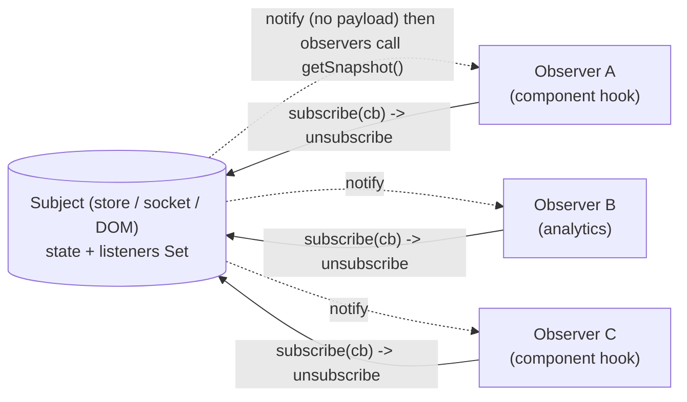
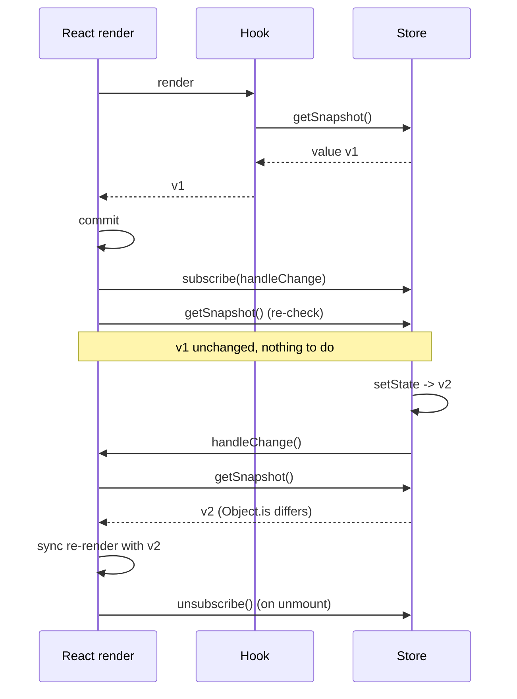
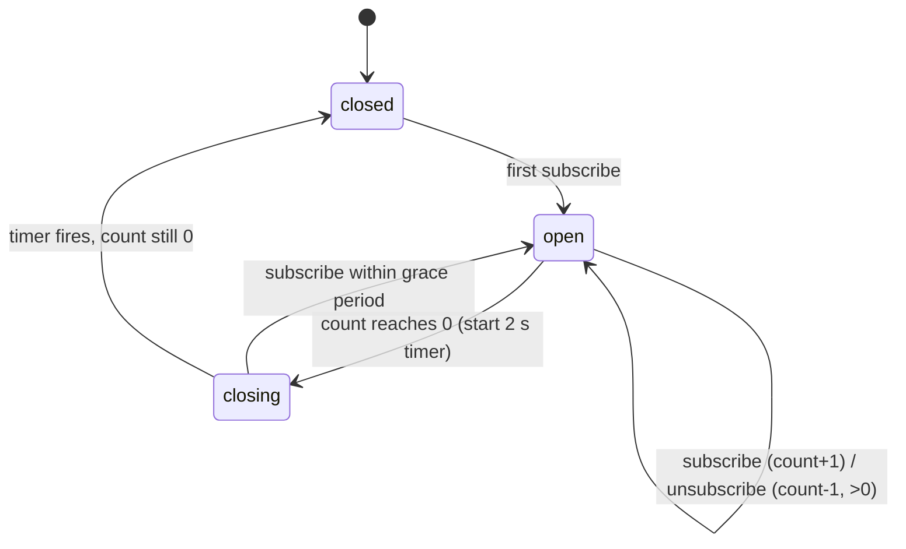

# 05 / 14 — Observer and Subscription Patterns

## 1. Lesson metadata

| | |
|---|---|
| **Level** | Advanced |
| **Study time** | 4–5 hours (reading 2 h, refactoring labs 1.5 h, exercises 1.5 h) |
| **Prerequisites** | [03 / 04 — `useEffect` and synchronization](../03-react-state-and-hooks/04-useeffect-synchronization.md), [03 / 06 — Effect cleanup](../03-react-state-and-hooks/06-effect-cleanup.md), [03 / 20 — `useSyncExternalStore` and external stores](../03-react-state-and-hooks/20-usesyncexternalstore-and-external-stores.md), [Foundations 13 — Browser events and propagation](../00-web-and-javascript-foundations/13-browser-events-and-propagation.md), [Foundations 06 — Lexical scope and closures](../00-web-and-javascript-foundations/06-lexical-scope-and-closures.md), [05 / 13 — State machine pattern](./13-state-machine-pattern.md) |
| **Next** | [15 — Adapter, strategy, factory](./15-adapter-strategy-factory.md) |
| **Related** | [Phase 6 / 17 — Real-time: WebSockets and subscriptions](../06-data-fetching-and-state-ecosystems/17-real-time-websockets-subscriptions.md), [Phase 6 / 11 — Context vs external stores](../06-data-fetching-and-state-ecosystems/11-context-vs-external-stores.md), [Phase 7 / 19 — Memory leaks](../07-performance/19-memory-leaks.md), [05 / 08 — Provider pattern](./08-provider-pattern.md) |

**Learning objectives.** After this lesson you can:
1. Describe the Observer (publish/subscribe) pattern, its three roles (subject, observer, subscription handle), and the guarantees it should and should not make.
2. Recognise observers already in the platform (`EventTarget`, `MutationObserver`, `matchMedia`, `storage`, `BroadcastChannel`, `WebSocket`) and in React itself (`useSyncExternalStore`, context).
3. Build a minimal typed store and a typed event emitter with correct unsubscribe semantics and safe emit-time iteration.
4. Bind an external subject to React with `useSyncExternalStore`, including selector rules, `getSnapshot` caching, and `getServerSnapshot`.
5. Write effect-based subscriptions that clean up, avoid stale handlers, and tolerate StrictMode's mount–unmount–mount cycle.
6. Decide between props/context, an observable store, and an event bus, and refactor a hand-rolled listener component to a shared subscription.

**Concepts covered:** subject/observer, publish/subscribe, subscription handle (unsubscribe function), push vs pull, snapshot, referential stability of snapshots, tearing, selector subscription, ref-counted shared subscription, latest-callback ref, event emitter, cross-tab messaging, backpressure (conceptual), hot vs cold observables (conceptual), signals (conceptual), memory leaks from forgotten unsubscribes.

---

## 2. Deep conceptual explanation

### 2.1 What problem is this lesson solving?

React's data flow is **top-down by props** ([Phase 1 / 06](../01-react-fundamentals/06-props-and-one-way-data-flow.md)). That is ideal for data that originates *inside* the component tree. But a large amount of interesting data originates **outside** React and changes **on its own schedule**:

- window size, `prefers-color-scheme`, online/offline status
- a WebSocket pushing price ticks
- `localStorage` changed by another tab
- a third-party map or editor widget that mutates its own model
- an application-level store (auth session, cart, feature flags) shared by components in unrelated subtrees
- a keyboard-shortcut system, analytics bus, or toast notification service that any module may trigger

React cannot call `render` on the external thing's behalf. Something must **tell React that the world changed**, and something must **stop telling it** when the component goes away. The Observer pattern is that something: a **subject** holds the changing value and a list of **observers**; observers register interest (`subscribe`) and receive a notification when the subject changes; each registration returns a handle to cancel it.

The recurring bugs in this area are all lifecycle bugs:

| Bug | Cause |
|---|---|
| Memory leak; handler runs after unmount | subscribe without unsubscribe |
| Stale values in the callback | closure over an old render's props/state |
| Double subscription (duplicate events) | subscribing in render, or missing cleanup before re-subscribe |
| Tearing (two components show different values of the same source in one frame) | each component caches the source in its own `useState` and updates at different times |
| Infinite render loop | `getSnapshot` returns a new object each call |
| Missed updates between render and subscribe | read happened before subscription was active |

This lesson is about getting subscription lifecycle right once, in a reusable form.

### 2.2 First principles

**The pattern.** Three parts:

```text
Subject:       holds state, keeps a set of listeners, notifies them on change
Observer:      a function (or object) the subject calls
Subscription:  the thing returned by subscribe(), used to cancel (usually an unsubscribe function)
```

**Push vs pull.** The subject can *push* the new value to each listener (`listener(value)`), or *notify* listeners that "something changed" and let them *pull* the new value (`listener()` then `subject.getState()`). Push is convenient but multiplies copying; pull-after-notify is what `useSyncExternalStore` requires, because React wants to read the value itself at the moment it chooses (during render) to avoid tearing.

**Guarantees you must choose explicitly** (the pattern as stated by textbooks leaves these open; real implementations differ):

| Question | Options | Typical choice in UI code |
|---|---|---|
| Is notification sync or async? | Sync (during `setState`) or microtask/batched | Sync notify; React batches renders itself |
| Order of observers | Registration order or unspecified | Registration order (a `Set` iterates insertion order) |
| Unsubscribe during notify | Takes effect immediately or after the current round | Snapshot the listener list before iterating (deterministic) |
| Error in one observer | Propagates and aborts the rest, or isolated | Isolate (try/catch per listener) and rethrow/log |
| Subscribe replays current value? | "Hot" (no) or "replay/BehaviorSubject" (yes) | Provide `getState()` separately; do not replay |
| Initial subscribe notification | Immediate call or none | None (the consumer reads current value separately) |

### 2.3 Observers you already use

| Source | Subscribe | Unsubscribe | Notes |
|---|---|---|---|
| DOM events | `target.addEventListener(type, fn, opts)` | `removeEventListener(type, fn, opts)` or an `AbortSignal` in options | Must pass the *same* function and the same `capture` flag; `{ signal }` simplifies cleanup |
| Media queries | `matchMedia(q).addEventListener('change', fn)` | `removeEventListener` | Older `addListener` is deprecated |
| Visibility, online | `document` / `window` events | same | |
| Cross-tab | `window` `storage` event; `BroadcastChannel` | `removeEventListener`; `channel.close()` | The `storage` event fires in *other* same-origin documents, not the one that made the change |
| DOM mutation/size | `MutationObserver`, `ResizeObserver`, `IntersectionObserver` | `observer.disconnect()` / `unobserve` | Observer *objects* hold callbacks |
| Sockets/SSE | `ws.onmessage`/`addEventListener` | `ws.close()` / remove listener | One connection, many logical subscribers (5.6) |
| React itself | `useSyncExternalStore(subscribe, getSnapshot)` | The function `subscribe` returns | React *is* an observer of your store |
| Context | `useContext` | automatic | Context is a subject whose subscribers are *all* consumers; no selector |

The unsubscribe-function convention (`subscribe` returns `() => void`) is the same shape as an effect cleanup, which is why the two compose without adapters.

### 2.4 React's relationship to the pattern

React is not an observable system by default: `useState` setters notify React only about that component's own state. Three bridges exist:

1. **Effects** (`useEffect` that subscribes and `setState`s in the callback). Fine for *event-like* data (a WebSocket message that appends to a list). Weak for *value-like* data read during render, because the initial value and the subscription happen at different times (tearing window; Section 3.2).
2. **`useSyncExternalStore`** (React 18+; the public guarantee for external mutable sources). Purpose-built for *value-like* data. See [03 / 20](../03-react-state-and-hooks/20-usesyncexternalstore-and-external-stores.md).
3. **Context.** Re-renders all consumers when the provided value changes (identity). Good for rarely changing values; it is an observer relation without selectors ([03 / 13](../03-react-state-and-hooks/13-usecontext-and-propagation.md), [03 / 14](../03-react-state-and-hooks/14-context-performance.md)).

### 2.5 Observer vs related ideas

| Idea | Relationship |
|---|---|
| **Pub/sub (event bus)** | Observer with a **topic broker** between publisher and subscribers: they do not know each other. Observer proper: subscribers know the subject. |
| **Callback props** (`onChange`) | A single-observer subject expressed via props. Prefer when the relation is parent–child. |
| **Streams / RxJS observables** | Observer + operators (map, debounce, switchMap) + completion/error channels. Powerful, heavier; not needed for most UI subscriptions. ⚠ Verify the current state of the TC39 Observable proposal before relying on native observables (not standardised in the language as of this lesson). |
| **Signals** | Fine-grained observer graphs: a computed value subscribes to the signals it read. Several frameworks use them; React's model is different (re-render by component) — [Phase 11 / 20](../11-senior-and-architect-mastery/20-evaluating-emerging-features.md). |
| **Mediator** | Central object coordinates peers; peers publish to the mediator, which decides who responds. |

### 2.6 Common misconceptions

| Misconception | Reality |
|---|---|
| "Subscribe in render; it's just reading." | Render must be pure ([Phase 2 / 12](../02-react-rendering-and-internals/12-why-rendering-must-be-pure.md)). A subscription is a side effect; it belongs in an effect or in `useSyncExternalStore`'s `subscribe`. |
| "`useState` + `useEffect` is equivalent to `useSyncExternalStore`." | Equivalent for eventually-consistent data; **not** for guaranteeing a consistent snapshot across the tree during a render or avoiding a missed update between first read and subscription. |
| "An event bus decouples my code." | It decouples *compile-time* dependencies and *increases* runtime coupling that is invisible to the type system and to readers. Use deliberately (Section 7). |
| "Unsubscribing is optional for global singletons." | The subscriber is the leak, not the subject: a component that unmounts but stays in the subject's listener set is retained along with its closure. |
| "Selectors make external-store subscription free." | They avoid *re-rendering* when the selected slice is unchanged, but each store update still runs every subscriber's selector; selectors must be cheap and return stable references. |
| "`addEventListener` with an inline arrow can be removed later." | `removeEventListener` matches by function identity; a different arrow does nothing. Keep the reference (or use `{ signal }`). |

---

## 3. Internal mechanics

### 3.1 What `useSyncExternalStore` guarantees

*Public guarantee* (see the [React reference](https://react.dev/reference/react/useSyncExternalStore)): `useSyncExternalStore(subscribe, getSnapshot, getServerSnapshot?)` returns the current snapshot of an external store; re-renders when the store notifies and the new snapshot is not `Object.is`-equal to the previous one; `subscribe` must accept a callback and return an unsubscribe function; `getSnapshot` must return an **immutable** value that is **the same** between calls if the store has not changed; `getServerSnapshot` is required when rendering on the server and during hydration, and must return the same value on server and client for hydration to match. Updates caused by external store changes are **synchronous** and cannot be marked as non-blocking transitions (documented caveat) — that is the price of tear-free reads.

*Teaching model.* React reads `getSnapshot()` during render; after commit it calls `subscribe(handleStoreChange)`. When notified, React calls `getSnapshot()` again and, if the result differs from what the last render used, schedules a re-render. After subscribing, it also re-checks for a change that happened between render and subscription, so nothing is missed. In dev, React calls `getSnapshot()` twice in a row and warns if the results differ.

*Implementation detail.* How React forces synchronous re-render, how it re-checks after commit, and how it handles mid-render store mutations (the "tearing" check during concurrent rendering) are internal. Treat them as the reason the contract exists, not as API.

⚠ *Version-sensitive:* verify details of server-rendering requirements and dev warnings in the current reference page.

### 3.2 Why `useState` + `useEffect` can tear

```tsx
function useWidth() {
  const [w, setW] = useState(window.innerWidth);   // render-time read
  useEffect(() => {
    const onResize = () => setW(window.innerWidth);
    window.addEventListener('resize', onResize);
    return () => window.removeEventListener('resize', onResize);
  }, []);
  return w;
}
```

Timeline: component A renders reading `1024`. Before its effect subscribes, the window resizes to `800`. B (a different component using the same hook) renders later with `800`. Both commit; **A shows 1024 and B shows 800** until A's effect subscribes and the *next* resize happens — and if no further resize occurs, A is wrong indefinitely. Concurrent rendering makes the render–commit gap larger (renders can be interrupted), so this class of bug is more likely than in synchronous React. `useSyncExternalStore` closes the gap by re-checking after subscribe and by reading the snapshot during render consistently.

### 3.3 Snapshot identity and the infinite loop

React compares snapshots with `Object.is`. A `getSnapshot` that **allocates** returns a new object each call:

```ts
// BUG: new object every call -> "getSnapshot should be cached" warning / render loop
const snap = useSyncExternalStore(subscribe, () => ({ width: window.innerWidth }));
```

Each render thinks the store changed → re-render → new object → again. Return a primitive, or return a **cached** object that only changes when the underlying value changes (5.3).

### 3.4 Subscription lifecycle vs effect lifecycle

A subscription created in an effect has the lifetime `[mount-or-dep-change, cleanup]`. In StrictMode (development) every effect is executed as *mount → unmount → mount*; React 19 also double-invokes ref callbacks and cleanups in this check. A correctly written subscription is **idempotent under that sequence**: subscribe, unsubscribe, subscribe leaves exactly one live subscription. If your subscribe has a side effect (opening a socket), the second subscribe reopens it — you either accept the churn in dev, or use a ref-counted shared connection that closes only after a grace period (5.6).

### 3.5 Listener-set iteration semantics

Iterating a `Set` while mutating it: elements deleted before being visited are not visited; elements *added* during iteration *are* visited by the same loop. Therefore a listener that subscribes a new listener inside its callback can cause an unbounded loop. Copy first (`[...listeners]`) to get deterministic "listeners at the time of notify" semantics (Section 5.2).

---

## 4. Step-by-step execution walkthrough: `useSyncExternalStore` with a shared cart store

Components: `CartBadge` (reads `count`), `CartTotal` (reads `total`), both subscribed to one `cartStore`.

| # | Event | Store | React | Result |
|---|---|---|---|---|
| 1 | Initial render | `{items: []}` | Render `CartBadge`: `getSnapshot()` → `0`; render `CartTotal`: → `0` | Both show 0 |
| 2 | Commit | — | React calls `cartStore.subscribe(cb)` for each hook (2 listeners) and re-reads snapshots (no change) | Listeners registered |
| 3 | User clicks "Add" | `setState` → new `items` array → **notify** both listeners | Each listener callback: React calls `getSnapshot()`; Badge: `1 !== 0` → schedule; Total: `19.99 !== 0` → schedule | Two scheduled updates, batched into one synchronous render |
| 4 | Render | — | Both components read the *same* store version | No tearing |
| 5 | User clicks "Add" for an item priced the same, item count unchanged elsewhere | notify | Badge: `2 !== 1` re-render; Total: `39.98 !== 19.99` re-render | |
| 6 | Another action changes only `lastViewedAt` in the store | notify | Badge: snapshot `2 === 2` → **no render**; Total: `39.98 === 39.98` → **no render** | Selector granularity saved renders |
| 7 | `CartBadge` unmounts | — | React calls the unsubscribe returned by `subscribe` | Listener set size 1 |

**Predict:** at step 6, how many times is `getSnapshot` for `CartBadge` called? *Answer:* at least once per notify (React calls it to compare); in development additional calls to check stability. This is why snapshot selectors must be cheap: they run on **every** notification for **every** subscriber, even when they produce no re-render.

---

## 5. Code examples

### 5.1 Minimal: the incorrect effect-based listener (leak + stale value)

```tsx
// INCORRECT
function ShortcutHandler({ onSave }: { onSave: () => void }) {
  useEffect(() => {
    window.addEventListener('keydown', (e) => {          // inline arrow
      if (e.ctrlKey && e.key === 's') { e.preventDefault(); onSave(); }
    });
    // no cleanup
  }, []);                                                // onSave captured from first render
  return null;
}
```

**Predict:** if the parent re-renders with a new `onSave` closing over new state, which `onSave` runs on Ctrl+S? How many handlers exist after mounting this component three times (mount, unmount, remount, StrictMode counted separately)? *Answer:* the **first render's** `onSave` (stale closure), and handlers accumulate on `window` forever (leak): after one mount in StrictMode dev there are two; after unmount they remain; after remounting more are added. Each stale handler calls a stale `onSave` — duplicate saves.

### 5.2 Minimal: correct subscription via cleanup, `AbortSignal`, and latest-callback ref

```tsx
import { useEffect, useRef } from 'react';

export function useWindowEvent<K extends keyof WindowEventMap>(
  type: K,
  handler: (event: WindowEventMap[K]) => void,
  options?: Omit<AddEventListenerOptions, 'signal'>,
) {
  const handlerRef = useRef(handler);
  useEffect(() => { handlerRef.current = handler; });         // keep latest after each commit

  useEffect(() => {
    const controller = new AbortController();
    window.addEventListener(
      type,
      (event) => handlerRef.current(event),
      { ...options, signal: controller.signal },
    );
    return () => controller.abort();                          // removes the listener
  }, [type, options?.capture, options?.passive, options?.once]);
}
```

Line notes:

- **Latest-callback ref.** The listener is registered once per `type`; it calls through `handlerRef.current`, which the first effect updates after every commit. The subscription never has to be torn down and recreated just because the handler changed, and the callback is never stale. This is the hand-rolled version of what the `useEffectEvent` hook is designed to express; `useEffectEvent` became stable in React 19.2 (it was experimental before), and it only works from effects of the same component (not passed to children, not a dependency), so it replaces this latest-ref only inside a component, not in a reusable hook that hands the callback onward.
- Updating a ref in an effect (not during render) respects purity: writing `handlerRef.current = handler` *in render* is a documented anti-pattern (render must not have side effects).
- `{ signal }` in `addEventListener` options removes the listener when the signal aborts — one call, no need to keep the function reference. Supported in current evergreen browsers; check MDN's compatibility table if you support older ones.
- The dependency array enumerates option fields (primitives) rather than the `options` object, which would be a new identity each render.

Usage: `useWindowEvent('keydown', (e) => { if (e.ctrlKey && e.key === 's') { e.preventDefault(); save(); } });`

### 5.3 A minimal typed store (the subject)

```ts
// store.ts
export type Listener = () => void;
export type Store<T> = {
  getState: () => T;
  setState: (next: T | ((prev: T) => T)) => void;
  subscribe: (listener: Listener) => () => void;
};

export function createStore<T>(initial: T): Store<T> {
  let state = initial;
  const listeners = new Set<Listener>();

  return {
    getState: () => state,

    setState(next) {
      const value = typeof next === 'function' ? (next as (prev: T) => T)(state) : next;
      if (Object.is(value, state)) return;            // no change, no notification
      state = value;
      for (const l of [...listeners]) l();            // copy: deterministic under (un)subscribe during notify
    },

    subscribe(listener) {
      listeners.add(listener);
      return () => { listeners.delete(listener); };   // idempotent: deleting twice is harmless
    },
  };
}
```

Notes:

- `getState`/`subscribe` are **stable function identities** created once: required, because React re-subscribes when the `subscribe` function identity changes between renders.
- `typeof next === 'function'` cannot distinguish "an updater" from "a state value that is itself a function"; if `T` can be a function type, make `setState` take only updater-or-value via two methods (`set`, `update`).
- No `Set` mutation hazard during notify: we iterate a copy.
- Errors in a listener will abort the rest of the loop. For a library-grade store, wrap each call in `try/catch`, collect errors, and rethrow after notifying everyone (a policy choice; document it).

Binding to React:

```tsx
import { useSyncExternalStore } from 'react';
import { createStore, type Store } from './store';

export function useStore<T, S>(store: Store<T>, selector: (state: T) => S): S {
  return useSyncExternalStore(
    store.subscribe,
    () => selector(store.getState()),
    () => selector(store.getState()),        // server snapshot: same source for a client-only store
  );
}

type Cart = { items: readonly { sku: string; price: number; qty: number }[]; lastViewedAt: number };
export const cartStore = createStore<Cart>({ items: [], lastViewedAt: 0 });

export function CartBadge() {
  const count = useStore(cartStore, (c) => c.items.reduce((n, i) => n + i.qty, 0)); // primitive: safe
  return <span aria-label="Items in cart">{count}</span>;
}
```

**Predict:** What happens with `useStore(cartStore, (c) => c.items.filter((i) => i.qty > 1))`? *Answer:* `filter` returns a **new array every call** — the snapshot is unstable → React warns that the result of `getSnapshot` should be cached and may loop. Fix: select a stable reference (`c.items`) and derive in render with `useMemo`, return a primitive, or memoise the selector against its input (e.g. a selector that returns the previous result when inputs are equal by reference or a shallow comparison). Libraries provide `useSyncExternalStoreWithSelector`-style helpers for this; verify what your store library offers.

⚠ A store that is client-only but rendered on the server: `getServerSnapshot` must return the value the *client's first render* will use, or hydration mismatches. For a store seeded from server data, pass the same seed to both sides.

### 5.4 Platform observers as hooks (value-like data)

```tsx
import { useSyncExternalStore } from 'react';

function subscribeOnline(callback: () => void) {
  window.addEventListener('online', callback);
  window.addEventListener('offline', callback);
  return () => {
    window.removeEventListener('online', callback);
    window.removeEventListener('offline', callback);
  };
}

export function useOnlineStatus(): boolean {
  return useSyncExternalStore(
    subscribeOnline,
    () => navigator.onLine,     // primitive boolean: stable by value
    () => true,                 // server snapshot (assume online)
  );
}

export function useMediaQuery(query: string): boolean {
  return useSyncExternalStore(
    (cb) => {
      const mql = window.matchMedia(query);
      mql.addEventListener('change', cb);
      return () => mql.removeEventListener('change', cb);
    },
    () => window.matchMedia(query).matches,
    () => false,
  );
}
```

The inline `subscribe` in `useMediaQuery` is a **new function each render**, so React unsubscribes and re-subscribes each render (correct but wasteful). Preferred: hoist/memoise per `query`:

```tsx
const subscribeCache = new Map<string, (cb: () => void) => () => void>();
function getSubscribe(query: string) {
  let s = subscribeCache.get(query);
  if (!s) {
    s = (cb) => { const m = window.matchMedia(query); m.addEventListener('change', cb); return () => m.removeEventListener('change', cb); };
    subscribeCache.set(query, s);
  }
  return s;
}
```

Hydration note: the server snapshot (`false`) may differ from the client's first value, causing a mismatch error if the markup depends on it. Either render something neutral on first paint or accept a post-hydration update; see [Phase 9 / 02](../09-advanced-rendering-and-ecosystem/02-hydration-internals-deep-dive.md).

### 5.5 A typed event emitter (pub/sub with topics)

```ts
// emitter.ts
type EventMap = Record<string, unknown>;

export function createEmitter<E extends EventMap>() {
  const handlers = new Map<keyof E, Set<(payload: never) => void>>();

  function on<K extends keyof E>(type: K, handler: (payload: E[K]) => void): () => void {
    let set = handlers.get(type);
    if (!set) { set = new Set(); handlers.set(type, set); }
    set.add(handler as (payload: never) => void);
    return () => {
      const s = handlers.get(type);
      s?.delete(handler as (payload: never) => void);
      if (s && s.size === 0) handlers.delete(type);
    };
  }

  function emit<K extends keyof E>(type: K, payload: E[K]): void {
    const snapshot = [...(handlers.get(type) ?? [])] as Array<(p: E[K]) => void>;
    const errors: unknown[] = [];
    for (const h of snapshot) {
      try { h(payload); } catch (e) { errors.push(e); }       // isolate observers
    }
    if (errors.length) queueMicrotask(() => { throw errors[0]; }); // surface, but after everyone ran
  }

  return { on, emit };
}

// usage
type AppEvents = {
  'cart:added': { sku: string; qty: number };
  'auth:logout': undefined;
};
export const bus = createEmitter<AppEvents>();
const off = bus.on('cart:added', ({ sku }) => console.info('added', sku));
bus.emit('cart:added', { sku: 'A1', qty: 1 });
off();
```

Design choices to defend: observers isolated; errors rethrown asynchronously so one buggy observer neither blocks others nor vanishes; the topic map is typed so `emit('cart:added', 5)` is a compile error. In React:

```tsx
function useBusEvent<K extends keyof AppEvents>(type: K, handler: (p: AppEvents[K]) => void) {
  const ref = useRef(handler);
  useEffect(() => { ref.current = handler; });
  useEffect(() => bus.on(type, (p) => ref.current(p)), [type]);   // on() returns the cleanup
}
```

Because `on` returns the unsubscribe function, it can be returned **directly** as the effect cleanup (arrow returns it). Event-like usage (toasts, analytics, "scroll to item") fits; value-like usage (the current user) does **not** — late subscribers would miss the event, and there is no `getSnapshot`.

### 5.6 Advanced: ref-counted shared subscription (one socket, many components)

```ts
// price-hub.ts
type PriceListener = (price: number) => void;

class PriceHub {
  private sockets = new Map<string, WebSocket>();                  // symbol -> socket
  private listeners = new Map<string, Set<PriceListener>>();
  private latest = new Map<string, number>();
  private closeTimers = new Map<string, ReturnType<typeof setTimeout>>();

  subscribe = (symbol: string, listener: PriceListener): (() => void) => {
    clearTimeout(this.closeTimers.get(symbol));                    // cancel pending close (StrictMode, fast remounts)
    this.closeTimers.delete(symbol);

    let set = this.listeners.get(symbol);
    if (!set) { set = new Set(); this.listeners.set(symbol, set); }
    set.add(listener);
    if (!this.sockets.has(symbol)) this.open(symbol);

    return () => {
      set.delete(listener);
      if (set.size === 0) {
        // grace period: don't tear down the connection on unmount-remount blips
        this.closeTimers.set(symbol, setTimeout(() => this.close(symbol), 2_000));
      }
    };
  };

  getLatest = (symbol: string): number | undefined => this.latest.get(symbol);

  private open(symbol: string) {
    const ws = new WebSocket(`wss://prices.example.com/${encodeURIComponent(symbol)}`);
    ws.onmessage = (e) => {
      const price = Number(JSON.parse(String(e.data)).price);
      this.latest.set(symbol, price);
      this.listeners.get(symbol)?.forEach((l) => l(price));
    };
    this.sockets.set(symbol, ws);
  }

  private close(symbol: string) {
    if (this.listeners.get(symbol)?.size) return;                  // someone re-subscribed
    this.sockets.get(symbol)?.close();
    this.sockets.delete(symbol);
    this.listeners.delete(symbol);
  }
}
export const priceHub = new PriceHub();
```

```tsx
export function usePrice(symbol: string): number | undefined {
  return useSyncExternalStore(
    (cb) => priceHub.subscribe(symbol, cb),   // new function per render => resubscribe per render; see note
    () => priceHub.getLatest(symbol),
    () => undefined,
  );
}
```

The inline `subscribe` closure changes identity when `symbol` changes (intended) and also on **every render** (unintended: React compares function identity). With the grace-period close the extra unsubscribe/subscribe pairs are cheap — that is *one* reason for the grace timer — but the clean fix is `useCallback((cb) => priceHub.subscribe(symbol, cb), [symbol])`. Wrapping with `useCallback` is justified here because the identity of `subscribe` is part of `useSyncExternalStore`'s contract, not an optimisation.

What the example demonstrates: **reference counting** (the number of listeners decides the connection lifetime), **grace-period teardown** (survives StrictMode and rapid navigation), and **separation of the live feed from the latest-value cache** (so late subscribers read a value without replay). It deliberately omits reconnection and heartbeat; see [Phase 6 / 17](../06-data-fetching-and-state-ecosystems/17-real-time-websockets-subscriptions.md).

### 5.7 Cross-tab observation

```ts
export function subscribeCrossTab(key: string, onValue: (v: string | null) => void) {
  const handler = (e: StorageEvent) => {
    if (e.storageArea === localStorage && e.key === key) onValue(e.newValue);
  };
  window.addEventListener('storage', handler);
  return () => window.removeEventListener('storage', handler);
}
```

Facts to remember: `storage` fires in *other* documents of the same origin, never in the tab that wrote; it is a notification channel, not a transactional store. For richer messaging use `BroadcastChannel('app')` (`postMessage`, `onmessage`, `close()` on cleanup). Always `close()` on unsubscribe.

### 5.8 Refactoring lab A: hand-rolled listeners → shared store (comparative)

**Before** — a `Toolbar` that re-implements three observers with `useState` + `useEffect`, duplicated across five components in the app.

```tsx
function Toolbar() {
  const [online, setOnline] = useState(navigator.onLine);
  const [dark, setDark] = useState(window.matchMedia('(prefers-color-scheme: dark)').matches);
  const [theme, setTheme] = useState(localStorage.getItem('theme') ?? 'system');

  useEffect(() => {
    const on = () => setOnline(true);
    const off = () => setOnline(false);
    window.addEventListener('online', on);
    window.addEventListener('offline', off);
    return () => { window.removeEventListener('online', on); window.removeEventListener('offline', off); };
  }, []);

  useEffect(() => {
    const m = window.matchMedia('(prefers-color-scheme: dark)');
    const h = (e: MediaQueryListEvent) => setDark(e.matches);
    m.addEventListener('change', h);
    return () => m.removeEventListener('change', h);
  }, []);

  useEffect(() => {
    const h = (e: StorageEvent) => { if (e.key === 'theme') setTheme(e.newValue ?? 'system'); };
    window.addEventListener('storage', h);
    return () => window.removeEventListener('storage', h);
  }, []);

  function chooseTheme(t: string) { localStorage.setItem('theme', t); setTheme(t); }  // storage event does NOT fire here
  ...
}
```

Problems: (1) three subscriptions per component × 5 components = 15 listeners; (2) each component has its own copy of `theme`; `chooseTheme` in one component updates only *its* `setTheme`, so the other four stay stale until a *different tab* writes — **in-tab inconsistency**; (3) SSR: `navigator`/`window`/`localStorage` in the `useState` initializer throws on the server; (4) tearing gap between initial read and subscription; (5) logic duplicated, untestable in isolation.

**After** — one store per source, one hook each, tear-free.

```tsx
// theme-store.ts
import { createStore } from './store';

type ThemePref = 'system' | 'light' | 'dark';
const KEY = 'theme';

function read(): ThemePref {
  try {
    const v = localStorage.getItem(KEY);
    return v === 'light' || v === 'dark' ? v : 'system';
  } catch { return 'system'; }                      // storage may throw (privacy mode)
}

export const themeStore = createStore<ThemePref>('system');
let initialised = false;

export function initThemeStore() {                  // call once on the client
  if (initialised) return;
  initialised = true;
  themeStore.setState(read());
  window.addEventListener('storage', (e) => {       // other tabs
    if (e.key === KEY) themeStore.setState(read());
  });
}

export function setTheme(t: ThemePref) {
  try { localStorage.setItem(KEY, t); } catch { /* quota/privacy: keep in-memory only */ }
  themeStore.setState(t);                           // same-tab subscribers update, too
}
```

```tsx
function Toolbar() {
  const online = useOnlineStatus();                                 // 5.4
  const prefersDark = useMediaQuery('(prefers-color-scheme: dark)'); // 5.4
  const pref = useStore(themeStore, (t) => t);                       // 5.3
  const effective = pref === 'system' ? (prefersDark ? 'dark' : 'light') : pref;
  ...
}
```

**Comparison**

| Criterion | Before | After |
|---|---|---|
| Listeners for 5 toolbars | 15 | 5 (hooks) + 1 (module `storage` listener) |
| In-tab consistency of `theme` | Broken (five copies) | One source of truth |
| SSR safety | `window` in initializer: crash | Server snapshots; reads guarded in `initThemeStore` |
| Tearing | Possible | Prevented by `useSyncExternalStore` |
| Testability | Mount-and-fire events | `themeStore.setState` + `getState` without DOM |
| Added code | 0 | ~50 lines in shared modules |
| Indirection cost | none | New contributors must learn the store (document it) |

**When Before is acceptable:** a single-use component whose value is read once on mount and is not shared. The refactor pays off on the *second* consumer.

### 5.9 Refactoring lab B: event bus vs lifted state vs callback props (comparative)

Scenario: when an item is added to the cart, show a toast. The cart button and the toast host are in distant subtrees.

**Option 1 — callback props / lifting** (most explicit): `App` owns `lastAdded` state, passes `onAdd` to the cart button and `message` to `ToastHost`. Traceable by IDE "find usages"; props pass through intermediate layers.

**Option 2 — context + store:** `cartStore` holds `lastAdded`; `ToastHost` subscribes with a selector. Value-like; late-mounted hosts see the current value (but may show a *stale* toast: you need a version/`id` to avoid re-showing).

**Option 3 — event bus:** `bus.emit('cart:added', ...)`; `ToastHost` does `useBusEvent('cart:added', show)`. Event-like; no state shared; late-mounted hosts correctly miss old events.

| Criterion | Lifted state/props | Store + selector | Event bus |
|---|---|---|---|
| Traceability | Highest (typed props) | Medium | Lowest (grep for event names) |
| Matches "something just happened" | Awkward | Needs ids to avoid replay | Natural |
| Matches "the current value" | Natural | Natural | Wrong tool |
| Coupling | Compile-time, explicit | Shared module | Shared module + naming convention |
| Testing | Render with props | Set store, render | Emit in test; assert effect |
| Risk | Prop drilling | Over-subscription | Hidden control flow; leaks |

Recommendation for *toasts*: bus or a store holding a queue, because the feature is a cross-cutting notification. Recommendation for the *current user*: store/context, never a bus.

---

## 6. Visual explanations

### 6.1 Roles



### 6.2 Sequence: `useSyncExternalStore` lifecycle



### 6.3 Tearing with `useState`+`useEffect`

```text
time ->  render A reads 1024 | window resizes to 800 | render B reads 800 | commit A,B | effects subscribe
Screen after commit:           A shows 1024              B shows 800       (inconsistent until next resize)
With useSyncExternalStore:     both read during same render pass or re-render synchronously after subscription re-check
```

### 6.4 Ref-counted connection



---

## 7. Alternative approaches and trade-offs

| Criterion | Props / lifting | Context | Observable store + `useSyncExternalStore` | Event bus | RxJS-style streams | `useState` + `useEffect` |
|---|---|---|---|---|---|---|
| Source of truth | React tree | React tree | Outside React | None (events only) | Outside React | Component copy |
| Selective re-render | Via memo | No (all consumers) | Yes (selectors) | N/A | Via operators | No |
| Tear-free | Yes | Yes | Yes (by contract) | N/A | Depends on binding | No guarantee |
| SSR | Natural | Natural | Needs `getServerSnapshot` | Not applicable | Hard | Initializer pitfalls |
| Traceability | Highest | High | Medium | Lowest | Medium | High |
| Time operators (debounce, retry, merge) | Manual | Manual | Manual | Manual | Native | Manual |
| Learning cost | Lowest | Low | Medium | Low | High | Lowest |
| Fits | Parent–child | Rarely changing, wide-read values | Shared, frequently changing values | One-shot notifications | Complex async composition | One component's private event data |

**Where the recommended approach (shared observable store) is NOT best.**

1. **Parent–child communication.** A callback prop is clearer; a store adds a global for what is a local relationship.
2. **Server data that needs caching, deduplication, retries.** Use a data-fetching library ([Phase 6 / 08](../06-data-fetching-and-state-ecosystems/08-tanstack-query.md)); building that out of subscribers re-invents it.
3. **A value read by one component, once.** `useState(() => read())` is enough; do not subscribe.
4. **Highly composed async flows** (debounce + switchMap + retry): stream operators beat hand-coded listeners — if the team already knows them. Otherwise a machine ([13](./13-state-machine-pattern.md)) plus an effect is often simpler.
5. **Rarely changing configuration** (locale, design tokens): context is simpler and its re-render cost irrelevant.

---

## 8. Best practices and anti-patterns

**Do**

- Always return an unsubscribe function from `subscribe`; always call it in cleanup.
- Use `useSyncExternalStore` for **value-like** external data read during render; effects for **event-like** reactions.
- Return **stable snapshots**: primitives or cached immutable objects.
- Keep `subscribe` and `getSnapshot` **stable identities** (module scope or `useCallback` keyed on the real inputs).
- Notify only on real change (`Object.is` check in `setState`).
- Snapshot the listener list before notifying.
- Isolate observer errors and decide how to surface them.
- Use the **latest-callback ref** (or the current stable equivalent) so callbacks are not stale and subscriptions are not recreated needlessly.
- Reference-count shared resources; add a grace period before teardown.

**Beginner mistakes**

- Subscribing in the component body.
- Anonymous listeners that cannot be removed.
- `[]` dependencies with callbacks closing over changing props.
- Copying an external value into `useState` and updating it only from the subscription.

**Experienced-developer mistakes**

- Event bus as a **global variable** that carries what should be state (late subscribers miss it).
- Selector returning a derived object per call.
- Notifying during render (a store updated inside a component body) — a side effect in render.
- Subscribing to **everything** (whole store) then filtering in render; the component re-renders on every unrelated change.
- Two sources of truth: store + a `useState` mirror.
- Using a global singleton store with SSR: the module state is shared across requests on the server, **leaking one user's data into another's response**. Create the store per request (and provide it via context) in server-rendered apps.

**Smells:** `eslint-disable react-hooks/exhaustive-deps` on a subscription effect; `setTimeout` used to "wait until subscribed"; a `forceUpdate`/counter `useState` used to re-render on external changes (replace with `useSyncExternalStore`).

**Justified exceptions:** a module-level store is fine in a purely client-rendered SPA; a bus is justifiable for analytics instrumentation where producers must not depend on consumers.

---

## 9. Real-world application

| Domain | Observed source | Constraint |
|---|---|---|
| **Trading dashboard** | WebSocket price feed, 50+ ticks/s per symbol | Re-render storm: batch notifications per animation frame in the hub (coalesce to latest value) and subscribe to symbol-level selectors; consider keeping chart data outside React. Backpressure policy: drop intermediate ticks, keep latest. |
| **E-commerce** | Cart store, cross-tab sync, stock updates | `storage`/`BroadcastChannel` for multi-tab cart; server remains source of truth; conflicts resolved by version. |
| **Auth** | Session store, token-refresh events | Single `refreshing` promise shared by all requests; logout broadcast to all tabs; SSR requires per-request store. |
| **Collaborative editor / maps** | Third-party widget model | Wrap the widget's observer API in a store adapter ([15](./15-adapter-strategy-factory.md)); unsubscribe when the widget is destroyed. |
| **Multi-team micro-frontends** | Cross-app notifications | A typed event contract (name + payload + version) is the API between teams; treat event names as public interface ([Phase 11 / 12](../11-senior-and-architect-mastery/12-microfrontends.md)). |
| **Forms/realtime validation** | Debounced field streams | Prefer controlled state plus effect; reach for streams only for multi-source composition. |

Engineering constraints to check: **notification frequency × subscriber count × selector cost** per second; memory retained by listeners; behaviour on tab backgrounding (timers throttled, sockets may be closed); privacy of payloads on shared buses.

---

## 10. Debugging and troubleshooting

### 10.1 Symptom: handler fires N times after navigating N times

*Investigation:* Chrome DevTools → Elements → select `window` (or use the Console `getEventListeners(window)`; this helper is available in the Chrome DevTools Console) and count entries per type. *Root cause:* missing/mismatched cleanup. *Fix:* add cleanup using the same function reference, or `{ signal }`. *Validate:* listener count returns to baseline after unmount.

### 10.2 Symptom: handler uses old props/state

*Root cause:* effect with `[]` deps closing over first render's variables. *Fix:* latest-callback ref (5.2) or include the dependency and accept re-subscription. *Validate:* a test that re-renders with a new callback and asserts only the new one is called.

### 10.3 Symptom: "The result of getSnapshot should be cached to avoid an infinite loop" (dev warning) or "Maximum update depth exceeded"

*Root cause:* snapshot allocates (3.3). *Investigation:* log `Object.is(getSnapshot(), getSnapshot())` — must be `true` with no store change. *Fix:* return primitives or cache by input reference. *Validate:* warning gone; render count equals number of real changes (React Profiler).

### 10.4 Symptom: component re-renders on every store change

*Investigation:* React DevTools Profiler → "Why did this render?" (enable *Record why each component rendered*). Snapshot is changing identity. *Root cause:* selector returns a fresh array/object, or subscribes to the whole state. *Fix:* narrower selector returning a primitive/stable ref. *Validate:* Profiler shows no commit when unrelated slices change.

### 10.5 Symptom: hydration mismatch with `useMediaQuery`/`useOnlineStatus`

*Root cause:* `getServerSnapshot` returns a value that differs from the client's first read. *Fix:* choose a neutral server value and render markup that does not depend on it for first paint, or defer client-only UI until after hydration. *Validate:* no mismatch warning; check with a production build too.

### 10.6 Symptom: memory grows over a session

*Investigation:* Chrome DevTools → Memory → heap snapshot before and after mounting/unmounting a view 20 times; search for detached DOM nodes and for your component's closures retained by a `Set` in the subject. *Root cause:* listeners not removed; subject outlives subscribers. *Fix:* unsubscribe; for global subjects prefer weak patterns only if truly needed (`WeakRef` is rarely the answer; fix the lifecycle). *Validate:* snapshots show flat retained size. See [Phase 7 / 19](../07-performance/19-memory-leaks.md).

### 10.7 Symptom: two tabs overwrite each other's setting

*Root cause:* `storage` events carry no ordering guarantee beyond arrival; both tabs write full objects. *Fix:* write small independent keys, or version records and merge. *Validate:* two-tab manual test and an automated Playwright test with two pages in one context ([Phase 8 / 09](../08-testing-and-quality/09-e2e-with-playwright.md)).

---

## 11. Exercises

### Level A — Knowledge
A1. Name the three roles in the Observer pattern and the contract of `subscribe`.
A2. Explain push versus "notify then pull". Which does `useSyncExternalStore` use and why?
A3. List four guarantees an implementation must choose (order, error isolation, unsubscribe-during-notify, replay) and your default for each in UI code.
A4. Why must `subscribe` and `getSnapshot` have stable identity?
A5. When does a `storage` event fire, and where does it not fire?

### Level B — Code comprehension
B1. In 5.1, how many `keydown` listeners exist on `window` after the component mounts, unmounts, and mounts again in a dev StrictMode tree? Which `onSave` runs?
B2. In 5.3, why does `useStore(store, (s) => s.items.filter(Boolean))` misbehave but `useStore(store, (s) => s.items.length)` does not?
B3. In the `PriceHub`, a component using `usePrice('ABC')` unmounts and another using `usePrice('ABC')` mounts 500 ms later. How many WebSocket connections are opened in total, and why?
B4. The emitter in 5.5 copies the listener set before iterating. Describe a scenario where *not* copying causes an infinite loop.

### Level C — Implementation
C1. Implement `useLocalStorageValue(key: string): string | null` with `useSyncExternalStore`, with same-tab and cross-tab updates and a safe server snapshot.
C2. Add `once(type, handler)` and `off(type, handler)` to the emitter; define semantics when `off` is called during `emit`.
C3. Implement a `createSelectorSubscription(store, selector, equalityFn)` that notifies its listener only when the selected value changes by `equalityFn`, and show how it plugs into `useSyncExternalStore` with a cached snapshot.

### Level D — Debugging
D1. A `useWindowSize` hook returns `{ w, h }` from `getSnapshot` and the app freezes on mount with a console warning. Diagnose and fix.
D2. A live-orders table duplicates rows: every websocket message appears twice only in development. Diagnose the cause and give two fixes (one in the subscription, one in the data model).
D3. A teammate's component shows the correct theme after toggling in tab A, but tab B on the same machine never updates. The code calls `setTheme(next); localStorage.setItem('theme', next)` and listens for `storage`. Diagnose.

### Level E — Architecture and engineering decisions
E1. Your app has a notifications panel, a header badge, and an analytics module that must all react to "new notification arrived" from a WebSocket. Compare a store, a bus, and context. Recommend with failure modes.
E2. An SSR app uses a module-level cart store. A security review flags it. What is the risk, how do you reproduce it, and how do you redesign?

### Level F — Expert challenge
F1. Design a `createHub<Topic, Value>()` generalising 5.6 with ref-counted topics, `getLatest`, grace-period teardown, reconnection with exponential backoff injected through a strategy, and a test using fake timers. List the invariants and write tests for three of them.
F2. Comparative refactor: given a component that tracks scroll position via `useState` + `scroll` listener and re-renders 60 times/s, produce (1) a `useSyncExternalStore` version, (2) a ref + `requestAnimationFrame` version that does not re-render, (3) a CSS-only version (`animation-timeline: scroll()`) if appropriate, and a written comparison on re-render count, correctness, browser support, and testing. State which you ship and when you would choose each.

---

## 12. Detailed answers and explanations

> Attempt the exercises first.

**A1.** Subject (holds state, owns listeners), observer (callback), subscription (handle for cancellation). `subscribe(listener)` registers the listener and returns an idempotent `unsubscribe`; after unsubscribe, the listener must not be called for future notifications (ideally including one already in progress, depending on the chosen semantics). Wrong answer: "subscribe returns the current value"; that is a replay subject, a different contract.

**A2.** Push sends the value to each listener; notify-then-pull sends a bare signal and observers read `getSnapshot()` themselves. `useSyncExternalStore` pulls because React must read the value at the time it renders to guarantee consistency across the tree, and to compare with the previous snapshot by `Object.is`.

**A3.** Defaults: order = registration order; error isolation = isolate with deferred rethrow; unsubscribe during notify = iterate a copy (a listener removed mid-round may still be called once in that round — document it or add a "removed" flag check); replay = none (consumer reads current value separately). A strong answer states *why*: determinism and not letting one component's bug starve others.

**A4.** React tracks the `subscribe` function; a new identity means "different store", so it unsubscribes and re-subscribes. Unstable `getSnapshot` identity is less harmful by itself (called each render), but unstable *results* cause loops. Fix with module scope or `useCallback` keyed on real inputs.

**A5.** Fires on `window` of **other** documents of the same origin sharing the storage area, when a key changes. It does not fire in the document that made the change. Hence same-tab updates need a direct store notification (5.8).

**B1.** Mount (StrictMode): effect runs → listener 1; StrictMode simulated unmount → no cleanup → listener 1 remains; remount effect → listener 2. Then real unmount → no cleanup → 2 remain; mount again, StrictMode again: +2 → 4 total. All of them close over the *first render's* `onSave` of their respective mount: stale. Pressing Ctrl+S calls several (potentially different) `onSave`s: multiple saves.

**B2.** `filter` returns a new array on each call → snapshot never `Object.is`-equal → warning/loop. `length` is a number: equal by value. General rule: selectors return primitives or existing references.

**B3.** One connection. On unmount the count hits 0 and a 2-second close timer starts; 500 ms later the new subscriber cancels the timer (`clearTimeout`) and reuses the open socket. Without the grace period: two connections and a window with no data.

**B4.** Listener L1 on `'x'` subscribes another listener L2 to `'x'` inside its callback, and L2 does the same. Iterating a live `Set` visits added entries, so each round creates another listener to visit → unbounded loop. A copy fixes the round to "those present at emit time".

**C1.** Sample:

```tsx
import { useSyncExternalStore } from 'react';

const sameTab = new Set<() => void>();

function subscribe(cb: () => void) {
  sameTab.add(cb);
  window.addEventListener('storage', cb);        // cross-tab
  return () => { sameTab.delete(cb); window.removeEventListener('storage', cb); };
}

export function setLocalValue(key: string, value: string | null) {
  try {
    if (value === null) localStorage.removeItem(key); else localStorage.setItem(key, value);
  } catch { /* ignore quota/privacy errors */ }
  sameTab.forEach((cb) => cb());                  // same-tab notification
}

export function useLocalStorageValue(key: string): string | null {
  return useSyncExternalStore(
    subscribe,
    () => { try { return localStorage.getItem(key); } catch { return null; } },  // string|null: stable by value
    () => null,
  );
}
```

Evaluation: handles both channels; primitive snapshot; try/catch around storage; server snapshot defined. Edge case: all keys' subscribers are notified on any `storage` event — acceptable since reading is cheap and React skips equal snapshots.

**C2.** `once` wraps the handler in a function that calls `off` then the handler; to allow `off(type, originalHandler)` to cancel a pending `once`, keep a map from original to wrapper (or tag the wrapper with the original). `off` during `emit`: because emit iterates a copy, the removed handler may still run in that round; to forbid it, check membership (`current.has(h)`) before invoking each copied handler. State the chosen semantics in docs and test it.

**C3.** Core idea: keep `lastSelected` and `lastState`. `getSnapshot = () => { const s = store.getState(); if (s !== lastState) { const next = selector(s); if (!equalityFn(lastSelected, next)) lastSelected = next; lastState = s; } return lastSelected; }` — it returns the *previous reference* when the new selected value is equal under `equalityFn`, so the snapshot is stable and derived objects do not loop. Initialise `lastSelected` lazily. Edge cases: selector closure identity changes between renders (reset the cache keyed on selector); `equalityFn` must be pure and cheap.

**D1.** `getSnapshot` returns a new `{ w, h }` each call → unstable snapshot → loop. Fix: cache the object and replace it only when `innerWidth`/`innerHeight` change, or call `useSyncExternalStore` twice for primitives (`w`, `h`), or return a string `` `${w}x${h}` `` and parse in render. Validate with the `Object.is(getSnapshot(), getSnapshot())` check.

**D2.** Cause: StrictMode runs the effect twice (mount–unmount–mount); the subscription lacked cleanup (or cleanup did not remove the handler), leaving two handlers appending to state. Fix 1: correct cleanup (so only one handler stays). Fix 2: make the data model idempotent — key rows by message id and use a map/upsert so duplicates collapse (needed anyway for at-least-once delivery on reconnect). Wrong fix: `useRef` "initialised" flag (see [13 / D2](./13-state-machine-pattern.md)).

**D3.** `storage` events never fire in tab A (the writer), which is fine, but tab B *does* receive them; so why no update in B? Likely the listener compares `e.key` to a different key string, or listens on `document` instead of `window`, or the `storage` handler does not call `setTheme`'s store-notify path (it sets the value without updating the store). Another possibility: the write happened in an iframe with a different origin or in a private window which does not share storage. Evaluation criteria: candidate identifies that the event is delivered to *other* documents, lists concrete checks (listener target, key equality, same origin, handler updates the store), and verifies with DevTools → Application → Local Storage in both tabs.

**E1.** Evaluation criteria: classify data (the notification *list* and *unread count* are value-like; "arrived" is event-like). Recommended: a store holding the list/unread count (late-mounting panel can read), with the WebSocket adapter writing to it; analytics subscribes via `store.subscribe` or a bus emission from the same adapter for event-semantics (so it counts arrivals, not re-renders). Failure modes: bus-only → panel mounted late misses history; store-only → analytics tied to render timing; context-only → every consumer re-renders on each arrival. Name idempotency (dedupe by id) and reconnection replay.

**E2.** A module-level store on a Node server persists across requests: request B can read request A's mutated cart/user — cross-request state leakage (a confidentiality bug). Reproduce: two sequential requests from different sessions, where the first writes to the store during render or loader code and the second renders and shows the first's data. Redesign: `createCartStore(initial)` per request, provided through context to hooks (`useContext(StoreContext)` then `useSyncExternalStore` against that instance), and serialise the initial state into the HTML for the client to hydrate with the same seed. Also forbid mutating stores during render.

**F1.** Evaluation criteria: invariants such as (1) one connection per topic with ≥1 subscriber; (2) connection closes only after grace period with 0 subscribers; (3) `getLatest` returns the latest value or `undefined`, never throws; (4) after unsubscribe no further callbacks; (5) backoff delays follow the strategy and reset after a successful open. With Vitest fake timers: advance 1 999 ms → still open; 2 000 ms → closed; resubscribe at 1 000 ms → timer cancelled, no new socket. Inject `createSocket` and the backoff strategy via constructor (dependency injection, [16](./16-dependency-injection.md)) so tests use a fake socket. Edge cases: unsubscribe called twice; subscribe within a listener callback; socket closes while count > 0 (schedule reconnect).

**F2.** Expected findings. (1) `useSyncExternalStore` re-renders per scroll event (React batches to frame-ish but each distinct snapshot renders) — correct but heavy when only a CSS transform depends on scroll. (2) Ref + `requestAnimationFrame`: update an element's style directly; zero React renders; but bypasses React's declarative model, so use only for purely visual effects and keep state-based logic elsewhere. (3) CSS scroll-driven animations (`animation-timeline: scroll()`): zero JS for pure visual coupling; ⚠ browser support is evolving (verify on MDN / caniuse before shipping, provide a fallback). Ship (3) where supported for decorative effects, (2) as the fallback, and (1) only if layout/state depends on the position (sticky headers that change component state, "back to top" visibility — use a threshold selector so the snapshot is a boolean and re-renders only on crossing). Strong answers note passive scroll listeners (`{ passive: true }`).

---

## 13. Senior engineer interview questions

1. **"Why `useSyncExternalStore` instead of `useState` + `useEffect`?"** Because the effect version has a gap between the render-time read and subscription activation, and under concurrent rendering renders can be interrupted, so different components can display different versions of the same external value. `useSyncExternalStore` makes React own the read, re-check after subscribing, and force a synchronous re-render so the committed UI is consistent. Trade-off: those updates cannot be deferred as transitions.
2. **"What goes wrong if `getSnapshot` returns a new object each time?"** React cannot tell "same value" from "changed", sees a different snapshot on every call, re-renders, and loops; React warns in dev. Snapshots must be referentially stable between store changes.
3. **"Bus or store?"** Ask whether consumers need the *current value* or to know *that something happened*. Current value → store (supports late subscribers, SSR, selectors). Happened → bus/emitter (no replay). A bus carrying state is a design smell.
4. **"How do you prevent a stale closure in an event subscription without resubscribing on every render?"** Keep the latest callback in a ref updated in an effect, and call through the ref from a stable listener; or use the framework's effect-event primitive (verify the current stable API). Never write to the ref during render.
5. **"What do StrictMode's double effects tell you about your subscription code?"** That subscribe→unsubscribe→subscribe must leave one live subscription and no leaked resources. If it does not, production will hit the same path on Fast Refresh, Suspense/Offscreen reuse, or remounts.
6. **"Design a shared WebSocket hook for 200 components."** One connection per endpoint, multiplexed topics; ref-counted subscriptions; grace-period teardown; cache the latest value so late subscribers have a snapshot; coalesce updates (frame batching) to bound render rate; reconnection with backoff injected for tests; idempotent message handling. Name the stale-after-reconnect problem and how to resync.
7. **"How does the Observer pattern leak memory?"** The subject holds strong references to listeners (and their closures: components, DOM, large data). If subscribers never unsubscribe, a long-lived subject retains short-lived subscribers. Detect with heap snapshots; fix by lifecycle-correct cleanup, not by `WeakRef` hacks.
8. **"Is context an Observer?"** Structurally yes: the Provider is a subject and every consumer an observer; but it has no selectors and compares the provided value by identity, so any change re-renders all consumers. For fast-changing shared data use an external store with selectors.
9. **"Why can a global store be a security bug in SSR?"** Module state is process-wide on the server, so state from one request can appear in another's response. Create the store per request and pass it down.

---

## 14. Further learning resources

| Resource | URL | Covers / why | Level | Section to study |
|---|---|---|---|---|
| React reference: `useSyncExternalStore` | https://react.dev/reference/react/useSyncExternalStore | Contract for subscribe/getSnapshot/getServerSnapshot, caveats, examples | I–A | Reference, Caveats, Usage |
| React: Synchronizing with Effects | https://react.dev/learn/synchronizing-with-effects | Subscription effects and cleanup | I | "How to handle the Effect firing twice in development" |
| React: Separating Events from Effects | https://react.dev/learn/separating-events-from-effects | Effect Events / reading latest values without resubscribing verify current status of `useEffectEvent` | A | Whole page |
| React: You Might Not Need an Effect | https://react.dev/learn/you-might-not-need-an-effect | "Subscribing to an external store" section | I | That section |
| MDN: `EventTarget.addEventListener` | https://developer.mozilla.org/en-US/docs/Web/API/EventTarget/addEventListener | Options incl. `signal`, `once`, `passive` | B–I | Parameters |
| MDN: `AbortController` / `AbortSignal` | https://developer.mozilla.org/en-US/docs/Web/API/AbortController | Cancellation primitive | I | Instance methods |
| MDN: `Window` `storage` event | https://developer.mozilla.org/en-US/docs/Web/API/Window/storage_event | Cross-tab semantics | I | Description |
| MDN: `BroadcastChannel` | https://developer.mozilla.org/en-US/docs/Web/API/BroadcastChannel | Same-origin messaging | I | Usage |
| MDN: `ResizeObserver`, `IntersectionObserver`, `MutationObserver` | https://developer.mozilla.org/en-US/docs/Web/API/ResizeObserver *(sibling pages follow the same pattern; unverified)* | Platform observers | I | Constructor + `disconnect()` |
| MDN: CSS scroll-driven animations | https://developer.mozilla.org/en-US/docs/Web/CSS/CSS_scroll-driven_animations | Alternative to JS scroll subscriptions | A | Overview |
| RxJS docs | https://rxjs.dev/ | Streams, operators; compare to hand-rolled observers | A | "Overview" |

---

## 15. Knowledge checkpoint

**You should now be able to understand:** the roles and design choices in Observer/pub-sub; why React needs `useSyncExternalStore` for value-like external data; how snapshot stability, subscribe identity and cleanup determine correctness.

**You should be able to explain:** push vs notify-then-pull; tearing and why `useState`+`useEffect` can exhibit it; value-like vs event-like data and which tool each deserves; why global stores are dangerous in SSR.

**You should be able to implement:** a typed store and emitter with safe unsubscribe semantics; hooks over platform observers (`online`, `matchMedia`, `storage`); a latest-callback subscription hook; a ref-counted shared connection.

**You should be able to debug:** duplicated handlers, stale closures, `getSnapshot` loops, over-rendering from selectors, hydration mismatches from server snapshots, and listener leaks via heap snapshots.

**Prerequisite for next lessons:** [15 — Adapter, strategy, factory](./15-adapter-strategy-factory.md) (wrapping foreign observer APIs), [16 — Dependency injection](./16-dependency-injection.md) (injecting stores/hubs for tests and per-request SSR).

**Self-check (answer without looking):** A component needs the current cart count and also a one-time analytics ping whenever an item is added. Which mechanism do you use for each, what does each return from `subscribe`, and what happens to each on unmount?
