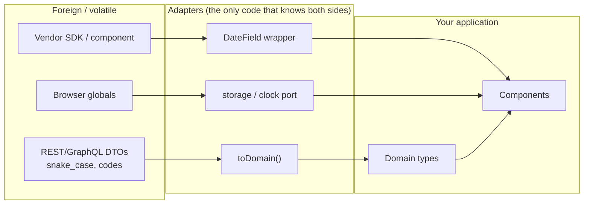
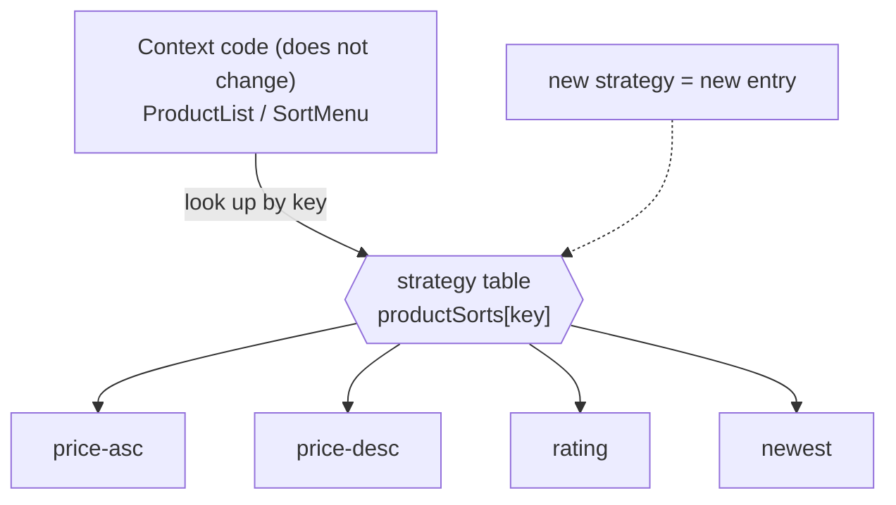
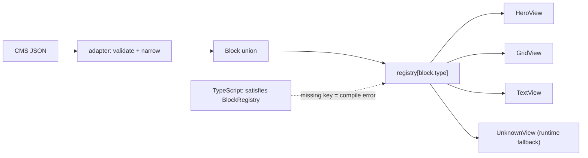

# 05 / 15 — Adapter, Strategy, and Factory in React

## 1. Lesson metadata

| | |
|---|---|
| **Level** | Intermediate–Advanced |
| **Study time** | 4–5 hours (reading 2 h, refactoring labs 1.5 h, exercises 1.5 h) |
| **Prerequisites** | [05 / 01 — SOLID in React](./01-solid-in-react.md), [05 / 02 — DRY, KISS, YAGNI](./02-dry-kiss-yagni.md), [05 / 03 — Composition over inheritance](./03-composition-over-inheritance.md), [05 / 08 — Provider pattern](./08-provider-pattern.md), [Phase 1 / 07 — Composition and children](../01-react-fundamentals/07-composition-and-children.md) |
| **Next** | [16 — Dependency injection](./16-dependency-injection.md) |
| **Related** | [Phase 4 / 10 — Clean and hexagonal architecture](../04-react-architecture/10-clean-and-hexagonal-architecture.md), [Phase 4 / 11 — Dependency inversion](../04-react-architecture/11-dependency-inversion.md), [Phase 6 / 04 — API normalization](../06-data-fetching-and-state-ecosystems/04-api-normalization.md), [05 / 25 — Comparative refactoring labs](./25-comparative-refactoring-labs.md) |

**Learning objectives.** After this lesson you can:
1. Explain the intent of the Adapter, Strategy, and Factory patterns and translate each from its classical object-oriented form into idiomatic function-and-component React.
2. Place an adapter at the correct boundary (network, third-party library, browser API, legacy component) and explain why the place matters more than the code.
3. Replace growing `if`/`switch` ladders with strategy tables or strategy props, and recognise when the ladder is actually the better design.
4. Build a registry-based factory that maps a discriminated union to components, with exhaustiveness checking in TypeScript.
5. Avoid the "component created during render" bug that makes some factories destroy state on every render.
6. Perform before/after refactors and justify each with criteria rather than taste.

**Concepts covered:** adapter, anti-corruption layer, DTO vs domain model, wrapper component, hook adapter, strategy, strategy table, function-as-strategy, component-as-strategy, factory function, factory registry, abstract factory, discriminated unions, `satisfies`, exhaustiveness (`never`), component identity and remounting, open/closed principle.

---

## 2. Deep conceptual explanation

### 2.1 What problem is this lesson solving?

Three recurring pressures in any non-trivial front end:

1. **Foreign shapes leak inward.** The back end returns `plan_cd: "P"`, a vendor SDK wants `selected` and `onSelect(string)`, the browser gives you `GeolocationPosition`. If those shapes flow through your components, every component couples to something you do not control. When the vendor changes, you edit forty files.
2. **Behaviour varies along one axis and the code branches on it everywhere.** Shipping is "standard", "express", or "pickup"; sorting is "price", "rating", or "newest"; payment is card, bank transfer, or wallet. The same `switch (kind)` appears in five components.
3. **Objects of one family must be created based on data.** A CMS returns `[{type: "hero"}, {type: "carousel"}, ...]`; a form schema lists fields; a notification has a `severity`. Something has to turn that data into the right component.

The classic Gang of Four answers are, respectively, **Adapter** (convert one interface to another), **Strategy** (make an algorithm interchangeable), and **Factory** (centralise the decision about *which* thing to create). In Java these are class hierarchies. In React they are mostly **functions, plain objects, and components** — and recognising them under that disguise is the skill. If you have used `Object.fromEntries(api.items.map(toItem))`, passed a `compare` function to a table, or written `const Widget = registry[block.type]`, you have already used all three.

### 2.2 First principles: what each pattern really is

| Pattern | Intent (one sentence) | Variation point | Typical React form |
|---|---|---|---|
| **Adapter** | Make something with interface *A* usable where interface *B* is expected, without changing either. | The *shape* of data or props | `toDomain(dto)` function; wrapper component; custom hook returning your own types |
| **Strategy** | Define a family of interchangeable behaviours behind one signature so the caller does not branch. | The *algorithm* | A function prop, an object of functions keyed by name, or a component prop |
| **Factory** | Centralise the decision about which concrete thing to build, so callers depend on the abstraction. | The *choice of concrete type* | `createX(config)` functions, `Record<Kind, Component>` registries, `createContext` wrappers |

They compose naturally. A payment screen might use an **adapter** to normalise three vendor SDKs into one `PaymentGateway` interface, a **strategy** selection to pick which gateway to use for a given country, and a **factory** to construct the gateway from configuration. Section 5.6 builds exactly that.

### 2.3 Adapter in depth

**Core idea.** Two sides disagree about shape. Rather than bend either one, put a thin translation layer between them. The consumer depends only on *its own* interface; the translation is the only code that knows both.

There are four places adapters appear in React applications:

1. **Data adapters (anti-corruption layer).** Convert transport DTOs to domain models: snake_case → camelCase, `"2024-05-01T..."` → `Date`, status codes → union literals, nullable fields → safe defaults. Sits at the edge of the data layer (query function, `select`, or loader).
2. **Component adapters.** Wrap a third-party or legacy component in a component with *your* prop contract. Your design system's `<DateField value onChange>` wraps a vendor's `<Picker selected onSelect>`.
3. **Hook adapters.** A custom hook that hides `useSomeVendorHook()` behind `useFeatureFlag(name)` or `useGeolocation()` returning your types and your loading/error vocabulary.
4. **Platform adapters.** `localStorage`, `IndexedDB`, `fetch`, `WebSocket`, `Intl` hidden behind an interface so code (and tests) do not call globals directly. This one overlaps with [dependency injection](./16-dependency-injection.md).

**Problem solved:** change isolation. The set of files that must change when the foreign shape changes shrinks from "everything that touched it" to "the adapter".

**What an adapter is not.** It is not a place for business rules (that is a domain function), not a cache, and not a facade (a facade *simplifies* a complex subsystem into a smaller API; an adapter *translates* between interfaces; see [Lesson 17](./17-facade-and-command.md)). An adapter that has grown conditionals about *business meaning* is probably two things.

### 2.4 Strategy in depth

**Core idea.** The part of a computation that varies is extracted behind a single function signature. The context code (the part that does not vary) receives or looks up the strategy and calls it.

In OO languages this needs an interface and classes. In JavaScript, **a function already is an interface with one method**, so:

```ts
type SortStrategy<T> = (a: T, b: T) => number;
```

is a complete Strategy definition. `Array.prototype.sort` is a Strategy-accepting context. `useMemo(() => items.toSorted(strategy), [items, strategy])` is a React-flavoured one.

**Where the strategy lives** determines the design:

| Where the strategy is chosen | Form | Use when |
|---|---|---|
| By the caller, passed in | Function prop (`compare`, `formatter`, `validate`) | The parent knows the policy; the child is generic. |
| By a key, looked up inside | `strategies[key]` table | The choice comes from data/state (URL param, user setting). |
| By the environment | Provided via context | Many descendants need the same policy; see [Provider pattern](./08-provider-pattern.md). |
| By polymorphic component | Component-as-strategy (`<Renderer />` from a map) | Strategy includes UI, i.e. the variation is in *what renders*. |

**Problem solved:** the Open/Closed Principle ([Lesson 01](./01-solid-in-react.md)). Adding a fourth sort order adds one entry to a table; it does not modify the component that consumes the table.

### 2.5 Factory in depth

**Core idea.** Callers say *what* they want ("a field of type `date`"), not *how* to build it. One module owns the mapping from description to implementation.

In React the factory forms are:

1. **Registry / lookup table:** `const registry: Record<BlockType, ComponentType<...>> = {...}` and `const C = registry[block.type]`. The most common and the most useful.
2. **Factory function returning a value:** `createStore(initial)`, `createStrictContext<T>(name)`, `createApiClient(config)`. Returns configured objects, hooks, or components.
3. **Factory returning a component** (higher-order-ish): `createIcon(path)`, `styled.div`-like builders. Legal and useful, but dangerous when called *during render* (Section 5.4).
4. **Abstract factory:** a factory of related factories, e.g. a "theme kit" that supplies `Button`, `Input`, `Modal` consistently for a design language. In React this is usually simply an object of components passed through context.

**Problem solved:** the creation decision is localised; consumers depend on the abstraction (`BlockProps`, `Field`), not on the set of concretes.

### 2.6 Relationship to JavaScript and React

- JavaScript functions are first-class values with referential identity ([Foundations 07](../00-web-and-javascript-foundations/07-functions-and-referential-identity.md)). Strategy and Factory depend on that: you can store, pass, and look up behaviour. Identity matters because a strategy passed as a new inline function on every render breaks memoization of children that receive it.
- React *itself* is a Factory-and-Adapter runtime: JSX type position (`<Widget />`) accepts any component, and `React.createElement(type, props)` is a factory. Rendering `<registry[type] />` is not valid JSX syntax (needs a capitalised identifier or member expression), hence `const C = registry[type]; return <C ... />`.
- The **reconciler** ([Phase 2](../02-react-rendering-and-internals/11-render-phase-and-commit-phase.md)) decides "same component or new one" by comparing the element `type` by reference. That single fact explains the dominant factory bug in Section 5.4.

### 2.7 Common misconceptions

| Misconception | Reality |
|---|---|
| "Patterns need classes and interfaces." | The patterns are about *structure of responsibility*. In TypeScript a function type, an object type, or a `Record` suffices. A `class` often *adds* ceremony without benefit. |
| "An adapter means I wrap everything." | Wrapping a stable, well-owned, single-use dependency is waste (YAGNI, [Lesson 02](./02-dry-kiss-yagni.md)). Adapt at *volatile or foreign* boundaries. |
| "Strategy removes all conditionals." | It *relocates* the conditional to the point of choosing. If that choice is made in one place, you gain; if you choose in each component, you gained nothing. |
| "A factory should create everything." | A registry for a closed set of three block types is clearer as a `switch`. Factories pay off with open, growing, or data-driven sets. |
| "`React.memo` on the adapter makes it free." | The adapter's cost is mostly cognitive. Performance only matters if the adapter runs per render on large data; then use `select`/`useMemo` deliberately. |
| "Components created in a factory are the same as normal components." | Only if created once at module scope. Created on each render, each render produces a *new type*, so React unmounts and remounts the subtree. |

---

## 3. Internal mechanics

### 3.1 Element type identity and why factories can break state

*Teaching model.* When React reconciles a child position, it compares the previous element's `type` with the new element's `type`. If `Object.is(prevType, nextType)` is true (and `key` matches), it **updates** the existing instance; otherwise it **unmounts** the old subtree (running cleanups, destroying state and DOM) and **mounts** a new one. See [Phase 2 — reconciliation](../02-react-rendering-and-internals/).

*Public guarantee.* The React docs state that component state is preserved as long as the same component is rendered at the same position in the tree, and that you should not define components inside other components because they are recreated every render ("Nested component definitions" is a documented pitfall on react.dev). Verify the exact wording in the current docs under "Preserving and Resetting State".

*Implementation detail.* Fiber structures and how the comparison is coded are not public API; do not rely on them.

Consequence for factories:

```ts
// Module scope: one function object for the lifetime of the module -> stable type.
const MoneyCell = createCell('money');

// Inside a component body: new function object per render -> new type -> remount.
function Table() { const Cell = createCell('money'); return <Cell />; } // bug
```

### 3.2 Why a registry lookup is stable

`registry[block.type]` returns the *same function reference* each render as long as the registry object is not rebuilt. Therefore the element type is identical across renders and state in `<C />` is preserved. A registry built inside the component, containing inline arrow functions (`{ hero: () => <Hero /> }`), recreates the types on each render and has the same bug as above. Define registries at module scope (or memoise them with stable dependencies).

### 3.3 Strategy identity and memoization

A strategy passed as a prop participates in props comparison. `<Table compare={(a, b) => a.price - b.price} />` produces a new function every render; if `Table` is wrapped in `React.memo` or uses `useMemo([compare])`, the memoization is defeated. Fixes: define strategies at module scope, or `useCallback` when they close over state. ⚠ *Version-sensitive:* with the React Compiler ([Phase 9 / 08](../09-advanced-rendering-and-ecosystem/08-react-compiler.md)) many inline functions are memoized automatically; behavior depends on compiler version and configuration, so verify against current docs before removing manual memoization.

### 3.4 TypeScript mechanics that make these patterns safe

- **Discriminated unions** give each block variant its own props; `block.type` narrows `block`.
- **`satisfies`** (TS 4.9+) validates that a registry covers every key *without widening* the inferred type.
- **`never` exhaustiveness check:** `const _exhaustive: never = block;` in the default branch makes adding a union member a compile error until handled.
- **Mapped types:** `{ [K in Block['type']]: ComponentType<Extract<Block, {type: K}>> }` correlates each key with its prop type. This is the only way to type a registry so `registry.hero` accepts only `HeroBlock`.

---

## 4. Step-by-step execution walkthrough: a CMS page rendered via a factory registry

Scenario: a product landing page returns JSON blocks. We follow data from the network to the DOM.

1. **Network.** `fetch('/api/pages/spring-sale')` resolves with `{"blocks":[{"type":"hero","headline_text":"Spring","image_url":"/a.jpg"},{"type":"product_grid","skus":["A","B"]}]}`.
2. **Adapter runs once** at the data boundary (e.g. in the query function): `blocks.map(toBlock)` converts `headline_text` to `headline`, `image_url` to `imageUrl`, and validates `type` against known values (unknown types become `{type:'unknown'}`). The output is `Block[]`, the domain type.
3. **React renders** `<PageRenderer blocks={blocks} />`. This is the render phase: pure function calls, no DOM mutations.
4. **Factory lookup** per block: `const Component = blockRegistry[block.type]`. For `hero` the registry returns `HeroBlockView`; for `product_grid`, `ProductGridView`. Same references as the previous render.
5. **Elements are created:** `<Component key={block.id} {...block} />`. A `key` taken from stable data keeps instance identity if blocks reorder.
6. **Reconcile.** First render: both types are new, so both mount. Second render (new data, same types): types match by reference, so React *updates* props and preserves internal state (e.g. a carousel's current slide).
7. **Commit.** DOM nodes are created or patched; effects run.
8. **Unknown block.** `blockRegistry.unknown` renders a placeholder (or `null` in production and a visible warning in dev). The page degrades per block rather than crashing, a documented advantage of lookup with a fallback.

**Predict:** if step 4 were written as `const Component = createBlockComponent(block.type)` and `createBlockComponent` returns a *new* function each call, what happens to the carousel's current slide when any parent state changes?
*Answer:* it resets to the first slide on every render of `PageRenderer`, because the element type differs each time, so the subtree is unmounted and remounted (Section 5.4).

---

## 5. Code examples

All examples are TypeScript for React 19. Library names marked *hypothetical* are illustrative.

### 5.1 Minimal Adapter: DTO to domain model

```ts
// api-types.ts — shape owned by the backend team
export interface UserDto {
  id: number;
  first_name: string;
  last_name: string | null;
  created_at: string;           // ISO 8601
  plan_cd: 'F' | 'P' | 'E';
}

// domain.ts — shape owned by this front end
export interface User {
  id: string;
  fullName: string;
  createdAt: Date;
  plan: 'free' | 'pro' | 'enterprise';
}

// adapters/user.ts
const planByCode = {
  F: 'free',
  P: 'pro',
  E: 'enterprise',
} as const satisfies Record<UserDto['plan_cd'], User['plan']>;

export function toUser(dto: UserDto): User {
  return {
    id: String(dto.id),
    fullName: [dto.first_name, dto.last_name].filter(Boolean).join(' '),
    createdAt: new Date(dto.created_at),
    plan: planByCode[dto.plan_cd],
  };
}
```

Line notes:
- `satisfies Record<...>` fails compilation if the backend adds `'T'` to `plan_cd` and you forget the mapping, but keeps literal types precise.
- `String(dto.id)` is a *decision*: the domain treats ids as opaque strings. The adapter is where that decision lives.
- `last_name` nullability is resolved *here*, so no component ever writes `user.lastName ?? ''`.

Usage with TanStack Query v5 (`select` runs the adapter and is memoised by result structural sharing rules; verify details in the docs):

```ts
import { useQuery } from '@tanstack/react-query';

export function useUser(id: string) {
  return useQuery({
    queryKey: ['user', id],
    queryFn: async (): Promise<UserDto> => {
      const res = await fetch(`/api/users/${id}`);
      if (!res.ok) throw new Error(`HTTP ${res.status}`);
      return res.json();
    },
    select: toUser, // stable module-scope reference
  });
}
```

Choosing `select: toUser` (a stable reference) rather than an inline arrow avoids re-running the transform needlessly. Whether to adapt in `queryFn` (cache stores domain objects) or in `select` (cache stores DTOs) is a trade-off: the former makes the cache consumer-agnostic; the latter lets several components derive different views from one cache entry. Covered in [Phase 6 / 04](../06-data-fetching-and-state-ecosystems/04-api-normalization.md).

### 5.2 Component Adapter: wrapping a vendor date picker

Imagine a *hypothetical* `vendor-datepicker` package with this API:

```ts
// vendor-datepicker (hypothetical)
export interface VendorPickerProps {
  selected: string | undefined;           // 'YYYY-MM-DD'
  onSelect: (iso: string | undefined) => void;
  minDate?: string;
  locale_id?: string;
  className?: string;
}
export declare function VendorPicker(props: VendorPickerProps): React.JSX.Element;
```

Our design system wants `Date` objects, standard `disabled`, and BCP-47 locales:

```tsx
import { VendorPicker } from 'vendor-datepicker';

export interface DateFieldProps {
  value: Date | null;
  onChange: (next: Date | null) => void;
  min?: Date;
  locale?: string;       // BCP-47, e.g. 'en-GB'
  label: string;
}

const toIsoDay = (d: Date) => d.toISOString().slice(0, 10);
const fromIsoDay = (s: string) => new Date(`${s}T00:00:00`);

export function DateField({ value, onChange, min, locale = 'en-GB', label }: DateFieldProps) {
  return (
    <label>
      <span>{label}</span>
      <VendorPicker
        selected={value ? toIsoDay(value) : undefined}
        onSelect={(iso) => onChange(iso ? fromIsoDay(iso) : null)}
        minDate={min ? toIsoDay(min) : undefined}
        locale_id={locale.replace('-', '_')}
      />
    </label>
  );
}
```

Notes:
- `toISOString()` converts to UTC; for a local-midnight `Date` in a positive-offset timezone this can yield the *previous* day. That is a real adapter bug class (timezone). A correct adapter formats with local parts (`getFullYear()`, `getMonth()`...) or uses `Temporal`/a date library. Adapters concentrate such bugs in one testable place, which is the pattern's benefit.
- The rest of the app imports `DateField`, never `vendor-datepicker`. Replacing the vendor is a one-file change. Enforce that with a lint rule (`no-restricted-imports`).
- Trade-off: you now maintain the mapping of vendor features you expose. Expose only what you use (YAGNI).

### 5.3 Minimal Strategy: sort policies

**Before: a branching component.**

```tsx
type SortKey = 'price-asc' | 'price-desc' | 'rating' | 'newest';

function ProductList({ products, sort }: { products: Product[]; sort: SortKey }) {
  const sorted = [...products];
  if (sort === 'price-asc') sorted.sort((a, b) => a.price - b.price);
  else if (sort === 'price-desc') sorted.sort((a, b) => b.price - a.price);
  else if (sort === 'rating') sorted.sort((a, b) => b.rating - a.rating);
  else if (sort === 'newest') sorted.sort((a, b) => +b.createdAt - +a.createdAt);
  return <ul>{sorted.map((p) => <ProductRow key={p.id} product={p} />)}</ul>;
}
```

The same `SortKey` also drives a `<select>` in `SortMenu` (labels), analytics (event names), and URL parsing, each with its own branching. That is *knowledge* (the set of sort orders) duplicated across files, the form of duplication DRY actually cares about ([Lesson 02](./02-dry-kiss-yagni.md)).

**After: a strategy table that is the single source of truth.**

```ts
// sorting.ts
export interface SortStrategy<T> {
  label: string;
  compare: (a: T, b: T) => number;
}

export const productSorts = {
  'price-asc':  { label: 'Price: low to high', compare: (a, b) => a.price - b.price },
  'price-desc': { label: 'Price: high to low', compare: (a, b) => b.price - a.price },
  rating:       { label: 'Best rated',         compare: (a, b) => b.rating - a.rating },
  newest:       { label: 'Newest',             compare: (a, b) => +b.createdAt - +a.createdAt },
} as const satisfies Record<string, SortStrategy<Product>>;

export type SortKey = keyof typeof productSorts;

export function isSortKey(v: string | null): v is SortKey {
  return v !== null && Object.hasOwn(productSorts, v);
}
```

```tsx
import { useMemo } from 'react';

function ProductList({ products, sort }: { products: Product[]; sort: SortKey }) {
  const sorted = useMemo(
    () => products.toSorted(productSorts[sort].compare),
    [products, sort],
  );
  return <ul>{sorted.map((p) => <ProductRow key={p.id} product={p} />)}</ul>;
}

function SortMenu({ value, onChange }: { value: SortKey; onChange: (k: SortKey) => void }) {
  return (
    <select value={value} onChange={(e) => {
      const next = e.target.value;
      if (isSortKey(next)) onChange(next);
    }}>
      {(Object.keys(productSorts) as SortKey[]).map((k) => (
        <option key={k} value={k}>{productSorts[k].label}</option>
      ))}
    </select>
  );
}
```

Line notes:
- `toSorted` (ES2023) returns a copy; it avoids mutating props. In older runtime targets use `[...products].sort(...)`. Check your browser support policy.
- `Object.hasOwn` prevents `"constructor"` or `"toString"` from being accepted as a key (a classic prototype-lookup bug when using plain objects as tables).
- Adding `'name'` sorting is a one-entry change. The `SortKey` union, the menu, and the list all update.

**Predict:** What does `productSorts['price-asc'].compare` return for `a.price=10, b.price=4`? *`6`* (positive, so `a` sorts after `b`). Comparators need only the *sign*; but never write `a.price > b.price` (returns boolean) for `sort`, because `true`/`false` coerce to 1/0 and never to a negative number, so the result is inconsistent.

### 5.4 The factory bug: components created during render

**Incorrect.**

```tsx
function createField(kind: 'text' | 'number') {
  return function Field({ name }: { name: string }) {
    const [value, setValue] = useState('');
    return <input name={name} type={kind} value={value} onChange={(e) => setValue(e.target.value)} />;
  };
}

function Form({ kind }: { kind: 'text' | 'number' }) {
  const [submitCount, setSubmitCount] = useState(0);
  const Field = createField(kind);            // new function every render of Form
  return (
    <form onSubmit={(e) => { e.preventDefault(); setSubmitCount((c) => c + 1); }}>
      <Field name="qty" />
      <button>Submit ({submitCount})</button>
    </form>
  );
}
```

Predict: the user types "12" in the input, then clicks Submit. What is in the input afterwards?

*Answer:* empty. Submitting updates `submitCount`, re-rendering `Form`. `createField` returns a *different function* each call, so `<Field>` has a new `type`; React unmounts the old `Field` (state `'12'` is lost) and mounts a fresh one with state `''`. Even each keystroke causes a re-render of `Field` only (its own state), not `Form`, so typing works. The bug surfaces only when `Form` re-renders, which makes it intermittent and confusing. React's linter rules (eslint-plugin-react-hooks, and `react/no-unstable-nested-components` in eslint-plugin-react) are designed to flag this class of bug.

**Corrected (a): create once at module scope.**

```tsx
const TextField = createField('text');
const NumberField = createField('number');
const fieldByKind = { text: TextField, number: NumberField } as const;

function Form({ kind }: { kind: 'text' | 'number' }) {
  const Field = fieldByKind[kind];   // stable reference per kind
  ...
}
```

Switching `kind` legitimately changes the type, so the field remounts then; that is correct since it is a different component.

**Corrected (b): prefer one component with a prop.** Often the factory was unnecessary: `function Field({ kind, name })` renders `<input type={kind}>` and needs no factory. This is the YAGNI check: *does this variation actually need a different component type, or only different props?*

### 5.5 Factory registry with exhaustiveness (the practical workhorse)

```tsx
import type { ComponentType } from 'react';

// --- domain union (output of the adapter) ---
interface HeroBlock { type: 'hero'; id: string; headline: string; imageUrl: string }
interface GridBlock { type: 'product_grid'; id: string; skus: string[] }
interface TextBlock { type: 'rich_text'; id: string; html: string }
export type Block = HeroBlock | GridBlock | TextBlock;

// --- registry typed per key ---
type BlockRegistry = {
  [K in Block['type']]: ComponentType<Extract<Block, { type: K }>>;
};

const HeroView: ComponentType<HeroBlock> = ({ headline, imageUrl }) => (
  <section style={{ backgroundImage: `url(${imageUrl})` }}><h1>{headline}</h1></section>
);
const GridView: ComponentType<GridBlock> = ({ skus }) => (
  <ul>{skus.map((s) => <li key={s}>{s}</li>)}</ul>
);
const TextView: ComponentType<TextBlock> = ({ html }) => (
  // html MUST be sanitized by the adapter or a trusted CMS pipeline; see Phase 10 / 06.
  <div dangerouslySetInnerHTML={{ __html: html }} />
);

const blockRegistry = {
  hero: HeroView,
  product_grid: GridView,
  rich_text: TextView,
} satisfies BlockRegistry;

export function PageRenderer({ blocks }: { blocks: Block[] }) {
  return (
    <>
      {blocks.map((block) => {
        const View = blockRegistry[block.type] as ComponentType<typeof block>;
        return <View key={block.id} {...block} />;
      })}
    </>
  );
}
```

Important honesty about TypeScript here: indexing a correlated registry with a union key loses the correlation, so `blockRegistry[block.type]` has type `ComponentType<HeroBlock> | ComponentType<GridBlock> | ComponentType<TextBlock>`, which is not callable with the full union. The `as ComponentType<typeof block>` cast is the pragmatic, *contained* escape hatch; it is safe because the registry type guarantees correlation. Alternatives that avoid the cast exist (a generic helper `renderBlock<K extends Block['type']>(b: Extract<Block,{type:K}>)` with a mapped type indexed access) but are harder to read; choose per team preference. The `satisfies` check is what gives compile-time protection: add `{type:'video'}` to `Block` and `blockRegistry` fails to compile until `video` is registered.

What if the CMS sends an unknown type at runtime? The TypeScript union only describes what the *adapter* emits. Make the adapter return `{ type: 'unknown' }` for unrecognised input and register an `unknown` view, so types and runtime agree.

### 5.6 Advanced: Adapter + Strategy + Factory together (payments)

Requirement: three payment providers have incompatible SDKs. The checkout UI must not know which is used; the provider is chosen by country.

```ts
// domain/payment.ts — the interface the app owns
export interface PaymentRequest { amountMinor: number; currency: string; orderId: string }
export type PaymentResult =
  | { status: 'succeeded'; receiptId: string }
  | { status: 'requires_action'; actionUrl: string }
  | { status: 'failed'; reason: string };

export interface PaymentGateway {
  readonly id: string;
  pay(req: PaymentRequest, signal?: AbortSignal): Promise<PaymentResult>;
}
```

```ts
// adapters/acmePay.ts — ADAPTER: vendor SDK (hypothetical) -> PaymentGateway
import type { AcmeClient } from 'acme-pay-sdk'; // hypothetical

export function acmeAdapter(client: AcmeClient): PaymentGateway {
  return {
    id: 'acme',
    async pay(req, signal) {
      try {
        const r = await client.charges.create(
          { cents: req.amountMinor, cur: req.currency.toLowerCase(), ref: req.orderId },
          { signal },
        );
        if (r.state === 'OK') return { status: 'succeeded', receiptId: r.rcpt };
        if (r.state === '3DS') return { status: 'requires_action', actionUrl: r.redirect };
        return { status: 'failed', reason: r.err_msg ?? 'declined' };
      } catch (e) {
        if (signal?.aborted) throw e;                  // let cancellation propagate
        return { status: 'failed', reason: 'network' };
      }
    },
  };
}
```

```ts
// payments/factory.ts — FACTORY: config -> gateway; STRATEGY selection by country
type GatewayFactory = () => PaymentGateway;

const gatewayFactories = {
  acme: () => acmeAdapter(getAcmeClient()),
  bankly: () => banklyAdapter(getBanklyClient()),
  wallet: () => walletAdapter(window.walletSdk),
} satisfies Record<string, GatewayFactory>;

type GatewayId = keyof typeof gatewayFactories;

const gatewayByCountry: Record<string, GatewayId> = { GB: 'acme', DE: 'bankly', NL: 'bankly' };

export function chooseGatewayId(country: string): GatewayId {
  return gatewayByCountry[country] ?? 'acme';
}

const cache = new Map<GatewayId, PaymentGateway>();
export function getGateway(id: GatewayId): PaymentGateway {
  let g = cache.get(id);
  if (!g) { g = gatewayFactories[id](); cache.set(id, g); }
  return g;
}
```

```tsx
// checkout/PayButton.tsx — the UI sees only the interface
export function PayButton({ order, country }: { order: Order; country: string }) {
  const [state, setState] = useState<'idle' | 'paying' | PaymentResult>('idle');

  async function onClick() {
    setState('paying');
    const gateway = getGateway(chooseGatewayId(country));
    const result = await gateway.pay({
      amountMinor: order.totalMinor, currency: order.currency, orderId: order.id,
    });
    setState(result);
  }
  // render by state ...
}
```

Where each pattern lives: *adapters* translate vendor semantics (`'3DS'` → `requires_action`); the *table* `gatewayByCountry` is strategy selection data; `gatewayFactories` is the factory that constructs lazily. Tests substitute a fake `PaymentGateway`; the next lesson shows how to inject it properly rather than importing `getGateway` directly.

⚠ Money rules: amounts as integer minor units, never floats. Idempotency keys and server-side verification belong in your back end; a client-side gateway abstraction is about code structure, not about trusting the client.

### 5.7 Hook adapter

```ts
// Own vocabulary for feature flags; vendor hook hidden.
import { useVendorFlag } from 'flags-sdk'; // hypothetical: returns {value, isLoading, err}

export type FlagState = { status: 'loading' } | { status: 'ready'; enabled: boolean };

export function useFlag(name: string): FlagState {
  const r = useVendorFlag(name);
  if (r.isLoading) return { status: 'loading' };
  return { status: 'ready', enabled: r.err ? false : Boolean(r.value) };
}
```

Components use `useFlag('new-checkout')` and never see the vendor shape. Fail-closed on error (`false`) is a *policy decision* captured in the adapter. Document it.

---

## 6. Visual explanations

### 6.1 Where adapters sit



### 6.2 Strategy: variation extracted from the context



### 6.3 Factory registry and exhaustiveness



### 6.4 Remount timeline for the render-time factory bug

```text
Render 1: Form -> createField('text') = fnA -> <fnA/> mounts   state ''
user types "12" -> fnA state '12'   (only fnA re-renders)
Click Submit -> Form state changes -> Form re-renders
Render 2: Form -> createField('text') = fnB (fnB !== fnA)
          reconcile: type changed => UNMOUNT fnA subtree (state '12' destroyed)
                                     MOUNT fnB subtree  (state '')
DOM: the <input> element is removed and a new one inserted; focus is lost.
```

---

## 7. Alternative approaches and trade-offs

| Criterion | Adapter | Direct use of foreign shape | Strategy table | `switch` in component | Registry factory | `switch` returning JSX |
|---|---|---|---|---|---|---|
| Change isolation | High | Low | High (add entry) | Low (edit core) | High | Medium |
| Cognitive load for 2–3 cases | Medium (extra file) | Low | Medium | **Low** | Medium | **Low** |
| Cognitive load for 10+ cases | Low | Low | **Low** | High | **Low** | High |
| Type safety (exhaustiveness) | Via `satisfies`/`never` | None | Via `satisfies` | Via `never` | Via mapped type | Via `never` |
| Runtime openness (plugins, config-driven) | n/a | n/a | **Yes** | No | **Yes** | No |
| Testability of the variants in isolation | High | Medium | **High** | Low | **High** | Medium |
| Cost of indirection when debugging | Medium | Low | Medium | Low | Medium (jump to registry) | Low |

**Where the recommended approach is not best.**

- *Two variants, never more, in one file.* `isAdmin ? <AdminBadge /> : <UserBadge />` is clearer than a registry with two entries. The strategy table's overhead (a type, a map, a lookup) exceeds the cost of the conditional. Introduce a table when the same branching appears in a *second* place (Rule of Three, [Lesson 02](./02-dry-kiss-yagni.md)).
- *The shape you would adapt is your own and stable.* Adapting your own DTO into an identical domain type only adds a file. Adapt when shapes truly differ or when the source is volatile or foreign.
- *Behaviour differs in many small, interleaved ways.* If variants differ in ten micro-decisions, a single strategy function is a poor fit; you end up with a god-interface. Consider composition ([Lesson 03](./03-composition-over-inheritance.md)): separate components for the two variants that share smaller building blocks.
- *Rendering variation is better expressed as children.* If callers need to arrange arbitrary content, slots or compound components ([Lesson 20](./20-slot-patterns.md), [Lesson 05](./05-compound-components.md)) beat a closed registry.

---

## 8. Best practices and anti-patterns

**Best practices**
1. Put adapters at the **edge** and make them pure functions; test them with table-driven unit tests (given DTO, expect domain).
2. Keep the adapter's output type *domain-first*, named for what the UI needs, not for how the source names it.
3. Have one canonical place for each strategy set; derive UI (menus), parsing (`isSortKey`) and analytics from it.
4. Create registries and component factories at module scope; lazily instantiate heavy things inside a cache.
5. Use `satisfies` plus a mapped type so an incomplete registry fails to compile.
6. Provide a runtime fallback for unknown keys when the data comes from outside your deployment (CMS, server-driven UI), since TypeScript cannot guarantee runtime input.
7. Enforce adapter boundaries with tooling (`no-restricted-imports` for the vendor package, or an architecture lint such as dependency-cruiser).

**Beginner mistakes**
- Passing raw API objects into components "for now", which becomes permanent.
- Using a plain `{}` as a table and accepting user-controlled keys (`__proto__`, `constructor`).
- Putting `useState` inside the "strategy" function (hooks belong in components/hooks, not in arbitrary strategy callbacks; strategies should be pure).

**Experienced-developer mistakes**
- **Speculative adapters:** wrapping every library "in case we switch". Most such switches never happen; wrap where the foreign API is awkward or volatile.
- **Leaky adapters:** returning vendor error objects or types in the "domain" interface (`Promise<AcmeCharge>`), so the abstraction exists in name only.
- **Strategy with a boolean explosion:** `strategy.shouldShowDiscount`, `strategy.isWeekend`... A strategy interface that keeps growing methods is a sign you are encoding conditionals as classes.
- **Over-generalised factory:** `createComponent(schema)` that interprets a mini-language; it often becomes an untyped, undebuggable DSL. Prefer a registry plus plain components.

**Smells**
- The same `switch (type)` appears in three files.
- Components import both `api-types.ts` and `domain.ts`.
- A "factory" called in a render body whose return value is rendered as a component.
- An adapter file with `if (process.env...)` branches (that is configuration/DI, not translation).

**Justified exceptions**
- A deliberately duplicated `switch` in two files if the two have different *reasons to change* and would be coupled by a shared table.
- Using the vendor type directly in a prototype or one-off internal tool with a stated expiry.

---

## 9. Real-world application

| Domain | Pattern use | Engineering constraints |
|---|---|---|
| **E-commerce** | Adapter: catalogue API DTO → `Product` with prices as integer minor units and `Intl.NumberFormat` formatting. Strategy: sort/filter/promo-pricing policies. Factory: CMS block registry for landing pages. | Prices must never be float-adapted silently. Marketing adds block types without deploys: registry fallback required. |
| **Dashboards** | Factory: widget registry (`chart`, `table`, `kpi`) keyed by persisted layout JSON. Adapter: metric series from different providers → one `TimeSeries`. | Persisted layouts outlive code: unknown widget types must degrade gracefully; versioned widget configs. |
| **Finance** | Strategy: rounding modes, fee calculators per product/jurisdiction. Adapter: bank API variants to one `Transaction`. | Strategies must be pure and unit-tested against fixtures; regulatory audits may require traceability of which strategy applied. |
| **Forms** | Factory: field renderers by schema type; Strategy: validators (`required`, `minLength`) composed per field. | Accessibility contract must be identical across variants (labels, error association). |
| **Auth** | Adapter: identity providers (OIDC vendors) → `Session`. Strategy: sign-in methods (password, passkey, SSO). | Security-sensitive logic stays server-side; the adapter normalises *UI-relevant* state only. |
| **Realtime** | Adapter: WebSocket / SSE / polling transports → `subscribe(topic, cb)`. Strategy: reconnect/backoff policies. | Must preserve ordering and unsubscribe semantics; see [Lesson 14](./14-observer-and-subscription.md). |
| **Multi-team** | Adapters isolate a shared design system from vendor churn; registries let teams contribute blocks without editing a central switch. | Governance of the registry (ownership, versioning) becomes a design-system concern ([Phase 10 / 11](../10-production-engineering/11-design-system-governance.md)). |

---

## 10. Debugging and troubleshooting

### 10.1 Symptom: input loses its value / focus whenever the parent updates

**Repro:** Section 5.4.
**Investigation:** in React DevTools, the Components panel shows the field's component name; toggle "Highlight updates" and watch whether the DOM node is *replaced*. In the Elements panel, the `<input>` element flashes (replaced) rather than just attribute-updated. The Profiler shows the component as *mounted* in the commit instead of *rendered*.
**Root cause:** component type identity changed between renders.
**Fix and validation:** hoist the factory call to module scope or use one component with a prop. Validate with a test: type in the field, trigger a parent update, assert the value remains (React Testing Library, `userEvent.type` then click a button that updates the parent).

### 10.2 Symptom: "Element type is invalid: expected a string... but got: undefined"

**Cause (factory):** `registry[block.type]` is `undefined` because the key is missing or misspelled at runtime; or the registry module has a circular import and the component was `undefined` when the registry object was built.
**Investigation:** `console.log(Object.keys(registry), block.type)`; check for circular imports (the registry imports components that import the registry). In dev builds the stack points to the parent `PageRenderer`.
**Fix:** runtime fallback `registry[type] ?? registry.unknown`; break import cycles by moving shared types to a leaf module.

### 10.3 Symptom: stale or wrong formatting after an API change

**Cause:** adapter silently coerces (`Number(undefined)` is `NaN`, `new Date('garbage')` is Invalid Date).
**Investigation:** add a boundary validation (schema parser such as Zod/Valibot, verify version and API in their docs) and log failures with the raw payload.
**Fix:** parse, don't coerce: the adapter either returns a valid domain object or reports a typed failure.

### 10.4 Symptom: memoized child re-renders every time

**Cause:** an inline strategy function prop (`compare={(a,b)=>...}`) changes identity per render.
**Investigation:** Profiler "Why did this render?" (enable "Record why each component rendered" in settings). It shows "props changed: compare".
**Fix:** module-scope strategy, or `useCallback`. Re-profile to confirm the render count drops. ([Phase 7 / 05](../07-performance/05-referential-equality.md).)

### 10.5 Symptom: timezone off-by-one in the date adapter

**Cause:** converting local dates through UTC (`toISOString`).
**Investigation:** reproduce with `TZ=Pacific/Auckland` and `TZ=America/Los_Angeles` in your test runner. 
**Fix:** format with local components or use a date library; add the timezone matrix to adapter unit tests.

---

## 11. Exercises

### Level A — Knowledge
A1. State the intent of Adapter, Strategy, and Factory in one sentence each, and name the variation point of each.
A2. In React, what plays the role of a Strategy "interface" and a Strategy "concrete class"?
A3. Why is `const C = registry[type]; return <C />` required instead of `<registry[type] />`?
A4. Name two reasons to adapt a DTO at the data boundary rather than inside components.
A5. What is the difference between an Adapter and a Facade?

### Level B — Code comprehension
B1. What does the user see after clicking Submit in Section 5.4's incorrect example if the user typed "12" first? Explain with the reconciliation rule.
B2. What compile-time behaviour occurs when `Block` gains `{type: 'video'}` but the registry in Section 5.5 is unchanged?
B3. Why is `const sorted = products.sort(compare)` inside `ProductList` a bug even though it "works"?
B4. In Section 5.3, what would `isSortKey('constructor')` return if implemented as `v in productSorts`? Why does `Object.hasOwn` avoid it?

### Level C — Implementation
C1. Write an adapter `toOrder(dto)` for `{ order_id: number; items: {sku: string; qty: number; unit_price_cents: number}[]; status: 'P'|'S'|'C' }` producing `{ id: string; lines: {sku; quantity; unitPriceMinor}[]; status: 'pending'|'shipped'|'cancelled'; totalMinor: number }`. Use `satisfies` for the status map.
C2. Implement `ShippingStrategy` as a table with `standard`, `express`, `pickup`. Each has `label`, `costMinor(order)`, and `etaDays`. Write a `ShippingPicker` component driven entirely by the table.
C3. Build `createStrictContext<T>(name)` returning `[Provider, useValue]`; `useValue` throws a descriptive error when used outside the provider. Use React 19 context-as-provider syntax.

### Level D — Debugging
D1. A dashboard has a `WidgetRenderer` with `const widgets = { chart: () => <Chart />, table: () => <Table /> }` declared *inside* the component. A chart's zoom level resets on every parent update. Diagnose and fix.
D2. An adapter `toProduct` runs on 10,000 items on every render of a list component and the typing in a nearby search box lags. Diagnose with the Profiler and propose two fixes with different trade-offs.
D3. `registry[block.type]` throws "Element type is invalid" only in production builds. List three hypotheses and a way to test each.

### Level E — Architecture and engineering decisions
E1. Your team uses a vendor charting library in 60 places. Leadership asks whether to wrap it behind an adapter. Evaluate (cost, risk, benefit), and recommend a migration plan or reject the idea.
E2. A server-driven-UI project lets a CMS add new block types weekly. Compare a hand-maintained `switch`, a static registry, and a dynamic registry with `React.lazy` per block. Which do you choose and what governance do you add?

### Level F — Expert challenge
F1. Design a typed `createRegistry<Props extends {type: string}>()` helper such that `register('hero', HeroView)` is checked against the union, `render(block)` needs no cast at the call site, and unknown runtime types fall back to a configurable component. Show the types and discuss where a cast remains unavoidable.
F2. Refactoring exercise (comparative). Below is a component with three duplicated `switch`es on `channel` (`'email' | 'sms' | 'push'`) used for label, validation and preview. Produce (1) a strategy-table version, (2) a composition version using three small components and no table, and (3) a written comparison on change-frequency, test effort, and onboarding cost. State under what circumstances you would keep the original.

```tsx
function ChannelEditor({ channel, value, onChange }: Props) {
  const label = channel === 'email' ? 'Email address' : channel === 'sms' ? 'Phone number' : 'Device token';
  const valid =
    channel === 'email' ? /^\S+@\S+$/.test(value)
    : channel === 'sms' ? /^\+\d{7,15}$/.test(value)
    : value.length === 64;
  return (
    <div>
      <label>{label}<input value={value} onChange={(e) => onChange(e.target.value)} /></label>
      {!valid && <p role="alert">Invalid {channel}</p>}
      {channel === 'email' && <EmailPreview address={value} />}
      {channel === 'sms' && <SmsPreview number={value} />}
      {channel === 'push' && <PushPreview token={value} />}
    </div>
  );
}
```

---

## 12. Detailed answers and explanations

> Attempt the exercises first.

**A1.** Adapter: make an interface *A* usable as interface *B*; varies the **shape**. Strategy: make an algorithm interchangeable behind one signature; varies the **algorithm/policy**. Factory: centralise the decision of which concrete implementation to create; varies the **concrete type chosen**. Common wrong answer: "Adapter and Facade are the same"; see A5.

**A2.** The interface is a function type (`(a: T, b: T) => number`) or an object type with a few functions. A concrete strategy is any function/object satisfying it. A class is possible but unnecessary. For UI strategies, a `ComponentType<Props>` is the interface and each component is a concrete strategy.

**A3.** JSX treats lowercase tags as host elements (strings) and a capitalised identifier or dotted member expression as a component reference. A computed expression like `registry[type]` is not valid as a tag name. Assigning to a capitalised local variable makes it a valid reference. (`<registry.hero />` is valid for a *known* key, but not a dynamic one.)

**A4.** (1) One place to change when the API changes; (2) components stay testable with plain domain fixtures; (3) parsing/validation errors are caught at the edge rather than manifest as `undefined` deep in the tree; (4) allows normalisation such as `Date`, ids, and money to be consistent. Any two with explanation.

**A5.** An adapter changes an interface to a *different, expected* one; the consumer wants the same capability in a different shape. A facade gives a *simpler* interface to a complex subsystem (many collaborators), typically broader and with fewer methods. Adapter: one-to-one translation. Facade: many-to-one simplification ([Lesson 17](./17-facade-and-command.md)).

**B1.** The input is empty. Submitting changes `Form` state; `Form` re-renders; `createField(kind)` produces a new function; React compares element types by reference, finds a mismatch, unmounts the old `Field` (state `'12'` discarded, DOM node removed) and mounts a new one with initial state `''`. Wrong answers: "state is preserved because the name/position is the same" (position matters, but the *type* must also match); "typing causes it" (typing re-renders only `Field`'s own state and does not recreate the function).

**B2.** `blockRegistry` is declared with `satisfies BlockRegistry`, whose mapped type requires a key for every `Block['type']`. The missing `video` key triggers a compile error at the `satisfies` expression: "Property 'video' is missing in type...". Without the `satisfies`, nothing would fail until runtime.

**B3.** `Array.prototype.sort` mutates the array in place. `products` is a prop (likely cached state in a query library); mutating it breaks React's immutability assumptions: other components holding the same array see a changed order without a render, memoisation based on reference equality sees the same array, and in StrictMode the render runs twice, sorting the already-sorted array (harmless here, but not for non-idempotent mutations). Use `toSorted` or copy first.

**B4.** `'constructor' in productSorts` returns `true` because the property is inherited from `Object.prototype`. Then `productSorts['constructor'].compare` is `undefined` and `.toSorted(undefined)` sorts by default string order silently, or throws elsewhere. `Object.hasOwn` checks own properties only. (Alternatively, use `Map` or `Object.create(null)`.)

**C1.** Sample:

```ts
interface OrderDto {
  order_id: number;
  items: { sku: string; qty: number; unit_price_cents: number }[];
  status: 'P' | 'S' | 'C';
}
interface OrderLine { sku: string; quantity: number; unitPriceMinor: number }
interface Order {
  id: string; lines: OrderLine[];
  status: 'pending' | 'shipped' | 'cancelled'; totalMinor: number;
}
const statusByCode = {
  P: 'pending', S: 'shipped', C: 'cancelled',
} as const satisfies Record<OrderDto['status'], Order['status']>;

export function toOrder(dto: OrderDto): Order {
  const lines = dto.items.map((i) => ({
    sku: i.sku, quantity: i.qty, unitPriceMinor: i.unit_price_cents,
  }));
  return {
    id: String(dto.order_id),
    lines,
    status: statusByCode[dto.status],
    totalMinor: lines.reduce((sum, l) => sum + l.quantity * l.unitPriceMinor, 0),
  };
}
```
Edge cases: empty `items` gives total 0; negative or non-integer quantities should be validated at a schema layer before the adapter; derived `totalMinor` in the adapter is acceptable only if the server does not supply an authoritative total (otherwise trust the server and avoid recomputation drift). Evaluation criteria: no float math, status map exhaustive, no mutation, no leakage of snake_case.

**C2.** Sample:

```tsx
interface ShippingStrategy { label: string; etaDays: number; costMinor: (o: Order) => number }

export const shipping = {
  standard: { label: 'Standard', etaDays: 5, costMinor: (o) => (o.totalMinor >= 5000 ? 0 : 499) },
  express:  { label: 'Express',  etaDays: 1, costMinor: () => 1299 },
  pickup:   { label: 'Pickup',   etaDays: 0, costMinor: () => 0 },
} as const satisfies Record<string, ShippingStrategy>;
export type ShippingKey = keyof typeof shipping;

export function ShippingPicker({ order, value, onChange }: {
  order: Order; value: ShippingKey; onChange: (k: ShippingKey) => void;
}) {
  return (
    <fieldset>
      <legend>Shipping</legend>
      {(Object.keys(shipping) as ShippingKey[]).map((k) => (
        <label key={k}>
          <input type="radio" name="shipping" checked={value === k} onChange={() => onChange(k)} />
          {shipping[k].label} — {(shipping[k].costMinor(order) / 100).toFixed(2)}, {shipping[k].etaDays} d
        </label>
      ))}
    </fieldset>
  );
}
```
Note: display formatting should use `Intl.NumberFormat` with the currency; `toFixed` is for brevity. Pitfall: `as const satisfies` freezes the object type so the function parameters are contextually typed by `satisfies`. Criteria: the component contains no `if (key === ...)`.

**C3.**
```tsx
import { createContext, use, type ReactNode } from 'react';

export function createStrictContext<T>(name: string) {
  const Ctx = createContext<T | undefined>(undefined);
  Ctx.displayName = name;

  function Provider({ value, children }: { value: T; children: ReactNode }) {
    return <Ctx value={value}>{children}</Ctx>;
  }
  function useValue(): T {
    const v = use(Ctx);
    if (v === undefined) throw new Error(`use${name} must be used inside <${name}Provider>`);
    return v;
  }
  return [Provider, useValue] as const;
}
```
Notes: call at module scope (a factory called in render creates a new context each render, same bug as 5.4). `use(Context)` can be called conditionally unlike `useContext`, but consistent usage is simpler. `<Ctx value>` as provider is React 19 syntax; `<Ctx.Provider>` still works in 19 but is the older form. Edge case: `T` that legitimately includes `undefined` needs a sentinel symbol rather than `undefined`.

**D1.** Diagnosis: the arrow functions in the `widgets` object are new on every render, so `widgets.chart` has a new identity and `<Chart/>` is rendered *inside* a new component type; React remounts the wrapper (and the `Chart` child, since the whole subtree under the new type is new). Zoom state in `Chart` is lost. Fix: move `widgets` to module scope and map directly to components (`chart: Chart, table: Table`). Validate: add a test that sets zoom, re-renders the parent, and checks zoom persists; in Profiler, `Chart` should show "Rendered", not "Mounted".

**D2.** Profiler shows `ProductList` commit time dominated by `toProduct` mapping. Fix A: adapt at the data boundary (`queryFn` or `select`), so mapping runs once per fetch, not per render. Trade-off: cache holds domain shapes (couples cache to your domain) or `select` re-runs when `data` or `select` identity changes. Fix B: `useMemo(() => dtos.map(toProduct), [dtos])`. Trade-off: memo lives in each consumer component, so two consumers duplicate work. Also consider avoiding adaptation of 10,000 items at all (server pagination, virtualization, [Phase 7 / 09](../07-performance/09-windowing-and-virtualization.md)).

**D3.** (1) Minification/ordering: circular import yields `undefined` at registry construction in the production bundle but not in dev (different module evaluation order); test by `console.log` in a production build with source maps or analyze the import graph. (2) A key from the server differs by case or has new unknown value in production data only; test by logging `block.type` and comparing with `Object.keys(registry)`. (3) Tree-shaking/side-effect removal drops a registration performed by side-effect import (if registry is filled via `register()` calls in modules not imported anywhere); test by checking `sideEffects` in `package.json` and import statements. Strongest fix: static registry with explicit imports.

**E1.** Evaluation criteria: quantify churn (how often did the chart library change API; is a swap plausible), cost of wrapping 60 sites (codemod possible?), expressiveness lost (charting libs have huge surface, a wrapper limited to your 3 chart types is feasible; one covering all options is a re-implementation), bundle impact, and team ownership. Example reasoning: *Recommend a narrow adapter:* define `<LineChart series xFormat />`, `<BarChart />` components covering what the 60 call sites actually use; migrate incrementally with a lint rule banning new direct imports; keep an escape hatch prop `vendorOptions` for rare needs but track its usage. Reject a "full wrapper" because it duplicates the vendor API and creates a second thing to learn. Where *not* to adapt: if only one chart exists and the vendor is stable and company-approved.

**E2.** Hand-maintained `switch`: simplest, perfect exhaustiveness, but every new block requires editing the core file (merge conflicts across teams). Static registry: same type safety, additive diffs, per-team files; still requires deployment. Dynamic registry with `React.lazy` per block: smaller initial bundle (blocks loaded on demand) and independent block bundles, but requires a loading/error boundary per block and runtime contract validation. Choice depends on block count and release cadence: with weekly additions and multiple teams, a static registry with lazy loading for heavy blocks and an `unknown` fallback is a reasonable default. Governance: versioned block schemas, ownership in a CODEOWNERS file, contract tests ([Phase 8 / 11](../08-testing-and-quality/11-component-contract-testing.md)), and a deprecation policy for block types persisted in content.

**F1.** One reasonable design:

```tsx
import type { ComponentType, ReactNode } from 'react';

type Discriminated = { type: string };

export function createRegistry<B extends Discriminated>(
  components: { [K in B['type']]: ComponentType<Extract<B, { type: K }>> },
  Fallback: ComponentType<{ block: B }> = () => null,
) {
  function render(block: B): ReactNode {
    const View = (components as unknown as Record<string, ComponentType<B> | undefined>)[block.type];
    return View ? <View {...block} /> : <Fallback block={block} />;
  }
  return { render };
}
```
A cast remains inside `render` because TypeScript cannot correlate `block.type` with the per-key component type through a computed index. Callers need no cast: `createRegistry<Block>({...})` fails to compile when keys are missing or when a component's props do not match its variant. Runtime unknowns reach `Fallback`. Evaluation criteria: exhaustiveness at the call site, contained cast, runtime fallback, stable identity (registry created at module scope), no `any`. Caveat: keys and key-ing of returned elements must be provided by the caller when mapping (`<Fragment key=...>{registry.render(b)}</Fragment>`).

**F2.** (1) *Strategy table:*

```tsx
const channels = {
  email: { label: 'Email address', isValid: (v: string) => /^\S+@\S+$/.test(v), Preview: EmailPreviewAdapter },
  sms:   { label: 'Phone number',  isValid: (v: string) => /^\+\d{7,15}$/.test(v), Preview: SmsPreviewAdapter },
  push:  { label: 'Device token',  isValid: (v: string) => v.length === 64,        Preview: PushPreviewAdapter },
} as const satisfies Record<string, {
  label: string; isValid: (v: string) => boolean; Preview: ComponentType<{ value: string }>;
}>;
type Channel = keyof typeof channels;

function ChannelEditor({ channel, value, onChange }: { channel: Channel; value: string; onChange: (v: string) => void }) {
  const { label, isValid, Preview } = channels[channel];
  return (
    <div>
      <label>{label}<input value={value} onChange={(e) => onChange(e.target.value)} /></label>
      {!isValid(value) && <p role="alert">Invalid {channel}</p>}
      <Preview value={value} />
    </div>
  );
}
```
(The previews take different prop names in the original, so thin adapters `EmailPreviewAdapter = ({value}) => <EmailPreview address={value} />` are introduced; an Adapter inside a Strategy, a common combination.)

(2) *Composition:* `EmailEditor`, `SmsEditor`, `PushEditor`, each ~10 lines, built on a shared `<ValidatedInput label isValid>` and rendered by the parent which chooses among three components (`channel === 'email' ? <EmailEditor/> : ...`, or one registry of components).

(3) *Comparison.* Change frequency: new channel is one entry (table) or one component (composition); table keeps all knowledge about a channel co-located, composition lets a channel diverge radically (e.g. SMS needs country selector) without bloating the interface. Test effort: table entries test as pure functions plus one component test; composition tests three components but each is simpler. Onboarding: the table is quickest to read for similar channels; composition is easier when channels are different. Keep the original when there are exactly three channels, no more are planned, the file is small, and no other file branches on `channel`. Evaluation criteria: correct typing, no behavioural regression (`role="alert"` retained), explicit trade-off statement, not declaring one universally best.

---

## 13. Senior engineer interview questions

**Q1. "Where do you put the adapter between your API and your components, and why there?"**
*Strong answer:* At the data boundary (query function, `select`, or loader) so that conversion happens once per fetch and the rest of the app only sees domain types. Placing it in components repeats the work per render and per consumer, spreads knowledge of the wire format, and makes tests need DTO-shaped fixtures. The counter-case is when several consumers need different projections of the same cached data, where adapting in `select` per consumer is cleaner than caching one canonical domain shape.

**Q2. "A teammate says a factory that returns components is fine anywhere. Is it?"**
*Strong answer:* Only if called once per component identity, i.e. at module scope or memoised with stable inputs. React identifies a component by its function reference; calling the factory during render yields a new type each render, causing unmount and remount, state loss, lost focus, and wasted work. I prefer a registry of pre-created components, or one component with props if the variation is only data.

**Q3. "Strategy pattern in React: what's the idiomatic form, and what is the downside?"**
*Strong answer:* A function or a table of functions/components keyed by a union, with a `satisfies` check. Benefit: Open/Closed and a single source of truth for the set of options. Downside: indirection, plus the conditional just moves to wherever the key is chosen; with two variants it is more ceremony than a ternary. Also strategies passed inline defeat memoization via identity changes.

**Q4. "How do you keep a vendor SDK from spreading through a codebase?"**
*Strong answer:* Define the interface from the app's needs, write an adapter that is the only importer of the SDK (enforced by a lint rule), and keep SDK types out of the interface. Accept that the wrapper limits access to SDK features; provide an explicit escape hatch for rare cases. Do it for volatile or high-fan-out dependencies, not everything.

**Q5. "What is the difference between a Factory and Dependency Injection?"**
*Strong answer:* A factory decides *what to build*; DI decides *who supplies the dependency to the consumer* (and when). They combine: the composition root uses factories to build implementations and injects them via props or context. A component that calls `createGateway()` itself is still coupled to the choice; one that receives a `PaymentGateway` is not ([Lesson 16](./16-dependency-injection.md)).

**Q6. "Adapter vs Facade vs Proxy?"**
*Strong answer:* Adapter changes the interface to match an expectation; facade simplifies a subsystem behind a narrower interface; proxy keeps the same interface but controls access (caching, lazy loading, logging). A caching `fetch` wrapper with the same signature is a proxy; one that returns your domain type instead of Response is an adapter.

---

## 14. Further learning resources

| Resource | URL | Covers / why | Level | Study |
|---|---|---|---|---|
| React docs: Preserving and Resetting State | <https://react.dev/learn/preserving-and-resetting-state> | Same type at same position preserves state; basis for the nested-definition bug | Beginner–Int. | Whole page, "Different components at the same position reset state" |
| React docs: Your First Component (nested definitions pitfall) | <https://react.dev/learn/your-first-component> | Warning about declaring components inside components | Beginner | "Nesting and organizing components" |
| React docs: `use` | <https://react.dev/reference/react/use> | Reading context/promises; used in `createStrictContext` | Intermediate | Reading context with `use` |
| React docs: `createContext` | <https://react.dev/reference/react/createContext> | Context as provider (React 19 syntax) | Intermediate | Provider usage |
| TypeScript Handbook: Narrowing | <https://www.typescriptlang.org/docs/handbook/2/narrowing.html> | Discriminated unions, exhaustiveness checking with `never` | Intermediate | "Discriminated unions", "Exhaustiveness checking" |
| TypeScript 4.9 release notes (`satisfies`) | <https://www.typescriptlang.org/docs/handbook/release-notes/typescript-4-9.html> | The `satisfies` operator | Intermediate | "The satisfies operator" |
| TypeScript Handbook: Mapped types | <https://www.typescriptlang.org/docs/handbook/2/mapped-types.html> | Typed registries | Intermediate | Whole page |
| MDN: `Object.hasOwn` | <https://developer.mozilla.org/en-US/docs/Web/JavaScript/Reference/Global_Objects/Object/hasOwn> | Safe own-key checks for tables | Beginner | Whole page |
| MDN: `Array.prototype.toSorted` | <https://developer.mozilla.org/en-US/docs/Web/JavaScript/Reference/Global_Objects/Array/toSorted> | Non-mutating sort and browser support | Beginner | Browser compatibility |
| TanStack Query docs: `select` / Query Functions | <https://tanstack.com/query/latest/docs/framework/react/guides/query-functions> | Where to adapt server data | Intermediate | Transformations section in the guides |
| Gang of Four, *Design Patterns* (book) | n/a | Original Adapter, Strategy, Factory Method, Abstract Factory definitions | Intermediate | The corresponding catalogue entries |

URLs in this table were checked for HTTP 200 on 2026-10-22; any still marked *(unverified)* could not be checked automatically (blocked or unreachable). A 200 response does not guarantee the page content still matches the description; if a link has moved, search the site for the quoted title.

---

## 15. Knowledge checkpoint

**You should now understand**
- Adapter, Strategy, and Factory as responsibilities, not class hierarchies, and what each varies.
- Why component identity makes render-time component factories unsafe.
- How `satisfies`, mapped types, and `never` make tables and registries exhaustive.
- Why the adapter belongs at the boundary and when an adapter, table, or registry is *more* complexity than it is worth.

**You should be able to explain without notes**
- The difference between Adapter and Facade, and between a Factory and DI.
- Why `compare={(a,b)=>...}` can defeat `React.memo`.
- Why `'constructor' in table` is a bug.

**You should be able to implement**
- A DTO adapter with a checked code map; a strategy table driving both UI and logic; a typed block registry with an unknown fallback; `createStrictContext`.

**You should be able to debug**
- A state-reset caused by an unstable component type, using the Profiler "Mounted vs Rendered" distinction and the Elements panel's DOM replacement.

**Before moving on:** read [16 — Dependency injection](./16-dependency-injection.md), which answers the question this lesson leaves open: *who hands the chosen gateway, clock, or storage to the component that needs it?*
