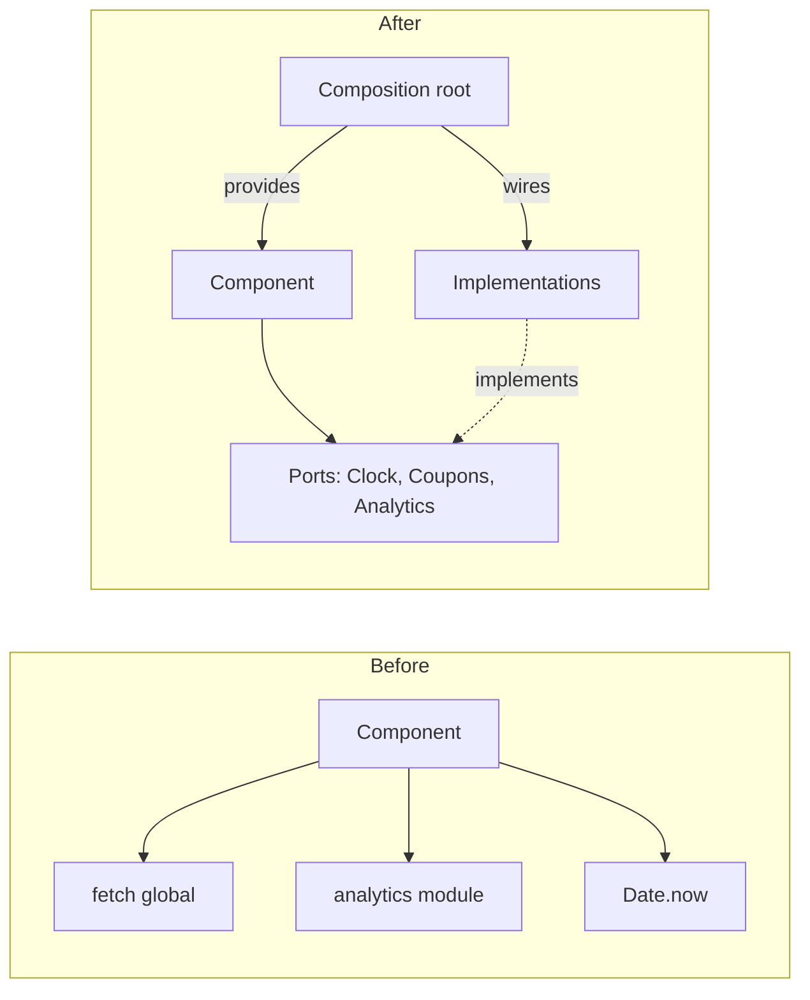
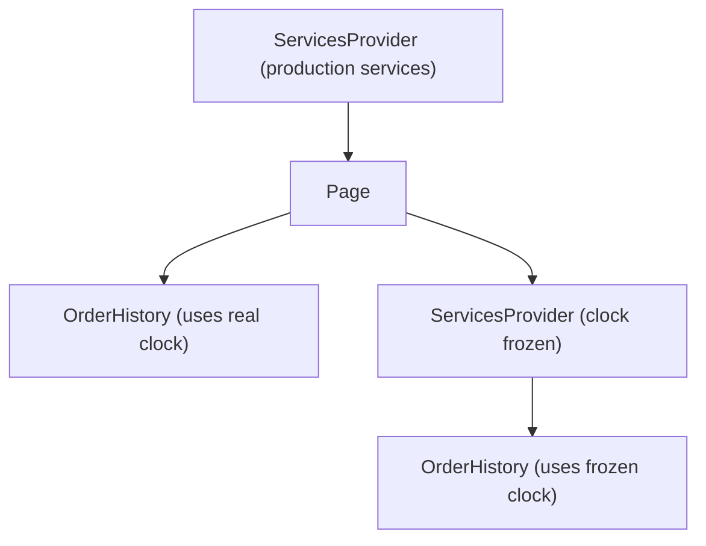

# 05 / 16 — Dependency Injection in React

## 1. Lesson metadata

| | |
|---|---|
| **Level** | Advanced |
| **Study time** | 4–5 hours (reading 2 h, refactoring lab 1.5 h, exercises 1.5 h) |
| **Prerequisites** | [05 / 01 — SOLID in React](./01-solid-in-react.md) (Dependency Inversion), [05 / 08 — Provider pattern](./08-provider-pattern.md), [05 / 15 — Adapter, strategy, factory](./15-adapter-strategy-factory.md), [03 / 13 — `useContext` and propagation](../03-react-state-and-hooks/13-usecontext-and-propagation.md), [04 / 11 — Dependency inversion](../04-react-architecture/11-dependency-inversion.md), [04 / 13 — Application services and adapters](../04-react-architecture/13-application-services-and-adapters.md) |
| **Next** | [17 — Facade and command](./17-facade-and-command.md) |
| **Related** | [Phase 8 / 06 — Mocking strategies and MSW](../08-testing-and-quality/06-mocking-strategies-and-msw.md), [Phase 8 / 05 — Testing custom hooks](../08-testing-and-quality/05-testing-custom-hooks.md), [Phase 11 / 10 — Designing for testability](../11-senior-and-architect-mastery/10-designing-for-testability.md), [05 / 14 — Observer and subscription](./14-observer-and-subscription.md) |

**Learning objectives.** After this lesson you can:
1. Define dependency injection (DI), inversion of control (IoC), and a composition root, and distinguish DI from the Service Locator.
2. Choose the right injection channel in React: arguments/props, factory closures, context, or module substitution, and justify it by scope and change frequency.
3. Build a typed, strict "services" context that fails loudly when a provider is missing, with stable identities and React 19 provider syntax.
4. Inject time, randomness, storage, HTTP and analytics so components and hooks become deterministic in tests and Storybook.
5. Create per-request containers for SSR, avoiding cross-request leakage.
6. Refactor a globally-coupled component to injected form, and evaluate when module mocking, MSW, or doing nothing is the better choice.

**Concepts covered:** dependency, injection, inversion of control, composition root, constructor/parameter injection, context injection, service locator (anti-pattern), ports and adapters, default implementations, test doubles (stub, fake, spy), strict context, stable service identity, per-request container, scope (app/route/feature/test), tree-local override, module mocking limits.

---

## 2. Deep conceptual explanation

### 2.1 What problem is this lesson solving?

A component that calls `fetch('/api/orders')`, reads `localStorage`, uses `Date.now()` to decide whether a coupon is expired, and calls `analytics.track(...)` from a global import is **hard-wired to its environment**. Consequences:

- **Testing needs global surgery:** stub `fetch`, patch `Date.now`, replace the `analytics` module via a module-mocking mechanism. The tests are coupled to *how* the component reaches its collaborators, not to what it does.
- **Environments diverge:** Storybook, unit tests, the app, an embedded widget, and a server render each need different "outside worlds" (fake data, in-memory storage, a no-op analytics). Hard-wired imports give you one.
- **Variation is a rewrite:** supporting a second payment provider or a mock mode in a demo means editing the component.
- **Hidden dependencies:** reading the import list does not show that a component *writes to storage* or *sends telemetry*.

**Dependency injection** reverses who decides: the component states *what it needs* (an interface), and something *outside* supplies it. The component stops knowing where its collaborators come from. This is the Dependency Inversion Principle ([Lesson 01](./01-solid-in-react.md), [Phase 4 / 11](../04-react-architecture/11-dependency-inversion.md)) made operational.

### 2.2 First principles

| Term | Meaning |
|---|---|
| **Dependency** | Anything a unit uses but does not own: a function, object, module, global, or environment capability (clock, storage, network). |
| **Injection** | Supplying the dependency from outside instead of the unit reaching for it. |
| **Inversion of control** | The *flow of control over wiring* is inverted: the unit no longer constructs or locates; a caller/framework does. |
| **Composition root** | The single place near the program entry (e.g. `main.tsx`, a route layout, a test helper) where concrete implementations are chosen and wired. |
| **Port** | The interface the unit needs (`type Clock = { now(): number }`). |
| **Adapter** | A concrete implementation of a port (`systemClock`, `fixedClock(t)`). |
| **Service Locator** | A global registry that units *pull* dependencies from (`Registry.get('http')`). Looks like DI; hides dependencies again. |

Core distinction: **DI** — dependencies are *declared in the unit's signature or typed context* and *pushed in*. **Service Locator** — dependencies are *fetched inside the body from a global/ambient registry by name*; the signature lies. In React, a **strict, typed context hook** (`useServices()`) sits in a gray area: the *component* pulls from context, but context is scoped to the tree, typed, replaceable by any ancestor, and visible by the hook name in the body. Many teams treat it as DI; purists call it a locator. Section 7 gives the criteria to choose.

### 2.3 DI channels in React

| Channel | How | Scope | Reasonable when |
|---|---|---|---|
| **Parameters / props** | `function useCheckout(deps: { http: Http; clock: Clock })`, `<OrderList fetchOrders={...} />` | One call / one component | The dependency is specific to this unit; easiest to trace and test. |
| **Factory closure** | `createOrderService({ http, clock })` returns functions closing over deps | Wherever the service lives | Non-React logic (domain, application services). Components receive the created service. |
| **Context** | `<ServicesProvider value={services}>`, `useServices()` | Subtree | Many descendants need the same dependency; avoids prop drilling; allows subtree overrides. |
| **Module substitution** | `vi.mock('./analytics')`, bundler alias, `process.env`-based swap | Whole module graph | Last resort for legacy code you cannot change; configuration-time variation (build targets). |
| **Hook injection** | Receiving a *hook* as a prop (`useData: () => Data`) | One component | Rare; legal only if the identity of the hook is **stable for the life of the component** (rules of hooks: same hooks, same order). |

React gives you **props** and **context** as native, tree-aware DI. Everything else is plain JavaScript (closures, parameters).

### 2.4 Relationship to JavaScript, React and the browser

- **ES modules are singletons** ([Foundations 10](../00-web-and-javascript-foundations/10-modules-and-dependency-graphs.md)). `import { analytics } from './analytics'` binds to a *module-level instance*. Replacing it needs the bundler/test runner's module graph hooks (mocking), which is why import-based dependencies are hard to vary per test or per tree.
- **Closures** make factories trivial: `createX(deps)` returns functions with `deps` captured ([Foundations 06](../00-web-and-javascript-foundations/06-lexical-scope-and-closures.md)).
- **Context identity.** A Provider's `value` is compared by `Object.is`; a new object each render re-renders all consumers ([03 / 14](../03-react-state-and-hooks/14-context-performance.md)). Services are usually *created once* and have stable identity, so DI via context is cheap.
- **Browser capabilities as dependencies.** `fetch`, `localStorage`, `crypto.randomUUID()`, `Date`, `performance.now()`, `IntersectionObserver`, `navigator.clipboard`: each is a global and thus an implicit dependency. Wrapping the ones you need to *control in tests* behind ports is the practical entry point to DI (adapters, [Lesson 15](./15-adapter-strategy-factory.md)).
- **SSR.** On the server, a module-level singleton is shared by all requests; per-request dependencies must be injected, not imported (Section 5.7).

### 2.5 What to inject, and what not to

**Inject** things that are: non-deterministic (time, randomness, IDs), effectful (network, storage, analytics, navigation, clipboard), environment-specific (feature flags, config, locale), or expensive/stateful singletons (API client, query client, store, socket hub).

**Do not inject**: pure functions with no environment (`formatCurrency`), stable language builtins (`Math.max`), React itself, and *every* utility "just in case". Injecting a dependency that never varies adds indirection and no value (YAGNI, [Lesson 02](./02-dry-kiss-yagni.md)).

**Decision test:** "Is there a second implementation I actually need (a fake in a test counts)?" If yes, inject. If no and no test needs control, import it.

### 2.6 Common misconceptions

| Misconception | Reality |
|---|---|
| "DI needs a container library (Inversify, tsyringe)." | DI is a *technique*; containers automate wiring for large object graphs. In React, props, context, and factory functions cover almost all needs. Decorator-based containers need `experimentalDecorators`/metadata settings and fit class-heavy code; verify current tooling before adopting. |
| "Context is DI, therefore global state." | Context carries *services* (stable capabilities) fine; carrying *rapidly changing state* is a different use ([03 / 14](../03-react-state-and-hooks/14-context-performance.md)). |
| "Mocking modules is the same as DI." | Module mocks rewrite the import graph at test time; the code under test stays hard-wired. The production code gains nothing; it works until module structure changes. |
| "DI makes code slower." | Passing references is free; the cost is *indirection for readers*. Measure the cost in comprehension, not CPU. |
| "If I use MSW I don't need DI." | MSW intercepts at the network boundary — an excellent complement for HTTP. It does not help with time, storage, randomness, analytics, or when you need a different *implementation* (not just different responses) in Storybook or demos. |
| "A default value in `createContext` is enough." | A silent default hides missing providers and leaks real implementations into tests. Prefer a strict hook that throws (5.2). |

---

## 3. Internal mechanics

### 3.1 How context-based injection resolves (public guarantee vs teaching model)

*Public guarantee.* `useContext(Ctx)` (and React 19's `use(Ctx)`) returns the value of the **nearest ancestor Provider** of `Ctx` above the calling component in the *React tree*; if none, the `defaultValue` passed to `createContext`. Consumers re-render when the nearest Provider's `value` changes (by `Object.is`). In React 19 you can render `<Ctx value={...}>` directly as the provider; `<Ctx.Provider>` remains supported but is called "legacy" on the `createContext` reference and the React 19 post says `<Context.Provider>` will be deprecated in a future version (react.dev, 2026-10-22).

*Teaching model.* Think of context as a **dynamically scoped variable**: the value seen depends on *where in the tree* the reader sits, not where the code is defined. That is precisely what makes it suitable for injection: a subtree can run with different services (a test double, a preview environment, a sandboxed demo) without changing any component code.

*Implementation detail.* How React stores context values on fibers and propagates changes is internal; do not depend on it. See [Phase 2 / 17](../02-react-rendering-and-internals/17-hooks-and-fiber-state.md) for the conceptual model.

### 3.2 `use(Context)` vs `useContext`

React 19's `use` can read context *conditionally* (after an early return, in a loop) because it is not a Hook subject to the rules-of-hooks call-order requirement. For injection this matters little; `useContext` inside a typed custom hook stays the convention. Verify exact `use` rules in the current reference.

### 3.3 Stable identity of services

If `value={{ http, clock, analytics }}` is written inline in a component that re-renders, the **object identity changes each render** and every consumer re-renders ([03 / 14](../03-react-state-and-hooks/14-context-performance.md)). Services are created at the composition root **once** (module scope or `useState(() => createServices())` / `useMemo` with stable inputs). Pitfall: `useMemo` is a *performance hint*, not a semantic guarantee (React may discard cache in the future; documented), so for objects holding resources (sockets) prefer `useState(() => ...)` or `useRef` initialisation, plus an explicit cleanup.

### 3.4 DI and effects

A service in a dependency array is stable if the service object is stable. If a test injects a *new fake each render*, effects depending on it re-run each render; create fakes outside the render function. Likewise, a hook that accepts `deps` as an object literal argument (`useCheckout({ http })`) creates a new `deps` identity per call; destructure primitives/stable functions in the effect dependency list.

### 3.5 Where tree-scoped DI cannot reach

Code outside the React tree (a router `loader`, a Redux middleware, an event handler registered at module scope, a Web Worker, a server action) cannot call hooks, so it cannot read context. For those, inject via **factory closure at construction** (`createLoader(services)`) or by passing `services` as an argument. The *same* `services` object can feed both the React tree (provider) and the non-React code, from the composition root.

---

## 4. Step-by-step execution walkthrough: one component, three environments

Component: `<OrderHistory />` uses `useServices()` for `orders: OrdersApi` and `clock: Clock`.

| # | Environment | Composition root | What `useServices()` returns | Result |
|---|---|---|---|---|
| 1 | **Production** | `main.tsx`: `createRoot(...).render(<ServicesProvider services={realServices}><App/></ServicesProvider>)` | `realServices` (HTTP-backed `OrdersApi`, `systemClock`) | Real data; dates computed from the real clock |
| 2 | **Unit test** | `render(<OrderHistory/>, { wrapper: makeWrapper({ orders: fakeOrders, clock: fixedClock(T) }) })` | Fake `OrdersApi` returning canned orders, `fixedClock(T)` | Deterministic: "Delivered 2 days ago" is stable |
| 3 | **Storybook** | Decorator wraps stories with `ServicesProvider` using in-memory fakes with a controllable delay/failure | Fakes parameterised by story args | Loading and error states can be shown without a server |
| 4 | **Sub-tree override** | `<ServicesProvider services={{ ...parent, clock: frozenClock }}>` around an "As of last quarter" report | Nearest provider wins | Only that subtree uses the frozen clock |

Chronology within one render of environment 2:

1. `render` mounts the wrapper → Provider with `value = services` (stable object created once in the test).
2. `OrderHistory` renders; `useServices()` → `useContext(ServicesContext)` → nearest Provider's value.
3. `useEffect` calls `services.orders.list()`; the fake returns a resolved Promise.
4. State updates → re-render; `clock.now()` returns `T` consistently across renders (no flicker, no flaky "just now" labels).
5. Assertions run against real DOM output; nothing was module-mocked.

**Predict:** if the wrapper is defined as `wrapper: ({ children }) => <Provider value={{ orders: fakeOrders, clock }}>{children}</Provider>` (inline object), how many times does `OrderHistory` render in total when the parent test harness re-renders once? *Answer:* the Provider re-renders with a *new* `value` object each time the wrapper renders, so every consumer re-renders each time; harmless for correctness in a unit test but it can re-run effects whose dependencies include the whole `services` object (a request storm in a test, producing confusing double calls). Create the services object outside the wrapper.

---

## 5. Code examples

### 5.1 The hard-wired component (incorrect for testability)

```tsx
// INCORRECT (for our purposes): environment baked in
import { analytics } from './analytics';

export function CouponBanner({ coupon }: { coupon: { code: string; expiresAt: number } }) {
  const expired = Date.now() > coupon.expiresAt;        // non-deterministic

  async function apply() {
    const res = await fetch(`/api/coupons/${coupon.code}/apply`, { method: 'POST' });   // hidden network
    analytics.track('coupon_applied', { code: coupon.code, ok: res.ok });                // hidden telemetry
    localStorage.setItem('lastCoupon', coupon.code);                                       // hidden storage
  }

  return expired ? <p>Expired</p> : <button onClick={apply}>Apply {coupon.code}</button>;
}
```

To test "expired" you must mock `Date.now` (and anything else using time); to test "apply" you must stub `fetch`, the `analytics` module, and `localStorage`. The component's *signature* reveals none of that.

### 5.2 Ports, a strict services context, and React 19 provider syntax

```ts
// services/ports.ts — the interfaces components depend on
export type Clock = { now(): number };
export type KeyValueStore = { get(key: string): string | null; set(key: string, value: string): void };
export type Analytics = { track(event: string, props?: Record<string, unknown>): void };
export type CouponsApi = { apply(code: string, signal?: AbortSignal): Promise<{ ok: boolean }> };

export type Services = {
  readonly clock: Clock;
  readonly storage: KeyValueStore;
  readonly analytics: Analytics;
  readonly coupons: CouponsApi;
};
```

```tsx
// services/ServicesContext.tsx
import { createContext, use, type ReactNode } from 'react';
import type { Services } from './ports';

const ServicesContext = createContext<Services | null>(null);   // null default: absence is detectable

export function ServicesProvider({ services, children }: { services: Services; children: ReactNode }) {
  return <ServicesContext value={services}>{children}</ServicesContext>;   // React 19: context as provider
}

export function useServices(): Services {
  const services = use(ServicesContext);
  if (services === null) {
    throw new Error('useServices must be used within <ServicesProvider>. Did you forget the composition root or the test wrapper?');
  }
  return services;
}

// Narrow hooks: each component declares only what it uses (Interface Segregation)
export const useClock = () => useServices().clock;
export const useAnalytics = () => useServices().analytics;
```

Notes:

- The context default is `null`, **not** a real implementation; a missing provider is a bug that surfaces immediately with a message that says what to do. A real default would silently use production behaviour in a test and send real telemetry.
- In React 18 and earlier (and still supported in 19) write `<ServicesContext.Provider value={services}>`. `<Context value>` requires React 19.
- `use(ServicesContext)` could be `useContext(ServicesContext)`; either works for context (3.2).
- Granular hooks (`useClock`) make dependencies visible at the call site and allow tests to see which capability a component needs.
- `Services` fields are `readonly`: components cannot mutate the registry.

### 5.3 The component with injected dependencies

```tsx
// CouponBanner.tsx
import { useServices } from './services/ServicesContext';

export function CouponBanner({ coupon }: { coupon: { code: string; expiresAt: number } }) {
  const { clock, coupons, analytics, storage } = useServices();
  const expired = clock.now() > coupon.expiresAt;

  async function apply() {
    const result = await coupons.apply(coupon.code);
    analytics.track('coupon_applied', { code: coupon.code, ok: result.ok });
    if (result.ok) storage.set('lastCoupon', coupon.code);
  }

  return expired ? <p>Expired</p> : <button onClick={apply}>Apply {coupon.code}</button>;
}
```

Observation: **the component's logic is unchanged**; the *sources* of its inputs moved to the signature (here: the hook). Everything that varies is now an interface.

### 5.4 Composition root and test wrapper

```tsx
// main.tsx (composition root for the browser)
import { createRoot } from 'react-dom/client';
import { ServicesProvider } from './services/ServicesContext';
import type { Services } from './services/ports';

const services: Services = {
  clock: { now: () => Date.now() },
  storage: {
    get: (k) => { try { return localStorage.getItem(k); } catch { return null; } },
    set: (k, v) => { try { localStorage.setItem(k, v); } catch { /* ignore */ } },
  },
  analytics: { track: (event, props) => navigator.sendBeacon?.('/collect', JSON.stringify({ event, props })) },
  coupons: {
    async apply(code, signal) {
      const res = await fetch(`/api/coupons/${encodeURIComponent(code)}/apply`, { method: 'POST', signal });
      return { ok: res.ok };
    },
  },
};

createRoot(document.getElementById('root')!).render(
  <ServicesProvider services={services}><App /></ServicesProvider>,
);
```

```tsx
// test-utils.tsx
import type { ReactNode } from 'react';
import { ServicesProvider } from './services/ServicesContext';
import type { Services } from './services/ports';

export function makeServices(overrides: Partial<Services> = {}): Services {
  const store = new Map<string, string>();
  return {
    clock: { now: () => 1_700_000_000_000 },
    storage: { get: (k) => store.get(k) ?? null, set: (k, v) => void store.set(k, v) },
    analytics: { track: () => {} },
    coupons: { apply: async () => ({ ok: true }) },
    ...overrides,
  };
}
export function wrapperFor(services: Services) {
  return function Wrapper({ children }: { children: ReactNode }) {
    return <ServicesProvider services={services}>{children}</ServicesProvider>;
  };
}
```

```tsx
// CouponBanner.test.tsx (Vitest + React Testing Library)
import { render, screen } from '@testing-library/react';
import userEvent from '@testing-library/user-event';
import { expect, it, vi } from 'vitest';
import { CouponBanner } from './CouponBanner';
import { makeServices, wrapperFor } from './test-utils';

it('shows Expired when the injected clock is past expiry', () => {
  const services = makeServices({ clock: { now: () => 2_000 } });
  render(<CouponBanner coupon={{ code: 'X', expiresAt: 1_000 }} />, { wrapper: wrapperFor(services) });
  expect(screen.getByText('Expired')).toBeInTheDocument();
});

it('tracks and stores on successful apply', async () => {
  const track = vi.fn();
  const services = makeServices({ analytics: { track }, coupons: { apply: async () => ({ ok: true }) } });
  render(<CouponBanner coupon={{ code: 'SAVE10', expiresAt: Number.MAX_SAFE_INTEGER }} />, { wrapper: wrapperFor(services) });
  await userEvent.click(screen.getByRole('button', { name: /apply save10/i }));
  expect(track).toHaveBeenCalledWith('coupon_applied', { code: 'SAVE10', ok: true });
  expect(services.storage.get('lastCoupon')).toBe('SAVE10');
});
```

Notes: no `vi.mock`, no `Date` patching, no global `fetch` stubbing. The fakes are plain objects: a **fake** (`storage` Map-backed) and a **spy** (`vi.fn`) coexist. `makeServices` provides a complete default test world; each test overrides only what it cares about (the "test data builder" idea). The services object is constructed *outside* the wrapper component so its identity is stable (4, predict box).

### 5.5 Parameter injection for hooks and non-React logic

```ts
// order-service.ts — plain TypeScript, no React
import type { Clock } from './services/ports';

export type Http = { get<T>(url: string, init?: { signal?: AbortSignal }): Promise<T> };

export function createOrderService(deps: { http: Http; clock: Clock }) {
  return {
    async listRecent(signal?: AbortSignal) {
      const orders = await deps.http.get<Array<{ id: string; placedAt: number }>>('/api/orders', { signal });
      const cutoff = deps.clock.now() - 30 * 24 * 60 * 60 * 1000;
      return orders.filter((o) => o.placedAt >= cutoff);
    },
  };
}
export type OrderService = ReturnType<typeof createOrderService>;
```

A factory closure is DI without React. Test it with `createOrderService({ http: fakeHttp, clock: fixedClock })`; no component, no DOM. The React layer receives the *created* service (via context or props):

```tsx
function useRecentOrders(orders: OrderService) {            // parameter injection
  const [data, setData] = useState<Awaited<ReturnType<OrderService['listRecent']>> | null>(null);
  useEffect(() => {
    const c = new AbortController();
    orders.listRecent(c.signal).then(setData).catch(() => { /* handle: see Lesson 21 */ });
    return () => c.abort();
  }, [orders]);               // stable because `orders` is created once at the composition root
  return data;
}
```

(Real data fetching with caching belongs to a data library; see [Phase 6](../06-data-fetching-and-state-ecosystems/01-fetch-lifecycle.md). The example is about the injection channel.)

### 5.6 Advanced: tree-local overrides and scoped services

```tsx
function withOverrides(parent: Services, overrides: Partial<Services>): Services {
  return { ...parent, ...overrides };
}

function QuarterReport() {
  const parent = useServices();
  // Stable identity: only recompute when `parent` changes.
  const frozen = useMemo(
    () => withOverrides(parent, { clock: { now: () => Date.UTC(2025, 0, 1) } }),
    [parent],
  );
  return (
    <ServicesProvider services={frozen}>
      <OrderHistory />
    </ServicesProvider>
  );
}
```

This is how a design-system playground, a "time travel" admin view, or a sandboxed demo runs real components with different services. `useMemo` is acceptable here because losing the cache only costs a recompute plus a one-time re-render of consumers; for services that hold resources (open sockets), construct them with `useState(() => ...)` and clean up in an effect.

### 5.7 SSR: per-request composition

```tsx
// server.tsx (illustrative; framework-specific wiring differs)
export async function renderPage(req: Request) {
  const services = createServerServices({
    // cookies/headers come from *this* request
    http: createHttp({ baseUrl: process.env.API_URL!, headers: { cookie: req.headers.get('cookie') ?? '' } }),
    clock: { now: () => Date.now() },
    // ...
  });
  return renderToString(
    <ServicesProvider services={services}><App /></ServicesProvider>,
  );
}
```

The rule: **nothing request-specific lives in module scope.** A module-level `const http = createHttp({ cookie: ... })` or a module singleton store would be shared across concurrent requests. DI via a per-request `services` makes the leak structurally impossible. (Frameworks provide their own request context; the principle is the same. ⚠ Verify the specifics of your framework's data-loading and context APIs.)

### 5.8 Anti-pattern: service locator by string

```tsx
// ANTI-PATTERN: untyped, ambient, global
const registry = new Map<string, unknown>();
export const register = (name: string, impl: unknown) => registry.set(name, impl);
export const locate = <T,>(name: string) => registry.get(name) as T;   // cast: types are a lie

function Widget() {
  const http = locate<Http>('http');         // dependency invisible in signature, typo-prone, global
  ...
}
```

Problems: stringly-typed (typos compile), global (no tree-scoped override, SSR leakage), unordered initialisation (`locate` before `register`), unverifiable by TypeScript. The typed context in 5.2 avoids the first three, which is why it is the accepted React form.

### 5.9 Refactoring lab: before / after / alternative (comparative)

**Before** — `useGeoWeather` hard-wires geolocation, `fetch`, and `Date`.

```tsx
function useGeoWeather() {
  const [state, setState] = useState<{ temp: number; updatedAt: number } | null>(null);
  useEffect(() => {
    navigator.geolocation.getCurrentPosition(async (pos) => {
      const res = await fetch(`/api/weather?lat=${pos.coords.latitude}&lon=${pos.coords.longitude}`);
      const json = await res.json();
      setState({ temp: json.temp, updatedAt: Date.now() });
    });
  }, []);
  return state;
}
```

Faults to find: `getCurrentPosition` has no cleanup/unmount guard; no error callback (permission denied hangs the UI at `null` forever); `fetch` errors are unhandled rejections; three globals make the hook untestable without stubbing `navigator.geolocation`, `fetch`, and `Date`; every consumer calls geolocation separately.

**After (A) — parameter injection with ports.**

```tsx
type Position = { lat: number; lon: number };
type GeoPort = { current(signal: AbortSignal): Promise<Position> };
type WeatherApi = { at(p: Position, signal: AbortSignal): Promise<{ temp: number }> };

type Weather =
  | { status: 'loading' }
  | { status: 'ready'; temp: number; updatedAt: number }
  | { status: 'error'; message: string };

function useGeoWeather(deps: { geo: GeoPort; weather: WeatherApi; clock: Clock }): Weather {
  const { geo, weather, clock } = deps;
  const [state, setState] = useState<Weather>({ status: 'loading' });
  useEffect(() => {
    const c = new AbortController();
    (async () => {
      try {
        const pos = await geo.current(c.signal);
        const w = await weather.at(pos, c.signal);
        if (!c.signal.aborted) setState({ status: 'ready', temp: w.temp, updatedAt: clock.now() });
      } catch (e) {
        if (!c.signal.aborted) setState({ status: 'error', message: e instanceof Error ? e.message : 'Unknown' });
      }
    })();
    return () => c.abort();
  }, [geo, weather, clock]);
  return state;
}
```

The *browser* adapter for `GeoPort` wraps `navigator.geolocation.getCurrentPosition` in a Promise with error mapping and `signal` support; the test adapter returns `Promise.resolve({lat:1, lon:2})` or rejects. The hook is now an ordinary function of its inputs plus effects.

**After (B) — context injection.** `useGeoWeather()` calls `useServices()` internally; call sites need no arguments. Better ergonomics, slightly less explicit.

**Comparison**

| Criterion | Before (globals) | A: parameter injection | B: context injection |
|---|---|---|---|
| Testability | Stub 3 globals | Pass 3 fakes | Wrap with provider |
| Call-site ergonomics | Best | Worst (pass deps everywhere) | Best |
| Dependency visibility | Hidden | Explicit in signature | Visible in hook body only |
| Per-subtree override | Impossible | By passing different args | By nesting providers |
| Error handling | None | Modelled (`Weather` union) | Same |
| Rules-of-hooks risk | None | Low | Low |
| Added code | 0 | ~25 lines + adapters | ~15 lines + provider |

**When "Before" is acceptable:** a prototype or an internal tool used by one team on one browser, with no tests required. Note the *non-DI* defects (no error path, no cleanup) are bugs regardless; fix those first.

**Alternative worth naming:** keep globals but mock at the boundary: MSW for `fetch`, a fake-timers clock, and a stub for `navigator.geolocation` in a setup file. For a single hook and one team, this can be cheaper than introducing ports, at the cost of tests that depend on global patching and cannot give Storybook a different *implementation*.

---

## 6. Visual explanations

### 6.1 Dependency direction before and after



### 6.2 One tree, different worlds



### 6.3 Where each injection channel reaches

```text
Props/params   : one call ──────────────────────────────▶
Context        : subtree below Provider ────────────────▶ (React components/hooks only)
Factory closure: wherever the created object is passed ─▶ (React or non-React)
Module mock    : the entire module graph for the test run (global within the run)
```

### 6.4 Composition root as the only impure-wiring place

```text
main.tsx / test-utils / story decorator   <- knows concrete implementations
      │ builds services
      ▼
Providers / factories                       <- distribute
      ▼
Components / hooks / services               <- know only ports
```

---

## 7. Alternative approaches and trade-offs

| Criterion | Import globals + module mocks | MSW at network boundary | Parameter / props injection | Context injection | Container library (decorators) | Service locator |
|---|---|---|---|---|---|---|
| Code under test changed? | No | No | Yes (signature) | Yes (hook) | Yes (classes/decorators) | Yes |
| Handles time/randomness/storage | Via global patching | No | Yes | Yes | Yes | Yes |
| Handles different implementations (demo, Storybook) | Poorly | Different responses only | Yes | Yes | Yes | Yes |
| Dependencies visible | No | n/a | Yes | Medium | Yes (constructor) | No |
| Per-subtree override | No | No | Yes | Yes | Child containers | No |
| Works outside React tree | Yes | Yes | Yes | No | Yes | Yes |
| SSR leakage risk | High (module state) | n/a | Low | Low | Depends | High |
| Setup cost | Low | Medium | Low | Low–Medium | High | Low |
| Typical team fit | Legacy, stable | Any app with HTTP | Libraries, hooks | Apps | Large OO back-end style teams | Avoid |

**When DI is NOT the best choice.**

1. **Small app, single environment, tests already stable with MSW and fake timers.** Adding ports and providers is ceremony. Use MSW for HTTP and fake timers for time.
2. **A leaf utility with no environment access** (`slugify`). Import it.
3. **A dependency that never varies and is already abstract** (e.g. React Router's `useNavigate`, which your tests already satisfy with `MemoryRouter`). Wrapping it again in your own port duplicates an abstraction that exists.
4. **Prototype/spike with a deadline.** The refactor is cheap *later* if you keep effects at the edges; do not pre-build ports.
5. **Hot-path leaf components** where each additional context read is a re-render source; inject at a higher container and pass values down via props (state colocation, [03 / 18](../03-react-state-and-hooks/18-state-colocation-and-lifting.md)).

---

## 8. Best practices and anti-patterns

**Do**

- Define **ports in terms of the consumer's needs** (small, role-focused), not mirrors of vendor SDKs.
- Wire in **one composition root per environment**: app entry, test helper, Storybook decorator, server request.
- Make the services context **strict** (throws when missing) and the services object **stable**.
- Prefer **narrow hooks** (`useClock`) over handing every component the whole bag.
- Inject **time and randomness** first; they are the largest source of flaky tests.
- Keep **domain logic in plain functions/factories** and inject at their construction.
- Provide **`makeServices(overrides)`** test helpers so tests state only what differs.
- Keep **adapters thin and tested**, they are the only code that touches the real world.

**Beginner mistakes**

- Putting a real implementation as the context default.
- Creating the services object in render (new identity each render).
- Injecting everything, including pure helpers.
- Passing the entire `services` object to a leaf component which needs one function.

**Experienced-developer mistakes**

- **Interface per class** ("IUserService" with one implementation and no second need), copied from other ecosystems.
- **God `Services` interface** with 30 members: violates ISP; tests must fake all of it. Split by capability.
- **Hidden global state in "services"**: a `cartService` with mutable internal state shared by everyone is a store; model it as one ([14](./14-observer-and-subscription.md)).
- **Injection of hooks as props** with unstable identity (`useData={cond ? useA : useB}`): violates rules of hooks when the identity changes between renders.
- **Locator creep:** `useService('http')`.
- **Mocking the thing you injected**: if you inject `coupons`, do not also `vi.mock('./coupons')`.

**Smells:** tests with more than three mocks; `vi.mock` of an internal module; `if (process.env.NODE_ENV === 'test')` inside production code (a missing injection point); a provider whose `value` is an inline object literal.

**Justified exceptions:** reading `window.location` directly in a utility that is only ever invoked in the browser, with a documented adapter for tests, is fine; the cost of a port can exceed the benefit.

---

## 9. Real-world application

| Domain | What is injected | Constraint |
|---|---|---|
| **E-commerce** | `payments` (Stripe vs fake), `analytics`, `clock` (promotion windows), `storage` (cart persistence) | Fake payment provider in Storybook and E2E staging; real one only in production root. Never ship a fake into production: guard the composition root with environment checks and a build-time assertion. |
| **Dashboards** | `metrics` source, `clock`, `featureFlags` | "Replay" mode for incident reviews injects a recorded metrics source and a frozen clock. |
| **Finance** | `rates`, `clock`, `idGenerator` (idempotency keys), `audit` | Determinism for reproducing a reported calculation: re-run with the recorded `clock` and `rates`. Compliance may require audit logging injected as non-optional (compile-time required in `Services`). |
| **Auth** | `session`, `tokenStorage`, `redirect` | Token storage differs (memory vs cookies); inject so tests do not touch real storage. Per-request on the server. |
| **Realtime** | `socketHub` | One hub per tab; test with a fake hub that emits scripted messages. |
| **Multi-team / micro-frontends** | Host-provided services (auth, router, i18n) to remote modules | Contract versioning: the `Services` interface is a public API between teams ([Phase 11 / 12](../11-senior-and-architect-mastery/12-microfrontends.md)). |
| **Component libraries** | `LinkComponent` (router link), `iconSet`, `formatters` | Libraries must not import the host's router; inject a link component through context or an `as` prop ([19](./19-polymorphic-components.md)). |

---

## 10. Debugging and troubleshooting

### 10.1 Symptom: "useServices must be used within <ServicesProvider>"

*Repro:* render a component in a test without the wrapper, or in a portal/root rendered separately (`createRoot` for a second tree, a toast container). *Investigation:* React DevTools → Components → select the failing component and inspect ancestors; note that **portals preserve context** (React tree), but a *second root* does not. *Root cause:* provider absent in that tree. *Fix:* provide at the second root, or share a single root. *Validate:* component renders; add the wrapper to the default test render helper.

### 10.2 Symptom: everything re-renders / requests fire repeatedly

*Root cause:* `value={{ ... }}` inline, or `useMemo(() => createServices(), [config])` where `config` is a new object each render. *Investigation:* Profiler "Why did this render?" shows "Context changed". *Fix:* create once at root; stabilise inputs. *Validate:* render count stable under unrelated parent updates.

### 10.3 Symptom: test passes alone, fails in suite (shared state leak)

*Root cause:* a "service" holds module-level state (a store, a cache) reused across tests. *Fix:* factory per test (`makeServices()` creates fresh stores); reset singletons only as a last resort. *Validate:* run tests in random order (`--sequence.shuffle` in Vitest; verify flag in current docs).

### 10.4 Symptom: production uses the fake service

*Root cause:* composition root chosen by a flag that defaulted wrong, or test helper imported into the app bundle. *Investigation:* check the bundle analyser for test utilities ([Phase 7 / 16](../07-performance/16-bundle-analysis.md)); inspect `services` in DevTools. *Fix:* separate entry files per environment; lint rule forbidding imports of `test-utils` from `src/` non-test files.

### 10.5 Symptom: hook injected as prop throws "Rendered more hooks than during the previous render"

*Root cause:* the identity of the injected hook changed between renders, changing the call sequence. *Fix:* keep the hook identity stable for the component's lifetime or inject *data* instead of a hook.

### 10.6 Symptom: SSR shows another user's data

*Root cause:* module-level service or store captured request-specific state (5.7). *Reproduce:* two concurrent requests with different cookies. *Fix:* per-request services. *Validate:* concurrency test hitting the server with interleaved requests.

---

## 11. Exercises

### Level A — Knowledge
A1. Define DI, IoC, composition root, port, adapter. Which is the "who constructs" question and which is the "interface" question?
A2. State the difference between DI and Service Locator in terms of where the dependency is declared.
A3. List four injection channels in React and one limitation of each.
A4. Why is `createContext(realImplementation)` a poor default?
A5. Name three categories of dependency that are always worth injecting and two that usually are not.

### Level B — Code comprehension
B1. Identify every hidden dependency in 5.1 and say what each makes hard to test.
B2. In 5.4's test wrapper, what changes if `makeServices()` is called *inside* `Wrapper`? Predict effects on a component whose effect depends on `services.coupons`.
B3. `<QuarterReport>` in 5.6 uses `useMemo` for the derived services. What would break if `parent` were recreated on every render of the root?
B4. Why does `useGeoWeather` in 5.9-A put `geo`, `weather`, `clock` in the dependency array and why must they be stable?

### Level C — Implementation
C1. Implement `fixedClock(t)` and `advancingClock(start, stepMs)` test clocks, and a test that proves a "Delivered X minutes ago" label updates when the clock advances (using fake timers if needed).
C2. Write the browser `Geolocation` adapter for 5.9-A (Promise wrapper, error mapping, abort support).
C3. Convert a component that uses `localStorage` directly into one using the `KeyValueStore` port, and write tests for the "storage throws" case.

### Level D — Debugging
D1. A story renders blank with "useServices must be used within...". The decorator exists at the preview level but the story uses a `play` function that opens a modal in a separate root. Diagnose.
D2. After introducing a `ServicesProvider`, the whole app re-renders on every keystroke in an unrelated input in `App`. Diagnose and fix.
D3. Tests of two different components interfere: one test sets a coupon in `storage`, a different test reads it. Diagnose.

### Level E — Architecture and engineering decisions
E1. A 40-component feature calls `analytics.track` imported from a module. Management wants GDPR consent gating (no events before consent) and per-region providers. Compare: (a) keep import + module-internal consent flag, (b) inject `Analytics` via context, (c) a facade at the composition root. Recommend.
E2. Your team debates adopting a decorator-based DI container for the front end. Evaluate against props/context/factories using criteria of bundle size, TypeScript config, readability, onboarding, SSR, and testing. State what would change your recommendation.

### Level F — Expert challenge
F1. Design a typed `createServicesContext<S>()` helper returning `{ Provider, useServices, useService<K extends keyof S>(k: K): S[K], withOverrides }` where `useService('clock')` is typed, missing providers throw named errors, and overrides compose without allocating a new object when no override changes. Discuss typing limits.
F2. Comparative refactor: take the 5.1 component and produce (1) module-mock-based tests with no production change, (2) parameter injection via props, (3) context injection. Compare lines of production change, test readability, brittleness under a refactor that moves `analytics` to another file, and Storybook support. State when you would stop at (1).

---

## 12. Detailed answers and explanations

> Attempt the exercises first.

**A1.** *DI*: supplying dependencies from outside. *IoC*: the broader principle that the unit does not control its own wiring; DI is one form. *Composition root*: the place where implementations are chosen and wired. *Port*: the interface the unit needs ("interface question"). *Adapter*: an implementation of a port. "Who constructs?" is the composition-root/IoC question; "what shape?" is the port.

**A2.** In DI the dependency is **declared at the boundary** (parameter, prop, typed hook name) and supplied from outside. In a Service Locator the unit **reaches into an ambient registry** by key inside its body; the signature does not reveal it. A typed strict context hook is closer to DI because it is typed, scoped, and replaceable per subtree, yet the body-pull makes it locator-like; an acceptable compromise when narrow hooks (`useClock`) keep needs visible.

**A3.** Props/params (drilling), factory closure (needs someone to call the factory; no tree scoping), context (React-only, re-render coupling by identity), module substitution (global to the module graph; brittle on file moves). Hook-as-prop is a fifth with the stable-identity limitation.

**A4.** A real default means a missing provider is silent: tests hit real network/analytics; wrong environment is used with no error. A `null` default plus a throwing hook turns the mistake into an immediate named error.

**A5.** Always worth injecting: time, randomness/IDs, network/storage/telemetry (effectful). Usually not: pure helpers (`formatCurrency`), stable platform builtins (`Math`, `JSON`), and abstractions that already have a test double in the ecosystem (e.g., a router's memory implementation).

**B1.** `Date.now()` (non-determinism → expiry tests need time patching), `fetch` (network → stub), `analytics` import (module → module mocking), `localStorage` (global state across tests → reset/stub). Also `fetch` URL building is untested; failure paths are unhandled.

**B2.** If `makeServices()` runs inside `Wrapper`, a **new services object (and new fake `coupons`) is created each time Wrapper renders**. Consumers re-render, and an effect depending on `services.coupons` re-runs, causing repeated calls and spies that count calls to see extra invocations. It also resets Map-based storage fakes, losing state between renders. Create the services once outside, as in 5.4.

**B3.** If the root creates a new `parent` each render, `useMemo` recomputes each render, creating a new `frozen` object, re-rendering all consumers under `QuarterReport` each time. Effects depending on `services` will re-run. It points to the real bug: the root must create stable services.

**B4.** Effect closes over them; omitting them would be stale-closure risk and violates exhaustive-deps. Stable identity prevents the effect from re-running (restarting geolocation and fetch) on every render. If tests create new fakes inline per render, the effect loops; create fakes once.

**C1.**

```ts
export const fixedClock = (t: number): Clock => ({ now: () => t });
export function advancingClock(start: number, stepMs: number): Clock & { tick(): void } {
  let t = start;
  return { now: () => t, tick() { t += stepMs; } };
}
```

Test: render a `RelativeTime` component that reads `clock.now()` in render and re-renders on an injected interval (or on `rerender`); `clock.tick()`, advance fake timers, assert text changes from "1 minute ago" to "6 minutes ago". Evaluation criteria: no global `Date` patching; the component receives the clock through the port; test covers boundary (59 s → 1 min).

**C2.**

```ts
export const browserGeolocation: GeoPort = {
  current(signal) {
    return new Promise((resolve, reject) => {
      if (signal.aborted) return reject(new DOMException('Aborted', 'AbortError'));
      if (!('geolocation' in navigator)) return reject(new Error('Geolocation unsupported'));
      const onAbort = () => reject(new DOMException('Aborted', 'AbortError'));
      signal.addEventListener('abort', onAbort, { once: true });
      navigator.geolocation.getCurrentPosition(
        (p) => { signal.removeEventListener('abort', onAbort); resolve({ lat: p.coords.latitude, lon: p.coords.longitude }); },
        (e) => { signal.removeEventListener('abort', onAbort); reject(new Error(e.code === e.PERMISSION_DENIED ? 'Location permission denied' : e.message)); },
        { timeout: 10_000 },
      );
    });
  },
};
```

Note: the underlying API cannot be cancelled, only ignored; the adapter *rejects* on abort but the browser may still complete the lookup. Document this.

**C3.** Port `KeyValueStore`; implementation wraps `localStorage` in try/catch. Test double `throwingStore` whose `get/set` throw (or the adapter test where `localStorage` access throws) asserts the component falls back to defaults and does not crash. Edge: private browsing and quota errors; `get` returning `null` vs `''`.

**D1.** A separate `createRoot`/`ReactDOM` render for the modal creates a **separate React tree**: context from the main tree does not propagate. (A portal *would* preserve it.) Fix: use `createPortal` within the story's tree, or wrap the second root in the same provider/decorator.

**D2.** The provider's `value` is an inline object in `App`, recreated on every `App` render (keystroke state lives in `App`). All consumers re-render. Fix: create services outside render or with `useState(() => createServices())`, and colocate the input state lower. Verify with Profiler: "Context changed" disappears.

**D3.** The `storage` fake is module-level (shared) rather than created per `makeServices()` call, so state persists between tests. Make fakes per-test; `beforeEach` creates a fresh services object; if the code under test touches the real `localStorage`, clear it in setup (and prefer the port).

**E1.** Evaluation criteria: (a) fast to implement but hidden coupling, region logic hard-coded, tests need module mocking, and a flag inside a module is invisible in SSR/multi-tree; (b) per-region/consent implementations as distinct adapters selected at the composition root, testable, and can be overridden per subtree (e.g., embedded widget); but touching 40 call sites to use the hook; (c) a facade at the root: components still call a narrow `Analytics` port (via context), whose single implementation *internally* applies consent and routes by region — keeping call sites simple and policy in one place. Strong recommendation: (b)+(c): inject a narrow `Analytics` port; implement consent gating and region routing inside the root implementation (decorator/facade), queueing events until consent. Mention privacy-law claims should be validated with legal counsel, not assumed from the code design.

**E2.** Strong answers: containers add decorator/metadata configuration and class-oriented style; React idioms (functions, hooks) do not map to constructor injection; tree-scoped context already provides scoping and overrides; bundle size and tree shaking are worse with reflection-based containers; SSR needs per-request child containers. Where a container could win: large non-React business-logic layers shared with a Node back end by a team already using it. What would change the recommendation: a mostly class-based domain layer with dozens of interdependent services, and a team fluent in it. Default recommendation: factories + context.

**F1.** Sketch:

```tsx
export function createServicesContext<S extends object>(name: string) {
  const Ctx = createContext<S | null>(null);
  const useAll = (): S => {
    const s = use(Ctx);
    if (s === null) throw new Error(`${name}: missing provider`);
    return s;
  };
  function Provider({ services, children }: { services: S; children: ReactNode }) {
    return <Ctx value={services}>{children}</Ctx>;
  }
  const useService = <K extends keyof S>(k: K): S[K] => useAll()[k];
  const withOverrides = (parent: S, o: Partial<S>): S => {
    const keys = Object.keys(o) as Array<keyof S>;
    return keys.every((k) => Object.is(parent[k], o[k])) ? parent : { ...parent, ...o };
  };
  return { Provider, useServices: useAll, useService, withOverrides };
}
```

Typing limits: `Partial<S>` permits `undefined` values with `exactOptionalPropertyTypes` off — an override of `undefined` would erase a service; enable `exactOptionalPropertyTypes` or filter. `use(Ctx)` conditional semantics; the helper's generic `S` loses literal key checks when `S` is widened. Evaluation: same-reference return when overrides are no-ops, named errors, no `any`.

**F2.** Expected: (1) module mocks: zero production change but tests `vi.mock('./analytics')`, patch `Date`, stub `fetch`; moving `analytics` breaks mock paths, shown by failing tests that are not behavioural failures; Storybook needs its own aliasing. (2) Props: `<CouponBanner coupon now={...} apply={...} onApplied={...} />` — highest explicitness; the *container* supplies real values; tests trivial; production change moderate; caller churn. (3) Context: smaller call-site churn, strong Storybook/test ergonomics, needs provider setup and discipline for stable identity. Stopping at (1) is rational for a legacy component with low change rate and few tests, or when migrating gradually: add DI at seams you are touching. Include Level-E style reasoning on change frequency and blast radius.

---

## 13. Senior engineer interview questions

1. **"Is `useContext` dependency injection?"** Mostly yes in effect: dependencies are supplied from outside the component by the nearest provider, are scoped to a subtree, and are replaceable. It differs from constructor injection because the component *pulls* them inside its body; to keep needs visible I use narrow hooks and strict (throwing) providers.
2. **"Why not just mock modules in tests?"** Module mocks couple tests to file structure and import mechanics, only work in the test runner, do not give Storybook or demo environments alternative implementations, and leave production code hard-wired. They are a pragmatic tool for legacy code; for new code I prefer injecting at seams so tests state behaviour, not wiring.
3. **"What do you inject first when making a codebase testable?"** Time and randomness (the major flake sources), then network/storage/analytics at their edges. Pure functions stay imports.
4. **"How does DI relate to SSR safety?"** Module-level singletons are shared across all requests in a server process; request-specific data in them leaks. Per-request injected services scope data to the request by construction.
5. **"How do you avoid re-render storms from a services context?"** Create the object once at the composition root with stable identity, keep it value-stable and change-free, expose narrow hooks, and keep fast-changing state out of it.
6. **"You see `if (process.env.NODE_ENV === 'test')` in a component. What's wrong?"** The production code is carrying test wiring because it lacks an injection point. Replace with a port whose test implementation is provided by the test composition root.
7. **"Ports: how big?"** As small as the consumer's need — role interfaces, not vendor mirrors. A 30-method `ApiClient` forces every test double to implement 30 methods and couples all consumers to everything.
8. **"When would you reject DI in a code review?"** When there is no second implementation or test need, when it wraps an already-abstract dependency, or when it adds layers to a throwaway feature. I would ask what varies and for evidence it will.
9. **"How do you inject something into a router loader or Redux middleware?"** They are outside the component tree, so no hooks: use factories (`createLoader(services)`) called at the composition root with the same services object that feeds the provider.

---

## 14. Further learning resources

| Resource | URL | Covers / why | Level | Section to study |
|---|---|---|---|---|
| React: Passing Data Deeply with Context | https://react.dev/learn/passing-data-deeply-with-context | Context mechanics used as injection channel | B–I | Whole page |
| React reference: `createContext` | https://react.dev/reference/react/createContext | Provider syntax (⚠ `<Context>` as provider in 19), default value caveats | I | Reference |
| React reference: `use` | https://react.dev/reference/react/use | Reading context with `use` | I | Reading context with `use` |
| React Testing Library: setup / wrapper | https://testing-library.com/docs/react-testing-library/setup | Custom render with providers | I | "Custom Render" |
| Vitest docs: mocking | https://vitest.dev/guide/mocking | Module mocks vs fakes; trade-offs | I | Mocking guide |
| Mock Service Worker | https://mswjs.io/ | Network-boundary mocking as a complement | I | Getting started |
| Storybook docs: decorators | https://storybook.js.org/docs/writing-stories/decorators | Providing services to stories | I | Decorators |
| Robert C. Martin, "The Dependency Inversion Principle" | Search for the original article/chapter in *Agile Software Development: Principles, Patterns, and Practices* | Origin of the principle | A | DIP chapter |
| Mark Seemann, *Dependency Injection: Principles, Practices, and Patterns* | Book (Manning) | Composition Root, Service Locator as anti-pattern | A | Part 1 |

---

## 15. Knowledge checkpoint

**You should now be able to understand:** why hard-wired environment access hurts testing and variation; what a port, adapter, and composition root are; why a service locator hides dependencies.

**You should be able to explain:** the injection channels in React with their scope and limitations; why strict contexts and stable service identity matter; when DI is not worth it.

**You should be able to implement:** a typed strict services context with narrow hooks; test wrappers with `makeServices(overrides)`; factory-based injection for non-React logic; per-request services for SSR.

**You should be able to debug:** missing providers (including separate roots), re-render storms from inline provider values, test state leaks from shared fakes, and fake services reaching production.

**Prerequisite for next lessons:** [17 — Facade and command](./17-facade-and-command.md) (facades are what you inject; commands are what you pass), [22 — Patterns for reusable libraries](./22-patterns-for-reusable-libraries.md) (libraries consume host services via injection).

**Self-check (answer without looking):** For a component that formats a "valid for 3 more days" label, list the dependencies, say which you would inject, show the port, and describe the test that proves the label at the boundary (exactly 72 hours remaining).
