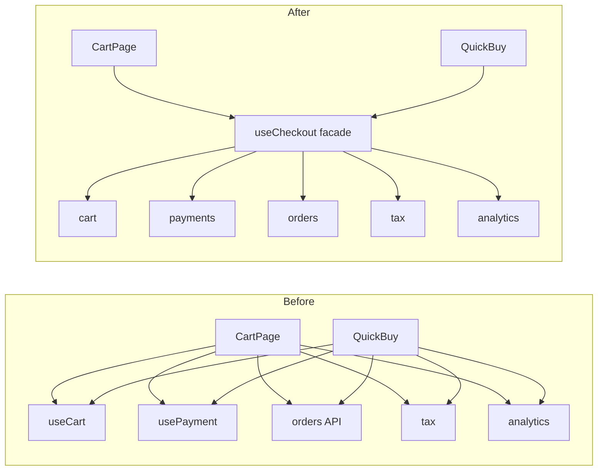
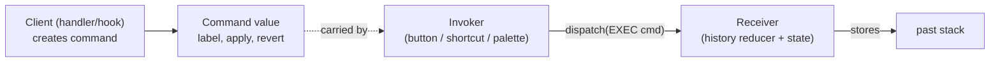
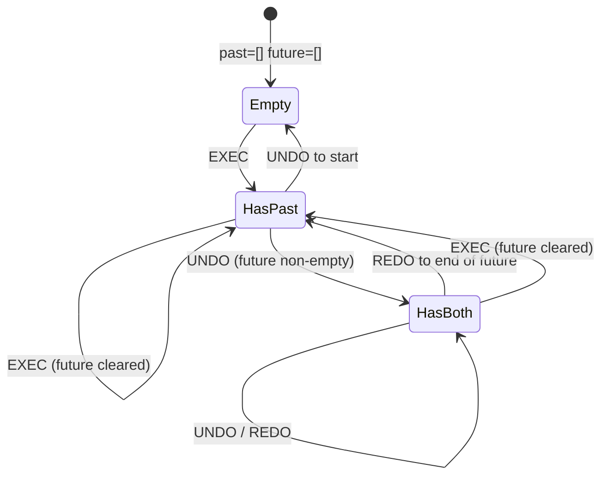

# 05 / 17 — Facade and Command Patterns

## 1. Lesson metadata

| | |
|---|---|
| **Level** | Advanced |
| **Study time** | 4–5 hours (reading 2 h, refactoring labs 1.5 h, exercises 1.5 h) |
| **Prerequisites** | [05 / 01 — SOLID in React](./01-solid-in-react.md), [05 / 04 — Container and presentational](./04-container-presentational.md), [05 / 15 — Adapter, strategy, factory](./15-adapter-strategy-factory.md), [05 / 16 — Dependency injection](./16-dependency-injection.md), [03 / 03 — `useReducer` and reducer architecture](../03-react-state-and-hooks/03-usereducer-and-reducer-architecture.md), [03 / 15 — Custom hooks](../03-react-state-and-hooks/15-custom-hooks.md), [05 / 13 — State machine pattern](./13-state-machine-pattern.md) |
| **Next** | [18 — Behavior vs presentation](./18-behavior-vs-presentation.md) |
| **Related** | [05 / 12 — Reducer pattern](./12-reducer-pattern.md), [05 / 06 — Custom hook patterns](./06-custom-hook-patterns.md), [Phase 4 / 13 — Application services and adapters](../04-react-architecture/13-application-services-and-adapters.md), [Phase 6 / 05 — Optimistic updates](../06-data-fetching-and-state-ecosystems/05-optimistic-updates.md), [Phase 9 / 13 — Forms, actions and mutations](../09-advanced-rendering-and-ecosystem/13-forms-actions-and-mutations.md) |

**Learning objectives.** After this lesson you can:
1. Explain Facade (one simple entry point over a complex subsystem) and Command (an action reified as a value) and say which problems each solves in a React codebase.
2. Design a facade hook or service that hides orchestration without hiding errors, loading states, or identity rules, and recognise a leaky or god facade.
3. Distinguish a **command** (intent that can be executed) from an **event** (fact that happened) and from a reducer **action** (React's term; often a command in disguise).
4. Implement an undo/redo history from commands with `apply`/`revert`, including coalescing (merging keystrokes) and invalidating redo.
5. Build a command registry for a command palette and keyboard shortcuts with enabled/disabled predicates.
6. Choose between command-based and snapshot-based undo, and between a facade, a plain custom hook, and doing nothing, using criteria.

**Concepts covered:** facade, subsystem, orchestration, façade as hook/service/component, Law of Demeter (conceptually), command, receiver, invoker, `apply`/`revert`, undo/redo stack, memento (snapshot) vs command-based history, command coalescing, command registry, outbox/queued commands, idempotency key, macro command, intent vs event, leaky abstraction, god object.

---

## 2. Deep conceptual explanation

### 2.1 What problem is this lesson solving?

Two different pains that look unrelated until you see their shared root: *the caller knows too much about how things get done*.

**Pain 1 — callers must orchestrate a subsystem.** A "place order" button must read the cart, validate the address, compute taxes, call the payment SDK, create the order, clear the cart, track analytics, and navigate. If each screen that can place an order (cart, quick-buy, reorder) repeats that sequence, then (a) the sequence is duplicated and drifts, (b) every screen depends on six modules, (c) a change in one module (the payment SDK) forces edits across screens. The **Facade** pattern provides *one* narrow entry point (`placeOrder()`) that hides the subsystem's wiring.

**Pain 2 — actions are fused to the code that triggers them.** `onClick={() => { setItems(...); track(...); }}` ties "what the user wants to do" to a specific handler. You cannot undo it, queue it for later, show it in a command palette, bind it to a shortcut, send it to a server for audit, replay it, or test it without rendering the button. The **Command** pattern turns an action into a **value** (an object with enough information to execute, and sometimes to reverse, itself). Values can be stored, passed, queued, logged, serialised, and composed.

Facade is about **hiding the how** behind a simple API. Command is about **making the what a first-class value**. They compose well: a facade method often *executes* a command; a command palette *lists* facade-backed commands.

### 2.2 First principles

**Facade (GoF intent):** provide a unified, simpler interface to a set of interfaces in a subsystem. It does not add new capability; it lowers the cost of using existing capability for the common cases. It does **not** forbid direct access to the subsystem — it is a convenience, not a wall (when it becomes a wall, you have built an *encapsulation boundary* — a different, stricter commitment).

| Facade is | Facade is not |
|---|---|
| A narrow API for the 80% case | A rewrite of the subsystem |
| A place for orchestration order and error mapping | A place for business rules (those live in domain functions) |
| A stable seam between feature code and volatile internals | An adapter (adapters *translate shapes*; facades *simplify use*) |
| Often implemented as a custom hook or a plain service module | A reason to hide loading/error state from the UI |

**Command (GoF intent):** encapsulate a request as an object, thereby letting you parameterise clients with different requests, queue or log requests, and support undoable operations. Roles: **command** (the value), **receiver** (what the command acts on), **invoker** (button, shortcut, palette), **client** (who creates the command and wires it).

In JavaScript the minimal command is a **function** `() => void`; the pattern earns its name when you add *data* (`id`, `label`, payload) and *capabilities* (`revert`, `serialize`, `canExecute`).

### 2.3 Facade forms in React

| Form | Example | Strength | Risk |
|---|---|---|---|
| **Facade hook** | `useCheckout()` returning `{ summary, placeOrder, status }` | Idiomatic; encapsulates hooks of the subsystem | Returns a new object each render; couples consumer re-renders to all inner state |
| **Service facade (plain TS)** | `createCheckoutService(deps).placeOrder(cart)` | Testable without React; usable in loaders/workers | Needs wiring ([16](./16-dependency-injection.md)) |
| **Component facade** | `<DataTable>` wrapping virtualisation + sort + a11y + loading states | One import for a common UI need | Prop explosion; escape hatch needed (see [19](./19-polymorphic-components.md), [20](./20-slot-patterns.md)) |
| **SDK facade** | `payments.charge(...)` over three vendor SDKs | Swappable vendors | Lowest-common-denominator API |

A facade hook **is not just any custom hook.** A custom hook extracts reusable stateful logic. A facade hook's *purpose* is to be the single entry point for a *subsystem* from a feature's perspective, composing several hooks/services and exposing a smaller, task-oriented API.

### 2.4 Command forms in React

| Form | Example | When |
|---|---|---|
| **Closure** | `const save = () => api.save(doc)` | Single-use, local; no need for a pattern |
| **Reducer action object** | `{ type: 'ADD_ITEM', item }` | State transition request. The data-only form: the reducer is the "receiver". A **command in the weak sense** |
| **Command object with behaviour** | `{ label, apply, revert }` | Undo/redo, macros, coalescing |
| **Registry entry** | `{ id: 'doc.save', title, shortcut, when, run }` | Palettes, menus, shortcuts, help overlays |
| **Serialisable command** | `{ id: uuid, type: 'rename', docId, name }` | Outbox/offline queue, audit log, server replay |

### 2.5 Command vs event vs action

Three words that get conflated:

| | Direction | Tense | Can be rejected? | Example |
|---|---|---|---|---|
| **Command** | Sent *to* a receiver | Imperative | Yes (guards, validation) | `RenameDocument` |
| **Event** | Emitted *by* something | Past | No: it already happened | `DocumentRenamed` |
| **Reducer action (React/Redux)** | Dispatched to a reducer | Either (commonly imperative-ish or event-ish) | By reducer logic | `{ type: 'rename', ... }` |

Practical rule: name things by what they mean. Commands are *requests* that a handler may refuse; events are *facts* other parts may react to ([14 — Observer](./14-observer-and-subscription.md)). Mixing them leads to bugs such as "event" handlers that are secretly *required* for correctness (they are commands wearing a costume), and "commands" that cannot be refused.

### 2.6 Relationship to JavaScript, React and the browser

- **Functions are first-class** ([Foundations 07](../00-web-and-javascript-foundations/07-functions-and-referential-identity.md)); that is why Command can be as light as a closure. Referential identity matters when commands are passed to memoised children or used as effect dependencies.
- **Immutability** ([Foundations 08](../00-web-and-javascript-foundations/08-objects-references-immutability.md)) makes undo cheap: structural sharing means retaining old versions costs only the changed parts.
- **Browser integration points** where commands shine: keyboard events (`keydown` with modifier keys), the Clipboard API, `history.pushState` (navigation as commands), `beforeunload` for pending commands, `BroadcastChannel` for cross-tab command sync, Service Worker background sync for outbox drain (⚠ support varies: verify before relying on it).
- **React 19 Actions** (`<form action={fn}>`, `useActionState`) are a framework-level *command channel* from UI to a function with pending-state handling ([Phase 9 / 13](../09-advanced-rendering-and-ecosystem/13-forms-actions-and-mutations.md)). They are not undoable commands; they are a trigger-and-await mechanism.

### 2.7 Common misconceptions

| Misconception | Reality |
|---|---|
| "A facade hides complexity." | It *relocates* it. If the complexity has leaky edges (errors, partial failure, loading), the facade must expose them or it lies. |
| "Facade = custom hook." | A custom hook is a mechanism; facade is a design role. A hook that just wraps `useState` is not a facade. |
| "Commands are only for undo." | Undo is the textbook use. In UIs, registries (palettes, shortcuts), queues (offline), audit, and macros are as common. |
| "Redux actions are commands." | Often they are, often they are events in disguise. The distinction is about semantics, not about syntax. |
| "Undo needs the Command pattern." | For many UIs, storing **snapshots** of immutable state is simpler and less error-prone (Section 7). Commands win when state is large, when you need to *merge* or *label* operations, or when operations have external effects. |
| "A bigger facade is a better facade." | A facade with 25 methods is a god object with a nice name. Aim for one facade per use-case area (checkout, session), each ≤ ~7 members. |

---

## 3. Internal mechanics

### 3.1 What React guarantees that these patterns rely on

*Public guarantee.* Hooks called in the same order each render; state updates are batched; `Object.is` is the comparison for state, dependency arrays, `memo` props, and context values ([Phase 1 / 15](../01-react-fundamentals/15-update-queues-and-batching.md), [03 / 16](../03-react-state-and-hooks/16-rules-of-hooks-and-composition.md)).

*Consequences for facades.* A facade hook that returns `{ summary, placeOrder, status }` as an object literal creates a **new object every render**. Destructuring at the call site (`const { placeOrder } = useCheckout()`) makes identity of the *wrapper* irrelevant, but the **functions inside** (`placeOrder`) must be stable if they are passed to memoised children or used in effect dependencies. Stabilise with `useCallback` *where identity matters*, or build the facade over a stable service object whose methods are created once.

*Consequences for commands.* Commands stored in state (`history.past`) must be **plain immutable values** (or at least not mutated after creation). A command closing over mutable external data (a `Map` it later mutates) breaks undo determinism.

### 3.2 Render-time vs event-time creation of commands

Create commands in **event handlers** (when the user acts), not during render. Creating them in render is allowed (pure object creation) but captures *render-time* data, which is what you want only if that data is a faithful snapshot of what the user saw at click time. The usual hazard: a command created in render captures `selectedId`; before the click, the selection changes and re-renders, but the click handler still holds the older command because the handler was memoised or captured stale. Prefer constructing commands inside the handler from the *current* data.

### 3.3 Why `apply`/`revert` must be inverses

For undo to be correct, `revert(apply(s))` must equal `s` for every `s` the command can legally be applied to. If `apply` is not defined for some `s` (an id no longer exists), `revert` is not either. Two common designs:

1. **Capture before** — at creation, the command records the previous value (`from`). `revert` writes `from` back. Fails if the state changed between creation and execution (stale `from`). Mitigation: create the command from the *current present* inside the same reducer step (a "command factory" executed in the reducer), or validate preconditions in `apply` and make failed application a no-op that is not pushed on the stack.
2. **Capture during execution** — `apply` returns the new state and an inverse command. More robust, slightly more ceremony (`apply(state) => { state, inverse }`).

The lesson's code uses design 1 for readability and discusses design 2 in Section 12 (F1).

### 3.4 History semantics

- **Execute** a new command: push to `past`, clear `future` (a new branch invalidates redo).
- **Undo**: pop from `past`, apply `revert`, push to `future`.
- **Redo**: shift from `future`, apply, push to `past`.
- **Coalescing:** consecutive commands with the same `mergeKey` (typing in the same field) collapse into one history entry whose `revert` goes back to the state before the *first*.
- **History limit:** bound `past.length` to avoid unbounded memory.

Not all state belongs in history: *view state* (scroll, which panel is open) usually should not be undoable; *document state* should.

---

## 4. Step-by-step execution walkthrough: undo/redo with coalescing

A rename field in a document editor. History = `{ past, present, future }`. Initial: `present.title = "Draft"`.

| # | User action | Command created | History after | Visible title |
|---|---|---|---|---|
| 1 | Deletes the last character: "Draft" → "Draf" (change event 1) | `setTitle(from="Draft", to="Draf")` mergeKey `title` | past=[C1], future=[] | Draf |
| 2 | Deletes another character in the same field: "Draf" → "Dra" (change event 2) | `setTitle(from="Draf", to="Dra")` mergeKey `title` | **merged**: past=[C1'(from "Draft", to "Dra")] | Dra |
| 3 | Clicks bold on a paragraph | `toggleBold(p3)` | past=[C1', C2] | Dra |
| 4 | Ctrl+Z | — | Undo C2: past=[C1'], future=[C2] | Dra, paragraph unbolded |
| 5 | Ctrl+Z | — | Undo C1': title back to "Draft"; past=[], future=[C1', C2] | Draft |
| 6 | Ctrl+Shift+Z | — | Redo C1': title "Dra"; past=[C1'], future=[C2] | Dra |
| 7 | Edits the title again | `setTitle(from="Dra", to="Dr")` (mergeKey `title`) | past=[C1'', ...] where merging only applies if the last past entry has the same mergeKey: last is C1' (title) → merged; **future cleared** | Dr |

**Predict:** at step 7, is C2 (bold) still redoable? *Answer:* no. Executing a new command clears `future` (a new timeline branch). Many editors behave this way; some keep a tree of branches ("undo tree"), which is a different, more complex design.

**Predict:** at step 2, why can the merged command revert to "Draft" in one undo? *Answer:* the merge keeps the *earliest* `revert` (restore `from="Draft"`) and the *latest* `apply` (set to `"Dra"`). One user-perceived edit = one history entry.

---

## 5. Code examples

### 5.1 The problem: orchestration spread across a component (incorrect for our purposes)

```tsx
// INCORRECT (as an architectural choice): every place order screen repeats this
function CartPage() {
  const { items, clear } = useCart();
  const { address } = useAddress();
  const taxes = useTaxes(items, address);
  const pay = usePayment();                 // vendor SDK hook
  const navigate = useNavigate();
  const [busy, setBusy] = useState(false);
  const [error, setError] = useState<string | null>(null);

  async function placeOrder() {
    setBusy(true); setError(null);
    try {
      if (!address) throw new Error('Address required');
      const total = items.reduce((s, i) => s + i.price * i.qty, 0) + taxes.amount;
      const charge = await pay.charge(total, address.country);
      const order = await createOrder({ items, chargeId: charge.id });
      clear();
      analytics.track('order_placed', { id: order.id, total });
      navigate(`/orders/${order.id}`);
    } catch (e) {
      setError(e instanceof Error ? e.message : 'Failed');
    } finally {
      setBusy(false);
    }
  }
  // ...render
}
```

Observed smells: the component knows six collaborators; the *order of steps* (charge before order creation, clear after success) is business-critical but lives in a click handler; a second screen ("quick buy") will copy-paste it. Failure semantics are incomplete: if `createOrder` fails after a successful `charge`, the customer was charged without an order. A facade is the right place to make that policy explicit (and a *domain* function is the right place to define it).

### 5.2 Facade as a plain service (the testable core)

```ts
// checkout-service.ts
import type { Clock } from './services/ports';

export type CheckoutDeps = {
  payments: { charge(amount: number, country: string, idempotencyKey: string): Promise<{ id: string }>; refund(chargeId: string): Promise<void> };
  orders: { create(input: { items: readonly CartItem[]; chargeId: string }): Promise<{ id: string }> };
  tax: { compute(items: readonly CartItem[], country: string): number };
  ids: { next(): string };
};
export type CartItem = { sku: string; price: number; qty: number };
export type Address = { country: string; line1: string };

export type PlaceOrderResult =
  | { ok: true; orderId: string; total: number }
  | { ok: false; reason: 'no-address' | 'payment-failed' | 'order-failed-refunded' | 'order-failed-refund-failed'; message: string };

export function createCheckoutService(deps: CheckoutDeps) {
  async function placeOrder(items: readonly CartItem[], address: Address | null): Promise<PlaceOrderResult> {
    if (!address) return { ok: false, reason: 'no-address', message: 'Address required' };

    const total = items.reduce((s, i) => s + i.price * i.qty, 0) + deps.tax.compute(items, address.country);
    const idempotencyKey = deps.ids.next();

    let chargeId: string;
    try {
      chargeId = (await deps.payments.charge(total, address.country, idempotencyKey)).id;
    } catch (e) {
      return { ok: false, reason: 'payment-failed', message: errorMessage(e) };
    }

    try {
      const order = await deps.orders.create({ items, chargeId });
      return { ok: true, orderId: order.id, total };
    } catch (e) {
      try {
        await deps.payments.refund(chargeId);
        return { ok: false, reason: 'order-failed-refunded', message: errorMessage(e) };
      } catch {
        // surfaces to ops; the facade must not hide a customer-impacting partial failure
        return { ok: false, reason: 'order-failed-refund-failed', message: 'Order failed and refund needs manual action' };
      }
    }
  }
  return { placeOrder };
}

const errorMessage = (e: unknown) => (e instanceof Error ? e.message : 'Unknown error');
```

What this facade does **and does not** do:

- It hides *orchestration order* and *compensation* (refund on failure).
- It returns a **discriminated result** instead of throwing, so the UI must handle every case (the failure that matters — refund failed — cannot be silently swallowed). This is the antidote to "the facade hides complexity so I can ignore errors".
- It does not decide *how the failure is displayed*, does not navigate, and does not clear the cart (UI/application concerns). Keep those at the call site (5.3).
- Tested without React: pass fakes for `payments`, `orders`, `tax`, `ids` ([16](./16-dependency-injection.md)).

### 5.3 Facade as a hook: narrow API, honest state

```tsx
// useCheckout.ts
import { useCallback, useMemo, useState } from 'react';
import { useNavigate } from 'react-router';          // router package name/version-dependent: verify
import { useServices } from './services/ServicesContext';

type CheckoutStatus =
  | { status: 'idle' }
  | { status: 'placing' }
  | { status: 'failed'; reason: string; message: string };

export function useCheckout(items: readonly CartItem[], address: Address | null) {
  const { checkout, analytics } = useServices();        // checkout = createCheckoutService(...)
  const navigate = useNavigate();
  const { clear } = useCart();
  const [state, setState] = useState<CheckoutStatus>({ status: 'idle' });

  const placeOrder = useCallback(async () => {
    setState((s) => (s.status === 'placing' ? s : { status: 'placing' }));
    const result = await checkout.placeOrder(items, address);
    if (result.ok) {
      clear();
      analytics.track('order_placed', { id: result.orderId, total: result.total });
      navigate(`/orders/${result.orderId}`);
    } else {
      setState({ status: 'failed', reason: result.reason, message: result.message });
    }
  }, [checkout, items, address, clear, analytics, navigate]);

  return useMemo(() => ({ state, placeOrder }), [state, placeOrder]);
}
```

Notes:

- The hook's **public surface** is `{ state, placeOrder }`: two members. `CartPage` and `QuickBuy` both call it; the sequence exists once.
- The guard against double click is *weak* here (`setState` guard, but two rapid calls can still start two `placeOrder`s before the state commits); a robust version uses the machine from [13](./13-state-machine-pattern.md) or an in-flight ref. Mention: **a facade is not a substitute for state modelling**.
- Dependencies list: `items`/`address` change → `placeOrder` identity changes. This is correct (the function *should* act on the latest data), and a reminder that "stable facade functions" and "always-fresh data" are in tension; options include passing data as arguments at call time (`placeOrder(items, address)`) which keeps the function stable.
- The router import is an example; verify package names for your router version (from React Router 7 the DOM APIs are imported from `react-router`; `react-router-dom` remains only as a compatibility package; `react-router` is at 8.x as of 2026-10) — unrelated to the pattern.

### 5.4 Incorrect facade: leaky, god, and lying

```tsx
// INCORRECT: god facade that swallows errors and exposes internals
function useEverything() {
  const cart = useCart(); const user = useUser(); const prefs = usePrefs(); const pay = usePayment(); // ...
  const placeOrder = async () => { try { /* ... */ } catch { /* ignore */ } };   // swallowed
  return { ...cart, ...user, ...prefs, ...pay, placeOrder, rawPaymentSdk: pay.sdk };  // spread everything + leak
}
```

Faults: a consumer re-renders when *anything* changes (new object each render with spread of everything); name collisions in the spread; swallowed errors; `rawPaymentSdk` leaks the vendor type so the facade is not a seam anymore.

### 5.5 Commands for undo/redo: the history reducer

```ts
// history.ts
export type Command<S> = {
  readonly label: string;
  readonly mergeKey?: string;          // consecutive commands with the same key coalesce
  apply(state: S): S;
  revert(state: S): S;
};

export type History<S> = {
  readonly past: readonly Command<S>[];
  readonly present: S;
  readonly future: readonly Command<S>[];
};

export type HistoryEvent<S> =
  | { type: 'EXEC'; command: Command<S> }
  | { type: 'UNDO' }
  | { type: 'REDO' };

export const initialHistory = <S,>(present: S): History<S> => ({ past: [], present, future: [] });

export const MAX_HISTORY = 200;

export function historyReducer<S>(h: History<S>, e: HistoryEvent<S>): History<S> {
  switch (e.type) {
    case 'EXEC': {
      const last = h.past.at(-1);
      const next = e.command.apply(h.present);
      if (Object.is(next, h.present)) return h;                         // no-op command: not recorded
      if (e.command.mergeKey && last?.mergeKey === e.command.mergeKey) {
        // coalesce: keep the earliest revert, take the latest apply
        const merged: Command<S> = { ...e.command, revert: last.revert };
        return { past: [...h.past.slice(0, -1), merged], present: next, future: [] };
      }
      const past = [...h.past, e.command].slice(-MAX_HISTORY);
      return { past, present: next, future: [] };                        // new branch: redo cleared
    }
    case 'UNDO': {
      const cmd = h.past.at(-1);
      if (!cmd) return h;
      return { past: h.past.slice(0, -1), present: cmd.revert(h.present), future: [cmd, ...h.future] };
    }
    case 'REDO': {
      const [cmd, ...rest] = h.future;
      if (!cmd) return h;
      return { past: [...h.past, cmd], present: cmd.apply(h.present), future: rest };
    }
  }
}
```

Notes:

- **Purity:** `apply`/`revert` must be pure functions of the state; the reducer calls them, so the reducer remains pure (important under StrictMode double invocation, [13 / 3.1](./13-state-machine-pattern.md)).
- **No-op detection** keeps selection clicks and idempotent edits out of history.
- **Coalescing** reuses the earliest `revert`: this is correct for *absolute set* commands (`setTitle` writes a value). It is **wrong** for relative commands (`increment`), whose `revert` depends on the amount applied; for those, give them a `merge` function that composes properly or don't coalesce.
- `slice(-MAX_HISTORY)` bounds memory. `Array.prototype.at` is ES2022; check your build target.
- The return type of the `switch` is exhaustive over the union (TypeScript errors if a case is missing, given `strict` + the function's declared return type).

Command factories:

```ts
type Doc = { title: string; blocks: readonly { id: string; text: string; bold: boolean }[] };

export const setTitle = (from: string, to: string): Command<Doc> => ({
  label: 'Rename document',
  mergeKey: 'title',
  apply: (d) => (d.title === to ? d : { ...d, title: to }),
  revert: (d) => ({ ...d, title: from }),
});

export const toggleBold = (blockId: string): Command<Doc> => {
  const flip = (d: Doc): Doc => ({
    ...d,
    blocks: d.blocks.map((b) => (b.id === blockId ? { ...b, bold: !b.bold } : b)),
  });
  return { label: 'Toggle bold', apply: flip, revert: flip };       // self-inverse operation
};
```

`toggleBold` is **self-inverse** (`flip(flip(d)) = d`), so `revert = apply`; self-inverse commands are the easiest to get right. `setTitle` captures `from` at creation (design 1, Section 3.3).

React wiring:

```tsx
function Editor({ initial }: { initial: Doc }) {
  const [h, dispatch] = useReducer(historyReducer<Doc>, initial, initialHistory<Doc>);
  const doc = h.present;

  useWindowEvent('keydown', (e) => {                  // from Lesson 14 (5.2)
    const mod = e.metaKey || e.ctrlKey;
    if (mod && e.key.toLowerCase() === 'z') {
      e.preventDefault();
      dispatch({ type: e.shiftKey ? 'REDO' : 'UNDO' });
    }
  });

  return (
    <>
      <input
        value={doc.title}
        onChange={(e) => dispatch({ type: 'EXEC', command: setTitle(doc.title, e.target.value) })}
      />
      <button onClick={() => dispatch({ type: 'UNDO' })} disabled={h.past.length === 0}>Undo</button>
      <button onClick={() => dispatch({ type: 'REDO' })} disabled={h.future.length === 0}>Redo</button>
      {/* blocks ... <button onClick={() => dispatch({ type: 'EXEC', command: toggleBold(b.id) })}> */}
    </>
  );
}
```

⚠ TypeScript detail: `useReducer(historyReducer<Doc>, initial, initialHistory<Doc>)` uses *instantiation expressions* (TS 4.7+) to specialise the generic functions. If your tooling is older, write wrapper functions.

⚠ `setTitle(doc.title, ...)` reads `doc` from the **render closure**. With fast typing and batching, `doc.title` could lag one event behind the reducer's `present`. The reducer's `Object.is(next, present)` and merge logic tolerate this for absolute-set commands, but `from` of the *first* command in a merge series is what matters and it is captured correctly (the earliest). For commands where staleness would corrupt `revert`, create the command *inside* the reducer from `present` (a "command factory event": `{ type: 'EXEC_WITH', make: (present) => Command }`) — discussed in 12 / F1.

### 5.6 A command registry (palette, menus, shortcuts)

```ts
// command-registry.ts
import { createStore } from './store';          // Lesson 14 (5.3)

export type CommandContext = { selection: readonly string[]; hasUnsaved: boolean; navigate(to: string): void };

export type AppCommand = {
  readonly id: string;                           // 'doc.save'
  readonly title: string;
  readonly keywords?: readonly string[];
  readonly shortcut?: string;                    // 'Mod+S'
  readonly when?: (ctx: CommandContext) => boolean;   // enabled predicate
  readonly run: (ctx: CommandContext) => void | Promise<void>;
};

const store = createStore<ReadonlyMap<string, AppCommand>>(new Map());

export const commandRegistry = {
  subscribe: store.subscribe,
  getAll: store.getState,
  register(cmd: AppCommand): () => void {
    store.setState((prev) => {
      if (prev.has(cmd.id) && import.meta.env?.DEV) console.warn(`Duplicate command id: ${cmd.id}`);
      const next = new Map(prev); next.set(cmd.id, cmd); return next;       // immutable update: new Map
    });
    return () => store.setState((prev) => {
      const cur = prev.get(cmd.id);
      if (cur !== cmd) return prev;               // someone else re-registered; don't remove theirs
      const next = new Map(prev); next.delete(cmd.id); return next;
    });
  },
};
```

```tsx
export function useRegisterCommand(cmd: AppCommand) {
  const ref = useRef(cmd);
  useEffect(() => { ref.current = cmd; });
  useEffect(
    () => commandRegistry.register({ ...cmd, run: (ctx) => ref.current.run(ctx), when: cmd.when && ((ctx) => ref.current.when!(ctx)) }),
    [cmd.id, cmd.title, cmd.shortcut],           // identity of the registration, not of the closures
  );
}
```

The registry is an **observable store** ([14](./14-observer-and-subscription.md)): features register commands on mount and unregister on unmount; the palette reads `commandRegistry.getAll()` via `useSyncExternalStore`. Points to defend:

- **The id is a public contract** (shortcuts, analytics, docs refer to it); treat as stable API.
- `when` returns *enabled-ness*; the palette hides or greys out disabled entries.
- The palette *invokes* commands; it does not know what they do (invoker/receiver decoupling).
- Dependencies of `useRegisterCommand` use the latest-callback ref so closures stay fresh without re-registering on each render.
- `import.meta.env?.DEV` is bundler-specific (Vite); adapt to your toolchain.

### 5.7 Serialisable commands and an outbox (offline-friendly)

```ts
type OutboxCommand =
  | { id: string; type: 'rename'; docId: string; name: string; createdAt: number }
  | { id: string; type: 'delete'; docId: string; createdAt: number };

function createOutbox(deps: { storage: KeyValueStore; send(cmd: OutboxCommand): Promise<void> }) {
  const KEY = 'outbox';
  const load = (): OutboxCommand[] => { try { return JSON.parse(deps.storage.get(KEY) ?? '[]'); } catch { return []; } };
  const save = (q: OutboxCommand[]) => deps.storage.set(KEY, JSON.stringify(q));

  return {
    enqueue(cmd: OutboxCommand) { save([...load(), cmd]); },
    async drain() {
      let queue = load();
      while (queue.length > 0) {
        const [head, ...rest] = queue;
        try { await deps.send(head); }               // server dedupes by head.id (idempotency key)
        catch { return; }                            // stop; retry later (online event / backoff)
        queue = rest; save(queue);
      }
    },
  };
}
```

Key engineering facts: commands must be **serialisable** (plain data), carry an **idempotency id**, and the server must **dedupe by id**, because a crash between `send` success and `save(queue)` re-sends the command. Ordering matters (`rename` before `delete`). Conflicts (a command made against stale data) need a policy: last-writer-wins, per-field merge, or reject-and-surface. Closures cannot be persisted, which is why serialisable commands are *data + handlers keyed by `type`*, not functions.

### 5.8 Refactoring lab A: handler spaghetti → facade (comparative)

**Before:** 5.1 (the component orchestrates).

**After (service + hook facade):** 5.2 + 5.3. Compare:

| Criterion | Before | After |
|---|---|---|
| Collaborators known by `CartPage` | 7 | 3 (`useCheckout`, `useCart` for display, router not needed if facade navigates) |
| Duplication across `CartPage`/`QuickBuy` | Full copy | Zero |
| Test of "refund on order failure" | Mount page, mock SDK, router, analytics | Pure async unit test of `createCheckoutService` with fakes |
| Partial failure handling | Not handled | Explicit result variants |
| Lines | ~35 | ~70 (service + hook) |
| Cognitive entry cost | One file | Two files + wiring |
| Risk | Drift between copies | Facade grows into a god object |

**When Before is the better design:** a single screen, a single execution path, no partial-failure semantics (e.g. "send feedback" with one POST). Then orchestration is one call and a facade is an empty wrapper.

### 5.9 Refactoring lab B: snapshot undo → command undo → "do nothing" (comparative)

**Before — snapshot history (memento):**

```tsx
function useSnapshotHistory<S>(initial: S) {
  const [past, setPast] = useState<S[]>([]);
  const [present, setPresent] = useState(initial);
  const [future, setFuture] = useState<S[]>([]);
  const set = (next: S) => { setPast((p) => [...p, present]); setPresent(next); setFuture([]); };
  const undo = () => { if (!past.length) return; setFuture((f) => [present, ...f]); setPresent(past.at(-1)!); setPast((p) => p.slice(0, -1)); };
  const redo = () => { if (!future.length) return; setPast((p) => [...p, present]); setPresent(future[0]); setFuture((f) => f.slice(1)); };
  return { present, set, undo, redo, canUndo: past.length > 0, canRedo: future.length > 0 };
}
```

This is correct for **immutable** `S` and is about 12 lines. Three state variables updated in sequence — in React 18+ they batch into one render, but they can be inconsistent if an update is later added in between; a single `useReducer` is safer. It cannot *label* entries ("Undo rename"), cannot merge keystrokes without extra bookkeeping, and stores whole-state references (cheap thanks to structural sharing *if* updates are immutable and localised; costly if each update clones a large structure).

**After — command history (5.5):** labels, coalescing, serialisable log (if commands are data), and ability to apply a command **to a different base** (collaborative editing, rebase) at the cost of writing a correct `revert` per operation.

**Alternative — do nothing / platform undo:** for a plain text `<input>` or `<textarea>`, the browser's native undo already works; a custom history replaces it (and breaks IME and accessibility expectations) — only override if you control all edits.

| Criterion | Snapshot | Command | Native/none |
|---|---|---|---|
| Correctness effort | Low | Medium–High (each `revert`) | None |
| Memory | Depends on structural sharing | Small per entry | n/a |
| Labels/merge/log | Hard | Natural | n/a |
| External side effects (server calls) | Cannot undo them | Can model compensating commands | n/a |
| Collaboration/rebase | No | Possible | No |
| Typical fit | Small/medium immutable state, whole-state undo | Editors, drawing tools, workflows with side effects | Simple text inputs |

---

## 6. Visual explanations

### 6.1 Facade: before and after



### 6.2 Command roles



### 6.3 History state transitions



### 6.4 Intent vs fact

```text
User clicks "Rename"        -> COMMAND   RenameDocument(id, name)       (can be refused)
Handler accepts, applies    -> EVENT     DocumentRenamed(id, name, t)   (cannot be refused: happened)
Subscribers: analytics, search index, other tabs react to the event
```

---

## 7. Alternative approaches and trade-offs

**Facade versus alternatives**

| Criterion | Inline orchestration in component | Custom hook (non-facade) | Facade hook/service | Domain/application service layer (hexagonal) | State machine |
|---|---|---|---|---|---|
| Duplication across screens | High | Medium | Low | Lowest | Low |
| Hides subsystem coupling | No | Partly | Yes | Yes | Partly |
| Partial-failure policy visible | No | No | Yes (in result type) | Yes | Yes (states) |
| Cost | Lowest | Low | Medium | High | Medium |
| Suits | One screen, simple | One reusable behaviour | Cross-screen task | Large multi-team systems | Flows with modes |

**Command versus alternatives**

| Criterion | Closure | Reducer action | Command object | Serialisable command | Snapshot history |
|---|---|---|---|---|---|
| Undo | No | Via history wrapper | Natural | Natural + persisted | Natural |
| Label/log/audit | No | Possible | Yes | Yes | No |
| Queue/offline | No | Possible | In-memory only | Yes | No |
| Complexity | Lowest | Low | Medium | High | Low |

**Where the recommended approach is NOT best.**

1. **Facade over a one-call subsystem.** Wrapping `fetch` in `useSubmitFeedback` adds a file and no hiding. Use the call directly.
2. **Facade when callers need fine control.** A charting library whose power users configure every axis: a facade for the common 80% is good, but make sure the escape hatch (pass-through options) exists or you will accumulate hundreds of flags.
3. **Command history for form state.** For a 6-field form, snapshot undo (or none) is simpler; command classes per field are ceremony.
4. **Commands where the *server* is the source of truth.** Undo of a server mutation is a *new* mutation (compensating command), not local state rewinding; model it as such, or accept that Undo is a soft delete window.
5. **Real-time collaborative editing.** Local undo stacks are *per user* and must integrate with an operational-transform/CRDT engine; do not hand-roll with simple stacks. Use the library's undo manager (verify the chosen library's API).

---

## 8. Best practices and anti-patterns

**Facade — do**

- Design the facade around **tasks** ("place order", "sign in"), not around subsystem modules.
- **Expose failure honestly:** result types, error variants, loading states.
- Keep the facade **thin**: orchestration only; rules live in domain functions.
- **One facade per use-case area**, small surface (≤ ~7 members).
- Make the facade **injectable** ([16](./16-dependency-injection.md)) and testable without React.
- Provide an **escape hatch** or keep the subsystem importable for advanced cases.

**Facade — avoid**

- Spreading multiple hooks' return values into one object (`...cart, ...user`).
- Leaking vendor types in the facade's public types.
- Swallowing errors "for simplicity".
- A facade whose methods only forward one-to-one (an empty wrapper adds noise).
- Returning a new unmemoised object when consumers depend on identity.

**Command — do**

- Keep commands **pure and immutable**; commands in history should not close over mutable data.
- Define `apply` and `revert` as **inverses** and test the property (`revert(apply(s)) ≡ s`).
- Create commands in **handlers**, not render.
- **Do not record no-ops.**
- Bound history size; exclude view state from history.
- For persisted commands, use **plain data + type-keyed handlers** and **idempotency ids**.
- Treat registry **ids as public API**.

**Command — avoid**

- A command that mixes view concerns (scroll, focus) with document changes.
- `revert` that depends on global state not captured by the command.
- Using events and commands interchangeably.
- Coalescing relative commands with absolute `revert`.

**Smells:** `undo` implemented by re-fetching from the server; a "manager" class with 40 methods called `CommandManager`; `if (cmd.type === ...)` ladders in the invoker (the invoker should just call `run`); a facade file importing half the app.

**Justified exceptions:** a facade can be a stepping stone during a migration (wrap the legacy module while moving callers) even if it forwards one-to-one at first; commands may be plain closures for palettes with ten entries and no need for registration lifecycles.

---

## 9. Real-world application

| Domain | Facade | Command |
|---|---|---|
| **E-commerce** | `useCheckout`, `useCartActions` hiding pricing/tax/promo/payment orchestration; compensating refunds | Cart operations as commands for undo ("Removed item — Undo" toast with a time window) |
| **Dashboards / admin tools** | `useReportExport` hiding queueing, polling, download | Command palette (`Ctrl+K`) with entity-aware commands; audit trail of admin actions |
| **Finance** | `useTransfer` hiding limit checks, FX, 2FA, confirmation | Commands with idempotency keys; **no undo** for settled transfers: model as *reversal* commands requiring authorisation |
| **Forms/wizards** | `useOnboarding` over steps, validation, persistence | Draft autosave as coalesced commands; "revert to saved" |
| **Auth** | `useSession` hiding token refresh, storage, cross-tab logout | Login/logout commands logged for security audit |
| **Realtime / collaboration** | `usePresence` | Operations as commands sent to a sync engine; local undo stacks per user |
| **Design systems** | `<DataTable>` as component facade | Keyboard shortcut registry shared across products; shortcut conflicts managed by registry |

Constraints to check: **atomicity and partial failure** (what if step 3 of 5 fails?), **idempotency** (retries, double clicks, StrictMode), **permissions** (command `when` predicates are UX hints; the server must enforce), **audit/compliance** (log commands/events, not UI clicks), **accessibility** of shortcuts (do not override assistive technology keys; allow remapping; provide visible alternatives), **memory** (history bounds).

---

## 10. Debugging and troubleshooting

### 10.1 Symptom: undo restores the wrong value

*Repro:* type quickly then undo; title jumps to an intermediate value. *Investigation:* log commands in `EXEC` with `from/to`; check that coalesced entries use the earliest `revert`. *Root cause:* `from` captured from a stale render closure, or coalescing used the latest `revert`. *Fix:* capture `from` from reducer `present` (command factory executed in reducer), or merge correctly. *Validate:* property test `revert(apply(s)) == s`; scripted typing sequence in a test.

### 10.2 Symptom: redo still available after a new edit

*Root cause:* `EXEC` did not clear `future`, or a coalescing branch returned the old `future`. *Fix:* all `EXEC` branches set `future: []`. *Validate:* test: exec, undo, exec → `canRedo === false`.

### 10.3 Symptom: Ctrl+Z triggers both browser-native undo and ours

*Root cause:* missing `preventDefault()`; or the shortcut handler runs while focus is in an `<input>` whose native undo you intended to keep. *Investigation:* DevTools → Sources → Event Listener Breakpoints → Keyboard → keydown. *Fix:* decide per context: when focus is in a text input, let native undo run unless your history owns that field; call `preventDefault()` only for owned contexts. *Validate:* manual test in text fields vs canvas; automated test for focus contexts.

### 10.4 Symptom: facade consumer re-renders constantly

*Root cause:* returned object recreated each render, or facade hook subscribes to unrelated state (e.g., includes `cart` for all). *Investigation:* Profiler "Why did this render?"; hook change list in DevTools. *Fix:* split the facade (`useCheckoutActions` for functions, `useCheckoutStatus` for state), memoise, or select narrower state. *Validate:* Profiler shows no render on unrelated cart updates.

### 10.5 Symptom: customers charged without orders

*Root cause:* orchestration without compensation (5.1). *Investigation:* payments dashboard vs orders table; logs show `createOrder` failures after `charge`. *Fix:* compensation in the facade/service (5.2) plus idempotent order creation keyed by `chargeId`; reconciliation job. *Validate:* fault-injection test where `orders.create` throws; assert refund called, result variant surfaced.

### 10.6 Symptom: queued commands applied twice after reconnect

*Root cause:* no server dedupe by command id, or client dropped the queue entry only after the response and crashed in between. *Fix:* idempotency keys server-side; client treats a duplicate-ack as success. *Validate:* kill the tab between send and ack in a test; verify one effect server-side.

### 10.7 Symptom: palette shows a command that does nothing / duplicates

*Root cause:* duplicate ids across features; registration without cleanup after route unmount. *Fix:* dev warning on duplicates (5.6), cleanup returns from `register`, id namespacing. *Validate:* navigate across routes 20 times; `getAll().size` stays constant.

---

## 11. Exercises

### Level A — Knowledge
A1. State the intent of Facade and of Command in one sentence each, and name the four roles in Command.
A2. Differentiate Facade from Adapter and from a plain custom hook.
A3. Differentiate command, event, and reducer action. Give an example name for each describing the same user intention.
A4. Why must `apply` and `revert` be inverses? What goes wrong if `revert` reads global state?
A5. Why clear `future` on a new `EXEC`?

### Level B — Code comprehension
B1. In 5.2, list every possible `PlaceOrderResult` and which line produces each. Which one needs human intervention and why must it be a distinct variant?
B2. In 5.5, simulate: `EXEC setTitle("A","B")` (mergeKey `title`), `EXEC setTitle("B","C")`, `EXEC toggleBold(x)`, `UNDO`, `UNDO`. Give `past`, `future`, and the title after each step.
B3. In 5.3, `placeOrder` is in a `useCallback` with `[checkout, items, address, ...]`. A memoised `<PayButton onClick={placeOrder} />` re-renders on every cart edit. Is that a bug? Explain, and give two alternatives.

### Level C — Implementation
C1. Write property-based style tests (or a table of random sequences) asserting `revert(apply(s))` equals `s` for `setTitle` and `toggleBold`, and that `UNDO` after `EXEC` returns to the original state for 100 random sequences.
C2. Implement `moveBlock(id, fromIndex, toIndex)` as a command with a correct `revert`, including the case where indices are equal (no-op).
C3. Implement `useCommandPalette()` that subscribes to the registry with `useSyncExternalStore`, filters by `when(ctx)` and a text query on title/keywords, and returns a stable array when nothing changed.

### Level D — Debugging
D1. Undo works for the first five edits then the document is corrupted. The commands capture `from` from a `useState` value in the editor. Find the cause with a reproduction recipe.
D2. A facade hook `useSession()` returns `{ user, signIn, signOut, ...rest }` where `rest` contains `refreshTimer`. A consumer's `useEffect` depending on `session` fires every second. Diagnose.
D3. A "Delete item (Undo)" toast: after clicking Undo, the item reappears but the server already deleted it; on reload it is gone. Diagnose and design the fix.

### Level E — Architecture and engineering decisions
E1. You own a 15-screen app where "export report" requires: permission check, filter validation, async job creation, polling, download, analytics. Four screens do it with copy-pasted code. Propose a facade (hook vs service), its public API, and a migration plan with measurable done-criteria.
E2. A product team wants "undo everywhere" in a CRUD admin tool with server persistence. Argue for/against a global command stack, and propose a scoped alternative with explicit non-goals.

### Level F — Expert challenge
F1. Redesign `Command<S>` so `apply` returns `{ state, inverse }` (design 2 in 3.3), update `historyReducer` accordingly, and explain how this fixes stale-capture bugs and enables coalescing of relative commands via `merge`.
F2. Comparative refactor: given a component with `useState` for `items` and handlers `add`, `remove`, `reorder` plus a hand-written "undo last action" buffer storing arbitrary closures, produce (1) a snapshot-history version, (2) a command-history version, and (3) a written recommendation on when each is superior with performance and correctness arguments.

---

## 12. Detailed answers and explanations

> Attempt the exercises first.

**A1.** Facade: provide a simple, unified interface to a complex subsystem. Command: encapsulate a request as an object so it can be stored, passed, queued, logged, or undone. Roles: command, receiver, invoker, client.

**A2.** Adapter translates one interface to another to satisfy a consumer's contract (shape change); Facade simplifies usage of many interfaces by providing a smaller, task-based API (no shape contract to satisfy). A plain custom hook extracts reusable stateful logic; it becomes a facade only when its role is to be the entry point for a subsystem from the feature's perspective. Wrong answer: "they're the same thing with different names": adapter and facade differ in *intent* and in *what they preserve* (adapter preserves capability and changes shape; facade reduces capability surface).

**A3.** Same user intention, "rename": command `RenameDocument` (request), event `DocumentRenamed` (fact), reducer action `{ type: 'document/rename', id, name }` (React mechanism; here command-like). Evaluation: names reflect tense and refusability.

**A4.** Undo restores the state before the command; if `revert` is not the inverse, the "restored" state differs from the original: silent corruption. If `revert` reads global state, its result depends on something other than the command's captured data, so replay/redo/rebase give different results over time and the reducer loses purity.

**A5.** After undoing and performing a new action, the "future" described a timeline that no longer follows from the present; applying those commands would act on a state they were not designed for (and `revert` data captured earlier would be wrong). Clearing is the standard linear-history semantics; tree histories keep the branch but are more complex.

**B1.** Variants: `no-address` (first guard), `payment-failed` (charge threw), success `{ ok: true }` (orders.create resolved), `order-failed-refunded` (order failed, refund succeeded), `order-failed-refund-failed` (order failed, refund failed). The last needs human/operations action (customer charged, no order, no refund); it must be distinct so the UI shows a support path and monitoring raises an alert rather than the generic "try again" which would charge twice.

**B2.** After 1: past=[C1(A→B)], title B. After 2: merged C1'(from A, to C) → past=[C1'], title C. After 3: past=[C1', Bold], title C. UNDO 1: past=[C1'], future=[Bold], title C (bold toggled back). UNDO 2: past=[], future=[C1', Bold], title A. Common wrong answer: expecting title B after one undo; coalescing removed that intermediate step.

**B3.** Not a bug but an expected consequence: `placeOrder`'s identity changes when `items` changes, so `memo` on `PayButton` does not help. If the button does not display cart data, the re-render is wasted. Alternatives: (1) make `placeOrder` stable by passing `items`/`address` at call time or reading them from a ref/store in the facade; (2) memoise at a higher level or accept the cost (a button render is cheap; measure first, [Phase 7 / 04](../07-performance/04-memoization-trade-offs.md)); (3) stable function that reads the latest values via a ref updated in an effect.

**C1.** Sample (Vitest, no library):

```ts
import { expect, it } from 'vitest';
import { historyReducer, initialHistory } from './history';
import { setTitle, toggleBold } from './commands';

const doc0 = { title: 'x', blocks: [{ id: 'a', text: '', bold: false }, { id: 'b', text: '', bold: true }] };

it('undo after exec returns the original state', () => {
  let seed = 42; const rnd = () => (seed = (seed * 1664525 + 1013904223) % 2 ** 32) / 2 ** 32;
  for (let run = 0; run < 100; run++) {
    let h = initialHistory(doc0);
    const n = 1 + Math.floor(rnd() * 10);
    for (let i = 0; i < n; i++) {
      const cmd = rnd() < 0.5 ? setTitle(h.present.title, `t${i}`) : toggleBold(rnd() < 0.5 ? 'a' : 'b');
      h = historyReducer(h, { type: 'EXEC', command: cmd });
    }
    for (let i = 0; i < n + 1; i++) h = historyReducer(h, { type: 'UNDO' });
    expect(h.present).toEqual(doc0);
  }
});
```

Evaluation criteria: deterministic seed (so failures reproduce), commands created from the *current* present for `from`, and extra UNDO beyond history length does not throw. Note the merging of consecutive `setTitle`s is exercised implicitly.

**C2.**

```ts
export const moveBlock = (id: string, from: number, to: number): Command<Doc> => {
  const move = (d: Doc, a: number, b: number): Doc => {
    if (a === b || a < 0 || a >= d.blocks.length || b < 0 || b >= d.blocks.length) return d;
    const blocks = d.blocks.slice();
    const [m] = blocks.splice(a, 1);
    blocks.splice(b, 0, m);
    return { ...d, blocks };
  };
  return { label: 'Move block', apply: (d) => move(d, from, to), revert: (d) => move(d, to, from) };
};
```

Notes: equal indices return the same state (no-op, not recorded); `revert` is the move with swapped indices; the `id` is kept for labels/audit — a more robust design locates the block by `id` at apply time rather than by index (indices drift if other commands intervene in non-linear histories). Mention that choice.

**C3.** Core: `const all = useSyncExternalStore(commandRegistry.subscribe, commandRegistry.getAll, commandRegistry.getAll)` — the Map reference is stable between registry changes. Then `useMemo(() => [...all.values()].filter((c) => (c.when?.(ctx) ?? true) && matches(c, query)), [all, ctx, query])`. Return stability: `useMemo` provides stable output while inputs are unchanged; `ctx` must be stable too (memoise it at the source). Edge cases: filter order stable (Map insertion order), `when` throwing (catch and treat as disabled and log), IME composition in the query field.

**D1.** `from` captured from `useState` in the render closure goes stale during fast input or when batched updates are queued: two commands both capture the same `from`, so the first `revert` restores a value that is not the state before *that* command. Repro: dispatch two `EXEC`s in the same event handler/tick; or throttle the renderer (DevTools → Performance → CPU throttle 6×) and type fast. Fix: create commands from reducer `present` (command factories evaluated inside the reducer), or capture the inverse during `apply` (F1).

**D2.** `...rest` includes a value that changes every second (`refreshTimer` or a tick counter) and the facade returns a new object each render; the effect depends on the whole `session` object, so it re-fires. Fix: don't spread internals; return only the public API; the consumer should depend on specific fields; memoise the facade object. Validate with the Profiler and a render counter.

**D3.** Optimistic local undo restored client state but never told the server (the delete was already committed). Design fix: Undo is a *compensating command* (`RestoreItem(id)`) issued to the server, or defer the actual delete until the undo window (e.g. 5 s) expires (soft-delete with a `deletedAt` flag and purge job). Trade-offs: deferring the delete causes weirdness on tab close (flush pending deletes in `pagehide`/`visibilitychange` with `sendBeacon`; verify support) and multi-device races; compensating command requires server support for restore and permission checks.

**E1.** Evaluation criteria. Facade type: **service** (`createExportService(deps)`) for logic + a **hook** `useReportExport()` returning `{ state, start, cancel }` where `state` is a union (`idle | creating | polling{progress} | ready{url} | failed{reason}`), since polling/cancel are modes ([13](./13-state-machine-pattern.md)). Public API: ≤ 3 members. Permission check is a *domain function* injected, not inside UI. Migration: (1) write service + tests mirroring the most-correct existing screen; (2) migrate one low-risk screen behind a flag; (3) delete duplicated code; (4) add lint/codemod warning on direct job API usage. Done-criteria: duplicate code lines → 0, all 4 screens use the hook, error-rate/telemetry equal or better, tests cover compensation paths (cancelled polling, expired URL). Mention rollout risk and keeping an escape hatch for the "scheduled exports" screen if it differs.

**E2.** A global stack suggests "undo anything" but server-persisted operations are not locally reversible: you would need compensating commands for every mutation (permissions, side effects, audit, notifications, concurrent edits by others). Counter-proposal: scope undo to *safe, reversible operations within a single entity edit session* (draft edits before save, bulk-select actions with soft-delete window) with explicit non-goals (no undo of sent emails, payments, cross-user changes). Mechanism: per-screen command history for drafts; server-side soft delete with TTL for destructive actions; "Undo" implemented as `restore` with permission checks and audit entries. Evaluation: acknowledges concurrency and audit, defines scope and non-goals.

**F1.** Sketch:

```ts
type Applied<S> = { state: S; inverse: Command<S> };
type Command<S> = {
  label: string;
  mergeKey?: string;
  apply(state: S): Applied<S> | null;                 // null = not applicable (no-op/precondition failed)
  merge?(next: Command<S>): Command<S> | null;       // compose this followed by next into one command
};
type History<S> = { past: readonly Applied<S>['inverse'][]; present: S; future: readonly Command<S>[] };
```

`EXEC`: `r = cmd.apply(present)`; if null, ignore; `past.push(r.inverse)`; coalesce with `last.merge?.(...)` where `last` is the previous *inverse*'s partner (store `{ forward, inverse }` pairs so merge can compose both). `UNDO`: pop `{forward, inverse}`; `r = inverse.apply(present)` → new present, push `r.inverse` (a re-forward) to `future`. Why it fixes stale capture: the inverse is derived from the **actual state at apply time** (reducer's `present`), never from a render closure. Relative commands: `merge` of `increment(2)` and `increment(3)` returns `increment(5)`; its inverse is `decrement(5)` derived inside `apply`. Edge: inverses must themselves be applicable (precondition checks), and redo should re-derive from the then-present state (or reuse stored forward if linear history guarantees the same base).

**F2.** Evaluation criteria: (1) snapshot: `past` of immutable `items` arrays; trivially correct for add/remove/reorder; memory O(history × changed structure), fine at ≤ thousands of items thanks to reference reuse. (2) Command: `addItem`, `removeItem(id, index, item)`, `moveItem`; each `revert` correct; richer labels; need tests for inverses. (3) Recommendation: with ≤ 1 000 items and pure client state → snapshots (less code, fewer bugs). Commands when entries need labels/merging, when state is huge (copy cost dominates), when operations have server counterparts, or when history must be shared/replayed. The original closure buffer is wrong because closures capture stale state and cannot be inspected or limited; show an example: `undo` closure for `remove` captured `items` of an old render, so undoing restores a stale list. A strong answer gives a quantitative cutoff and a test plan.

---

## 13. Senior engineer interview questions

1. **"What's the difference between a facade and an adapter?"** An adapter keeps the same capability but changes the interface to match what a consumer expects (translation); a facade provides a *simpler, task-oriented* API over several parts (simplification). One adapts shape, the other reduces surface. They often appear together: adapters at the subsystem boundaries, a facade above them.
2. **"How do you stop a facade from becoming a god object?"** One facade per use-case area with a small public API; no spreading of inner hook returns; orchestration only, domain rules elsewhere; split by consumer role (actions vs state); keep subsystems importable for advanced cases; review the facade's imports as a smell metric.
3. **"What should a facade never hide?"** Failure, loading, and partial-failure semantics. Hiding them makes the happy path pretty and incidents expensive. Return typed results/variants or states.
4. **"Command or reducer action?"** A reducer action *is* a command when it expresses intent to the reducer; use plain action objects when you only need state transitions; use command objects with `apply/revert` when you need undo, merging, labels, or serialisation to a queue. Pick the weakest form that meets the requirements.
5. **"Design undo/redo for a drawing app."** Commands per user gesture (a stroke, a move, a resize) with `apply`/`revert` (or snapshot patches), coalescing for continuous gestures (drag as one command committed on pointer-up), bounded history, view state excluded, pure commands so the reducer is pure, and tests of inverse properties. For collaborative editing, defer to the sync engine's undo manager.
6. **"What are the failure modes of an offline command queue?"** Duplicates (needs idempotency keys and server dedupe), ordering/dependencies between commands, stale-base conflicts, poison commands that always fail (block the queue; need dead-letter handling), persistence limits (quota), and user-visible state (show pending/failed). Plan for each.
7. **"Why is Command useful for a command palette?"** Because the palette (invoker) must discover, filter, enable/disable, and execute actions without knowing their implementations: a registry of `{id, title, when, run}` is exactly a set of command objects.
8. **"Is `onClick={() => ...}` already the Command pattern?"** A closure is the lightest command. The pattern name matters when you need properties closures lack: inspection (label), reversal, serialisation, queueing, or registry-based discovery.
9. **"How do you test a facade?"** Inject fakes for every collaborator, run through the happy path and each failure branch (including compensation and partial failures), assert on the **result variants** and on collaborator calls with idempotency keys, with no DOM. Then one thin hook test for wiring.

---

## 14. Further learning resources

| Resource | URL | Covers / why | Level | Section to study |
|---|---|---|---|---|
| React: Extracting State Logic into a Reducer | https://react.dev/learn/extracting-state-logic-into-a-reducer | Reducer actions as the intent channel | B–I | Whole page |
| React: Reusing Logic with Custom Hooks | https://react.dev/learn/reusing-logic-with-custom-hooks | Hooks as the mechanism for facade hooks | I | Whole page |
| React reference: `useReducer` | https://react.dev/reference/react/useReducer | Purity requirements for history reducers | I | Caveats |
| React reference: `useActionState` | https://react.dev/reference/react/useActionState | Form action as command channel with pending state | I | Reference |
| MDN: `KeyboardEvent` | https://developer.mozilla.org/en-US/docs/Web/API/KeyboardEvent | Modifier keys, `key` vs `code` for shortcuts | I | Properties |
| MDN: `navigator.sendBeacon` | https://developer.mozilla.org/en-US/docs/Web/API/Navigator/sendBeacon | Flushing pending commands on page hide | A | Usage notes |
| WAI-ARIA Authoring Practices | https://www.w3.org/WAI/ARIA/apg/ | Keyboard interaction patterns; palette/combobox accessibility | I–A | Combobox pattern; Keyboard interface |
| Gamma, Helm, Johnson, Vlissides, *Design Patterns* (1994) | Book | Original Facade and Command (and Memento) | A | Command; Facade; Memento chapters |
| Immer docs: patches | https://immerjs.github.io/immer/patches | Patch-based undo as alternative to hand-written `revert` | A | Patches |

---

## 15. Knowledge checkpoint

**You should now be able to understand:** why orchestration should not live in click handlers; how reified commands enable undo, queues, palettes and audit; the difference between command, event and action.

**You should be able to explain:** facade versus adapter versus custom hook; when snapshot history beats command history; why facades must surface failures and why commands must be pure and inverse-correct.

**You should be able to implement:** a facade service with compensation and typed results, a facade hook with a small honest API, an undo/redo history reducer with coalescing, a command registry, and a serialisable outbox.

**You should be able to debug:** stale-captured inverses, redo not clearing, shortcut conflicts, facade-induced re-render storms, and duplicate command application after reconnect.

**Prerequisite for next lessons:** [18 — Behavior vs presentation](./18-behavior-vs-presentation.md) (facade hooks as behaviour layers), [25 — Comparative refactoring labs](./25-comparative-refactoring-labs.md).

**Self-check (answer without looking):** Sketch the public API of a `useSession()` facade (≤ 4 members), name the typed states it must expose, and describe which parts of sign-in/refresh/sign-out are commands, which are events, and which belong in a domain function.
