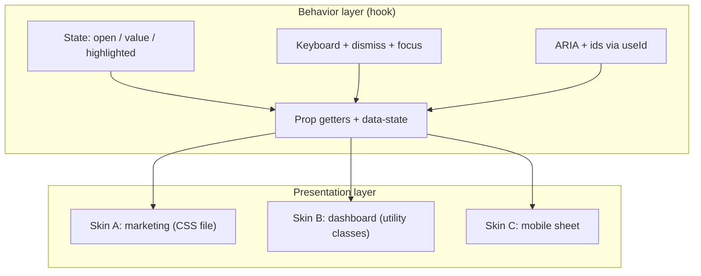
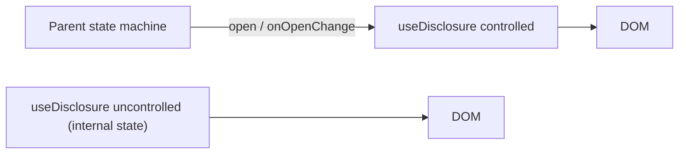

# 05 / 18 — Separating Behavior from Presentation

## 1. Lesson metadata

| | |
|---|---|
| **Level** | Advanced |
| **Study time** | 4–5 hours (reading 2 h, refactoring labs 1.5 h, exercises 1.5 h) |
| **Prerequisites** | [05 / 04 — Container and presentational](./04-container-presentational.md), [05 / 06 — Custom hook patterns](./06-custom-hook-patterns.md), [05 / 07 — Headless components](./07-headless-components.md), [05 / 11 — Controlled component pattern](./11-controlled-component-pattern.md), [03 / 15 — Custom hooks](../03-react-state-and-hooks/15-custom-hooks.md), [03 / 10 — `useRef` and mutable references](../03-react-state-and-hooks/10-useref-and-mutable-references.md), [Phase 1 / 11 — Controlled and uncontrolled inputs](../01-react-fundamentals/11-controlled-and-uncontrolled-inputs.md) |
| **Next** | [19 — Polymorphic components](./19-polymorphic-components.md) |
| **Related** | [05 / 05 — Compound components](./05-compound-components.md), [05 / 10 — Render props](./10-render-props.md), [Phase 4 / 12 — Domain logic vs UI logic](../04-react-architecture/12-domain-logic-vs-ui-logic.md), [Phase 8 / 10 — Accessibility testing](../08-testing-and-quality/10-accessibility-testing.md), [Phase 11 / 07 — Design system architecture](../11-senior-and-architect-mastery/07-design-system-architecture.md) |

**Learning objectives.** After this lesson you can:
1. Define *behavior* (state, events, keyboard and pointer interaction, ARIA semantics, focus management) and *presentation* (markup structure choices, styling, motion, layout) and name the seam between them.
2. Extract behavior into a hook that returns **state + actions + prop getters**, and wire it to multiple visual skins without duplication.
3. Implement controlled/uncontrolled support (`useControllableState`), event-handler composition, and ref merging correctly, including React 19 `ref`-as-prop and ref cleanup functions.
4. Style from state through **data attributes** and ARIA attributes instead of passing `isOpen` through styling props.
5. Decide between a behavior hook, a headless component, compound components, and a monolithic styled component using explicit criteria, including cases where separation is the wrong call.
6. Test behavior independently from skins and verify accessibility semantics survive refactoring.

**Concepts covered:** behavior vs presentation, seam, prop getters, headless hook, headless component, controlled/uncontrolled state, handler composition, ref merging, data attributes for state styling, ARIA state/relationship attributes, roving tabindex, dismiss behavior, `useId`, state reducer (inversion of control for behavior), skin, design token, inseparable concerns.

---

## 2. Deep conceptual explanation

### 2.1 What problem is this lesson solving?

Consider a company with a marketing site, a dashboard, and a mobile web view. All three need a dropdown menu. The *look* differs in each (spacing, colour, animation, density). The *behaviour* must be identical in all three, and must be correct:

- opens on click or Enter/Space, closes on Escape and outside click,
- keeps `aria-expanded`/`aria-controls` truthful,
- returns focus to the trigger on close,
- supports arrow-key navigation with roving focus,
- works controlled (parent decides) *or* uncontrolled,
- does not break when rendered twice on a page (unique ids).

If behaviour and styling are fused in one component, three things go wrong: (1) the dropdown is **copy-pasted** per skin and the copies drift (one forgets Escape, one forgets focus return); (2) correctness fixes must be applied N times; (3) visual change requests become behavioural-regression risks because the same JSX contains both. Accessibility is the biggest casualty: ARIA attributes are *behaviour* encoded in markup, and a skin author who rewrites markup "just for styling" silently deletes the semantics.

The remedy is a **seam**: put the stateful, event-driven, semantic part behind an API, and let each skin consume it. This is the principle behind headless libraries (Radix primitives, React Aria, Headless UI, Downshift — see Section 14; verify current APIs), and it is the natural evolution of Container/Presentational ([04](./04-container-presentational.md)) from *data* to *interaction*.

### 2.2 First principles: what belongs on each side

| Concern | Behavior side | Presentation side |
|---|---|---|
| Open/closed, selected index, value | State and transitions | Reads state; renders differently |
| Keyboard map (Arrow, Home, End, Escape, Enter) | Yes | No |
| Focus management (trap, restore, roving) | Yes | No |
| ARIA roles/states/relationships | Yes (it is behaviour expressed in markup) | Must *place* them on the right elements, not invent them |
| Dismissal (outside click, blur) | Yes | No |
| Timing (open delay, debounce) | Yes | Animation *duration* is presentation, but *when state flips* is behaviour |
| DOM structure | Constraints from semantics (a `menu` needs `menuitem`s) | Wrapper elements, icons, layout |
| Colours, spacing, typography | No | Yes |
| Transitions/animations | Provide hooks (state attributes, `onTransitionEnd` handling if mounting depends on it) | CSS/JS animation |
| Content | Slots/children | Yes |

**The seam test:** can a designer change *every* visual aspect without touching code that handles events or ARIA? Can an engineer fix a keyboard bug without touching any stylesheet? If either is false, the seam is leaky.

### 2.3 Four ways to express the seam in React

| Mechanism | Shape | Strengths | Weaknesses |
|---|---|---|---|
| **Behavior hook** | `const d = useDisclosure()` returns state, actions, prop getters | Zero extra DOM; maximal flexibility; easy to test | Consumer must apply props correctly; no enforced structure |
| **Headless component (render prop / function-as-children)** | `<Disclosure>{(d) => ...}</Disclosure>` | Co-locates provider-like scope; works in class-free libs | Nesting/indentation; "render prop hell" ([10](./10-render-props.md)) |
| **Compound components + context** | `<Menu><Menu.Button/><Menu.List/></Menu>` | Structure enforced; ARIA wiring automatic | More API surface; styling via props/`className`/`data-*` ([05](./05-compound-components.md)) |
| **Styled component with variants** | `<Menu variant="compact" />` | Simplest for one skin | Behaviour and skin fused; variants multiply |

Behavior hooks are the **lowest-level** primitive; headless components and compounds are packaged *on top of* hooks. This lesson focuses on the hook layer plus the conventions (prop getters, data attributes, controllability) that make the higher layers possible.

### 2.4 Prop getters

A **prop getter** is a function that returns the props a UI element must receive to participate in the behaviour:

```tsx
<button {...d.getTriggerProps({ className: 'btn', onClick: track })} />
<div {...d.getPanelProps()} />
```

Why functions, not static objects? Three reasons:

1. **Merging.** The consumer's own `onClick`, `className`, `ref` and `id` must be *combined* with the hook's, not overwritten. A getter takes the consumer's props as input and returns the merged result.
2. **Per-instance data.** Lists need per-item props (`getItemProps({ index })`).
3. **Evolving contract.** The hook can add `aria-*` attributes later without consumers changing code (they spread the getter result).

The alternative — returning static `triggerProps`/`panelProps` objects — works for simple cases but breaks as soon as the consumer wants their own handler on the same element.

### 2.5 Relationship to JavaScript, React and the browser

- **ARIA is a contract with assistive technology**, not styling. `aria-expanded` and `aria-controls` must reflect state; roles define expected keyboard behaviour (the WAI-ARIA Authoring Practices describe the expected interaction for patterns such as disclosure, menu button, tabs, combobox; see Section 14). A behaviour hook is the right home for *keeping them true*.
- **The DOM owns focus**. Focus management needs refs and imperative `.focus()` calls in effects/handlers ([03 / 10](../03-react-state-and-hooks/10-useref-and-mutable-references.md)); this is behaviour that a purely declarative skin cannot express.
- **CSS can see state** if you expose it as attributes. `[data-state="open"]`, `[aria-expanded="true"]`, `[data-disabled]`, `[data-highlighted]` let stylesheets (or utility variants such as Tailwind's `data-[state=open]:`) respond to behaviour **without the skin re-implementing state logic** or taking an `isOpen` prop.
- **`useId`** (React 18+) generates ids that are stable across server and client renders and unique per instance; it is the correct tool for `aria-controls`/`aria-labelledby` relationships ([Phase 9 / 02](../09-advanced-rendering-and-ecosystem/02-hydration-internals-deep-dive.md) for hydration context). Never construct ids with `Math.random()` or a module counter in render.
- **React 19 `ref` as a prop.** Function components receive `ref` as an ordinary prop (no `forwardRef` needed; `forwardRef` is legacy for new code). Callback refs may **return a cleanup function**, which React calls on detach instead of calling the callback with `null` (React 19 behavior; in React 18 the returned function is ignored/typed as an error). This matters for the merge-refs helper in Section 5.5.

### 2.6 Common misconceptions

| Misconception | Reality |
|---|---|
| "Headless means no markup." | Headless means no *visual opinions*. The behaviour layer is still responsible for *which elements/roles/attributes* are required for semantics; hooks return them via getters. |
| "A hook returning `isOpen` and `toggle` is a behaviour layer." | That is state, not behaviour. Keyboard map, focus, dismissal, ARIA and ids are the behaviour that is expensive to get right. |
| "Separating them is always better." | Separation costs indirection. For a one-off, single-skin component it is over-engineering (Section 7). |
| "Styling by `className` props from behaviour is fine." | Behaviour should not know class names. Expose *state attributes*; let skins style from them. |
| "I can test the behaviour hook with `renderHook` and be done." | Hooks cannot verify that the *DOM* wiring (ids, roles, focus) is right. Test with a minimal reference skin via Testing Library queries by role, in addition to hook tests. |
| "Controlled/uncontrolled is a detail." | It is part of the behaviour contract. A component that cannot be controlled cannot be integrated into forms, routers, or state machines. |

---

## 3. Internal mechanics

### 3.1 Controlled vs uncontrolled: the contract

*Public guarantee* (React docs for inputs): an input is "controlled" when its value comes from props and changes through `onChange`; otherwise uncontrolled. React warns when an input switches between controlled and uncontrolled during its lifetime ([Phase 1 / 11](../01-react-fundamentals/11-controlled-and-uncontrolled-inputs.md)). Component libraries adopt the same convention for their own state: if `open` is provided (not `undefined`), the parent owns it; otherwise the component owns `defaultOpen`.

*Teaching model.* `useControllableState` is: "the current value is `value ?? internal`; setting calls `onChange` always, and updates `internal` only when uncontrolled". The control decision is made **per render** by checking `value !== undefined`; switching modes mid-lifetime is a bug the hook should warn about in development.

### 3.2 Why handler composition order matters

If both the consumer and the hook attach `onClick` to the same element, you must call both. The convention (used by several libraries; verify in each) is: call the **consumer's handler first**, then run the hook's handler **unless `event.defaultPrevented`** — giving the consumer a veto. This is a design decision, not a platform rule; document it.

### 3.3 Why `getXProps` identity matters (and doesn't)

Prop getters create **new objects each call** (each render). That is fine for DOM elements (React diffs props shallowly per host element). It is a problem if the result is passed to `React.memo` components expecting stable function props. Handlers inside the getter (`toggle`) should be stable (`useCallback`) so memoised children do not re-render needlessly ([03 / 11](../03-react-state-and-hooks/11-usememo-and-usecallback.md)); the *composed* wrapper (consumer's `onClick` + toggle) is necessarily new if the consumer's handler is new. Do not over-optimise: measure ([Phase 7 / 01](../07-performance/01-measure-before-optimizing.md)).

### 3.4 Where effects belong in behaviour hooks

Dismiss-on-outside-click, focus return, and scroll locking are **effects tied to state** ("while open, listen"). They follow the subscription rules in [14](./14-observer-and-subscription.md): subscribe when `open` becomes true, unsubscribe in cleanup, tolerate StrictMode's mount–unmount–mount. Focus return should run on the *transition* from open to closed (not on the initial mount where `open` is already false); track the previous value in a ref or fire it from the close action.

### 3.5 Mounting vs hiding

A panel can be *unmounted* when closed (`{open && <Panel/>}`) or *hidden* (`hidden` attribute / CSS). Consequences: unmounted panels lose their state and DOM (inputs reset); hidden panels keep it but still render (cost) and need `hidden` or `inert` to be removed from the accessibility tree and tab order. The behaviour layer should expose enough (`open` state, ids, `hidden` via the getter) to allow either; the skin chooses the mounting strategy, constrained by animation needs ([Phase 2 / 20](../02-react-rendering-and-internals/20-commit-and-dom-mutation.md) for DOM mutation cost context).

---

## 4. Step-by-step execution walkthrough: one `useDisclosure`, two skins

Component tree: a page renders `<MarketingFaq />` (skin A, uncontrolled) and `<SettingsAdvanced open={open} onOpenChange={setOpen} />` (skin B, controlled by a form state machine). Both use `useDisclosure`.

| # | Event | Behaviour hook (A) | Behaviour hook (B) | DOM / a11y result |
|---|---|---|---|---|
| 1 | Mount | `useId` → `:r1:`; internal `open=false` | `useId` → `:r2:`; `open` from props (`false`) | Two triggers with distinct `aria-controls` targets; both `aria-expanded="false"` |
| 2 | User clicks A's trigger | `toggle` → `setInternal(true)`; calls `onOpenChange?.(true)` (none) | — | A re-renders: `aria-expanded="true"`, panel `hidden=false`, `data-state="open"` → skin A's CSS animates |
| 3 | User presses Escape while A is open and focus is inside panel | Keydown handler → `close()` + focus returns to trigger | — | `aria-expanded="false"`, focus on trigger (screen reader announces the control) |
| 4 | User clicks B's trigger | — | `toggle` → calls `onOpenChange(true)`; **does not** set internal state (controlled) | Parent state machine receives the request; if it rejects (form invalid), `open` stays `false`: UI does not change |
| 5 | Parent accepts, `setOpen(true)` | — | New `open=true` from props | B shows content with its own skin (no animation, a different DOM wrapper) |
| 6 | Outside click | A: effect subscribed while open → close | B: effect subscribed → `onOpenChange(false)` | Only the open instance reacts |

**Predict:** at step 4, what does the user see if the parent ignores `onOpenChange`? *Answer:* nothing — the panel stays closed; a controlled component renders what the parent says. That is correct behaviour, and also the most common source of "my disclosure doesn't open" bug reports when a parent forgets to wire `onOpenChange` (Section 10.2).

**Predict:** in StrictMode (development), how many outside-click listeners exist after A opens? *Answer:* one, provided the effect cleanup removes the listener: the simulated unmount/remount subscribes, unsubscribes, subscribes again.

---

## 5. Code examples

### 5.1 Fused component (the "before"): behaviour and skin entangled

```tsx
// INCORRECT (as architecture): behaviour duplicated per skin
function UserMenu({ items }: { items: { id: string; label: string; onSelect(): void }[] }) {
  const [open, setOpen] = useState(false);
  const ref = useRef<HTMLDivElement>(null);

  useEffect(() => {
    function onDoc(e: MouseEvent) { if (!ref.current?.contains(e.target as Node)) setOpen(false); }
    document.addEventListener('mousedown', onDoc);
    return () => document.removeEventListener('mousedown', onDoc);   // subscribed even when closed
  }, []);

  return (
    <div ref={ref} className="relative inline-block">
      <button
        className="px-3 py-2 rounded bg-blue-600 text-white"
        onClick={() => setOpen(!open)}                               // stale-closure-prone toggle
      >
        Account ▾
      </button>
      {open && (
        <ul className="absolute right-0 mt-1 w-48 bg-white shadow rounded">
          {items.map((i) => (
            <li key={i.id} className="px-3 py-2 hover:bg-gray-100 cursor-pointer" onClick={() => { i.onSelect(); setOpen(false); }}>
              {i.label}
            </li>
          ))}
        </ul>
      )}
    </div>
  );
}
```

Defects relevant to this lesson (find them first): no `aria-expanded`/`aria-haspopup`/`aria-controls`; menu items are `<li onClick>` (not focusable, not keyboard operable — a WCAG failure for keyboard users); no Escape; no focus return; the document listener runs when closed; `setOpen(!open)` uses the render-time value; no controlled mode; the skin (Tailwind classes) is inside the same function as the behaviour. `FilterMenu` and `SortMenu` in the same app are copies with different classes and, over time, different bugs.

### 5.2 `useControllableState`

```tsx
// use-controllable-state.ts
import { useCallback, useEffect, useRef, useState } from 'react';

type Options<T> = {
  value?: T;                         // controlled value (undefined => uncontrolled)
  defaultValue: T;                   // initial value if uncontrolled
  onChange?: (next: T) => void;
};

export function useControllableState<T>({ value, defaultValue, onChange }: Options<T>) {
  const [internal, setInternal] = useState<T>(defaultValue);
  const isControlled = value !== undefined;
  const current = isControlled ? (value as T) : internal;

  // dev-only: warn on mode switch
  const wasControlled = useRef(isControlled);
  useEffect(() => {
    if (process.env.NODE_ENV !== 'production' && wasControlled.current !== isControlled) {
      console.warn('A component changed from ' + (wasControlled.current ? 'controlled to uncontrolled' : 'uncontrolled to controlled') + '. Decide once.');
    }
    wasControlled.current = isControlled;
  }, [isControlled]);

  // Latest-value refs keep `set` stable (Lesson 14, 5.2)
  const currentRef = useRef(current);
  const onChangeRef = useRef(onChange);
  const controlledRef = useRef(isControlled);
  useEffect(() => { currentRef.current = current; onChangeRef.current = onChange; controlledRef.current = isControlled; });

  const set = useCallback((next: T) => {
    if (Object.is(next, currentRef.current)) return;
    if (!controlledRef.current) setInternal(next);
    onChangeRef.current?.(next);
  }, []);

  return [current, set] as const;
}
```

Line notes:

- `value !== undefined` is the controlled test; consequently `T` should not include `undefined` as a legitimate value (use `null` for "no selection"). State this in the docs of your components.
- `set` is stable (empty deps) and reads latest data through refs updated in an effect (not during render).
- Notification policy: `onChange` fires on every *requested* change (both modes), enabling controlled parents to veto. For uncontrolled mode `onChange` is a notification after we also set internal state.
- Limitation: `set` reads `currentRef` which is updated **after commit**; two `set` calls in the same event handler both see the old value. For toggles inside one handler this can matter; offer `toggle()` implemented against the ref at call time, or accept the limitation and document it. (A reducer-based approach avoids it in uncontrolled mode; controlled mode inherently depends on the parent's next render.)
- `process.env.NODE_ENV` is replaced by bundlers; use your toolchain's equivalent.

### 5.3 Utilities: handler composition and ref merging (React 19 aware)

```ts
// compose.ts
import type { Ref, RefCallback, RefObject, SyntheticEvent } from 'react';

export function composeHandlers<E extends SyntheticEvent>(
  user: ((e: E) => void) | undefined,
  ours: (e: E) => void,
) {
  return (e: E) => {
    user?.(e);
    if (!e.defaultPrevented) ours(e);     // consumer may veto with preventDefault()
  };
}

export function mergeRefs<T>(...refs: Array<Ref<T> | undefined>): RefCallback<T> {
  return (node) => {
    const cleanups: Array<(() => void) | undefined> = refs.map((ref) => {
      if (typeof ref === 'function') {
        const cleanup = ref(node) as unknown;            // React 19: may return a cleanup function
        return typeof cleanup === 'function' ? (cleanup as () => void) : () => ref(null);
      }
      if (ref) { (ref as RefObject<T | null>).current = node; return () => { (ref as RefObject<T | null>).current = null; }; }
      return undefined;
    });
    return () => cleanups.forEach((c) => c?.());
  };
}
```

Notes:

- React 19 semantics: when a ref callback returns a function, React calls **that function** on detach and does **not** call the callback with `null`. Our merged callback always returns a cleanup, so React calls it, and each inner ref is detached properly (either through its own cleanup or by calling it with `null`). In React 18 the returned function is not used (and TypeScript's `RefCallback` type disallows non-void returns in older `@types/react`), so in 18-based codebases keep the older "call each ref with the node, then with null" pattern. Verify against the React and `@types/react` versions in your project.
- Creating `mergeRefs(...)` inline in render produces a **new callback each render**, so React detaches and re-attaches the ref every render (old ref called with `null`/cleanup, new called with node). Memoise with `useMemo`/`useCallback` keyed on the input refs when that matters (or accept it for refs that only store the node).
- `composeHandlers` gives the **consumer a veto** through `defaultPrevented`: document it.

### 5.4 `useDisclosure` with prop getters and data attributes

```tsx
// use-disclosure.ts
import { useCallback, useId, useMemo } from 'react';
import type { ButtonHTMLAttributes, HTMLAttributes, KeyboardEvent, MouseEvent, Ref } from 'react';
import { composeHandlers } from './compose';
import { useControllableState } from './use-controllable-state';

type DisclosureOptions = {
  open?: boolean;
  defaultOpen?: boolean;
  onOpenChange?: (open: boolean) => void;
};

type TriggerProps = ButtonHTMLAttributes<HTMLButtonElement> & { ref?: Ref<HTMLButtonElement> };
type PanelProps = HTMLAttributes<HTMLElement> & { ref?: Ref<HTMLElement> };

export function useDisclosure({ open: openProp, defaultOpen = false, onOpenChange }: DisclosureOptions = {}) {
  const [open, setOpen] = useControllableState<boolean>({
    value: openProp,
    defaultValue: defaultOpen,
    onChange: onOpenChange,
  });
  const baseId = useId();
  const triggerId = `${baseId}-trigger`;
  const panelId = `${baseId}-panel`;

  const toggle = useCallback(() => setOpen(!open), [open, setOpen]);
  const close = useCallback(() => setOpen(false), [setOpen]);

  const getTriggerProps = useCallback(
    (props: TriggerProps = {}): TriggerProps & { 'data-state': 'open' | 'closed' } => ({
      ...props,
      id: triggerId,
      type: 'button',
      'aria-expanded': open,
      'aria-controls': panelId,
      'data-state': open ? 'open' : 'closed',
      onClick: composeHandlers<MouseEvent<HTMLButtonElement>>(props.onClick, toggle),
    }),
    [open, panelId, toggle, triggerId],
  );

  const getPanelProps = useCallback(
    (props: PanelProps = {}): PanelProps & { 'data-state': 'open' | 'closed' } => ({
      ...props,
      id: panelId,
      role: props.role ?? 'region',      // default, overridable by the consumer
      'aria-labelledby': triggerId,
      hidden: !open,
      'data-state': open ? 'open' : 'closed',
      onKeyDown: composeHandlers<KeyboardEvent<HTMLElement>>(props.onKeyDown, (e) => {
        if (e.key === 'Escape') { e.stopPropagation(); close(); }
      }),
    }),
    [close, open, panelId, triggerId],
  );

  return useMemo(
    () => ({ open, setOpen, toggle, close, getTriggerProps, getPanelProps }),
    [open, setOpen, toggle, close, getTriggerProps, getPanelProps],
  );
}
```

Line notes:

- The hook never knows a class name, an element tag beyond the types for props, or a skin.
- `ref` is a normal prop in React 19, so `TriggerProps` can include `ref`; consumers pass `ref` through the getter (merge with the hook's own if the hook needs a ref, using `mergeRefs`).
- `useId` result contains colons (`:r1:`) in some versions; it is valid for `id`/`aria-*` references but not in CSS selectors without escaping — never use it in `querySelector('#...')` strings ⚠ (format is an implementation detail; do not parse it).
- `role="region"` with `aria-labelledby` is appropriate for a significant disclosed section; for a generic FAQ, omit the role to avoid landmark noise (follow the APG disclosure pattern; verify). The right role is a **behavioural/semantic decision**, which is exactly why it lives in the hook (and why the hook lets the consumer override it: `props.role ?? 'region'` makes `role` a *default*, while ids and `aria-*` relationships are *enforced* by being written after `...props`. Decide per attribute which are defaults and which are invariants, and document the decision).
- `hidden` removes the panel from rendering *and* the accessibility tree. If the skin animates, it must override `hidden` handling: provide `getPanelProps({ hidden: undefined })` or expose a variant; document.
- `data-state` lets any CSS select on the state.

### 5.5 Two skins on one behaviour

**Skin A — marketing FAQ (CSS in a stylesheet, animated height):**

```tsx
function FaqItem({ question, children }: { question: string; children: React.ReactNode }) {
  const d = useDisclosure();
  return (
    <div className="faq">
      <button {...d.getTriggerProps({ className: 'faq__q' })}>{question}</button>
      <div {...d.getPanelProps({ className: 'faq__a' })}>{children}</div>
    </div>
  );
}
```

```css
.faq__q[data-state='open']::after { content: '−'; }
.faq__q[data-state='closed']::after { content: '+'; }
.faq__a[data-state='open'] { animation: reveal 160ms ease-out; }
```

**Skin B — dashboard "Advanced settings" (controlled by a form machine, different DOM, no animation):**

```tsx
function AdvancedSection({ open, onOpenChange, children }: { open: boolean; onOpenChange(o: boolean): void; children: React.ReactNode }) {
  const d = useDisclosure({ open, onOpenChange });
  return (
    <section className="rounded border p-4">
      <header className="flex items-center justify-between">
        <h3>Advanced</h3>
        <button {...d.getTriggerProps({ className: 'text-sm underline' })}>{d.open ? 'Hide' : 'Show'}</button>
      </header>
      <div {...d.getPanelProps({ className: 'mt-3' })}>{children}</div>
    </section>
  );
}
```

Observations: identical ARIA, id, keyboard and dismiss behaviour; structure, markup and styling differ; one skin is controlled, one is not. Fixing "Escape should not close nested dialogs" is a one-file change in `use-disclosure.ts` and flows to both.

### 5.6 Advanced: a roving-tabindex tabs hook

```tsx
// use-tabs.ts
import { useId, useRef } from 'react';
import type { HTMLAttributes, KeyboardEvent, ButtonHTMLAttributes } from 'react';
import { composeHandlers } from './compose';
import { useControllableState } from './use-controllable-state';

export function useTabs<K extends string>(keys: readonly K[], opts: { value?: K; defaultValue: K; onValueChange?: (k: K) => void }) {
  const [value, setValue] = useControllableState<K>({ value: opts.value, defaultValue: opts.defaultValue, onChange: opts.onValueChange });
  const base = useId();
  const tabRefs = useRef(new Map<K, HTMLButtonElement | null>());

  const focusKey = (k: K) => tabRefs.current.get(k)?.focus();

  const onKeyDown = (e: KeyboardEvent<HTMLElement>) => {
    const i = keys.indexOf(value);
    let next: number | null = null;
    if (e.key === 'ArrowRight') next = (i + 1) % keys.length;
    else if (e.key === 'ArrowLeft') next = (i - 1 + keys.length) % keys.length;
    else if (e.key === 'Home') next = 0;
    else if (e.key === 'End') next = keys.length - 1;
    if (next === null) return;
    e.preventDefault();
    const k = keys[next];
    setValue(k);           // "automatic activation": selection follows focus (see note)
    focusKey(k);
  };

  const getTabListProps = (p: HTMLAttributes<HTMLDivElement> = {}): HTMLAttributes<HTMLDivElement> => ({
    ...p,
    role: 'tablist',
    onKeyDown: composeHandlers(p.onKeyDown, onKeyDown),
  });

  const getTabProps = (k: K, p: ButtonHTMLAttributes<HTMLButtonElement> = {}): ButtonHTMLAttributes<HTMLButtonElement> & { ref: (n: HTMLButtonElement | null) => void; 'data-state': 'active' | 'inactive' } => ({
    ...p,
    id: `${base}-tab-${k}`,
    role: 'tab',
    type: 'button',
    'aria-selected': value === k,
    'aria-controls': `${base}-panel-${k}`,
    tabIndex: value === k ? 0 : -1,             // roving tabindex: only the selected tab is in the tab order
    'data-state': value === k ? 'active' : 'inactive',
    onClick: () => setValue(k),
    ref: (n) => { tabRefs.current.set(k, n); },
  });

  const getPanelProps = (k: K, p: HTMLAttributes<HTMLDivElement> = {}): HTMLAttributes<HTMLDivElement> => ({
    ...p,
    id: `${base}-panel-${k}`,
    role: 'tabpanel',
    'aria-labelledby': `${base}-tab-${k}`,
    hidden: value !== k,
    tabIndex: 0,
  });

  return { value, setValue, getTabListProps, getTabProps, getPanelProps };
}
```

Notes:

- **Roving tabindex:** exactly one tab has `tabIndex=0`; Tab key moves focus out of the tablist into the panel; arrow keys move between tabs. This matches the WAI-ARIA Authoring Practices tabs pattern (verify details, including *manual* vs *automatic* activation, in the current APG; the example uses automatic activation, which is advisable only when showing the panel is instant).
- The ref callback in `getTabProps` is recreated each render; React detaches/re-attaches each render (calls with `null`, then the node), and the `Map` ends up consistent. React 19 allows a cleanup return; the simple form above is valid in both versions.
- The getters are plain functions recreated each render and close over the current `value`; there is no `useCallback` with a partial dependency list (a common source of stale-closure bugs). Add memoisation only if profiling shows a memoised child receiving these props.
- Hidden panels with `tabIndex: 0` are focusable only when visible (hidden elements are not focusable).

### 5.7 Headless component form (render prop)

```tsx
export function Disclosure({ children, ...opts }: DisclosureOptions & { children: (d: ReturnType<typeof useDisclosure>) => React.ReactNode }) {
  return <>{children(useDisclosure(opts))}</>;
}

// <Disclosure>{(d) => (<><button {...d.getTriggerProps()}>More</button><div {...d.getPanelProps()}>...</div></>)}</Disclosure>
```

A hook call inside the function body of `Disclosure` is legal (it is a component). The advantage over calling the hook directly: usable where hooks cannot be called (class component, a place where you want JSX-only composition, or a library offering both forms). The cost: indentation and a harder-to-trace data flow ([10](./10-render-props.md)). Prefer the hook when you own the component.

### 5.8 State reducer: letting consumers adjust behaviour without forking

```tsx
type DisclosureState = { open: boolean };
type DisclosureAction = { type: 'toggle' | 'open' | 'close' | 'escape' | 'outside-click' };

type Reducer = (state: DisclosureState, action: DisclosureAction, defaultNext: DisclosureState) => DisclosureState;

function useDisclosureWithReducer(opts: { reducer?: Reducer }) {
  const [state, dispatch] = useReducer(
    (s: DisclosureState, a: DisclosureAction): DisclosureState => {
      const defaultNext: DisclosureState =
        a.type === 'toggle' ? { open: !s.open } :
        a.type === 'open' ? { open: true } : { open: false };
      return opts.reducer ? opts.reducer(s, a, defaultNext) : defaultNext;
    },
    { open: false },
  );
  return { state, dispatch };
}
// consumer: "do not close on outside click while the form is dirty"
// reducer: (s, a, next) => (a.type === 'outside-click' && dirty ? s : next)
```

This is inversion of control for *behaviour*: the hook provides defaults, the consumer overrides specific transitions. Cost: the action vocabulary becomes public API and consumers' reducers must be pure and stable (a new reducer each render is acceptable with `useReducer` since React uses the latest reducer on the next render; verify the exact semantics in the `useReducer` reference). Use only when "customise one rule" requests keep arriving; otherwise controlled mode ([11](./11-controlled-component-pattern.md)) is simpler.

### 5.9 Refactoring lab A: three fused menus → one behaviour hook + skins (comparative)

**Before:** `UserMenu` (5.1), `FilterMenu`, `SortMenu`: 3 × ~35 lines; three listeners, three subtly different outside-click bugs, none keyboard-accessible.

**After:** `useDisclosure` (5.4) + `useDismiss` (outside click + Escape, below) + `useMenuNavigation` (arrow keys among items), composed into skins:

```tsx
function useDismiss(open: boolean, onDismiss: () => void, refs: Array<React.RefObject<HTMLElement | null>>) {
  const dismissRef = useRef(onDismiss);
  useEffect(() => { dismissRef.current = onDismiss; });
  useEffect(() => {
    if (!open) return;                                          // subscribe only while open
    const controller = new AbortController();
    document.addEventListener('pointerdown', (e) => {
      if (refs.every((r) => !r.current?.contains(e.target as Node))) dismissRef.current();
    }, { signal: controller.signal });
    return () => controller.abort();
  }, [open, refs]);                                             // refs array must be stable (module/`useRef` array)
}
```

```tsx
function UserMenu({ items }: { items: MenuItem[] }) {
  const d = useDisclosure();
  const root = useRef<HTMLDivElement>(null);
  useDismiss(d.open, d.close, useMemo(() => [root], []));      // useMemo as a stability hint only
  return (
    <div ref={root} className="relative inline-block">
      <button {...d.getTriggerProps({ className: 'px-3 py-2 rounded bg-blue-600 text-white', 'aria-haspopup': 'menu' })}>Account ▾</button>
      <ul {...d.getPanelProps({ role: 'menu', className: 'absolute right-0 mt-1 w-48 bg-white shadow rounded' })}>
        {items.map((i) => (
          <li key={i.id} role="none">
            <button role="menuitem" className="block w-full px-3 py-2 text-left hover:bg-gray-100"
              onClick={() => { i.onSelect(); d.close(); }}>{i.label}</button>
          </li>
        ))}
      </ul>
    </div>
  );
}
```

Properly implementing the **menu button** pattern (focus first item on open, arrow-key navigation, typeahead, return focus on close) requires more behaviour than shown; that is precisely why mature libraries exist (Section 7). The point of the lab: after refactoring, `FilterMenu` and `SortMenu` differ from `UserMenu` only in *skin and items*; a bugfix in `useDismiss` fixes all three.

**Comparison**

| Criterion | Before (3 fused copies) | After (hooks + skins) |
|---|---|---|
| Lines (3 menus) | ~105 | ~60 skins + ~90 shared behaviour |
| Behavioural bugs fixed per fix | 1 copy at a time | All skins |
| Keyboard/ARIA correctness | Missing everywhere | Centralised and testable |
| Visual change risk | Touches behaviour code | Touches skin only |
| Onboarding | Read one file | Learn 2–3 hooks and prop getters |
| Risk | Drift | Misapplied getters; hook API churn |

### 5.10 Refactoring lab B: variants explosion → seam (comparative)

**Before:** `<Accordion variant="faq" | "settings" | "card" iconPosition="left" | "right" animated />`: a single component with a growing matrix of flags that mixes behaviour (`allowMultiple`) with skin (`iconPosition`). Each new product team adds flags; internal branches multiply (`variant === 'card' && animated && ...`).

**After:** behaviour hook `useAccordion({ type: 'single' | 'multiple', ... })` returns per-item getters; the design system ships *two or three* skins as ordinary components and documents the hook for custom skins. Variants multiply across skins not inside one component.

| Criterion | Variant flags | Hook + skins |
|---|---|---|
| New visual need | Add flag + branch | New skin component |
| New behavioural need | Add flag (shared) | Add option to hook |
| Combinatorial testing | Behaviour × variants | Behaviour once, skins smoke-tested |
| Public API size | Large | Hook API + a few skins |
| Consumers' flexibility | Limited by flags | Full |

**When flags win:** a product with one visual identity and three real variants maintained by one team; the hook adds an API surface no one needs.

---

## 6. Visual explanations

### 6.1 The seam



### 6.2 Where the ownership of `open` lives



### 6.3 Handler and ref merging

```text
consumer onClick ─┐
                  ├─> composeHandlers(user, ours): user(e); if (!e.defaultPrevented) ours(e)
hook toggle ──────┘

consumer ref ─┐
hook ref      ├─> mergeRefs(a, b, c): set all; return cleanup that detaches all (React 19)
other ref ────┘
```

### 6.4 State-driven styling

```text
Hook:    data-state="open"  aria-expanded="true"
CSS:     [data-state='open'] { ... }       (no JS prop, no isOpen styling prop)
Utility: data-[state=open]:rotate-180      (Tailwind-style variant; verify in your version)
```

---

## 7. Alternative approaches and trade-offs

| Criterion | Fused styled component | Container / presentational | Behavior hook + prop getters | Headless component (render prop) | Compound components | Third-party headless library |
|---|---|---|---|---|---|---|
| Behavioural correctness | Per component | Per component | Centralised | Centralised | Centralised | Centralised + tested broadly |
| Visual flexibility | Low–Medium | Medium | High | High | Medium–High | High |
| DOM structure enforced | Yes | Yes | No | No | Yes | Yes |
| A11y wiring errors possible | Low (one place) | Low | Medium (consumer must apply getters) | Medium | Low | Low |
| Learning cost | Low | Low | Medium | Medium | Medium | Medium–High (library API) |
| Bundle impact | Minimal | Minimal | Minimal | Minimal | Small | Library size |
| Testability | UI-level | Container logic testable | Hook + reference skin | Same | Via structure | Library tested; you test integration |
| Typical fit | App-specific one-offs | Data/UI separation | Design-system internals | Libraries supporting non-hook consumers | Design systems with enforced structure | Production design systems |

**When the recommended approach (separate behaviour from presentation, hook-level) is NOT best.**

1. **Single use, single skin.** One `<ConfirmDeleteButton>` that will never be re-skinned: a fused component is simplest and fully correct.
2. **Behaviour and presentation are inseparable.** A draggable bottom sheet whose gesture physics are driven by the same values as its visual transform; a canvas editor; swipe-to-dismiss cards. The "behaviour" is the animation. Splitting adds an interface that carries per-frame values and gives no reuse.
3. **Complex accessibility patterns where you should *buy*.** Combobox, menu with typeahead, date picker, dialogs with focus traps, virtualised listbox: correctness is extremely costly to reproduce; use a vetted library (React Aria, Radix, Headless UI, Downshift, Ariakit — verify current status and licensing) and put your skin on it. Writing your own should be a deliberate, justified decision.
4. **Team skill/size constraints.** Prop-getter APIs are easy to misuse; with a large, rotating team, a compound component that enforces structure may produce fewer a11y regressions than a hook that merely supplies props.
5. **Server-rendered, no-JS-required patterns.** Native `<details>/<summary>`, `<dialog>`, the Popover API (`popover` attribute) and CSS-only solutions provide behaviour *without React state*. Check browser support for the Popover API and `<dialog>` features you rely on (MDN compat tables) before choosing; using the platform removes the hook entirely.

---

## 8. Best practices and anti-patterns

**Do**

- Make behaviour hooks **return prop getters**, not just state; merge consumer props (handlers, `className`, `style`, `ref`, `id`).
- **Expose state as `data-*` and ARIA attributes**; skins style from attributes.
- **Support controlled and uncontrolled** from day one; warn on mode switch in dev.
- Use **`useId`** for ids; never random values in render.
- Keep **keyboard maps** and **focus rules** in the hook; document them against the APG pattern.
- Offer a **reference skin** (minimal, unstyled) used in tests and docs.
- **Default to unmount-free hiding** (`hidden`) *or* document the mounting strategy and its state implications.
- Keep **domain logic** out: a hook for a menu does not know what "Delete account" means ([Phase 4 / 12](../04-react-architecture/12-domain-logic-vs-ui-logic.md)).

**Beginner mistakes**

- Returning `{ isOpen, setIsOpen }` and calling it a behaviour layer.
- Spreading the same getter result *after* consumer props and overwriting their handlers.
- Using `<div onClick>` instead of `<button>` for interactive elements.
- Forgetting `type="button"` (accidental form submit).

**Experienced-developer mistakes**

- **Over-abstraction:** a hook with 25 options replicating a third-party library poorly.
- **Behaviour reading styling:** measuring CSS classes or `getComputedStyle` to decide state transitions.
- **Leaky skin API:** `isOpen`, `isActive`, `isHovered` boolean props passed to presentational components for styling instead of data attributes (re-implements the hook's state per skin).
- **No contract tests:** skin authors can delete a required `aria-*` attribute without CI noticing.
- **Pointer-only dismissal** (no Escape, no focus handling).
- **Behaviour in context for tiny widgets** causing rerender fan-out ([03 / 14](../03-react-state-and-hooks/14-context-performance.md)).

**Smells:** a "presentational" component that imports `useEffect`; className strings built from behavioural state in hooks; `role` attributes set by skins but needed by behaviour (a menu's `role="menuitem"` set ad hoc by every skin).

**Justified exceptions:** a hook may set a default `className` hook-point (like `data-slot`) for CSS targeting, which is attribute-level, not style-level; a skin may add ARIA attributes the behaviour layer cannot know (`aria-label` text, localised) — content, not behaviour.

---

## 9. Real-world application

| Domain | Behaviour examples | Constraint |
|---|---|---|
| **Design systems / multi-team** | Disclosure, tabs, menu, dialog, tooltip, combobox, toast | One accessibility implementation, many brand skins; versioned API; tokens drive the skins ([Phase 10 / 11](../10-production-engineering/11-design-system-governance.md)). |
| **E-commerce** | Filter facets (disclosure + checkbox groups), image gallery (roving tabindex), size selector (radio group), mini-cart popover | Conversions depend on interaction polish; keyboard and screen-reader paths must work at checkout. Legal accessibility obligations may apply in your market; confirm with compliance. |
| **Dashboards** | Resizable panels, sortable tables, column pickers, date range | Behaviour heavy and performance sensitive; headless tables (e.g. TanStack Table; verify) separate logic from markup. |
| **Finance** | Confirmation dialogs, step-up auth prompts, masked inputs | Focus trapping, announce errors (`role="alert"`), no accidental dismiss on destructive flows (state-reducer override). |
| **Forms** | Field wrapper (label + hint + error ids), validation display | `aria-describedby` wiring is behaviour; skins style. |
| **Embedded widgets** | Self-contained behaviour with host styling | Isolate: don't depend on host CSS for state; use attributes. |

Engineering constraints: **WCAG** keyboard operability and name/role/value; **RTL** layouts (arrow keys swap direction: left/right semantics must invert in `dir="rtl"`); **touch targets**; **reduced motion** (`prefers-reduced-motion` handled in skins); **SSR** (ids via `useId`, no `window` in render).

---

## 10. Debugging and troubleshooting

### 10.1 Symptom: screen reader announces "button" with no expanded state

*Investigation:* Chrome DevTools → Elements → Accessibility pane; check `aria-expanded` on the trigger and `aria-controls`' target existence. *Root cause:* skin did not spread the getter, or spread it before overriding props, or rendered a `div`. *Fix:* spread getter props last for enforced attributes; use `<button>`. *Validate:* accessibility tree shows expanded state; Testing Library `getByRole('button', { expanded: false })` passes.

### 10.2 Symptom: controlled disclosure never opens

*Investigation:* log `onOpenChange` calls. *Root cause:* parent did not update `open` (forgot to wire `onOpenChange`, or its reducer rejected). *Fix:* wire; in dev, warn when `open` is provided without `onOpenChange` (like React's read-only input warning). *Validate:* click → parent state flips.

### 10.3 Symptom: consumer's `onClick` is ignored

*Root cause:* getter returned `{ ...props, onClick: toggle }` (overwrites). *Fix:* `composeHandlers`. *Validate:* both handlers run; `preventDefault` vetoes.

### 10.4 Symptom: two instances toggle together or `aria-controls` points to the wrong element

*Root cause:* static ids (`"panel"`) or module counter ids; hydration warnings if counters differ server vs client. *Fix:* `useId`. *Validate:* two instances in a test; unique ids; no hydration mismatch ([Phase 2 / 37](../02-react-rendering-and-internals/37-scenario-f-hydration-mismatch.md)).

### 10.5 Symptom: focus is lost after closing

*Investigation:* DevTools console `document.activeElement` before/after, or Elements → "Break on subtree modifications". *Root cause:* panel unmounted with focus inside; browser moved focus to `body`. *Fix:* on close, `triggerRef.current?.focus()` when focus was within the panel (check `panel.contains(document.activeElement)` before closing). *Validate:* keyboard test: Tab into panel, Escape, `expect(trigger).toHaveFocus()`.

### 10.6 Symptom: outside click closes immediately after opening (flicker)

*Root cause:* the click that opens the panel also bubbles to a document listener registered synchronously in the open handler/effect and is treated as outside. *Fix:* use `pointerdown` with containment check including the trigger, or subscribe in an effect after open commit (the effect runs after the click event completes). *Validate:* open/close stress test with fake events in Testing Library (`userEvent.click`).

### 10.7 Symptom: arrow keys move in the wrong direction in Arabic/Hebrew UI

*Root cause:* hard-coded Left=previous. *Fix:* consult `dir` (`getComputedStyle(el).direction` or a prop) and invert. *Validate:* RTL test.

---

## 11. Exercises

### Level A — Knowledge
A1. Define behaviour and presentation for UI components; list five concerns on each side.
A2. What is a prop getter and why is it a function?
A3. Why `data-state` instead of an `isOpen` prop to the skin?
A4. What is the difference between controlled and uncontrolled components in the context of a disclosure?
A5. What does React 19 change about `ref` for function components and for ref callbacks?

### Level B — Code comprehension
B1. In 5.4, a consumer writes `getTriggerProps({ onClick: (e) => e.preventDefault() })`. What happens when the trigger is clicked? Why?
B2. In 5.2, two `set(true)` / `set(false)` calls happen in one click handler in uncontrolled mode. What is the final value and why? Propose a fix.
B3. In 5.6, which tab is in the tab order when `value='b'`, and what does Tab do next?
B4. In 5.9, `useDismiss(d.open, d.close, useMemo(() => [root], []))`: why is the array memoised and what would happen if it were created inline?

### Level C — Implementation
C1. Implement `useDisclosure`-based `Accordion` (single-open mode) using a shared state hook `useAccordion` that returns per-item getters; ensure `aria-expanded`/`aria-controls`/`aria-labelledby` are correct.
C2. Implement `useDismiss` including Escape handling and a test with Testing Library that verifies: outside pointerdown closes, inside pointerdown does not, listener is removed after close (spy on `document.addEventListener/removeEventListener` or abort signal).
C3. Write a minimal **reference skin** and a **contract test** (Testing Library) that asserts the hook's a11y contract: trigger has `aria-expanded`, `aria-controls` points to the panel id, panel `hidden` when closed, Escape closes, focus returns.

### Level D — Debugging
D1. A skin passes `{...d.getPanelProps()}` to a custom `<Panel>` component that does not forward unknown props to the DOM. Describe symptoms and fixes.
D2. After upgrading to React 19, a custom `mergeRefs` helper that returns `ref(node)` results causes a console error/typing error. Diagnose.
D3. A `useDisclosure` skin works in dev but on the server render logs a hydration mismatch for `aria-controls`. Diagnose.

### Level E — Architecture and engineering decisions
E1. Your design system has a styled `<Dropdown>` used in 140 places with 9 boolean/variant props and 11 open a11y bugs. Propose a migration strategy to a behaviour/presentation split, including adoption of a third-party headless library vs in-house hooks, API compatibility, and measurable outcomes.
E2. Compare hook-based vs compound-component APIs for a `Tabs` primitive for a design system used by 6 teams with varying React expertise. Choose and justify; include governance (a11y tests, versioning).

### Level F — Expert challenge
F1. Design `useCombobox` outline: state, events, prop getters (`getInputProps`, `getListProps`, `getOptionProps`), ARIA (`aria-activedescendant` vs roving), controlled value/inputValue/open, and which parts you would **not** implement yourself. Provide the hook's type signature and a state-diagram of the highlight and open states.
F2. Comparative refactor: take the fused `UserMenu` (5.1) and produce (1) a hook + skin version, (2) a compound-component version (`<Menu><Menu.Trigger/><Menu.List><Menu.Item/></Menu.List></Menu>`), and (3) a version using native Popover API + `<button popovertarget>` (no React state). Write a comparison on a11y coverage, bundle, SSR, animation, focus management, browser support, and testing. State what you ship for a public marketing site and for an internal admin tool.

---

## 12. Detailed answers and explanations

> Attempt the exercises first.

**A1.** Behaviour: state and transitions, keyboard interactions, focus management, ARIA semantics, dismissal/timing. Presentation: markup layout choices, colours, spacing, typography, animation visuals, iconography. A strong answer notes ARIA lives in markup yet is behavioural, and that animation durations are presentation while *when* state flips is behaviour.

**A2.** A prop getter is a function returning the props an element needs (handlers, aria, ids, data attributes) while merging in the consumer's props. A function (not an object) because it must merge per-call consumer props, support per-item arguments, and allow the hook to evolve the returned contract without breaking consumers.

**A3.** An `isOpen` prop duplicates state into every skin and encourages skins to re-derive other state; attributes put state in the DOM where CSS and testing tools can read it, and keep the skin's code free of behavioural branches. Also, attribute selectors work for third-party CSS and CSS Modules without extra props.

**A4.** Controlled: parent supplies `open` and `onOpenChange`; the component displays what the parent says and only *requests* changes. Uncontrolled: the component owns state initialised by `defaultOpen`. Mixed use (switching) is a bug.

**A5.** In React 19, function components receive `ref` as a regular prop (no `forwardRef` needed for new code; `forwardRef` remains supported but is legacy). Callback refs can return a cleanup function; React calls it on detach (instead of calling the callback with `null`). Verify the exact React and types versions in your project.

**B1.** `composeHandlers` calls the consumer's handler first; it calls `preventDefault()`, so `e.defaultPrevented` is true and the hook's `toggle` is skipped: the disclosure does **not** toggle. This is the designed veto. Wrong answer: "both run" — they do, but ours is skipped by the guard. If you want no veto semantics, document and change the policy.

**B2.** Final value: `true` (not the last request!). `set` reads `currentRef` which updates **after commit**, so within one handler `set(true)` sets internal `true` and calls `onChange(true)`, then `set(false)` compares `false` against the *stale* `currentRef.current` (still `false`) and returns early as "no change": final internal state remains `true`, and `onChange(false)` is never called. Surprising! Fix: update `currentRef.current` synchronously inside `set` after deciding (`currentRef.current = next` for uncontrolled mode), or implement uncontrolled state with `useReducer`/functional updates. Edge: in controlled mode the parent's next render is authoritative, so don't write the ref.

**B3.** Tab `b` has `tabIndex=0`, others `-1`. Pressing Tab moves focus out of the tablist to the next tabbable element, typically the visible panel (it has `tabIndex: 0`) — not to tab `c`. Arrow keys move between tabs.

**B4.** The effect depends on `refs`; an inline array literal is a new identity every render, so the effect would unsubscribe and resubscribe each render while open (correct, but wasteful; and risk of missed events during the gap). `useMemo(() => [root], [])` is a hint for stable identity (acceptable here; if you need a guarantee use a `useRef` holding the array or a module constant). Better API: accept refs via a stable ref object.

**C1.** Reference design:

```tsx
function useAccordion<K extends string>(keys: readonly K[], opts: { type: 'single' | 'multiple'; value?: K[]; defaultValue?: K[]; onValueChange?: (v: K[]) => void }) {
  const [value, setValue] = useControllableState<K[]>({ value: opts.value, defaultValue: opts.defaultValue ?? [], onChange: opts.onValueChange });
  const base = useId();
  const toggle = (k: K) =>
    setValue(
      value.includes(k)
        ? value.filter((x) => x !== k)
        : opts.type === 'single' ? [k] : [...value, k],
    );
  const getTriggerProps = (k: K, p: ButtonHTMLAttributes<HTMLButtonElement> = {}) => ({
    ...p, id: `${base}-t-${k}`, type: 'button' as const,
    'aria-expanded': value.includes(k), 'aria-controls': `${base}-p-${k}`,
    'data-state': value.includes(k) ? 'open' : 'closed',
    onClick: composeHandlers(p.onClick, () => toggle(k)),
  });
  const getPanelProps = (k: K, p: HTMLAttributes<HTMLElement> = {}) => ({
    ...p, id: `${base}-p-${k}`, role: 'region' as const, 'aria-labelledby': `${base}-t-${k}`, hidden: !value.includes(k),
  });
  return { value, getTriggerProps, getPanelProps };
}
```

Evaluation criteria: arrays are replaced, not mutated; `single` mode replaces the array; ids unique per key and instance; controllable. Edge: `defaultValue` array identity (do not allocate a new `[]` per render for `useState` initial; fine because only used once); allowing "collapse the open item in single mode" (`collapsible`) is a policy option.

**C2.** Skeleton: render a component with `useDismiss` and refs; open it; `await userEvent.pointer({ keys: '[MouseLeft]', target: document.body })` outside → expect `onDismiss` called; click inside → not called. For listener removal use an abort-signal-based `useDismiss` and `vi.spyOn(document, 'addEventListener')` to capture the `signal` option, then assert `signal.aborted` after close; or assert behaviourally that outside clicks after close no longer call `onDismiss`. Evaluation: tests do not depend on implementation details beyond observable calls; Escape tested through `userEvent.keyboard('{Escape}')`.

**C3.** Assertions with Testing Library: `const trigger = screen.getByRole('button', { name: /more/i, expanded: false })`; after click `expanded: true`; `expect(trigger).toHaveAttribute('aria-controls', panel.id)`; `expect(panel).toBeVisible()`; `await user.keyboard('{Escape}')` → closed; `expect(trigger).toHaveFocus()` (requires focus-return implemented). The contract test runs against the *reference skin*, and the same test file is exported for skin authors to run against their skins (a "conformance suite").

**D1.** The custom `<Panel>` receives `id`, `role`, `hidden`, `aria-*`, `data-state`, `onKeyDown` as props; if it drops unknown props, the DOM lacks them: panel visible while "closed" (no `hidden`), missing ids/ARIA, Escape inert. Fix: forward `...rest` to the root DOM element; add a conformance test; or have `Panel` accept `getPanelProps` explicitly. TypeScript: type `Panel`'s props with `ComponentPropsWithoutRef<'div'>` so extra DOM props are allowed.

**D2.** In React 19 a ref callback's returned function is treated as a cleanup; an old `mergeRefs` returning something unrelated (e.g. the first ref's return value or a non-function) can trigger React's warning or type errors, and returning arbitrary values is disallowed by the newer `RefCallback` typing. Fix: return `undefined` or a proper cleanup function (5.3). In React 18, don't rely on cleanup returns.

**D3.** Ids not generated with `useId` (random/counter) differ between server and client, causing mismatch; or conditional hook usage changes id sequence. Fix: `useId`; ensure the same component tree renders on server and client.

**E1.** Evaluation criteria: audit usages (140) by variant, a11y bug taxonomy; decide build vs adopt: adopt a vetted headless library for complex patterns (menu/combobox) and build thin in-house hooks for simple ones; strangler strategy: keep `<Dropdown>` API stable, reimplement internals on the new behaviour layer, deprecate flags with codemods and dev warnings; ship a conformance test suite and an a11y checklist; measure outcomes (open a11y bugs 11 → 0 for the pattern, axe violations in CI, keyboard E2E pass, bundle size delta, number of variant props 9 → ≤ 3). Risks: visual regressions (use visual tests), library lock-in, and versioning. Provide timeline.

**E2.** Strong answer: for 6 teams with varying expertise, a **compound-component API on top of a headless hook** is a safer public surface: it enforces structure (tablist/tab/tabpanel ids wired by context), while the hook remains available for exotic cases. Governance: shared a11y conformance tests, visual regression, semantic versioning with deprecation policy, docs with APG links, lint rules for forbidden raw `role="tab"` in app code. Acknowledge trade-off: compound components increase API surface and make styling via `className`/`data-*` essential; hooks give maximal flexibility but misuse risk.

**F1.** Outline: state `{ open, inputValue, highlightedIndex, selected }` each controllable (`value`, `inputValue`, `open`, `highlightedIndex`). Events: `INPUT_CHANGE`, `ARROW_DOWN/UP`, `HOME/END`, `ENTER`, `ESCAPE`, `BLUR`, `OPTION_CLICK`, `OPEN/CLOSE`. ARIA: `role="combobox"` on input, `aria-expanded`, `aria-controls`, `aria-autocomplete`, `aria-activedescendant` pointing at highlighted option id (focus stays in the input), listbox with `role="listbox"`, options `role="option"` with `aria-selected`. Signature sketch: `useCombobox<T>(opts: { items: readonly T[]; itemToString(i: T): string; value?: T | null; onValueChange?(v: T | null): void; inputValue?: string; onInputValueChange?(v: string): void; open?: boolean; onOpenChange?(o: boolean): void; })` returning `{ getInputProps, getListProps, getOptionProps(item, index), state }`. Not to implement: IME composition edge cases, virtualisation integration, screen-reader quirks across browsers, typeahead locales, mobile keyboard behaviour — use a library. Evaluation: state diagram includes closed/opening/open-highlighting/committing transitions.

**F2.** Expected comparison: (1) hook + skin — flexible, requires care; a11y coverage depends on implemented keyboard map; (2) compound — enforces structure; more API; same a11y as hook; (3) Popover API — native light dismiss, top-layer rendering, no React state, minimal JS; limited to what the platform provides (menu semantics/arrow navigation are not automatic — you still need a11y behaviour for menu pattern), browser support must be checked (MDN) and fallbacks planned; SSR trivial; animation support evolving. Ship: for a marketing site with simple disclosure and non-menu popovers → native elements where support allows; for an admin tool with real menu semantics → compound over a vetted headless library; avoid hand-rolling menu behaviour unless you have the a11y test coverage. Include testing differences: native behaviour is browser-tested but jsdom does not implement Popover API fully — E2E tests (Playwright) needed.

---

## 13. Senior engineer interview questions

1. **"Why separate behaviour from presentation?"** Behaviour (state machine, keyboard, focus, ARIA) is expensive, shared, and correctness-critical; presentation changes constantly and per brand. Fusing them multiplies copies of the hard part, so each skin re-introduces the same bugs. The seam lets one tested behaviour power many skins.
2. **"Prop getters vs returning props objects?"** Getters take the consumer's props and merge (handlers composed, `className`/`style` merged, refs merged), support per-item parameters, and allow the hook to add attributes without consumers changing. Static objects get overwritten or overwrite.
3. **"How do you make a component work controlled and uncontrolled?"** Derive `isControlled = value !== undefined`; read from props when controlled, from internal state otherwise; always call `onChange` for requested changes; update internal state only when uncontrolled; warn on mode switches; do not allow `undefined` as a legitimate controlled value.
4. **"Where does ARIA belong?"** In the behaviour layer, because roles/states/relationships encode expected interaction and must remain true as state changes. Skins add labels and content, not behavioural attributes.
5. **"How would you test a behaviour hook?"** Hook-level tests for transitions and controlled/uncontrolled contract; a reference skin with Testing Library role queries to verify DOM wiring (ids, roles, focus, keyboard); and a conformance suite that skins can run. Plus axe checks and a few real-browser E2E for focus behaviours jsdom cannot model.
6. **"Why use data attributes for state styling?"** They expose state to CSS without props or re-derivation, are readable by tests and tools, and keep skins free of behavioural logic.
7. **"When is it wrong to separate?"** One-off single-skin widgets; gesture/animation-bound components where behaviour *is* presentation; and when a platform feature (`<details>`, `<dialog>`, Popover API) already provides the behaviour.
8. **"Hook vs compound components for a public design system?"** Hooks are the foundation; compound components are the safer default public API because they enforce structure and wire ids, while still built on the hook. Expose both when expertise varies.
9. **"What's the risk of homegrown headless primitives?"** Accessibility and cross-browser/AT edge cases are enormous (focus traps, typeahead, IME, RTL, mobile). Unless the team commits to an a11y test matrix, adopt a maintained library and skin it.

---

## 14. Further learning resources

| Resource | URL | Covers / why | Level | Section to study |
|---|---|---|---|---|
| WAI-ARIA Authoring Practices Guide | https://www.w3.org/WAI/ARIA/apg/ | Canonical keyboard/ARIA patterns (disclosure, tabs, menu button, combobox) | I–A | Patterns index; Keyboard interface |
| React: Reusing Logic with Custom Hooks | https://react.dev/learn/reusing-logic-with-custom-hooks | Hooks as behaviour containers | I | Whole page |
| React: Sharing State Between Components / controlled vs uncontrolled | https://react.dev/learn/sharing-state-between-components | "Controlled and uncontrolled components" section | I | That section |
| React reference: `useId` | https://react.dev/reference/react/useId | Unique ids for ARIA relationships; SSR-safe | I | Reference + Caveats |
| React 19 release notes / `ref` as prop | https://react.dev/blog/2024/12/05/react-19 | `ref` as a prop, ref cleanup functions verify | I | "ref as a prop"; "Cleanup functions for refs" |
| MDN: ARIA | https://developer.mozilla.org/en-US/docs/Web/Accessibility/ARIA | Roles and states reference | B–I | ARIA roles; aria-expanded |
| MDN: `<details>`, `<dialog>`, Popover API | https://developer.mozilla.org/en-US/docs/Web/API/Popover_API | Native behaviour alternatives; check compatibility | I | Usage + browser compatibility |
| React Aria | https://react-spectrum.adobe.com/react-aria/ | Hook-based headless a11y library; reference for API design | A | Getting started; hooks list |
| Radix Primitives | https://www.radix-ui.com/primitives | Compound, headless, data-attribute-styled components | I–A | Introduction; Styling |
| Headless UI | https://headlessui.com/ | Headless components (render-prop style) | I | Components overview |
| Downshift | https://www.downshift-js.com/ | Prop-getter and state-reducer patterns (origin of those conventions) | A | `useCombobox`, state reducer |

---

## 15. Knowledge checkpoint

**You should now be able to understand:** why interaction behaviour and ARIA semantics deserve their own layer; why prop getters, data attributes, and controllability are the interface conventions of that layer.

**You should be able to explain:** the seam test; controlled vs uncontrolled; handler and ref merging policies; when separation costs more than it returns and when to buy instead of build.

**You should be able to implement:** `useControllableState`, `useDisclosure`/`useTabs` with prop getters, `composeHandlers`/`mergeRefs` (React 19 aware), dismiss behaviour, and multiple skins over one hook; plus a conformance test for skins.

**You should be able to debug:** missing ARIA wiring, swallowed handlers, id collisions and hydration mismatches, focus loss on close, outside-click flicker, controlled components that never change.

**Prerequisite for next lessons:** [19 — Polymorphic components](./19-polymorphic-components.md) (the `as` prop and prop-getter typing), [20 — Slot patterns](./20-slot-patterns.md), [22 — Patterns for reusable libraries](./22-patterns-for-reusable-libraries.md).

**Self-check (answer without looking):** Name the elements, roles, ARIA attributes and keys a "menu button" needs; say which of them your hook returns via getters and which the skin may change; explain what breaks if a skin replaces `<button>` with `<div onClick>`.
