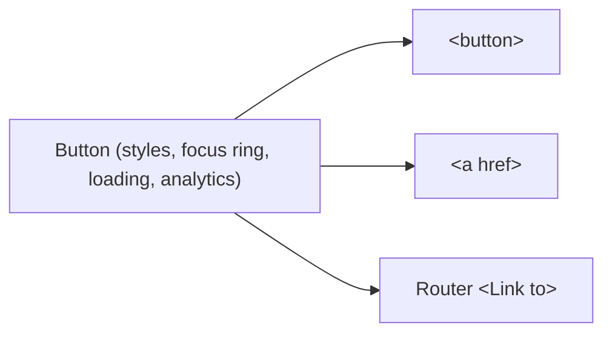
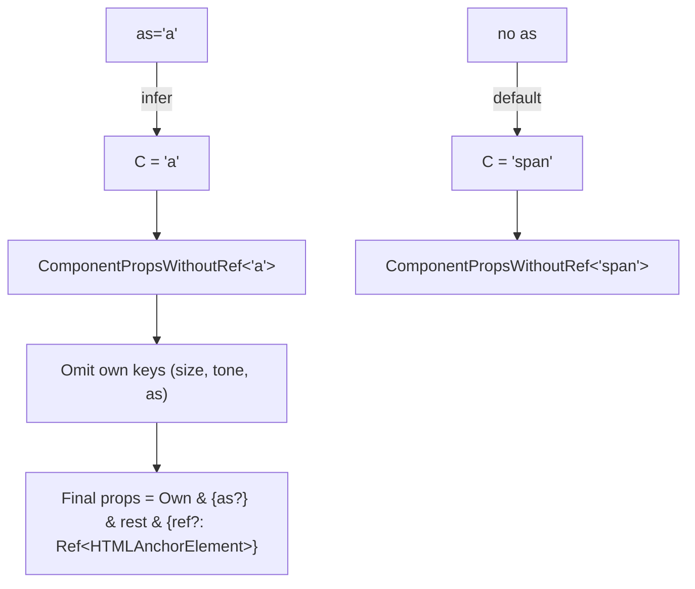

# 05 / 19 — Polymorphic Components

## 1. Lesson metadata

| | |
|---|---|
| **Level** | Advanced |
| **Study time** | 4–5 hours (reading 2 h, refactoring labs 1.5 h, exercises 1.5 h) |
| **Prerequisites** | [Phase 0 / 19 — TypeScript generics and utility types](../00-web-and-javascript-foundations/19-typescript-generics-and-utility-types.md), [Phase 1 / 04 — Elements, components, instances](../01-react-fundamentals/04-elements-components-instances.md), [05 / 03 — Composition over inheritance](./03-composition-over-inheritance.md), [05 / 15 — Adapter, strategy, factory](./15-adapter-strategy-factory.md), [05 / 18 — Behavior vs presentation](./18-behavior-vs-presentation.md), [03 / 10 — `useRef` and mutable references](../03-react-state-and-hooks/10-useref-and-mutable-references.md) |
| **Next** | [20 — Slot patterns](./20-slot-patterns.md) |
| **Related** | [05 / 05 — Compound components](./05-compound-components.md), [05 / 07 — Headless components](./07-headless-components.md), [05 / 22 — Patterns for reusable libraries](./22-patterns-for-reusable-libraries.md), [Phase 8 / 13 — TypeScript correctness](../08-testing-and-quality/13-typescript-correctness.md), [Phase 10 / 08 — Accessibility as architecture](../10-production-engineering/08-accessibility-as-architecture.md) |

**Learning objectives.** After this lesson you can:
1. Explain what "polymorphic" means for a React component (same behaviour and styling, different rendered element or component) and list four legitimate use cases and four misuses.
2. Write the canonical `as` prop typing in **TypeScript 5.x** so that props, `ref`, and autocompletion follow the chosen element, with own-props overriding element props.
3. Use **React 19 `ref` as a prop** to drop `forwardRef` from polymorphic components, and explain why generics now survive.
4. Implement `asChild` (a `Slot`) and a `render`-prop alternative, including prop merging, handler composition, and the React 19 child-ref access rule.
5. Choose between `as`, discriminated-union props, `asChild`, render props, and separate components with explicit criteria, including type-checking cost and accessibility consequences.
6. Debug typical failures: wrong ref type, `as` leaking to the DOM, lost semantics (`div` as button), excessive type-instantiation depth, and invalid HTML nesting.

**Concepts covered:** polymorphism, `as` prop, `React.ElementType`, `ComponentPropsWithoutRef` / `ComponentPropsWithRef`, own-props vs element-props override (`Omit`), generic components, ref as prop (React 19), `forwardRef` as legacy, `asChild` / `Slot`, `cloneElement` caveats, prop merging, render prop, discriminated-union props, accessibility of element swapping, router-link integration, type-instantiation depth, `satisfies`, restricted tag unions.

---

## 2. Deep conceptual explanation

### 2.1 What problem is this lesson solving?

A design system's `Button` is styled and instrumented once: padding, focus ring, loading state, analytics hook. But in a real app the **same visual component** must sometimes be:

- a `<button>` (performs an action),
- an `<a href>` (navigates; SEO and middle-click matter),
- a router `<Link to>` (client-side navigation without a full page load),
- a `<summary>` or a `<label>` in rarer cases.

Similarly a `Heading` has *visual* size independent of its *semantic* level (`<h2>` styled like an `h4`); a `Text` may need to be `<p>`, `<span>`, `<label>`, or `<li>`; a `Card` may be `<div>`, `<article>`, or `<li>`; a `Box` layout primitive may be anything.

Without a mechanism, teams either **duplicate** the component (`Button`, `LinkButton`, `RouterButton`, each with its own copy of the styles and bugs), or **fuse** the decision into flags (`isLink`, `isRouterLink`, `external`) that bloat the props and leak routing libraries into the design system. A **polymorphic component** lets the caller choose *what it renders* while the component keeps *how it looks and behaves*.

The pattern is deceptively simple at runtime (`const Component = as ?? 'button'`) and notoriously hard to type correctly. Most of this lesson is about getting both right: choosing when to use polymorphism, and typing it so the compiler enforces valid combinations (`<Button as="a" href>` is valid; `<Button as="div" href>` is an error).

### 2.2 First principles

**Runtime.** JSX type position accepts a string (host element), a function component, or an object (memo, lazy, context...). `React.createElement(type, props)` is the factory ([15](./15-adapter-strategy-factory.md)). A polymorphic component picks `type` from a prop and passes the remaining props through. Nothing else is needed at runtime.

**Types.** The **props the component accepts depend on the element chosen**. That is a *dependent type*: the type of the remaining props is a function of the value of `as`. TypeScript models this with a **generic parameter** inferred from the `as` prop:

```ts
function Box<C extends React.ElementType = 'div'>(props: { as?: C } & React.ComponentPropsWithoutRef<C>): React.JSX.Element
```

`C` is inferred from the `as` argument (`'a'` → the anchor props; a component → its props); with no `as`, `C` defaults to `'div'`.

**Three requirements** for a correct polymorphic type:

1. **Props follow the element:** `href` allowed for `'a'`, `type="submit"` for `'button'`, rejected otherwise.
2. **Own props win:** the component's own props (`size`, `variant`) override same-named element props (e.g. `size` is a numeric attribute on `<input>` but a design token on your `Text`). Implemented with `Omit`.
3. **`ref` matches the element:** `ref` of `<Button as="a">` is `Ref<HTMLAnchorElement>`, not `Ref<HTMLButtonElement>`.

Requirement 3 historically forced awkward casts around `forwardRef`, because `forwardRef` returns a non-generic component type. **React 19 changes this** (Section 2.5).

### 2.3 Legitimate and illegitimate uses

| Use | Verdict | Why |
|---|---|---|
| `Heading` with `as="h1"…"h6"` decoupled from visual `size` | Legitimate | Semantics (document outline) and visuals vary independently |
| `Button` rendered as `a` / router `Link` | Legitimate | Same look; navigation vs action is a semantic choice |
| `Text`/`Box`/`Stack` layout primitives (`as="ul"`, `as="li"`, `as="section"`) | Legitimate | The primitive owns spacing/typography only |
| `Card` as `article`/`li` | Legitimate | Landmark/list semantics vary |
| `Button as="div"` to "avoid default button styling" | **Misuse** | Loses focusability, key activation (Enter/Space), role; fix styles, not semantics |
| `as` accepting *any* component in a public library | **Risky** | Type-check cost, unbounded props surface, a11y unknowns |
| Using `as` to pick between unrelated behaviours | **Misuse** | If behaviours differ (`as="input"` vs `as="select"`), they are different components |
| Passing `as` that changes *required props* in conflicting ways (`as="a"` requires `href`, `as="button"` requires `type`) | Needs care | Use discriminated unions to require the right props per target (Section 5.6) |

### 2.4 Four ways to build "same look, different element"

| Approach | Shape | Typing difficulty | Composition with arbitrary components | Accessibility burden |
|---|---|---|---|---|
| **`as` prop** | `<Button as="a" href="/">` | High (generics) | Direct (`as={Link}`) | On caller if `as` is arbitrary |
| **`asChild` / Slot** | `<Button asChild><a href="/">…</a></Button>` | Low–Medium | Excellent (child owns its props) | Child must forward props/ref |
| **Render prop** | `<Button render={(p) => <a {...p} href="/" />}>` | Medium | Excellent | Caller must spread props |
| **Discriminated union by prop** | `<Button href="/">` renders `<a>`; no `href` → `<button>` | Medium | Closed set only | Component controls semantics |
| **Separate components** | `Button`, `ButtonLink` sharing a style helper | Low | Per component | Each component controls semantics |

All five are valid. The right choice depends on how open the target set is, who the consumers are, and how much type-checking cost you accept (Section 7).

### 2.5 React 19: `ref` as a prop, and why it helps polymorphism

*Public guarantee (React 19):* function components receive `ref` as an ordinary prop; `forwardRef` is no longer needed for new code and is documented as legacy/to be deprecated in a future version (verify the current status in the React docs). Ref callbacks may return a cleanup function.

Consequences for this lesson:

1. **Generics survive.** `forwardRef(function Button<C>(props, ref) {...})` returns a `ForwardRefExoticComponent` that is *not generic* — you had to cast it to a custom generic call signature. A plain generic function component keeps its type parameters.
2. **Ref typing is just a prop.** `ref?: React.ComponentPropsWithRef<C>['ref']` (or `React.Ref<...>`) joins the props type.
3. **Class components** still do not receive `ref` as a prop; they're legacy anyway.
4. **React 18 codebases** (or libraries supporting both) keep `forwardRef` and the cast; Section 5.9 shows that legacy form so you can read existing code.

⚠ `@types/react` typing details differ between 18.x and 19.x (e.g. whether `ComponentProps<'button'>` includes `ref`, the shape of `RefObject`, where the `JSX` namespace lives). Use the type utilities below as documented in your installed `@types/react` and verify with `tsc` — do not assume.

### 2.6 Relationship to JavaScript and the browser

- **HTML semantics are a contract with browsers and assistive technology.** `<button>` gives focus, Enter/Space activation, form submission, `disabled`; `<a href>` gives navigation, middle-click, "open in new tab", link role, status bar preview; `<div>` gives none of that. Swapping the element swaps the contract.
- **Content models.** HTML restricts nesting: `<a>` inside `<a>`, `<button>` inside `<a>` or `<button>`, `<div>` inside `<p>` are invalid; browsers' parsers repair them and React logs `validateDOMNesting` warnings. `as` makes it easy to create invalid trees (`<Text as="p">` containing `<Card as="div">`).
- **Attributes differ by element.** `disabled` is meaningful on `<button>`, not `<a>` (use `aria-disabled` and block navigation); `type` is a button/input attribute; `href` only for `<a>`/`<area>`; `target`/`rel` for anchors.
- **Custom elements and SVG:** `as="svg"` and web components are accepted by `ElementType` if registered in `JSX.IntrinsicElements` types; typing for custom elements needs declarations.

### 2.7 Common misconceptions

| Misconception | Reality |
|---|---|
| "`as` is just a prop, so typing it is trivial." | Typing props *dependent on the value* of `as`, plus ref and overrides, is one of the hardest common TypeScript-in-React tasks. |
| "Polymorphic = flexible = better." | Unbounded flexibility transfers responsibility (semantics, a11y, valid nesting) to every caller and slows type checking. Prefer a **closed set** of targets when you can. |
| "I can use `forwardRef` with generics in React 19." | It still works (legacy) but returns a non-generic type; with ref-as-prop you don't need it. |
| "`asChild` is magic." | It is `cloneElement` with merged props: your child must accept and forward the props and the `ref`. |
| "`<Button as="a">` automatically becomes a link for accessibility." | It renders an `<a>`; you must provide `href`, and handle `disabled` (not valid on anchors) yourself. |
| "`as={Link}` couples nothing." | It couples the **caller** to the router, not the component — good for the design system — but props of `Link` (`to`) are now part of the typed surface. |

---

## 3. Internal mechanics

### 3.1 How React treats the dynamic type

*Public guarantee.* When the element type changes between renders at the same position (`'button'` → `'a'`), React unmounts the old subtree and mounts the new one: state inside is destroyed ([Phase 1 / 16 — State preservation and reset](../01-react-fundamentals/16-state-preservation-and-reset.md)). So `as` changes should be rare, stable per use site, not toggled dynamically from state while the subtree holds state.

*Teaching model.* `const Component = as ?? 'button'` assigns a *reference* the same way a registry factory does ([15 / 3.1](./15-adapter-strategy-factory.md)); a stable string or module-scope component keeps identity.

**Pitfall:** `as={(props) => <Link {...props} />}` defined inline creates a **new component type each render** → remount each render (focus loss, state reset). Define wrapper components at module scope.

### 3.2 How TypeScript infers `C`

For `function Text<C extends ElementType = 'span'>(props: PolymorphicProps<C, Own>)`:

1. TypeScript collects candidates for `C` from the `as` property of the argument object. `as="a"` yields candidate `'a'` (literal preserved because `C extends ElementType` includes string literal types).
2. If there is no `as`, there are no inference candidates, so `C` falls back to the default `'span'`.
3. Remaining props are checked against `ComponentPropsWithoutRef<C>` minus own keys.

Inference can fail or degrade (resulting in `ElementType` itself, i.e. everything allowed) when `as` is a union-typed variable (`as={cond ? 'a' : 'button'}`) — then `C` is `'a' | 'button'` and the props type becomes the **union distribution** or intersection, producing confusing errors. Solution: branch in JSX and render two elements, or constrain.

### 3.3 `ComponentProps*` utilities

| Utility | Meaning |
|---|---|
| `React.ComponentProps<T>` | Props of intrinsic tag name or component, including `ref` if the component type declares it |
| `React.ComponentPropsWithRef<T>` | Props including `ref` (for function components with `ref` as prop in React 19, and intrinsic elements) |
| `React.ComponentPropsWithoutRef<T>` | Props excluding `ref`; the usual base when you will add your own `ref` typing |
| `React.ElementType<P, Tag>` | Any tag name or component accepting props `P`; the optional second parameter restricts allowed intrinsic tags (present in `@types/react` 19.3: `ElementType<P = any, Tag extends keyof JSX.IntrinsicElements = ...>`) |
| `React.ElementRef<T>` (deprecated) | Ref instance type; marked `@deprecated` in `@types/react` 19 (checked in 19.3): use `React.ComponentRef<T>` |

⚠ Names and deprecations change between `@types/react` versions; consult the installed package's `index.d.ts` rather than memory.

### 3.4 Why `Omit` needs care (the union trap)

`Omit<T, K>` is defined with `Pick<T, Exclude<keyof T, K>>`. When `T` is a **union**, `keyof T` is the *intersection* of keys common to all members, so `Omit` collapses the union and destroys discrimination. `ComponentPropsWithoutRef<C>` is a union when `C` is a union (e.g. `'a' | 'button'`) or when the component's props are a union. Remedy: a **distributive omit** (`T extends unknown ? Omit<T, K> : never`), or avoid unions in `C` by design.

### 3.5 Type-instantiation depth and performance

`PolymorphicProps<C, P>` intersects `P`, `{ as?: C }`, and an `Omit` of `ComponentPropsWithoutRef<C>`. With `C = ElementType` (when `as` is untyped or generic) TypeScript materialises props for every intrinsic element (~170 tags). In large codebases, thousands of call sites plus nested polymorphic components (`Button` wrapping `Text` wrapping `Box`, each generic) can trigger *"Type instantiation is excessively deep and possibly infinite"* or slow IDE checks. Mitigations: restrict `as` to a **union of allowed tags**, avoid re-spreading generic types through multiple layers, and measure with `tsc --extendedDiagnostics`. This is a cost of the pattern, not a bug in your code.

---

## 4. Step-by-step execution walkthrough: `<Button as="a" href="/pricing" ref={r}>`

**Compile time (TypeScript 5.x):**

| # | Step | Result |
|---|---|---|
| 1 | Resolve `Button<C>`'s call signature; collect inference candidates for `C` from `as="a"` | `C = 'a'` |
| 2 | Compute `Omit<ComponentPropsWithoutRef<'a'>, 'as' | 'variant' | 'size' | ...own keys>` | Anchor attributes minus own prop names |
| 3 | Check `href="/pricing"` against anchor props | OK |
| 4 | Check `ref={r}` against `ComponentPropsWithRef<'a'>['ref']` | `r` must be `Ref<HTMLAnchorElement>`; a `RefObject<HTMLButtonElement>` is an error |
| 5 | Check required own props | OK |

**Run time (React 19):**

| # | Step | Result |
|---|---|---|
| 1 | `Button` receives props `{ as: 'a', href, ref, children }` | `ref` is just a prop |
| 2 | Destructure `as`, `variant`, `size`; keep `rest` | `rest = { href, ref, children }` |
| 3 | `const Component = as ?? 'button'` → `'a'` | |
| 4 | Return `<Component className={cx(...)} {...rest} />` | `createElement('a', { className, href, ref, children })` |
| 5 | Reconciler creates `<a>` DOM node, attaches `ref` | `r.current` is the anchor |
| 6 | Later render with the same `as` | Same type → update in place; with a different `as` → unmount/mount |

**Predict:** what DOM does `<Button as="a">Pricing</Button>` (no `href`) produce, and what does TypeScript say? *Answer:* an `<a>` without `href` renders (it is a "placeholder link": not focusable, not a link role in most browsers); TypeScript accepts it with the plain `as` typing because `href` is optional on anchors. This is an a11y hole that discriminated-union typing (Section 5.6) closes.

---

## 5. Code examples

### 5.1 The non-polymorphic starting point (and the problem)

```tsx
// Three components with the same styles — drift waiting to happen
function Button(props: React.ComponentPropsWithoutRef<'button'>) { return <button className="btn" {...props} />; }
function ButtonLink(props: React.ComponentPropsWithoutRef<'a'>) { return <a className="btn" {...props} />; }
function ButtonRouterLink(props: React.ComponentProps<typeof RouterLink>) { return <RouterLink className="btn" {...props} />; }
```

Each repeats `className="btn"` and will diverge (loading state added to one; focus ring fixed in another).

### 5.2 Incorrect: the untyped `as` (the `any` escape hatch)

```tsx
// INCORRECT: compiles, enforces nothing
function Button({ as: Component = 'button', ...props }: { as?: React.ElementType; [key: string]: any }) {
  return <Component className="btn" {...props} />;
}
<Button as="div" href="/x" typo="oops" onClick="not a function" />   // all accepted
```

**Predict:** which of these produce compile errors? *Answer:* none; the index signature `[key: string]: any` accepts everything. This is the pattern's worst failure mode: runtime flexibility with no type safety. It is also what many "quick" implementations ship.

### 5.3 Canonical typed `as` (React 19, TypeScript 5.x)

```tsx
// polymorphic.ts
import type { ComponentPropsWithoutRef, ComponentPropsWithRef, ElementType } from 'react';

type AsProp<C extends ElementType> = { as?: C };

/** Keys that the component's own props (and `as`) own: removed from the element's props. */
type PropsToOmit<C extends ElementType, P> = keyof (AsProp<C> & P);

export type PolymorphicRef<C extends ElementType> = ComponentPropsWithRef<C>['ref'];

export type PolymorphicProps<C extends ElementType, Props = object> =
  Props & AsProp<C> &
  Omit<ComponentPropsWithoutRef<C>, PropsToOmit<C, Props>> &
  { ref?: PolymorphicRef<C> };
```

```tsx
// Text.tsx
import type { ElementType } from 'react';
import type { PolymorphicProps } from './polymorphic';

type TextOwnProps = {
  size?: 'sm' | 'md' | 'lg';
  tone?: 'default' | 'muted' | 'danger';
};

export function Text<C extends ElementType = 'span'>({
  as,
  size = 'md',
  tone = 'default',
  className,
  ...rest
}: PolymorphicProps<C, TextOwnProps> & { className?: string }) {
  const Component: ElementType = as ?? 'span';
  return <Component className={['text', `text--${size}`, `text--${tone}`, className].filter(Boolean).join(' ')} {...rest} />;
}
```

Line notes:

- `Props & AsProp<C> & Omit<...>`: own props and `as` are authoritative; the `Omit` removes **their keys** from the element props, so `size: 'sm' | 'md' | 'lg'` replaces `<input size={number}>`.
- `ref` is typed from `ComponentPropsWithRef<C>['ref']` and added back, because `ComponentPropsWithoutRef` removed it; in React 19, `ref` arrives in `rest` and is forwarded by spread: **no `forwardRef`**.
- `className` is destructured so it can be merged with the component's classes, then excluded from `rest`. Typed explicitly because `Omit` may remove it only if `TextOwnProps` declared it.
- `const Component: ElementType = as ?? 'span'` widens deliberately: inside the implementation TypeScript cannot correlate `rest` with `C`; the *public* signature carries the safety, the implementation uses one assertion-like widening. This is the standard, unavoidable internal looseness.
- Default `C = 'span'`: `<Text>hi</Text>` renders a span.

Usage and what the compiler says:

```tsx
const a = useRef<HTMLAnchorElement>(null);
const d = useRef<HTMLDivElement>(null);

<Text>plain</Text>;                                        // OK  (span)
<Text as="a" href="/x" ref={a}>link</Text>;                // OK
<Text as="a" href="/x" ref={d}>link</Text>;                // ERROR: ref type mismatch (HTMLDivElement vs HTMLAnchorElement)
<Text as="span" href="/x">no</Text>;                       // ERROR: 'href' does not exist on span props
<Text as="input" size="lg" />;                             // OK: own `size` wins; input's numeric size is omitted
<Text size="xl">no</Text>;                                 // ERROR: not assignable to 'sm' | 'md' | 'lg'
<Text as="label" htmlFor="email">Email</Text>;             // OK
```

**Predict** before reading the comments: which line would break if you removed `Omit` and used a plain intersection `TextOwnProps & ComponentPropsWithoutRef<C>`? *Answer:* the `size` line (for `as="input"`): the intersection of `size: 'sm'|'md'|'lg'` and `size?: number` is `never` for that property; the call becomes uncallable or errors confusingly. `Omit` resolves the conflict in favour of your prop.

### 5.4 Router integration without coupling the design system

```tsx
import { Link } from 'react-router';            // package name varies by router version: verify
<Text as={Link} to="/pricing" size="lg">Pricing</Text>;     // `to` is typed from Link's props
```

TypeScript infers `C = typeof Link`; `ComponentPropsWithoutRef<typeof Link>` supplies `to`. The design system never imports the router; only the caller does. This is **dependency injection by prop** ([16](./16-dependency-injection.md)).

**Warning:** a wrapper like `as={(p) => <Link {...p} />}` inline makes a new type each render (3.1). Define `const AppLink = (p: LinkProps) => <Link {...p} />` at module scope if a wrapper is necessary.

### 5.5 The button case: closing the a11y holes with discriminated unions

`as` alone permits `<Button as="a">` with no `href`, `<Button as="a" disabled>`, `<Button as="div">`. For a *closed* set of targets, a discriminated union gives stricter, simpler types:

```tsx
type ButtonOwnProps = {
  variant?: 'primary' | 'secondary';
  loading?: boolean;
};

type ButtonAsButton = ButtonOwnProps &
  Omit<React.ComponentPropsWithRef<'button'>, keyof ButtonOwnProps> & { href?: undefined };

type ButtonAsAnchor = ButtonOwnProps &
  Omit<React.ComponentPropsWithRef<'a'>, keyof ButtonOwnProps | 'href'> & { href: string };

export type ButtonProps = ButtonAsButton | ButtonAsAnchor;

export function Button(props: ButtonProps) {
  if (props.href !== undefined) {
    const { variant = 'primary', loading, className, children, ...anchorProps } = props;
    // anchors have no `disabled`; expose `loading` as aria-disabled and block the click
    return (
      <a
        {...anchorProps}
        className={cx('btn', `btn--${variant}`, className)}
        aria-disabled={loading || undefined}
        onClick={(e) => { if (loading) e.preventDefault(); else anchorProps.onClick?.(e); }}
      >
        {children}
      </a>
    );
  }
  const { variant = 'primary', loading, className, children, ...buttonProps } = props;
  return (
    <button type="button" {...buttonProps} className={cx('btn', `btn--${variant}`, className)} disabled={buttonProps.disabled || loading}>
      {children}
    </button>
  );
}
const cx = (...a: Array<string | false | undefined>) => a.filter(Boolean).join(' ');
```

Behaviour of the types:

```tsx
<Button onClick={save}>Save</Button>                       // OK -> <button type="button">
<Button type="submit">Pay</Button>                          // OK
<Button href="/pricing">Pricing</Button>                    // OK -> <a>
<Button href="/pricing" formAction="/x">x</Button>          // ERROR: 'formAction' not on anchor props (when discriminated by href)
<Button href="/pricing" disabled>x</Button>                 // ERROR: 'disabled' not on anchor props
```

Notes (checked with tsc 5.9 + @types/react 19: note that `<a type="submit">` is *not* an error, because `type` is a valid anchor attribute (a MIME-type hint), so use button-only props such as `formAction`/`disabled` to see the narrowing): `href: string` (required in the anchor variant) means an `<a>` without `href` is unrepresentable; `href?: undefined` in the button variant makes `href` the **discriminant**; destructuring from `props` after narrowing preserves the variant (TypeScript narrows `props` within the `if`; `onClick` on `anchorProps` is typed as anchor's). `type="button"` default prevents accidental form submits ([18](./18-behavior-vs-presentation.md)). Loading anchors use `aria-disabled` and block default navigation.

Limitations: only two targets. `<Button as={Link}>` is not expressible; to add router support add a third variant (`to: string`), or accept an injected `LinkComponent` through context ([16](./16-dependency-injection.md)).

### 5.6 Advanced: polymorphic **and** discriminated — restricting the tag set

```tsx
type ButtonTag = 'button' | 'a';

type PolyButtonProps<C extends ButtonTag> = PolymorphicProps<C, ButtonOwnProps> &
  (C extends 'a' ? { href: string } : { href?: never });

export function PolyButton<C extends ButtonTag = 'button'>(props: PolyButtonProps<C>) { /* as in 5.5, branching on props.as */ return null; }
```

Restricting `C` to a **union of allowed tags** instead of `ElementType` cuts type-check cost (Section 3.5) and keeps the autocompletion list short. The conditional type attaches per-tag required props. Caveat: conditional types over a generic `C` defer evaluation inside the implementation, forcing casts there; keep the implementation small, test types with `expectTypeOf` (Vitest) or `tsd`.

### 5.7 `asChild` and `Slot`: letting the child be the element

```tsx
// slot.tsx  (React 19)
import { Children, cloneElement, isValidElement, type HTMLAttributes, type ReactElement, type Ref } from 'react';
import { mergeRefs } from './compose';          // Lesson 18, 5.3

type AnyProps = Record<string, unknown> & { ref?: Ref<unknown>; className?: string; style?: React.CSSProperties };

function mergeProps(slotProps: AnyProps, childProps: AnyProps): AnyProps {
  const merged: AnyProps = { ...slotProps, ...childProps };       // child wins by default
  for (const key of Object.keys(childProps)) {
    const s = slotProps[key], c = childProps[key];
    if (/^on[A-Z]/.test(key) && typeof s === 'function' && typeof c === 'function') {
      merged[key] = (...args: unknown[]) => { c(...args); s(...args); };   // both handlers run; child first
    }
  }
  merged.className = [slotProps.className, childProps.className].filter(Boolean).join(' ') || undefined;
  merged.style = { ...slotProps.style, ...childProps.style };
  return merged;
}

export function Slot({ children, ...slotProps }: HTMLAttributes<HTMLElement> & { ref?: Ref<HTMLElement>; children?: React.ReactNode }) {
  const child = Children.only(children);                          // throws if not exactly one child
  if (!isValidElement<AnyProps>(child)) return null;
  // React 19: the child's ref is `child.props.ref`; reading `child.ref` is deprecated and warns.
  const childRef = child.props.ref as Ref<unknown> | undefined;
  return cloneElement(child, {
    ...mergeProps(slotProps as AnyProps, child.props),
    ref: mergeRefs(slotProps.ref as Ref<unknown> | undefined, childRef),
  } as AnyProps);
}
```

```tsx
type ButtonBase = { variant?: 'primary' | 'secondary'; asChild?: boolean } & React.ComponentPropsWithRef<'button'>;

export function Button({ asChild, variant = 'primary', className, ...rest }: ButtonBase) {
  const Component = asChild ? Slot : 'button';
  return <Component className={`btn btn--${variant} ${className ?? ''}`} {...rest} />;
}

<Button asChild variant="secondary"><a href="/pricing">Pricing</a></Button>
<Button asChild><Link to="/pricing">Pricing</Link></Button>
```

Mechanics and caveats:

- `Slot` does not render an element of its own: it **clones its single child** with merged props. The DOM output is just `<a class="btn btn--secondary" href="/pricing">`.
- **Child must forward props and ref** to a DOM node. If `Link` (or any custom component) ignores `className`, the style disappears; if it ignores `ref`, refs are lost. This is the contract of `asChild`; document it.
- **Typing is looser:** `Button` types only button props; the child is arbitrary JSX, so the compiler cannot verify that the child accepts `type="submit"`. Trade-off versus `as`: composition freedom ↑, type safety ↓.
- `cloneElement` is discouraged by the React docs as a general technique (it makes data flow implicit and breaks when children are not elements); `Slot` isolates that use to one audited place. ⚠ Verify the current guidance on `cloneElement` in the React reference ("Alternatives").
- **React 19 ref access:** read `element.props.ref`, not `element.ref`; the latter warns in 19. In React 18, the child's ref lives on `element.ref` and `props.ref` is not available — libraries that support both branch on the version.
- Handler merging policy (child first, then slot) is a design decision; Radix-style `Slot` implementations use a similar policy (verify in the library you compare against).

### 5.8 Render-prop alternative

```tsx
type RenderProps = React.HTMLAttributes<HTMLElement>;   // element-agnostic subset

export function Button({ render, className, ...rest }: {
  render?: (props: RenderProps & { className: string }) => React.ReactElement;
  variant?: 'primary' | 'secondary';
} & React.ComponentPropsWithoutRef<'button'>) {
  const props = { ...rest, className: `btn ${className ?? ''}` };
  return render ? render(props) : <button type="button" {...props} />;
}

<Button render={(p) => <a {...p} href="/pricing" />}>Pricing</Button>
```

Explicit and easy to type (the caller sees exactly what props flow), with no cloning. The cost: more verbose call sites, and the render function receives only the element-agnostic `HTMLAttributes<HTMLElement>` (typed this way on purpose: typing it as `ComponentPropsWithRef<'button'>` makes `<a {...p} />` a compile error under `strict`, because the `HTMLButtonElement` handler and ref types do not match the anchor's; verified with tsc 5.9), yet at runtime button-only attributes such as `type` and `disabled` still flow through `rest` and the type system will not warn you when you spread them onto an `<a>`.

### 5.9 Legacy: the `forwardRef` + cast (React 18 and earlier)

```tsx
// Legacy, for reading existing code. Do not write this in new React 19 code.
type PolymorphicComponent = <C extends React.ElementType = 'span'>(
  props: PolymorphicProps<C, TextOwnProps> & { ref?: PolymorphicRef<C> },
) => React.ReactElement | null;

export const Text: PolymorphicComponent = React.forwardRef(
  <C extends React.ElementType = 'span'>({ as, ...rest }: PolymorphicProps<C, TextOwnProps>, ref?: PolymorphicRef<C>) => {
    const Component: React.ElementType = as ?? 'span';
    return <Component ref={ref} {...rest} />;
  },
) as PolymorphicComponent;
```

The cast `as PolymorphicComponent` exists because `forwardRef` returns a non-generic exotic component; the generic call signature is re-imposed by hand. With ref-as-prop (5.3) the cast and `forwardRef` disappear. Keep this form only while supporting React < 19.

⚠ Wrapping a polymorphic component in `React.memo` also erases the generic signature; cast it back or avoid `memo` on polymorphic primitives (they rarely benefit).

### 5.10 Refactoring lab A: flag soup → discriminated union (comparative)

**Before** — a `Button` that accumulated flags.

```tsx
type Props = {
  children: React.ReactNode;
  isLink?: boolean; href?: string; external?: boolean;
  isRouterLink?: boolean; to?: string;
  onClick?: () => void; type?: 'button' | 'submit'; disabled?: boolean;
};
function Button({ isLink, href, external, isRouterLink, to, children, ...rest }: Props) {
  if (isRouterLink) return <RouterLink to={to!} className="btn">{children}</RouterLink>;     // non-null assertion
  if (isLink) return <a href={href} className="btn" {...(external ? { target: '_blank' } : {})}>{children}</a>;   // missing rel
  return <button className="btn" {...rest}>{children}</button>;
}
```

Defects: impossible combinations compile (`isLink` without `href`, `isRouterLink` with `href`), `to!` assertion, `target="_blank"` without `rel="noopener noreferrer"` (modern browsers imply `noopener` for `_blank` anchors, but explicit `rel` remains good practice; verify current browser behaviour), no ref, `disabled` ignored for links, the design system imports a router.

**After** — a discriminated union (5.5) for `button | a`, plus a **composition seam** for routing: either `asChild` (5.7) or an injected `LinkComponent` via context.

| Criterion | Before | After (union + asChild for routers) |
|---|---|---|
| Impossible props compile? | Yes | No |
| Router dependency in design system | Yes | No (caller supplies `<Link>` as child) |
| A11y for anchors (disabled) | Missing | `aria-disabled` + blocked click |
| Ref support | None | Typed ref per variant |
| Lines | ~12 | ~45 |
| Type-check cost | None | Low (closed union) |

**When Before is acceptable:** a small internal app with one router, three call sites, no design-system distribution: simplicity beats rigor. But `!` and ignored `disabled` are still defects to fix.

### 5.11 Refactoring lab B: three polymorphism strategies compared on one component

Component: `Heading` with semantic level independent of visual size.

**(1) `as` prop**

```tsx
type HeadingTag = 'h1' | 'h2' | 'h3' | 'h4' | 'h5' | 'h6';
export function Heading<C extends HeadingTag = 'h2'>({ as, size = 'lg', ...rest }: PolymorphicProps<C, { size?: 'sm' | 'md' | 'lg' | 'xl' }>) {
  const Tag: ElementType = as ?? 'h2';
  return <Tag className={`heading heading--${size}`} {...rest} />;
}
// <Heading as="h3" size="xl">…</Heading>
```

Restricting `C` to heading tags keeps the type small and prevents `as="div"` (which would silently remove the heading semantics).

**(2) A `level` prop** — closed, no generics:

```tsx
export function Heading({ level = 2, size, ...rest }: { level?: 1 | 2 | 3 | 4 | 5 | 6; size?: 'sm' | 'md' | 'lg' | 'xl' } & React.ComponentPropsWithoutRef<'h2'>) {
  const Tag = (`h${level}` as const);
  return <Tag className={`heading heading--${size ?? 'lg'}`} {...rest} />;
}
```

`Tag` is typed as `'h1' | ... | 'h6'`; spreading `h2` props onto the union is accepted because all headings share `HTMLHeadingElement` attributes. Simplest and fully type-safe.

**(3) `asChild`:** `<Heading asChild><h3>…</h3></Heading>`: works but gives the caller the freedom to put a `div` inside — wrong for headings.

| Criterion | `as` (generic) | `level` prop | `asChild` |
|---|---|---|---|
| Type complexity | High | Low | Medium |
| Prevents invalid targets | With restricted union | Yes | No |
| Works with arbitrary components | Yes (if allowed) | No | Yes |
| Autocomplete quality | Good | Excellent | Poor |
| Fits | Layout primitives | Closed semantic sets | Link/router composition |

For `Heading`, **(2) wins**: the target set is closed and tiny; the generic machinery adds nothing. For `Box`/`Text` layout primitives, `as` is the right tool. For `Button` with routers, `asChild` or union + injection.

---

## 6. Visual explanations

### 6.1 One look, many elements



### 6.2 Type flow for `as`



### 6.3 `asChild` data flow

```text
<Button asChild variant="secondary"><a href="/x" onClick={A}>Go</a></Button>

Button props -> className, onClick(B?), ref ─┐
                                              ├─ Slot: mergeProps + mergeRefs ─> cloneElement(<a>) 
Child <a> props -> href, onClick(A), ref ────┘
DOM: <a class="btn btn--secondary" href="/x"> (A then B on click)
```

### 6.4 Choosing the mechanism

```mermaid
flowchart TD
  Q1{"Is the target set closed and small (≤ 3)?"}
  Q1 -- yes --> U["Discriminated union or separate components / level prop"]
  Q1 -- no --> Q2{"Must accept arbitrary components (router Link, custom)?"}
  Q2 -- yes --> Q3{"Do you want strong typing of the target's props?"}
  Q3 -- yes --> AS["`as` prop (restrict tags; accept cost)"]
  Q3 -- no --> SL["asChild / Slot or render prop"]
  Q2 -- no --> AS2["`as` with restricted tag union"]
```

---

## 7. Alternative approaches and trade-offs

| Criterion | `as` prop (generic) | Discriminated union | `asChild` / Slot | Render prop | Separate components |
|---|---|---|---|---|---|
| Type safety of target props | High | High (closed set) | Low (child unchecked) | Low–Medium | High |
| Open set of targets | Yes | No | Yes | Yes | No |
| Compile-time cost | High if `ElementType` | Low | Low | Low | Lowest |
| Autocomplete | Good | Good | Fair | Fair | Best |
| A11y guardrails | Weak unless restricted | Strong | Weak (child decides) | Weak | Strongest |
| Runtime overhead | None | None | `cloneElement` + merge | One function call | None |
| Ref handling | Needs typing, easy in 19 | Per variant | Merge refs | Caller spreads | Per component |
| Library API surface | Small | Small | Small + contract docs | Medium | Larger |
| Duplicated styles | None | None | None | None | Shared helper needed |
| Typical fit | Layout primitives, Text, Box | Button/Link split | Router/links composition | Libraries avoiding clone | App-level code with 2 targets |

**Scenarios where the recommended approach is NOT best.**

1. **Two known targets.** For `Button`/`ButtonLink`, two components sharing a `buttonStyles()` helper are clearer and cheaper to type than any polymorphism. Use polymorphism when the *third* target arrives and you've seen duplication hurt.
2. **Public library with arbitrary `as`.** Each consumer's `as={SomeComponent}` can produce deep instantiations and unfriendly error messages; restricted tags or `asChild` is kinder to downstream compile times.
3. **Semantics should be fixed.** `Heading`, `Button`: preserve the element's semantic contract by *not* allowing arbitrary `as` (use `level` or union).
4. **Server Components boundary.** `asChild` with `cloneElement` needs the child element and Slot in the same environment; check RSC constraints when `Slot` is a client component and the child is a server-rendered element ([Phase 9 / 04](../09-advanced-rendering-and-ecosystem/04-client-server-boundaries-and-serialization.md)). ⚠ Verify against your framework.
5. **Heavy styling systems** (CSS-in-JS with its own `as`/`styled(Component)`) already solve this; layering a second `as` mechanism produces conflicts.

---

## 8. Best practices and anti-patterns

**Do**

- Restrict `as` to a **union of allowed tags** when semantics matter; use `ElementType` only for layout primitives.
- Write the **public signature** carefully and keep the implementation loosely typed internally (`const Component: ElementType = as ?? default`).
- Make **own props override** element props with `Omit`.
- Use **React 19 ref as a prop**; keep `forwardRef` only for libraries supporting older React.
- Provide **a11y guardrails**: required `href` for anchors; `aria-disabled` for disabled links; default `type="button"`.
- **Test the types** (`expectTypeOf`/`tsd`/`// @ts-expect-error` cases) as part of CI.
- Document the **`asChild` contract**: child must forward props and ref to a DOM element.

**Beginner mistakes**

- `[key: string]: any` escape hatches (5.2).
- `as="div"` + `onClick` for buttons.
- Defining `as={(p) => ...}` inline (remount per render).
- Forgetting to forward `ref`/`className`/rest props to the rendered element.

**Experienced-developer mistakes**

- Typing `as` to accept `ElementType` everywhere in a large library and paying minutes of type-check time.
- Nested polymorphic wrappers re-spreading generics through three layers.
- Using `Omit` on union props (3.4).
- `cloneElement` without merging handlers/refs (overwrites the child's `onClick`).
- Reading `element.ref` in React 19 (deprecated access).
- Changing `as` dynamically while subtree state matters (remounts).

**Smells:** a `variant` that secretly changes the element type; docs saying "use `as` for anything"; `// @ts-ignore` near `as`; ten overloads to appease the compiler.

**Justified exceptions:** a deliberately open `Box` primitive in an internal design system whose consumers are trained and whose type-check time is measured and acceptable.

---

## 9. Real-world application

| Domain | Use | Engineering constraint |
|---|---|---|
| **Design systems** | `Button`, `Heading`, `Text`, `Box`, `Stack`, `Card` | Semantics and a11y must be preserved when swapped; tag restrictions and conformance tests; type-check budget in CI. |
| **E-commerce** | Product card as `<li>` in a list, `<article>` in a grid; CTA as `<a>` to PDP vs `<button>` add-to-cart | Navigation vs action semantics matter for SEO (crawlable links) and analytics. |
| **Dashboards** | Table cell/row primitives (`as="th"`/`"td"`), sortable header as `button` inside `th` | Table semantics require correct nesting; no `div` soup (a11y). |
| **Forms** | `Field` as `fieldset` vs `div`; label as `label`/`legend` | Group semantics for radio/checkbox sets. |
| **Multi-team routers** | `asChild`/`as={Link}` so the design system is router-agnostic | Different apps use different routers; the design system must not import any. |
| **Marketing / CMS** | Typography components where authors choose semantic level separately from visual size | Heading hierarchy checks (single `h1`, no skipped levels) enforced by lint/CMS validation. |

Constraints to measure: **TypeScript check time** (`tsc --extendedDiagnostics`), **IDE responsiveness**, **bundle** (Slot adds ~1 KB-class code; measure), **a11y violations** (axe in CI, keyboard tests), **SSR** (no differences), **hydration** (element type must match server).

---

## 10. Debugging and troubleshooting

### 10.1 Symptom: TS error "Type 'RefObject<HTMLDivElement>' is not assignable to type 'Ref<HTMLAnchorElement>'"

*Root cause:* correct behaviour: `as="a"` makes the ref anchor-typed. *Fix:* type the ref `useRef<HTMLAnchorElement>(null)`. If the ref type is `Ref<never>` or `any`, you used `ElementType` without a concrete `C` (inference failed). *Validate:* hover `C` in the IDE; add a `@ts-expect-error` test for the wrong ref.

### 10.2 Symptom: `as` appears as an attribute in the DOM (`<div as="a">`) or React warns about unknown prop

*Root cause:* `as` was not destructured out of the props before spreading. *Fix:* destructure `as`. *Validate:* Elements panel shows no `as` attribute; add a unit test asserting `container.firstChild` has no `as` attribute.

### 10.3 Symptom: "Type instantiation is excessively deep and possibly infinite"

*Investigation:* `tsc --extendedDiagnostics`, TS Server log (`tsserver` trace in VS Code: "TypeScript: Open TS Server Log"), bisect by removing call sites. *Root cause:* generics over `ElementType` nested through several wrappers, or conditional types over union tags. *Fix:* restrict tag union; avoid forwarding the generic through wrappers (wrap with concrete types); simplify `PolymorphicProps`. *Validate:* check time and memory decrease; no error.

### 10.4 Symptom: `<Button as="a">` has no link behaviour / not keyboard focusable

*Root cause:* anchor without `href` (placeholder link). *Fix:* require `href` via discriminated union (5.5); dev warning when `as="a"` lacks `href`. *Validate:* Tab key reaches it; accessibility tree shows "link".

### 10.5 Symptom: styles missing when using `asChild`

*Root cause:* child component doesn't forward `className` (or `style`) to its DOM node. *Investigation:* React DevTools → Components: inspect the child's props; Elements: check the DOM class. *Fix:* child must spread `...props` on its root, or wrap with a forwarding adapter. *Validate:* class appears in DOM.

### 10.6 Symptom: console warning about `element.ref` access (React 19)

*Root cause:* `Slot` reads `child.ref`. *Fix:* use `child.props.ref` (5.7); version-branch if supporting 18. *Validate:* warning gone.

### 10.7 Symptom: `validateDOMNesting` warning (`<div>` cannot appear as a descendant of `<p>`, `<a>` inside `<a>`)

*Root cause:* an `as` choice produces invalid HTML nesting. *Investigation:* the warning prints the ancestor chain. *Fix:* choose a valid tag (e.g. `as="span"` inside `p`), or restructure. *Validate:* no warnings; HTML validator or `eslint-plugin-jsx-a11y` checks.

### 10.8 Symptom: state resets when toggling `as` dynamically

*Root cause:* different element types mean unmount/mount (3.1). *Fix:* don't toggle `as` while holding state; branch above the stateful subtree or keep a stable element and adjust attributes.

---

## 11. Exercises

### Level A — Knowledge
A1. Define a polymorphic component and list four legitimate and three illegitimate uses.
A2. Why is typing `as` hard? State the three requirements of a correct polymorphic type.
A3. What changes for polymorphic components in React 19 regarding refs? Name one thing that still requires `forwardRef`.
A4. State two differences between `as` and `asChild` in typing and in runtime mechanism.
A5. Why can `<Button as="a">` be an accessibility problem even though it type-checks?

### Level B — Code comprehension
B1. With the `Text` from 5.3, which of the following compile: (a) `<Text as="p" onClick={fn}>x</Text>`; (b) `<Text as="p" href="/">x</Text>`; (c) `<Text as="input" size="sm" value="x" onChange={fn} />`; (d) `<Text as="input" size={20} />`; (e) `<Text ref={useRef<HTMLSpanElement>(null)}>x</Text>`? Explain each.
B2. In 5.5, `<Button href="/x" onClick={fn}>`: which `onClick` type applies and why? What happens at runtime when `loading` is true?
B3. In 5.7, what are the DOM output and the handler order for `<Button asChild onClick={B}><a href="/x" onClick={A} /></Button>`?
B4. Why does `as={(p) => <Link {...p} />}` defined inline in render cause focus loss in a form?

### Level C — Implementation
C1. Implement `Box<C extends ElementType = 'div'>` with props `p`, `gap` (own), typed `as`, `ref`, and tests using `// @ts-expect-error` for invalid combinations.
C2. Extend 5.5 `Button` with a third variant `to: string` rendered by an injected `LinkComponent` obtained from context ([16](./16-dependency-injection.md)), keeping `href`/`to` mutually exclusive in types.
C3. Implement a distributive `DistributiveOmit<T, K>` and write a test showing where plain `Omit` breaks union discrimination.

### Level D — Debugging
D1. A teammate's polymorphic `Text` is `function Text({ as: C = 'span', ...props }: any) { return <C {...props} /> }`, used as `<Text as="a" ref={r} href={5} />`. List every defect (types and runtime) and explain how the behaviour of `ref` differs under React 18 and React 19. Fix it for React 19.
D2. After adding a polymorphic `Card` that wraps polymorphic `Text` that wraps polymorphic `Box`, IDE completions take 8 seconds. Diagnose and propose three mitigations ordered by effort.
D3. `asChild` works with `<a>` children but a custom `<FancyLink>` child loses the button styles and ref. Diagnose and give two fixes with different trade-offs.

### Level E — Architecture and engineering decisions
E1. Your design system must support Next.js, React Router, and a legacy anchor-based app. Compare `as`, `asChild`, an injected `LinkComponent` in context, and discriminated unions. Recommend and describe governance (types tests, a11y tests).
E2. A public component library is slow to type-check in consumers' projects, which complain. You use generic `as` everywhere. Propose a migration plan that keeps backwards compatibility.

### Level F — Expert challenge
F1. Write the types for a polymorphic `Field` component whose `as` is restricted to `'input' | 'select' | 'textarea'`, whose `onChange` event type follows the element, which requires `options` only for `'select'`, and which rejects `type` on `select`/`textarea`. Show the type, the implementation skeleton, and `expectTypeOf` tests.
F2. Comparative refactor: given the flag-soup `Button` (5.10 Before), produce (1) discriminated union, (2) generic `as` restricted to `'button' | 'a'`, (3) `asChild`, and (4) a written matrix on type safety, router coupling, SSR, bundle, and a11y guardrails. Recommend one for a design system used by 6 teams.

---

## 12. Detailed answers and explanations

> Attempt the exercises first.

**A1.** A polymorphic component keeps one implementation of look/behaviour but lets the caller choose the rendered element or component. Legitimate: `Heading` (semantic level vs visual size), `Button` as link, layout primitives (`Box`, `Stack`, `Text`), `Card` as `li/article`. Illegitimate: `Button as="div"`, `as` for unrelated behaviours (`input` vs `select`), `as` that flips semantic meaning without guardrails (`as="a"` with no `href`).

**A2.** Props depend on the *value* of `as` (dependent typing needing a generic); own props must override element props (`Omit`); `ref` type must match the chosen element. Failing any yields too loose, too strict, or wrong types.

**A3.** Function components receive `ref` as a prop; no need for `forwardRef`; the component stays generic. `forwardRef` still works and is needed only for supporting React < 19 (and remains for class/legacy interop if a codebase uses it). Wrong answer: "refs no longer work on function components without forwardRef" (the opposite). Also note `useImperativeHandle` still exists for exposing imperative APIs through the ref prop.

**A4.** Typing: `as` requires generics and gives full target-prop checking; `asChild` types only the wrapper's own props, the child is unconstrained. Runtime: `as` picks the element type directly; `asChild` clones the child element, merging props/handlers/refs.

**A5.** `a` without `href` is not a link: not focusable, no link role, no navigation; `disabled` is invalid on anchors; screen reader and keyboard users lose the control. The compiler accepts it because `href` is optional on anchor props.

**B1.** (a) OK: `onClick` exists on `p` props. (b) Error: `href` is not a `p` attribute. (c) OK: `size="sm"` uses own prop; `value`/`onChange` valid for `input`. (d) Error: own `size` is `'sm'|'md'|'lg'`; `20` is not assignable (own prop wins; the input's numeric size is omitted). (e) OK: default `C = 'span'`; ref typed `Ref<HTMLSpanElement>`. Trap: (c) works only because `Omit` removed the element's `size`.

**B2.** The `href` discriminant narrows `props` to `ButtonAsAnchor`; `onClick` is `MouseEventHandler<HTMLAnchorElement>`. At runtime with `loading`, the click handler calls `e.preventDefault()` and does *not* call the user's `onClick`; `aria-disabled="true"` is set. Note the policy: user's handler suppressed while loading; document it.

**B3.** DOM: `<a class="btn btn--primary" href="/x">`. Handler order per `mergeProps` policy (child first, then slot): `A` then `B`. (If the policy were slot-first, `B` then `A`; this is design, not law.) If the child were a component ignoring `onClick`, neither would fire.

**B4.** Each render creates a new function component type; React sees a different `type` and unmounts/remounts the subtree, destroying DOM nodes including the focused input, so focus is lost and state resets. Fix by hoisting the wrapper to module scope.

**C1.** Sample:

```tsx
type BoxOwn = { p?: 0 | 1 | 2 | 3 | 4; gap?: 0 | 1 | 2 | 3 | 4 };
export function Box<C extends ElementType = 'div'>({ as, p = 0, gap = 0, className, ...rest }: PolymorphicProps<C, BoxOwn> & { className?: string }) {
  const Component: ElementType = as ?? 'div';
  return <Component className={`box p-${p} gap-${gap} ${className ?? ''}`} {...rest} />;
}
// type tests
<Box as="a" href="/x" />;
// @ts-expect-error href is not valid on div
<Box href="/x" />;
// @ts-expect-error gap must be 0..4
<Box gap={7} />;
```

Evaluation criteria: `ref` flows; `as` not in DOM; `@ts-expect-error` lines actually fail without the directive (verify by removing it once).

**C2.** Sketch: add `LinkContext` providing `LinkComponent: ComponentType<{ href: string } & AnchorHTMLAttributes<HTMLAnchorElement>>`; variants: `{ href?: undefined; to?: undefined }` (button), `{ href: string; to?: undefined }` (anchor), `{ to: string; href?: undefined }` (router link). Implementation chooses `LinkComponent` for `to`. Edge: the injected component must forward `className`/`ref`; provide default `LinkComponent = 'a'` mapping `to`→`href`. Evaluation: mutual exclusivity expressed with `?: undefined`, no `any`.

**C3.**

```ts
type DistributiveOmit<T, K extends PropertyKey> = T extends unknown ? Omit<T, K> : never;

type Shape = { kind: 'a'; a: string; shared: number } | { kind: 'b'; b: string; shared: number };
type Wrong = Omit<Shape, 'shared'>;                // { kind: 'a' | 'b' } — loses a/b (only common keys remain)
type Right = DistributiveOmit<Shape, 'shared'>;    // { kind:'a'; a:string } | { kind:'b'; b:string }
```

Test with `expectTypeOf<Right>().toEqualTypeOf<...>()` and assert `Wrong` lacks `a`. Explanation: `keyof (A | B)` is `keyof A & keyof B`.

**D1.** Defects: (1) the `any` annotation means `href={5}` and any typo compile; replace with `PolymorphicProps<C, Own>` (5.3). (2) `ref`: in React 19, `ref` is an ordinary prop and the spread forwards it, so `r` receives the anchor; in React 18, `ref` is **not** passed to function components, `r.current` stays `null` and React warns "Function components cannot be given refs"; fix with `forwardRef` plus the generic cast (5.9) or upgrade. (3) `as` is destructured, so it does not leak into the DOM here; a version that spread `as` would put an unknown attribute on the element (Section 10.2). Evaluation: candidate separates the type defect from the React-version-dependent ref behaviour and produces the typed signature.

**D2.** Likely cause: nested generic polymorphism over `ElementType` multiplying instantiations (each layer re-intersects props over ~170 tags). Mitigations: (low effort) restrict tags (`'div' | 'section' | 'article'`) on inner layers; (medium) make inner components non-generic and pass concrete props (`Card` renders `Box as="div"` with fixed types); (higher) replace deep generics with discriminated unions or `level`/`kind` props; measure with `tsc --extendedDiagnostics` and TS Server logs before/after.

**D3.** `FancyLink` does not spread received props/ref onto its DOM node (or uses `forwardRef` incorrectly in 18). Fix A: update `FancyLink` to forward `...props` and `ref` (best, but you must own it). Fix B: wrap: `<Button asChild><a href="/x"><FancyLink/></a></Button>` (nesting a link in an anchor is invalid; so rather) provide a small adapter component that forwards props to FancyLink's own `className` prop. Trade-off: A fixes root cause but may be a third-party; B is local but adds a wrapper layer and may duplicate styles.

**E1.** Evaluation criteria: avoid importing routers in the design system; evaluate `asChild` (works with all routers, loose typing), injected `LinkComponent` in context (one place to configure per app, strong typing of the `to`/`href` props abstracted), `as` with arbitrary components (typing cost, coupling of call sites to router props), and unions (closed set). Recommended: discriminated union for `button|a` plus an injected `LinkComponent` for `to`, with `asChild` as the advanced escape hatch; governance: type tests (`expectTypeOf`), a11y tests (`getByRole('link')` for `href`, keyboard activation), an ESLint rule forbidding `as="div"` on interactive primitives, versioning/deprecation policy.

**E2.** Plan: measure baseline (`tsc --extendedDiagnostics` on a consumer repo); introduce restricted overloads (e.g., `as?: 'button' | 'a' | 'span'`) while keeping the generic `ElementType` signature as a deprecated overload; add `asChild` as the supported way to use arbitrary components; ship codemods (`as={Link}` → `asChild`); announce deprecation with dev-time warnings; remove in the next major. Track consumers' check time before/after; ensure type tests for both paths.

**F1.** Sketch:

```ts
type FieldTag = 'input' | 'select' | 'textarea';
type FieldOwn = { label: string };

type FieldProps<C extends FieldTag> =
  FieldOwn &
  { as?: C } &
  Omit<ComponentPropsWithoutRef<C>, keyof FieldOwn | 'as'> &
  (C extends 'select' ? { options: readonly { value: string; label: string }[]; type?: never } :
   C extends 'textarea' ? { type?: never; options?: never } :
   { options?: never }) &
  { ref?: ComponentPropsWithRef<C>['ref'] };

export function Field<C extends FieldTag = 'input'>(props: FieldProps<C>) { /* branch on props.as */ return null; }
```

Tests: `expectTypeOf(<Field as="select" options={[]} label="x" />)`-style via `// @ts-expect-error` for `<Field as="select" label="x" />` (missing options) and `<Field as="textarea" type="text" label="x" />`. Event type: `onChange` for `select` is `ChangeEventHandler<HTMLSelectElement>` by `ComponentPropsWithoutRef<'select'>`. Caveat: conditional types on generic `C` make the implementation need casts; keep it narrow. Evaluation: required/forbidden props enforced; unions avoided in `C` inference at call sites; tests prove each rule.

**F2.** Expected comparison matrix. (1) union: best type safety for two targets, no router coupling if injected, SSR neutral, small bundle, strongest a11y guardrails; limited to closed set. (2) generic `as` restricted: flexible within `'button' | 'a'`, same safety as (1) with more type machinery, cost moderate; still needs the `href` required rule via conditional type. (3) `asChild`: universal composition, weakest typing, `cloneElement` runtime, RSC caveats, requires child forwarding contract. Recommendation for six teams: (1) as the default surface + `asChild` for router/third-party composition + injected link component per app; rationale: guardrails and compile speed for the common case, escape hatch for the rest. State the conditions that would change the choice (e.g., a very open primitive like `Box` → `as`).

---

## 13. Senior engineer interview questions

1. **"What is a polymorphic component and when would you use one?"** One implementation of look/behaviour with a caller-chosen rendered element or component. Use it where semantics vary independently from presentation (heading level vs size, button vs link, layout primitives). Avoid it where the semantic contract must stay fixed or the target set is closed and tiny.
2. **"Why is the `as` prop hard to type, and how do you solve it?"** Remaining props depend on the *value* of `as`, so you need a generic inferred from it: `PolymorphicProps<C, Own> = Own & {as?: C} & Omit<ComponentPropsWithoutRef<C>, keyof Own | 'as'> & {ref?: ...}`. The `Omit` makes own props authoritative; the ref type is derived from `C`.
3. **"How does React 19 change this?"** `ref` is a regular prop on function components, so the component stays a plain generic function — no `forwardRef`, no cast to restore the generic call signature. Ref callbacks can return cleanups, which affects merge-refs helpers. Teams supporting React 18 keep `forwardRef` and the cast.
4. **"`as` or `asChild`?"** `as` gives strong typing of the target's props but costs type-check time and relies on callers to maintain semantics; `asChild` gives composition with any component and keeps the typing simple, but is unverified by the compiler and needs the child to forward props and ref. For routers I prefer `asChild` or an injected link component; for layout primitives, restricted `as`.
5. **"How do you keep accessibility safe with `as`?"** Restrict allowed tags; require `href` for anchors via discriminated unions; handle disabled-link semantics (`aria-disabled`, blocking navigation); default `type="button"`; provide tests (axe, keyboard) and lint rules; document that changing the element changes the semantic contract.
6. **"What goes wrong with `Omit` and unions?"** `Omit` on a union collapses it to the common keys, destroying discrimination; use a distributive omit or avoid unions in generic inference.
7. **"What's the performance cost of polymorphic types?"** Type-instantiation depth and time when the generic is `ElementType` and props are re-spread through several generic layers; restrict tags, avoid nesting generics, measure with `tsc --extendedDiagnostics`.
8. **"What are the pitfalls of `cloneElement` in a Slot?"** It couples to the child's props contract, overwrites handlers/refs unless merged, fails for non-element children, and in React 19 reading `element.ref` is deprecated (use `props.ref`). It is acceptable when isolated in one audited utility.
9. **"Does changing `as` remount?"** Yes if the resolved type changes: React unmounts the old subtree. So avoid toggling `as` around stateful content, and never define component types inline in render.

---

## 14. Further learning resources

| Resource | URL | Covers / why | Level | Section to study |
|---|---|---|---|---|
| React 19 release post | https://react.dev/blog/2024/12/05/react-19 | `ref` as a prop; cleanup functions for refs verify current text | I | "ref as a prop" |
| React reference: `forwardRef` | https://react.dev/reference/react/forwardRef | Legacy status and migration notes verify | I | Top of page / deprecation note |
| React reference: `cloneElement` | https://react.dev/reference/react/cloneElement | Why it is discouraged; alternatives | I | Alternatives |
| TypeScript Handbook: Generics | https://www.typescriptlang.org/docs/handbook/2/generics.html | Generic constraints, defaults, inference | I | Generic constraints; defaults |
| TypeScript Handbook: Conditional types | https://www.typescriptlang.org/docs/handbook/2/conditional-types.html | Distributive conditional types (distributive omit) | A | Distributive conditional types |
| TypeScript Handbook: Utility types | https://www.typescriptlang.org/docs/handbook/utility-types.html | `Omit`, `Pick`, `Exclude` semantics | I | `Omit` |
| React TypeScript Cheatsheet | https://github.com/typescript-cheatsheets/react (site: react-typescript-cheatsheet.netlify.app, unreachable from the review sandbox on 2026-10-22) | Community patterns incl. polymorphic components; verify against current React 19 types | I–A | Advanced cheatsheet: polymorphic |
| MDN: `<a>` element | https://developer.mozilla.org/en-US/docs/Web/HTML/Element/a | Anchor semantics, `href`, `rel`, `target` | B | Attributes; Accessibility |
| MDN: `<button>` element | https://developer.mozilla.org/en-US/docs/Web/HTML/Element/button | Button semantics, `type`, `disabled` | B | Attributes |
| WAI-ARIA APG: Button pattern | https://www.w3.org/WAI/ARIA/apg/patterns/button/ | Keyboard and role requirements if you must simulate | I | Keyboard interaction |
| Radix: Composition (`asChild`) | https://www.radix-ui.com/primitives/docs/guides/composition | Reference for Slot semantics ⚠ verify current API | I–A | Composition |
| Vitest: `expectTypeOf` | https://vitest.dev/guide/testing-types | Testing types | A | `expectTypeOf` |

---

## 15. Knowledge checkpoint

**You should now be able to understand:** why polymorphism solves "same look, different element" and why it is dependent typing in TypeScript; how React 19's ref-as-prop removes the `forwardRef` cast; what each alternative trades.

**You should be able to explain:** the three requirements of a polymorphic type; the semantic and accessibility cost of swapping elements; why `Omit` on unions breaks; when a closed union, `level` prop, or separate components is better than `as`.

**You should be able to implement:** a typed `as` primitive with own-props override and ref; a discriminated-union `Button` with required `href` and anchor-disabled semantics; a `Slot`/`asChild` with prop, handler, and ref merging that reads `props.ref`; type tests with `@ts-expect-error` or `expectTypeOf`.

**You should be able to debug:** ref type mismatches, `as` leaking into the DOM, remounts from inline component types, excessive instantiation depth, invalid DOM nesting, and `asChild` children that drop props.

**Prerequisite for next lessons:** [20 — Slot patterns](./20-slot-patterns.md), [22 — Patterns for reusable libraries](./22-patterns-for-reusable-libraries.md), and, for TypeScript depth, [Phase 8 / 13 — TypeScript correctness](../08-testing-and-quality/13-typescript-correctness.md).

**Self-check (answer without looking):** Write the `PolymorphicProps` type from memory, predict whether `<Text as="input" size="lg" />` and `<Text as="span" href="/">` compile and why, and explain what changes in the implementation and in the types when you move from React 18 to React 19.
