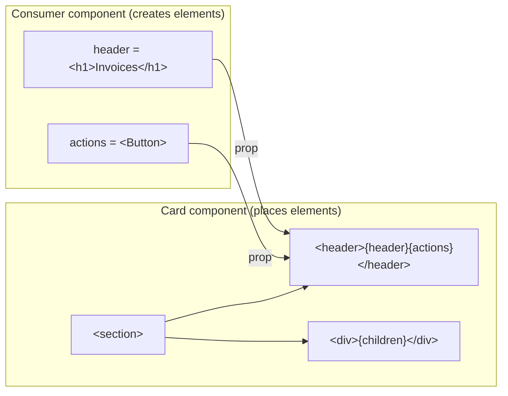
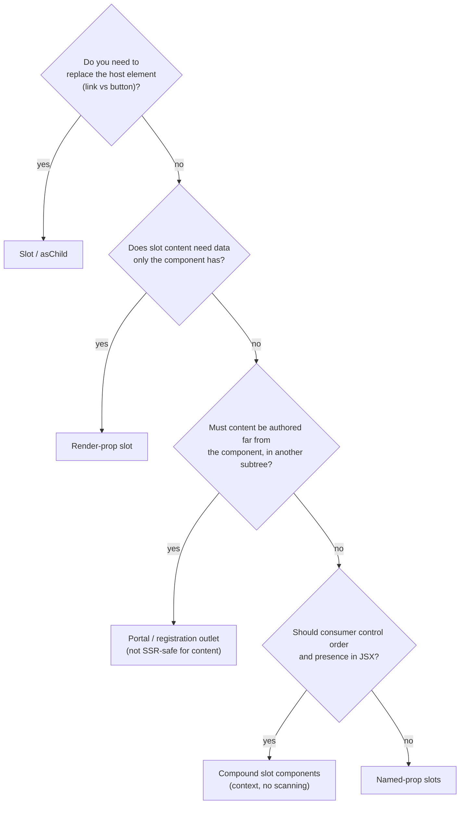

# 05 / 20 — Slot Patterns: Named Regions, Slot Components, and `asChild`

## 1. Lesson metadata

| | |
|---|---|
| **Level** | Advanced |
| **Study time** | 5–6 hours (reading 2 h, experiments 1.5 h, exercises 2 h) |
| **Prerequisites** | [Phase 1 / 07 — Composition and children](../01-react-fundamentals/07-composition-and-children.md), [Phase 5 / 03 — Composition over inheritance](./03-composition-over-inheritance.md), [Phase 5 / 05 — Compound components](./05-compound-components.md), [Phase 5 / 07 — Headless components](./07-headless-components.md), [Phase 5 / 10 — Render props](./10-render-props.md), [Phase 5 / 19 — Polymorphic components](./19-polymorphic-components.md) |
| **Next** | [21 — Error handling patterns](./21-error-handling-patterns.md) |
| **Related later** | [22 — Patterns for reusable libraries](./22-patterns-for-reusable-libraries.md), [Phase 9 / 04 — Client/server boundaries and serialization](../09-advanced-rendering-and-ecosystem/04-client-server-boundaries-and-serialization.md), [Phase 11 / 07 — Design system architecture](../11-senior-and-architect-mastery/07-design-system-architecture.md) |

**Learning objectives.** After this lesson you can:
1. Define a *slot* precisely and distinguish it from `children`, a render prop, and a compound sub-component.
2. Implement four slot techniques: named-prop slots, compound slot components, registration/portal-based slots, and the `Slot`/`asChild` merge technique.
3. Explain why scanning `children` by element type is fragile, and when it is still acceptable.
4. Implement a correct `Slot` that merges props, composes event handlers, merges `className`/`style`, and composes refs under React 19.
5. Identify the SSR, accessibility, focus, and key pitfalls of each technique.
6. Choose the lightest slot technique that satisfies a layout or component-library requirement.

**Concepts covered:** slot, named slot, default slot, fallback content, slot props (scoped slot), child-type inspection, registration slots, portal outlets, `Slot` / `asChild`, `cloneElement`, prop merging, handler composition, ref composition, `Children.toArray`, `isValidElement`, slot contracts and types.

---

## 2. Deep conceptual explanation

### 2.1 What problem is this lesson solving?

A reusable component needs *structure* it controls and *content* the consumer controls. `children` handles one region. Real components have several: a dialog has a title, a description, a body, and actions; a page layout has a header, a sidebar, a main area, and a footer; a table cell has an icon, a label, and a trailing action.

A **slot** is a *named place in a component's output where the consumer supplies the content*. The component owns the surrounding structure, the position, the styling hooks, and the accessibility wiring. The consumer owns what goes inside.

The problem slots solve is the **combinatorial prop explosion** that appears when the alternative is configuration props:

```tsx
// Configuration-prop smell: every new region becomes a new family of props.
<Card
  title="Invoice 42"
  titleIcon={<FileIcon />}
  titleSize="lg"
  subtitle="Due Friday"
  actionLabel="Pay"
  onAction={pay}
  actionVariant="primary"
  footerText="Net 30"
/>
```

Each prop is a promise ([lesson 22 §2.1](./22-patterns-for-reusable-libraries.md)). With slots, the card promises *regions*, not *configurations*:

```tsx
<Card
  header={<><FileIcon /> Invoice 42</>}
  actions={<Button onClick={pay}>Pay</Button>}
  footer="Net 30"
>
  Due Friday
</Card>
```

### 2.2 Slot vs the neighbours

| Technique | What the consumer passes | Who decides the output position | Slot receives data from component? |
|---|---|---|---|
| `children` | One React node | Component (single place) | No |
| Named-prop slot | A node per region (`header`, `footer`) | Component | No |
| Render-prop slot | A function per region | Component | **Yes** (arguments) |
| Compound slot (`Card.Header`) | Elements as children | **Consumer** (order) or component (by scanning) | Via context |
| Registration / portal slot | Elements anywhere in the tree that "register" into an outlet | Component's outlet | Via context |
| `asChild` / `Slot` | One element that *becomes* the component's rendered element | Component merges onto it | Props are merged onto the element |

The last row is a different animal: it is not about filling a region with content but about **replacing the host element while keeping the component's behavior** ("render this behavior onto my element"). It is the composition-based answer to polymorphism covered in [lesson 19](./19-polymorphic-components.md); this lesson implements it.

### 2.3 The vocabulary imported from other ecosystems

The word *slot* comes from Web Components (`<slot name="header">`) and Vue. React has no first-class slot syntax; slots are **a convention built from props and composition**. This matters for two reasons.

1. React does not enforce anything. If you name a region `header` and the consumer passes `undefined`, you render nothing, unless *you* write the fallback.
2. Because a slot is just a prop holding a React element, it is **already rendered by the consumer's component scope**. Hooks, state, and context used inside the slot content belong to whichever component *created* the element (the consumer), but the element is *placed* in the library's tree. Context available inside the slot content is the context at its **placement position** (the library's provider ancestors), not the creator's. This is the same rule as `children`; see [Phase 2 / 05 — Elements vs DOM nodes](../02-react-rendering-and-internals/05-elements-vs-dom-nodes.md).

### 2.4 Common misconceptions

| Misconception | Reality |
|---|---|
| "Slots are a React feature." | React has no slot API. Slots are props/children used by convention. |
| "Passing JSX as a prop makes it render early." | Creating an element does not render it. It renders when placed in the returned tree. The *creation* cost is small and happens in the consumer's render. |
| "Scanning `children` by `type` is the idiomatic way to find slots." | It is the most fragile technique. Wrapping, `memo`, HOCs, `lazy`, or a fragment breaks it. Prefer named props or registration. |
| "`asChild` is magic." | It is `cloneElement` plus a careful merge of props, handlers, and refs onto the single child element. |
| "Named slots are always better than compound slots." | Compound slots let the consumer control order and conditionally include regions in JSX, which is often what you want. Named props make order fixed. |

---

## 3. Internal mechanics

### 3.1 Public guarantees vs teaching model vs implementation detail

- **Public guarantee (React API).** `props` may contain any value, including elements; `children` is an ordinary prop; `React.Children.toArray` flattens and assigns keys; `isValidElement` tells you whether a value is an element; `cloneElement(element, props, ...children)` returns a copy of an element with merged props; `createPortal` renders into a DOM node.
- **Teaching model.** "A slot is a prop that holds an element tree; the component decides where to place it." Rendering of the element happens where it is placed, not where it was created.
- **Implementation detail.** The internal representation of an element's `type`, the `$$typeof` marker, and how `key`/`ref` are stored on the element object. Do not depend on them. **Version-sensitive:** in React 19, `ref` is an ordinary prop, so a child's ref is readable as `element.props.ref`; in React 18 and earlier it lived on `element.ref` and `props.ref` was not available. React 19.3.1 still returns the ref from `element.ref` but logs "Accessing element.ref was removed in React 19" (executed). A `Slot` implementation that reads either must be pinned to the major version it targets.

### 3.2 Why type-scanning children is fragile

`Children.toArray(children)` returns each child element with its original `type`. A scan like `child.type === Card.Header` succeeds only if the child *is literally* an element of that component type at the top level of `children`:

```tsx
<Card>
  <Card.Header>Title</Card.Header>            {/* found */}
  <Fragment><Card.Footer /></Fragment>         {/* not found: type is Fragment */}
  <MyHeader />                                 {/* not found: renders Card.Header inside, but type is MyHeader */}
  {cond && <Card.Footer />}                    {/* false filtered by toArray; fine */}
</Card>
```

`Children.toArray` does **not** flatten fragments (it flattens arrays, not `<Fragment>` elements; this is documented behavior). A wrapper component such as `MyHeader` is opaque from the outside: the slot parent cannot see what `MyHeader` will render, because it has not rendered yet. This is the same visibility limitation that makes `Children.map`-based designs brittle; the React docs list `Children` utilities under "legacy"-style alternatives and recommend alternatives. See `react.dev/reference/react/Children` for the cautions.

### 3.3 Where does slot content "live" in the tree?

For named-prop and compound slots, the slot content is placed **inside** the component's returned tree, so it participates in reconciliation at that position. Consequences:

1. **Identity follows position and type.** If a component conditionally places the same element type in two different positions depending on a prop, the slot content's state resets when it moves. See [Phase 1 / 16 — State preservation and reset](../01-react-fundamentals/16-state-preservation-and-reset.md).
2. **Context follows placement.** A slot placed inside the component's `<Dialog.Context.Provider>` sees that context.
3. **Re-render cost.** When the consumer re-renders, it creates *new element objects* for all slot props; the library component re-renders (new props) and each slot subtree is reconciled. Slots do not magically avoid renders. See [Phase 7 / 03 — Why components re-render](../07-performance/03-why-components-rerender.md).

For **portal outlets**, content is *created* in one place in the React tree and *placed in the DOM* somewhere else; React context follows the **React tree** (portal children see the context of where `createPortal` was called), while DOM events bubble through the **React tree** too (React-synthetic bubbling follows the React ancestry). Both are documented behaviors of portals.

### 3.4 The `Slot` merge algorithm (conceptual)

A `Slot` component receives its own props (`slotProps`) and exactly one child element. It renders a clone of that child whose props are:

```
mergedProps = mergeProps(slotProps, childProps)
  - event handlers (on[A-Z]...)  → composed: call child handler first, then slot handler
                                   (stop if the child called preventDefault, if you adopt that rule)
  - style                        → { ...slot.style, ...child.style }
  - className                    → [slot.className, child.className].join(' ')
  - everything else              → child wins (the consumer's element is the more specific author)
  - ref                          → composed ref (both refs receive the node)
```

Which side "wins" for plain props is a *design decision* (Radix-style primitives let the child win). State it in your library docs.

---

## 4. Step-by-step execution walkthrough: `<Button asChild><a href="/pay">Pay</a></Button>`

Suppose the library `Button` is:

```tsx
function Button({ asChild, ...props }: ButtonProps) {
  const Comp = asChild ? Slot : "button";
  return <Comp data-variant="primary" className="btn" {...props} />;
}
```

Chronology for the first render and a click:

1. Consumer renders; JSX creates an element `<Button asChild>` with `children` = element `<a href="/pay">Pay</a>`. Nothing has been rendered yet.
2. React calls `Button(props)`. `asChild` is true so `Comp = Slot`. `Button` returns an element of type `Slot` with props `{ "data-variant", className, children: <a/> }`.
3. React calls `Slot(props)`. `Slot` verifies `children` is a single valid element, computes `mergedProps`, and returns `cloneElement(children, mergedProps)`: an `<a>` with `href="/pay"`, `data-variant="primary"`, `className="btn"`.
4. React reconciles `<a>`; the commit creates one DOM node: `<a href="/pay" class="btn" data-variant="primary">Pay</a>`. **No extra wrapper element.** That is the point of `asChild`.
5. The user clicks. The `<a>`'s handler runs. If the consumer's `<a onClick>` and `Button`'s `onClick` both exist, the composed handler calls the child's first, then the slot's.
6. On the next re-render of the consumer, `Button` receives a new `children` element, `Slot` clones again. The DOM `<a>` is *reused* (same type at same position), so focus and any internal state of the `<a>` subtree is preserved.

**Predict:** if the consumer later changes `asChild` from `true` to `false` at runtime and passes `<a>` as children, what happens to the DOM? *Answer:* `Comp` changes from `Slot` (which renders `a`) to `"button"`, so the root element type at that position changes from `a` to `button`; React unmounts the `<a>` subtree and mounts a `<button>` that contains the `<a>` as nested content (invalid HTML: interactive content inside `button`). `asChild` is a *static* design-time choice, not a runtime toggle.

---

## 5. Code examples

### 5.1 Minimal example: named-prop slots with fallbacks

```tsx
import type { ReactNode } from "react";

type CardProps = {
  header?: ReactNode;
  actions?: ReactNode;
  footer?: ReactNode;
  children: ReactNode; // the default slot
};

export function Card({ header, actions, footer, children }: CardProps) {
  return (
    <section className="card">
      {(header != null || actions != null) && (
        <header className="card__header">
          <div className="card__title">{header}</div>
          {actions != null && <div className="card__actions">{actions}</div>}
        </header>
      )}
      <div className="card__body">{children}</div>
      {footer != null && <footer className="card__footer">{footer}</footer>}
    </section>
  );
}
```

Line notes:

- `header != null` treats `undefined` and `null` as "not provided". `false`, `""` and `0` need a decision: `0` is a legitimate node (renders "0"), `false` renders nothing but would still produce an empty wrapper. Decide and document. Using `!= null` keeps wrapper-less rendering for `undefined`/`null` only.
- The component owns the landmark elements (`section`, `header`, `footer`) and class names. Consumers cannot accidentally break the structure.
- `children` is the **default slot**. Named slots are additional props.

**Predict:** `<Card header={false}>x</Card>`: does the header wrapper render? *Answer:* yes. `false != null` is true, so an empty `div` renders. If you want `false` to skip, use a helper `isRenderable` that excludes `null`, `undefined`, and booleans.

### 5.2 Practical: slot props (scoped slots) via render-prop slots

Sometimes the slot content needs data only the component knows (selection state, row index).

```tsx
import type { ReactNode } from "react";

type Row<T> = { id: string; value: T };

type ListProps<T> = {
  rows: Row<T>[];
  selectedId: string | null;
  renderRow: (row: Row<T>, state: { selected: boolean; index: number }) => ReactNode;
  renderEmpty?: () => ReactNode;
};

export function List<T>({ rows, selectedId, renderRow, renderEmpty }: ListProps<T>) {
  if (rows.length === 0) return <>{renderEmpty?.() ?? <p>No items.</p>}</>;
  return (
    <ul role="listbox">
      {rows.map((row, index) => (
        <li
          key={row.id}
          role="option"
          aria-selected={row.id === selectedId}
        >
          {renderRow(row, { selected: row.id === selectedId, index })}
        </li>
      ))}
    </ul>
  );
}
```

Notes:

- `renderRow` is a **render-prop slot**: [lesson 10](./10-render-props.md) covers this in depth. The component supplies *slot props* (`selected`, `index`); the consumer decides the markup.
- The `key` is on the element the *component* creates (`li`), not on whatever `renderRow` returns, because the component controls the list. A key mistake here belongs to the library, not to the consumer.
- ⚠ A render-prop slot is *called during the library's render*. If the consumer's function calls a hook, the hook call count would change with the rows. Hooks inside `renderRow` break the Rules of Hooks. Document "this is a render function, not a component", or call it through a component (`<RowSlot render={renderRow} row={row} />`) when hooks must be allowed.

### 5.3 Compound slot components with a registered-by-position layout

The consumer controls order and presence by JSX, but the component does no scanning: each slot renders itself in place.

```tsx
import { createContext, use, useId, type ReactNode } from "react";

type DialogCtx = { titleId: string; descriptionId: string };
const DialogContext = createContext<DialogCtx | null>(null);

function useDialog(part: string): DialogCtx {
  const ctx = use(DialogContext);
  if (!ctx) throw new Error(`<Dialog.${part}> must be used inside <Dialog>`);
  return ctx;
}

function Dialog({ children, open }: { children: ReactNode; open: boolean }) {
  const titleId = useId();
  const descriptionId = useId();
  if (!open) return null;
  return (
    <DialogContext value={{ titleId, descriptionId }}>
      <div role="dialog" aria-modal="true" aria-labelledby={titleId} aria-describedby={descriptionId}>
        {children}
      </div>
    </DialogContext>
  );
}

function Title({ children }: { children: ReactNode }) {
  const { titleId } = useDialog("Title");
  return <h2 id={titleId}>{children}</h2>;
}

function Description({ children }: { children: ReactNode }) {
  const { descriptionId } = useDialog("Description");
  return <p id={descriptionId}>{children}</p>;
}

function Actions({ children }: { children: ReactNode }) {
  useDialog("Actions");
  return <div className="dialog__actions">{children}</div>;
}

Dialog.Title = Title;
Dialog.Description = Description;
Dialog.Actions = Actions;
export { Dialog };
```

Notes:

- `<DialogContext value=...>` uses React 19's "context as provider" form; in React 18 write `<DialogContext.Provider value=...>`. version-sensitive.
- `use(DialogContext)` could be `useContext`; `use` can also be called conditionally, which is irrelevant here.
- The **ARIA wiring is the real value of the slot**. The consumer never types an id; the compound parts connect `aria-labelledby` automatically. That is what a consumer would otherwise get wrong.
- Because each slot is a *component that renders itself*, `<Dialog.Title>` can be wrapped by the consumer in `MyTitle` and it still works: the context lookup happens at render time, not by `type` inspection. This is why this design is more robust than scanning.
- A weakness: if the consumer omits `Dialog.Title`, `aria-labelledby` points to a non-existent id. Solve by registration (§5.5) or a dev-only warning.

### 5.4 Incorrect: scanning children by type

```tsx
// ❌ Fragile slot extraction
function Layout({ children }: { children: ReactNode }) {
  const all = Children.toArray(children) as ReactElement[];
  const header = all.find((c) => c.type === Layout.Header);
  const footer = all.find((c) => c.type === Layout.Footer);
  const rest = all.filter((c) => c !== header && c !== footer);
  return (
    <div>
      <header>{header}</header>
      <main>{rest}</main>
      <footer>{footer}</footer>
    </div>
  );
}
```

**Predict** what happens with:

```tsx
<Layout>
  <AppHeader />   {/* internally renders <Layout.Header>…</Layout.Header> */}
  <p>Body</p>
</Layout>
```

*Answer:* `AppHeader`'s element `type` is `AppHeader`, not `Layout.Header`. `header` is `undefined`; `AppHeader` lands in `rest` and renders **inside `<main>`**, where its inner `Layout.Header` renders wherever that component renders itself (here a raw element in main). Layout silently misplaces the content. There is no error. Additional failure modes: `memo(Layout.Header)` changes the type; `lazy` changes it; React Fast Refresh may produce new type identities during development edits (⚠ tooling-dependent), so conditions like `c.type === Layout.Header` can fail after a hot update until a full reload.

Also: `Children.toArray` re-keys children (prefixes keys), so reordering via the toArray result can alter keys and state identity in subtle ways.

### 5.5 Corrected: registration slots through a portal outlet

When a slot's content should be authored **anywhere in the consumer's tree** (for example a page declares what the layout's header contains) use an *outlet*: the layout renders an empty DOM element and exposes it; slot components `createPortal` their children into it.

```tsx
import {
  createContext, use, useState, useMemo,
  type ReactNode,
} from "react";
import { createPortal } from "react-dom";

type Targets = {
  header: HTMLElement | null;
  sidebar: HTMLElement | null;
};
type LayoutCtx = {
  targets: Targets;
  register: Record<keyof Targets, (el: HTMLElement | null) => void>;
};

const LayoutContext = createContext<LayoutCtx | null>(null);

export function AppLayout({ children }: { children: ReactNode }) {
  const [targets, setTargets] = useState<Targets>({ header: null, sidebar: null });

  // Stable callback refs: one per region, created once. A callback ref whose identity
  // changes every render is detached (null) and re-attached on every commit.
  const register = useMemo(
    () => ({
      header: (el: HTMLElement | null) => setTargets((t) => ({ ...t, header: el })),
      sidebar: (el: HTMLElement | null) => setTargets((t) => ({ ...t, sidebar: el })),
    }),
    [],
  );

  return (
    <LayoutContext value={{ targets, register }}>
      <div className="app">
        <header ref={register.header} />
        <aside ref={register.sidebar} />
        <main>{children}</main>
      </div>
    </LayoutContext>
  );
}

function Fill({ name, children }: { name: keyof Targets; children: ReactNode }) {
  const ctx = use(LayoutContext);
  if (!ctx) throw new Error("<AppLayout.Header/Sidebar> must be inside <AppLayout>");
  const target = ctx.targets[name];
  return target ? createPortal(children, target) : null;
}

AppLayout.Header = ({ children }: { children: ReactNode }) => <Fill name="header">{children}</Fill>;
AppLayout.Sidebar = ({ children }: { children: ReactNode }) => <Fill name="sidebar">{children}</Fill>;
```

Usage:

```tsx
function InvoicePage() {
  return (
    <>
      <AppLayout.Header><h1>Invoices</h1></AppLayout.Header>
      <AppLayout.Sidebar><InvoiceFilters /></AppLayout.Sidebar>
      <InvoiceTable />
    </>
  );
}
// App: <AppLayout><InvoicePage /></AppLayout>
```

Line notes and consequences:

1. `register` holds **one stable callback ref per region**, created once by `useMemo`. If the callbacks were recreated every render (for example `ref={register("header")}` with a factory), React would call the previous callback with `null` and the new one with the node on *every commit*; each call sets state to a new object, which re-renders, which creates new callbacks: an infinite update loop ("Maximum update depth exceeded"). Stable identity means the ref is attached once on mount and detached once on unmount.
2. `target` is `null` on the first render (refs are attached in commit), so **the slot content does not appear in the first render pass**. Two consequences: (a) it appears one commit later (a second render pass triggered by `setTargets`), usually before paint but not guaranteed to be same-frame; with `useState` set in a ref callback during commit React processes the update synchronously at the end of the commit for discrete work, but do not rely on this; measure if flicker matters. (b) **During server rendering there is no DOM**, so the portal content is *not in the server HTML at all*. For SSR-critical regions (the page `h1`, content needed for SEO) a portal outlet is the wrong tool. (Executed: `renderToString` of a component returning `createPortal(...)` throws "Portals are not currently supported by the server renderer".) `createPortal` is not supported by streaming server rendering APIs, which is why the pattern only works after mount.
3. React context and event bubbling follow the React tree: a click in `InvoiceFilters` bubbles (in React's synthetic system) to ancestors of `Fill` in React ancestry, not to the DOM `aside`'s ancestors. Be careful with `onClick` on wrappers.
4. Accessibility: DOM order is layout order (header first), but **reading/tab order follows DOM**, so what the user perceives matches the layout rather than the authoring order. That is usually desirable.

When this is the best choice: app shells where each route contributes breadcrumb/toolbar actions. When it is not: anything that must be server-rendered with content, or needs to work without JavaScript.

### 5.6 Advanced: a correct `Slot` / `asChild`

```tsx
import {
  Children, cloneElement, isValidElement,
  type CSSProperties, type HTMLAttributes, type ReactElement, type Ref,
} from "react";

type AnyProps = Record<string, unknown>;

function setRef<T>(ref: Ref<T> | undefined, value: T | null): void | (() => void) {
  if (typeof ref === "function") return ref(value) as void | (() => void);
  if (ref) (ref as { current: T | null }).current = value;
}

// ⚠ React 19: callback refs may return a cleanup function.
export function composeRefs<T>(...refs: Array<Ref<T> | undefined>) {
  return (node: T | null) => {
    const cleanups = refs.map((r) => setRef(r, node));
    return () => {
      refs.forEach((r, i) => {
        const cleanup = cleanups[i];
        if (typeof cleanup === "function") cleanup();
        else setRef(r, null);
      });
    };
  };
}

function mergeProps(slotProps: AnyProps, childProps: AnyProps): AnyProps {
  const merged: AnyProps = { ...slotProps, ...childProps }; // child wins by default

  for (const key of Object.keys(slotProps)) {
    const s = slotProps[key];
    const c = childProps[key];
    if (/^on[A-Z]/.test(key) && typeof s === "function" && typeof c === "function") {
      merged[key] = (...args: unknown[]) => {
        c(...args);   // child first
        s(...args);   // then the component's handler
      };
    } else if (key === "style") {
      merged.style = { ...(s as CSSProperties), ...(c as CSSProperties) };
    } else if (key === "className") {
      merged.className = [s, c].filter(Boolean).join(" ");
    }
  }
  return merged;
}

type SlotProps = HTMLAttributes<HTMLElement> & { ref?: Ref<HTMLElement> };

export function Slot({ children, ...slotProps }: SlotProps) {
  if (!isValidElement(children)) {
    // Children.only throws a descriptive error for non-single-element children.
    Children.only(children);
    return null;
  }
  const child = children as ReactElement<AnyProps & { ref?: Ref<HTMLElement> }>;
  const childRef = child.props.ref; // ⚠ React 19: ref is a prop. In React 18 use (child as any).ref.
  const merged = mergeProps(slotProps as AnyProps, child.props);
  return cloneElement(child, {
    ...merged,
    ref: composeRefs(slotProps.ref, childRef),
  });
}
```

Line notes:

- `Children.only` throws if there is not exactly one element child. That is the right behavior: `asChild` with two children is a programming error, and silent fallbacks hide bugs. The `return null` after it is unreachable at runtime but satisfies the type checker for non-element values (strings, arrays).
- `mergeProps` starts from `{...slotProps, ...childProps}` so child wins; then special-cases handlers, `style`, `className`. Anything not special-cased (including `aria-*`, `id`, `data-*`, `tabIndex`) is "child wins". Document it.
- Handler order: child first, then the component's. A stricter variant skips the component handler when the child's handler called `event.preventDefault()`; Radix-style libraries expose that as a documented rule. Choose and document.
- `composeRefs` returns a callback ref with cleanup (React 19 feature: "ref callbacks may return a cleanup function"). In React 19, when a callback ref returns a function, React calls it on detach **instead of** calling the ref with `null`. The implementation handles both ref kinds (object, callback with and without cleanup).
- **Callback identity.** `composeRefs(...)` creates a new function every render of `Slot`, so React detaches and re-attaches the ref on every render (calls old cleanup, then new ref). This is correct but noisy. If a ref callback does expensive work (measurement, observers), memoize with `useMemo`/`useCallback` keyed on the input refs. The React Compiler may do this automatically (verify against current docs).
- Types: for a production library, type `asChild` props so that `Slot` requires `children: ReactElement`. See [lesson 19](./19-polymorphic-components.md) for polymorphic typing trade-offs.

**Predict.** Given:

```tsx
<Button asChild onClick={() => log("button")}>
  <a href="/x" onClick={() => log("link")}>Go</a>
</Button>
```

what is logged on click, and in what order? *Answer:* `link`, then `button`. If the link's handler calls `preventDefault`, navigation is prevented but `button` still logs (in this implementation).

### 5.7 Practical application: slot-based table cell

```tsx
type CellProps = {
  leading?: ReactNode;
  trailing?: ReactNode;
  children: ReactNode;
};

export function Cell({ leading, trailing, children }: CellProps) {
  return (
    <td className="cell">
      {leading != null && <span className="cell__leading" aria-hidden="true">{leading}</span>}
      <span className="cell__label">{children}</span>
      {trailing != null && <span className="cell__trailing">{trailing}</span>}
    </td>
  );
}
```

Note `aria-hidden` on `leading`: the component *decides* that leading content is decorative. If a consumer passes meaningful content (a status text), that decision is wrong. A slot contract includes its **accessibility semantics**; document which slots are decorative.

---

## 6. Visual explanations

### Where content is created vs placed



### Technique selection



### `asChild` DOM result

```text
<Button asChild><a href="/pay">Pay</a></Button>

Without asChild:  <button class="btn"><a href="/pay">Pay</a></button>   ← invalid nesting
With asChild:     <a href="/pay" class="btn" data-variant="primary">Pay</a>
```

---

## 7. Alternative approaches and trade-offs

| Criterion | Named-prop slots | Compound slot components | Type-scanning children | Portal / registration | `Slot` / `asChild` | Configuration props |
|---|---|---|---|---|---|---|
| Order controlled by | Component | Consumer | Component | Layout | n/a | Component |
| Robust to wrapping | Yes | Yes (context) | **No** | Yes | n/a | Yes |
| SSR content in HTML | Yes | Yes | Yes | **No** (content) | Yes | Yes |
| Typing | Simple | Moderate (static members) | Weak | Moderate | Hard (element prop types) | Simple |
| Surface area | Per region | Per sub-component | Per sub-component | Per region | One prop | Grows with every option |
| A11y wiring | Manual | Strong (context ids) | Possible | Manual | Merge risk | Component-owned |
| Debuggability | Easy | Easy | Hard | Medium (DOM vs React tree) | Medium | Easy |

**Scenario where the recommended approach is not best.** Lessons favor compound slots over scanning, but for a **very small, internal, app-local component** with one optional footer, a single `footer` prop is better than a compound API: less code, easier typing, no context, no static-member assignment, no documentation burden. Likewise, for a link-styled button used in three places, `<LinkButton>` (a dedicated component) is simpler than shipping `asChild` machinery; `asChild` pays off when many components in a **library** each need to be rendered as consumer-chosen elements (links under client-side routers, custom design-system anchors).

---

## 8. Best practices and anti-patterns

**Beginner mistakes**
- Passing a *component* instead of an *element* (`icon={Icon}` vs `icon={<Icon />}`) without documenting which. Choose one style per library. Passing a component type allows the library to pass props (size, color); passing an element is more flexible.
- Forgetting fallbacks (empty wrapper elements, orphaned separators when a slot is absent).
- Putting the same `key`-less array of elements in a slot, producing warnings.

**Experienced-developer mistakes**
- Scanning `children` by `type` (§5.4).
- Implementing `asChild` with `cloneElement` but not merging handlers/refs: the child's `onClick` is silently overwritten, or the consumer's `ref` is dropped.
- Using portal outlets for SEO-critical content.
- Slot components that call `useContext` and throw when missing but are used in tests without the parent. Provide a test helper or a descriptive error (shown in §5.3).
- Allowing consumers to override accessibility attributes unintentionally through `Slot`'s "child wins" rule. For roles and `aria-*` that the component *must* control, set them after the merge, or document that the child is responsible.

**Smells**
- More than ~4 named slots plus configuration props: consider a compound API or composition at a higher level.
- Slots that all need the same data via render-props: consider a headless hook ([lesson 07](./07-headless-components.md)).
- `cloneElement` used to inject props into arbitrary children (not `asChild`). Documented by React as an uncommon pattern that makes data flow hard to follow; prefer render props or context. See `react.dev/reference/react/cloneElement` for the listed alternatives.

**Justified exceptions**
- Type-scanning is acceptable when the set of allowed children is closed, private, and enforced by types in an *application* (for example, an internal Wizard that only accepts `<Step>`), and you accept the limitation. Add a dev-time check that warns about unrecognized children.
- `cloneElement` is fine inside `Slot`, because the contract is "one element that gets my props".

---

## 9. Real-world application

**Design system, `Button`/`IconButton`/`MenuItem` as links.** A multi-team design system must render a link under three routers (framework `Link`, plain anchor, custom `AnalyticsLink`). Per-router adapters are unmaintainable; `asChild` lets each team pass their `Link`. Constraints: all teams' `Link` components must **forward `ref` and spread unknown props** onto the DOM element, otherwise `Slot` merges props into a component that ignores them. In React 19, `ref` as a prop makes forwarding trivial for new code; older components still need `forwardRef` (legacy; see Phase 0 guidance on legacy APIs).

**Dashboard shell.** Each route fills `Toolbar`, `Filters`, and `Breadcrumb` regions via a portal outlet. Constraints: dashboards behind login do not need SSR content; keyboard focus order must follow layout; tests must render `AppLayout` around pages.

**Checkout form.** A `Field` component with slots `label`, `hint`, `error`, `control`. The component wires `htmlFor`, `aria-describedby`, and `aria-invalid`, and passes ids to the control through a render prop or `Slot`. Constraint: *error content must be announced*: render the error slot inside `role="alert"` or an `aria-live` region.

**Finance table.** Cell slots (`leading`, `trailing`) with currency formatting inside `children`. Constraint: right-aligned numeric cells; leading icons are decorative and `aria-hidden`; sorting state is the table's, not the slot's.

**Multi-team.** Document each slot's *contract*: what element types are allowed, whether interactive content is allowed, whether it is decorative, and its sizing constraints.

---

## 10. Debugging and troubleshooting

| Symptom | Likely root cause | Investigation | Fix |
|---|---|---|---|
| Slot content appears in the wrong region | Type-scanning failed because of wrapper/memo/Fragment | React DevTools Components tab: inspect the element `type` names; log `child.type` | Switch to named props or context-based compound slots |
| Consumer's `onClick` stopped firing under `asChild` | `cloneElement` overwrote handlers | Add `console.log` in both handlers; inspect merged props | Compose handlers (§5.6) |
| `ref` from the consumer is `null` under `asChild` | Slot did not compose refs, or child component does not accept a ref | DevTools: inspect element props; check the child is a DOM element or forwards `ref` | `composeRefs`; require ref-forwarding children |
| Portal slot content flickers or is missing in SSR HTML | Target element not yet available at first render | View page source: content absent; Profiler: two commits | Render critical content inline; use portals only for client-only regions |
| Infinite re-render with a portal outlet | Callback ref creates new identity and sets state each render without bail-out | React DevTools Profiler shows continuous commits; add a counter | Stable callbacks and "same value" guard |
| Dialog is unnamed in the accessibility tree | `Dialog.Title` omitted, `aria-labelledby` points to a missing id | Browser DevTools → Accessibility pane | Dev warning, or register the title and omit the attribute when absent |
| Hydration warning | A slot's content depends on `window`/`useId` mismatch, or the portal renders on the client only | Warning text; compare server HTML | Defer client-only slots until after mount; use `useId` |
| Hook order error inside `renderRow` | A hook called inside a render-prop function whose call count varies | Error message names hook order | Wrap in a component (`<RowSlot/>`) |

Validation step for each fix: write a test that renders the slot through a wrapper (`MyHeader`) and with absent slots, and assert on the accessibility tree (role queries) instead of class names.

---

## 11. Exercises

### Level A — Knowledge
A1. Define "slot" in one sentence and name three techniques React developers use to implement them.
A2. What is the *default slot* in React?
A3. Why does `Children.toArray(children).find(c => c.type === X)` fail when the consumer wraps `X` in a custom component?
A4. What four things must a `Slot` merge beyond plain props, and why?
A5. Why is the visible-in-server-HTML guarantee lost with portal-outlet slots?

### Level B — Code comprehension
B1. In §5.1, what is rendered for `<Card header={0}>x</Card>`? For `<Card header="">x</Card>`?
B2. In §5.3, the consumer writes `<Dialog open><Dialog.Description>d</Dialog.Description></Dialog>`. Describe the accessibility tree and what a screen reader would announce on opening.
B3. In §5.6, with `<Slot className="a" style={{color:"red"}}><span className="b" style={{color:"blue"}} /></Slot>`, what are the resulting `className` and `color`?
B4. In §5.5, why does the sample create the callback refs once with `useMemo` rather than inline per render?
B5. What changes in `Slot` when moving from React 19 to React 18?

### Level C — Implementation
C1. Add a `renderEmpty` fallback and a dev-only warning to `List` when `rows` is empty and `renderEmpty` is missing.
C2. Implement `Field` with named slots `label`, `hint`, `error`, and a `control` render prop receiving `{ id, "aria-describedby", "aria-invalid" }`.
C3. Implement a `Tabs` compound API with `Tabs.List`, `Tabs.Tab`, and `Tabs.Panel` without scanning children.
C4. Extend `mergeProps` so the component's handler is skipped when the child's handler called `event.preventDefault()`. Write two tests.

### Level D — Debugging
D1. A `Layout` that scans children breaks only after a dev hot-reload. Explain a plausible cause and a durable fix.
D2. `<Button asChild><MyLink>Go</MyLink></Button>` renders but the focus ring and click handling from `Button` do nothing. `MyLink` is `function MyLink({ children }) { return <a href="/go">{children}</a>; }`. Find the bug.
D3. Portal slot content is visible on client navigations but missing on first server-rendered load. Explain and propose two fixes.
D4. After adding `asChild`, `eslint-plugin-jsx-a11y` reports nothing, yet the rendered `<div>` receives `onClick` with no keyboard support. What is the underlying problem?

### Level E — Architecture and engineering decisions
E1. Your design system has 30 components that can render as links. Compare shipping `as` prop vs `asChild` vs per-component `LinkX` variants. Consider typing cost, bundle, and onboarding.
E2. A product team wants a `Page` layout where deep children set the page title and actions. Compare context-registration, portal outlet, and a router-level `handle` metadata approach. State when each is best.
E3. A teammate proposes making every component prop accept `ReactNode | (state) => ReactNode`. Argue for or against.

### Level F — Expert challenge
F1. Design a slot system that is **SSR-safe** while allowing deep descendants to contribute to layout regions. Outline the algorithm and its limits (two-pass render? hoisting? metadata collection?). Explain what React 19 provides for document metadata and what it does not.
F2. Write a `Slot` that supports a *list* of child elements (`asChild` with `Fragment`-free multiple children by merging onto the first only). Define the contract and the failure behavior, and list five edge cases.

---

## 12. Detailed answers and explanations

> Attempt the exercises first.

**A1.** A slot is a named place in a component's output where the consumer supplies the content while the component owns the surrounding structure. Techniques: named-prop slots (including render-prop slots), compound slot components, portal/registration outlets, and `Slot`/`asChild` (element-replacement). Type-scanning is a fourth, but not recommended.

**A2.** `children`. Any content passed between the component's tags. Other slots are additional props or sub-components.

**A3.** `Children.toArray` returns the consumer's elements; their `type` is what the consumer wrote. A wrapper component `MyHeader` has `type === MyHeader`, and what it will render (`X`) is unknown until React renders it, which happens *after* the parent has already decided what to do with its children. The parent cannot see through components. The same applies to `memo`, `lazy`, and fragments (toArray does not flatten `<Fragment>` elements).

**A4.** Event handlers (so neither the component's nor the consumer's is dropped), `style` (object merge), `className` (concatenate), and `ref` (compose both). Otherwise a naive spread silently overwrites one side, breaking behavior.

**A5.** Server rendering generates HTML from the React tree without a DOM, and portals need an existing DOM node to target. The outlet node is only available after mounting (ref attached in commit on the client). So the portal's content does not appear in server HTML. Verify against current `react-dom/server` docs, since support for portals is limited there.

**B1.** `header={0}`: `0 != null` is true, so the header wrapper renders and `{header}` renders the text "0". `header=""`: `"" != null` true; wrapper renders, text is empty, producing an empty `div`. Fix with a helper that treats empty strings and booleans as absent if desired. The edge cases justify documenting what "absent" means.

**B2.** `role="dialog"` with `aria-modal`, `aria-labelledby` pointing at `titleId` (no element has that id) and `aria-describedby` pointing at the description. Name computation: with `aria-labelledby` referencing a missing id the label is empty, so the dialog is announced without a name (or falls back, implementation dependent) and then, typically, the description text. This shows why a title slot should be required, or the attribute omitted when no title registered.

**B3.** `className="a b"` (slot's first, then child's). `color`: the merged style is `{...slot.style, ...child.style}`, so the child's `blue` wins.

**B4.** (The sample now uses stable callbacks, so the question is why.) With a callback factory like `ref={register("header")}`, every render of `AppLayout` creates a new function. React treats a changed callback ref as detach-then-attach: the old one is called with `null`, the new one with the element, during commit. Each call does `setTargets` with a new object (`null` then element), so the final state is a *new object* even though the values match the original. That schedules a re-render, which creates new callbacks again: an infinite loop. An equality guard inside the updater does not rescue this, because the intermediate `null` update changes the value. The fix is stable per-region callbacks (`useMemo`), after which refs attach once per mount. Wrong answer: "the guard prevents the loop", true only when the callback identity is already stable.

**B5.** `child.props.ref` is not available; read `(child as any).ref` (React 18 stores it on the element). `ref` as a regular prop on function components does not exist in React 18, so `Slot` itself would need `forwardRef`. Callback-ref cleanup functions are not supported in 18 (returning a function is ignored or warned), so composition must call refs with `null` explicitly.

**C1.** Sample:

```tsx
if (rows.length === 0) {
  if (!renderEmpty && process.env.NODE_ENV !== "production") {
    console.warn("<List> received empty rows and no renderEmpty slot.");
  }
  return <>{renderEmpty?.() ?? <p>No items.</p>}</>;
}
```

Edge cases: `process.env.NODE_ENV` replacement depends on bundler configuration (); logging during render runs twice in StrictMode dev; use a once-per-mount guard in an effect if noise matters. Evaluation criteria: fallback present, dev-only, no hooks conditional.

**C2.**

```tsx
function Field({ label, hint, error, control }: {
  label: ReactNode; hint?: ReactNode; error?: ReactNode;
  control: (a: { id: string; "aria-describedby"?: string; "aria-invalid"?: boolean }) => ReactNode;
}) {
  const id = useId();
  const hintId = `${id}-hint`;
  const errorId = `${id}-error`;
  const describedBy = [hint != null && hintId, error != null && errorId].filter(Boolean).join(" ") || undefined;
  return (
    <div>
      <label htmlFor={id}>{label}</label>
      {control({ id, "aria-describedby": describedBy, "aria-invalid": error != null ? true : undefined })}
      {hint != null && <p id={hintId}>{hint}</p>}
      {error != null && <p id={errorId} role="alert">{error}</p>}
    </div>
  );
}
```

Evaluation: ids derived from `useId`; `aria-describedby` only lists existing ids; error announced. Wrong answers: random ids (hydration mismatch), always referencing both ids.

**C3.** Evaluation criteria: context with `selected` and an `onSelect`; `Tab` and `Panel` pair by a `value` prop (not by index); `Tabs.List` has `role="tablist"`; arrow-key handling lives in `List` via a keydown handler and `roving tabindex`; no `Children` calls. Sample outline: `Tabs` owns `value` via `useControllableState` ([lesson 22](./22-patterns-for-reusable-libraries.md)); `Tab` renders `<button role="tab" aria-selected={selected} aria-controls={panelId} id={tabId}>`; ids built from `useId()` + `value`. Pitfall: sanitizing `value` used in ids.

**C4.** In `mergeProps` handler composition:

```tsx
merged[key] = (event: { defaultPrevented?: boolean }, ...rest: unknown[]) => {
  c(event, ...rest);
  if (!event?.defaultPrevented) s(event, ...rest);
};
```

Tests: (1) child calls `preventDefault` → slot handler not called; (2) child does nothing → both called in order. Edge: handlers that are not events (e.g., `onValueChange(value)`) have no `defaultPrevented`; restrict to DOM events or guard with `typeof event === "object"`.

**D1.** Fast Refresh may re-create component *type identities* for edited modules (state is preserved where possible, but component references change), so a comparison with a stale reference captured in a closure or a module that did not hot-update can fail. (⚠ tooling-dependent; verify with your bundler's refresh behavior.) Durable fix: stop identity comparisons; use context registration or named props. A weaker mitigation: compare `displayName` strings (still fragile with wrappers).

**D2.** `MyLink` ignores the props `Slot` injects (`className`, `onClick`, `ref`, `data-*`) because it only reads `children`. `Slot` merges onto `<MyLink>`'s props, but `MyLink` renders `<a href>` without spreading them. Fix: `function MyLink({ children, ...rest }: ComponentProps<"a">) { return <a href="/go" {...rest}>{children}</a>; }` — with React 19, `ref` is included in `rest`. Contract: *children of `asChild` must spread props and forward `ref`.*

**D3.** On server render the portal target is null, so no content; on client navigation the layout is already mounted, the target exists, and the portal renders. Fixes: (1) render critical content inline (not via slot) and keep only enhancements in portals; (2) hoist the content through route-level data (metadata/handle) that the layout renders on the server, i.e. an approach that does not need the DOM. Also acceptable: two-pass server collection (heavier).

**D4.** `asChild` merged a click handler onto an element the consumer chose (`div`). The linter checks static JSX at the consumer's site, where `div` has no `onClick`, and inside `Button` where the `Comp` is dynamic; neither sees the combination. The component promises button behavior but the host element may lack role, focusability, and key handling. Contract fix: restrict `asChild` children to interactive elements by docs and dev warnings, or have `Slot` add `role="button"` and `tabIndex` when the child is a non-interactive host element (a policy decision).

**E1.** Evaluation criteria: typing cost (`as` needs polymorphic generics over every component; `asChild` needs only `Slot` plus a boolean), runtime (both cheap), bundle (shared `Slot`), documentation burden (`asChild` is one concept everywhere), accessibility risks (both), variant components (`LinkButton`) explode surface (30 components × variants). Example well-reasoned answer: choose `asChild` across the system for consistency; keep `as` only for typography (`Text as="h2"`) where the element choice is semantic, not behavioral. Weak answers say "as is simpler" without counting generics cost, or ignore router `Link` ref/props forwarding.

**E2.** Context-registration (store title in context via effect) works client-side and causes a render after mount; portal outlet similar plus DOM placement; router `handle`/route-data metadata is SSR-safe and declarative but only works for route-level data, not deep dynamic state. Best: route metadata for titles/breadcrumbs (SEO), portals for client-only toolbars. React 19 also provides document metadata tags (`<title>`, `<meta>`) hoisting; ⚠ verify the current docs for the exact rules.

**E3.** Evaluation: against universal union props because they force every consumer to branch on `typeof`, defeat memoization (inline functions), complicate typing, and hide hook rules. For: flexibility. A good answer permits functions only where slot props are needed (rows, items), keeps others as plain nodes.

**F1.** Outline: two options. (1) *Collect-then-render:* render the tree once with a collecting context that records slot contributions, then render the layout with those; this needs two render passes on the server and is incompatible with streaming for the parts that stream later. (2) *Declarative metadata via route data*: layouts read contributions from route loaders. React 19 hoists `<title>`, `<meta>`, and `<link>` elements rendered anywhere into the document head; that handles head metadata but not arbitrary layout regions. Limits: any two-pass approach doubles render cost; Suspense boundaries complicate collection because content that suspends has not contributed yet. A rubric: identifies SSR constraint, picks an approach with a stated limit, mentions streaming/Suspense.

**F2.** Contract: exactly one element receives props; additional children are rejected via `Children.only` (error) or rendered unchanged after the first (explicit design). Edge cases: Fragment child (props would be dropped, React warns for invalid props on Fragment), text child, `null` child, conditional `false`, element whose type is a context provider, child with its own `key`, child using `ref` string (not supported in 19), child that is `memo` without forwarding, and child that already has `asChild` (nested slots; merging should compose). Evaluation: states contract, error type, tests.

---

## 13. Senior engineer interview questions

**Q1. Why would you prefer a compound slot component to scanning `children` by type?**
Because compound parts find the parent through *context at render time* instead of the parent inspecting elements before they render. Wrapping, `memo`, and fragments cannot break context lookup. The cost is a context provider and static-member typing.

**Q2. What does `asChild` give you that an `as` prop does not?**
`as` makes the component render a different tag or component type itself, and its types must express the props of that type (generics). `asChild` lets the *consumer's element* be the output and the component only injects behavior; types for the child element belong to the consumer. It handles consumer components with custom props (router `Link`) without the library knowing them. It requires the child to forward props and refs, and merging policy must be documented.

**Q3. Where does context inside slot content come from?**
From the placement position, because context follows the React tree where the element is rendered, not where it was created. A slot placed inside a library's provider sees that provider even though the consumer wrote the JSX outside it.

**Q4. When would you not use a portal-based slot?**
When content must be in server HTML for SEO, performance (LCP) or no-JS support; when focus order would be confusing; when events bubbling through the React tree would surprise ancestors.

**Q5. How do you avoid a `Slot` silently dropping a consumer's `ref`?**
Compose the slot's ref and the child's `ref` prop into a single callback that forwards to both; in React 19 read `child.props.ref`, return cleanup from the composed callback, and memoize if identity matters.

**Q6. What is wrong with `cloneElement` to inject props into arbitrary children?**
Data flow becomes implicit (a parent adds props the child author does not see), it breaks with wrappers, and refs/keys may be altered. The React docs list alternatives (render props, context, custom hooks). Inside `Slot` the injected props are the documented contract, so it is acceptable.

**Q7. A slot receives `0`. What should render?**
`0` renders text "0"; if the contract is "falsy means absent" the library must say so, because `0 && <X/>` patterns leak zeros into UIs. Decide whether `0` is a valid slot value (e.g., a count badge). Document the absent rule (`null`/`undefined`).

**Q8. How would you test a slot-based component?**
Render with all slots, no slots, and wrapped slots (custom wrapper components); assert on roles/accessible names and ids relationships rather than classes; test composing handler order and ref receipt for `Slot`; test SSR with `renderToString` for hydration and absent portal content.

---

## 14. Further learning resources

| Resource | URL | Covers / why | Level | Study |
|---|---|---|---|---|
| React docs — Passing JSX as children | <https://react.dev/learn/passing-props-to-a-component> | Children as a prop, the default slot | Beginner | "Passing JSX as children" |
| React docs — `Children` | <https://react.dev/reference/react/Children> | Why scanning children is discouraged, `toArray`, `only` | Intermediate | Alternatives and caveats |
| React docs — `cloneElement` | <https://react.dev/reference/react/cloneElement> | Semantics and listed alternatives | Intermediate | Caveats and alternatives |
| React docs — `createPortal` | <https://react.dev/reference/react-dom/createPortal> | Portal semantics (events, context) | Intermediate | Whole page |
| React docs — `isValidElement` | <https://react.dev/reference/react/isValidElement> | Element checks | Beginner | Whole page |
| React 19 upgrade guide | <https://react.dev/blog/2024/04/25/react-19-upgrade-guide> | `ref` as a prop, ref cleanup, context provider form | Intermediate | Refs section |
| Radix Primitives — Composition guide | <https://www.radix-ui.com/primitives/docs/guides/composition> | Real `asChild` / `Slot` contract *(deep link unverified)* | Intermediate | Whole page |
| WAI-ARIA Authoring Practices Guide | <https://www.w3.org/WAI/ARIA/apg/> | Dialog, tabs naming and labelling patterns | Intermediate | Dialog (modal) pattern |
| MDN — `<slot>` element | <https://developer.mozilla.org/en-US/docs/Web/HTML/Element/slot> | Origin of slot vocabulary in Web Components | Beginner | Whole page |

URLs in this table were checked for HTTP 200 on 2026-10-22; any still marked *(unverified)* could not be checked automatically. A 200 does not guarantee the page content still matches the description; if a link has moved, search the site for the quoted title.

---

## 15. Knowledge checkpoint

**You should now understand**
- A slot is a named region where consumers supply content; React offers no slot API, so it is built from props, children, context, portals, and `cloneElement`.
- Why type-scanning children is brittle and what replaces it.
- What a correct `Slot` must merge (handlers, `style`, `className`, `ref`) and how React 19 changes ref handling.

**You should be able to explain without notes**
- Where context and events flow for portal slots, and why portal content is absent from server HTML.
- The difference between named-prop slots, render-prop slots, compound slots, and `asChild`.

**You should be able to implement**
- A `Card` with named slots, a `Dialog` with context-wired ARIA slots, a portal outlet layout, and a `Slot` with `composeRefs`/`mergeProps`.

**You should be able to debug**
- Misplaced slot content, lost handlers/refs under `asChild`, missing SSR content from portals, and unnamed dialogs.

**Before moving on:** continue to [21 — Error handling patterns](./21-error-handling-patterns.md), where boundaries become the slot-like "fallback" regions of a component tree, then revisit this lesson from [22 — Patterns for reusable libraries](./22-patterns-for-reusable-libraries.md).
