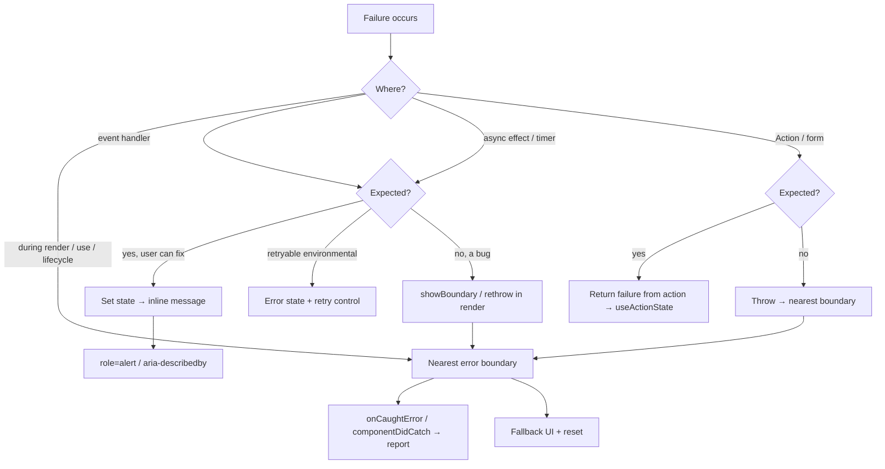

# 05 / 21 — Error Handling Patterns: Boundaries, Results, and Recovery

## 1. Lesson metadata

| | |
|---|---|
| **Level** | Intermediate–Advanced |
| **Study time** | 5–6 hours (reading 2 h, experiments 1.5 h, exercises 2 h) |
| **Prerequisites** | [Phase 4 / 19 — Error boundaries](../04-react-architecture/19-error-boundaries.md), [Phase 3 / 22 — Modern hooks and APIs](../03-react-state-and-hooks/22-modern-hooks-and-apis.md), [Phase 3 / 15 — Custom hooks](../03-react-state-and-hooks/15-custom-hooks.md), [Phase 5 / 12 — Reducer pattern](./12-reducer-pattern.md), [Phase 5 / 13 — State machine pattern](./13-state-machine-pattern.md) |
| **Next** | [22 — Patterns for reusable libraries](./22-patterns-for-reusable-libraries.md) |
| **Related later** | [Phase 6 / 03 — Loading and error states](../06-data-fetching-and-state-ecosystems/03-loading-and-error-states.md), [Phase 6 / 15 — Error recovery and retries](../06-data-fetching-and-state-ecosystems/15-error-recovery-and-retries.md), [Phase 10 / 05 — Error monitoring](../10-production-engineering/05-error-monitoring.md), [Phase 10 / 10 — Resilience and degradation](../10-production-engineering/10-resilience-and-degradation.md) |

**Learning objectives.** After this lesson you can:
1. Classify failures into expected, unexpected, and environmental, and choose a handling mechanism for each.
2. Place error boundaries at the right granularity and define a reset contract for each.
3. List exactly which errors a boundary does and does not catch, and route the uncaught ones into the boundary deliberately.
4. Model expected failures as data (result unions, action state) instead of exceptions, and know when exceptions are still right.
5. Wire React 19 root error callbacks, Actions, `use`, Suspense and TanStack Query into one coherent error pipeline.
6. Build accessible, non-leaking fallback UIs with retry, and verify them with tests.

**Concepts covered:** expected vs unexpected failure, fail-fast vs degrade, error boundary (class contract, `react-error-boundary`), boundary granularity, reset keys, error propagation from events/async/Actions, `createRoot` error callbacks, result types, error normalization, `Error.cause`, typed domain errors, fallback accessibility, lazy-chunk failures, error reporting contracts.

---

## 2. Deep conceptual explanation

### 2.1 What problem is this lesson solving?

[Lesson 19 of Phase 4](../04-react-architecture/19-error-boundaries.md) taught you *where error boundaries sit in the architecture*. This lesson teaches the **pattern language** around failure: how to decide, for each kind of failure, whether it becomes an exception, a value, a boundary fallback, an inline message, a retry, or a report to monitoring, and how to compose those decisions so the user always sees something truthful and recoverable.

Without a pattern language, teams drift into one of three failure modes:

| Failure mode | Symptom | Cause |
|---|---|---|
| **Blank screen** | Whole app unmounts on one failed widget | No boundary below the root; React unmounts the tree that threw when nothing catches it |
| **Swallowed failure** | Spinner forever, or empty list that "looks fine" | `catch {}` / unhandled rejections inside effects; failure never reaches state |
| **Alert storm** | Every failed request shows a toast and a boundary and a console error and a Sentry event | Each layer reports independently; no single owner of "who tells the user" |

### 2.2 Three classes of failure

The single most useful decision tool is classifying the failure *before* choosing a mechanism.

| Class | Examples | Who can fix it | Idiomatic representation |
|---|---|---|---|
| **Expected (domain) failure** | Validation rejected, "email already taken", 404 on a user-supplied id, insufficient funds | The user, by changing input | **Data**: a returned value or state field. Rendered inline. |
| **Environmental failure** | Network offline, 503, timeout, chunk download failed, rate-limited | Time, retry, the user's connection | **Recoverable error state**: retry UI, backoff ([Phase 6/15](../06-data-fetching-and-state-ecosystems/15-error-recovery-and-retries.md)); boundary if the region cannot render without the data |
| **Unexpected (bug) failure** | `undefined is not a function`, impossible state, schema violation from the server | A developer | **Exception** → nearest error boundary → report → generic fallback |

Misclassification is the root of most bad error UX. Showing a stack-trace fallback because the user typed a bad coupon code (expected, treated as bug) is as wrong as showing a red toast "Something went wrong" for a `TypeError` (bug, treated as expected).

> **Rule of thumb.** If the user can do something *specific* about it, return it as data. If only a developer can fix it, throw it. If time can fix it, offer retry.

### 2.3 Fail fast vs degrade gracefully

Two valid philosophies, applied to *different regions*:

- **Fail fast** inside a unit that cannot produce a correct result (a payment summary with a corrupted total). Throw; do not render a plausible but wrong number.
- **Degrade gracefully** at the *boundary between independent features* (a recommendations carousel failing must not remove the cart). Contain the failure and render a reduced experience.

Error boundaries are the mechanism that turns "fail fast inside" into "degrade at the edge": the inner component throws; the boundary decides how much of the page the failure is allowed to take down.

### 2.4 What React exposes

| Mechanism | Purpose | Notes |
|---|---|---|
| Error boundary (class with `static getDerivedStateFromError` and/or `componentDidCatch`) | Catch errors thrown while rendering descendants, in lifecycle methods, and in constructors of descendants | Still **class-only** in React 19; there is no hook equivalent. Use the `react-error-boundary` package or one small class of your own. |
| `createRoot(container, { onCaughtError, onUncaughtError, onRecoverableError })` (React 19) | Central reporting for errors, whether caught by a boundary or not | Replaces the older pattern of every boundary reporting independently. |
| `use(promise)` / Suspense | A rejected promise passed to `use` throws during render, so it reaches the nearest boundary | See [Phase 3/22](../03-react-state-and-hooks/22-modern-hooks-and-apis.md). |
| Actions (`startTransition(async …)`, `<form action>`, `useActionState`) (React 19) | An exception thrown inside an Action propagates to the nearest error boundary; expected failures should be returned as state | Distinction is the key pattern of this lesson. |
| `ErrorEvent`/`unhandledrejection` on `window` | Browser last resort for errors React never sees | Monitoring SDKs hook these. |

### 2.5 What errors an error boundary catches (public guarantee)

Per the React docs, boundaries catch errors **during rendering, in lifecycle methods, and in constructors of the whole tree below them**. They do **not** catch:

1. Errors in **event handlers** (they run outside the render phase; React does not need to "recover" a tree for them).
2. **Asynchronous** code: `setTimeout`, un-awaited promises, `fetch(...).then(...)` callbacks, `async` effect bodies after the first `await`.
3. **Server-side rendering** errors (handled by the server renderer's own error callbacks).
4. Errors thrown **by the boundary itself** (they propagate to the next boundary up).

Everything in this lesson's "routing" patterns exists to compensate for items 1 and 2: *if you want a boundary to handle it, you must hand the error to React during a render*.

### 2.6 Common misconceptions

| Misconception | Reality |
|---|---|
| "Wrap the app root in one `ErrorBoundary` and I'm done." | A root-only boundary converts every failure into a full-page failure. It is a *backstop*, not a design. |
| "`try/catch` around `<Child />` catches Child's render errors." | JSX creates an element description; `Child` runs later, inside React. The `try` block has already exited. |
| "Boundaries catch my failed `fetch`." | Only if you re-throw that failure during render (via state, `use`, or a library's `throwOnError`/suspense mode). |
| "Errors should always be exceptions (or always be values)." | Both are tools. Domain failures as values; bugs as exceptions. |
| "A fallback UI should show `error.message`." | Messages can leak internals (SQL, hostnames) and are rarely actionable. Show a curated message; log the detail. |
| "Resetting a boundary re-runs the failed request." | Resetting re-renders the children. Whether that re-fetches depends on your data layer's cache; it may serve the cached failure. |

---

## 3. Internal mechanics

### 3.1 The boundary contract

A class component becomes an error boundary by defining either or both:

```ts
static getDerivedStateFromError(error: unknown): Partial<State>  // render phase: must be pure
componentDidCatch(error: unknown, info: React.ErrorInfo): void   // commit phase: side effects OK
```

*Public guarantee:* `getDerivedStateFromError` is called during rendering and returns the state update that makes the boundary render a fallback; `componentDidCatch` is called after the fallback commits and receives `info.componentStack`. Reporting belongs in `componentDidCatch` (or the root callbacks below), never in `getDerivedStateFromError`, because render-phase code must be pure and can be invoked more than once (see [Phase 1/12](../01-react-fundamentals/12-component-purity.md)).

*Teaching model:* when a component throws, React unwinds from the throwing fiber toward the root, looking for the nearest ancestor boundary that handles errors. The subtree *below that boundary* is discarded and the boundary re-renders with its fallback. Siblings of the boundary and everything above it are untouched.

*Implementation detail (do not rely on it).* For errors during concurrent rendering, React may retry the render synchronously once before committing the fallback, in case the error came from an inconsistent concurrent snapshot. Your render function may therefore run more than you expect, and in development StrictMode adds further invocations. Your fallback logic must not depend on "render ran exactly once".

### 3.2 React 19 error callbacks

*Version-sensitive.* In React 19 `createRoot`/`hydrateRoot` accept:

| Option | Fires when |
|---|---|
| `onCaughtError(error, errorInfo)` | A boundary caught an error |
| `onUncaughtError(error, errorInfo)` | An error was thrown and **no boundary caught it** (the tree is unmounted) |
| `onRecoverableError(error, errorInfo)` | React recovered by itself (for example a hydration mismatch it fixed by client rendering) |

React 19 also changed logging: an error thrown in render is reported once through these paths instead of being re-thrown to `window` and logged repeatedly as in React 18. If you previously hooked `window.onerror` to detect render errors, re-verify that behavior against the [React 19 upgrade guide](https://react.dev/blog/2024/04/25/react-19-upgrade-guide) and your monitoring SDK's React 19 documentation. Treat the exact shape of `errorInfo` (for example `componentStack`) as **verify against current docs**.

### 3.3 How errors reach a boundary from non-render code

Because boundaries only observe errors thrown *during a render*, the established trick is to store the error and throw it from a component:

```ts
const [, setState] = useState();
setState(() => { throw error; });   // the updater runs during the next render; the throw lands in render
```

Why this works: state updater functions run while React computes the next state, which is part of rendering. A throw there is a render-phase throw and unwinds to the nearest boundary. The `react-error-boundary` package packages this as `useErrorBoundary().showBoundary(error)`. Equivalent hand-written pattern: save `error` in state and `if (error) throw error;` in the component body.

### 3.4 Actions and errors ⚠

In React 19, work started inside `startTransition(async () => …)` is an **Action**. Per the React docs, if an Action throws, React surfaces the error to the nearest error boundary (and reverts optimistic state). `useActionState` runs your action function and stores its *return value*; if you want an expected failure to display inline, **return it**; if the action throws, the form's boundary takes over. This gives the clean split:

```text
return { ok:false, field:'email', message:'Already taken' }   → inline, user fixes it
throw new Error('Unexpected response shape')                  → boundary, developer fixes it
```

### 3.5 Suspense, `use`, and rejected promises

`use(promise)` suspends until the promise resolves; if it rejects, the rejection is thrown at the `use` call during render and reaches the nearest boundary. Suspense handles *waiting*; boundaries handle *failing*. The two are siblings in the tree and should be placed together (`<ErrorBoundary><Suspense>…</Suspense></ErrorBoundary>`) so the same region owns both its loading and failure states. Promise identity matters: a promise created during render in a Client Component is recreated every render, so pass promises from a cache/Server Component, as covered in the `use` section of [Phase 3/22](../03-react-state-and-hooks/22-modern-hooks-and-apis.md).

---

## 4. Step-by-step execution walkthrough: a failing widget on a dashboard

Setup: a dashboard page with a boundary per widget. `RevenueChart` calls `use(revenuePromise)`; the request returns 500.

```mermaid
sequenceDiagram
  participant U as User
  participant R as React
  participant S as Suspense
  participant B as WidgetBoundary
  participant C as RevenueChart
  participant M as Monitoring
  U->>R: navigates to /dashboard
  R->>C: render (use(promise))
  C-->>S: suspends (promise pending)
  S->>R: commit fallback skeleton
  Note over C: network returns 500; promise rejects
  R->>C: re-render
  C-->>B: throws (rejection surfaces at use)
  R->>B: getDerivedStateFromError(error) [render phase]
  B->>R: render fallback UI
  R->>R: commit fallback, rest of dashboard untouched
  R->>B: componentDidCatch(error, info) [commit phase]
  B->>M: report(error, componentStack)
  U->>B: clicks "Try again"
  B->>B: reset(): clear error state, onReset invalidates cache
  B->>R: re-render children
  R->>C: render with a fresh promise
```

Chronological notes:

1. **Skeleton shown** because the promise is pending: Suspense territory, not error territory.
2. **Rejection** is delivered as an exception at the `use` call on the re-render triggered by the settled promise.
3. **Nearest boundary** is the widget's own, so the header, other widgets, and navigation stay mounted and interactive. State inside them is preserved because they were never unmounted.
4. **Reporting** happens exactly once, in the commit-phase hook (or root callback), not in render.
5. **Reset** clears the boundary's error state and re-renders children. If the data layer returns the same rejected promise from cache, the widget will fail again immediately; `onReset` must invalidate or replace it. This is the single most common "Try again does nothing" bug.

---

## 5. Code examples

### 5.1 Minimal example — a hand-written boundary

```tsx
import { Component, type ErrorInfo, type ReactNode } from 'react';

type Props = {
  fallback: (args: { error: unknown; reset: () => void }) => ReactNode;
  onError?: (error: unknown, info: ErrorInfo) => void;
  children: ReactNode;
};
type State = { error: unknown; hasError: boolean };

export class Boundary extends Component<Props, State> {
  state: State = { error: null, hasError: false };

  static getDerivedStateFromError(error: unknown): State {
    return { error, hasError: true };
  }

  componentDidCatch(error: unknown, info: ErrorInfo) {
    this.props.onError?.(error, info);
  }

  reset = () => this.setState({ error: null, hasError: false });

  render() {
    if (this.state.hasError) {
      return this.props.fallback({ error: this.state.error, reset: this.reset });
    }
    return this.props.children;
  }
}
```

Line notes:
- `hasError` is separate from `error` because `throw null` and `throw undefined` are legal JavaScript; testing `error !== null` would miss them.
- `getDerivedStateFromError` is `static` and pure; it only maps error → state.
- `componentDidCatch` is the side-effect slot; reporting goes through the injected `onError`, which keeps the class free of any specific monitoring SDK (a use of the [dependency injection pattern](./16-dependency-injection.md)).
- `reset` is an arrow-function class field so it can be passed as a callback without losing `this`.

**Predict:** if `fallback` itself throws while rendering, what happens? *Answer:* The boundary cannot catch its own render errors; the error propagates to the next boundary above. This is why fallbacks must be trivially simple and why you want an outer backstop boundary.

### 5.2 Practical example — `react-error-boundary` with reset keys and query reset

```tsx
import { ErrorBoundary, type FallbackProps } from 'react-error-boundary';
import { QueryErrorResetBoundary } from '@tanstack/react-query';
import { Suspense } from 'react';

function WidgetFallback({ error, resetErrorBoundary }: FallbackProps) {
  const message = toUserMessage(error);
  return (
    <div role="alert" className="widget-error">
      <p>{message}</p>
      <button type="button" onClick={resetErrorBoundary}>Try again</button>
    </div>
  );
}

export function Widget({ children, widgetId }: { children: React.ReactNode; widgetId: string }) {
  return (
    <QueryErrorResetBoundary>
      {({ reset }) => (
        <ErrorBoundary
          FallbackComponent={WidgetFallback}
          onReset={reset}                       // tell TanStack Query to forget its error state
          onError={(error, info) => reportError(error, { widgetId, componentStack: info.componentStack })}
          resetKeys={[widgetId]}                // new widget id → auto reset
        >
          <Suspense fallback={<Skeleton />}>{children}</Suspense>
        </ErrorBoundary>
      )}
    </QueryErrorResetBoundary>
  );
}
```

Notes:
- `QueryErrorResetBoundary` and `useSuspenseQuery`/`throwOnError` are TanStack Query v5 APIs; `reset` makes queries that threw retry fetching on the next mount instead of immediately re-throwing the cached error. (`QueryErrorResetBoundary`, `useQueryErrorResetBoundary`, `useSuspenseQuery` and `throwOnError` exist in @tanstack/react-query 5.104.)
- `resetKeys` compares the array between renders; when any item changes while in the error state, the boundary resets. Without it, navigating from `/widgets/1` to `/widgets/2` would keep showing widget 1's failure if the same boundary instance stays mounted.
- `role="alert"` makes assistive technology announce the fallback when it appears.
- `info.componentStack` is a string that tells you *where in the tree* it happened; it is usually minified in production unless you upload source maps ([Phase 10/05](../10-production-engineering/05-error-monitoring.md)).
- Ordering matters: the boundary is **outside** the `Suspense`, so a rejection surfaces to the boundary while loading is handled inside.

### 5.3 Incorrect example — expecting a boundary to catch an event/async failure

```tsx
function SaveButton({ doc }: { doc: Doc }) {
  async function onClick() {
    await saveDocument(doc);          // rejects with a 500
  }
  return <button onClick={onClick}>Save</button>;
}

// elsewhere
<ErrorBoundary FallbackComponent={Fallback}>
  <SaveButton doc={doc} />
</ErrorBoundary>
```

**Predict:** user clicks Save and the server returns 500. What does the user see? 

*Answer:* Nothing. The boundary never triggers, the button does not change, and the browser reports an *unhandled promise rejection*. The rejected promise belongs to `onClick`'s async function, which executed in an event task outside rendering. Users will click again and may double-save.

### 5.4 Corrected implementation — classify, then route

```tsx
import { useState } from 'react';
import { useErrorBoundary } from 'react-error-boundary';

type SaveResult =
  | { ok: true }
  | { ok: false; kind: 'conflict'; message: string }   // expected: user must reload/merge
  | { ok: false; kind: 'validation'; fields: Record<string, string> };

function SaveButton({ doc }: { doc: Doc }) {
  const { showBoundary } = useErrorBoundary();
  const [pending, setPending] = useState(false);
  const [problem, setProblem] = useState<string | null>(null);

  async function onClick() {
    setPending(true);
    setProblem(null);
    try {
      const result = await saveDocument(doc);   // returns SaveResult, throws only for the unexpected
      if (!result.ok) {
        setProblem(result.kind === 'conflict' ? result.message : 'Please fix the highlighted fields.');
      }
    } catch (error) {
      showBoundary(error);                       // unexpected → boundary
    } finally {
      setPending(false);
    }
  }

  return (
    <>
      <button type="button" onClick={onClick} disabled={pending}>
        {pending ? 'Saving…' : 'Save'}
      </button>
      {problem && <p role="alert">{problem}</p>}
    </>
  );
}
```

Why it works: `saveDocument` converts *expected* HTTP outcomes (409, 422) into a typed value, so they never become exceptions. Anything else (500, network failure, parse error) throws; the `catch` hands it to React during a render via `showBoundary`, where the region's boundary can contain it. `finally` guarantees `pending` resets in every path. ⚠ One subtlety: `setPending(false)` after `showBoundary` runs on a component that may be about to unmount; React 18+ does not warn about state updates on unmounted components, so this is safe, but it signals that the component's lifetime is not guaranteed after `await`.

### 5.5 Advanced example — a typed error taxonomy with `cause` and an adapter

```ts
export class AppError extends Error {
  constructor(
    message: string,
    readonly code: 'network' | 'unauthorized' | 'not_found' | 'server' | 'contract',
    options?: { cause?: unknown; retryable?: boolean },
  ) {
    super(message, { cause: options?.cause });   // ES2022 Error cause; needs lib es2022 in tsconfig
    this.name = 'AppError';
    this.retryable = options?.retryable ?? false;
  }
  readonly retryable: boolean;
}

export function toAppError(e: unknown): AppError {
  if (e instanceof AppError) return e;
  if (e instanceof TypeError && /fetch|network/i.test(e.message)) {
    return new AppError('Network unreachable', 'network', { cause: e, retryable: true });
  }
  return new AppError('Unexpected error', 'server', { cause: e });
}

export function toUserMessage(e: unknown): string {
  const err = toAppError(e);
  switch (err.code) {
    case 'network':      return 'You appear to be offline. Check your connection and try again.';
    case 'unauthorized': return 'Your session has expired. Please sign in again.';
    case 'not_found':    return 'We could not find what you were looking for.';
    case 'contract':     // fallthrough: server returned something we cannot parse = bug
    case 'server':       return 'Something went wrong on our side. We have been notified.';
  }
}
```

Line notes: `catch (e)` yields `unknown` under `strict` (`useUnknownInCatchVariables`), so we narrow explicitly; `cause` preserves the original error for logs without exposing it to the UI; the *UI maps code → message* so message text can be localized ([Phase 10/09](../10-production-engineering/09-internationalization.md)) and the original `message` is never displayed. The brittle `TypeError` heuristic is an example of an *adapter* that localizes platform-specific detection in one place.

### 5.6 `useActionState` — return expected failures, throw unexpected ones

```tsx
type FormState =
  | { status: 'idle' }
  | { status: 'error'; fieldErrors: Partial<Record<'email' | 'name', string>> }
  | { status: 'success' };

async function signUp(_prev: FormState, formData: FormData): Promise<FormState> {
  const email = String(formData.get('email') ?? '');
  const res = await fetch('/api/signup', { method: 'POST', body: formData });
  if (res.status === 422) {
    const body = (await res.json()) as { errors: { email?: string; name?: string } };
    return { status: 'error', fieldErrors: body.errors };         // expected → data
  }
  if (!res.ok) throw new AppError(`Signup failed (${res.status})`, 'server', { retryable: res.status >= 500 }); // unexpected → boundary
  return { status: 'success' };
}

export function SignUpForm() {
  const [state, action, pending] = useActionState(signUp, { status: 'idle' });
  const emailError = state.status === 'error' ? state.fieldErrors.email : undefined;
  return (
    <form action={action} noValidate>
      <label htmlFor="email">Email</label>
      <input id="email" name="email" type="email" aria-invalid={!!emailError} aria-describedby={emailError ? 'email-err' : undefined} />
      {emailError && <p id="email-err" role="alert">{emailError}</p>}
      <button disabled={pending}>Create account</button>
    </form>
  );
}
```

Trade-off: using `throw` for 5xx puts the **whole form's boundary** in charge. If the form should instead stay visible with a retry banner, return `{ status: 'error', banner: … }` for retryable server errors and reserve throwing for contract violations. Both are defensible; choose by *whether the form can still be used*.

---

## 6. Visual explanations

### Where each failure goes



### Boundary layering

```text
<RootBoundary>                    backstop: "App crashed, reload"        (onUncaughtError for anything else)
  <Layout nav/sidebar>            never inside a feature boundary → survives feature failures
    <RouteBoundary key={path}>    route-level: "This page failed", resets on navigation
      <Page>
        <WidgetBoundary>          region-level: "Couldn't load chart", retry just this
          <Suspense/> <Chart/>
        <WidgetBoundary>
          <Suspense/> <Table/>
```

Rule: **a boundary's blast radius should equal the largest region that can fail without making the rest of the page lie**.

---

## 7. Alternative approaches and trade-offs

| Approach | Strengths | Weaknesses | Best when |
|---|---|---|---|
| **Exceptions + boundaries** | Concise happy path; fail-fast; works with Suspense/`use` | Easy to throw expected failures and lose context; async needs rethrow trick; untyped `catch` | Bugs, contract violations, "cannot render without data" |
| **Result/union values** (`{ok:true,…}\|{ok:false,…}`) | Exhaustive `switch` in TypeScript forces handling; no control-flow surprises | Verbose; every caller must branch; unexpected exceptions still exist | Expected domain outcomes, form submission, validation |
| **Error state in hooks** (`{data, error, status}`) | Familiar; localized UI | Easy to forget the error branch; each hook reinvents it | Simple fetches without a data library |
| **Data-library error handling** (TanStack Query `error`, `throwOnError`, `retry`) | Retries, cache, reset utilities | Another abstraction; default retry/cache semantics can mask failures | Server state ([Phase 6/08](../06-data-fetching-and-state-ecosystems/08-tanstack-query.md)) |
| **Global error handler** (`onUncaughtError`, `window.onerror`) | Single reporting funnel | Cannot recover UI; too late for UX | Telemetry backstop only |
| **Error state in a state machine** | Explicit retry/backoff states; impossible-state free | Setup cost | Multi-step flows with retries ([Phase 5/13](./13-state-machine-pattern.md)) |

**A scenario where the recommended split is *not* best.** For a tiny internal tool with three screens and a team of two, per-widget boundaries, typed taxonomies, and result unions are overhead. One route-level boundary with a Reload button plus `role="alert"` inline messages for forms is the right amount of machinery. Match engineering to blast radius and audience, not to the pattern catalog.

---

## 8. Best practices and anti-patterns

**Best practices**
- Classify first (expected / environmental / unexpected) and document the policy per layer in the repo.
- One **reporting owner**: either root callbacks (`onCaughtError`/`onUncaughtError`) *or* boundary `onError`, not both unless you de-duplicate.
- Define a **reset contract** for each boundary: what changes (`resetKeys`) or what happens (`onReset` invalidates cache) so "Try again" really retries.
- Keep fallbacks **dumb**: no data fetching, no context that may itself be broken, no throwing.
- Normalize at the edge: `unknown` → `AppError` in one adapter; UI consumes codes, not messages.
- Make fallbacks accessible: `role="alert"` (or `aria-live`) for newly appearing errors; move focus to the heading or retry button when a *route* fails, so keyboard users are not stranded.
- Test failure paths: force a throw and assert the fallback, the reset, and that unrelated regions survive.

**Beginner mistakes**
- `try/catch` around JSX.
- Empty `catch {}` or `.catch(console.error)` that leaves the UI in a loading state.
- Showing raw `error.message` or `JSON.stringify(error)`.
- One giant root boundary only.

**Experienced-dev mistakes**
- Boundary **above** the `Suspense` it should be paired with, so one failed region replaces unrelated skeletons.
- Using exceptions for control flow (`throw new NotFound()` to redirect) when a router loader/redirect API exists.
- Retrying non-idempotent mutations automatically ([Phase 6/15](../06-data-fetching-and-state-ecosystems/15-error-recovery-and-retries.md)).
- Reset that re-renders but the cache still holds the rejected promise.
- Reporting in render (`getDerivedStateFromError`) which can duplicate events under StrictMode/concurrent retry.
- Catching an error, logging, and rethrowing at every layer, producing N reports per failure.

**Smells:** `catch (e: any)`; `if (error) return null`; a `ToastProvider` called from library code; a `loading` boolean with no matching `error`; a fallback component that imports the same module that failed.

**Justified exceptions:** swallowing an error is legitimate for truly optional work (analytics beacons, prefetch hints) *if you intentionally record that you dropped it*; exceptions for control flow are acceptable inside a single module as an internal early-exit, never across the public API.

---

## 9. Real-world application

| Domain | Failure | Chosen pattern | Constraint driving it |
|---|---|---|---|
| **E-commerce checkout** | Card declined | Result value → inline message, form stays editable | User can fix; must not lose cart/form state |
| | Payment service 503 | Retry banner with idempotency key; no boundary | Retrying a charge without an idempotency key can double-charge |
| | Recommendation carousel fails | Widget boundary with "Hide" fallback (render `null` + report) | Must not block purchase flow |
| **Dashboard** | One chart's query fails | Widget boundary + per-widget retry | 12 widgets; blast radius must be one |
| | Session expired (401) | Not a boundary: global auth interceptor redirects, preserving return URL | Same cause would fire 12 boundaries |
| **Finance** | Totals do not reconcile | Throw (fail fast), generic fallback, high-severity report | Showing a plausible wrong balance is worse than showing nothing |
| **Forms** | Server-side validation | `useActionState` return; `aria-describedby` | Accessibility and preserving input |
| **Realtime** | WebSocket drops | Connection-state machine + banner; reconnect with backoff | Not an error to the render tree; app remains usable offline-ish |
| **Multi-team shell (micro-frontends/modules)** | Remote module throws | Boundary at the module seam, owned by the shell team | A failing module must not take down the shell; shell cannot assume module's error semantics |
| **After a deployment** | `React.lazy` chunk 404 (old hashed file removed) | Route boundary detecting chunk-load failure → offer a hard reload | Users with stale tabs; auto-reload loops if the new asset is also broken, so cap at once per session |

Engineering constraints to name in design reviews: **idempotency** of retried operations, **PII** in error payloads sent to monitoring, **correlation ids** shown to users ("Reference: 8f3a…") so support can find the log, and **error budgets** in the SLOs ([Phase 10/04](../10-production-engineering/04-observability-and-logging.md)).

---

## 10. Debugging and troubleshooting

| Symptom | Likely root cause | Investigation | Fix |
|---|---|---|---|
| Whole app goes white | No boundary above the thrower, or boundary itself threw | React DevTools Components tree: is there an ErrorBoundary ancestor? Console: "The above error occurred…" message names the component stack | Add region boundary and root backstop; simplify fallback |
| Boundary does not show for a failed click handler | Event/async error | Console shows "Uncaught (in promise)"; no boundary hit | Convert to value, or `showBoundary` |
| "Try again" shows same error instantly | Cache returned the rejected promise / query not reset | Network panel: no new request fired after click | `onReset` must invalidate (`QueryErrorResetBoundary`, new promise) |
| Fallback stays after navigating | Boundary instance persists across routes | React DevTools: same boundary fiber across routes | `resetKeys={[location.pathname]}` or `key={path}` |
| Duplicate monitoring events | Boundary `onError` + root `onCaughtError` + SDK global handler all report | Count events per failure in the monitoring UI | Choose one owner; de-dupe by error identity |
| Error overlay in dev appears even with a boundary | Dev tooling (Vite/Next overlay) displays errors regardless | Dismiss overlay; the boundary fallback is behind it | Expected in development; verify in a production build |
| Minified stack in report | Missing source maps | Check monitoring release artifacts | Upload source maps per release |

Reproduction recipe: create a `<Bomb />` component (`throw new Error('boom')`) toggled by a query param, and a `<DelayedRejection />` using `use` on a rejecting promise. Both should show *different, region-local* fallbacks. Validate a fix by (1) asserting fallback text, (2) clicking retry with the stubbed service now succeeding, (3) confirming siblings never re-mounted (their local state, e.g. a text input value, persists).

---

## 11. Exercises

### Level A — Knowledge
A1. List the four categories of errors a boundary does not catch.
A2. Which lifecycle hook is the right place to report an error, and why not `getDerivedStateFromError`?
A3. Classify as expected / environmental / unexpected: (a) 409 version conflict on save, (b) `TypeError: x.map is not a function` from a server payload, (c) `ERR_INTERNET_DISCONNECTED`.
A4. What does `resetKeys` do?
A5. What do `onCaughtError` and `onUncaughtError` distinguish?

### Level B — Code comprehension
B1. In §5.3, name two distinct problems besides "boundary does not trigger".
B2. What happens here, and why?
```tsx
function Page() {
  try {
    return <Risky />;      // Risky throws during render
  } catch {
    return <p>Failed</p>;
  }
}
```
B3. In §5.4, why is `showBoundary(error)` inside `catch` preferable to `throw error` there?
B4. Why does `Boundary` store `hasError` separately from `error`?

### Level C — Implementation
C1. Implement `useAsyncError(): (e: unknown) => void` from scratch (no libraries) so any component can route an async error to its boundary.
C2. Write a `Result<T, E>` type with helpers `ok`, `err`, and `matchResult`, and convert a `fetchUser(id)` that returns a result for 404 but throws for other failures.
C3. Write a test (Vitest + React Testing Library) proving a failing widget shows its fallback while a sibling input retains typed text.

### Level D — Debugging
D1. A teammate's boundary has a "Reload widget" button, but after clicking it the widget fails instantly without a network request. The data hook is `useSuspenseQuery`. Diagnose and fix.
D2. After upgrading to React 19, your monitoring dashboard shows **half** as many render errors as before, but support tickets are unchanged. Hypothesize and verify.
D3. A form uses `useActionState`; a 500 response throws and the entire page shows the root fallback and the user loses their typed data. Propose two fixes with trade-offs.

### Level E — Architecture and engineering decisions
E1. Design the boundary layout for an e-commerce product page (header, gallery, price/stock, reviews, recommendations, cart drawer). Which regions fail independently, what does each fallback render, and which failures must **not** be hidden?
E2. Argue for or against a global `ToastProvider` that every `catch` calls. Provide criteria.
E3. A shared library team wants to export a `<Table>` that handles its own errors. What should it handle internally and what should it leave to the consumer?

### Level F — Expert challenge
F1. Design an error pipeline for a multi-team app: classification taxonomy, who owns reporting, de-duplication, PII scrubbing, user-facing correlation ids, retry policy for mutations vs queries, and test strategy. Present as a one-page design with trade-offs and a rollout plan.

---

## 12. Detailed answers and explanations

> Attempt the exercises first.

**A1.** Event handlers; asynchronous code (timers, promise callbacks, code after `await`); server-side rendering errors; errors thrown by the boundary itself. A frequently added wrong answer is "errors in effects": errors thrown *synchronously during an effect's execution* in the commit phase are handled by React like lifecycle errors and do reach boundaries, whereas errors after an `await` inside an effect do not.

**A2.** `componentDidCatch` (commit phase, side effects allowed) or root-level callbacks. `getDerivedStateFromError` runs during render, which must be pure and may be invoked more than once (retry, StrictMode in development), so reporting there can duplicate or fire for renders that never commit.

**A3.** (a) Expected: user can reload/merge; represent as a value. (b) Unexpected: contract violation, a bug somewhere (or in the server); throw/report. (c) Environmental: offline; retry UI. Debatable: if (b) is caused by server version skew you may classify it environmental, but the *representation* (boundary + report) is the same.

**A4.** After an error has been caught, when any element of `resetKeys` changes between renders, the boundary clears its error state and re-renders children. It's for automatic recovery on input change (route, id), as opposed to `resetErrorBoundary` for a user-initiated retry.

**A5.** `onCaughtError`: a boundary handled it (UI degraded but alive). `onUncaughtError`: no boundary caught it (tree unmounted). Operationally the second is higher severity. Verify exact semantics against the current `createRoot` reference.

**B1.** (1) No error handling for the rejection, so the unhandled rejection can leave the user with no feedback. (2) No `disabled` while saving → double submit. Also: no distinction between a 409 and a 500, and no idempotency; any of these is acceptable if explained.

**B2.** The fallback never renders. `<Risky />` is just an element; React calls `Risky` later, outside the `try`. The error propagates to the nearest boundary, or unmounts the tree if none. Do not "fix" by moving `try/catch` inside `Risky` unless you can return a meaningful fallback value from there. That is possible (a `try/catch` inside a component's body *does* catch errors in code that component itself calls, such as a parser), but it cannot catch children's errors.

**B3.** `throw error` inside an async `catch` rethrows into the promise chain created by the event handler, producing an unhandled rejection again. `showBoundary` calls a state setter whose updater throws during the next render, and *that* is catchable by React.

**B4.** Because `null`/`undefined` can be thrown; `error === null` is not a reliable "no error" signal. A separate boolean is exact.

**C1. Reference solution**
```tsx
import { useCallback, useState } from 'react';

export function useAsyncError() {
  const [, setState] = useState();
  return useCallback((error: unknown) => {
    setState(() => { throw error; });
  }, []);
}
```
Edge cases: `throw` of non-Error values is allowed but poor practice; wrap with `toAppError` first. If called after the component unmounts, nothing is thrown (no render to occur), so the error is lost; consider reporting to monitoring *before* calling it. Evaluation criteria: stable identity (`useCallback`), throw inside updater, no dependence on a boundary library.

**C2. Reference solution**
```ts
export type Result<T, E> = { ok: true; value: T } | { ok: false; error: E };
export const ok = <T,>(value: T): Result<T, never> => ({ ok: true, value });
export const err = <E,>(error: E): Result<never, E> => ({ ok: false, error });
export function matchResult<T, E, R>(r: Result<T, E>, h: { ok: (v: T) => R; err: (e: E) => R }): R {
  return r.ok ? h.ok(r.value) : h.err(r.error);
}

type NotFound = { kind: 'not_found'; id: string };
export async function fetchUser(id: string): Promise<Result<User, NotFound>> {
  const res = await fetch(`/api/users/${id}`);
  if (res.status === 404) return err({ kind: 'not_found', id });
  if (!res.ok) throw new AppError(`GET /users/${id} → ${res.status}`, 'server', { retryable: res.status >= 500 });
  return ok((await res.json()) as User);   // in production validate with a schema at this boundary
}
```
Why the split: 404 here is a *domain answer* ("no such user"); 5xx is not. Trap: wrapping everything in `Result` forces callers to handle truly unrecoverable states they cannot do anything about. Also note the unchecked cast `as User`: validate at the boundary with a schema library if the server is not under your control ([Phase 4/14](../04-react-architecture/14-api-boundaries-and-data-access.md)).

**C3. Reference solution (sketch)**
```tsx
function Bomb(): never { throw new Error('boom'); }

test('widget failure is contained', async () => {
  const user = userEvent.setup();
  vi.spyOn(console, 'error').mockImplementation(() => {});   // React logs caught errors
  render(
    <>
      <input aria-label="note" />
      <ErrorBoundary fallbackRender={() => <p role="alert">Widget failed</p>}><Bomb /></ErrorBoundary>
    </>,
  );
  await user.type(screen.getByLabelText('note'), 'hello');
  expect(screen.getByRole('alert')).toHaveTextContent('Widget failed');
  expect(screen.getByLabelText('note')).toHaveValue('hello');
});
```
Criteria: console noise suppressed deliberately (and restored), assertion on role not implementation, sibling state preserved.

**D1.** `useSuspenseQuery` caches the errored query. Re-rendering the children reads the same errored cache entry, which throws again with no request. Fix: wrap with `QueryErrorResetBoundary` and pass its `reset` to the boundary's `onReset` (or call `queryClient.resetQueries`/`invalidateQueries` for that key). Validate in the Network panel: a new request appears after clicking retry. Wrong answers: "add `retry: true`" (retry applies during the original fetch cycle, not after a boundary reset), "remount with `key`" (works only if the cache also forgets the error).

**D2.** Hypothesis: the monitoring SDK relied on `window.onerror`/`unhandledrejection` or on React 18's re-throw behavior to capture render errors; React 19 reports through root callbacks, so the SDK sees fewer. Verify: reproduce a render error in a production build and see whether the SDK records it; check the SDK's React 19 integration docs; wire `onCaughtError`/`onUncaughtError` to the SDK's capture API. Support tickets unchanged means errors still happen; only *detection* decreased. (If you find the opposite, such as duplicates, review the same wiring.)

**D3.** Fix 1: return a state for retryable server errors (`{ status:'error', banner:'Server busy; your input is kept' }`) and keep throwing only for contract violations; the form stays mounted so typed data persists. Cost: you must hand-classify statuses. Fix 2: put a boundary *around the form only* (not the whole page) with a fallback that renders the form again with preserved values saved in a parent or `sessionStorage` draft. Cost: more machinery; drafts may contain sensitive data. A third: reset form action with `defaultValue` from `state`. Note React resets uncontrolled form fields after a successful `<form action>` in React 19; verify your behavior and preserve values via returned state if needed.

**E1. Example well-reasoned answer.** Header/nav: no feature boundary, covered only by root backstop (static, fewest dependencies). Gallery: boundary; fallback = placeholder image; failure is cosmetic, report. Price/stock: **fail loudly**; boundary fallback "Price unavailable, try again" and *disable add-to-cart*; never display stale price silently. Reviews: boundary; fallback "Reviews unavailable" + retry; hidden failure acceptable. Recommendations: boundary; fallback `null` (silent) + report. Cart drawer: own boundary, but add-to-cart failures expected (out of stock) are values. Not to hide: price, stock, anything that governs the purchase. Evaluation criteria: blast radii justified by user harm, each fallback specified, retry semantics, which failures are reported at which severity.

**E2.** Criteria: testability, coupling (library code calling UI), duplicate messaging, accessibility (toasts disappear before screen readers read them), actionability. Against: couples every layer to a UI provider, toasts for bugs train users to ignore them, hard to test. For: one consistent feedback channel for *transient, expected* failures (e.g. "Saved offline"). Best answer: allow toasts only for non-blocking, transient outcomes at the feature layer; blocking and unexpected failures go through boundaries/inline.

**E3.** Handle: its own loading/empty/row-level rendering errors with a contained "cell failed" fallback only if the library can do so without hiding data correctness; expose `onError`/`error` render slot. Leave: data fetching failures, retry policy, reporting and message copy to the consumer. Reason: libraries do not own the host app's monitoring, i18n, or product semantics (see [lesson 22](./22-patterns-for-reusable-libraries.md)).

**F1. Evaluation criteria.** A strong answer includes: (1) taxonomy with codes and `retryable` flag; (2) reporting owner = root callbacks + one SDK adapter, with de-dupe keyed by error identity/fingerprint; (3) PII scrubbing allow-list (not block-list) applied before send; (4) correlation id generated per request, attached to logs and shown in fallbacks; (5) queries retry with backoff and jitter, mutations only with idempotency keys; (6) boundary map with reset contracts; (7) tests: unit (taxonomy mapping), component (fallback/reset), E2E fault injection (Playwright route abort), contract tests on error payloads; (8) rollout: backstop first, then per-route, measure error-free session rate; (9) risks: alert fatigue, over-catching hiding regressions.

---

## 13. Senior engineer interview questions

**Q1. Why can't a boundary catch errors in event handlers, and what do you do about it?**
Event handlers run outside the render phase; React has no render to abandon and no subtree to replace, because the UI is still consistent with its state. The failure is a *transition* problem, not a rendering problem. Handle with local error state (expected) or hand it to React during a render (`showBoundary`/state-throw) when it should replace the region. Causal point: boundaries exist to recover from *inconsistent render output*; a failed click does not make the tree inconsistent.

**Q2. When would you throw instead of returning a result?**
When the caller cannot meaningfully continue and nothing the user can do addresses it (contract violations, impossible states), and when you want Suspense/`use` flows to propagate failure automatically. Return values when failure is a normal domain outcome and callers should be forced (by types) to handle it. A mixed approach is normal: expected → value, unexpected → throw.

**Q3. Where do you put boundaries?**
At seams where failure is independent and the surrounding UI remains truthful: root (backstop), route, widget/feature, and module boundaries between teams. Size is set by "blast radius vs. honesty": a boundary too big hides working UI; too small causes fragmentation and duplicated fallbacks. Pair each with Suspense and a reset contract.

**Q4. "Try again" does nothing. Why?**
Reset re-renders children, but the data source likely still holds the failed result, so children throw again. The reset contract must also clear that source. Diagnose with the Network panel (no request) and fix via cache invalidation or a new promise.

**Q5. How did React 19 change error reporting and why does it matter?**
Root options `onCaughtError`/`onUncaughtError`/`onRecoverableError` centralize reporting and caught render errors are no longer re-thrown to `window` as in 18 (they go to `onCaughtError`, default `console.error`; uncaught ones go to `onUncaughtError`, default `window.reportError`, per the React 19 upgrade guide). Matters because monitoring that relied on global handlers can silently lose events, and because you can now de-duplicate and distinguish handled from fatal. Confirm against your monitoring SDK.

**Q6. How do you keep error handling from leaking sensitive data?**
Treat `error.message` as developer-facing. Map error codes to curated user copy; attach a correlation id; scrub payloads with an allow-list before sending to monitoring; avoid serializing request bodies; make sure fallback components never render `error.stack` in production.

**Q7. What belongs in a fallback component?**
Minimal, dependency-light markup: message, retry, perhaps a link home. No data fetching, no providers that may be the failure source, no throwing, accessible announcement. Because a failing fallback escalates to the next boundary and eventually blanks the page.

**Q8. Retry automatically or manually?**
Automatic for idempotent reads with backoff and cap; manual (or idempotency-keyed) for mutations. Automatic retry hides intermittent failures from the user but can multiply load during an outage (retry storms), hence jitter and caps ([Phase 6/15](../06-data-fetching-and-state-ecosystems/15-error-recovery-and-retries.md)).

---

## 14. Further learning resources

| Resource | URL | Covers / why | Level | Study |
|---|---|---|---|---|
| React docs — Component (error boundaries) | <https://react.dev/reference/react/Component> | `getDerivedStateFromError`, `componentDidCatch` reference | Intermediate | The two error-boundary methods |
| React docs — `createRoot` | <https://react.dev/reference/react-dom/client/createRoot> | Root options including error callbacks *(verify option names for your version)* | Intermediate | "Parameters" → options |
| React 19 upgrade guide | <https://react.dev/blog/2024/04/25/react-19-upgrade-guide> | Error handling changes | Intermediate | "Improvements to error reporting" |
| React docs — `use` | <https://react.dev/reference/react/use> | Rejected promises and error boundaries | Intermediate | "Dealing with rejected Promises" |
| React docs — `useActionState` | <https://react.dev/reference/react/useActionState> | Action state, returning errors | Intermediate | Usage examples |
| react-error-boundary | <https://github.com/bvaughn/react-error-boundary> | `ErrorBoundary`, `resetKeys`, `useErrorBoundary` | Intermediate | README |
| TanStack Query — Suspense / QueryErrorResetBoundary | <https://tanstack.com/query/latest/docs/framework/react/guides/suspense> | Resetting queries from boundaries | Intermediate | Resetting error boundaries |
| MDN — `Error` and `cause` | <https://developer.mozilla.org/en-US/docs/Web/JavaScript/Reference/Global_Objects/Error> | Error subclassing, `cause` | Beginner | `cause` property |
| TypeScript docs — `useUnknownInCatchVariables` | <https://www.typescriptlang.org/tsconfig/#useUnknownInCatchVariables> | Why `catch (e)` is `unknown` | Intermediate | Option page |
| WAI-ARIA `alert` role | <https://developer.mozilla.org/en-US/docs/Web/Accessibility/ARIA/Roles/alert_role> | Announcing errors | Beginner | Whole page |

URLs in this table were checked for HTTP 200 on 2026-10-22; any still marked *(unverified)* could not be checked automatically (blocked or unreachable). A 200 response does not guarantee the page content still matches the description; if a link has moved, search the site for the quoted title.

---

## 15. Knowledge checkpoint

**You should now understand**
- The expected / environmental / unexpected classification and the matching representation for each.
- Exactly what boundaries catch and miss, and how to route the misses.
- Why reset contracts, `resetKeys`, and cache invalidation decide whether "Try again" works.
- How React 19 root callbacks, Actions, `use`, and Suspense fit one error pipeline.

**You should be able to explain without notes**
- Why `try/catch` around JSX fails.
- Why reporting does not belong in `getDerivedStateFromError`.
- Why a single root boundary is a backstop, not a strategy.

**You should be able to implement**
- A boundary class, an `useAsyncError` hook, a `Result` type, an `AppError` taxonomy, and an accessible region fallback with reset.

**You should be able to debug**
- Blank screens, silent async failures, instant re-failures after retry, duplicate reports.

**Before moving on:** read [22 — Patterns for reusable libraries](./22-patterns-for-reusable-libraries.md), where the question changes from "how does my app fail" to "how should a *library's* API let consumers decide how it fails".
