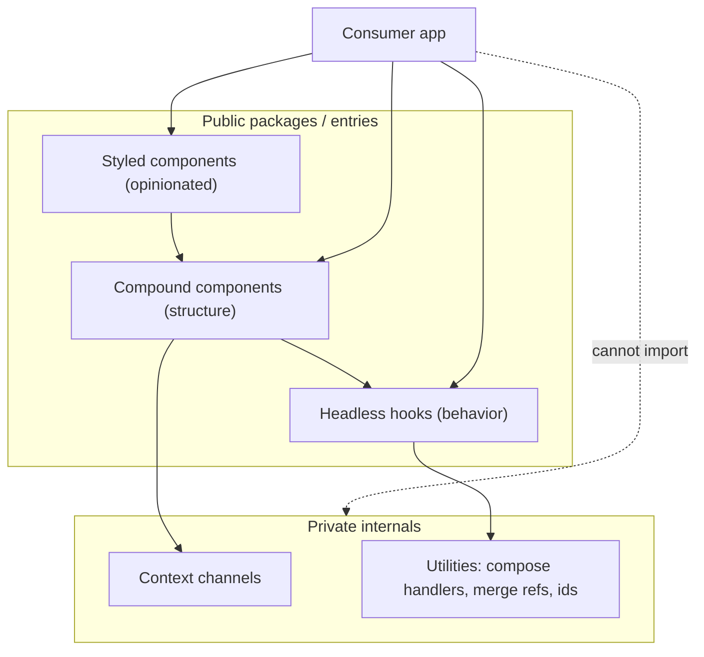

# 05 / 22 — Patterns for Reusable Libraries: Designing APIs Other Teams Can Live With

## 1. Lesson metadata

| | |
|---|---|
| **Level** | Advanced |
| **Study time** | 6–7 hours (reading 2.5 h, experiments 2 h, exercises 2 h) |
| **Prerequisites** | [05 — Compound components](./05-compound-components.md), [07 — Headless components](./07-headless-components.md), [11 — Controlled component pattern](./11-controlled-component-pattern.md), [19 — Polymorphic components](./19-polymorphic-components.md), [20 — Slot patterns](./20-slot-patterns.md), [Phase 4 / 20 — Design systems](../04-react-architecture/20-design-systems.md), [Phase 4 / 21 — Component libraries](../04-react-architecture/21-component-libraries.md), [Phase 0 / 10 — Modules](../00-web-and-javascript-foundations/10-modules-and-dependency-graphs.md) |
| **Next** | [23 — Patterns made less necessary](./23-patterns-made-less-necessary.md) |
| **Related later** | [Project 7 — Reusable component library](../projects/), [Phase 8 / 11 — Component contract testing](../08-testing-and-quality/11-component-contract-testing.md), [Phase 10 / 11 — Design system governance](../10-production-engineering/11-design-system-governance.md), [Phase 10 / 12 — Backward compatibility](../10-production-engineering/12-backward-compatibility.md) |

**Learning objectives.** After this lesson you can:
1. Explain how designing a library differs from designing an app, in terms of who owns state, styling, data, and failure.
2. Implement the core reusable-library primitives: `useControllableState`, event-handler composition, prop merging, strict context hooks, ref forwarding, id generation.
3. Choose between compound components, hooks, render props, slots, and polymorphism for a given public API, and justify the choice by evolution cost.
4. Make a library SSR-safe, tree-shakeable, accessible by default, and compatible with React Server Components boundaries.
5. Define a public API surface, versioning policy, and deprecation path, and detect accidental breaking changes.
6. Review a component API for the common smells that cause consumers to fork or wrap it.

**Concepts covered:** public API surface, inversion of control, controlled/uncontrolled dual mode, prop spreading and merging, handler composition, ref as prop, polymorphism, slots, context contracts, `useId`, SSR safety, `"use client"` boundaries, peer dependencies, `exports` map, `sideEffects`, semantic versioning, deprecation, API-surface testing.

---

## 2. Deep conceptual explanation

### 2.1 What problem is this lesson solving?

Application code is written for *one* consumer who sits in the same repository and can be edited in the same pull request. Library code is written for consumers you cannot see, whose requirements you cannot predict, and whose upgrade schedule you do not control. The central engineering fact is:

> **Every public prop, export, DOM structure, class name, and behavior is a promise.** In an app you can change a promise with a find-and-replace. In a library you change it with a major version, a migration guide, and a support burden.

Patterns for libraries are therefore patterns for **keeping promises small, composable, and evolvable**. This lesson collects the patterns from lessons 05–20 that matter most under that constraint and adds the mechanics that apps rarely need: package structure, SSR safety, dual controlled/uncontrolled mode, and API governance.

### 2.2 App code vs library code

| Concern | App component | Library component |
|---|---|---|
| Data | Fetches and owns it | Receives it; never fetches (or isolates fetching in an optional adapter) |
| State | Owns domain state | Owns *only UI-intrinsic state* (open, focused, selected) and lets consumers take control |
| Styling | Uses the app's design tokens | Exposes tokens, `className`, `data-*` state attributes, CSS variables; does not assume a CSS pipeline |
| Errors | Chooses policy | Surfaces errors via props/callbacks; never swallows, never toasts |
| Copy / i18n | Hard-coded or via app i18n | Receives labels as props/slots; ships no user-facing strings it cannot override |
| Routing / auth / analytics | May call app services | Must not import them; accepts callbacks or an adapter |
| Breaking change | One PR | Major version, codemod, migration guide |
| Performance | Optimized for known screens | Must not impose cost on consumers who use a subset (bundle size, context re-renders) |
| Testing | Behavior of features | **Contract** tests of the public surface ([Phase 8/11](../08-testing-and-quality/11-component-contract-testing.md)) |

### 2.3 The four axes of API design

1. **Inversion of control.** How much of the decision-making does the library keep? A `<Select options={…} />` keeps rendering, filtering, and keyboard behavior; a headless `useSelect()` keeps only behavior; a compound `<Select.Root>…` keeps structure but lets you rearrange. More inversion → more flexibility → more surface area to document and break. See [07 — Headless](./07-headless-components.md).
2. **State ownership.** Who owns `open`, `value`, `selected`? The controllable pattern (§5.1) lets the *consumer decide per usage*.
3. **Extension points.** Where can consumers inject behavior or content without forking: props, slots, render props, event callbacks, context, `className`/`style`, polymorphic `as`/`asChild`.
4. **Evolution cost.** For each prop ask: *what is the cheapest way I will be able to remove or change this in two years?* Boolean props that interact (`primary`, `danger`, `outline`) multiply states; a single union (`variant="primary" | "danger"`) can be extended without breaking.

### 2.4 Misconceptions

| Misconception | Reality |
|---|---|
| "More props means more flexible." | Each prop is a promise and a combinatorial test burden. Composition (children, slots) scales extension without scaling prop count. |
| "Libraries should be uncontrolled for simplicity." | Consumers eventually need to *drive* state (URL sync, forms, analytics). Support both ([11](./11-controlled-component-pattern.md)). |
| "Using `forwardRef`." | In React 19, function components receive `ref` as an ordinary prop; `forwardRef` is legacy and deprecated for new code but still works. Libraries supporting React 18 must still provide it (§3.4). |
| "`...rest` spreading is a convenience." | Spreading is part of the contract: it promises that *any* valid DOM attribute works and that you will not silently overwrite it. You must decide merge order deliberately. |
| "SSR safety is the framework's problem." | Library code that reads `window` at module scope or generates random ids during render breaks SSR/hydration for every consumer. |
| "Semver protects me." | Only if the *surface* is defined. DOM structure, class names, `data-*` attributes, and context shapes are all surface unless you declare them private. |

---

## 3. Internal mechanics

### 3.1 The public surface

*Teaching model.* Partition everything into three zones:

| Zone | Examples | Change policy |
|---|---|---|
| **Public/stable** | Exported components, hooks, types; documented props; documented `data-*` state attributes; documented CSS custom properties; documented events and their payloads | Breaking only in majors |
| **Public/experimental** | Exports under an `unstable_` prefix or `/experimental` entry | May change in minors; consumers opt in |
| **Private** | Everything else: internal context shapes, class names, DOM nesting, non-exported helpers | May change anytime; **enforced** by package `exports` so deep imports fail |

*Public guarantee (Node/bundlers):* the `exports` field in `package.json` restricts which subpaths consumers can import in resolvers that support it. This is a structural way to enforce "private".

### 3.2 Controllable state

The dual-mode contract:

- If the consumer passes `value` (not `undefined`), the component is **controlled**: it renders `value`, and on user interaction calls `onChange(next)` *without* updating internal state.
- Otherwise it is **uncontrolled**: it initializes from `defaultValue`, updates internal state, and also calls `onChange`.
- Switching between modes for the same instance is a bug and should warn in development (React's own `<input>` does this).

⚠ Detail: `value={undefined}` means "uncontrolled" by convention; `null` is a legitimate controlled value for "nothing selected". Document this.

### 3.3 Event and prop composition

When a library component attaches its own `onClick` and the consumer also passes `onClick`, spreading consumer props **after** the library handler silently deletes the library behavior; spreading **before** silently deletes the consumer's. The correct pattern composes: call the consumer's handler first, and skip the library's if the consumer called `event.preventDefault()`. Radix UI-style libraries popularized this as `composeEventHandlers`. The same for refs (merge), `className` (concatenate), and `style` (shallow merge).

### 3.4 Refs in React 19 and in libraries that support both 18 and 19

*Version-sensitive.* In React 19, function components accept `ref` as a prop:

```tsx
function Input({ ref, ...props }: React.ComponentProps<'input'>) {
  return <input ref={ref} {...props} />;
}
```

`React.ComponentProps<'input'>` includes `ref` in React 19's type definitions. `forwardRef` is still supported but is the legacy route. A library that must support React 18 consumers keeps using `forwardRef` (or ships separate builds) until its supported range drops 18. Declare the supported range in `peerDependencies`. Ref callbacks may return a cleanup function in React 19, which matters for libraries that attach observers in ref callbacks (verify against the React 19 reference for `ref` callbacks).

### 3.5 Context as a private channel

A compound component uses context to connect root and parts. Library rules:

1. **Do not export the raw context object**; export the parts and, if needed, a hook (`useDialogContext`).
2. **Strict hook:** throw a descriptive error if the hook is used outside its provider; this converts a `undefined` access crash into an actionable message.
3. **Split contexts** by change frequency (stable actions vs changing state) so consumers who only need the dispatcher do not re-render on each state change ([Phase 3/14](../03-react-state-and-hooks/14-context-performance.md)).
4. **Memoize the value** if the provider can re-render without state change.

### 3.6 SSR and hydration safety

Library code runs on the server (Node), in the browser, and at hydration. Rules:

- No `window`/`document` access during render or at module scope; guard in effects or use `useSyncExternalStore` with a server snapshot ([Phase 3/20](../03-react-state-and-hooks/20-usesyncexternalstore-and-external-stores.md)).
- No `Math.random()`/`Date.now()`-derived ids in render; use `useId` ([Phase 3/22](../03-react-state-and-hooks/22-modern-hooks-and-apis.md)), which is stable across server and client for the same tree position.
- `useLayoutEffect` used to warn on the server in React 18 and earlier; `renderToString` on React 19.3.1 produced no warning (executed). A common library workaround is an isomorphic layout effect alias; evaluate whether you need layout timing at all.
- Portals need a mount node that exists only on the client; render them after mount.

### 3.7 Server Components compatibility

⚠ *Volatile, verify against current docs.* In the Server Components model, a module that uses state, effects, or event handlers must be a Client Component, marked by a `"use client"` directive at the top of the file. A library that ships such components typically preserves the directive in its built output (bundlers can strip it, so check your build). Components that are pure (no hooks, no handlers) can be used from both environments. Design consequence: split a library into **server-safe primitives** and **client interactive parts**, and ensure that the context a compound component uses is created inside client modules, since context cannot be created in a Server Component. See [Phase 9/03](../09-advanced-rendering-and-ecosystem/03-server-components-in-depth.md) and [Phase 9/04](../09-advanced-rendering-and-ecosystem/04-client-server-boundaries-and-serialization.md).

### 3.8 Packaging mechanics

| Field | Purpose | Pitfall |
|---|---|---|
| `peerDependencies` (`react`, `react-dom`) | Ensure one React instance; consumers choose version | Putting React in `dependencies` creates duplicate Reacts → "Invalid hook call" |
| `exports` | Declares entry points and conditions (`import`, `require`, `types`, `default`) | Wrong condition order breaks types or resolution; `types` generally listed first |
| `sideEffects: false` (or a list of files with side effects) | Lets bundlers drop unused modules | Importing global CSS inside components counts as a side effect; list those files |
| `"type": "module"` + ESM build | Native ESM for modern bundlers | Dual ESM/CJS publication risks the "dual package hazard" (two copies loaded) |
| Per-component entry points or preserved module structure | Tree-shaking friendliness | A single bundled barrel file with side effects defeats tree shaking |
| Types shipped (`.d.ts`) | Typed consumers | `any`-leaking generics, un-exported types referenced by exported ones |

---

## 4. Step-by-step execution walkthrough: a consumer upgrades and a prop is removed

Scenario: library `acme-ui` ships `<Tabs>` with `value`/`defaultValue`/`onValueChange`. Version 2.3 deprecates `selectedIndex`. We trace the lifecycle of a *change*.

1. **Deprecation introduced (2.3.0, minor).** `selectedIndex` still works; TypeScript marks it with a `/** @deprecated Use value */` JSDoc tag so editors strike it through. In development only, the component logs a one-time warning *naming the replacement and the removal version*.
2. **Consumers upgrade.** Their code still compiles. Lint rule `@typescript-eslint/no-deprecated` (or the editor) shows the strikethrough.
3. **Codemod released.** A script rewrites `selectedIndex={i}` → `value={tabIds[i]}` where it can, flags the rest.
4. **Removal (3.0.0, major).** The prop is deleted from types, the shim and warning are removed, the changelog states the migration, and the `exports` map ensures no consumer deep-imports the old internal module.
5. **Consumers that skip.** Their build fails at the type level (good: loud) rather than silently misbehaving at runtime (bad). That is why public types must be *exact*, not `[key: string]: any`.

Contrast with an unplanned break: a minor release reorders the DOM so `Tab` is now wrapped in an extra `div`; consumers' CSS selectors (`.tablist > button`) silently stop matching. **DOM structure and class names were surface** because they were never declared private.

---

## 5. Code examples

### 5.1 Minimal example — `useControllableState`

```tsx
import { useCallback, useEffect, useRef, useState } from 'react';

type Options<T> = {
  value: T | undefined;
  defaultValue: T;
  onChange?: (next: T) => void;
};

export function useControllableState<T>({ value, defaultValue, onChange }: Options<T>) {
  const isControlled = value !== undefined;
  const [inner, setInner] = useState<T>(defaultValue);
  const current = isControlled ? (value as T) : inner;

  // Dev-time warning: mode must not change for the lifetime of an instance.
  const wasControlled = useRef(isControlled);
  useEffect(() => {
    if (process.env.NODE_ENV !== 'production' && wasControlled.current !== isControlled) {
      console.warn(
        `A component changed from ${wasControlled.current ? 'controlled' : 'uncontrolled'} to ` +
        `${isControlled ? 'controlled' : 'uncontrolled'}. Decide for the lifetime of the component.`,
      );
    }
  }, [isControlled]);

  const set = useCallback(
    (next: T) => {
      if (!isControlled) setInner(next);
      if (!Object.is(next, current)) onChange?.(next);
    },
    [isControlled, current, onChange],
  );

  return [current, set] as const;
}
```

Line notes:
- `value !== undefined` is the controlled test. Using `null` to mean "no selection" stays controlled.
- The component renders `current`, so in controlled mode the UI changes **only if the parent re-renders with a new `value`**. This is the contract: the parent may reject the change.
- `onChange` is only called when the value actually changes, preventing noisy callbacks.
- `set` depends on `current` and `onChange`, so its identity changes with them. Consumers who pass it to memoized children may prefer a ref-stored latest-callback approach; trade-off is more indirection. `useEffectEvent` (React 19.2+) does not apply here: its function must not be passed to children and has unstable identity by design. Do not rely on it in a library whose peer range predates 19.2.

**Predict:** with `value="a"` and `onChange={() => {}}` (parent ignores changes), the user clicks tab "b". Which tab is shown? *Answer:* "a". The state is the parent's; the component only *requested* a change. This is correct controlled behavior and the most common "my tabs don't switch" confusion.

### 5.2 Practical example — a small compound `Tabs` with strict context and handler composition

```tsx
import { createContext, use, useId, type ReactNode, type ComponentProps } from 'react';

type TabsContextValue = {
  baseId: string;
  value: string;
  setValue: (v: string) => void;
};
const TabsContext = createContext<TabsContextValue | null>(null);

function useTabs(component: string): TabsContextValue {
  const ctx = use(TabsContext);                       // React 19: `use` can read context
  if (!ctx) throw new Error(`<${component}> must be rendered inside <Tabs>`);
  return ctx;
}

export function composeEventHandlers<E extends { defaultPrevented: boolean }>(
  external: ((e: E) => void) | undefined,
  internal: (e: E) => void,
) {
  return (e: E) => {
    external?.(e);
    if (!e.defaultPrevented) internal(e);
  };
}

type TabsProps = {
  value?: string;
  defaultValue: string;
  onValueChange?: (v: string) => void;
  children: ReactNode;
};

export function Tabs({ value, defaultValue, onValueChange, children }: TabsProps) {
  const [current, setValue] = useControllableState({ value, defaultValue, onChange: onValueChange });
  const baseId = useId();
  return <TabsContext value={{ baseId, value: current, setValue }}>{children}</TabsContext>;
}

export function TabList(props: ComponentProps<'div'>) {
  return <div role="tablist" {...props} />;
}

type TabProps = Omit<ComponentProps<'button'>, 'value'> & { value: string };

export function Tab({ value, onClick, ...rest }: TabProps) {
  const { baseId, value: active, setValue } = useTabs('Tab');
  const selected = active === value;
  return (
    <button
      type="button"
      role="tab"
      id={`${baseId}-tab-${value}`}
      aria-selected={selected}
      aria-controls={`${baseId}-panel-${value}`}
      tabIndex={selected ? 0 : -1}
      data-state={selected ? 'active' : 'inactive'}
      {...rest}
      onClick={composeEventHandlers(onClick, () => setValue(value))}
    />
  );
}

export function TabPanel({ value, ...rest }: ComponentProps<'div'> & { value: string }) {
  const { baseId, value: active } = useTabs('TabPanel');
  if (active !== value) return null;
  return <div role="tabpanel" id={`${baseId}-panel-${value}`} aria-labelledby={`${baseId}-tab-${value}`} {...rest} />;
}
```

Design notes:
- `ComponentProps<'button'>` gives consumers every native attribute and `ref` (React 19) for free: the "escape hatch" principle.
- `{...rest}` comes **before** `onClick` so a consumer cannot clobber the composed handler by accident, while their own `onClick` is invoked via composition. For `className`/`style` you would merge, not override.
- `data-state` is a **styling contract**: consumers target `[data-state=active]`, independent of class names or CSS-in-JS.
- IDs from `useId` link tab and panel for accessibility and are hydration-safe. (`useId` output contains colons, which is valid for `id` but needs escaping in CSS selectors; mention this in docs if consumers select by id.)
- ⚠ Keyboard navigation (arrow keys, Home/End, roving tabindex) is deliberately omitted here; a production tab widget must implement the WAI-ARIA Authoring Practices keyboard model.
- `<TabsContext value={...}>` as the provider (no `.Provider`) is React 19; React 18 requires `TabsContext.Provider`.

### 5.3 Incorrect example — a prop-driven mega component

```tsx
type TableProps = {
  rows: Row[];
  columns: ColumnDef[];
  showHeader?: boolean;
  striped?: boolean;
  bordered?: boolean;
  compact?: boolean;
  selectable?: boolean;
  multiSelect?: boolean;
  onRowClick?: (row: Row) => void;
  renderEmpty?: () => ReactNode;
  headerClassName?: string;
  rowClassName?: (row: Row) => string;
  fetchUrl?: string;                 // fetches its own data
  analyticsEvent?: string;           // calls a global tracker
  locale?: 'en' | 'de' | 'fr';       // ships its own strings
};
```

**Predict the support tickets.** (1) "Can I put a button in the header cell?": new prop `renderHeaderCell`. (2) "Selectable rows but not on the first column": new prop. (3) "I use our own fetch layer": `fetchUrl` is useless. (4) "Add `es` locale": library release required. (5) "Rows should be a link for SEO": `onRowClick` cannot render an anchor.

The shape guarantees that *every* new need is either a new prop (surface growth) or a fork. `fetchUrl`, `analyticsEvent`, and `locale` bind the library to services it should not own. Booleans such as `striped`, `bordered`, `compact` describe presentation that tokens/CSS should own.

### 5.4 Corrected implementation — headless core + composable parts + adapters at the edge

```tsx
// 1. Headless core: behavior only, no markup
export function useTable<T>(opts: {
  rows: readonly T[];
  getRowId: (row: T) => string;
  selection?: { value?: ReadonlySet<string>; defaultValue?: ReadonlySet<string>; onChange?: (s: ReadonlySet<string>) => void };
}) {
  const [selected, setSelected] = useControllableState<ReadonlySet<string>>({
    value: opts.selection?.value,
    defaultValue: opts.selection?.defaultValue ?? new Set(),
    onChange: opts.selection?.onChange,
  });
  const toggle = (id: string) => {
    const next = new Set(selected);
    next.has(id) ? next.delete(id) : next.add(id);
    setSelected(next);
  };
  return { rows: opts.rows, selected, toggle, isSelected: (id: string) => selected.has(id), getRowId: opts.getRowId };
}

// 2. Consumer composes markup; library provides optional styled parts built on the core
function Orders({ orders }: { orders: Order[] }) {
  const table = useTable({ rows: orders, getRowId: (o) => o.id });
  return (
    <table>
      <tbody>
        {table.rows.map((o) => (
          <tr key={table.getRowId(o)} data-selected={table.isSelected(o.id) || undefined}>
            <td><input type="checkbox" checked={table.isSelected(o.id)} onChange={() => table.toggle(o.id)} aria-label={`Select order ${o.id}`} /></td>
            <td><a href={`/orders/${o.id}`}>{o.number}</a></td>   {/* real link: SEO, middle-click */}
          </tr>
        ))}
      </tbody>
    </table>
  );
}
```

What improved:
- **No data fetching, analytics, or strings**: the consumer wires TanStack Query, their tracker, and their i18n.
- **Markup belongs to the consumer**, so links, buttons-in-cells, and semantics are unconstrained.
- The behavior (`useTable`) is independently testable and reusable ([headless pattern](./07-headless-components.md)).
- **Trade-off:** the consumer writes more code. A *second tier* (a styled `<DataTable>` built on `useTable`) can serve the 80% case, while the headless tier serves the 20%. Ship both from separate entry points; the high-level tier is allowed to be opinionated because it can be replaced.

### 5.5 Advanced example — package `exports`, `"use client"`, and an API-surface test

`package.json` (excerpt):

```json
{
  "name": "acme-ui",
  "version": "3.0.0",
  "type": "module",
  "sideEffects": ["**/*.css"],
  "peerDependencies": { "react": "^18.2.0 || ^19.0.0", "react-dom": "^18.2.0 || ^19.0.0" },
  "exports": {
    ".":        { "types": "./dist/index.d.ts",   "import": "./dist/index.js" },
    "./tabs":   { "types": "./dist/tabs.d.ts",    "import": "./dist/tabs.js" },
    "./styles.css": "./dist/styles.css"
  }
}
```

Notes: `types` first; no wildcard export, so `acme-ui/dist/internal/x` is unreachable; the peer range declares dual support and therefore requires the `forwardRef`/`ref`-prop compatibility decision from §3.4 and `Context.Provider` instead of `<Context value>` in code compiled for 18 (a library supporting both writes `<Ctx.Provider>`, which still works in 19).

An interactive file starts with the directive:

```tsx
'use client';
import { createContext, use } from 'react';
// …Tabs implementation…
```

⚠ Verify that your bundler retains per-file directives in output; otherwise Server Component consumers hit "createContext only works in Client Components"-style errors.

API-surface regression test (public exports snapshot):

```ts
import * as lib from 'acme-ui';
import { expect, test } from 'vitest';

test('public exports are stable', () => {
  expect(Object.keys(lib).sort()).toMatchInlineSnapshot(`
    [
      "Tab",
      "TabList",
      "TabPanel",
      "Tabs",
      "useControllableState",
    ]
  `);
});
```

An accidental export or removal shows up in review as a snapshot diff. Tools that extract an API report from the `.d.ts` files (for example API Extractor) do this for types too; ⚠ evaluate and verify the tool before adopting.

---

## 6. Visual explanations

### The inversion-of-control spectrum

```mermaid
flowchart LR
  A["Config component\n<Select options=… />"] --> B["Slots / render props\n<Select renderOption=… />"]
  B --> C["Compound components\n<Select.Root><Select.Item/>"]
  C --> D["Headless hook\nuseSelect()"]
  D --> E["Primitives only\n(state machine + a11y rules)"]
  style A fill:#e8f0fe
  style E fill:#fde8e8
```



Left: least flexibility, least consumer code, smallest breakable surface per use. Right: maximum flexibility, most consumer code, biggest documentation burden.

### Layered library architecture



### Controlled vs uncontrolled data flow

```text
Uncontrolled:  user click → set(next) → internal state ← renders current ← onChange(next) notifies parent
Controlled:    user click → set(next) → onChange(next) → parent decides → new `value` prop → renders current
                                          (no internal state update)
```

---

## 7. Alternative approaches and trade-offs

| Criteria | Config props | Compound components | Headless hooks | Slots / `asChild` | Render props |
|---|---|---|---|---|---|
| Consumer code for the default case | Lowest | Medium | Highest | Medium | Medium |
| Layout/markup flexibility | Low | High | Total | High | High |
| Prop surface growth over time | High (grows per feature) | Low | Lowest | Low | Low |
| Accessibility enforcement | Library controls DOM → strong | Library controls parts, consumers arrange → medium | Consumer must apply returned props correctly → weakest unless prop-getters are used | Medium | Medium |
| RSC compatibility | Interactive needs client | Context forces client | Hooks force client | Mixed | Function props cannot cross server→client boundary |
| TypeScript complexity | Low | Medium | Medium | High (polymorphism) | Medium |
| Documentation burden | Table of props | Anatomy + parts | Hook contract + examples | Subtle semantics | Callback contracts |
| Cost to deprecate a feature | High (prop removal) | Low–Medium (part removal) | Low (remove return field) | Medium | Medium |

**A scenario where the recommended "go headless/compound" answer is *not* best.** An internal design system for a 15-person company with one product, no external consumers, and a mandate for visual consistency. A config-prop `<DataTable columns rows />` that enforces one look is *better*: consumers want fewer decisions, and the library team can change every call site in one PR. Flexibility you do not need is cost you pay in documentation, a11y mistakes by consumers, and visual drift. Choose inversion of control in proportion to the diversity of your consumers.

Related choice, **monorepo package vs published package**: a workspace package consumed from source allows atomic refactors ([Phase 4/22](../04-react-architecture/22-monorepos-and-shared-packages.md)); publishing introduces versioning but enables independent upgrade schedules. Do not adopt library-grade ceremony for a package with one consumer.

---

## 8. Best practices and anti-patterns

**Best practices**
- Support controlled and uncontrolled modes for every piece of UI-intrinsic state (`open`, `value`, `selected`, `expanded`).
- Accept and forward native props/`ref` (via `ComponentProps<'tag'>`); merge `className`, `style`, handlers, and refs; do not overwrite.
- Expose state through `data-*` attributes and CSS variables.
- Prefer composition (`children`, slots) over `renderX` props; avoid boolean prop clusters in favor of a single union.
- Make misuse loud: strict context hooks, development warnings, exhaustive TypeScript unions.
- Keep the library free of fetching, routing, analytics, i18n strings, and toasts; accept callbacks or adapters.
- Generate ids with `useId`; guard browser APIs; use portals only after mount.
- Document an **anatomy diagram** (which parts, in which nesting) and keyboard interactions.
- Publish a deprecation policy: warn in minor, remove in major, ship a codemod when feasible.

**Beginner mistakes**
- Spreading `...props` before the library's own handler/attributes, or after them without thinking about which should win.
- Exporting the raw context.
- Swallowing `ref`.
- Using index as default `value` for tabs/items.

**Experienced-dev mistakes**
- Over-generalizing before two real consumers exist (see [02 — DRY/KISS/YAGNI](./02-dry-kiss-yagni.md)); a library with speculative extension points is hard to simplify later.
- Treating internal DOM/class names as private without telling anyone, then breaking CSS-selector users in a minor.
- Hiding accessibility behind opt-in props (accessible should be the default).
- Shipping React in `dependencies`, causing duplicate-React hook errors.
- Mixed polymorphism and generics that produce 10-second type checks and unreadable errors.
- Publishing one barrel file with side effects, ruining tree-shaking.

**Smells:** `any` in public types; props named after implementation (`useMemoizedRender`); `Boolean` props mutually exclusive in practice; behavior that differs between React 18 and 19 without documentation; tests that import from `../src/internal/...`.

**Justified exceptions:** a deliberately *closed* component (no composition) is correct when consistency is the product requirement (payment fields with PCI-driven constraints, a legal consent banner). A single-consumer internal package may skip codemods and semver ceremony.

---

## 9. Real-world application

| Scenario | Library design decision | Engineering constraint |
|---|---|---|
| **Enterprise design system used by 12 product teams** | Headless behavior + styled tier; `data-state` contract; strict semver; Storybook + visual regression ([Phase 8/12](../08-testing-and-quality/12-visual-regression.md)) | Teams upgrade on different schedules; a major release must coexist with the previous one for a migration window |
| **Finance dashboard widgets** | `DataGrid` accepts pre-computed rows and formatter callbacks; never formats currency itself | Locale/currency rules belong to the host app; the library must not guess |
| **Auth-gated UI kit** | Components accept a `can(permission)` adapter, never import the auth SDK | Different apps use different identity providers |
| **Forms library** | Controlled/uncontrolled inputs; error messages by prop/slot; no built-in network | Accessibility: label/description/error ids via `useId` and `aria-describedby` |
| **Realtime chat kit** | Message list takes `messages` and `onLoadMore`; transport is an adapter | Reconnect/backoff differs per backend |
| **Multi-team micro-frontends** | Shared UI package is a singleton peer; context lives in one version | Two copies of the library → two contexts → "provider not found" errors across module-federation boundaries |
| **Next.js App Router consumers** | Mark interactive entries `"use client"`; keep purely presentational primitives server-safe | RSC cannot pass functions as props from server to client components, so slots should be elements (`ReactNode`), not render callbacks, in server-composable APIs |

Constraints to raise in design review: bundle budget per component, supported React range, browser support matrix, a11y conformance target (e.g., WCAG 2.2 AA), documentation ownership, who triages issues.

---

## 10. Debugging and troubleshooting

| Symptom | Likely root cause | Investigation | Fix |
|---|---|---|---|
| "Invalid hook call" only in consumer app | Duplicate React (library bundled or listed in `dependencies`; linked package resolves its own `node_modules/react`) | `npm ls react`; compare `require.resolve('react')` from app and library | `peerDependencies`; dedupe/alias; for `npm link` use bundler `resolve.alias`/`dedupe` |
| Hydration mismatch warning mentioning ids | Random/incrementing ids generated in render | Compare server HTML ids with client; search for `Math.random`, module counters | `useId` |
| Click handler passed by consumer never runs / library handler never runs | Prop spread order overwrote one | Inspect props in React DevTools; log in both handlers | Compose handlers; spread order deliberate |
| Controlled component "does nothing" | Parent does not update `value`, or passes `value={undefined}` initially then a string | DevTools: does `value` prop change after click? Console: controlled/uncontrolled warning | Parent state update; initialize with `''`/`null`, not `undefined` |
| Styles broken after minor upgrade | Changed DOM nesting/class names that consumers targeted | Diff rendered HTML between versions | Treat as breaking; revert; publish stable `data-*` hooks |
| Tree-shaking not working (bundle includes whole library) | Barrel + side effects; `sideEffects` missing; CJS build | Bundle analyzer ([Phase 7/16](../07-performance/16-bundle-analysis.md)) | ESM, `sideEffects`, per-entry exports |
| "createContext only works in Client Components" in Next.js | Missing `"use client"` in the built output | Inspect `dist` file head | Preserve directive in build; add per-entry banner |
| Types: `Property 'ref' does not exist` | Mixed React 18/19 types | `npm ls @types/react` | Align peer types; use `ComponentPropsWithRef` carefully |

Reproduction recipe for the duplicate-React class: create a scratch app, `npm link` (or workspace-link) the library built with React in `dependencies`, render a component using `useState` → observe the invalid hook call; fix by moving to `peerDependencies`, re-link, verify `npm ls react` shows one version.

---

## 11. Exercises

### Level A — Knowledge
A1. Define "public surface" for a React component library. List five things beyond props that are part of it unless declared private.
A2. What are the two ways to tell controlled from uncontrolled in `useControllableState`, and why is `value !== undefined` used?
A3. Why should React be a `peerDependency` of a component library?
A4. Name three reasons a library component should not fetch data.
A5. What does `sideEffects: false` allow a bundler to do, and what can go wrong?

### Level B — Code comprehension
B1. In §5.2 `Tab`, what would break if `{...rest}` were placed *after* `onClick`?
B2. In §5.1, a parent passes `value="a"` and an `onChange` that updates parent state to the received value. What are the exact steps for the user clicking "b"? How many renders of the hook's consumer, and who owns the state?
B3. Why does §5.4's `<a href>` inside a cell matter for a library whose API would otherwise offer `onRowClick`?
B4. Spot the SSR bug:
```tsx
let counter = 0;
export function Field({ label }: { label: string }) {
  const id = `field-${counter++}`;
  return (<><label htmlFor={id}>{label}</label><input id={id} /></>);
}
```

### Level C — Implementation
C1. Implement `mergeRefs<T>(...refs)` that supports object refs and callback refs. In React 19, callback refs may return cleanups; handle that.
C2. Implement a `useControllableState` variant whose `set` has a **stable identity** (does not change when `onChange` or `current` change) without using `useEffectEvent`.
C3. Build a `Disclosure` compound component (`Disclosure`, `DisclosureButton`, `DisclosurePanel`) with controlled/uncontrolled `open`, correct `aria-expanded`/`aria-controls`, `useId`, and a strict context hook.
C4. Write `className` and `style` merging helpers for a component that should accept consumer overrides but keep its own base class.

### Level D — Debugging
D1. A consumer reports that after upgrading from 2.4 to 2.5 their E2E tests failing: `button.tab` no longer found. The changelog says "internal refactor". Diagnose and propose process changes.
D2. Two micro-frontends each bundle their own copy of `acme-ui`; a `<Tabs>` rendered in MFE A containing a `<Tab>` rendered by MFE B throws "`<Tab>` must be rendered inside `<Tabs>`". Explain precisely and propose fixes.
D3. A library's modal works in the client-rendered app but in an SSR app logs `document is not defined`. Locate the likely culprits and show a safe portal implementation.

### Level E — Architecture and engineering decisions
E1. Your team must deliver a date-picker used by 8 teams. Choose between config-props, compound, and headless+styled tiers. Provide decision criteria, risks, and a v1 scope.
E2. A product team asks for a `Button` with `loading`, `icon`, `iconPosition`, `variant`, `size`, `danger`, `outline`, `ghost`, `link`. Review the prop design and propose a final API.
E3. Argue for or against shipping a CJS build in 2026 for a new library. State assumptions about your consumers.

### Level F — Expert challenge
F1. Write a one-page API governance policy for a design-system package: surface definition, semver rules, deprecation timeline, experimental channel, codemod expectations, breaking-change detection in CI, and support window. Include how you will *measure* adoption and breakage.

---

## 12. Detailed answers and explanations

> Attempt the exercises first.

**A1.** The public surface is everything consumers can come to depend on. Besides props: exported types and generic constraints; rendered DOM structure and ARIA roles; class names; `data-*` attributes; CSS custom properties; event payload shapes; context shapes if exported; default values; timing/ordering of callbacks; supported React/browser versions; error messages (if consumers match on them). Declare which are private; enforce with `exports`.

**A2.** (1) Check the prop presence (`value !== undefined`), (2) a separate explicit flag such as `controlled` prop (not recommended). React's own inputs use the presence check, so consumers' mental model carries over. `undefined`, not `null`, is chosen since `null` is a meaningful value (no selection) that must be controllable.

**A3.** Hooks and context require a single React instance. If the library carries its own copy, the library's hooks run against a different dispatcher than the app's renderer → "Invalid hook call"; contexts created by one copy are invisible to the other. `peerDependencies` delegates the choice to the app.

**A4.** (1) Fetch strategy, caching, auth headers differ per app. (2) Testing and SSR become dependent on network. (3) Error policy (retry, toasts) belongs to the app. Also: bundle weight and security (credentials).

**A5.** It allows the bundler to remove modules whose exports are unused without evaluating them. It can go wrong if a module *does* have side effects (CSS imports, polyfills, registering custom elements) that the flag claims it lacks: styles vanish in production. Use an array listing side-effectful files.

**B1.** A consumer's `onClick` would *replace* the composed handler (since `rest` contains `onClick`? No: `onClick` is destructured out of `rest`, so `rest` no longer contains it). Careful: in this code `onClick` is extracted, so placing `{...rest}` after the explicit `onClick={…}` would not clobber it. The prop that *would* break is any attribute in `rest` that the library sets deliberately, for example `role`, `aria-selected`, or `tabIndex`: a consumer-supplied `tabIndex` or `aria-selected` would win over the library's accessible state. That is the real consequence of ordering: decide, per attribute, whether the consumer may override (ids, `data-*`) or not (roles, `aria-selected`). The given code spreads `rest` after the accessibility attributes, so consumers *can* override them; for a strict library, move `role`, `aria-selected`, and `aria-controls` after the spread. This is a deliberate design choice, and either answer is acceptable if justified. The trap is assuming `onClick` is vulnerable when it was already destructured.

**B2.** Steps: click → `set('b')` → `isControlled` true so internal state is not touched → `Object.is('b','a')` false → `onChange('b')` → parent `setState('b')` → parent re-renders with `value="b"` → hook returns `current='b'` → UI updates. One render of the consumer tree for the change (parent and child render in the same pass; batching merges). The parent owns the state; the library holds none (its internal `inner` remains at `defaultValue` unused).

**B3.** `onRowClick` yields a `<tr onClick>` which is not focusable, not keyboard-operable, not a crawlable link, and not middle-click/open-in-new-tab capable. A library that only offers a callback prevents accessible, SEO-friendly rows; markup ownership by the consumer solves it.

**B4.** Module-level `counter` differs between server and client (server counter accumulates across requests; client starts at 0, and different render order), causing a hydration id mismatch; it also is not stable across StrictMode double render. Fix: `const id = useId();`. Additional: shared module state on the server leaks between requests.

**C1. Reference solution**
```ts
import type { Ref, RefCallback } from 'react';

export function mergeRefs<T>(...refs: Array<Ref<T> | undefined>): RefCallback<T> {
  return (node) => {
    const cleanups: Array<() => void> = [];
    for (const ref of refs) {
      if (typeof ref === 'function') {
        const result = ref(node) as void | (() => void);
        if (typeof result === 'function') cleanups.push(result);
        else cleanups.push(() => ref(null));
      } else if (ref) {
        (ref as { current: T | null }).current = node;
        cleanups.push(() => { (ref as { current: T | null }).current = null; });
      }
    }
    return () => cleanups.forEach((fn) => fn());
  };
}
```
Notes: returning a cleanup from a ref callback is React 19 behavior; in React 18 a returned function is ignored and the callback is called with `null` on detach, which this implementation also handles only if cleanups run on the `null` call. A cross-version-safe version branches on `node === null`. Cleanup semantics: if React 19 uses the returned cleanup, it does *not* call the ref with `null`; hence for refs that did not return cleanups we emulate with `ref(null)`. Evaluate edge cases: the merged callback must have stable identity (wrap in `useCallback` at the call site) or React detaches and reattaches on every render. TypeScript typing of cleanup-returning `RefCallback` depends on your `@types/react` version.

**C2. Reference solution**
```ts
export function useControllableState<T>({ value, defaultValue, onChange }: Options<T>) {
  const isControlled = value !== undefined;
  const [inner, setInner] = useState(defaultValue);
  const current = isControlled ? (value as T) : inner;

  const latest = useRef({ current, onChange, isControlled });
  useLayoutEffect(() => { latest.current = { current, onChange, isControlled }; });  // update after commit

  const set = useCallback((next: T) => {
    const l = latest.current;
    if (!l.isControlled) setInner(next);
    if (!Object.is(next, l.current)) l.onChange?.(next);
  }, []);
  return [current, set] as const;
}
```
Why a ref and not render-time assignment: writing refs during render is a purity violation and unsafe under concurrent rendering ([Phase 3/10](../03-react-state-and-hooks/10-useref-and-mutable-references.md)). Trade-off: a handler invoked *between render and layout effect* (rare) sees the previous values; `useLayoutEffect` warned during SSR in React 18 and earlier (no warning on 19.3.1), so a library supporting 18 may use an isomorphic variant. Alternative: `useEffectEvent` (React 19.2+, only usable inside the component's own effects, so not for a callback handed to consumers).

**C3. Reference solution (key parts)**
```tsx
const DisclosureCtx = createContext<{ open: boolean; toggle: () => void; id: string } | null>(null);
function useDisclosure(part: string) {
  const c = use(DisclosureCtx);
  if (!c) throw new Error(`<${part}> must be used within <Disclosure>`);
  return c;
}
export function Disclosure({ open, defaultOpen = false, onOpenChange, children }:
  { open?: boolean; defaultOpen?: boolean; onOpenChange?: (o: boolean) => void; children: ReactNode }) {
  const [isOpen, setOpen] = useControllableState({ value: open, defaultValue: defaultOpen, onChange: onOpenChange });
  const id = useId();
  return <DisclosureCtx value={{ open: isOpen, toggle: () => setOpen(!isOpen), id }}>{children}</DisclosureCtx>;
}
export function DisclosureButton({ onClick, ...rest }: ComponentProps<'button'>) {
  const { open, toggle, id } = useDisclosure('DisclosureButton');
  return <button type="button" aria-expanded={open} aria-controls={`${id}-panel`}
    {...rest} onClick={composeEventHandlers(onClick, toggle)} />;
}
export function DisclosurePanel(props: ComponentProps<'div'>) {
  const { open, id } = useDisclosure('DisclosurePanel');
  return <div id={`${id}-panel`} hidden={!open} {...props} />;
}
```
Evaluation: controlled and uncontrolled both work; `hidden` keeps the panel in the DOM (preserving internal state and anchors) versus unmounting; the choice is documented. The context value is recreated per render; if the tree is large, memoize or split. `aria-controls` on a hidden-by-default panel is allowed.

**C4. Reference solution**
```ts
export const cx = (...parts: Array<string | false | null | undefined>) => parts.filter(Boolean).join(' ');
export const mergeStyle = (base: React.CSSProperties, override?: React.CSSProperties) => ({ ...base, ...override });
// usage: <div className={cx('acme-card', className)} style={mergeStyle({ padding: 8 }, style)} {...rest} />
```
Edge: when `{...rest}` contains `className` it would override; destructure `className`/`style` first as shown in the usage note.

**D1.** Evidence: diff the rendered HTML between versions; likely class names/DOM changed. Root cause: DOM/class names were *de facto* surface without a declared policy. Fixes: restore compatibility or release as major; introduce stable `data-*`/`role`-based hooks and document that consumers should test by role (`getByRole('tab')`); add a rendered-HTML snapshot test of anatomy to the library's CI; add a "surface" section to the contribution guide. Wrong answer: "consumers shouldn't depend on class names": true but unenforced; the library team shares responsibility.

**D2.** Each bundle has its own module instance, therefore its own `TabsContext` object; the `use(TabsContext)` in B's `Tab` reads *B's* context, whose provider (A's `Tabs`) never rendered it. Contexts are matched by object identity, not name. Fixes: share one instance via module federation `shared` singleton config or a monorepo import map; or pass a `Tabs` context bridge; or avoid cross-MFE nesting by letting the host own the composition. Validate by logging `TabsContext === ` across bundles.

**D3.** Culprits: module-scope or render-scope `document.body`, `window.matchMedia`, a `createPortal(…, document.body)` call during render. Safe portal:
```tsx
function Portal({ children }: { children: ReactNode }) {
  const [mounted, setMounted] = useState(false);
  useEffect(() => setMounted(true), []);
  return mounted ? createPortal(children, document.body) : null;
}
```
Trade-off: portal content appears after hydration (no SSR of the modal, usually acceptable for overlays); focus management must run after mount.

**E1. Evaluation criteria.** Strong answers weigh: diversity of consumers (formats, calendars, localization), a11y complexity (grid keyboard model), date library coupling (accept adapter functions, don't bundle Moment/date-fns decisions), controlled value shape (`Date` vs ISO string; timezone semantics), range selection, SSR. Typical recommendation: a headless core `useDatePicker` (calendar math, keyboard model, a11y props via prop getters) plus one styled component for 80% of teams; v1 scope: single date, controlled/uncontrolled, min/max, locale via adapter; defer range, time, and multi-calendar. Risks: timezone bugs, locale week-start, a11y regressions; mitigations: contract tests, visual regression, a11y automation plus manual screen-reader review.

**E2.** Review: `variant="primary" | "secondary" | "ghost" | "link" | "danger"` replaces `danger/outline/ghost/link` booleans (mutually exclusive in practice); `size` union; `loading` boolean that sets `aria-busy`, disables interaction but keeps focusability decision documented; icons as children/slots (`<Button><Icon/>Save</Button>`) instead of `icon` + `iconPosition`; polymorphic `asChild`/`as` for link-buttons; forward native props and `ref`. Rejected: `iconPosition` (layout via children order), `link` as a variant if semantic anchor needed (use `as="a"`). Justification: fewer valid combinations, extendable union, native semantics.

**E3.** Criteria: consumer toolchains (`require(esm)` works without a flag from Node 22.12 / 20.19 for synchronous ES modules, per nodejs.org/api/modules; check your minimum Node), dual-package hazard (two instances of module state, e.g. contexts), maintenance cost, legacy Jest/CJS setups. Defensible positions: ESM-only if consumers are modern frontends and the library has module state; dual with a `require` condition if enterprise test infrastructure is CJS and you can ensure a single-instance (e.g. CJS wrapper re-exporting). State assumptions explicitly.

**F1. Evaluation criteria.** Must include: surface definition (including DOM/data attributes); semver table (what is major/minor/patch, with examples); deprecation timeline (e.g., warned for ≥1 minor and ≥N months, removal in next major); experimental channel/prefix; codemod expectation for removals; CI detection (API report diff, type tests, rendered-anatomy snapshots, bundle-size budget, visual regression); support window (e.g., N-1 majors for security); measurement (usage telemetry via static analysis of consumer repos or lint reports, issues labeled "regression", upgrade lag per team); escalation path for urgent breaking fixes. Reject answers that rely only on "communication".

---

## 13. Senior engineer interview questions

**Q1. How is designing a library API different from designing a component in your app?**
In an app you control every call site, so you can refactor freely and optimize for current needs. A library's props, DOM, and behaviors become promises to unknown consumers with their own upgrade schedules. So you minimize the surface, prefer composition over props, expose state via stable hooks (`data-*`), and treat removals as versioned events. The causal link: unknown callers + expensive change → design for extension without modification.

**Q2. Explain controlled vs uncontrolled and why libraries support both.**
Uncontrolled gives zero-config usage; controlled lets the consumer be the source of truth (URL sync, forms, validation, analytics). Supporting both means state lives in one hook that picks its source by `value !== undefined`; handlers always notify. The cost is the rule that the mode must not flip, enforced by a dev warning.

**Q3. Why compose event handlers instead of spreading props?**
Spread order decides who wins; either choice destroys one party's behavior silently. Composition runs both, with the consumer able to veto by `preventDefault`. It preserves the library's accessibility behavior while keeping consumer extensibility.

**Q4. What breaks SSR in a component library, and how do you prevent it?**
Reading `window`/`document` during render, non-deterministic ids, layout effects on the server, portals into non-existent nodes, module-scope mutable state (leaks across requests). Prevent with `useId`, effect-time browser access, `useSyncExternalStore` server snapshots, post-mount portals, and SSR tests that hydrate the output and fail on warnings.

**Q5. How do React Server Components affect library design?**
Interactive components and context creators must be Client Components, so libraries mark entries `"use client"` and keep primitives server-safe. Functions can't be passed from server to client components as props, so slot APIs based on elements compose better than render callbacks. ⚠ Details move; verify with current docs.

**Q6. Headless or styled?**
Depends on consumer diversity and the cost of inconsistency. Headless maximizes reuse across brands but shifts a11y and visual responsibility to consumers; styled maximizes consistency with a larger prop surface. Many mature systems ship both tiers: styled built on headless.

**Q7. How do you prevent accidental breaking changes?**
Declare the surface, restrict imports via `exports`, snapshot public exports and types, snapshot anatomy (roles/data attributes), run consumer-driven contract tests, and require changelog entries tagged breaking/non-breaking. Humans miss DOM and type-level breaks; machines should check them.

**Q8. Why does `peerDependencies` matter for React specifically?**
Hooks and context are bound to the renderer instance; two Reacts mean two dispatchers and two context registries, causing invalid-hook errors and invisible providers. Peer dependencies make the app choose one.

---

## 14. Further learning resources

| Resource | URL | Covers / why | Level | Study |
|---|---|---|---|---|
| React docs — Passing props to a component | <https://react.dev/learn/passing-props-to-a-component> | Props contract basics | Beginner | Spread syntax section |
| React docs — `useId` | <https://react.dev/reference/react/useId> | SSR-safe ids, accessibility linking | Intermediate | Whole page |
| React docs — `use` | <https://react.dev/reference/react/use> | Reading context/promises | Intermediate | Reading context |
| React docs — Server Components / `"use client"` | <https://react.dev/reference/rsc/use-client> | Client boundary directive | Intermediate | Whole page *(verify current URL)* |
| React 19 blog / upgrade guide | <https://react.dev/blog/2024/04/25/react-19-upgrade-guide> | `ref` as a prop, `<Context>` as provider | Intermediate | Ref and context sections |
| WAI-ARIA Authoring Practices Guide | <https://www.w3.org/WAI/ARIA/apg/> | Keyboard and ARIA patterns for tabs, dialogs, comboboxes | Intermediate | Patterns relevant to your widget |
| Radix Primitives docs | <https://www.radix-ui.com/primitives/docs/overview/introduction> | Real-world compound/headless API conventions, `asChild` | Intermediate | Composition guide *(deep link unverified)* |
| Node.js — Package entry points (`exports`) | <https://nodejs.org/api/packages.html> | `exports`, conditions, `type` | Advanced | Package entry points |
| TypeScript docs — Publishing / declaration files | <https://www.typescriptlang.org/docs/handbook/declaration-files/publishing.html> | Shipping types | Intermediate | Whole page |
| Semantic Versioning | <https://semver.org/> | Versioning rules | Beginner | Spec summary |
| webpack docs — Tree shaking | <https://webpack.js.org/guides/tree-shaking/> | `sideEffects`, ESM | Intermediate | `sideEffects` flag |

URLs in this table were checked for HTTP 200 on 2026-10-22; any still marked *(unverified)* could not be checked automatically. A 200 does not guarantee the page content still matches the description; if a link has moved, search the site for the quoted title.

---

## 15. Knowledge checkpoint

**You should now understand**
- That library surface includes DOM, attributes, and types, and that surface area is the main cost driver.
- Why control inversion, controlled/uncontrolled modes, and composition are the main extension tools.
- The mechanics that apps rarely need: SSR safety, peer dependencies, `exports`, `"use client"`, tree-shaking.

**You should be able to explain without notes**
- Why spread order and handler composition matter.
- Why duplicate React instances produce invalid hook calls and invisible providers.
- Why headless is not always better.

**You should be able to implement**
- `useControllableState`, `composeEventHandlers`, `mergeRefs`, a compound component with a strict context hook, and an API-surface regression test.

**You should be able to debug**
- Duplicate-React errors, hydration id mismatches, controlled components that "do nothing", and silent DOM-structure breaks.

**Before moving on:** read [23 — Patterns made less necessary](./23-patterns-made-less-necessary.md) to learn which of the library-grade patterns above are *obsolete* in modern React, and which remain essential. Then apply everything in [Project 7 — Reusable component library](../projects/).
