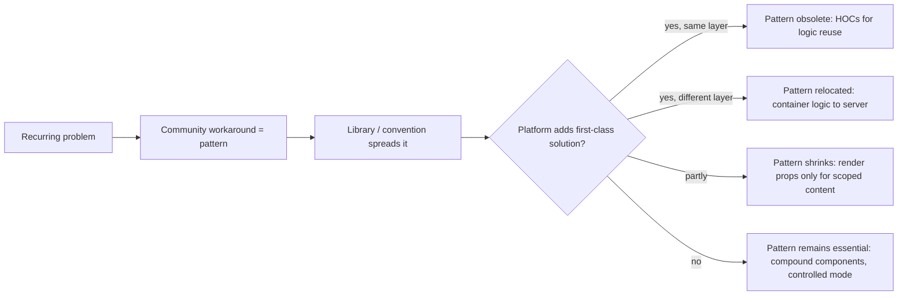
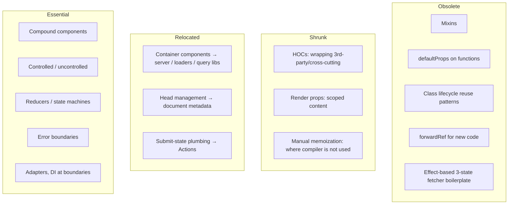

# 05 / 23 — Patterns Made Less Necessary: What Modern React Absorbed, and What It Did Not

## 1. Lesson metadata

| | |
|---|---|
| **Level** | Advanced |
| **Study time** | 5–6 hours (reading 2 h, experiments 1.5 h, exercises 2 h) |
| **Prerequisites** | [04 — Container/presentational](./04-container-presentational.md), [06 — Custom hook patterns](./06-custom-hook-patterns.md), [09 — Higher-order components](./09-higher-order-components.md), [10 — Render props](./10-render-props.md), [11 — Controlled component pattern](./11-controlled-component-pattern.md), [22 — Patterns for reusable libraries](./22-patterns-for-reusable-libraries.md), [Phase 3 / 22 — Modern hooks and APIs](../03-react-state-and-hooks/22-modern-hooks-and-apis.md), [Phase 3 / 07 — You might not need an effect](../03-react-state-and-hooks/07-you-might-not-need-an-effect.md) |
| **Next** | [24 — OOP patterns in functional React](./24-oop-patterns-in-functional-react.md) |
| **Related later** | [Phase 7 / 04 — Memoization trade-offs](../07-performance/04-memoization-trade-offs.md), [Phase 9 / 07 — Modern React APIs](../09-advanced-rendering-and-ecosystem/07-modern-react-apis.md), [Phase 9 / 08 — React Compiler](../09-advanced-rendering-and-ecosystem/08-react-compiler.md), [Phase 9 / 13 — Forms, actions and mutations](../09-advanced-rendering-and-ecosystem/13-forms-actions-and-mutations.md), [Phase 9 / 15 — React API changes across versions](../09-advanced-rendering-and-ecosystem/15-react-api-changes-across-versions.md) |

**Learning objectives.** After this lesson you can:
1. Explain, for each of ~12 classic React patterns, the *original problem* it solved, the mechanism that reduced the need, and the residual cases where it still applies.
2. Read a legacy codebase and recognize patterns that exist only to compensate for old limitations (class lifecycle, `forwardRef`, manual memoization, effect-based fetching, `defaultProps`).
3. Distinguish a pattern that is **obsolete** from one that is **relocated** (the problem moved to a different layer) and one that is **still essential**.
4. Migrate HOC, render-prop, container/presentational, `forwardRef`, effect-fetch and hand-rolled form-state code to current idioms without changing behavior.
5. Evaluate new language/framework features critically: what they guarantee, what they only make convenient, and what depends on build tooling or framework support.
6. Avoid the opposite error: removing an abstraction that was solving a real, still-present problem.

**Concepts covered:** pattern lifecycle, problem–mechanism fit, hooks replacing HOCs/render props/mixins/lifecycle classes, `ref` as a prop, context as provider, Actions and form `action`, `useActionState`, `useOptimistic`, `use`, Suspense data loading, Server Components relocating container logic, `useSyncExternalStore`, automatic memoization (React Compiler), `useEffectEvent`, document metadata, platform features (`<dialog>`, Popover API).

---

## 2. Deep conceptual explanation

### 2.1 What problem is this lesson solving?

Design patterns in React are, with few exceptions, **workarounds for missing capabilities**. A pattern appears when a recurring problem has no direct solution in the platform. Later the platform adds a direct solution, and the pattern either disappears, shrinks into a convenience, or moves.

Teaching patterns without this history produces two failure modes:

1. **Cargo-culting.** A team writes a HOC for permissions in 2026 because "the HOC pattern" appears in a book, when a hook and a component would be shorter, typed better, and easier to debug.
2. **Over-correcting.** A team deletes every `React.memo`, every context provider, or every container/presentational split because "hooks replaced that", and ships a regression because the original problem still exists in their situation.

The skill this lesson builds is *problem-first reasoning*: for any pattern, state the problem, ask whether a simpler mechanism now covers it **in this codebase's React version, framework, and tooling**, and verify.

### 2.2 The pattern lifecycle



### 2.3 Three outcomes: obsolete, relocated, essential

| Outcome | Meaning | Example |
|---|---|---|
| **Obsolete** | A direct mechanism replaced the workaround; using the pattern is more code for no gain | Class lifecycle mixins, `defaultProps`, `forwardRef` for new code, `react-helmet`-style head management in simple cases |
| **Shrunk** | Still useful, but for a narrower set of problems | HOCs (cross-cutting wrapping of third-party components), render props (scoped content/inversion of control) |
| **Relocated** | The problem still exists, but is solved in another layer | Container components that fetch data → server components, route loaders, a server-state library |
| **Essential** | The problem is structural and unchanged | Controlled/uncontrolled state ownership, compound components, error boundaries, reducers/state machines for complex state, adapters at system boundaries |

### 2.4 Misconceptions

| Misconception | Reality |
|---|---|
| "Hooks made every pattern from before 2019 obsolete." | Hooks replaced the *logic-reuse* patterns (HOC, render props for logic, mixins). They did not replace composition patterns, state ownership patterns, or API design patterns. |
| "The React Compiler means I never think about memoization." | The compiler can automate many memoization decisions *when its assumptions hold and it is enabled*. It does not fix unstable architecture, expensive renders, large lists, or effect dependency bugs. ⚠ Verify current docs and your build setup. |
| "Server Components replaced container/presentational." | They relocated data access to the server. The *separation of concerns* idea survives; the implementation boundary moved. |
| "Actions removed the need for form libraries." | Actions provide submission/pending/error plumbing. Field-level validation, dirty tracking, complex dynamic arrays, and schema integration still need design (or a library). |
| "If a feature exists, I should use it everywhere." | New APIs have constraints (framework support, browser support, behavior in tests). A pattern that is verbose but universally supported can be the right choice. |

---

## 3. Internal mechanics

### 3.1 Public guarantee vs teaching model vs implementation detail

- **Public guarantee.** The documented React 19 APIs: `ref` as a prop on function components; `<Context>` usable as a provider; ref callbacks may return cleanup functions; Actions (functions passed to `<form action>` and run in transitions); `useActionState`, `useFormStatus`, `useOptimistic`; `use(promise)` and `use(context)`; `useSyncExternalStore`; document metadata tags rendered in components being hoisted to `<head>`. These are specified in the React docs and the React 19 release notes.
- **Teaching model.** "Each older pattern solved a gap; the gap closed." This is explanatory, not historical fact for every library.
- **Implementation detail.** Which optimizations the compiler performs, how `use` suspends, how Actions are scheduled internally. Treat any statement about exact internals as "conceptually" and verify in source or docs.

⚠ **Version-sensitive.** Several items here depend on the React version and framework (React 19.x). `useEffectEvent` (stable since React 19.2) and the React Compiler (v1.0 released Oct 2025) have evolved quickly; recheck current docs for recommended usage. Server Component behavior depends on a framework/bundler integration.

### 3.2 Why the replacements work (mechanism by mechanism)

**Hooks replace logic-reuse wrappers.** HOCs and render props existed because function components could not hold state or subscribe to anything; reusing stateful logic required wrapping *components*. A hook reuses logic *inside* a component's render with no new tree nodes. Consequences: no wrapper hell in DevTools, no prop-name collisions, no static hoisting problems, full type inference.

**`ref` as a prop replaces `forwardRef`.** Function components previously did not receive `ref` as a prop (it was special-cased), so `forwardRef` was required to pass it through. In React 19, `ref` is an ordinary prop for function components. `forwardRef` still works but "will be deprecated in a future release" (react.dev/reference/react/forwardRef, 2026-10-22).

**Actions replace hand-rolled submit state.** Before: `isSubmitting` boolean, `error` state, `try/catch/finally`, and manual ordering. Now: an async function passed to `<form action={fn}>` or run via `startTransition` is tracked as a transition; `useActionState` returns `[state, action, isPending]`; `useFormStatus` exposes pending for child components of a form; `useOptimistic` shows temporary state that reverts when the transition finishes.

**Suspense + `use` replace load-state boilerplate in simple cases.** The "container" that fetched in an effect, tracked `loading`/`error`, and rendered children becomes: a component that calls `use(promise)` inside a `<Suspense>` with an error boundary. The promise must be **stable across renders** (created outside render, cached, or provided by a framework/library); creating a promise during render and passing it to `use` produces a new promise each render and is a documented mistake.

**Server Components relocate containers.** A component that only fetches data and passes it down can run on the server, with direct data access, shipping no component code to the client. The "container" persists as a *module boundary*, not a client component.

**`useSyncExternalStore` replaces observer boilerplate.** Subscribing a component to an external store correctly under concurrent rendering (no tearing) used to require care in effects. The hook is the supported primitive; libraries build on it.

**The compiler (when enabled) replaces manual memoization in many cases.** It analyzes components and hooks and inserts memoization automatically, provided the code follows the Rules of React. ⚠ Not a language guarantee; it is a build-time tool whose coverage and bail-outs you verify (e.g., with the compiler's reporting/ESLint rules).

### 3.3 What did not change

- **State ownership and data flow** are unchanged: one-way, top-down, state lives in the lowest common ancestor ([Phase 4 / 15](../04-react-architecture/15-state-ownership.md)).
- **Reconciliation identity rules**: position and key ([Phase 2 / 07](../02-react-rendering-and-internals/07-identity-keys-and-reconciliation.md)).
- **Purity of render** ([Phase 2 / 12](../02-react-rendering-and-internals/12-why-rendering-must-be-pure.md)): the compiler and concurrency depend on it more than ever.
- **Error boundaries remain classes** (or a library wrapper): there is no hook equivalent for catching render errors. ⚠ Verify the current docs: this was true for React 19 at the time of writing.

---

## 4. Step-by-step walkthrough: migrating a `withUser` HOC + container + `forwardRef` + manual memo to current idioms

Starting point (the "2018 stack" for one feature):

1. `UserCardContainer` (class) fetches `/api/user` in `componentDidMount`, stores `user`, `loading`, `error`.
2. `withTracking(UserCard)` HOC injects an `track` prop.
3. `UserCard` is wrapped in `forwardRef` to expose the avatar element.
4. `React.memo` and `useCallback` guard against re-renders from the container.
5. A `defaultProps` object sets `size="md"`.

Chronological migration (each step independently shippable, behavior preserved):

1. **Characterize.** Write tests for current behavior (loading, error, success, tracking calls, ref exposure). See [Phase 4 / 24 — Refactoring legacy React](../04-react-architecture/24-refactoring-legacy-react.md).
2. **Replace `defaultProps`** with default parameter values (`size = "md"`). Function component `defaultProps` are removed in React 19 for function components (verified against the React 19 upgrade guide), so this is also a prerequisite for upgrading.
3. **Replace `forwardRef`** with a `ref` prop: add `ref?: Ref<HTMLImageElement>` to props and pass it down.
4. **Replace the HOC** with a `useTracking()` hook called inside `UserCard`.
5. **Replace the class container** with either a server-state hook (`useQuery`), a route loader, or `use(promise)` + Suspense + boundary, depending on the app's data layer. The choice is architectural; see [Phase 6](../06-data-fetching-and-state-ecosystems/07-server-state-management.md).
6. **Delete manual memoization** *only after* measuring: remove `memo`/`useCallback` where profiling shows no effect, and keep where it protects an expensive subtree or a stable dependency. If the React Compiler is adopted, remove incrementally and compare Profiler results.
7. **Re-run characterization tests** and compare React DevTools component tree depth: expected result is fewer wrapper nodes.

**Predict:** after step 4, how many component instances in the tree represent one `UserCard` on screen? Before: container, HOC wrapper, memo wrapper, forwardRef wrapper, and the inner component, up to five nodes in DevTools (DevTools shows `memo` and `forwardRef` as badges on one node in modern versions, but HOCs are real components). After: the card plus any provider. The measurable improvement is clarity and stack depth, not necessarily speed.

---

## 5. Code examples

### 5.1 HOC → hook (logic reuse)

```tsx
// Before: HOC (legacy style)
function withWindowWidth<P extends { width: number }>(Wrapped: React.ComponentType<P>) {
  return function WithWindowWidth(props: Omit<P, "width">) {
    const [width, setWidth] = React.useState(window.innerWidth);
    React.useEffect(() => {
      const onResize = () => setWidth(window.innerWidth);
      window.addEventListener("resize", onResize);
      return () => window.removeEventListener("resize", onResize);
    }, []);
    return <Wrapped {...(props as P)} width={width} />;
  };
}
```

```tsx
// After: hook, SSR-safe via useSyncExternalStore
import { useSyncExternalStore } from "react";

function subscribe(cb: () => void) {
  window.addEventListener("resize", cb);
  return () => window.removeEventListener("resize", cb);
}
const getSnapshot = () => window.innerWidth;     // must return a stable primitive when unchanged
const getServerSnapshot = () => 1024;            // deterministic server value; choose deliberately

export function useWindowWidth() {
  return useSyncExternalStore(subscribe, getSnapshot, getServerSnapshot);
}

function Header() {
  const width = useWindowWidth();
  return <nav data-compact={width < 640} />;
}
```

Notes:

- `getSnapshot` returns a number, so identical values compare equal under `Object.is`. Returning a fresh object each call would loop; see [Phase 3 / 20](../03-react-state-and-hooks/20-usesyncexternalstore-and-external-stores.md).
- The HOC's `as P` cast is the type-system cost of the pattern: `Omit` on generics rarely infers.
- `getServerSnapshot` returns a guess; hydration then reconciles to the real width. If layout depends on it, prefer CSS media queries instead of JS (the best replacement for many `useWindowWidth` hooks is **no JS**).

**Predict:** how many extra DevTools nodes? HOC: one (`WithWindowWidth`) per use. Hook: zero.

### 5.2 Render prop → hook (when no markup inversion is needed)

```tsx
// Before
<Mouse>{({ x, y }) => <Cursor x={x} y={y} />}</Mouse>

// After
function usePointer() {
  const [p, setP] = useState({ x: 0, y: 0 });
  useEffect(() => {
    const onMove = (e: PointerEvent) => setP({ x: e.clientX, y: e.clientY });
    window.addEventListener("pointermove", onMove);
    return () => window.removeEventListener("pointermove", onMove);
  }, []);
  return p;
}
function Pointer() { const { x, y } = usePointer(); return <Cursor x={x} y={y} />; }
```

**Where the render prop remains the better tool:** when the component owns *markup positions* and hands the consumer per-item state (a virtualized list passing `style` for each row; a headless Downshift-like component). See [§5.2 of lesson 20](./20-slot-patterns.md). A hook cannot place content inside another component's output.

### 5.3 `forwardRef` → `ref` prop

```tsx
// Before (legacy, still works in 19)
const Input = forwardRef<HTMLInputElement, InputProps>(function Input(props, ref) {
  return <input ref={ref} {...props} />;
});

// After (React 19)
type InputProps = React.ComponentPropsWithoutRef<"input"> & {
  ref?: React.Ref<HTMLInputElement>;
};
function Input({ ref, ...props }: InputProps) {
  return <input ref={ref} {...props} />;
}
```

Notes: `ComponentPropsWithRef<"input">` also works in React 19 types, because `ref` is part of props. If your library supports React 18 consumers, `ref` as a prop will **not** work there; libraries typically keep `forwardRef` until their minimum supported React is 19.

### 5.4 Class container + effect fetching → `use` + Suspense + boundary

```tsx
// Before: effect-based fetching with hand-rolled state
function UserPanel({ id }: { id: string }) {
  const [user, setUser] = useState<User | null>(null);
  const [error, setError] = useState<Error | null>(null);
  useEffect(() => {
    let cancelled = false;
    fetchUser(id).then(
      (u) => !cancelled && setUser(u),
      (e) => !cancelled && setError(e),
    );
    return () => { cancelled = true; };
  }, [id]);
  if (error) return <ErrorView error={error} />;
  if (!user) return <Spinner />;
  return <UserCard user={user} />;
}
```

```tsx
// After: promise created outside render (cache by id), consumed with use()
const cache = new Map<string, Promise<User>>();
function getUser(id: string): Promise<User> {
  let p = cache.get(id);
  if (!p) { p = fetchUser(id); cache.set(id, p); }
  return p;
}

function UserPanel({ id }: { id: string }) {
  const user = use(getUser(id));            // suspends until resolved; throws to boundary if rejected
  return <UserCard user={user} />;
}

// Parent
<ErrorBoundary fallback={<ErrorView />}>
  <Suspense fallback={<Spinner />}>
    <UserPanel id={id} />
  </Suspense>
</ErrorBoundary>
```

Why this code is *not* production-ready by itself:

1. The module-level `Map` never invalidates: stale data forever, memory growth, and shared across tests and, on a server, across users. A real solution needs invalidation and scoping, which is what libraries and frameworks provide.
2. A rejected promise stays cached; the error boundary's retry would re-throw the same rejection. A cache must evict failures.
3. Waterfalls: if `UserCard` fetches its own data after rendering, you serialize requests.

**The honest conclusion:** `use` + Suspense reduces *UI-state boilerplate*; it does not provide a cache. The cache is the missing piece, and that is why server-state libraries and framework loaders remain relevant ([Phase 6 / 08](../06-data-fetching-and-state-ecosystems/08-tanstack-query.md), [06 / 13](../06-data-fetching-and-state-ecosystems/13-suspense-data-loading.md)). The *pattern removed* is the three-state `useEffect` fetcher; the *problem relocated* is caching and invalidation.

### 5.5 Hand-rolled form submit state → Actions

```tsx
// Before
function Rename({ id }: { id: string }) {
  const [name, setName] = useState("");
  const [pending, setPending] = useState(false);
  const [error, setError] = useState<string | null>(null);
  async function onSubmit(e: React.FormEvent) {
    e.preventDefault();
    setPending(true); setError(null);
    try { await rename(id, name); } catch (err) { setError(String(err)); }
    finally { setPending(false); }
  }
  return (
    <form onSubmit={onSubmit}>
      <input value={name} onChange={(e) => setName(e.target.value)} />
      <button disabled={pending}>Save</button>
      {error && <p role="alert">{error}</p>}
    </form>
  );
}
```

```tsx
// After
type State = { error: string | null };

function Rename({ id }: { id: string }) {
  const [state, action, pending] = useActionState(
    async (_prev: State, formData: FormData): Promise<State> => {
      try {
        await rename(id, String(formData.get("name") ?? ""));
        return { error: null };
      } catch (err) {
        return { error: err instanceof Error ? err.message : "Failed" };
      }
    },
    { error: null },
  );
  return (
    <form action={action}>
      <input name="name" defaultValue="" />
      <button disabled={pending}>Save</button>
      {state.error && <p role="alert">{state.error}</p>}
    </form>
  );
}
```

Notes:

- The input is **uncontrolled**; the form's data is read from `FormData` on submit. This is a different data-flow model from the controlled "before" version. If you need live validation or character counts, you reintroduce controlled state. This is a trade-off, not a free upgrade.
- React 19 **resets uncontrolled form fields** after a successful `action` for `<form action>` submissions (documented behavior of form actions in React 19; executed on 19.3.1). If your UX needs the typed value to stay on error, return it in `state` and set it as `defaultValue`.
- `pending` here is for the *whole action*; to render pending state in a deeply nested button without prop drilling, use `useFormStatus()` inside a child of the `<form>`.
- Progressive enhancement: a form whose `action` is a server function can work before hydration in frameworks that support it; a client-only `action` function does not. That depends on the framework.

### 5.6 Optimistic update patterns → `useOptimistic`

```tsx
function Todos({ todos, add }: { todos: Todo[]; add: (t: string) => Promise<void> }) {
  const [optimistic, addOptimistic] = useOptimistic(
    todos,
    (current, title: string): Todo[] => [...current, { id: `tmp-${title}`, title, pending: true }],
  );
  async function action(formData: FormData) {
    const title = String(formData.get("title"));
    addOptimistic(title);           // must be called inside an Action / transition
    await add(title);               // when the transition ends, `todos` (new truth) replaces optimistic state
  }
  return (
    <form action={action}>
      <input name="title" />
      <ul>{optimistic.map((t) => <li key={t.id} aria-busy={t.pending}>{t.title}</li>)}</ul>
    </form>
  );
}
```

What it removes: the manual "insert fake row, then roll back on failure" bookkeeping. What it does **not** remove: server reconciliation (ids), conflict policy, and cache updates in server-state libraries ([Phase 6 / 05](../06-data-fetching-and-state-ecosystems/05-optimistic-updates.md)).

### 5.7 Manual memoization → (maybe) compiler; incorrect removal

```tsx
// Before
const Row = React.memo(function Row({ item, onSelect }: RowProps) { /* … */ });
function List({ items }: { items: Item[] }) {
  const onSelect = useCallback((id: string) => select(id), []);
  const sorted = useMemo(() => [...items].sort(byName), [items]);
  return sorted.map((i) => <Row key={i.id} item={i} onSelect={onSelect} />);
}
```

**Incorrect removal** (done because "the compiler handles it", though the compiler is not enabled in this project):

```tsx
function Row({ item, onSelect }: RowProps) { /* … */ }          // memo deleted
function List({ items }: { items: Item[] }) {
  const sorted = [...items].sort(byName);                        // sorts on every render
  return sorted.map((i) => <Row key={i.id} item={i} onSelect={(id) => select(id)} />);
}
```

With 5,000 rows, every parent render now re-renders every row and re-sorts. **Predict:** typing in an unrelated search box in `List`'s parent: before, `Row`s skip (stable props); after, all rows render. Without the compiler enabled, nothing replaced the memoization.

**Corrected approach:** (1) check whether the compiler is actually running (build plugin present, component compiled; the React DevTools shows a marker for compiled components in versions that support it, ⚠ verify), (2) measure with the Profiler ([Phase 7 / 02](../07-performance/02-profiler-workflows.md)), (3) remove memoization where it does not change results, (4) keep it where it guards expensive subtrees. The rule: **delete a defensive optimization only when you know what now provides the protection.**

### 5.8 Provider and ref cleanup details

```tsx
// React 19: context as provider; ref callback cleanup
const ThemeContext = createContext<"light" | "dark">("light");

function App() {
  return (
    <ThemeContext value="dark">
      <input ref={(el) => {
        el?.focus();
        return () => { /* cleanup when the element is removed */ };
      }} />
    </ThemeContext>
  );
}
```

`ThemeContext.Provider` still works. This is a small ergonomics gain; do not mass-rewrite for it. Library code supporting React 18 must keep `.Provider`.

### 5.9 Platform features replacing component libraries

`<dialog>` with `showModal()` provides a modal with focus trapping behavior and backdrop in the browser; the Popover API provides light-dismiss popovers. A custom modal component whose job was focus trap + escape handling + backdrop may reduce to a thin wrapper:

```tsx
function Modal({ open, onClose, children }: { open: boolean; onClose: () => void; children: ReactNode }) {
  const ref = useRef<HTMLDialogElement>(null);
  useEffect(() => {
    const d = ref.current;
    if (!d) return;
    if (open && !d.open) d.showModal();
    if (!open && d.open) d.close();
  }, [open]);
  return <dialog ref={ref} onClose={onClose}>{children}</dialog>;
}
```

Caveats: this is imperative synchronization (justified here because it syncs React state to a DOM API, see [Phase 3 / 04](../03-react-state-and-hooks/04-useeffect-synchronization.md)); browser support and styling details differ; animations on `<dialog>` require careful CSS. Verify against MDN for your browser support targets.

---

## 6. Visual explanations

### Pattern fate map



### Component tree depth, before vs after

```text
Before                                  After
<UserCardContainer>                     <UserPanel>
  <WithTracking>                          <UserCard>   (uses useTracking())
    <ForwardRef(UserCard)>                  
      <Memo(UserCard)>
        
```

### When "new" is not better: adoption heuristic

| Replacement | Framework/tooling dependence | Benefit | Default stance |
|---|---|---|---|
| HOC to hook | None (React 16.8+) | High | Adopt when touched |
| `ref` prop | React 19 only | Medium | Adopt in apps on 19; libraries wait for min version |
| Provider shorthand | React 19 only | Low | Leave alone |
| Effect fetch to `use`/Suspense | Needs a cache or framework | Medium | Adopt with a data layer, not hand-rolled |
| Compiler | Build tooling; verify support | Potentially high | Pilot, measure, roll out |

---

## 7. Alternative approaches and trade-offs

| Pattern | Replacement | Criteria where replacement wins | Criteria where the old pattern still wins |
|---|---|---|---|
| HOC for logic | Custom hook | Typing, DevTools clarity, no wrapper | Wrapping classes or third-party components you cannot edit; cross-cutting wrapping at module boundaries (e.g., `withProfiler`, instrumentation) |
| Render prop for logic | Custom hook | Less nesting | Consumer must place content *inside* the component's markup with per-item data |
| Container/presentational | Hooks + colocated logic; server components | Fewer files | When presentational purity enables Storybook, visual testing, reuse across data sources |
| `forwardRef` | `ref` prop | Less boilerplate, simpler types | Libraries supporting React 18 consumers |
| Effect fetching | `use` + Suspense, loaders, query libs | Less boilerplate, fewer races | Tiny one-off fetch in a prototype with no data layer |
| Manual `useCallback`/`useMemo`/`memo` | Compiler | Less noise, fewer dependency-array bugs | Compiler not enabled, bailouts, code outside Rules of React |
| Redux for global UI state | Context + reducer, or smaller store | Small apps | Large teams needing devtools, middleware, strict update traces |
| Form state libs | Actions + `FormData` | Simple submit flows | Complex validation, dynamic arrays, field-level subscriptions |
| Custom modal infrastructure | `<dialog>` / Popover API | Platform accessibility behavior | Styling/animation requirements, legacy browser support, design-system consistency |
| Controlled inputs everywhere | Uncontrolled + `FormData` | Fewer renders for large forms | Live validation, masks, dependent fields |

**Scenario where the recommended (modern) approach is not best.** A team maintains a 400-component app on React 18 with a stable HOC-based analytics wrapper applied by a codemod across every route. Rewriting to hooks touches 400 files and risks regressions with zero user-visible benefit. The *best* decision is to keep the HOC, forbid new ones, and migrate opportunistically when files are touched for other reasons (the "boy-scout rule"). Pattern choices are bounded by migration cost; see [Phase 11 / 03 — Large-scale refactoring](../11-senior-and-architect-mastery/03-large-scale-refactoring.md).

---

## 8. Best practices and anti-patterns

**Beginner mistakes**
- Following tutorials written for class components and copying `defaultProps`, `componentDidMount`, or `forwardRef` into new code.
- Wrapping everything in `useCallback`/`useMemo` "to be safe" and creating wrong dependency arrays.
- Writing `useEffect` to derive state from props ([Phase 3 / 07](../03-react-state-and-hooks/07-you-might-not-need-an-effect.md)).

**Experienced-developer mistakes**
- **Wholesale deletion** of memoization after reading about the compiler, without confirming it is enabled and compiling the component.
- **Using `use(fetch(...))` inline** (a new promise every render).
- **Treating Actions as a validation framework.**
- **Replacing a typed, tested HOC pipeline** with hooks in a way that moves cross-cutting concerns (auth, tracing) into every component, increasing duplication. Sometimes the wrapper is the right place for a policy.
- **Replacing a well-factored presentational component** with a component that calls hooks directly, losing Storybook-ability and test simplicity.

**Smells**
- A pattern's name in a filename (`withX`, `XContainer`) in new code without a stated reason.
- Memoization everywhere *and* a codebase where the compiler is enabled (redundant), or neither profiled.
- A "modern" rewrite with no tests characterizing old behavior.

**Justified exceptions**
- Keep `forwardRef` in libraries whose supported peer range includes React 18 or earlier.
- Keep HOCs for wrapping third-party class components or when a `displayName`/static hoisting contract exists.
- Keep container components when the container is the **anti-corruption layer** to a messy API ([lesson 15 — Adapter](./15-adapter-strategy-factory.md)).

**Not universal:** "prefer hooks over HOCs" is a strong default, not a law. State the problem and constraints in the PR.

---

## 9. Real-world application

**E-commerce checkout.** Legacy: class container + HOC for A/B tests + Redux for cart. Migration plan: hooks for cart selectors and experiments (flags via context), Actions for the payment form, keep Redux where devtools and middleware (idempotency keys, retries) are valuable. Constraints: payments must be idempotent; optimistic UI must never display "paid" before confirmation; `useOptimistic` is for *presentation*, not authorization.

**Dashboard.** Legacy: render props for chart tooltips, effect fetching per widget. Migration: a query library for caching/polling (relocated, not removed), hooks for resize/measure, render props retained for chart tooltip slots. Constraints: many widgets mean waterfalls matter; Suspense boundaries per widget; compiler benefits are real only if render cost, not network, dominates.

**Auth.** Legacy: `withAuth(Component)`. Modern: route-level guards in the router + server-side checks; client-side hooks for UI affordance only. Constraint: **never rely on client-only checks for authorization**; the replacement mechanism must still enforce on the server ([Phase 9 / 12](../09-advanced-rendering-and-ecosystem/12-auth-boundaries.md)).

**Real-time.** Legacy: observer + event emitter inside containers. Modern: `useSyncExternalStore` for store subscriptions; transitions for non-urgent updates. Constraint: message bursts, tearing safety, cleanup on unmount.

**Multi-team design system.** Keep patterns that define *public APIs* (compound, controlled, slots) even when internal implementations adopt new hooks; consumers on different React versions constrain your choices ([lesson 22](./22-patterns-for-reusable-libraries.md)).

---

## 10. Debugging and troubleshooting

| Symptom | Likely cause | Investigation | Fix |
|---|---|---|---|
| Infinite suspense loop after switching to `use` | New promise created during render each time | Log promise identity across renders; React DevTools shows repeated suspensions | Create/cache promise outside render; key cache by inputs |
| UI re-renders everything after "removing memo" | Compiler not active, or component bailed out | Profiler "Why did this render?"; check build config and DevTools compiled marker *(verify)* | Restore memoization or fix compiler setup |
| Ref is `undefined` in a child after upgrading to React 19 | Component still typed/implemented for `forwardRef`, or consumer on React 18 | Check React version and component signature | Pass `ref` as a prop consistently |
| Form clears after failed submit | Form action reset uncontrolled fields | Observe input values after action; check docs | Return values in action state and use `defaultValue` |
| `useOptimistic` item stays after failure | Optimistic update called outside an Action/transition, or state not derived from source truth | Trace where `addOptimistic` is called | Call inside Action; make base state the real data |
| Hydration mismatch with `useSyncExternalStore` | `getServerSnapshot` differs from the first client snapshot | Compare server HTML and client first render | Make server snapshot match the client's first render; defer client-only values |
| HOC-removed component loses a static property | The HOC hoisted statics (e.g., `getLayout`) | Search for static usage in router/framework | Move to explicit config |

Validation: add a regression test that fails under the old bug and passes after the fix; confirm in the Profiler that render counts match expectations.

---

## 11. Exercises

### Level A — Knowledge
A1. State the *original problem* behind HOCs, render props, `forwardRef`, and container components in one sentence each.
A2. Classify each as obsolete, shrunk, relocated, or essential: mixins, compound components, controlled inputs, `defaultProps`, error boundaries, hand-rolled loading state.
A3. What must be true for `use(promise)` to avoid an infinite suspend loop?
A4. Name two cases where a render prop is still a better fit than a hook.
A5. Which behavior of React 19 form actions can surprise a developer who had controlled inputs?

### Level B — Code comprehension
B1. Explain why `useSyncExternalStore(subscribe, () => ({ w: window.innerWidth }))` is a bug.
B2. In §5.4's "after", what happens when `fetchUser` rejects once and the user presses "Retry" inside the error boundary?
B3. In §5.7, list every consequence of the "incorrect removal" for a 5,000-row list (renders and work).
B4. In §5.5, where does `pending` come from, and when would `useFormStatus` be better?

### Level C — Implementation
C1. Convert `withPermission(Component, "billing:read")` into a hook-based and a component-based API. Keep type safety.
C2. Convert a render-prop `<Fetch url>` to a `useFetchJson(url)` hook with abort handling, then explain why a query library is a better end state.
C3. Write a `Modal` using `<dialog>` that closes on backdrop click and restores focus. State what the browser does for you and what remains manual.
C4. Convert a `forwardRef` component with generics (`<T,>(props: Props<T>, ref)`) to a `ref` prop. Note the typing differences.

### Level D — Debugging
D1. After upgrading to React 19, a component using `Foo.defaultProps = { size: "md" }` renders without a size. Explain and fix.
D2. A page using `use(fetchData())` in the component body flickers its Suspense fallback forever. Fix it.
D3. After removing `React.memo` from `Row`, the Profiler flame graph shows all rows rendering on every keystroke in an unrelated input. Provide a decision tree for what to do.
D4. A hook-based replacement for `withAuth` shows the protected page for a frame before redirecting. Why, and what is the correct architecture?

### Level E — Architecture and engineering decisions
E1. Your team's React 18 app uses 60 HOCs. Propose a migration policy with milestones and metrics. When would you *not* migrate?
E2. Decide whether to adopt Actions for all forms. Specify the criteria.
E3. A staff engineer says "we don't need container components anymore". Evaluate under three architectures: client-only SPA, framework with server components, and a micro-frontend shell.

### Level F — Expert challenge
F1. Write a decision record (ADR) for enabling the React Compiler in a mid-size app: preconditions, rollout, verification, rollback. Identify what you would verify in current docs.
F2. Propose a measurement plan to prove that replacing HOCs with hooks did not change runtime performance, and identify what you would expect to change (and what not).

---

## 12. Detailed answers and explanations

> Attempt the exercises first.

**A1.** HOC: reuse stateful/cross-cutting logic among components when function components had no state. Render prop: same reuse, by passing a function child. `forwardRef`: pass a `ref` through a function component because `ref` was not a normal prop. Container: separate data acquisition and state from rendering so UI is testable and reusable.

**A2.** Mixins: obsolete (class-only, removed from idiomatic React long ago). Compound components: essential. Controlled inputs: essential (the model of controlled state remains), though uncontrolled + `FormData` is now a stronger alternative for some forms. `defaultProps` (function components): obsolete; removed in React 19 for function components. Error boundaries: essential. Hand-rolled loading state: shrunk/relocated: Suspense, Actions, and query libs cover most cases.

**A3.** The same promise (by identity) must be passed across re-renders until it resolves: created outside the render, cached by inputs, or provided by a framework/library. A promise created inside render yields a new pending promise each time, re-suspending.

**A4.** (1) Virtualization/windowing, where the component computes per-item position styles and hands them to the consumer's markup. (2) Headless components with per-item state (hover/selected/active), where the consumer decides the markup and the component owns behavior. Hooks can supply state but cannot place the consumer's JSX inside the component's DOM.

**A5.** After a successful `<form action>` submission React 19 resets uncontrolled fields; also, controlled inputs bypass `FormData` semantics partially (their value is already in state). Developers who relied on field values persisting after submission (for example after errors) must return values through action state. ⚠ (Reset executed on React 19.3.1.)

**B1.** `getSnapshot` returns a new object on each call. React compares snapshots with `Object.is`; the new object is never equal, so React considers the store changed on every check, and in dev warns that `getSnapshot` should be cached; it can lead to infinite re-render loops. Return a primitive or a cached/immutable value that changes only when the data changes.

**B2.** The rejected promise is cached in the module `Map`. Retry resets the boundary and re-renders `UserPanel`, which calls `use(getUser(id))`, receives the same rejected promise, and throws again immediately: the user sees the error forever. A retry must evict the cache entry (or the cache must not retain failures) before re-rendering. This is why a hand-rolled cache is a trap.

**B3.** On each parent render: `sorted` recomputed (O(n log n)), 5,000 new element objects created, new inline `onSelect` per row (new function identity), and every `Row` re-renders (function calls, reconciliation, and diffing of host output; DOM mutations only where output differs). Typing in an unrelated input in the parent triggers all of it per keystroke. Without memoization, the work scales with list size, and long tasks may block input.

**B4.** `pending` is the third element of `useActionState`'s tuple, true while the action runs. `useFormStatus` is better when a *descendant* (a submit button component in a design system) needs pending state without receiving a prop; it reads the status of its closest parent `<form>`. It must be called from a component rendered *inside* the form, not the component that renders the form.

**C1.** Hook: `usePermission("billing:read"): boolean`. Component: `<Can permission="billing:read" fallback={null}>…</Can>`. HOC wrapper (kept only for third-party components): `withPermission`. Type safety: a union type `Permission` shared by all. Evaluation: no authorization logic only on the client (UI affordance only), the server must enforce; memoization of the permission set via context; no flash (decision available at first render, from server data or suspended). Weak answers put fetch inside `usePermission` with a loading state flash.

**C2.**

```tsx
function useFetchJson<T>(url: string) {
  const [state, setState] = useState<{ data?: T; error?: Error; loading: boolean }>({ loading: true });
  useEffect(() => {
    const ctrl = new AbortController();
    setState({ loading: true });
    fetch(url, { signal: ctrl.signal })
      .then((r) => { if (!r.ok) throw new Error(String(r.status)); return r.json() as Promise<T>; })
      .then((data) => setState({ data, loading: false }))
      .catch((e: unknown) => { if ((e as Error).name !== "AbortError") setState({ error: e as Error, loading: false }); });
    return () => ctrl.abort();
  }, [url]);
  return state;
}
```

Why a query library is better: caching, de-duplication, retries, stale-while-revalidate, invalidation, devtools: all missing here. Edge cases: StrictMode double effect (abort cancels the first request; fine), response schema validation, `AbortError` detection (`DOMException` name).

**C3.** Browser provides: top-layer rendering, backdrop, `Escape` closes via `cancel`/`close` events, inert background, initial focus management (behavior as specified; verify per browser). Manual: backdrop click (compare `event.target === dialog`), restoring focus to the trigger (the platform restores focus on close in modern browsers, ⚠ verify; otherwise store `document.activeElement` before open), animation, scroll lock details, syncing `onClose` with React state. Evaluation: uses `showModal`, not just `open` attribute (non-modal); handles `onClose` to sync state; no focus-trap library needed.

**C4.** Generic `forwardRef` required a cast to preserve generics (`forwardRef(...) as <T>(p: Props<T> & { ref?: Ref<HTMLElement> }) => ReactElement`). With a ref prop: `function Select<T>({ ref, ...props }: Props<T> & { ref?: Ref<HTMLSelectElement> })`, no cast, generics flow naturally. Evaluation: no `as` cast, `ref` typed in props.

**D1.** React 19 removed support for `defaultProps` on function components (class `defaultProps` remain, per the upgrade guide). Fix: default parameters (`function Foo({ size = "md" }: Props)`). Watch out for `undefined` vs `null`: default parameters apply only to `undefined`.

**D2.** A new promise each render re-suspends before it ever resolves, then the next render creates another. Fix: create the promise outside of the component or cache it by inputs (framework data API, query library, or a module cache with invalidation), or pass the promise as a prop from a parent created once (e.g., `useMemo` is *not* a semantic guarantee, so prefer a cache). Mention: React docs warn that `use` with promises created in render is unsupported.

**D3.** Decision tree: (1) Is the React Compiler enabled and is `Row` compiled? If not, memoization was providing protection: restore `memo` and stabilize props (`useCallback`, stable data). (2) If compiled, check compiler bailouts (a Rules-of-React violation, mutation, or unsupported pattern). (3) Check that props really are stable (the sorting happens in the parent each render; the compiler memoizes it only if inputs are stable). (4) Measure with the Profiler; if renders are cheap, accept them. (5) For 5,000 rows, windowing is the real fix ([Phase 7 / 09](../07-performance/09-windowing-and-virtualization.md)).

**D4.** A client-side hook runs after the first render commit (an effect redirect), so the protected page renders once first. Correct architecture: enforce authorization before rendering: server-side (middleware/loader/server component) redirect and API-level checks; client hooks may hide UI but are not a security boundary. If client-only, render a neutral loading state until the decision is known, never the protected content.

**E1.** Evaluation criteria: inventory and classify (logic-reuse vs wrapper-of-3rd-party), codemod where mechanical, ESLint rule forbidding *new* HOCs, migrate on touch, metrics (HOC count, tree depth, type errors, test coverage), no performance regressions (Profiler comparisons), freeze on risky modules. Do not migrate when: code is stable, scheduled for deletion, or has no tests and high blast radius. A good answer includes a rollback plan and defined end state ("HOCs only in `/legacy`").

**E2.** Criteria: forms are submit-oriented with few live dependencies; server function integration exists; progressive enhancement valued; validation can be server-driven; team familiarity. Not for: wizard forms with rich cross-field validation, large dynamic arrays, or forms requiring per-keystroke feedback. Recommend a hybrid: Actions for transport and pending/error, a validation library for schema.

**E3.** SPA: the container concept persists as hooks/query layer (client containers). Framework with server components: data-fetching containers become server components; client components receive serialized props; the boundary is enforced by the module system and serialization rules ([Phase 9 / 04](../09-advanced-rendering-and-ecosystem/04-client-server-boundaries-and-serialization.md)). Micro-frontend shell: containers are the integration seam (adapters to remote contracts). So the claim is true only in one context; the *separation of concerns* idea is architecture-independent.

**F1.** Evaluation: preconditions (React version supported by the compiler, lint rule `react-hooks` compiler checks pass, Rules of React compliance), rollout (opt-in by directory/annotation, then default), verification (Profiler render counts, bundle size, test suite, e2e, visual diffs), monitoring (INP, error rate), rollback (disable plugin; code must still work without it, so keep tests running both ways for a period), what to verify in current docs: supported versions, configuration options, opt-in/opt-out directives, known incompatibilities. Weak answers claim compiler fixes slow renders in general.

**F2.** Plan: choose representative flows; record Profiler traces before and after (commit durations, render counts); benchmark with identical data; measure INP and long tasks in lab and RUM; compare React DevTools component counts. Expected changes: fewer wrapper component instances (slightly less reconciliation), reduced stack depth, equal DOM output. Expected unchanged: DOM mutations, network behavior. Possible regressions: lost memoization from a removed `memo` wrapper in the HOC, changed context subscription granularity. Evaluation: states hypotheses and noise bounds, not just "it felt faster".

---

## 13. Senior engineer interview questions

**Q1. Hooks "killed" HOCs. Do you ever still write one?**
Yes, in narrow cases: wrapping a component you cannot modify (a third-party class component), instrumentation that must wrap a component boundary (profilers, error tracking), or a stable legacy codebase. Reason from the problem: a hook shares logic within a component; a HOC changes the component boundary.

**Q2. How do you decide whether to remove `useCallback`/`useMemo`?**
Determine what protects the render: is the compiler enabled and compiling this file? Are the memoized values dependencies of effects or props to memoized children? Profile before and after. Remove only when removing does not change render counts or when the compiler demonstrably takes over; keep for correctness cases (stable identity required by an effect or an external subscription).

**Q3. What did `ref` as a prop change for library authors?**
Removes `forwardRef` boilerplate and fixes generic typing, but only for React 19+. Libraries supporting 18 keep `forwardRef` or ship dual builds. Also changes how `Slot` implementations read child refs.

**Q4. Server Components: did they remove containers?**
They moved data-loading containers to server modules; the separation of data and UI persists as a boundary enforced by serialization. Client containers remain for interactive state. The pattern's *goal* (separating acquisition from presentation) survives.

**Q5. Why is `use(fetch(url))` in a component body wrong?**
A new promise each render; React cannot associate the suspension with a stable resource, so it suspends repeatedly. The promise must be created outside render or cached.

**Q6. Does `useOptimistic` replace optimistic updates in TanStack Query?**
No; it handles local presentation tied to a transition. Query-cache-level optimistic updates handle shared cache consistency across components, rollback and invalidation. They can be combined.

**Q7. What's your opinion on deleting container/presentational structure in a new codebase?**
Separate by concern, not by file type: keep presentational components pure when they benefit from isolated testing or reuse; colocate hooks when the component is single-use. The test is whether the split buys something (visual testing, reuse, policy), not whether the pattern is fashionable.

**Q8. What risk do you see in adopting a React feature on day one of release?**
Ecosystem lag (libraries, devtools, types), unclear failure modes, and framework coupling. Adopt behind a flag, in low-risk areas, with verification against current docs; avoid rewriting stable code solely to use new APIs.

---

## 14. Further learning resources

| Resource | URL | Covers / why | Level | Study |
|---|---|---|---|---|
| React 19 release post | <https://react.dev/blog/2024/12/05/react-19> | Actions, `use`, `ref` as a prop, metadata | Intermediate | Whole post |
| React 19 upgrade guide | <https://react.dev/blog/2024/04/25/react-19-upgrade-guide> | Removed APIs (`defaultProps`, legacy context), new behaviors | Intermediate | Breaking changes |
| React docs — `use` | <https://react.dev/reference/react/use> | Promise caveats, context reading | Intermediate | Caveats |
| React docs — `useActionState` | <https://react.dev/reference/react/useActionState> | Action state, pending | Intermediate | Whole page |
| React docs — `useOptimistic` | <https://react.dev/reference/react/useOptimistic> | Optimistic presentation | Intermediate | Whole page |
| React docs — `useSyncExternalStore` | <https://react.dev/reference/react/useSyncExternalStore> | External stores, snapshot caching | Advanced | Caveats |
| React Compiler docs | <https://react.dev/learn/react-compiler> | Overview, adoption *(verify current URL and status)* | Advanced | Introduction, incremental adoption |
| React docs — You Might Not Need an Effect | <https://react.dev/learn/you-might-not-need-an-effect> | Effect anti-patterns | Intermediate | Whole page |
| MDN — `<dialog>` | <https://developer.mozilla.org/en-US/docs/Web/HTML/Element/dialog> | Platform modal behavior | Beginner | Usage, accessibility |
| MDN — Popover API | <https://developer.mozilla.org/en-US/docs/Web/API/Popover_API> | Platform popovers | Intermediate | Using the Popover API *(verify)* |

URLs in this table were checked for HTTP 200 on 2026-10-22; any still marked *(unverified)* could not be checked automatically. A 200 does not guarantee the page content still matches the description; if a link has moved, search the site for the quoted title.

---

## 15. Knowledge checkpoint

**You should now understand**
- Patterns are workarounds for missing capabilities; when the capability arrives the pattern becomes obsolete, shrinks, relocates, or remains essential.
- Which classic patterns fall into which bucket, and why.
- Why new APIs shift boilerplate but often leave caching, validation, and architecture problems intact.

**You should be able to explain without notes**
- Why `use(promise)` needs a stable promise, why `defaultProps` disappeared for function components, and why client-side authorization hooks are not security boundaries.

**You should be able to implement**
- Migrations from HOC, render prop, `forwardRef`, effect fetch, and submit-state code to hooks, `ref` prop, `use`/Suspense, and Actions.

**You should be able to debug**
- Infinite suspense, vanished memoization protection, form reset surprises, optimistic state that does not roll back.

**Before moving on:** read [24 — OOP patterns in functional React](./24-oop-patterns-in-functional-react.md) to see how classic object-oriented patterns map onto functions, closures, and modules. Then apply the migrations in [25 — Comparative refactoring labs](./25-comparative-refactoring-labs.md).
