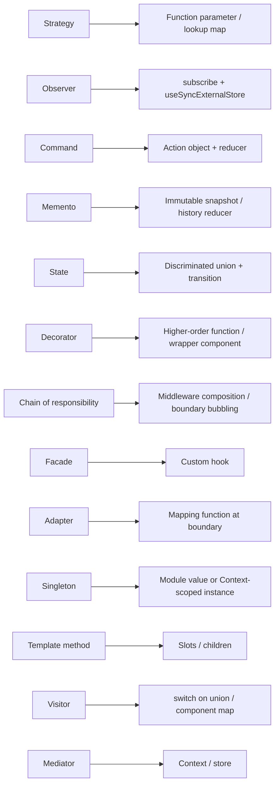
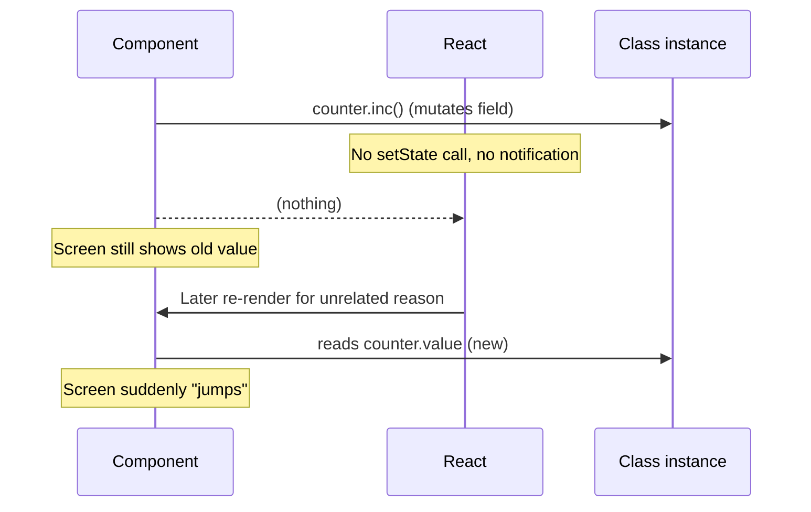

# 05 / 24 — OOP Patterns in Functional React: Mapping Gang-of-Four Ideas onto Functions, Closures, and Modules

## 1. Lesson metadata

| | |
|---|---|
| **Level** | Advanced |
| **Study time** | 5–6 hours (reading 2 h, experiments 1.5 h, exercises 2 h) |
| **Prerequisites** | [01 — SOLID in React](./01-solid-in-react.md), [03 — Composition over inheritance](./03-composition-over-inheritance.md), [12 — Reducer pattern](./12-reducer-pattern.md), [13 — State machine pattern](./13-state-machine-pattern.md), [14 — Observer and subscription](./14-observer-and-subscription.md), [15 — Adapter, strategy, factory](./15-adapter-strategy-factory.md), [16 — Dependency injection](./16-dependency-injection.md), [17 — Facade and command](./17-facade-and-command.md), [Phase 0 / 09 — Prototypes, `this`, classes](../00-web-and-javascript-foundations/09-prototypes-and-object-model.md), [Phase 0 / 06 — Closures](../00-web-and-javascript-foundations/06-lexical-scope-and-closures.md) |
| **Next** | [25 — Comparative refactoring labs](./25-comparative-refactoring-labs.md) |
| **Related later** | [Phase 6 / 10 — Zustand](../06-data-fetching-and-state-ecosystems/10-zustand.md), [Phase 6 / 12 — State machines and XState](../06-data-fetching-and-state-ecosystems/12-state-machines-and-xstate.md), [Phase 11 / 04 — Choosing abstraction level](../11-senior-and-architect-mastery/04-choosing-abstraction-level.md) |

**Learning objectives.** After this lesson you can:
1. State the *intent* of the classic object-oriented patterns (Singleton, Factory, Strategy, Observer, Decorator, Command, State, Template Method, Facade, Adapter, Proxy, Mediator, Memento, Chain of Responsibility, Visitor, Builder, Iterator) independent of their class-based encodings.
2. Map each to its idiomatic form in functional React: functions, closures, modules, discriminated unions, hooks, context, and composition.
3. Predict the failure modes that appear when OOP encodings are imported unchanged: mutable instances in state, module-level singletons on the server, `this` binding, inheritance hierarchies of components, and StrictMode double-invocation of initializers.
4. Decide when a class *is* the right tool in a React codebase (services, domain models, third-party integration objects) and how to hold one correctly.
5. Refactor an inheritance-based or class-service-based design into functional composition without losing the pattern's benefits.
6. Explain why immutability and referential identity change which patterns are viable.

**Concepts covered:** pattern intent vs encoding, closures as objects, modules as singletons, higher-order functions, discriminated unions as state/visitor, reducer as command interpreter, `useSyncExternalStore` as observer, hook as facade, lazy initial state for instance creation, mutable instances and identity, per-request scoping on the server, inheritance vs composition, Liskov in component props, immutable memento.

---

## 2. Deep conceptual explanation

### 2.1 What problem is this lesson solving?

Most engineers join a React team with object-oriented training (Java, C#, class-based TypeScript) or read pattern catalogs written for that world. Translating those patterns literally into React yields code that fights the framework: components that extend other components, service singletons imported anywhere, observers implemented with arrays of callbacks stored in component instances, "controllers" with mutable fields that React cannot detect changing.

This lesson separates **the intent of a pattern** (the design problem and the forces) from **its encoding in a language** (classes, interfaces, inheritance). Intent is portable; encodings are not. Functional React encodes the same intents with different tools:

| OOP tool | Functional-React counterpart |
|---|---|
| Class with private fields | Closure, or module with unexported bindings |
| Interface | TypeScript `type` / structural typing of a function or object |
| Inheritance | Composition, higher-order function, props, slots |
| Polymorphic method dispatch | Function passed in, discriminated union + `switch`, component map |
| Mutable object with methods | Immutable value + pure functions (reducer), or external store with subscription |
| Singleton instance | Module-level value (with care), or a context provided once |
| Constructor injection | Function parameters, props, context |
| `this` | Closure variables; avoid `this` entirely in components |

### 2.2 The foundation: React's rendering model changes which patterns work

Three properties of React rendering govern every translation:

1. **Render must be pure** ([Phase 2 / 12](../02-react-rendering-and-internals/12-why-rendering-must-be-pure.md)). A pattern that mutates shared objects during render breaks it.
2. **Change is detected by identity/`Object.is`** ([Phase 3 / 01](../03-react-state-and-hooks/01-usestate-internals-and-update-semantics.md), [Phase 7 / 05](../07-performance/05-referential-equality.md)). A mutable object whose fields change but whose reference stays the same is *invisible* to React.
3. **A component function may run more than once per commit** (StrictMode, concurrent rendering) and can be discarded. Code that runs during render, including `useState` initializers and `useMemo` callbacks, must be idempotent and free of observable side effects.

OOP patterns that rely on mutation and object identity as *state* need an adaptation layer: an **immutable snapshot** (reducer/state) or a **subscription** (store + `useSyncExternalStore`).

### 2.3 Where classes still belong

A class is a fine tool for:

- **Domain/service objects with an internal lifecycle** that is not UI state: an `ApiClient` with auth refresh, a `WebSocketConnection`, an `AudioEngine`, a charting library instance, a `Map` wrapper with eviction.
- **Third-party objects** (map instances, editors, players) that you hold by ref and synchronize via effects ([Phase 3 / 04](../03-react-state-and-hooks/04-useeffect-synchronization.md)).
- **Error boundaries** (class components are the supported mechanism).
- **Typed domain errors** (`class NotFoundError extends Error`).

What is wrong is not "using a class" but **using a class instance as render-visible state without a notification mechanism**, or **extending React components**. Section 5 shows both.

### 2.4 Common misconceptions

| Misconception | Reality |
|---|---|
| "Functional programming means no objects." | Objects (records, closures) are everywhere. The distinction is *how state changes*: replacement vs mutation. |
| "Design patterns don't apply to React." | The *problems* apply; the encodings differ. Strategy, Observer, Command, State, Facade, Adapter all appear daily. |
| "A hook is just a class method." | A hook is called each render and re-reads state; it is closer to a function with a persistent slot per call site ([Phase 2 / 17](../02-react-rendering-and-internals/17-hooks-and-fiber-state.md)). |
| "Singletons are fine in modules, so they're fine everywhere." | A module-level mutable singleton is shared across all requests in a Node SSR process and across tests. It is a global. |
| "Context is dependency injection, so a service locator is fine." | Context supports DI when scoped and typed; a global service locator hides dependencies and complicates tests ([lesson 16](./16-dependency-injection.md)). |
| "Inheritance is banned." | The React docs advise composition; they do not claim inheritance is impossible. Class components could extend, and the guidance is simply that no use case needs it ([lesson 03](./03-composition-over-inheritance.md)). |

---

## 3. Internal mechanics

### 3.1 Public guarantees vs teaching model vs implementation detail

- **Public guarantee.** Component render functions should be pure; state updates use `Object.is`; `useState`'s initializer function is called during initial render (and may be called twice in development StrictMode, with one result discarded); `useRef` returns the same object across renders for the lifetime of the component instance; `useSyncExternalStore` subscribes a component to an external store with tear-free reads.
- **Teaching model.** "A closure is an object: state in captured variables, methods as inner functions." "A reducer is a command interpreter: actions are command objects, the reducer executes them." "A custom hook is a facade over several lower-level hooks."
- **Implementation detail.** Where hook state lives on the fiber, and how refs persist. Teach as "per-component-instance slots"; see [Phase 2 / 17](../02-react-rendering-and-internals/17-hooks-and-fiber-state.md).

**Version-sensitive:** development-time double invocation of initializers and render is a StrictMode behavior, and in production each runs once, but never write code that *depends* on that count.

### 3.2 Why "mutable instance in state" fails

```tsx
const [cart] = useState(() => new Cart());     // class with add(item) mutating items
cart.add(item);                                  // mutates, no re-render
```

`useState` only re-renders when you call the setter with a value that is not `Object.is`-equal to the current one. `cart.add` mutates in place; nothing notifies React. If something else re-renders the component later, the UI will suddenly show the new items, producing the confusing "it updates when I do something else" symptom. A second variant, `setCart(cart)` after mutation, is a no-op because the identity is the same (React bails out).

### 3.3 Lazy initial state and double invocation

`useState(() => new Service())` calls the initializer once per mount in production, but in development StrictMode React may call it twice and discard one result. If the constructor opens a socket or registers a global listener, you will leak one. Rule: **constructors used during render must be side-effect-free**; start/stop side effects in `useEffect` with cleanup.

### 3.4 Modules as singletons

ES modules evaluate once per module graph per realm. A module-level `export const store = createStore()` gives every importer the same instance. In the browser that is one instance per page; in Node SSR it is one instance per **process**, shared between users' requests; in tests it is shared between tests in a file unless reset. This is the root cause of cross-request data leaks ([Phase 9 / 01](../09-advanced-rendering-and-ecosystem/01-spa-ssr-ssg-streaming.md)).

---

## 4. Step-by-step walkthrough: translating Command + Memento into a reducer with undo

Goal: an editor with `insert`, `delete`, `undo`, `redo`.

OOP encoding: `Command` interface with `execute()`/`undo()`, a `CommandManager` with two stacks, `Memento` snapshots for restoring.

Functional encoding, chronologically:

1. **Model state as an immutable value:** `{ text: string }`.
2. **Model commands as data:** `{ type: "insert"; at: number; value: string }`, `{ type: "delete"; at: number; length: number }`.
3. **Make `execute` a pure function** `apply(state, command): state`.
4. **Make the inverse a pure function** `invert(state, command): Command` (computed *before* applying, because delete needs the deleted text).
5. **History as state:** `{ past: Command[]; present: State; future: Command[] }`; or, alternatively, store snapshots (structural sharing makes snapshots cheap for immutable data: this is the Memento pattern).
6. **A reducer** handles `do`, `undo`, `redo` actions by moving items between stacks and calling `apply`.
7. **Component** dispatches; React re-renders because each reducer result is a new object.

Predict: after `insert("a")`, `insert("b")`, `undo`, `insert("c")`, what are `past` and `future`? `past = [insert a, insert c]`, `future = []`, because a new command after undo discards the redo branch (standard linear undo semantics). Section 5.3 implements this.

---

## 5. Code examples

### 5.1 Strategy: pass a function (not a class hierarchy)

OOP: `interface PricingStrategy { price(cart): Money }` plus `RegularPricing`, `BlackFridayPricing` classes selected by a factory.

```tsx
type Money = number; // minor units (cents) to avoid floating errors
type CartLine = { sku: string; unitPrice: Money; qty: number };
type PricingStrategy = (lines: readonly CartLine[]) => Money;

const regular: PricingStrategy = (lines) =>
  lines.reduce((sum, l) => sum + l.unitPrice * l.qty, 0);

const blackFriday: PricingStrategy = (lines) =>
  Math.round(regular(lines) * 0.8);

const strategies = { regular, blackFriday } as const satisfies Record<string, PricingStrategy>;
type StrategyName = keyof typeof strategies;

function CartTotal({ lines, mode }: { lines: readonly CartLine[]; mode: StrategyName }) {
  const total = strategies[mode](lines);
  return <output>{(total / 100).toFixed(2)}</output>;
}
```

Notes:

- The "factory" is an object lookup keyed by a union. Type-checked exhaustively because `StrategyName` derives from the map.
- Strategies are **pure functions**: trivial to test with plain assertions, no mocks.
- Money in integer minor units; rounding policy is part of the strategy's contract.
- `satisfies` (TS 4.9+) validates values against the type while keeping literal keys.

**Predict:** if a strategy needs I/O (a remote price service), the pure-function form breaks. Then the strategy returns a promise and belongs outside render (a loader/query), or the *selection* stays a pure function over data fetched elsewhere. The shape "strategy = function" holds; where it is called changes.

### 5.2 Observer: external store + `useSyncExternalStore`

OOP: `Subject` with `attach(observer)`/`notify()`.

```tsx
import { useSyncExternalStore } from "react";

type Listener = () => void;

export function createStore<T>(initial: T) {
  let state = initial;
  const listeners = new Set<Listener>();

  return {
    getState: () => state,
    setState(next: T | ((prev: T) => T)) {
      const value = typeof next === "function" ? (next as (p: T) => T)(state) : next;
      if (Object.is(value, state)) return;
      state = value;                         // replace, never mutate
      listeners.forEach((l) => l());         // notify
    },
    subscribe(l: Listener) {
      listeners.add(l);
      return () => { listeners.delete(l); };
    },
  };
}

export function useStore<T, S>(store: ReturnType<typeof createStore<T>>, select: (s: T) => S): S {
  return useSyncExternalStore(
    store.subscribe,
    () => select(store.getState()),
    () => select(store.getState()),
  );
}
```

Notes:

- The closure is the object: `state`, `listeners` are private; the returned methods are the public interface. There is no `this`.
- `setState` replaces the value and skips notification on equal values.
- `useStore`'s `select` must return a **stable** value for unchanged state (a primitive or a referentially stable slice). Returning `({ a: s.a })` each call causes the infinite-loop warning from [Phase 3 / 20](../03-react-state-and-hooks/20-usesyncexternalstore-and-external-stores.md).
- `ReturnType<typeof createStore<T>>` uses an instantiation expression (TS 4.7+). For clarity in a real codebase, export a `Store<T>` type.
- **Server caveat:** the third argument (`getServerSnapshot`) here reads the module/store instance, which on a server shared across requests would leak state. Per-request stores must be created per request and provided through context.

### 5.3 Command + Memento: undo/redo as a reducer

```tsx
type Command =
  | { type: "insert"; at: number; value: string }
  | { type: "delete"; at: number; length: number };

type Doc = { readonly text: string };

function apply(doc: Doc, c: Command): Doc {
  switch (c.type) {
    case "insert":
      return { text: doc.text.slice(0, c.at) + c.value + doc.text.slice(c.at) };
    case "delete":
      return { text: doc.text.slice(0, c.at) + doc.text.slice(c.at + c.length) };
  }
}

function invert(doc: Doc, c: Command): Command {
  switch (c.type) {
    case "insert":
      return { type: "delete", at: c.at, length: c.value.length };
    case "delete":
      return { type: "insert", at: c.at, value: doc.text.slice(c.at, c.at + c.length) };
  }
}

type History = {
  past: Array<{ forward: Command; backward: Command }>;
  present: Doc;
  future: Array<{ forward: Command; backward: Command }>;
};

type Action =
  | { type: "do"; command: Command }
  | { type: "undo" }
  | { type: "redo" };

export function historyReducer(h: History, a: Action): History {
  switch (a.type) {
    case "do": {
      const backward = invert(h.present, a.command);
      return {
        past: [...h.past, { forward: a.command, backward }],
        present: apply(h.present, a.command),
        future: [],
      };
    }
    case "undo": {
      const last = h.past[h.past.length - 1];
      if (!last) return h;
      return {
        past: h.past.slice(0, -1),
        present: apply(h.present, last.backward),
        future: [last, ...h.future],
      };
    }
    case "redo": {
      const next = h.future[0];
      if (!next) return h;
      return {
        past: [...h.past, next],
        present: apply(h.present, next.forward),
        future: h.future.slice(1),
      };
    }
  }
}
```

Notes:

- `invert` is computed from the document **before** applying (a delete needs the removed text). Computing it after is a classic bug: you lose the information.
- The reducer is pure: given the same history and action it returns the same result, so StrictMode's double invocation of reducers in development is harmless. See [Phase 3 / 03](../03-react-state-and-hooks/03-usereducer-and-reducer-architecture.md).
- `if (!last) return h;` returns the same reference, so React bails out of re-rendering (no spurious update).
- Memento alternative: store whole `Doc` snapshots in `past`. With immutable data, snapshots share structure when documents are trees; for strings, memory scales with size, so command-based history is cheaper for large text, snapshot-based is simpler and robust. That is the same Command-vs-Memento trade-off as in OOP.

### 5.4 State pattern: discriminated union + exhaustive switch (instead of State classes)

OOP: `abstract class ConnectionState { connect(); disconnect(); send() }` with subclasses.

```tsx
type Conn =
  | { status: "idle" }
  | { status: "connecting"; attempt: number }
  | { status: "open"; socketId: string }
  | { status: "failed"; reason: string };

type ConnEvent =
  | { type: "CONNECT" }
  | { type: "OPENED"; socketId: string }
  | { type: "FAIL"; reason: string }
  | { type: "CLOSE" };

function transition(s: Conn, e: ConnEvent): Conn {
  switch (s.status) {
    case "idle":
      return e.type === "CONNECT" ? { status: "connecting", attempt: 1 } : s;
    case "connecting":
      if (e.type === "OPENED") return { status: "open", socketId: e.socketId };
      if (e.type === "FAIL") return s.attempt < 3
        ? { status: "connecting", attempt: s.attempt + 1 }
        : { status: "failed", reason: e.reason };
      return s;
    case "open":
      return e.type === "CLOSE" ? { status: "idle" } : s;
    case "failed":
      return e.type === "CONNECT" ? { status: "connecting", attempt: 1 } : s;
  }
}
```

Notes: impossible states are unrepresentable (`socketId` exists only when `open`). Adding a state forces TypeScript to flag every `switch` that omits it, *if* the function has a return type that disallows `undefined` (which `noImplicitReturns`/the declared return type enforce). Full machine design is in [lesson 13](./13-state-machine-pattern.md).

### 5.5 Incorrect: class instance as render-visible state

```tsx
class Counter {
  value = 0;
  inc() { this.value++; }
}

function Bad() {
  const [counter] = useState(() => new Counter());
  return <button onClick={() => counter.inc()}>{counter.value}</button>;
}
```

**Predict:** click the button three times. What does the UI show? *Answer:* `0`. `inc` mutates the object; no setter is called; React is never told to re-render. If the parent re-renders later, the button suddenly shows `3`.

A worse "fix": add `const [, force] = useState(0); onClick={() => { counter.inc(); force(n => n + 1); }}`. It works until `counter` is shared by two components (only one re-renders), or until a concurrent render reads the object mid-mutation ("tearing"). The mutable object is read during render and changed outside it, which is exactly what the purity rules prohibit.

### 5.6 Corrected: three valid options

```tsx
// (1) Immutable value + pure functions
type Counter = { readonly value: number };
const inc = (c: Counter): Counter => ({ value: c.value + 1 });
function Good1() {
  const [c, setC] = useState<Counter>({ value: 0 });
  return <button onClick={() => setC(inc)}>{c.value}</button>;
}

// (2) Class instance kept as an external store with subscription
class CounterStore {
  #value = 0;
  #listeners = new Set<() => void>();
  getSnapshot = () => this.#value;           // arrow properties keep `this` bound
  subscribe = (l: () => void) => { this.#listeners.add(l); return () => { this.#listeners.delete(l); }; };
  inc = () => { this.#value++; this.#listeners.forEach((l) => l()); };
}
const counterStore = new CounterStore();
function Good2() {
  const v = useSyncExternalStore(counterStore.subscribe, counterStore.getSnapshot, counterStore.getSnapshot);
  return <button onClick={counterStore.inc}>{v}</button>;
}

// (3) A reducer
function Good3() {
  const [n, dispatch] = useReducer((s: number, a: "inc") => (a === "inc" ? s + 1 : s), 0);
  return <button onClick={() => dispatch("inc")}>{n}</button>;
}
```

Notes: Option (2) is legitimate when a class models something that outlives components (a connection, a cache). Arrow-function properties avoid unbound `this` when methods are passed as callbacks; the trade-off is one function per instance instead of one on the prototype. `#private` fields are runtime-private (ES2022). Option (2)'s module-level instance is shared across SSR requests; per-request instances must be created per request.

### 5.7 Singleton: module vs per-request instance

```tsx
// ❌ Server: one shared mutable cache across all users
export const userCache = new Map<string, User>();

// ✅ Create per request / per app instance and provide via context
const CacheContext = createContext<Map<string, User> | null>(null);

export function CacheProvider({ children }: { children: ReactNode }) {
  const [cache] = useState(() => new Map<string, User>()); // lazy initializer; no side effects
  return <CacheContext value={cache}>{children}</CacheContext>;
}
```

Notes:

- `useState(() => …)` ensures one instance per mounted provider (per request when rendering on the server with a fresh tree).
- Mutating a `Map` held in state is *not* observable by React; consumers must not rely on re-rendering when entries change. For observable caches use a store with subscription (§5.2).
- In the browser one provider near the root is a singleton for practical purposes with test-friendly replacement.

### 5.8 Decorator and Chain of Responsibility: higher-order functions and middleware

```tsx
type Fetcher = (input: RequestInfo, init?: RequestInit) => Promise<Response>;
type Middleware = (next: Fetcher) => Fetcher;

const withAuth = (getToken: () => string): Middleware => (next) => (input, init) =>
  next(input, { ...init, headers: { ...init?.headers, Authorization: `Bearer ${getToken()}` } });

const withRetry = (times: number): Middleware => (next) => async (input, init) => {
  let lastError: unknown;
  for (let i = 0; i <= times; i++) {
    try {
      const res = await next(input, init);
      if (res.status < 500) return res;
      lastError = new Error(String(res.status));
    } catch (e) { lastError = e; }
  }
  throw lastError;
};

const compose = (...ms: Middleware[]): Middleware => (next) => ms.reduceRight((f, m) => m(f), next);

export const apiFetch: Fetcher = compose(withAuth(() => "token"), withRetry(2))(fetch);
```

Notes: decoration is function wrapping; the chain is the composition order (outermost first). Retrying a request with a consumed body or a non-idempotent method is unsafe; the middleware above is illustrative and omits idempotency checks and backoff. `withRetry` retries on thrown errors including aborts, which you would normally exclude (`AbortError`).

### 5.9 Facade over a service class, held correctly in a component

```tsx
class UploadService {
  constructor(private readonly client: Fetcher) {}
  async upload(file: File, onProgress: (n: number) => void, signal: AbortSignal) { /* … */ }
}

function useUpload() {
  const client = use(ApiContext);                       // injected
  const service = useMemo(() => new UploadService(client), [client]);
  const [state, setState] = useState<{ status: "idle" | "uploading" | "done" | "error"; progress: number }>({ status: "idle", progress: 0 });
  const abortRef = useRef<AbortController | null>(null);

  const start = useCallback(async (file: File) => {
    abortRef.current?.abort();
    const ctrl = new AbortController();
    abortRef.current = ctrl;
    setState({ status: "uploading", progress: 0 });
    try {
      await service.upload(file, (n) => setState({ status: "uploading", progress: n }), ctrl.signal);
      if (!ctrl.signal.aborted) setState({ status: "done", progress: 100 });
    } catch { if (!ctrl.signal.aborted) setState({ status: "error", progress: 0 }); }
  }, [service]);

  useEffect(() => () => abortRef.current?.abort(), []);
  return { ...state, start };
}
```

Notes:

- The class is **stateless** (holds only injected collaborators), so creating it in `useMemo` is safe even if called twice. `useMemo` is a performance hint, not a semantic guarantee, so the service must be cheap and side-effect-free to recreate.
- The hook is the facade: components see `{ status, progress, start }`, not `UploadService`.
- Cleanup aborts in-flight upload on unmount; the guard `ctrl.signal.aborted` prevents late `setState` after replacement.

### 5.10 Inheritance → composition (Template Method)

OOP: `abstract class BaseForm { render() { header(); fields(); footer(); } }`.

```tsx
type FormShellProps = {
  title: string;
  fields: ReactNode;
  footer?: ReactNode;
};
function FormShell({ title, fields, footer }: FormShellProps) {
  return (
    <form>
      <h2>{title}</h2>
      {fields}
      {footer ?? <button>Save</button>}
    </form>
  );
}
function ProfileForm() { return <FormShell title="Profile" fields={<ProfileFields />} />; }
```

The "template" is the shell component; the "hook methods" are slots ([lesson 20](./20-slot-patterns.md)).

---

## 6. Visual explanations

### Pattern-to-mechanism map



### Why mutation is invisible



---

## 7. Alternative approaches and trade-offs

| Need | Class-based | Function/closure-based | Store + subscription | Reducer/union |
|---|---|---|---|---|
| Private state | `#field` | Closure | Closure | State value |
| Detect change | Manual notify | n/a | Notify + snapshot | Identity change |
| Testability | Mock instances | Call function | Create store per test | Pure function test |
| SSR safety | Per-request instance needed | Pure functions safe | Per-request store | Safe |
| Devtools/time-travel | Hard | n/a | Possible via middleware | Easy (actions are data) |
| Serialization | Custom | Easy for data | Snapshot serializable if plain | Easy |
| Inheritance hooks | Possible | Not needed | n/a | n/a |

**Scenario where the recommended (functional) approach is not best.** Wrapping a complex imperative third-party engine (a map renderer, a WebGL scene, a rich text editor core). The engine is a mutable object with a lifecycle; forcing it into immutable snapshots wastes effort and often loses performance. Hold it in a ref, create it in an effect (or lazily in a ref callback), expose a thin typed facade hook, and synchronize *React state → engine* in effects and *engine events → React state* via subscriptions. A class (or the library's own instance) is the right domain model here.

---

## 8. Best practices and anti-patterns

**Beginner mistakes**
- Mutating class instances held in state (§5.5).
- Calling `new Service()` in the component body (new instance per render, losing internal state and leaking subscriptions).
- Binding `this` incorrectly in callbacks.
- Building a component hierarchy with `extends`.

**Experienced-developer mistakes**
- Module-level singletons holding per-user data on a server.
- Constructors with side effects used in lazy `useState` initializers (double invoked in dev StrictMode).
- Re-implementing a DI container with decorators and reflect-metadata for a UI app where context and props suffice.
- Observers that notify during render (setState-in-render loops).
- Treating reducers as places for I/O ([lesson 12](./12-reducer-pattern.md)): reducers must be pure.
- Overengineering: a `StrategyFactory` class hierarchy where a lookup map would do ([Phase 5 / 02 — YAGNI](./02-dry-kiss-yagni.md)).

**Smells**
- `this` appearing in component code.
- Arrays of callbacks stored in a `useRef` with manual notify (it is usually a store that should be extracted).
- A `Manager`, `Controller`, or `Helper` class with only static methods (it is a module).
- A `forceUpdate`-style `useState` counter.

**Justified exceptions**
- A class for a long-lived imperative resource.
- `class AppError extends Error` hierarchies for error taxonomy.
- Error boundaries as classes.
- DI container in a large codebase *shared with non-React code* (a Node/React hybrid).

**Not universal:** a pattern encoded as a function is not automatically better; when the domain really has behavior-polymorphic *objects with identity and lifecycle*, a class is clearer.

---

## 9. Real-world application

**E-commerce pricing.** Strategies as pure functions keyed by promotion type, selected by a discriminated union coming from the backend. Constraints: money in integer minor units; rounding rules legally specified; strategies are unit-tested exhaustively; the server remains the source of truth for final totals.

**Collaborative editor.** Command history with inverse commands; operations transformed for concurrency (outside this lesson's scope: OT/CRDT). Constraints: undo must be per-user, history memory-bounded, command log serializable.

**Real-time dashboard.** A WebSocket connection class (long-lived), exposed to React through a store + `useSyncExternalStore`; per-widget selectors keep re-render scope narrow. Constraints: reconnection with backoff, message bursts, cleanup on route change.

**Auth.** A session object as an immutable snapshot in a store; a facade hook `useSession()`; a chain of request middleware attaches tokens and refreshes once (single-flight refresh to avoid parallel refresh storms).

**Multi-team.** Document which patterns are standard (store creation per app instance, factory for API clients) and forbid hidden globals; enforce with ESLint rules about module-level mutable state in server-rendered packages.

---

## 10. Debugging and troubleshooting

| Symptom | Likely root cause | Investigation | Fix |
|---|---|---|---|
| UI does not update after calling an instance method | Mutation without notification | Set a breakpoint in render; log that no render occurred (React DevTools Profiler) | Immutable value, reducer, or store + `useSyncExternalStore` |
| UI shows other users' data intermittently on server | Module-level singleton cache | Reproduce with two concurrent requests; inspect module state | Per-request instance via context |
| Two sockets opened in dev | Constructor side effect in lazy initializer; StrictMode double-invocation | Network tab shows duplicate connections only in dev | Move connect to `useEffect` with cleanup |
| `Cannot read properties of undefined (reading 'x')` when passing a method as a callback | Lost `this` binding | Stack trace in handler | Arrow property, `bind`, or closure-based object |
| Infinite render loop with store hook | `getSnapshot` returns a new object each call | Console warning from React; log snapshot identity | Return stable/primitive snapshot; memoize selector output |
| Undo restores wrong text for delete | Inverse command computed after applying | Unit test with delete then undo | Compute inverse from the pre-apply state |
| Test pollution across test cases | Shared module singleton | Run tests in isolation vs together | Factory function per test; reset in `afterEach` |

---

## 11. Exercises

### Level A — Knowledge
A1. State the intent of Strategy, Observer, and Command in one sentence each, without referencing classes.
A2. Why does mutating a class instance held in `useState` not re-render? Name the React mechanism involved.
A3. What is the functional encoding of the State pattern, and what bug class does it prevent?
A4. Why are module-level singletons dangerous in server-rendered apps?
A5. When is a class the right choice in a React codebase? Give two examples.

### Level B — Code comprehension
B1. In §5.2, what happens if `select` returns `{ a: s.a }`? Why?
B2. In §5.3, trace `do(insert 0 "ab")`, `do(delete 0 1)`, `undo`, `undo`, `redo`. Give `present`, `past.length`, `future.length` after each step.
B3. In §5.6 option (2), why are `getSnapshot`/`subscribe`/`inc` arrow properties?
B4. In §5.9, why must `UploadService` be cheap and side-effect-free to construct?

### Level C — Implementation
C1. Implement a `createPersistedStore<T>(key, initial)` that persists to `localStorage`, is SSR-safe, and exposes `subscribe/getSnapshot/getServerSnapshot`.
C2. Convert a `NotificationSender` class hierarchy (`EmailSender`, `SmsSender`, `PushSender`) used in a settings screen to a strategy map with exhaustive typing.
C3. Add a `batch(commands)` action to §5.3 that undoes as one step.
C4. Implement a `Visitor`-style renderer for an AST (`Text | Bold | Link | List`) using a component map and exhaustive checking.

### Level D — Debugging
D1. A `Cart` class instance in context; `cart.add()` updates the badge only when the user navigates. Diagnose and give two fixes.
D2. A lazily created `new WebSocketClient(url)` in `useState` initializer opens two sockets in development and one in production. Explain, fix, and say whether production has a hidden bug.
D3. A `Map` cache in module scope returns user A's profile to user B during peak traffic on a Node server. Explain and fix.
D4. A decorator-style `withRetry` retries `POST /charge` and double-charges. Fix the design.

### Level E — Architecture and engineering decisions
E1. Your team debates a Java-style DI container (inversify-like decorators) vs React context + props for a 300-component app. Decide and justify.
E2. Choose between a class-based `ApiClient` and a function-based `createApiClient()` returning a closure object. Compare on testing, SSR, tree-shaking, and typing.
E3. A new hire wants an abstract `BaseTable` with subclasses. Propose a compositional design and explain what the team gives up.

### Level F — Expert challenge
F1. Design a history system for a design tool (thousands of shapes) that supports undo/redo, bounded memory, and collaborative remote edits not being undone by local undo. Compare command log, snapshots with structural sharing, and hybrid.
F2. Design a per-request store architecture for SSR + streaming so that a store can be created on the server, serialized, and revived on the client without module singletons. List pitfalls.

---

## 12. Detailed answers and explanations

> Attempt the exercises first.

**A1.** Strategy: choose an interchangeable algorithm at runtime without changing its callers. Observer: let interested parties be notified when a value changes without the source knowing who they are. Command: represent a request as data so it can be queued, logged, undone, or replayed.

**A2.** React re-renders on state updates triggered through a setter (or reducer dispatch, store subscription). `useState` bails out when the new value is `Object.is`-equal to the old. Mutating the instance neither calls a setter nor changes identity; nothing schedules a render.

**A3.** A discriminated union with a `status` tag and a transition function (or reducer) using an exhaustive `switch`. It prevents impossible-state bugs (flags that disagree: `loading && error`), and missing-case bugs when a new state is added.

**A4.** Node module state is shared by all requests in a process; request A can write data that request B reads. It also persists across hot-reloads and tests. Cross-user data leaks are a security incident, not just a bug.

**A5.** Long-lived imperative resources (WebSocket manager, audio engine, map instance) and Error boundaries (class components) or typed errors. Also domain classes shared with non-React code.

**B1.** Each call to `getSnapshot` returns a new object; React compares snapshots with `Object.is`, sees them as different on every check, and (in dev) warns that `getSnapshot` should be cached; it may re-render continuously or loop. Select primitives or stable references; or select the whole state and derive with `useMemo` afterwards.

**B2.** Start: `present=""`, past 0, future 0.
1. `do(insert 0 "ab")`: backward = delete(0, 2); present `"ab"`; past 1; future 0.
2. `do(delete 0 1)`: backward = insert(0, "a") (computed from `"ab"`); present `"b"`; past 2; future 0.
3. `undo`: apply backward of last = insert(0,"a") → `"ab"`; past 1; future 1.
4. `undo`: apply delete(0,2) → `""`; past 0; future 2.
5. `redo`: future[0] is the first command (insert "ab") since `future = [last, ...future]` prepends; present `"ab"`; past 1; future 1.

Redo reapplies the *most recently undone* command, which here is the first command (it was undone last).

**B3.** The members are passed as callbacks (`subscribe` to React, `inc` to `onClick`) detached from the instance. Prototype methods would lose `this`; arrow properties capture it lexically. Trade-off: one function allocation per instance per member and no override via prototype.

**B4.** `useMemo` is a performance optimization; React may discard cached values and recompute (and in dev StrictMode invokes the callback twice). A constructor with side effects (opening connections, registering listeners) would duplicate them. Keep construction pure; start side effects in effects with cleanup.

**C1.** Sketch:

```tsx
export function createPersistedStore<T>(key: string, initial: T) {
  let state = initial;
  let hydrated = false;
  const listeners = new Set<() => void>();
  const read = () => {
    if (hydrated || typeof window === "undefined") return;
    hydrated = true;
    try { const raw = localStorage.getItem(key); if (raw != null) state = JSON.parse(raw) as T; } catch { /* ignore */ }
  };
  return {
    getSnapshot: () => { read(); return state; },
    getServerSnapshot: () => initial,
    subscribe(l: () => void) {
      listeners.add(l);
      const onStorage = (e: StorageEvent) => {
        if (e.key !== key) return;
        try { state = e.newValue == null ? initial : (JSON.parse(e.newValue) as T); } catch { return; }
        listeners.forEach((x) => x());
      };
      window.addEventListener("storage", onStorage);
      return () => { listeners.delete(l); window.removeEventListener("storage", onStorage); };
    },
    set(next: T) {
      state = next;
      try { localStorage.setItem(key, JSON.stringify(next)); } catch { /* quota/private mode */ }
      listeners.forEach((l) => l());
    },
  };
}
```

Criteria: `getServerSnapshot` returns `initial`; storage access in try/catch; cross-tab sync via the `storage` event (fires in *other* tabs); stable snapshot identity; no access to `localStorage` during module evaluation on the server. Note the hydration mismatch: first client render uses `getSnapshot` (stored value) after React compares with the server snapshot; React handles by re-rendering after hydration when snapshots differ. ⚠ verify the behavior for your React version. Per-request/per-key instances on server must not hold user data.

**C2.**

```tsx
type Channel = "email" | "sms" | "push";
type Sender = (to: string, body: string) => Promise<void>;
const senders: Record<Channel, Sender> = {
  email: async (to, body) => { /* … */ },
  sms: async (to, body) => { /* … */ },
  push: async (to, body) => { /* … */ },
};
export const send = (c: Channel, to: string, body: string) => senders[c](to, body);
```

`Record<Channel, Sender>` enforces exhaustiveness: adding `"slack"` to `Channel` without a sender is a compile error. What you give up: per-sender internal state (move to closures if needed), `instanceof` checks (use the tag).

**C3.** Add `{ type: "batch"; commands: Command[] }`: in the reducer apply commands sequentially to compute `present`, collecting backward commands in reverse; push *one* history entry whose `forward` is a `batch` command and `backward` is a batch of inverses in reverse order. Edge: each inverse must be computed from the state *at that point* of the sequence, not the state before the batch. Test: batch of two inserts undoes in one step.

**C4.**

```tsx
type Node =
  | { kind: "text"; value: string }
  | { kind: "bold"; children: Node[] }
  | { kind: "link"; href: string; children: Node[] }
  | { kind: "list"; items: Node[][] };

function assertNever(x: never): never { throw new Error(`Unhandled ${JSON.stringify(x)}`); }

function Render({ node }: { node: Node }): ReactNode {
  switch (node.kind) {
    case "text": return node.value;
    case "bold": return <strong>{node.children.map((c, i) => <Render key={i} node={c} />)}</strong>;
    case "link": return <a href={node.href}>{node.children.map((c, i) => <Render key={i} node={c} />)}</a>;
    case "list": return <ul>{node.items.map((it, i) => <li key={i}>{it.map((c, j) => <Render key={j} node={c} />)}</li>)}</ul>;
    default: return assertNever(node);
  }
}
```

Criteria: exhaustive; index keys acceptable here because the AST is static per render (state any assumption); validate `href` against `javascript:` URLs if the AST is untrusted (security).

**D1.** Mutation without notification: context holds the same instance; `add` mutates; consumers do not re-render (context value identity unchanged). Navigation re-renders consumers for other reasons. Fixes: (1) immutable cart state with a reducer in the provider, exposing `{ cart, dispatch }`; (2) cart as a store with subscription and `useSyncExternalStore` selectors (so the badge subscribes narrowly). Wrong fix: creating a new context value on each render to force updates (re-renders all consumers).

**D2.** Dev StrictMode intentionally double-invokes initializers/effects to expose impurity: the first initializer result is discarded but its constructor already opened a socket. In production, one socket is opened *by the constructor* but never cleaned up on unmount: a leak. The hidden bug is real: constructors with side effects leak in production on every mount/unmount cycle. Fix: construct without connecting; connect in `useEffect`, return cleanup that closes.

**D3.** The module-level map is shared across requests in the process; user A's entry served to B when keys collide (for example a missing user-scoped key, or caching by a non-unique key like `"me"`). Fix: per-request cache instance created at request start and provided via context; or key by user id and avoid caching personalized data in a process-global cache (use a shared cache only for public data with explicit TTL).

**D4.** Retrying non-idempotent requests is unsafe. Fix: retry only idempotent methods (GET/HEAD/PUT/DELETE by spec semantics) or require an idempotency key on POSTs and let the server dedupe; classify errors (network error before the request was sent vs timeout after). The middleware should take a policy object, not retry by default.

**E1.** Recommended: context + props with explicit factories; decorators + reflection add build complexity (metadata emission), obscure dependencies from static analysis and bundlers, and fight tree shaking. DI container is justifiable when the same service layer is shared with non-React backend code. Evaluate with: dependency visibility, testing ease (swap provider in tests), bundle impact, onboarding cost, SSR scoping.

**E2.** Function-based factory: closures give privacy without `this` pitfalls; easy per-request creation; tree-shakes better when exposing multiple functions; typing via return type. Class: familiar to OO devs, `instanceof`, inheritance for mock fakes. Testing: both can be faked by passing a `Fetcher`; class mocking tools often rely on prototype spying. SSR: both fine if created per request. Preference: function, unless the team and tooling are class-oriented; not a correctness issue.

**E3.** Composition: a `Table` component with column definitions (`columns` array of `{ id, header, cell, sort }`), slot props for toolbar/empty state, headless hook `useTable` for behavior ([lesson 07](./07-headless-components.md)). What you give up: a single obvious override point per behavior (subclass method) in exchange for explicit extension points and typed configuration; discoverability requires docs. Weak answers say "inheritance is bad" without discussing variation points.

**F1.** Evaluation: command log with inverse commands (small memory, but replaying/transforming under remote edits is complex), snapshots with structural sharing (immutable trees; memory proportional to changed paths; trivial restore; remote edits create new snapshots complicating per-user undo), hybrid (periodic snapshots + commands). For collaboration: *local undo must invert only local operations and transform against interleaved remote ones* (operational transform / CRDT-based undo managers). Bound memory by capping the history length and coalescing rapid edits (typing, drags). Verify claims against a CRDT/OT library's documented undo semantics rather than inventing your own.

**F2.** Outline: create a store instance per request in the server render entry; pass via context; serialize the store snapshot into the HTML (escaped JSON, guarding against `</script>` injection); on the client create a store with the snapshot as initial state; streaming: late-resolving data needs a mechanism to append serialized updates, or restrict stores to data known at shell time. Pitfalls: non-serializable values (Dates, Maps, class instances), module-level imports retaining state, hydration mismatch if client reads browser-only data in initial snapshot, XSS via unescaped JSON, store created in module scope by a third-party library default. Frameworks provide data-serialization conventions; prefer them.

---

## 13. Senior engineer interview questions

**Q1. Do design patterns still matter in functional React?**
The problems matter; the encodings changed. Strategy becomes a function parameter, Observer becomes subscription via `useSyncExternalStore`, Command becomes action objects and reducers, State becomes discriminated unions. Knowing the intent lets you choose the cheapest encoding and recognize when an over-engineered class hierarchy is unnecessary.

**Q2. Why can't I keep my state in a class instance and call `forceUpdate`-like code?**
React's model is snapshot-based: render reads state, event handlers replace state. A mutable instance read during render and changed elsewhere can produce tearing under concurrent rendering and invisible updates when identity is unchanged. `useSyncExternalStore` exists precisely to make external mutable stores safe.

**Q3. How do you scope a "singleton" correctly?**
Decide the lifetime: page (module or root provider), request (per-request instance provided via context), user session, or test. The word singleton hides scoping; a module-level value gives process lifetime, which is wrong on servers.

**Q4. What is wrong with `useState(() => new Foo())` where `Foo` connects in its constructor?**
Initializers run during render and may run more than once (StrictMode in development; discarded renders in concurrent rendering). Side effects belong in effects with cleanup.

**Q5. Is a reducer an implementation of Command?**
Actions are command objects (data) and the reducer is the interpreter. Unlike classic Command, there is no `undo()` on the object: undo is a separate reducer concern (inverse commands or snapshots). Reducers must be pure; I/O belongs in handlers or Actions.

**Q6. When would you choose a class over closures?**
When the domain is naturally objects with identity and lifecycle (connections, engines), when interop with class-based libraries requires it, or when the team's tooling (e.g., decorators in a shared backend) is class-centric. Not for UI state.

**Q7. How do you test code organized as patterns?**
Pure encodings (strategies, reducers, transitions) with plain unit tests; stores with a fresh instance per test; facades via the hook under a provider test harness; side-effectful services via fakes injected through context or parameters. Avoid module singletons in tests, or reset them.

**Q8. What's the downside of encoding patterns as functions?**
Less discoverable structure for people used to named classes; type-level documentation is weaker; closure-captured state is harder to inspect in debuggers than object fields. Mitigate with naming conventions, types (`type Store<T>`), and docs.

---

## 14. Further learning resources

| Resource | URL | Covers / why | Level | Study |
|---|---|---|---|---|
| React docs — Keeping components pure | <https://react.dev/learn/keeping-components-pure> | Purity, mutation during render | Beginner | Whole page |
| React docs — Updating objects in state | <https://react.dev/learn/updating-objects-in-state> | Why mutation is invisible | Beginner | Whole page |
| React docs — `useSyncExternalStore` | <https://react.dev/reference/react/useSyncExternalStore> | External stores, snapshot rules | Advanced | Caveats |
| React docs — `useReducer` | <https://react.dev/reference/react/useReducer> | Reducers and purity | Intermediate | Caveats |
| React docs — Extracting state logic into a reducer | <https://react.dev/learn/extracting-state-logic-into-a-reducer> | Command-like actions | Intermediate | Whole page |
| React docs — `useState` (initializer) | <https://react.dev/reference/react/useState> | Lazy initializers, StrictMode | Beginner | "Avoiding recreating the initial state" |
| TypeScript handbook — Narrowing (discriminated unions) | <https://www.typescriptlang.org/docs/handbook/2/narrowing.html> | Exhaustiveness checks | Intermediate | Discriminated unions, `never` |
| MDN — Closures | <https://developer.mozilla.org/en-US/docs/Web/JavaScript/Closures> | Closures as encapsulation | Beginner | Whole page |
| MDN — Private class elements | <https://developer.mozilla.org/en-US/docs/Web/JavaScript/Reference/Classes/Private_elements> | `#private` fields | Intermediate | Whole page |
| Refactoring.Guru — Design patterns catalog | <https://refactoring.guru/design-patterns> | Pattern intent, class-based encodings | Beginner | Pattern descriptions |

URLs in this table were checked for HTTP 200 on 2026-10-22; any still marked *(unverified)* could not be checked automatically. A 200 does not guarantee the page content still matches the description; if a link has moved, search the site for the quoted title.

---

## 15. Knowledge checkpoint

**You should now understand**
- Pattern intent is portable; class-based encodings often are not.
- Why React's purity and identity-based change detection invalidate mutable-instance designs, and which constructs (reducer, store + subscription, discriminated union) restore the benefits.
- How scoping (module, provider, request) determines whether a "singleton" is safe.

**You should be able to explain without notes**
- The mapping of at least ten OOP patterns to functional encodings, and what each gains and loses.

**You should be able to implement**
- A strategy map, a subscription store with `useSyncExternalStore`, an undo/redo reducer, a discriminated-union state machine, a middleware chain, and a facade hook over a service class.

**You should be able to debug**
- Invisible mutation, StrictMode double-initialization leaks, singleton data leaks, lost `this`, and non-idempotent retries.

**Before moving on:** apply these translations end to end in [25 — Comparative refactoring labs](./25-comparative-refactoring-labs.md).
