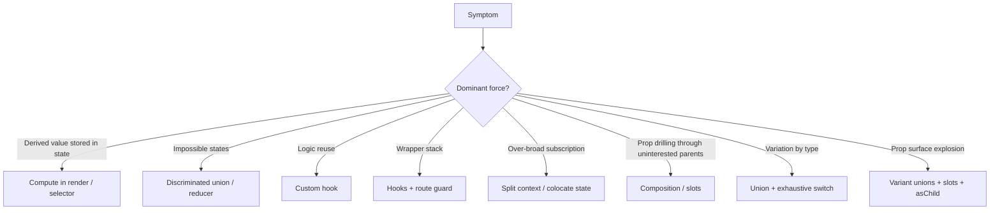
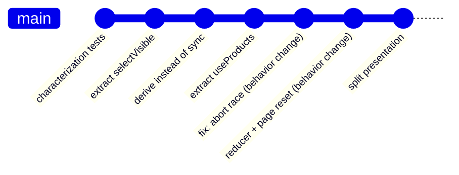

# 05 / 25 — Comparative Refactoring Labs: Six Before/After Transformations with Measured Trade-offs

## 1. Lesson metadata

| | |
|---|---|
| **Level** | Advanced–Professional |
| **Study time** | 8–10 hours (reading 2 h, labs 5 h, exercises 2 h) |
| **Prerequisites** | [01 — SOLID](./01-solid-in-react.md), [02 — DRY, KISS, YAGNI](./02-dry-kiss-yagni.md), [04 — Container/presentational](./04-container-presentational.md), [05 — Compound components](./05-compound-components.md), [06 — Custom hook patterns](./06-custom-hook-patterns.md), [08 — Provider pattern](./08-provider-pattern.md), [09 — Higher-order components](./09-higher-order-components.md), [12 — Reducer pattern](./12-reducer-pattern.md), [13 — State machine pattern](./13-state-machine-pattern.md), [20 — Slot patterns](./20-slot-patterns.md), [23 — Patterns made less necessary](./23-patterns-made-less-necessary.md), [24 — OOP patterns in functional React](./24-oop-patterns-in-functional-react.md), [Phase 4 / 24 — Refactoring legacy React](../04-react-architecture/24-refactoring-legacy-react.md), [Phase 3 / 07 — You might not need an effect](../03-react-state-and-hooks/07-you-might-not-need-an-effect.md) |
| **Next** | [26 — Phase assessment](./26-phase-assessment.md) |
| **Related later** | [Phase 7 / 03 — Why components re-render](../07-performance/03-why-components-rerender.md), [Phase 8 / 16 — Avoiding brittle tests](../08-testing-and-quality/16-avoiding-brittle-tests.md), [Phase 11 / 03 — Large-scale refactoring](../11-senior-and-architect-mastery/03-large-scale-refactoring.md), [Project 7 — Reusable component library](../projects/) |

**Learning objectives.** After this lesson you can:
1. Apply a repeatable **behavior-preserving refactoring protocol**: characterize, isolate, transform in small steps, verify with tests and the Profiler, then (separately) fix bugs.
2. Transform six representative "legacy" components using the right pattern for each problem, and justify *why that pattern and not another*.
3. Measure before/after on explicit criteria (render counts, tree depth, lines of branching logic, type safety, testability) instead of relying on taste.
4. Recognize when a refactor is not worth doing, or when the "after" is worse in a given context.
5. Keep refactors reviewable: small commits, each independently correct.
6. Present a refactoring proposal with trade-offs to a team.

**Concepts covered:** characterization tests, extract hook / extract pure function, derive-don't-sync, reducer extraction, discriminated unions, compound components with slots, variant unions replacing boolean props, HOC-to-hook migration, context splitting, composition to avoid prop drilling, state colocation, exhaustive switch, abort/ignore for races, strangler-style migration, refactoring metrics.

---

## 2. Deep conceptual explanation

### 2.1 What problem is this lesson solving?

Patterns taught in isolation are easy to admire and hard to apply. In real code, a single component exhibits several problems at once (fetching, derived state, boolean flags, prop drilling), and the choice of pattern depends on **which force dominates**. A refactoring lab forces the decision sequence: *observe symptoms → name the force → pick the smallest pattern that relieves it → verify.*

### 2.2 The refactoring protocol used in every lab

1. **Characterize.** Write tests (or at minimum a manual script) that capture *current observable behavior*, including known bugs. If behavior is untested, you cannot claim "behavior-preserving".
2. **Baseline metrics.** Record: component count, lines of branching logic, hook count, render count per interaction (React DevTools Profiler), type errors suppressed (`any`, `as`), and test difficulty.
3. **Name the force.** Examples: *duplicated derived state*, *unrepresentable states are representable*, *cross-cutting wrapper stack*, *over-broad subscription*, *variation by type*, *unbounded prop surface*.
4. **Choose the smallest pattern** that removes the force (not the most impressive one).
5. **Refactor in small steps**, each leaving tests green. Prefer mechanical moves (extract function, extract component, rename) before design changes.
6. **Verify**: tests, type check, Profiler comparison, bundle diff if relevant.
7. **Fix bugs in separate commits.** A refactor that also fixes bugs hides regressions. Where a lab discovers a bug in the "before", the bug fix is a distinct step, labelled.
8. **Review criteria**: is the "after" easier to *change*, not just prettier?

### 2.3 Misconceptions

| Misconception | Reality |
|---|---|
| "Refactoring means rewriting." | Refactoring changes structure while preserving behavior, in small steps. A rewrite changes both and discards accumulated bug fixes. |
| "More abstractions = better design." | Each abstraction has a cost (indirection, documentation). Prefer the smallest abstraction that removes the force ([lesson 02](./02-dry-kiss-yagni.md)). |
| "If tests pass, behavior is preserved." | Only for behavior the tests assert. Characterize first; include timing/race behavior where feasible. |
| "Performance improvements justify refactors." | Unmeasured. Verify with the Profiler; sometimes the refactor changes nothing for users. |
| "Hooks always beat components for reuse." | A hook shares logic, a component shares logic *and* UI structure; choose by what varies. |

---

## 3. Internal mechanics of a safe refactor

### 3.1 Public guarantee / teaching model / implementation detail

- **Public guarantee.** React renders are a function of props, state, and context; the same inputs yield the same output when components are pure. Hence a *pure extraction* (moving a calculation into a function, a JSX chunk into a component) preserves output.
- **Teaching model.** "Behavior = what the user and the network can observe": DOM output, requests, timing of states, focus. Refactors must not change those unless explicitly intended.
- **Implementation detail.** Exact render counts depend on batching and StrictMode. Compare counts *in the same mode* before and after.

### 3.2 What can silently change during refactors

| Refactor move | Silent behavior change | Check |
|---|---|---|
| Extract a component inside another component's body | New component identity every render → unmount/remount, lost state | Never define components inside components ([Phase 1 / 16](../01-react-fundamentals/16-state-preservation-and-reset.md)) |
| Move state up/down | Changes which subtree re-renders and when state resets | Profiler; test unmount/remount behavior |
| Replace effect with derivation | Removes an extra render; changes ordering of side effects | Check the effect had no external effect |
| Replace HOC with hook | Removes wrapper node; changes where context is read; statics hoisting | Search for static properties, `displayName`, test selectors |
| Split context | Changes provider nesting order; consumers must move | Type errors for missing providers (strict hooks) |
| Replace boolean flags with a union | Impossible states disappear; code that relied on them breaks | Exhaustive type check surfaces all sites |
| Introduce `memo`/`useMemo` | Stale value bugs when deps are wrong | Lint rules, tests with changing inputs |

---

## 4. Step-by-step walkthrough: how to run a lab

For each lab below, follow this fixed sequence (the lab text shows the result of each step):

1. **Read the "before" and predict.** Write down: the state variables, how many renders happen for the main interaction, and two bugs you suspect.
2. **Write characterization checks** (listed in the lab).
3. **Apply the refactor steps** in order; after each step the app must work.
4. **Compare** using the lab's table.
5. **Answer the "when not to" question**: decide in which context the "before" is acceptable.

**Predict (warm-up):** extracting `const Row = ...` *inside* `Table`'s function body to "tidy" the file: what happens to row state (like an open dropdown) every time `Table` re-renders? *Answer:* `Row` is a new function (a new component type) each render; React sees a different type at the same position and unmounts/remounts all rows, destroying their state and DOM focus. Define components at module scope or pass data via props.

---

## 5. The labs

All labs use TypeScript and React 19. Imports are abbreviated: assume `import { … } from "react"` as needed.

---

### Lab 1: The god component, fetching, derived state, and a race

**Symptoms.** A 150-line product list: loads products, filters by query, sorts, paginates. QA reports: (a) typing in the search box feels laggy on a slow device, (b) switching category quickly sometimes shows the wrong category's data, (c) after searching, the user stays on page 5 and sees an empty list.

**Before.**

```tsx
type Product = { id: string; name: string; price: number; category: string };

export function ProductsPage({ category }: { category: string }) {
  const [products, setProducts] = useState<Product[]>([]);
  const [visible, setVisible] = useState<Product[]>([]);
  const [loading, setLoading] = useState(true);
  const [error, setError] = useState<string | null>(null);
  const [query, setQuery] = useState("");
  const [sort, setSort] = useState<"name" | "price">("name");
  const [page, setPage] = useState(1);

  useEffect(() => {
    setLoading(true);
    fetch(`/api/products?category=${category}`)
      .then((r) => r.json())
      .then((data: Product[]) => { setProducts(data); setLoading(false); })
      .catch((e) => { setError(String(e)); setLoading(false); });
  }, [category]);

  useEffect(() => {
    const q = query.toLowerCase();
    const filtered = products.filter((p) => p.name.toLowerCase().includes(q));
    filtered.sort((a, b) => (sort === "name" ? a.name.localeCompare(b.name) : a.price - b.price));
    setVisible(filtered.slice((page - 1) * 20, page * 20));
  }, [products, query, sort, page]);

  if (loading) return <p>Loading…</p>;
  if (error) return <p role="alert">{error}</p>;
  return (
    <div>
      <input value={query} onChange={(e) => setQuery(e.target.value)} />
      <select value={sort} onChange={(e) => setSort(e.target.value as "name" | "price")}>
        <option value="name">Name</option><option value="price">Price</option>
      </select>
      <ul>{visible.map((p) => <li key={p.id}>{p.name} — {p.price}</li>)}</ul>
      <button onClick={() => setPage((p) => p - 1)} disabled={page === 1}>Prev</button>
      <button onClick={() => setPage((p) => p + 1)}>Next</button>
    </div>
  );
}
```

**Diagnosis (force naming).**

| Observation | Force |
|---|---|
| `visible` is computed in an effect and stored in state | **Duplicated derived state**: every keystroke renders twice (once for `query`, once after the effect's `setVisible`). A frame can show stale `visible`. |
| `fetch` without abort/ignore | **Race condition**: a slow response for category A can overwrite the response for B. |
| `error` is never cleared when `category` changes, and `loading`/`error`/`products` are independent flags | **Flag soup**: after one failure, a later success still shows the error branch first (`error` is checked before data). |
| `page` unchanged when `query` changes | **Missing invariant**: page must reset when filters change. |
| Fetch, state, and rendering in one body | **Mixed responsibilities** ([lesson 01 — SRP](./01-solid-in-react.md)). |
| The sort runs on the array returned by `filter` (a fresh copy), so `products` is not mutated | Safe by accident; the extracted selector copies explicitly so it stays safe if the filter step changes. |

**Predict:** typing one character: how many renders of `ProductsPage`? *Answer:* two: one for `setQuery`, then the effect runs after commit and calls `setVisible`, causing a second render (the first render commits stale `visible` to the DOM; with 20 items that is invisible, with 2,000 it is perceptible). Because both results are committed, the intermediate UI is real, not hypothetical.

**Step 1: characterize.** Tests: renders loading, then list; typing filters; sort works; page next/prev; error shows alert. Add *known-bug* tests marked `it.fails` or documented: stale page after filter; race (resolve second request first then first). Keep these tests visible so the bug fix later flips them.

**Step 2: extract the pure function** (no behavior change):

```tsx
type Sort = "name" | "price";
type View = { query: string; sort: Sort; page: number };
const PAGE_SIZE = 20;

export function selectVisible(products: readonly Product[], view: View): Product[] {
  const q = view.query.toLowerCase();
  const filtered = products.filter((p) => p.name.toLowerCase().includes(q));
  const sorted = [...filtered].sort((a, b) =>
    view.sort === "name" ? a.name.localeCompare(b.name) : a.price - b.price,
  );
  return sorted.slice((view.page - 1) * PAGE_SIZE, view.page * PAGE_SIZE);
}
```

Unit-test `selectVisible` directly (no React, no async). This is the highest-value, lowest-risk step.

**Step 3: derive instead of sync.** Delete the second effect and the `visible` state:

```tsx
const visible = selectVisible(products, { query, sort, page });
```

Render count per keystroke drops from 2 to 1. If profiling shows the computation is expensive for large `products`, wrap in `useMemo(() => …, [products, query, sort, page])`, *after measuring* ([Phase 7 / 04](../07-performance/04-memoization-trade-offs.md)).

**Step 4: extract the data hook with a status union** (fixes flag soup) and **abort** (fixes the race; a separate, labelled bug-fix commit):

```tsx
type ProductsState =
  | { status: "loading" }
  | { status: "error"; message: string }
  | { status: "ready"; products: Product[] };

export function useProducts(category: string): ProductsState {
  const [state, setState] = useState<ProductsState>({ status: "loading" });

  useEffect(() => {
    const ctrl = new AbortController();
    setState({ status: "loading" });
    fetch(`/api/products?category=${encodeURIComponent(category)}`, { signal: ctrl.signal })
      .then((r) => {
        if (!r.ok) throw new Error(`HTTP ${r.status}`);
        return r.json() as Promise<Product[]>;
      })
      .then((products) => setState({ status: "ready", products }))
      .catch((e: unknown) => {
        if (e instanceof DOMException && e.name === "AbortError") return;
        setState({ status: "error", message: e instanceof Error ? e.message : "Failed" });
      });
    return () => ctrl.abort();
  }, [category]);

  return state;
}
```

Notes: cleanup aborts the previous request when `category` changes or on unmount, so a late response cannot overwrite newer state. In development StrictMode the effect runs, cleans up, and runs again; the first request is aborted (visible as a cancelled request in the Network panel) and is the expected result, not a bug. `setState({ status: "loading" })` inside the effect is synchronous state sync with the category; an alternative design keys the hook by `category` so state resets naturally. For production, prefer a query library ([lesson 23 §5.4](./23-patterns-made-less-necessary.md), [Phase 6 / 08](../06-data-fetching-and-state-ecosystems/08-tanstack-query.md)); the abort-in-effect hook is the minimal correct version.

**Step 5: view state as a reducer** (fixes the page invariant; bug-fix commit):

```tsx
type ViewAction =
  | { type: "query"; value: string }
  | { type: "sort"; value: Sort }
  | { type: "page"; delta: 1 | -1 };

function viewReducer(v: View, a: ViewAction): View {
  switch (a.type) {
    case "query": return { ...v, query: a.value, page: 1 };       // invariant: reset page
    case "sort":  return { ...v, sort: a.value, page: 1 };
    case "page":  return { ...v, page: Math.max(1, v.page + a.delta) };
  }
}
```

**Step 6: split presentation.**

```tsx
function ProductsView(props: {
  view: View;
  products: Product[];
  onQuery: (q: string) => void;
  onSort: (s: Sort) => void;
  onPage: (d: 1 | -1) => void;
}) { /* inputs + list + pager; no fetching */ }

export function ProductsPage({ category }: { category: string }) {
  const data = useProducts(category);
  const [view, dispatch] = useReducer(viewReducer, { query: "", sort: "name", page: 1 });

  if (data.status === "loading") return <p>Loading…</p>;
  if (data.status === "error") return <p role="alert">{data.message}</p>;
  return (
    <ProductsView
      view={view}
      products={selectVisible(data.products, view)}
      onQuery={(value) => dispatch({ type: "query", value })}
      onSort={(value) => dispatch({ type: "sort", value })}
      onPage={(delta) => dispatch({ type: "page", delta })}
    />
  );
}
```

**One more observation (a bug the refactor surfaces).** The search input is *unmounted* while `loading` (the early return replaces the whole tree). When `category` changes, the input and its focus vanish and return when data arrives. This was also in the "before" (it returns `<p>Loading…</p>`). It is a UX decision: for category changes, keep the controls mounted and show a loading state in the list region. Do it as a separate change; the data-hook design makes it a few lines (render `ProductsView` always and pass `products=[]`/`loading`).

**Comparison.**

| Metric | Before | After |
|---|---|---|
| Renders per keystroke | 2 | 1 |
| State variables in the page component | 7 | 1 reducer + 1 hook result |
| Unit-testable without React | 0 functions | `selectVisible`, `viewReducer` |
| Race on fast category switch | present | fixed (abort) |
| Page reset on filter change | missing | invariant in reducer |
| Impossible states | `loading && error` possible | unrepresentable |
| Lines of branching in the component body | high | low |
| Added files/abstractions | 0 | 3 (hook, selector, view) |

**When not to do this.** For a throwaway admin page used by two people, step 3 (derive) is worth doing everywhere (free, shorter code); steps 4–6 are optional. For a page that already uses a query library, skip the hand-written hook: use the library and still do steps 2, 3, 5, 6.

---

### Lab 2: Boolean-prop explosion → variant unions, slots, `asChild`

**Symptoms.** `Button` has 11 props: `primary`, `danger`, `outline`, `small`, `large`, `loading`, `icon`, `iconRight`, `href`, `fullWidth`, `disabled`. Designers ask for a "ghost" style; developers add `ghost`, then discover `primary ghost danger` renders as something nobody designed. Links styled as buttons are `<Button href>` and break client-side routing.

**Before.**

```tsx
type ButtonProps = {
  primary?: boolean; danger?: boolean; outline?: boolean; ghost?: boolean;
  small?: boolean; large?: boolean; loading?: boolean; fullWidth?: boolean;
  icon?: string; iconRight?: boolean; href?: string; disabled?: boolean;
  children: React.ReactNode; onClick?: () => void;
};

export function Button(p: ButtonProps) {
  const cls = [
    "btn",
    p.primary && "btn-primary",
    p.danger && "btn-danger",
    p.outline && "btn-outline",
    p.ghost && "btn-ghost",
    p.small && "btn-sm",
    p.large && "btn-lg",
    p.fullWidth && "btn-block",
  ].filter(Boolean).join(" ");
  const content = (
    <>
      {p.icon && !p.iconRight && }
      {p.loading ? "…" : p.children}
      {p.icon && p.iconRight && }
    </>
  );
  return p.href
    ? <a className={cls} href={p.href}>{content}</a>
    : <button className={cls} onClick={p.onClick} disabled={p.disabled || p.loading}>{content}</button>;
}
```

**Diagnosis.**

| Observation | Force |
|---|---|
| 8 independent booleans → 2⁸ = 256 combinations; ~10 are designed | **Combinatorial state** with unrepresentable intent |
| `primary` and `danger` both allowed | Mutually exclusive concept expressed as two flags |
| `icon: string` + `iconRight` | Content slot modeled as configuration |
| `href` switches element | Element choice conflated with appearance; no router integration |
| `loading` replaces children with "…" | Loses accessible name and layout stability |

**Refactor steps.**

1. **Characterize** with a visual/DOM snapshot test of the *designed* combinations only (primary, danger, outline, small, large) and keyboard behavior (disabled, loading).
2. **Introduce mutually exclusive unions** (keep old props as deprecated shims for one release):

```tsx
type Variant = "solid" | "outline" | "ghost";
type Tone = "neutral" | "primary" | "danger";
type Size = "sm" | "md" | "lg";

type ButtonProps = Omit<React.ComponentPropsWithoutRef<"button">, "children"> & {
  ref?: React.Ref<HTMLButtonElement>;
  variant?: Variant;
  tone?: Tone;
  size?: Size;
  loading?: boolean;
  leading?: React.ReactNode;
  trailing?: React.ReactNode;
  asChild?: boolean;
  children: React.ReactNode;
};
```

3. **Compute styling from data attributes** (variants as a lookup, not boolean concatenation):

```tsx
export function Button({
  variant = "solid", tone = "neutral", size = "md",
  loading = false, leading, trailing, asChild = false,
  disabled, children, ref, ...rest
}: ButtonProps) {
  const Comp = asChild ? Slot : "button";
  return (
    <Comp
      ref={ref}
      className="btn"
      data-variant={variant}
      data-tone={tone}
      data-size={size}
      data-loading={loading || undefined}
      aria-busy={loading || undefined}
      disabled={asChild ? undefined : disabled || loading}
      {...rest}
    >
      {leading && <span className="btn__leading" aria-hidden="true">{leading}</span>}
      <span className="btn__label">{children}</span>
      {trailing && <span className="btn__trailing" aria-hidden="true">{trailing}</span>}
    </Comp>
  );
}
```

`Slot` is the implementation from [lesson 20 §5.6](./20-slot-patterns.md). Notes:

- With `asChild`, `Comp` is `Slot` and the *single child element* must contain the content. In the sketch above, `Slot` would receive three children (leading, label, trailing), which violates "exactly one child". The resolution is a real design decision: either (a) `asChild` mode renders `children` only (no leading/trailing wrapper), with the consumer placing icons inside their element, or (b) `Slot` clones the child and *replaces its children* with the composed content (Radix-style `Slottable`). Option (a) is simpler and what the final version below uses. This is a flaw many first implementations have; the lab states it deliberately.

```tsx
  if (asChild) {
    return <Slot ref={ref} className="btn" data-variant={variant} data-tone={tone} data-size={size} {...rest}>{children as React.ReactElement}</Slot>;
  }
```

4. **Replace `loading ? "…" : children`** with `aria-busy` plus a visually-hidden spinner so the accessible name remains, and the layout does not jump (keep `children` rendered).
5. **Type-level guard:** because `variant`/`tone`/`size` are unions, `primary danger` is *unrepresentable*; TypeScript rejects `tone="primary danger"`.
6. **Codemod/shim:** a temporary wrapper maps old booleans to new props with a console warning in development; delete after migration. Search usages with grep/AST codemod; ship in a minor version; remove in a major.

**Predict:** `<Button tone="danger" variant="outline" size="sm">` → DOM: `<button class="btn" data-variant="outline" data-tone="danger" data-size="sm">`. CSS targets `.btn[data-variant="outline"][data-tone="danger"]`: the combinations are designed in CSS, not accumulated by flags.

**Comparison.**

| Metric | Before | After |
|---|---|---|
| Style-affecting props | 8 booleans | 3 unions |
| Representable style combos | 256 | 27 (3×3×3), all designable |
| Link-as-button support | `href` (full-page navigation) | `asChild` + router `Link` |
| Accessible name while loading | lost | preserved |
| Extension (add `tone="success"`) | New prop + new CSS + interaction rules | Union member + CSS |
| Surface area promises | 12 | ~10 plus `asChild` |

**When not to do this.** An app-internal button used 6 times with two looks does not need `asChild` or three axes: two variants as a single `variant` union is enough (YAGNI). The refactor pays off with design-system scale (many consumers, many surfaces).

---

### Lab 3: HOC stack → hooks and a route-level guard

**Symptoms.** `export default withAuth(withTheme(withAnalytics(Dashboard)))`. Props collide (`user` provided by two HOCs). DevTools shows eight wrapper layers. TypeScript requires casts. A page flashes protected content before redirecting.

**Before.**

```tsx
const withAuth = <P extends object>(C: React.ComponentType<P & { user: User }>) =>
  function WithAuth(props: P) {
    const user = useCurrentUser();            // hook used inside a HOC wrapper, fine
    useEffect(() => { if (!user) window.location.assign("/login"); }, [user]);
    return <C {...props} user={user as User} />;   // cast hides the null case
  };

const withTheme = <P extends object>(C: React.ComponentType<P & { theme: Theme }>) =>
  (props: P) => <C {...props} theme={useTheme()} />;   // ❌ hook called in an arrow that isn't a component by name; works but lint-hostile

const withAnalytics = <P extends object>(C: React.ComponentType<P>) =>
  (props: P) => { useEffect(() => track("view"), []); return <C {...props} />; };

function DashboardBase({ user, theme }: { user: User; theme: Theme }) { /* … */ }
export const Dashboard = withAuth(withTheme(withAnalytics(DashboardBase)));
```

**Diagnosis.**

| Observation | Force |
|---|---|
| Stack order matters, but is implicit | **Hidden coupling**: `withAuth` outermost means analytics only fires for authenticated users; reversing changes behavior |
| `user as User` | **Type lies**: the null state is unmodeled |
| Props injected by wrappers | **Prop-name collisions** and opaque component contracts |
| Redirect in an effect | **Flash of protected content** and client-only security |
| Hooks inside anonymous arrow wrappers | Lint and DevTools naming issues |

**Refactor steps.**

1. **Characterize.** Tests: unauthenticated → redirect and *no protected content rendered*; authenticated → dashboard; analytics event once per mount (note StrictMode doubles effects in dev: assert with a production-like setup or count by distinct mounts).
2. **Replace `withTheme` with a hook inside the component** (cheapest, no semantic change): `const theme = useTheme();`.
3. **Replace `withAnalytics` with a hook** (`usePageView("dashboard")`). The hook encapsulates the effect:

```tsx
function usePageView(name: string) {
  useEffect(() => { track("view", { name }); }, [name]);
}
```

`track` must be idempotent or dedupe in dev (StrictMode runs the effect twice on mount, then cleans up; analytics events are not cleanup-able, so dedupe keys or accept dev duplicates; verify with a production build).

4. **Replace `withAuth` with a guard component at the route level** (this is where *authorization policy* belongs):

```tsx
function RequireUser({ children }: { children: (user: User) => React.ReactNode }) {
  const user = useCurrentUser();           // returns User | null | "loading" in a real app
  if (user === "loading") return <Spinner />;
  if (user === null) return <Navigate to="/login" replace />;   // router-provided redirect
  return <>{children(user)}</>;
}

// route
<Route path="/dashboard" element={<RequireUser>{(user) => <Dashboard user={user} />}</RequireUser>} />

function Dashboard({ user }: { user: User }) {
  const theme = useTheme();
  usePageView("dashboard");
  return /* … */;
}
```

`user` is now a normal prop with a non-null type, no cast; the "null" case is handled where it belongs, once. Using a render-prop `children` function narrows the type without a cast. Alternative: `useRequiredUser()` that throws to an error boundary (but redirect via boundaries is awkward).

5. **Move enforcement to the server** (API authorization) and, in a framework with server rendering, into a loader/middleware redirect so the protected content is never *sent*. The client guard is a UX affordance.
6. **Delete HOCs** after usage count reaches zero; add an ESLint `no-restricted-syntax`/import rule to prevent reintroduction.

**Predict:** component nodes in DevTools for one `Dashboard`: before ≈ 7 (`WithAuth`, `WithTheme`, `WithAnalytics`, `DashboardBase` plus inner function wrappers); after: `RequireUser` + `Dashboard`. Not a performance change worth quoting; it is a *diagnosability* change.

**Comparison.**

| Metric | Before | After |
|---|---|---|
| Wrapper layers | 3 HOCs | 1 guard (route) |
| Type casts | `as User` | none |
| Order-dependent semantics | implicit | explicit in JSX |
| Flash of protected content | yes | no (guard renders before children) |
| Server enforcement | unspecified | explicit |
| Unit-test difficulty | wrap + mock context | render `Dashboard` with props |

**When not to do this.** If 200 screens use `withAnalytics` through a codemod and it works, leave it ([lesson 23 §7](./23-patterns-made-less-necessary.md)): forbid new uses and migrate on touch. HOCs remain appropriate for wrapping components you cannot edit.

---

### Lab 4: One giant context and prop drilling → split contexts, composition, colocation

**Symptoms.** A single `AppContext` holds `user`, `theme`, `cart`, and setters. Adding an item to the cart re-renders the header, the footer, and the whole catalog. `user` is passed through `Layout → Sidebar → UserMenu → Avatar` as a prop though only `Avatar` uses it.

**Before.**

```tsx
type AppState = {
  user: User; theme: Theme; cart: CartItem[];
  setTheme: (t: Theme) => void; addToCart: (i: CartItem) => void;
};
const AppContext = createContext<AppState | null>(null);

export function AppProvider({ children }: { children: React.ReactNode }) {
  const [theme, setTheme] = useState<Theme>("light");
  const [cart, setCart] = useState<CartItem[]>([]);
  const user = useUser();
  return (
    <AppContext value={{ user, theme, cart, setTheme, addToCart: (i) => setCart((c) => [...c, i]) }}>
      {children}
    </AppContext>
  );
}

function Header() { const { theme } = useApp(); return <header data-theme={theme} />; }
function CartBadge() { const { cart } = useApp(); return <span>{cart.length}</span>; }
function Layout({ user }: { user: User }) { return <Sidebar user={user} />; }
function Sidebar({ user }: { user: User }) { return <UserMenu user={user} />; }
function UserMenu({ user }: { user: User }) { return <Avatar user={user} />; }
```

**Diagnosis.**

| Observation | Force |
|---|---|
| New object `value` every provider render | Every consumer re-renders whenever `AppProvider` renders, even if their slice is unchanged |
| Consumers read the whole context | Context has no selector: any change re-renders all consumers ([Phase 3 / 14](../03-react-state-and-hooks/14-context-performance.md)) |
| `user` threaded through intermediaries | **Prop drilling** through components that do not use it |
| Unrelated domains in one provider | **Low cohesion**; cart state does not need to be global |

**Predict (before):** `addToCart` is called. Which components render? *Answer:* `AppProvider` re-renders (its state changed). Its `children` prop is unchanged (same element identity from the parent), so React does not re-render children *merely because the provider did*, **but** every component consuming `AppContext` re-renders because the context value is a new object: `Header` and `CartBadge` and any other consumer. `Header` only needs `theme`, yet renders. Non-consumers are skipped, unless their parent re-rendered.

**Refactor steps.**

1. **Characterize + baseline render counts** with the Profiler: record which components render on `addToCart`.
2. **Split by domain and rate of change:**

```tsx
const ThemeContext = createContext<{ theme: Theme; setTheme: (t: Theme) => void } | null>(null);
const CartStateContext = createContext<CartItem[] | null>(null);
const CartActionsContext = createContext<{ add: (i: CartItem) => void } | null>(null);
const UserContext = createContext<User | null>(null);

export function ThemeProvider({ children }: { children: React.ReactNode }) {
  const [theme, setTheme] = useState<Theme>("light");
  const value = useMemo(() => ({ theme, setTheme }), [theme]);
  return <ThemeContext value={value}>{children}</ThemeContext>;
}

export function CartProvider({ children }: { children: React.ReactNode }) {
  const [cart, setCart] = useState<CartItem[]>([]);
  const actions = useMemo(() => ({ add: (i: CartItem) => setCart((c) => [...c, i]) }), []);
  return (
    <CartActionsContext value={actions}>
      <CartStateContext value={cart}>{children}</CartStateContext>
    </CartActionsContext>
  );
}
```

Splitting *state* and *actions* lets "Add to cart" buttons (actions only; stable value) avoid re-rendering when the cart changes. `setCart` from `useState` is stable, so `actions` is memoized once. Each context needs a strict hook (`useCart()` throwing outside the provider; see [lesson 08](./08-provider-pattern.md)).

3. **Colocate:** mount `CartProvider` only around the subtree that needs it (catalog + header badge region), not at the root, if the layout allows. State that few components need should live low. Verify with the dependency graph, not feeling.
4. **Kill prop drilling by composition** (no context needed):

```tsx
// App owns user and creates the element once; intermediaries only place `avatar`.
function App() {
  const user = useUser();
  return <Layout sidebar={<Sidebar menu={<UserMenu avatar={<Avatar user={user} />} />} />} />;
}
function Layout({ sidebar }: { sidebar: React.ReactNode }) { return <div className="layout">{sidebar}</div>; }
function Sidebar({ menu }: { menu: React.ReactNode }) { return <aside>{menu}</aside>; }
function UserMenu({ avatar }: { avatar: React.ReactNode }) { return <nav>{avatar}</nav>; }
```

This is the slot pattern of [lesson 20](./20-slot-patterns.md). Alternatively, `UserContext` if many unrelated descendants need `user`.
5. **Re-measure.** Expected: `addToCart` renders `CartProvider`, `CartBadge` (state consumer), and the cart list; `Header` no longer renders.

**Comparison.**

| Metric | Before | After |
|---|---|---|
| Consumers re-rendered on add-to-cart | all `AppContext` consumers | only `CartState` consumers |
| Prop-drilling depth for `user` | 3 pass-through components | 0 pass-through components |
| Providers | 1 (global) | 3–4 (scoped) |
| Provider nesting complexity | 1 level | 3–4 levels (cost) |
| Memoization needed | none (but wasteful) | `useMemo` on context values |

**Trade-off and when not to.** More providers means more nesting and more boilerplate; for an app with 2 consumers of 3 small values, a single context is fine, and splitting is premature. Composition (slots) has a cost too: the *parent* (`App`) now knows the shape of the layout. If the intermediate components genuinely need `user` for their own logic, passing props is correct. Verify gains with the Profiler before and after ([Phase 7 / 06](../07-performance/06-context-propagation-cost.md)); if a cart change costs 3 ms of rendering, nobody benefits.

---

### Lab 5: Flag-soup form → status union, Action, and honest validation

**Symptoms.** A sign-up form with `isSubmitting`, `isSuccess`, `isError`, `error`, `fieldErrors`. Users double-click and create two accounts; after an error the success banner still shows once; "Submit" stays disabled after a network error.

**Before.**

```tsx
function SignUp() {
  const [email, setEmail] = useState("");
  const [isSubmitting, setSubmitting] = useState(false);
  const [isSuccess, setSuccess] = useState(false);
  const [isError, setError] = useState(false);
  const [message, setMessage] = useState("");

  async function onSubmit(e: React.FormEvent) {
    e.preventDefault();
    setSubmitting(true);
    try {
      await createAccount(email);
      setSuccess(true);
      setMessage("Welcome!");
    } catch (err) {
      setError(true);
      setMessage(String(err));
    }
  }
  return (
    <form onSubmit={onSubmit}>
      <input value={email} onChange={(e) => setEmail(e.target.value)} />
      <button disabled={isSubmitting}>Create</button>
      {isSuccess && <p>{message}</p>}
      {isError && <p role="alert">{message}</p>}
    </form>
  );
}
```

**Diagnosis.**

| Observation | Force |
|---|---|
| `setSubmitting(false)` is missing | Stuck button: **forgotten transition** |
| `isSuccess` and `isError` can both be true after a retry (never reset) | **Impossible states are representable** |
| `message` shared between two meanings | Overloaded state |
| Double-click creates two accounts | Guard exists only through `disabled` after re-render; two clicks in the same event tick (or Enter key repeat) can fire `onSubmit` twice before `isSubmitting` renders. Client guard is insufficient; **server idempotency** needed |

**Predict:** the user double-clicks "Create". The first click's `setSubmitting(true)` re-renders the button as `disabled` once React processes it; a second click that is dispatched after that commit is ignored by the disabled button. But implicit submission via the Enter key in the input does not go through the button's click, and any path that calls `onSubmit` before the re-render commits can fire twice. A client-side guard is therefore not a guarantee; the server needs a uniqueness constraint or an idempotency key. (Exact event/commit timing depends on the browser and React's event priority; treat "usually protected, not guaranteed" as the safe claim.)

**Refactor steps.**

1. **Characterize.** Tests for success, failure, and retry after failure.
2. **Model status as a union:**

```tsx
type FormState =
  | { status: "idle"; email: string }
  | { status: "submitting"; email: string }
  | { status: "success"; email: string }
  | { status: "error"; email: string; message: string };
```

3. **Implement with Actions** (React 19), which tracks pending state and prevents the stuck button by construction:

```tsx
type SignUpState = { status: "idle" } | { status: "success" } | { status: "error"; message: string; email: string };

async function signUpAction(_prev: SignUpState, formData: FormData): Promise<SignUpState> {
  const email = String(formData.get("email") ?? "").trim();
  if (!/^\S+@\S+\.\S+$/.test(email)) return { status: "error", message: "Enter a valid email", email };
  try {
    await createAccount(email, { idempotencyKey: crypto.randomUUID() });
    return { status: "success" };
  } catch (err) {
    return { status: "error", message: err instanceof Error ? err.message : "Failed", email };
  }
}

function SignUp() {
  const [state, action, pending] = useActionState(signUpAction, { status: "idle" } as SignUpState);
  return (
    <form action={action}>
      <input name="email" type="email" defaultValue={state.status === "error" ? state.email : ""} required />
      <button disabled={pending}>Create</button>
      {state.status === "success" && <p role="status">Welcome!</p>}
      {state.status === "error" && <p role="alert">{state.message}</p>}
    </form>
  );
}
```

Notes: the idempotency key is generated *per submission* here, which does not stop a double submission (two keys); a correct design generates the key once per form instance (e.g., `useRef(crypto.randomUUID())` or `useId`-derived) and reuses it for retries of the *same intent*. Treat this as a deliberate lab flaw to find (Exercise D5). Errors are returned as **data** (expected failure) rather than thrown. `defaultValue` restores the typed email after an error, because React 19 resets uncontrolled fields after form actions (⚠ verify against current docs). `crypto.randomUUID()` requires a secure context in browsers.

4. **If live validation is required**, keep controlled inputs for the fields that need it and still submit through the Action. Do not force Actions onto forms whose UX is per-keystroke.
5. **Server:** enforce unique email and handle idempotency; client states are advisory.

**Comparison.**

| Metric | Before | After |
|---|---|---|
| State variables | 5 | 1 (`useActionState`) |
| Impossible states | possible | unrepresentable |
| Stuck pending after error | yes | no (pending ends when the action settles) |
| Live per-keystroke validation | trivial (controlled) | needs controlled fields |
| Works without JS | no | depends on framework (server function) |
| Double submit protection | partial | pending guard + server idempotency |

**When not to do this.** Multi-step wizards with cross-field live validation; forms bound to a schema library with field-level subscriptions; React 18 codebases (use a reducer-based status union instead: same modeling, different transport).

---

### Lab 6: Type-switch conditionals → discriminated union, exhaustive dispatch, per-variant components

**Symptoms.** A notifications feed renders email, mention, and billing notices with `if (n.type === …)` chains in three places (row rendering, icon choice, "mark as read" copy). Adding "security alert" required edits in five files, one of which was missed, producing a blank row in production.

**Before.**

```tsx
type Notification = { id: string; type: string; payload: any; read: boolean };

function icon(n: Notification) {
  if (n.type === "email") return "✉";
  if (n.type === "mention") return "@";
  if (n.type === "billing") return "$";
  return "?";
}

function Row({ n }: { n: Notification }) {
  let body: React.ReactNode = null;
  if (n.type === "email") body = <span>{n.payload.from} sent: {n.payload.subject}</span>;
  else if (n.type === "mention") body = <span>{n.payload.by} mentioned you in {n.payload.room}</span>;
  else if (n.type === "billing") body = <span>Invoice {n.payload.invoiceId} {n.payload.status}</span>;
  return <li>{icon(n)} {body}</li>;
}
```

**Diagnosis.**

| Observation | Force |
|---|---|
| `type: string`, `payload: any` | **No type safety**; typos compile |
| Conditionals duplicated across functions | **Shotgun surgery** when adding a variant (violates Open/Closed in practice) |
| Fallback `"?"`/`null` silently renders junk | **Silent failure** for unknown types |

**Refactor steps.**

1. **Characterize** with a table-driven test: one fixture per type asserting rendered text.
2. **Model the union** (and parse at the boundary; the server's JSON is `unknown` until validated):

```tsx
type Notification =
  | { id: string; read: boolean; type: "email"; from: string; subject: string }
  | { id: string; read: boolean; type: "mention"; by: string; room: string }
  | { id: string; read: boolean; type: "billing"; invoiceId: string; status: "paid" | "failed" };

function assertNever(x: never): never {
  throw new Error(`Unhandled notification: ${JSON.stringify(x)}`);
}
```

3. **One exhaustive view per concept** (all variation points in one place per variant):

```tsx
function NotificationBody({ n }: { n: Notification }): React.ReactNode {
  switch (n.type) {
    case "email":   return <>{n.from} sent: {n.subject}</>;
    case "mention": return <>{n.by} mentioned you in {n.room}</>;
    case "billing": return <>Invoice {n.invoiceId} {n.status}</>;
    default:        return assertNever(n);
  }
}

const ICONS = { email: "✉", mention: "@", billing: "$" } as const satisfies Record<Notification["type"], string>;

function Row({ n }: { n: Notification }) {
  return <li data-read={n.read}>{ICONS[n.type]} <NotificationBody n={n} /></li>;
}
```

`satisfies Record<Notification["type"], string>` forces the icon map to cover every variant: adding `"security"` to the union is a compile error until the icon exists, and `assertNever` flags the missing `case`. This converts a runtime blank row into a build failure.
4. **Boundary parsing.** Validate incoming JSON (a schema library or hand-written guard) and map unknown types to an explicit `{ type: "unknown" }` variant for forward compatibility if the server may send newer types than the client knows. Decide: render a generic row, or drop and log.
5. **When variants grow large**, move each case to its own component (`<EmailNotification n={n}/>`) with a `switch` in one dispatcher. A plain lookup map `Record<type, Component>` is attractive, but calling `map[n.type]` with a union-typed `n` does not typecheck without a correlated-union helper in TypeScript; the `switch` stays fully type-safe and is not meaningfully slower or longer.

**Comparison.**

| Metric | Before | After |
|---|---|---|
| Files edited to add a variant | 5 | 2–3, compiler-guided |
| Unknown type behavior | silent `"?"`/blank | compile error; explicit runtime policy |
| `any` usage | `payload: any` | none |
| Tests | per function | table-driven per variant |

**When not to do this.** If there are two variants and they will never grow, `if/else` is perfectly good. Heavy dispatch machinery (visitor classes, registries) is overkill. A **registry with runtime registration** is justified only when third parties add variants (plugins), accepting the loss of exhaustiveness.

---

## 6. Visual explanations

### Decision flow used across labs



### Render timeline: keystroke in Lab 1

```text
Before:  keydown -> setQuery -> render #1 (stale list) -> commit -> effect -> setVisible -> render #2 -> commit
After:   keydown -> dispatch  -> render #1 (list derived)           -> commit
```

### Refactoring commit sequence



---

## 7. Alternative approaches and trade-offs

| Decision | Option A | Option B | Prefer A when | Prefer B when |
|---|---|---|---|---|
| Fetching in Lab 1 | Hand-written hook with abort | Query library | Tiny app, no cache needs | Multiple screens share data, retries, caching |
| Variants in Lab 2 | Union props + data attributes | CSS-in-JS recipe/variants helper | Plain CSS or CSS modules | Large design system with typed recipes and tooling |
| Auth in Lab 3 | Client guard component | Framework middleware / loader redirect | SPA with API-enforced auth | SSR framework; protected content must never ship |
| Context in Lab 4 | Split contexts | External store with selectors | Few, rarely changing values | Frequent updates with many subscribers |
| Form in Lab 5 | Actions + FormData | Controlled form + schema validation | Submit-oriented forms | Live validation, dependent fields |
| Dispatch in Lab 6 | `switch` | Lookup map of components | Small/medium variant count; exhaustive typing | Plugin extensibility |
| Process | Incremental (strangler) | Big-bang rewrite | Almost always | Throwaway code, or tech stack change with feature freeze |

**Scenario where refactoring is the wrong call.** A feature is scheduled for removal next quarter, has no tests, and has no bugs. The refactor's expected benefit is zero and the risk is nonzero. Leave it, document it, and spend the time on code that will live.

**Scenario where an "after" is worse.** In Lab 4, a startup app with three small context values and two consumers gains nothing from three providers and memoized values: more nesting, more files, and subtle `useMemo` dependency bugs. The single-context "before" is the better design until measurements say otherwise.

---

## 8. Best practices and anti-patterns

**Beginner mistakes**
- Refactoring without tests and declaring "should be the same".
- Combining bug fixes and restructuring in one commit.
- Extracting components inside other components (state loss).
- Adding `useMemo`/`useCallback` to every extracted function.

**Experienced-developer mistakes**
- Introducing a pattern for its own sake (reducer for a single toggle; context for two components).
- Overfitting abstractions to today's two cases ([rule of three](./02-dry-kiss-yagni.md)).
- Moving logic into a hook but leaving the component equally entangled (the hook has 12 return values and mirrors the old component).
- Treating "fewer lines" as the metric. Branches, states, and change cost matter more.

**Smells to look for during review**
- Effects that only call `setState` from other state.
- Two booleans that cannot both be true.
- `as` casts near props; `any` in payloads.
- Context value created inline.
- A component with more than ~5 `useState` calls.

**Justified exceptions**
- Leaving a messy but stable component alone.
- Keeping controlled state for fields that need live validation even when Actions exist.

**Not universal:** thresholds (5 `useState`s, 150 lines) are heuristics; justify refactors by the *force* and the change cost, not counts alone.

---

## 9. Real-world application

**E-commerce.** The product listing (Lab 1) combined with variant buttons (Lab 2) and a cart context (Lab 4): in a real migration you sequence by risk: derive-state and selector extraction first (pure, safe), then data hook, then context splitting (touches the most files). Constraints: SEO pages may be server-rendered; refactor client state without changing the server output.

**Dashboards.** Widgets with duplicated fetch/derive logic: Lab 1's steps per widget, then a shared `useWidgetData`. Constraint: do not introduce a shared hook that couples widgets' loading states unintentionally.

**Finance.** Money formatting and rounding belong in pure functions with exhaustive tests (the Lab 1 selector approach). Constraint: refactors must prove numerical equivalence with fixture tests.

**Auth.** Lab 3's guard plus server enforcement; constraint: security review and no behavior regression for deep links and session expiry.

**Multi-team.** Refactor plans must define compatibility: shims, codemods, deprecation windows ([Phase 10 / 12](../10-production-engineering/12-backward-compatibility.md)). Keep each PR reviewable (< ~400 changed lines) and revertible.

---

## 10. Debugging and troubleshooting

| Symptom after a refactor | Likely root cause | Investigation | Fix |
|---|---|---|---|
| Component state resets unexpectedly | Component defined inside another component, or key/position changed | React DevTools: component unmounts on each parent render (Profiler "mounted"); search for nested function components | Hoist to module scope; stabilize keys |
| Extra renders increased | Context value created inline or props now unstable | Profiler "Why did this render?" | Memoize context value; pass stable props |
| Stale list after switching category | Abort not wired, or state not reset | Network tab for overlapping requests | Abort in cleanup; key hook state by input |
| Types now fail in 40 places | Union exposed previously hidden states | `tsc` output grouped by file | Handle each missing case; this is the benefit |
| `useMemo` result stale | Missing dependency | ESLint `react-hooks/exhaustive-deps` | Add deps or remove memo |
| Form resets values after failed submit | Action reset uncontrolled fields | Observe DOM values after action | Return values in state; set `defaultValue` |
| Flash of protected content | Guard runs in an effect after first render | Throttle CPU, record Performance trace | Guard renders before children; enforce server-side |
| Snapshot tests all failing | Structure changed but behavior not | Review diffs; switch to role-based queries | Assert on roles/names ([Phase 8 / 16](../08-testing-and-quality/16-avoiding-brittle-tests.md)) |

---

## 11. Exercises

### Level A — Knowledge
A1. List the eight steps of the refactoring protocol and explain why bug fixes are separated from restructuring.
A2. Why is deriving `visible` in render better than computing it in an effect and storing it?
A3. What does `satisfies Record<Notification["type"], string>` buy you that a plain object literal does not?
A4. Why does splitting a context into state and actions help?
A5. Name three silent behavior changes that can result from moving state.

### Level B — Code comprehension
B1. In Lab 1, after step 5, a user is on page 3, changes the sort. What page do they see, and where in the code is that guaranteed?
B2. In Lab 2, `<Button asChild tone="danger"><a href="/x">Go</a></Button>`: write the resulting DOM. What happens to `disabled`?
B3. In Lab 3, `RequireUser` returns `<Navigate>` for `null`. Under React StrictMode in dev, is the redirect executed twice? Explain what is and is not a problem.
B4. In Lab 4 after splitting, which components render when `setTheme("dark")` is called? List consumers and non-consumers.
B5. In Lab 5, why is `crypto.randomUUID()` inside `signUpAction` a flawed idempotency strategy?

### Level C — Implementation
C1. **Lab 7 (implement):** Refactor a `Tabs` component using `activeIndex` state and `React.Children.map` + `cloneElement` to inject `isActive` into children into a compound component with context and `useId`-based ARIA wiring. Provide tests.
C2. **Lab 8 (implement):** Replace an effect chain (`useEffect` sets `fullName` from `first` and `last`; another effect sets `isValid` from `fullName`) with derived values; then add a `reset` that correctly resets the form with the `key` technique.
C3. **Lab 9 (implement):** Convert a `Modal` with `isOpen` boolean props in five places to a controllable open state using a `useControllableState` hook, supporting both controlled and uncontrolled usage. Cover edge cases.
C4. Write the characterization test suite for Lab 1 (loading, filter, sort, page, error, race).

### Level D — Debugging
D1. After extracting `Row` into a nested function inside `ProductsView`, the open "details" panel in each row closes whenever the user types in the search box. Explain and fix.
D2. After Lab 4's split, `CartBadge` never updates. The provider code is correct. List four plausible causes and how to check each.
D3. In Lab 1 step 4, the hook shows `loading` forever in development but works in production. What dev-only behavior could expose which bug in the hook?
D4. In Lab 6, the compiler does not error after adding `"security"` to the union. Name two ways exhaustiveness was defeated.
D5. In Lab 5, fix the idempotency design so double submissions of the same intent create one account while a retry after a *different* email creates a new account.

### Level E — Architecture and engineering decisions
E1. A team of 12 wants to run all six refactors across a 400-component codebase. Propose a sequencing plan with risk tiers, ownership, metrics, and stop criteria.
E2. You are asked to justify Lab 3's guard component to a security reviewer who says "client guards are useless". Respond.
E3. Decide whether to refactor Lab 2's `Button` before or after introducing a design-token system. Argue the dependency.

### Level F — Expert challenge
F1. Design an automated check (lint rule, type-level test, or CI script) that prevents regression for each of three labs (derived-state-in-effect, boolean-flag pairs, non-exhaustive switch). Specify what it can and cannot detect.
F2. Prove or refute with an experiment: "Lab 4's split reduces main-thread work for the cart interaction by at least 30% in our app." Specify the measurement protocol and the confounders.

---

## 12. Detailed answers and explanations

> Attempt the exercises first.

**A1.** (1) Characterize, (2) baseline metrics, (3) name the force, (4) choose the smallest pattern, (5) refactor in small steps, (6) verify, (7) fix bugs in separate commits, (8) review for ease of change. Separation: a mixed commit makes failures ambiguous (is the new behavior a regression from restructuring or a deliberate fix?), complicates revert, and weakens the "behavior-preserving" claim reviewers rely on.

**A2.** An effect runs *after* commit: the first render commits stale `visible`, then `setVisible` triggers a second render. Deriving in render yields one render with consistent state, removes a state variable that can disagree with its sources, and has no stale intermediate frame. Effects are for synchronizing with external systems, not for computing from state ([Phase 3 / 07](../03-react-state-and-hooks/07-you-might-not-need-an-effect.md)).

**A3.** A plain literal would accept missing keys (TypeScript only checks assigned properties unless annotated) and either lose literal types (if annotated, `Record<…>` widens values to `string`) or lose key checking. `satisfies` checks the value against the type (every variant must be a key, values are strings) while keeping the narrow literal types (`"✉"`) of the expression. Adding a variant becomes a compile error until the map is updated.

**A4.** Context consumers re-render when the context value changes. Components that only *dispatch* (Add to cart buttons) do not need the changing state; if actions live in a separate context with a stable value, they do not re-render when the state changes. Components needing state subscribe to the state context only.

**A5.** (1) Which subtree re-renders on update (scope changes), (2) when state resets (remount vs preserved by position/key), (3) timing of derived values and effects (e.g., an effect depending on moved state now runs in a different component's lifecycle), (4) context availability and provider order, (5) event handler closure freshness. Any three with explanation.

**B1.** Page 1. The reducer's `sort` case returns `{ ...v, sort: a.value, page: 1 }`: the invariant lives in `viewReducer`, not at call sites, so it cannot be forgotten by a new caller. Previously the page remained 3, which could be out of range.

**B2.** DOM: `<a href="/x" class="btn" data-variant="solid" data-tone="danger" data-size="md">Go</a>`. `disabled` is not applied for non-button hosts (`<a>` has no `disabled` attribute semantics); to disable a link-button you need `aria-disabled="true"`, `tabIndex={-1}`, and preventing click navigation. This is an accessibility contract the `asChild` API must document or implement. Defaults come from destructuring (`variant="solid"`, `size="md"`).

**B3.** StrictMode in dev double-invokes component *render functions* (and effects mount/unmount/mount). `<Navigate>` from the router typically performs navigation in an effect; the dev double-invocation of effects may trigger the navigation attempt twice. A `replace` navigation to the same location is idempotent, so no user-visible problem, but non-idempotent side effects (analytics, `POST`) would double in dev. Rendering itself has no side effects, which is why the guard being pure is correct. Router behavior details vary by library/version; verify in its docs.

**B4.** Consumers of `ThemeContext` render (e.g., `Header`, anything using `useTheme`). `ThemeProvider` renders; its `children` prop element identity is unchanged, so non-consumers below it are not re-rendered by the provider. `CartBadge`, `CartProvider` consumers do not render (their contexts did not change). Components that are both consumers and non-consumers are determined by hook usage, not position.

**B5.** A fresh UUID per call makes each submission a *new* intent; the server cannot dedupe two submissions caused by a double click. The key must identify the *user's intent*, generated once when the form instance (or attempt) is created and reused for retries of that intent, rotated after success or an intentional change.

**C1.** Required: `Tabs` provides context `{ value, setValue, baseId }` (using `useId`); `Tabs.List` role `tablist` with arrow-key navigation (roving `tabIndex`); `Tabs.Tab` renders `<button role="tab" id aria-selected aria-controls tabIndex>`; `Tabs.Panel` renders `role="tabpanel" aria-labelledby hidden`. No `Children.map`/`cloneElement`. Tests: role queries (`getByRole("tab", { name })`), selection on click and arrow keys, `aria-controls` points to existing panel, wrapped tab components still work (`MyTab` wrapper). Why better: the old version breaks with wrappers/fragments, and index-based ids shift on conditional tabs.

**C2.**

```tsx
function NameForm({ initial }: { initial: { first: string; last: string } }) {
  const [first, setFirst] = useState(initial.first);
  const [last, setLast] = useState(initial.last);
  const fullName = `${first} ${last}`.trim();
  const isValid = first.length > 0 && last.length > 0;
  /* … */
}
// Parent resets by remounting: <NameForm key={resetCount} initial={…} />
```

No effects. Reset via `key` remounts, restoring initial state. Edge cases: `key` remounting loses focus and any uncommitted child state: acceptable for a form reset; for partial reset, use a reducer `reset` action instead.

**C3.** Core hook:

```tsx
function useControllableState<T>({ value, defaultValue, onChange }: { value?: T; defaultValue: T; onChange?: (v: T) => void }) {
  const [inner, setInner] = useState(defaultValue);
  const controlled = value !== undefined;
  const current = controlled ? value : inner;
  const set = useCallback((next: T) => {
    if (!controlled) setInner(next);
    if (!Object.is(next, current)) onChange?.(next);
  }, [controlled, current, onChange]);
  return [current as T, set] as const;
}
```

Edge cases: controlled/uncontrolled switch warning in dev; `onChange` called only on actual change; functional updater support is optional (document); stale `current` in `set` when called multiple times in the same tick (use a ref to the latest value if supporting rapid calls). See [lesson 22](./22-patterns-for-reusable-libraries.md) for the full treatment.

**C4.** Evaluation: uses a fetch stub or MSW; `findBy*` for async; asserts roles/text; simulates type/sort/page via `userEvent`; the race test resolves request 2 before request 1 and asserts the UI shows category 2's items (this test *fails* on the before, *passes* after step 4); the page-reset test fails before step 5. Tests must not assert call counts of internal functions.

**D1.** `Row` is defined inside `ProductsView`'s body, so each render creates a new component type; React remounts every row (state lost). Typing re-renders `ProductsView`, so the details state resets. Fix: define `Row` at module scope and pass props; if it needs parent values, pass them as props or use context.

**D2.** (1) The consumer reads the *actions* context instead of the state context; (2) `CartBadge` is rendered outside `CartProvider`'s subtree where a default value masks the missing provider (use strict hooks that throw); (3) the reducer/updater mutates the array (`push`) so the state identity is unchanged: `useState` bails out; (4) a stale `useMemo` dependency list for the state value (state context value memoized with missing dep). Check each via React DevTools context values and provider placement.

**D3.** StrictMode's dev-only extra mount/unmount/mount cycle runs the effect, aborts it in cleanup, and runs it again. If the hook does not distinguish `AbortError` (treats it as a failure, or fails to reset status), it can end in the wrong state; or if state updates are skipped because of an `ignore` flag set in cleanup and never re-enabled in the second run (a flag declared outside the effect). The guard variable must be declared *inside* the effect so each run has its own. Production runs the effect once, hiding the bug.

**D4.** (1) A `default` branch returning a value instead of `assertNever(n)`/`never` assignment swallows new variants; (2) the type is widened (`type: string`, or a cast `as Notification` on parsed JSON) so the compiler cannot know the variant set; also missing `strict`/`noImplicitReturns`, or a function with an inferred return type that includes `undefined`.

**D5.** Create the key per form *attempt*: `const intentKey = useRef(crypto.randomUUID())` (or state), pass it as a hidden input `<input type="hidden" name="intent" value={...}>`, read it in the action, and rotate it after a success or when the email changes. Server stores `(intent, result)` and returns the same result for a repeated key. Note: `useRef(crypto.randomUUID())` evaluates `randomUUID()` on every render (the argument is evaluated each time though only the first value is kept); prefer `useState(() => crypto.randomUUID())`. Server-side uniqueness constraint remains the last line of defense.

**E1.** Evaluation criteria: tiering by risk (pure extractions and derive-in-render: low; data hooks: medium; context splits and HOC removal: high blast radius); ownership by feature team; metrics (HOC count, `useEffect`-sets-state lint count, p95 render counts in key flows, bundle size, incident rate); stop criteria (regression budget, test coverage threshold, deprioritize dying code); automation (codemods, lint rules); feature flags for risky swaps. Weak answers propose a big-bang rewrite or no measurement.

**E2.** Agree that client guards are not security: authorization is enforced server-side per request. The client guard exists for UX (avoid showing UI the user cannot use, redirect) and to avoid rendering protected data that the API wouldn't return anyway. The refactor improves *correctness of UX* (no flash) and type safety. In a server-rendered framework, redirect before sending the page. Document the threat model.

**E3.** Prefer tokens first (or in parallel) if variants depend on token names; otherwise the union API will change when tokens are introduced (e.g., `tone` values map to semantic tokens). But coupling is loose: variant unions are API; tokens are implementation. A defensible plan: define the union API now (public surface), implement with current CSS, then swap implementation to tokens without API changes. Risk: if tokens reveal the need for new axes, the API changes again.

**F1.** Derived-state-in-effect: ESLint rule or custom AST check flagging `useEffect` whose body is only `setX(expression of props/state)`; can't detect effects that also perform legitimate external sync, so allow an explicit disable comment with reason. Boolean-flag pairs: custom lint flagging components with ≥3 `useState<boolean>` whose names match `is(Loading|Error|Success|Submitting)`; heuristic and noisy. Non-exhaustive switch: `@typescript-eslint/switch-exhaustiveness-check` and a `never` assertion; cannot detect widening casts. Evaluation: states false positives/negatives.

**F2.** Protocol: scripted interaction (add to cart ×20) in a production build with the React Profiler (or a production-profiling build) and Performance panel traces; fixed CPU throttle (4×–6×); 10+ runs, discard warm-up, report median and spread; compare scripting/rendering time attributable to the interaction and commit counts; verify the same data and viewport. Confounders: dev vs production builds, StrictMode, extensions, GC pauses, network, differing component counts between branches. Proof requires showing the *difference exceeds run-to-run noise*; refutation is acceptable if the cart interaction cost was already small ("30% of 2 ms" is not user-visible). State INP as the user-facing metric.

---

## 13. Senior engineer interview questions

**Q1. How do you refactor a component you don't have tests for?**
Write characterization tests first (even coarse DOM-level ones), isolate pure logic into functions I can test directly, and make changes in small steps. If tests are impossible, I add logging/visual checks and release behind a flag with a rollback plan. I do not claim equivalence without evidence.

**Q2. When do you extract a hook, and when a component?**
Hook when what varies is *logic* without UI; component when what is shared includes markup and structure. A hook returning 12 values that mirror the old component is a smell: I probably extracted a lump instead of a concept.

**Q3. Why separate bug-fix commits from refactoring commits?**
Reviewability and bisect-ability. If a regression appears, I need to know if it came from restructuring (should be zero behavior change) or a deliberate fix.

**Q4. A teammate wants to split a context to "improve performance". What do you ask first?**
What does the Profiler show? Which interaction, which components, how long? If the render cost is trivial, splitting adds complexity for no user benefit. If expensive, I consider splitting, colocating, selector-based stores, or memoizing expensive children.

**Q5. How do you handle a change that makes impossible states unrepresentable but breaks 40 call sites?**
That is the type system doing its job. I stage it: introduce the union alongside the old API with an adapter, migrate call sites in batches (codemod where mechanical), then remove the adapter. I communicate the deprecation window.

**Q6. What is your view on "no HOCs ever"?**
A strong default, not a rule. HOCs remain appropriate for wrapping components I cannot edit and for instrumentation at component boundaries. The test is whether it is the simplest way to attach behavior at that boundary.

**Q7. How do you decide the refactor is done?**
When the force I named is gone, the metrics I recorded moved in the intended direction (or I understand why not), tests pass, and the next change in that area is cheaper. Not when the code "looks nicer".

**Q8. How do you keep a refactor from becoming a rewrite?**
Time-box steps, ship each step independently, keep behavior tests green, and refuse scope additions (new features, restyling) in the same PR.

---

## 14. Further learning resources

| Resource | URL | Covers / why | Level | Study |
|---|---|---|---|---|
| React docs — You Might Not Need an Effect | <https://react.dev/learn/you-might-not-need-an-effect> | Derived state, effects misuse (Lab 1) | Intermediate | Whole page |
| React docs — Choosing the State Structure | <https://react.dev/learn/choosing-the-state-structure> | Avoid contradictions, redundant state (Labs 1, 5) | Intermediate | Principles list |
| React docs — Extracting State Logic into a Reducer | <https://react.dev/learn/extracting-state-logic-into-a-reducer> | Reducer refactor (Lab 1) | Intermediate | Whole page |
| React docs — Passing Data Deeply with Context | <https://react.dev/learn/passing-data-deeply-with-context> | Context and alternatives such as composition (Lab 4) | Intermediate | "Before you use context" |
| React docs — Preserving and Resetting State | <https://react.dev/learn/preserving-and-resetting-state> | Nested component definitions, keys (Lab 1, D1) | Intermediate | Whole page |
| React docs — `useActionState` | <https://react.dev/reference/react/useActionState> | Actions state (Lab 5) | Intermediate | Whole page |
| TypeScript docs — `satisfies` | <https://www.typescriptlang.org/docs/handbook/release-notes/typescript-4-9.html> | Operator semantics (Lab 6) | Intermediate | "The satisfies operator" |
| Testing Library — Guiding principles | <https://testing-library.com/docs/guiding-principles/> | Testing behavior not implementation | Beginner | Whole page |
| Martin Fowler — Refactoring catalog | <https://refactoring.com/catalog/> | Named refactoring moves | Intermediate | Browse moves |
| WAI-ARIA Authoring Practices — Tabs | <https://www.w3.org/WAI/ARIA/apg/patterns/tabs/> | Tabs semantics (Exercise C1) | Intermediate | Keyboard interaction |

URLs in this table were checked for HTTP 200 on 2026-10-22; any still marked *(unverified)* could not be checked automatically. A 200 does not guarantee the page content still matches the description; if a link has moved, search the site for the quoted title.

---

## 15. Knowledge checkpoint

**You should now understand**
- A refactor is defined by preserved observable behavior; evidence comes from characterization tests and measurements, not intuition.
- Each lab's dominant force and the smallest pattern that relieves it.
- Where each "after" is worse than the "before".

**You should be able to explain without notes**
- Why deriving beats syncing, why unions beat flag pairs, why composition can replace context, and why bug fixes ship separately.

**You should be able to implement**
- Extracted selectors and reducers, a status-union data hook with abort, variant-based components with slots, a route guard, split contexts, an Action-based form, and an exhaustive union dispatch.

**You should be able to debug**
- State loss from nested components, over-broad context renders, stale responses, and non-exhaustive switches.

**Before moving on:** take the [26 — Phase assessment](./26-phase-assessment.md). Then build [Project 7 — Reusable component library](../projects/), applying these refactors to a component API that you must keep stable for consumers.
